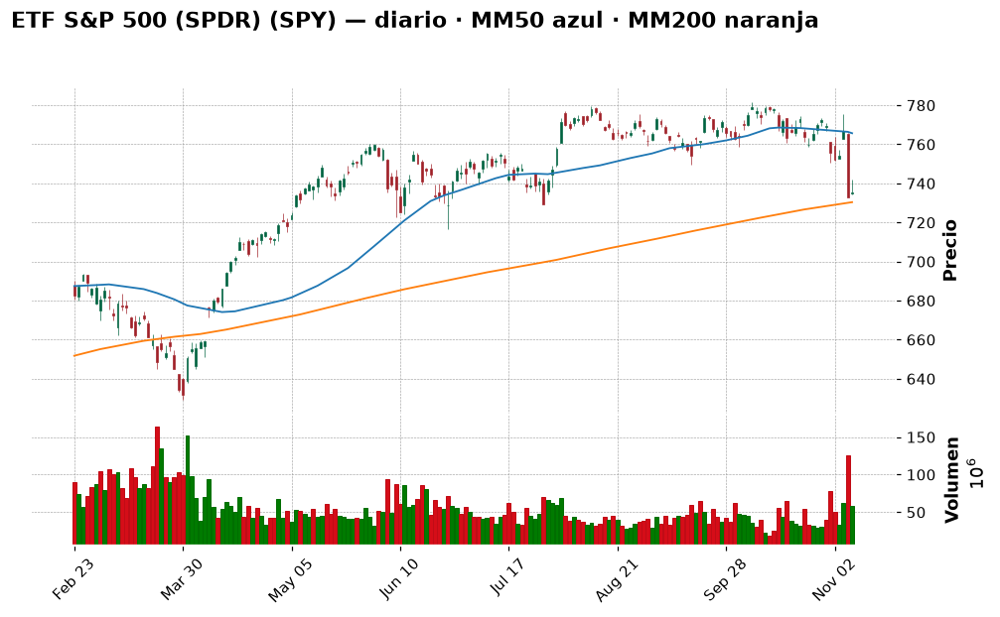
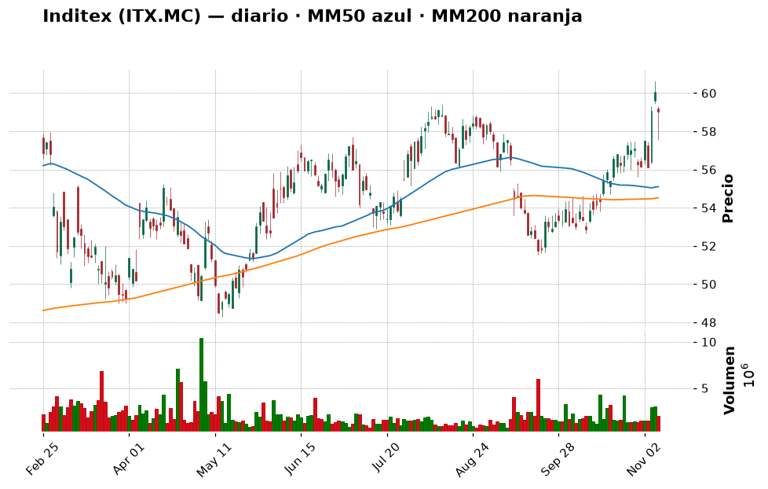
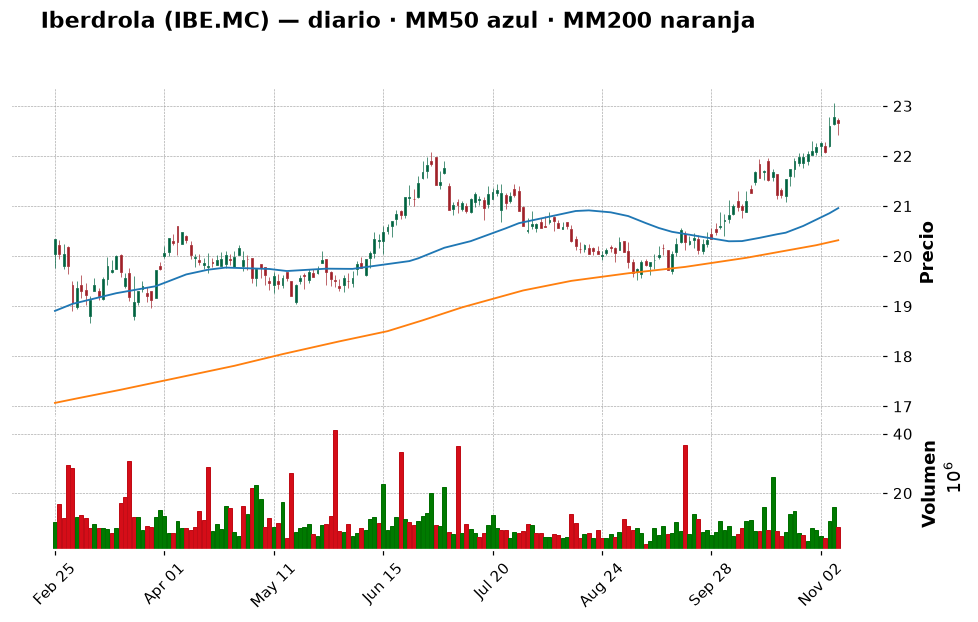
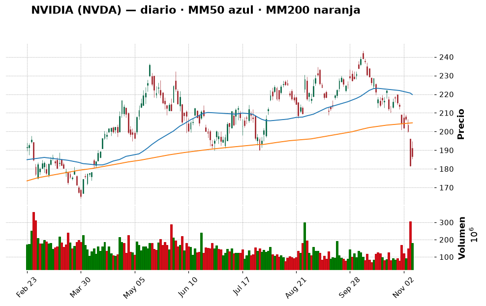
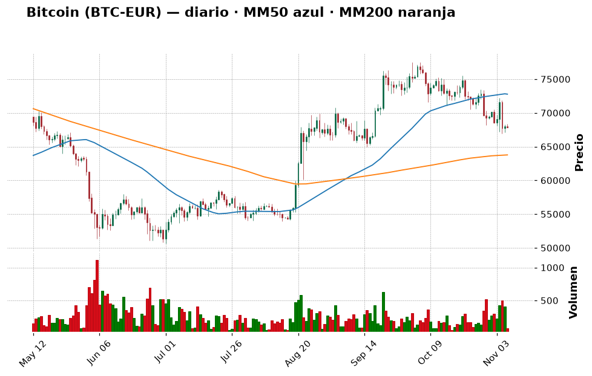
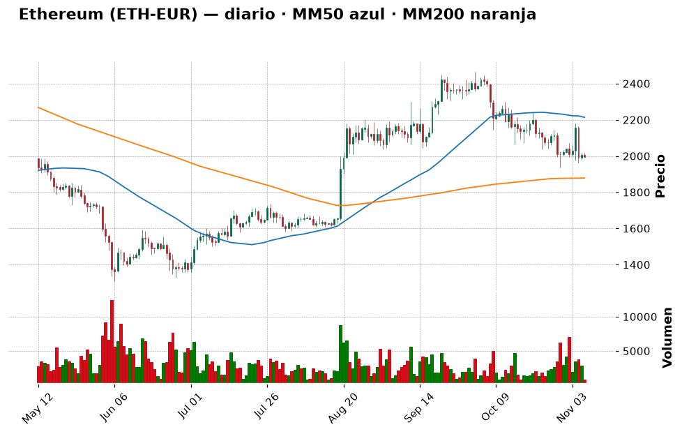

# 📈 Informe pre-apertura — Sábado 7 de noviembre de 2026

> Generado automáticamente a las 22:17 (hora de Madrid) · Bolsa española abre a las 9:00 · Wall Street a las 15:30 · Cripto: 24/7
> ⚙️ *Ejecución de prueba en fin de semana: las bolsas están cerradas hasta el **lunes 9 de noviembre**; los precios de bolsa son el cierre del viernes 6 y las recomendaciones están pensadas para la semana que empieza.*
> **Termómetro del día:** 🟡 prudencia — la Fed podría subir tipos en diciembre, las tecnológicas de IA están en plena corrección y el martes se publica la inflación de EE. UU.
> **Lección de hoy:** La inflación (IPC): qué es y por qué mueve a la bolsa

## 1. Lo que tienes que saber hoy
- **El empleo en EE. UU. salió "demasiado bueno":** en octubre se crearon 165.000 empleos (unas 2,5 veces lo esperado) y el paro bajó al 4,1 %. Parece buena noticia, pero hace más probable que la Reserva Federal **suba** tipos en diciembre (el mercado lo ve al ~77 %), y eso pesa sobre la bolsa.
- **La fiebre de la IA se enfría:** tras la victoria demócrata en las elecciones de mitad de mandato (*midterms*), el mercado teme más regulación (moratorias a centros de datos, chips). El Nasdaq ha caído un 9,6 % en un mes y NVIDIA un 19 %.
- **El martes 10 es el día clave de la semana:** se publica el IPC (inflación) de EE. UU. Si sale alto, refuerza la subida de tipos; si sale moderado, puede dar un respiro. Por eso hoy la palabra es **paciencia** y entrar, si acaso, **en tramos**.

## 2. ✅ Recomendaciones del día (resumen)
| Activo | Acción | Cuánto (orientativo) | Horizonte | Por qué, en una frase | Confianza |
|---|---|---|---|---|---|
| ETF S&P 500 (SPY o equivalente en UCITS) | 🟢 Comprar | Núcleo: hasta 30–40 % de lo que quieras invertir en bolsa, en **3 tramos** (el 1.º tras el IPC del martes) | Años | Está cerca de su media de 200 días, un precio razonable para empezar el núcleo de la cartera | media |
| Inditex (ITX.MC) | 🟢 Comprar | Hasta 4–5 % de la cartera, en **2 tramos** | 2–5 años | Tendencia sana, por encima de sus medias, y empresa sólida | media |
| Iberdrola (IBE.MC) | ⏸️ Esperar | Hasta 5 % cuando retroceda | Años | Gran empresa defensiva, pero ahora está "estirada" (RSI 72) | media |
| NVIDIA (NVDA) | ⛔ Evitar | 0 % por ahora | — | Tendencia rota, ruido político y regulatorio; no es momento para un principiante | media |
| Bitcoin (BTC) | 🟢 Comprar | Empieza con un 2–3 % de la cartera, en 3–4 aportaciones semanales | 3–5 años | "Miedo extremo" y precio sobre su media de 200 días: buen momento para ir entrando poco a poco | baja-media |
| Ether (ETH) | ⏸️ Esperar | 0 % hasta que recupere 2.180 € o aguante en 1.936 € | 3–5 años | Más volátil que bitcoin y con peor impulso ahora mismo | baja |

> Semana para **no hacer movimientos grandes**: empezar (o reforzar) el núcleo indexado poco a poco, sin perseguir rebotes en tecnológicas, y dejar que el IPC del martes y la Fed marquen el paso.

## 3. Agenda del día
| Hora (Madrid) | Evento | Por qué importa |
|---|---|---|
| Sáb.–dom. | Mercados de bolsa cerrados; cripto sigue cotizando | Los movimientos del fin de semana en cripto pueden ser bruscos por el poco volumen |
| Lun. 9, 9:00 | Apertura de la Bolsa española | Primera reacción europea al dato de empleo de EE. UU. y a las tensiones en Irán |
| Mar. 10, 14:30 | **IPC de octubre de EE. UU.** | El dato más importante de la semana: decide en gran parte si la Fed sube tipos en diciembre |
| Mar. 10 y jue. 12 | Huelga de maquinistas de Renfe (servicios mínimos fijados) | Impacto económico limitado, pero es un dato de clima laboral en España |
| 8–9 de diciembre | Reunión de la Fed | Probabilidad de subida de 0,25 puntos ~77 % según los futuros |

## 4. Cómo llegan los mercados
### España y Europa
El **Ibex 35** cerró el viernes en **19.369,5 puntos** (−0,60 % en el día), pero acumula **+3,84 % en la semana** y **+18,2 % en un año**. Está a un 4,85 % de su máximo de 52 semanas (20.356,5). El **Euro Stoxx 50** cerró en 6.170,49 (−0,98 %).
Movimientos de los grandes valores españoles el viernes: todos en rojo pero suave — Inditex −1,7 %, Telefónica −1,83 %, Santander −1,18 %, Repsol −1,03 %. En la semana, los bancos rebotaron con fuerza (BBVA +7,9 %, Santander +5,7 %).
Noticias: Telefónica empieza el apagado de su red 3G, que terminará en 2027 ([Expansión](https://www.expansion.com/empresas/2026/11/07/telefonica-inicia-apagado-red-3g-acabara-2027.html)); en Expansión también analizan qué vigilar de los bancos en cartera ([Expansión](https://www.expansion.com/mercados/2026/11/07/bancos-cartera-pistas-vigilar.html)).

### Estados Unidos
El **S&P 500** cerró en **7.376,86** (+0,31 %), pero pierde un 2,68 % en la semana y un 5 % en el mes. El **Nasdaq** subió un 1,09 % el viernes gracias al rebote de los semiconductores ([Investing.com](https://es.investing.com/analysis/el-rebote-de-los-semiconductores-modero-las-perdidas-de-wall-street-200485468)), aunque cae un 9,61 % en un mes. Como hoy es sábado **no hay futuros pre-apertura** relevantes: la referencia será el domingo por la noche.
Detrás de la caída: la victoria demócrata en las *midterms* ha despertado dudas sobre la IA (posibles moratorias de centros de datos y más vigilancia de los chips) ([Expansión](https://www.expansion.com/elecciones/elecciones-estados-unidos/2026/11/07/victoria-democratas-midterms-desata-temblores-fiebre-ia.html)). Además, según el *Financial Times*, un memorando de inteligencia de EE. UU. relaciona al consejero delegado de NVIDIA con una supuesta espía china; son acusaciones no confirmadas, pero suman ruido ([Investing.com](https://www.investing.com/news/stock-market-news/us-intelligence-memo-ties-nvidias-huang-to-alleged-chinese-spy-ft-reports-5009930)).

### Macro (tipos de interés, inflación, divisas, materias primas)
- **Fed (EE. UU.):** tipos en 3,75–4,00 %. Tras el dato de empleo, la probabilidad de **subida** en diciembre pasó del 67 % al 77 %, y la presidenta de la Fed de San Francisco, Mary Daly, dijo que probablemente habrá que "endurecer más" ([24/7 Wall St.](https://247wallst.com/investing/2026/11/07/odds-of-a-december-rate-hike-jump-to-77-after-a-blowout-jobs-report/)). La rentabilidad del bono a 2 años subió a 4,51 %.
  💡 *"Endurecer" significa subir tipos para enfriar la economía y frenar los precios.*
- **BCE (Europa):** Lagarde dice que la inflación seguirá alta "en los próximos trimestres" (la general está en torno al doble del objetivo del 2 % por la energía) y que no ve motivos para cambiar el rumbo; el tipo de depósito está en 2,50 % y en diciembre podría llegar la tercera subida del ciclo ([Investing.com](https://www.investing.com/news/economy-news/ecbs-lagarde-says-inflation-to-stay-high-sees-little-reason-to-alter-rate-course-5009950)).
- **Petróleo:** el Brent está en torno a **98 $/barril**, con una fuerte caída semanal (Yahoo Finance muestra −16 % en 5 días) por los avances en las conversaciones con Irán, aunque el fin de semana ha habido explosiones en la isla de Qeshm y ataques a petroleros en Ormuz ([Investing.com](https://www.investing.com/news/economy-news/trump-signals-iran-peace-progress-as-hormuz-attacks-threaten-talks-5009635)). Un petróleo más barato ayuda a bajar la inflación… si la paz se consolida.
- **Euro/dólar:** 1,1143 $ por euro, cerca del mínimo de 52 semanas (1,1110). 💡 *Un dólar fuerte hace que tus inversiones en EE. UU. valgan algo más en euros, y al revés.*

## 5. Panorama técnico de la watchlist
> 💡 *Cómo leer esta tabla:* la **tendencia** resume si el precio lleva meses subiendo, bajando o de lado
> (comparando el precio con sus medias de 50 y 200 días). El **RSI** mide de 0 a 100 si las subidas o bajadas
> recientes han sido muy fuertes: por encima de 70 se dice "sobrecompra" (quizá ha subido demasiado rápido),
> por debajo de 30 "sobreventa". Son pistas, no predicciones.

| Valor | Último cierre | Día | 1 mes | 1 año | Tendencia | RSI | vs MM200 |
|---|---|---|---|---|---|---|---|
| IBEX 35 (^IBEX) | 19.369,5 | −0,60 % | +2,33 % | +18,19 % | ➡️ lateral | 53,8 🟡 | +3,5 % |
| Euro Stoxx 50 | 6.170,49 | −0,98 % | +0,71 % | +9,02 % | ➡️ lateral | 48,1 🟡 | +0,9 % |
| S&P 500 (^GSPC) | 7.376,86 | +0,31 % | −5,00 % | +8,54 % | ➡️ lateral | 35,1 🟡 | +0,7 % |
| Nasdaq Composite | 24.579,43 | +1,09 % | −9,61 % | +4,59 % | ➡️ lateral | 33,9 🟡 | −2,1 % |
| Santander (SAN.MC) | 10,70 | −1,18 % | −10,19 % | +14,90 % | ➡️ lateral | 38,8 🟡 | −5,2 % |
| BBVA (BBVA.MC) | 22,73 | −0,74 % | −1,26 % | +22,57 % | ➡️ lateral | 48,7 🟡 | +5,7 % |
| Inditex (ITX.MC) | 59,04 | −1,70 % | +11,73 % | +18,48 % | ➡️ lateral | 62,8 🟡 | +8,3 % |
| Iberdrola (IBE.MC) | 22,65 | −0,53 % | +7,30 % | +27,79 % | 📈 alcista | 72,1 🔴 | +11,5 % |
| Telefónica (TEF.MC) | 3,38 | −1,83 % | −0,70 % | −7,84 % | 📉 bajista | 50,0 🟡 | −7,3 % |
| Repsol (REP.MC) | 29,90 | −1,03 % | −0,63 % | +77,50 % | 📈 alcista | 52,6 🟡 | +23,9 % |
| Apple (AAPL) | 342,37 | −0,52 % | +0,57 % | +26,74 % | 📈 alcista | 51,5 🟡 | +14,6 % |
| Microsoft (MSFT) | 530,61 | −0,99 % | +1,53 % | +4,62 % | 📈 alcista | 52,1 🟡 | +20,6 % |
| NVIDIA (NVDA) | 186,64 | +2,78 % | −19,02 % | −4,39 % | ➡️ lateral | 30,8 🟡 | −8,8 % |
| Amazon (AMZN) | 259,30 | −0,35 % | +2,06 % | +3,64 % | ➡️ lateral | 54,2 🟡 | +6,3 % |
| ETF S&P 500 (SPY) | 735,29 | +0,31 % | −4,99 % | +8,52 % | ➡️ lateral | 35,1 🟡 | +0,7 % |
| ETF Nasdaq 100 (QQQ) | 656,10 | +1,40 % | −12,24 % | +5,27 % | ➡️ lateral | 31,4 🟡 | −3,6 % |

La foto es la de un mercado **cansado pero no roto**: los grandes índices siguen por encima (o muy cerca) de su media de 200 días, que es la "línea de fondo" de la tendencia de largo plazo. Lo que está castigado es la tecnología ligada a la IA (NVIDIA, Nasdaq, QQQ, con RSI cerca de 30). En España, la parte "estirada" es Iberdrola (sobrecompra) y lo más fuerte del último año ha sido Repsol (+77 %), impulsada por el petróleo.

## 6. Ideas de bolsa: qué haría un experto
### ETF S&P 500 (SPY) — COMPRAR (en tramos)

- **Qué es:** un fondo que cotiza en bolsa (ETF) y replica las 500 mayores empresas de EE. UU. Con una sola compra tienes un trozo de todas. 💡 *Desde España, lo habitual es comprar la versión europea "UCITS" de un ETF del S&P 500 (de Vanguard, iShares, etc.), que hace lo mismo.*
- **Por qué es noticia hoy:** el índice cae un 5 % en un mes por la corrección de la IA y el miedo a subidas de tipos ([24/7 Wall St.](https://247wallst.com/investing/2026/11/07/odds-of-a-december-rate-hike-jump-to-77-after-a-blowout-jobs-report/)).
- **Lo que dice el gráfico:** desde abril subía de forma ordenada (velas por encima de la línea azul, MM50). En las últimas semanas ha caído por debajo de la MM50 (−4 %) y se ha acercado a la línea naranja (MM200, 730,38), que está **solo un 0,7 % por debajo**. El soporte más cercano está en 729,1. El RSI es 35: ha bajado con fuerza, pero aún no está en "sobreventa".
- **Lo positivo:** compras 500 empresas un 5,9 % más baratas que en su máximo de 52 semanas, y la economía de EE. UU. sigue creando empleo.
- **El riesgo:** si el IPC sale alto y la Fed sube tipos, el índice podría perder la MM200 y caer hacia 716–722; el peso de la tecnología en el índice es alto.
- **🧑‍💼 Recomendación: COMPRAR en 3 tramos.** Para un inversor moderado, el núcleo de la cartera debería ser un ETF indexado, y estar cerca de la media de 200 días es un punto razonable para **empezar**. Pero como el martes hay un dato que puede mover mucho, no entraría de golpe.
  - **Cuánto y cómo:** hasta un 30–40 % de lo que destines a bolsa, dividido en 3 partes: la 1.ª tras el IPC del martes, la 2.ª en 2–3 semanas (o si cae hacia 716–722) y la 3.ª después de la Fed de diciembre.
  - **Horizonte:** años (5 o más).
  - **Qué me haría cambiar de opinión:** un cierre semanal por debajo de 716 retrasaría los tramos 2 y 3 (no vendería lo comprado: es un núcleo de largo plazo).
- **Qué mirar para entenderlo:** en el gráfico, si las velas se mantienen sobre la línea naranja. Por arriba, recuperar 742–756 indicaría que el susto pasa.
- **Confianza:** media

### Inditex (ITX.MC) — COMPRAR (pequeño, en 2 tramos)

- **Qué es:** la dueña de Zara, Massimo Dutti, Pull&Bear… Una de las mayores empresas del Ibex, conocida por su solidez financiera.
- **Por qué es noticia hoy:** no hay una noticia concreta de la empresa; destaca por fuerza relativa: +11,7 % en un mes mientras Wall Street caía.
- **Lo que dice el gráfico:** cotiza a 59,04 €, un 7 % sobre su MM50 y un 8 % sobre su MM200: tendencia de fondo positiva. Está a solo un 2,6 % de su máximo de 52 semanas (60,64) y tiene una resistencia en 59,42. RSI 62,8: fuerte, sin llegar a sobrecompra. Soportes en 56,2 y 55,6.
- **Lo positivo:** negocio de calidad, global y con dividendo; aguanta bien cuando la tecnología sufre.
- **El riesgo:** está cerca de máximos, así que puede tomarse un respiro; el consumo puede resentirse si los tipos siguen subiendo; competencia de Shein (que acaba de invertir 500 millones en logística en Polonia ([Expansión](https://www.expansion.com/empresas/distribucion/2026/11/06/shein-refuerza-hub-logistico-polaco-500-millones.html))).
- **🧑‍💼 Recomendación: COMPRAR, poco y en 2 tramos.** Es el tipo de gran empresa estable que encaja con tu perfil y su tendencia es sana. Para no comprar todo justo en el techo, la mitad ahora y la otra mitad en un retroceso.
  - **Cuánto y cómo:** hasta un 4–5 % de la cartera en total: 1.er tramo el lunes/martes; 2.º si baja a la zona 56–56,5 € o si supera con claridad 60,64 € (nuevo máximo).
  - **Horizonte:** 2–5 años.
  - **Qué me haría cambiar de opinión:** un cierre por debajo de 54,5 € (su MM200) indicaría que la tendencia se ha roto.
- **Qué mirar para entenderlo:** si rompe el máximo de 60,64 con volumen alto (confirmación) o si rebota en 56 (el soporte funciona).
- **Confianza:** media

### Iberdrola (IBE.MC) — ESPERAR

- **Qué es:** la mayor eléctrica española, con mucho negocio de redes y renovables en EE. UU. y Reino Unido. Sector **defensivo** 💡 *(la gente sigue pagando la luz aunque la economía vaya mal).*
- **Por qué es noticia hoy:** es la única gran española en tendencia claramente alcista (+27,8 % en un año).
- **Lo que dice el gráfico:** escalera ascendente de libro, con las velas muy por encima de ambas medias (+8 % sobre MM50, +11,5 % sobre MM200), a un 1,8 % de su máximo de 52 semanas. Pero el **RSI es 72: sobrecompra**, y el MACD indica que el impulso empieza a frenar ("empeorando").
- **Lo positivo:** estable, buen dividendo, poca volatilidad (16 % anual, la menor de la lista).
- **El riesgo:** las eléctricas se comportan un poco como los bonos: si los tipos suben, pierden atractivo. Comprar ahora es pagar el precio más alto del año.
- **🧑‍💼 Recomendación: ESPERAR.** Me gusta la empresa, no el precio. Esperaría a que el RSI baje de 60 o a que el precio retroceda hacia la MM20 (21,9 €) o el soporte de 21,1 €.
  - **Cuánto y cómo:** cuando llegue, hasta un 5 % de la cartera en 2 tramos.
  - **Horizonte:** años.
  - **Qué me haría cambiar de opinión:** si el BCE y la Fed dejan de subir tipos, podría comprar antes, aunque fuera a un precio algo mayor.
- **Qué mirar para entenderlo:** el RSI (cuando vuelva a la zona 50–60, la "fiebre" habrá bajado) y la distancia a la MM50 (20,96).
- **Confianza:** media

### NVIDIA (NVDA) — EVITAR

- **Qué es:** el gran fabricante de chips para inteligencia artificial.
- **Por qué es noticia hoy:** acumula −19 % en un mes. Al miedo a una burbuja de la IA y a un Washington más hostil tras las elecciones se suma el memorando sobre su consejero delegado publicado por el *FT* (no confirmado) ([Investing.com](https://www.investing.com/news/stock-market-news/us-intelligence-memo-ties-nvidias-huang-to-alleged-chinese-spy-ft-reports-5009930); [Cointelegraph](https://cointelegraph.com/news/nvidia-may-be-facing-a-more-hostile-post-election-washington-report)).
- **Lo que dice el gráfico:** el precio (186,64 $) ha caído por debajo de la MM200 (−8,8 %) y de la MM50 (−15 %), y el volumen del viernes fue un 53 % superior a la media: hay mucha gente vendiendo. El RSI es 30,8, rozando la sobreventa. El rebote del viernes (+2,8 %) es, de momento, solo eso: un rebote.
- **Lo positivo:** sigue siendo una empresa líder y muy rentable; está a un 23 % de su máximo.
- **El riesgo:** volatilidad muy alta (46,6 % anual), riesgo político y regulatorio difícil de medir. 💡 *Intentar comprar en el punto más bajo de una caída se llama "intentar coger un cuchillo que cae".*
- **🧑‍💼 Recomendación: EVITAR por ahora.** No es momento para un principiante: tendencia rota, noticias negativas y mucha volatilidad. Si ya tienes un ETF del S&P 500, ya tienes NVIDIA dentro.
  - **Qué me haría cambiar de opinión:** que recupere la MM200 (~205 $) y aclare la situación regulatoria; entonces, como mucho un 2–3 % de la cartera.
- **Qué mirar para entenderlo:** si el volumen de venta se calma y el precio deja de marcar mínimos más bajos.
- **Confianza:** media

## 7. ₿ Criptomonedas
> 💡 *Las criptomonedas cotizan 24 horas, 7 días a la semana: los precios son de esta mañana (en euros).
> Son mucho más volátiles que las acciones: caídas del 50 % o más han ocurrido varias veces.*

**Sentimiento:** Fear & Greed **25/100 (miedo extremo**; ayer 28, hace una semana 30) · Capitalización total 2,65 billones $ (−0,52 % 24 h, **44,96 % bajo su máximo histórico** de octubre de 2025) · Dominancia de Bitcoin 57,24 %.
El mercado cripto lleva un año malo y el ánimo está por los suelos: el hackeo récord a Binance (6.300 millones de dólares, el 29 de octubre) ([News Tribune](https://www.newstribune.com/news/2026/nov/02/binance-seeks-to-shore-up-confidence-after-record-63-billion-heist/)), la caída de la tecnología y salidas de unos 430 millones de los ETF de bitcoin ([CoinDesk](https://www.coindesk.com/markets)). 💡 *Históricamente, el "miedo extremo" ha coincidido más con buenas zonas de compra a largo plazo que con malas, pero no indica el suelo exacto.*

**Radar Coinbase** (410 monedas comprables · hoy suben 55 y bajan 290 · en 7 días suben 48 y bajan 296):
- **Mayores por capitalización:** BTC (−2,7 % en 7 d), ETH (−1,7 %), BNB (−1,2 %), XRP (−8,1 %), SOL (−7,5 %), DOGE (−6,3 %).
- **Más suben (7 d, top 100):** INJ (+12,1 %), STX (+5,0 %), PAXG (+4,3 %, ⚠️ es un token de oro, no una cripto "de crecimiento") · **Más bajan:** NEAR (−18,2 %), ENA (−17,9 %), WLD (−17,3 %).
La caída es **general** (casi 6 de cada 7 monedas bajan en la semana). Las pocas que suben son pequeñas (INJ es la n.º 93): una subida aislada en un mercado bajista no es motivo para comprar; el riesgo de llegar tarde es alto.

| Moneda | Ranking | Precio (€) | 24 h | 7 días | 1 mes | 1 año | Tendencia | RSI | vs MM200 |
|---|---|---|---|---|---|---|---|---|---|
| Bitcoin (BTC) | #1 | 67.818,53 | −0,24 % | −2,32 % | −6,94 % | −24,04 % | ➡️ lateral | 39,0 | +6,4 % |
| Ether (ETH) | #2 | 1.996,77 | −0,51 % | −1,14 % | −9,59 % | −32,73 % | ➡️ lateral | 40,1 | +6,3 % |
| XRP (XRP) | #5 | 1,04 | −2,05 % | −7,52 % | −15,87 % | −48,32 % | ➡️ lateral | 31,7 | −6,7 % |
| Solana (SOL) | #7 | 79,67 | −1,41 % | −6,75 % | −18,39 % | −43,04 % | ➡️ lateral | 30,8 | +2,7 % |

**Noticias que importan:**
- **EE. UU. aprieta a los exchanges:** el Tesoro quiere cortar el acceso de MEXC al sistema financiero por 16.000 millones en supuestos flujos ilícitos ([CoinDesk](https://www.coindesk.com/business/2026/11/07/u-s-treasury-moves-to-cut-off-crypto-exchange-mexc-over-usd16-billion-in-alleged-illicit-flows)). Recordatorio de por qué conviene usar exchanges grandes y regulados (como Coinbase).
- **Binance cerrará cuentas en algunos países europeos a final de año** y pide a los usuarios retirar sus fondos ([CoinDesk](https://www.coindesk.com/business/2026/11/07/binance-users-in-some-european-countries-told-to-pull-crypto-before-fees-kick-in-with-accounts-closing-by-year-end)); su director financiero dimitió tras el hackeo ([Investing.com](https://www.investing.com/news/stock-market-news/binance-cfo-exits-days-after-catastrophic-6-billion-crypto-hack-5009968)).
- **Regulación:** con el Congreso en manos demócratas, el mercado ve más difícil que avance la ley cripto en EE. UU. ([CoinDesk](https://www.coindesk.com/markets)).

### Bitcoin (BTC) — COMPRAR (en tramos pequeños)

- **Qué es:** la primera y mayor criptomoneda; su oferta máxima está limitada a 21 millones de unidades.
- **Lo que dice el gráfico:** a 67.818 € está un 27 % por debajo de su máximo de 52 semanas, pero **aún un 6,4 % por encima de su MM200**: el fondo de largo plazo no se ha roto. Ha perdido la MM50 (−6,8 %). Soportes en 65.898 € y 64.918 €; resistencia en 69.923 €. RSI 39 y MACD "mejorando": la presión vendedora se está aflojando.
- **🧑‍💼 Recomendación: COMPRAR en tramos pequeños.** Con miedo extremo, precio sobre la MM200 y el resto del mercado cripto peor que bitcoin, es la forma más "sensata" de tener cripto. Pero solo mediante aportaciones periódicas: nadie sabe si el suelo está aquí o un 20 % más abajo.
  - **Cuánto y cómo:** empieza con un **2–3 % de la cartera**, repartido en 3–4 compras semanales en el par **BTC-EUR** de Coinbase. Tu tope es el 25 %, pero para un perfil moderado es **un porcentaje alto**: bitcoin ha caído un 50–80 % varias veces. Yo no pasaría del 5–10 % en total.
  - **Qué me haría cambiar de opinión:** un cierre diario por debajo de 64.900 € (y, sobre todo, perder la MM200) pausaría las compras.
- **El riesgo:** más hackeos o quiebras de exchanges, salidas de los ETF y una Fed más dura.
- **Confianza:** baja-media

### Ether (ETH) — ESPERAR

- **Qué es:** la moneda de la red Ethereum, en la que funcionan los "contratos inteligentes" (programas que se ejecutan solos).
- **Lo que dice el gráfico:** 1.996,77 €, un 6,3 % sobre la MM200 pero un 9,8 % bajo la MM50 y un 37 % bajo su máximo de 52 semanas. Volatilidad del 52,7 % (más que bitcoin) y MACD "empeorando". Soporte clave en 1.936 €; el siguiente está mucho más abajo (1.607 €).
- **🧑‍💼 Recomendación: ESPERAR.** Si el soporte de 1.936 € cede, el siguiente apoyo queda un 17 % más abajo. Prefiero ver una de dos cosas: que recupere los 2.180 € (resistencia) o que aguante varias semanas sobre 1.936 €.
  - **Cuánto y cómo:** cuando se dé la señal, la mitad de lo que pongas en bitcoin, en tramos (par ETH-EUR).
  - **Qué me haría cambiar de opinión:** un cierre semanal sobre 2.200 €.
- **El riesgo:** caídas mucho más fuertes que bitcoin en mercados bajistas.
- **Confianza:** baja

*Monedas del radar como INJ (+12 % en 7 días, n.º 93) o las que más caen (NEAR, ENA, WLD): ⛔ **Evitar**. Las pequeñas suben y bajan con violencia, y no hay ninguna noticia sólida que justifique entrar.*

## 8. 💼 Tu cartera
Aún no has registrado movimientos en `inputs/cartera.csv`; las recomendaciones son genéricas. Cuando apuntes tus compras (fecha, activo, cantidad, precio…), el informe te dirá qué hacer con cada posición, su ganancia o pérdida y si te pasas del tope de cripto.

Una propuesta de **estructura de partida** para un perfil moderado (orientativa): **60–70 % en ETF indexados** (S&P 500 y un ETF global o europeo) · **20–30 % en 4–6 grandes empresas** (ninguna por encima del 10 %) · **5–10 % en cripto** (sobre todo bitcoin), muy por debajo de tu tope del 25 % · y siempre un colchón de emergencia **fuera** de la bolsa.

## 9. Análisis de riesgo
| Riesgo | Nivel | Explicación |
|---|---|---|
| IPC de EE. UU. (mar. 10) | 🔴 | Un dato alto casi aseguraría la subida de la Fed en diciembre |
| Corrección de la IA / tecnología | 🟡 | El Nasdaq ya cae un 9,6 % en un mes; si sigue, arrastra al S&P 500 |
| Irán y petróleo | 🟡 | Las conversaciones avanzan, pero hay ataques en Ormuz; un repunte del crudo reavivaría la inflación |
| Subidas del BCE | 🟡 | Encarecen las hipotecas y pesan sobre eléctricas e inmobiliarias; ayudan a los bancos |
| Cripto: hackeos y regulación | 🔴 | Hackeo récord de Binance, sanciones a MEXC y menos apoyo político en EE. UU. |

**Qué podría salir mal esta semana:** un IPC alto el martes, junto a nuevas caídas de las tecnológicas, podría llevar al S&P 500 por debajo de su MM200 (730) y hacia 716–722. En ese escenario, retrasaría el 2.º tramo del ETF y pausaría las compras de bitcoin, sin vender lo ya comprado.

## 10. 🎓 Aprende con el informe de hoy: la inflación (IPC)
- **Qué es (en una frase):** el IPC (Índice de Precios de Consumo) mide cuánto sube, de media, el precio de una "cesta" de cosas que compra una familia (comida, luz, alquiler, gasolina…); su variación anual es la **inflación**.
- **Ejemplo con números:** si la cesta costaba 1.000 € hace un año y hoy cuesta 1.037 €, la inflación es del 3,7 % (el último IPC publicado en EE. UU., el de septiembre, fue justo 3,7 %). Con 10.000 € en una cuenta al 0 %, has perdido unos 370 € de poder de compra sin darte cuenta.
- **Dónde lo has visto hoy:** en las secciones 1, 3 y 4. El IPC de octubre se publica el martes, la Fed y el BCE suben tipos para frenarlo y el petróleo es una de sus principales causas.
- **Por qué te importa como inversor:** inflación alta → los bancos centrales suben tipos → los bonos y depósitos pagan más y las acciones (sobre todo las tecnológicas) pierden atractivo. Por eso un solo dato puede mover un índice un 2 % en un día. También explica por qué no conviene dejar todo el dinero parado: la inflación lo va erosionando.
- **Error típico de principiante:** pensar que "la inflación baja" significa que los precios bajan. No: significa que **suben más despacio**. Otro error: comprar o vender todo el día del dato; la reacción del primer día suele exagerarse.
- **Pregunta para pensar:** si el martes el IPC de EE. UU. sale **por debajo** de lo esperado, ¿qué crees que pasará con la probabilidad de que la Fed suba tipos en diciembre y con el ETF del S&P 500?

## 11. Consejo del día para inversores principiantes
**No intentes adivinar el suelo: divide tus compras.** Esta semana tienes un dato capaz de mover el mercado (IPC), una Fed que puede subir tipos y un sector (IA) en plena corrección. Nadie sabe si los precios del viernes serán los más bajos del mes o los más altos. Si repartes tu compra en 3 tramos, en el peor caso habrás comprado un tercio "caro", y en el mejor habrás aprovechado las caídas. Ese método (aportaciones periódicas, o **DCA**) es la mejor defensa contra el pánico y contra el FOMO 💡 *(miedo a quedarse fuera de una subida).*

## 12. Glosario
- **ETF:** fondo que cotiza en bolsa como una acción y replica un índice (p. ej. el S&P 500).
- **UCITS:** etiqueta europea de fondos regulados; es la versión de ETF que puede comprar un inversor minorista en España.
- **Media móvil (MM50 / MM200):** precio medio de los últimos 50 o 200 días; la de 200 marca la tendencia de largo plazo.
- **RSI:** indicador de 0 a 100 que mide la fuerza de las últimas subidas o bajadas; >70 sobrecompra, <30 sobreventa.
- **MACD:** indicador que compara dos medias para ver si el impulso del precio acelera o frena.
- **Soporte / resistencia:** precios donde antes el valor dejó de caer (soporte) o de subir (resistencia).
- **Volatilidad:** cuánto oscila el precio; a mayor volatilidad, más riesgo y más sustos.
- **Sector defensivo:** empresas cuya demanda apenas cae en las crisis (eléctricas, alimentación, salud).
- **IPC / inflación:** índice de precios de consumo y su subida anual.
- **Fed / BCE:** bancos centrales de EE. UU. y de la zona euro; fijan el precio del dinero (tipos de interés).
- **Fear & Greed:** índice de 0 a 100 que mide el miedo o la codicia del mercado cripto.
- **Dominancia de Bitcoin:** porcentaje del valor total del mercado cripto que corresponde a bitcoin.
- **DCA (aportaciones periódicas):** invertir la misma cantidad cada cierto tiempo, sin intentar adivinar el mejor momento.
- **Midterms:** elecciones legislativas de mitad de mandato en EE. UU.

## 13. Fuentes
- 24/7 Wall St. — [Odds of a December Rate Hike Jump to 77% After a Blowout Jobs Report](https://247wallst.com/investing/2026/11/07/odds-of-a-december-rate-hike-jump-to-77-after-a-blowout-jobs-report/)
- Investing.com — [ECB's Lagarde says inflation to stay high, sees little reason to alter rate course](https://www.investing.com/news/economy-news/ecbs-lagarde-says-inflation-to-stay-high-sees-little-reason-to-alter-rate-course-5009950)
- Investing.com — [Trump cites progress in Iran talks as fresh explosions hit Qeshm Island](https://www.investing.com/news/economy-news/trump-signals-iran-peace-progress-as-hormuz-attacks-threaten-talks-5009635)
- Investing.com — [U.S. memo alleges Nvidia's CEO was romantically linked to suspected Beijing spy](https://www.investing.com/news/stock-market-news/us-intelligence-memo-ties-nvidias-huang-to-alleged-chinese-spy-ft-reports-5009930)
- Investing.com — [Binance CFO exits days after catastrophic $6 billion crypto hack](https://www.investing.com/news/stock-market-news/binance-cfo-exits-days-after-catastrophic-6-billion-crypto-hack-5009968)
- Investing.com ES — [El rebote de los semiconductores moderó las pérdidas de Wall Street](https://es.investing.com/analysis/el-rebote-de-los-semiconductores-modero-las-perdidas-de-wall-street-200485468)
- Expansión — [La victoria de los demócratas en las 'midterms' desata temblores en la fiebre de la IA](https://www.expansion.com/elecciones/elecciones-estados-unidos/2026/11/07/victoria-democratas-midterms-desata-temblores-fiebre-ia.html)
- Expansión — [Telefónica inicia el apagado de la red 3G, que acabará en 2027](https://www.expansion.com/empresas/2026/11/07/telefonica-inicia-apagado-red-3g-acabara-2027.html)
- Expansión — [Bancos en la cartera: pistas para vigilar](https://www.expansion.com/mercados/2026/11/07/bancos-cartera-pistas-vigilar.html)
- Expansión — [Shein refuerza su 'hub' logístico polaco con 500 millones](https://www.expansion.com/empresas/distribucion/2026/11/06/shein-refuerza-hub-logistico-polaco-500-millones.html)
- Europa Press — [Servicios mínimos en Renfe para la huelga de maquinistas del 10 y 12 de noviembre](https://www.europapress.es/economia/transportes-00343/noticia-transportes-fija-servicios-minimos-renfe-huelga-maquinistas-10-12-noviembre-20261107204525.html)
- CoinDesk — [Mercados cripto](https://www.coindesk.com/markets) · [U.S. Treasury moves to cut off crypto exchange MEXC](https://www.coindesk.com/business/2026/11/07/u-s-treasury-moves-to-cut-off-crypto-exchange-mexc-over-usd16-billion-in-alleged-illicit-flows) · [Binance users in some European countries told to pull crypto](https://www.coindesk.com/business/2026/11/07/binance-users-in-some-european-countries-told-to-pull-crypto-before-fees-kick-in-with-accounts-closing-by-year-end)
- News Tribune (Reuters) — [Binance seeks to shore up confidence after record $6.3 billion heist](https://www.newstribune.com/news/2026/nov/02/binance-seeks-to-shore-up-confidence-after-record-63-billion-heist/)
- Cointelegraph — [Nvidia may face a more hostile post-election Washington](https://cointelegraph.com/news/nvidia-may-be-facing-a-more-hostile-post-election-washington-report)
- Calendario del IPC: [Thrive in Markets](https://thriveinmarkets.com/es/calendar/dates/cpi-2026/) · [SimianX](https://www.simianx.ai/es/stories/us-cpi-report-latest-inflation-data-and-release-schedule)
- Yahoo Finance — [Brent](https://finance.yahoo.com/quote/BZ=F/) · [EUR/USD](https://finance.yahoo.com/quote/EURUSD=X/)
- Precios e indicadores de bolsa: Yahoo Finance (velas diarias, último cierre disponible)
- Cripto: Coinbase (universo de monedas y velas diarias) · Coinpaprika (datos de mercado) · Fear & Greed (alternative.me)
- **Fuentes que fallaron hoy:** expansion.com (portada de mercados, bloqueo a la descarga automática) y cincodias.elpais.com (artículo de opinión, bloqueado). No se consultaron futuros pre-apertura porque las bolsas están cerradas en fin de semana.

---
**Respuesta a la pregunta del día:** un IPC más bajo de lo esperado indicaría que la inflación se está frenando, así que la Fed tendría menos motivos para subir tipos: la probabilidad de subida en diciembre (hoy ~77 %) **bajaría**. Normalmente eso es **bueno para el S&P 500**, sobre todo para las tecnológicas, porque el dinero sería más barato de lo temido. Ojo: es una tendencia habitual, no una ley; otras noticias (Irán, la IA) también pesan.

*Este informe lo genera automáticamente una IA a partir de noticias y datos de precios públicos y de los
movimientos que has registrado. Las recomendaciones son la opinión razonada de un modelo, no
asesoramiento financiero personalizado ni regulado: no conoce toda tu situación (ingresos, deudas,
objetivos, fiscalidad). El análisis técnico es orientativo y no predice el futuro. Invertir conlleva riesgo
de pérdida, y en criptomonedas ese riesgo es muy alto. Decide tú, contrasta la información y, si lo
necesitas, consulta con un profesional.*
