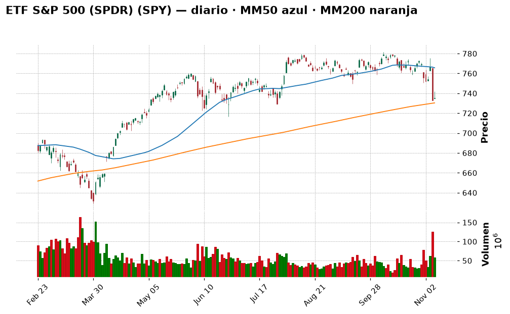
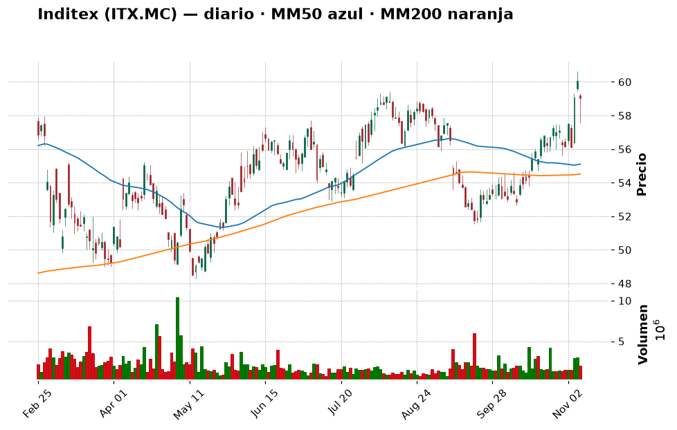
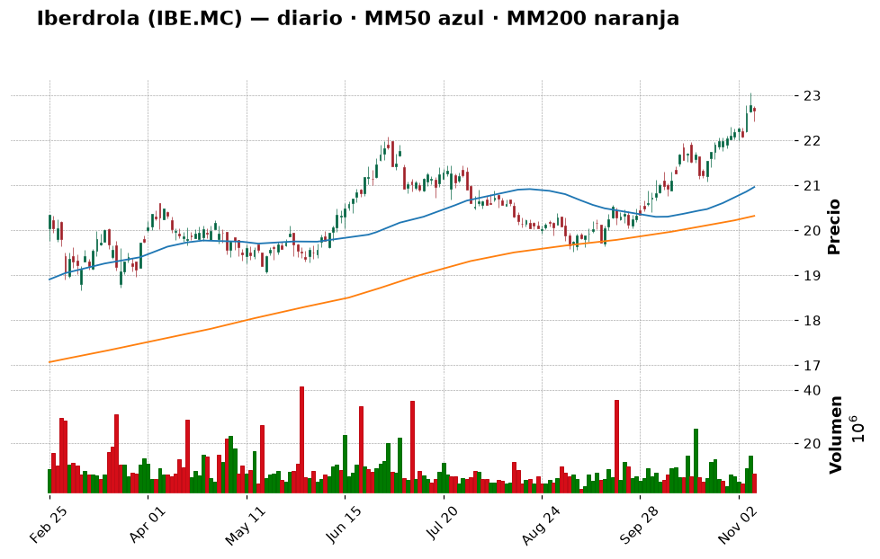
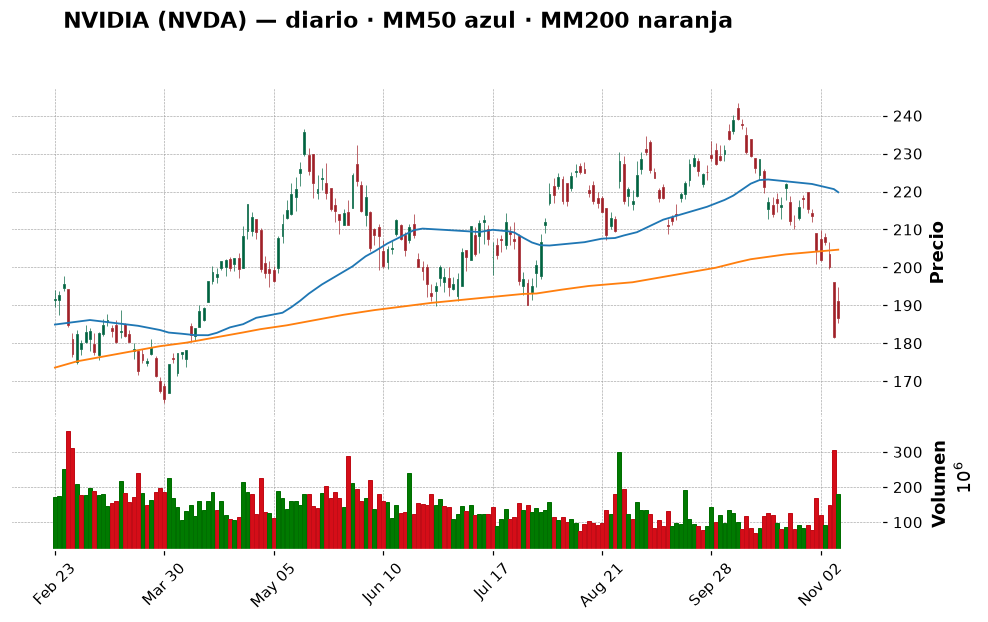
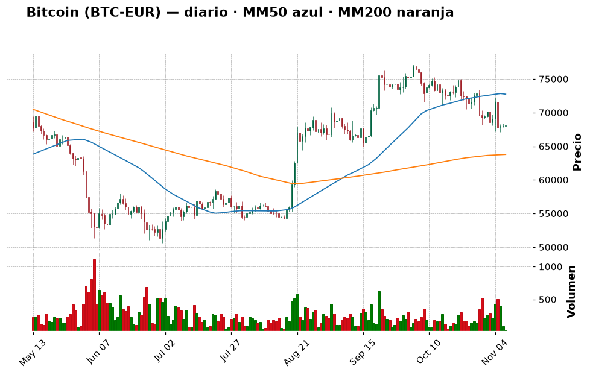
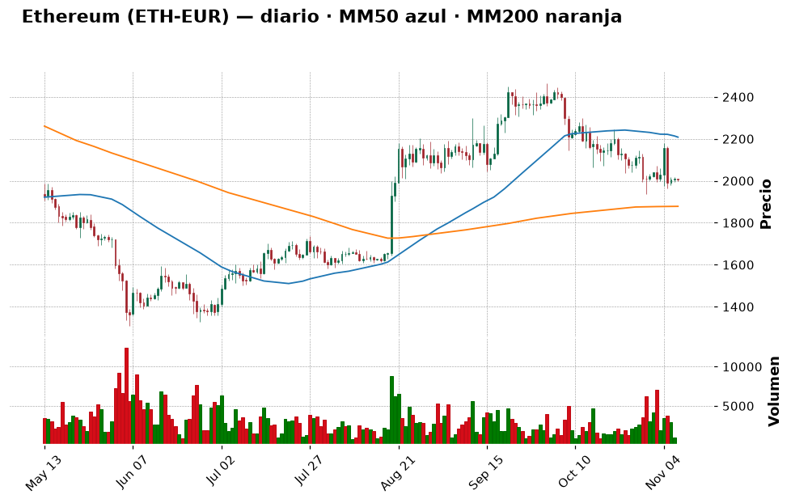

# 📈 Informe pre-apertura — Domingo 8 de noviembre de 2026

> Generado automáticamente a las 11:00 (hora de Madrid) · Bolsa española abre a las 9:00 · Wall Street a las 15:30 · Cripto: 24/7
> ⚙️ *Ejecución de prueba en domingo: las bolsas están cerradas hasta el **lunes 9 de noviembre**. Los precios de bolsa son el cierre del viernes 6 y las recomendaciones valen para la semana que empieza.*
> **Termómetro del día:** 🟡 prudencia — la Fed podría subir tipos en diciembre, la IA corrige y el martes llega la inflación de EE. UU.
> **Lección de hoy:** El RSI: sobrecompra y sobreventa

## 1. Lo que tienes que saber hoy
- **La semana pasada fue mala en Wall Street:** el S&P 500 tuvo [su peor semana desde la crisis arancelaria de abril de 2025](https://247wallst.com/investing/2026/11/07/the-sp-500-just-had-its-worst-week-since-the-april-2025-tariff-crash/). Su índice cae un 5 % en un mes y el Nasdaq un 9,6 %.
- **Los tipos podrían subir:** tras un informe de empleo mucho más fuerte de lo esperado, [la probabilidad de una subida de tipos de la Fed en diciembre ronda el 77 %](https://247wallst.com/investing/2026/11/07/odds-of-a-december-rate-hike-jump-to-77-after-a-blowout-jobs-report/). Tipos más altos suelen presionar a la bolsa, sobre todo a la tecnología. 💡 *Tipos de interés: el "precio del dinero". Si sube, financiarse es más caro y los bonos compiten mejor con las acciones.*
- **Miedo también en cripto:** el índice Fear & Greed marca 28/100 (miedo) y Bitcoin cotiza por debajo de 76.000 $ con [presión regulatoria](https://es.investing.com/news/cryptocurrency-news/bitcoin-se-mantiene-por-debajo-de-los-76000-dolares-ante-presion-regulatoria-3917651).

## 2. ✅ Recomendaciones del día (resumen)
| Activo | Acción | Cuánto (orientativo) | Horizonte | Por qué, en una frase | Confianza |
|---|---|---|---|---|---|
| ETF S&P 500 (SPY) | 🟢 Comprar | 3–5 % de la cartera, en 3 tramos (uno ahora, otros tras el IPC y a mitad de mes) | Años | Mercado castigado, RSI 35 y diversificación barata | media |
| Inditex (ITX.MC) | ⏸️ Esperar | — | Años | Sube bien (+11,7 % en un mes) pero está pegada a su resistencia de 59,4 € | media |
| Iberdrola (IBE.MC) | ⏸️ Esperar | — | Años | RSI 72: "estirada"; mejor entrar en una corrección hacia 21–21,5 € | media |
| NVIDIA (NVDA) | ⏸️ Esperar | — | Años | Cae un 19 % en un mes con RSI 31: puede rebotar, pero el cuchillo sigue cayendo | baja |
| Bitcoin (BTC) | 🟢 Comprar | Pequeño, 1–2 % de la cartera en 4 tramos semanales | Años | Cuesta un 23 % menos que hace un año, miedo extremo y sobre su media de 200 días | baja |
| Ether (ETH) | ⏸️ Esperar | — | Años | Más débil que BTC (−32 % en un año) y sin señal de giro | baja |

> Día para **no hacer movimientos grandes**: entrar poco a poco en lo sólido (ETF) y esperar a que el IPC del martes aclare si la Fed sube tipos.

## 3. Agenda del día
| Hora (Madrid) | Evento | Por qué importa |
|---|---|---|
| Lunes 9, 19:00 | Subasta de bonos del Tesoro de EE. UU. a 3 años | Muestra cuánta rentabilidad exigen los inversores; si sube mucho, presiona a la bolsa |
| Martes 10, 14:30 | IPC de octubre en EE. UU. | Es el dato clave para saber si la Fed sube tipos en diciembre |
| Miércoles 9 dic. | Reunión de la Fed (fuera de esta semana) | Cuando se decidiría la posible subida de tipos |

*Horas orientativas (ET→Madrid): confirma en las webs oficiales del BLS y la Fed.*

## 4. Cómo llegan los mercados
### España y Europa
El Ibex 35 cerró el viernes en 19.369,5 puntos (−0,6 %), con +2,3 % en un mes y +18 % en un año. El Euro Stoxx 50 cayó un 0,98 % hasta 6.170. Ambos están "laterales": se mueven en un rango sin tendencia clara. 💡 *Lateral: el precio sube y baja sin decidirse, como una pelota botando entre suelo y techo.*
### Estados Unidos
El S&P 500 cerró en 7.376,9 (+0,31 %) y el Nasdaq en 24.579 (+1,09 %), un rebote tras la caída semanal. El futuro del S&P 500 (el "precio adelantado" que anticipa la apertura) marcaba unos 7.402 el viernes por la tarde, según [Yahoo Finance](https://finance.yahoo.com/quote/ES=F/). Deutsche Bank apunta a que [la posición de los inversores en bolsa sufrió una de las caídas semanales más fuertes registradas](https://www.investing.com/news/stock-market-news/equity-positioning-suffered-one-of-its-sharpest-weekly-drops-on-record-db-5010048): mucha gente ya ha vendido.
### Macro (tipos de interés, inflación, divisas, materias primas)
El empleo de EE. UU. sorprendió al alza (165.000 empleos frente a 65.000 previstos y paro del 4,1 %, según [CoinDesk](https://www.coindesk.com/markets)). Economía fuerte suena bien, pero obliga a la Fed a mantener o subir tipos. El euro/dólar está en 0,897 € por dólar. No he podido leer hoy datos fiables de petróleo ni del BCE: consúltalos antes de operar.

## 5. Panorama técnico de la watchlist
> 💡 *Cómo leer esta tabla:* la **tendencia** resume si el precio lleva meses subiendo, bajando o de lado
> (comparando el precio con sus medias de 50 y 200 días). El **RSI** mide de 0 a 100 si las subidas o bajadas
> recientes han sido muy fuertes: por encima de 70 se dice "sobrecompra" (quizá ha subido demasiado rápido),
> por debajo de 30 "sobreventa". Son pistas, no predicciones.

| Valor | Último cierre | Día | 1 mes | 1 año | Tendencia | RSI | vs MM200 |
|---|---|---|---|---|---|---|---|
| Ibex 35 | 19.369,5 | −0,6 % | +2,3 % | +18,2 % | ➡️ lateral | 53,8 🟡 | +3,5 % |
| S&P 500 | 7.376,9 | +0,3 % | −5,0 % | +8,5 % | ➡️ lateral | 35,1 🟡 | +0,7 % |
| Nasdaq Comp. | 24.579 | +1,1 % | −9,6 % | +4,6 % | ➡️ lateral | 33,9 🟡 | −2,1 % |
| Santander (SAN.MC) | 10,70 | −1,2 % | −10,2 % | +14,9 % | ➡️ lateral | 38,8 🟡 | −5,2 % |
| Inditex (ITX.MC) | 59,04 | −1,7 % | +11,7 % | +18,5 % | ➡️ lateral | 62,8 🟡 | +8,3 % |
| Iberdrola (IBE.MC) | 22,65 | −0,5 % | +7,3 % | +27,8 % | 📈 alcista | 72,1 🔴 | +11,5 % |
| Repsol (REP.MC) | 29,90 | −1,0 % | −0,6 % | +77,5 % | 📈 alcista | 52,6 🟡 | +23,9 % |
| Apple (AAPL) | 342,37 | −0,5 % | +0,6 % | +26,7 % | 📈 alcista | 51,5 🟡 | +14,6 % |
| Microsoft (MSFT) | 530,61 | −1,0 % | +1,5 % | +4,6 % | 📈 alcista | 52,1 🟡 | +20,6 % |
| NVIDIA (NVDA) | 186,64 | +2,8 % | −19,0 % | −4,4 % | ➡️ lateral | 30,8 🟢 | −8,8 % |
| ETF S&P 500 (SPY) | 735,29 | +0,3 % | −5,0 % | +8,5 % | ➡️ lateral | 35,1 🟡 | +0,7 % |
| ETF Nasdaq 100 (QQQ) | 656,10 | +1,4 % | −12,2 % | +5,3 % | ➡️ lateral | 31,4 🟢 | −3,6 % |

Los índices de EE. UU. han perdido fuelle en el último mes, con la tecnología (NVDA, QQQ) muy castigada y cerca de sobreventa. España aguanta mejor. Iberdrola es el único valor "estirado" (RSI > 70).

## 6. Ideas de bolsa: qué haría un experto
### ETF S&P 500 (SPY) — COMPRAR

- **Qué es:** un fondo cotizado que replica las 500 mayores empresas de EE. UU. 💡 *ETF: una "cesta" de muchas acciones que se compra como si fuera una sola.*
- **Por qué es noticia hoy:** [peor semana del S&P 500 desde abril de 2025](https://247wallst.com/investing/2026/11/07/the-sp-500-just-had-its-worst-week-since-the-april-2025-tariff-crash/).
- **Lo que dice el gráfico:** lateral, justo sobre su media de 200 días (+0,7 %), RSI 35 (cerca de zona baja) y apoyo cercano en 729. Está un 5 % más abajo que hace un mes.
- **Lo positivo:** diversificación inmediata y comisiones bajas; entrar tras una semana de miedo suele salir mejor que hacerlo en euforia.
- **El riesgo:** si el IPC sorprende al alza y la Fed sube tipos, puede seguir bajando.
- **🧑‍💼 Recomendación: COMPRAR en tramos.** Es la opción más tranquila del informe y encaja con tu perfil moderado.
  - **Cuánto y cómo:** 3–5 % de la cartera en 3 tramos (ahora, tras el IPC y a mitad de mes). Referencia: apoyo en 729.
  - **Horizonte:** años.
  - **Qué me haría cambiar de opinión:** cierres semanales por debajo de 716 (siguiente soporte): pararía los tramos restantes.
- **Qué mirar para entenderlo:** el cierre del martes tras el IPC: si aguanta sobre 729, el apoyo funciona.
- **Confianza:** media

### Inditex (ITX.MC) — ESPERAR

- **Qué es:** el grupo textil dueño de Zara.
- **Por qué es noticia hoy:** un análisis de [Yahoo Finance](https://finance.yahoo.com/markets/stocks/articles/inditex-bme-itx-stock-could-221639384.html) la considera hasta un 27 % sobrevalorada por su flujo de caja (es una opinión, no un hecho).
- **Lo que dice el gráfico:** sube un 11,7 % en un mes, +8 % sobre su media de 200 días, RSI 62,8, y choca con la resistencia de 59,4 €.
- **Lo positivo:** empresa grande y sólida, con tendencia reciente muy fuerte.
- **El riesgo:** entrar justo en el techo de su rango.
- **🧑‍💼 Recomendación: ESPERAR.** Mejor si retrocede a 55,6–56,2 € o si supera 59,4 € con volumen.
  - **Cuánto y cómo:** nada hoy; si entra, máximo 3 % de la cartera, en 2 tramos.
  - **Horizonte:** años.
  - **Qué me haría cambiar de opinión:** un cierre sostenido sobre 59,4 € (comprar poco) o bajo 54,6 € (descartar).
- **Qué mirar para entenderlo:** el gráfico: ¿rebota o atraviesa la línea de 59,4?
- **Confianza:** media

### Iberdrola (IBE.MC) — ESPERAR

- **Qué es:** eléctrica española, de las más grandes de Europa.
- **Por qué es noticia hoy:** no hay noticia específica en los feeds; es el valor con el RSI más alto de la lista.
- **Lo que dice el gráfico:** alcista, +11,5 % sobre la MM200 y RSI 72 (sobrecompra), cerca de máximos.
- **Lo positivo:** defensiva, con dividendo y tendencia clara.
- **El riesgo:** tras subir tanto, un pequeño descanso es habitual.
- **🧑‍💼 Recomendación: ESPERAR** a una corrección hacia 21–21,5 €.
  - **Cuánto y cómo:** hasta 3–4 % de la cartera en 2 tramos si retrocede.
  - **Horizonte:** años.
  - **Qué me haría cambiar de opinión:** cierre por debajo de 20,5 € (la tendencia se rompe).
- **Qué mirar para entenderlo:** que el RSI baje hacia 50–55 sin perder el soporte.
- **Confianza:** media

### NVIDIA (NVDA) — ESPERAR

- **Qué es:** el gran fabricante de chips para inteligencia artificial.
- **Por qué es noticia hoy:** la corrección de la IA: [analistas se preguntan si la caída es una oportunidad](https://es.investing.com/news/stock-market-news/5-grandes-movimientos-de-analistas-en-ia-es-la-historica-caida-una-oportunidad-de-compra-3917661).
- **Lo que dice el gráfico:** −19 % en un mes, −8,8 % bajo su MM200, RSI 30,8 (casi sobreventa) y sin soporte claro cerca; el siguiente techo está en 214 $.
- **Lo positivo:** el RSI bajo sugiere posible rebote.
- **El riesgo:** una acción muy volátil; "barata" no significa "ha tocado suelo".
- **🧑‍💼 Recomendación: ESPERAR** una señal de giro (primeros cierres al alza).
  - **Cuánto y cómo:** si entras, ≤1–2 % de la cartera en 3 tramos.
  - **Horizonte:** años.
  - **Qué me haría cambiar de opinión:** recuperar los 200 $ me haría considerarla; nuevos mínimos me harían evitarla.
- **Qué mirar para entenderlo:** el RSI saliendo de 30 hacia arriba junto con precio estable.
- **Confianza:** baja

## 7. ₿ Criptomonedas
> 💡 *Las criptomonedas cotizan 24 horas, 7 días a la semana: los precios son de esta mañana (en euros).
> Son mucho más volátiles que las acciones: caídas del 50 % o más han ocurrido varias veces.*
> ⚠️ Tu tope en cripto es el 25 % de la cartera: es un porcentaje **alto** para un perfil moderado.

**Sentimiento:** Fear & Greed 28/100 (miedo; ayer 25, hace una semana 34) · Capitalización total 2,66 billones $ (−0,3 % 24 h, 44,8 % bajo su máximo histórico) · Dominancia de Bitcoin 57,3 %.
El miedo ayuda a quien compra poco a poco, pero también indica que la tendencia es bajista.

**Radar Coinbase** (410 monedas comprables · hoy suben 67 y bajan 294 · en 7 días suben 49 y bajan 311):
- **Mayores por capitalización (7 d):** BTC −2,7 % · ETH −1,5 % · BNB −2,2 % · XRP −7,5 % · SOL −6,5 %
- **Más suben (7 d, top 100):** INJ (+13,1 %), STX (+4,8 %), ARB (+3,7 %) · **Más bajan:** WLD (−18,1 %), ENA (−17,8 %), NEAR (−15,5 %)
El movimiento es general: la gran mayoría baja. Nada del radar justifica más que mirar de lejos; INJ (puesto 92) sube con fuerza pero llegaría tarde.

| Moneda | Ranking | Precio (€) | 24 h | 7 días | 1 mes | 1 año | Tendencia | RSI | vs MM200 |
|---|---|---|---|---|---|---|---|---|---|
| Bitcoin (BTC) | #1 | 68.088 | +0,1 % | −3,0 % | −7,7 % | −23,0 % | ➡️ lateral | 39,9 | +6,8 % |
| Ether (ETH) | #2 | 2.006 | −0,1 % | −1,6 % | −9,6 % | −31,7 % | ➡️ lateral | 40,9 | +6,8 % |
| Solana (SOL) | #7 | 80,08 | −0,6 % | −5,4 % | −17,8 % | −41,4 % | ➡️ lateral | 31,3 | +3,2 % |
| XRP (XRP) | #5 | 1,04 | +0,1 % | −6,8 % | −16,2 % | −47,2 % | ➡️ lateral | 32,6 | −5,1 % |

**Noticias que importan:**
- [Los usuarios de Binance en algunos países europeos deben retirar sus cripto antes de fin de año](https://www.coindesk.com/business/2026/11/07/binance-users-in-some-european-countries-told-to-pull-crypto-before-fees-kick-in-with-accounts-closing-by-year-end): presión regulatoria.
- [El Tesoro de EE. UU. actúa contra el exchange MEXC](https://www.coindesk.com/business/2026/11/07/u-s-treasury-moves-to-cut-off-crypto-exchange-mexc-over-usd16-billion-in-alleged-illicit-flows) por supuestos flujos ilícitos.
- [Brecha de seguridad en Gnosis Pay](https://www.coindesk.com/business/2026/11/07/gnosis-pay-breach-exposes-card-numbers-home-addresses-and-linked-crypto-wallets): recuerda el riesgo de custodia.

### Bitcoin (BTC) — COMPRAR

- **Qué es:** la mayor criptomoneda, con oferta limitada a 21 millones.
- **Lo que dice el gráfico:** lateral, 6,4 % bajo su MM50 pero 6,8 % sobre su MM200, RSI 39,9. Ha caído un 23 % en un año.
- **🧑‍💼 Recomendación: COMPRAR poco a poco.** Es el núcleo del bloque cripto y la mejor relación riesgo/liquidez.
  - **Cuánto y cómo:** 1–2 % de la cartera en 4 tramos semanales, par BTC-EUR en Coinbase.
  - **Qué me haría cambiar de opinión:** cierre diario bajo la MM200 (~63.800 €) pararía las compras.
- **El riesgo:** caídas del 50 % o más han ocurrido; la regulación y las ventas de ETF pesan ahora.
- **Confianza:** baja

### Ether (ETH) — ESPERAR

- **Qué es:** la plataforma de "contratos inteligentes" (programas que se ejecutan solos) sobre la que se construyen muchas aplicaciones.
- **Lo que dice el gráfico:** lateral, −9,1 % bajo su MM50 y −32 % en un año; peor que BTC.
- **🧑‍💼 Recomendación: ESPERAR** a que recupere la MM50 (~2.200 €).
  - **Cuánto y cómo:** nada hoy; luego, 0,5–1 % en 3 tramos.
  - **Qué me haría cambiar de opinión:** cierre sobre ~2.200 € o caída bajo la MM200 (~1.880 €).
- **El riesgo:** más volátil que BTC y con la misma presión de mercado.
- **Confianza:** baja

## 8. 💼 Tu cartera
Aún no has registrado movimientos en `inputs/cartera.csv`; las recomendaciones son genéricas.

## 9. Análisis de riesgo
| Riesgo | Nivel | Explicación |
|---|---|---|
| IPC de EE. UU. (martes) | 🔴 | Un dato alto aumenta la probabilidad de subida de tipos y de más caídas |
| Corrección de la IA | 🟡 | Las tecnológicas arrastran a los índices (Nasdaq −9,6 % en un mes) |
| Regulación cripto | 🟡 | Binance en Europa, MEXC en EE. UU.: presión sobre el sector |
| Fallos de seguridad cripto | 🟡 | Brechas como la de Gnosis Pay |

**Qué podría salir mal:** el IPC sale alto, la Fed sube tipos en diciembre y la bolsa y la cripto caen otro 5–10 %. Por eso las compras van en tramos y con importes pequeños.

## 10. 🎓 Aprende con el informe de hoy: el RSI
- **Qué es (en una frase):** un indicador de 0 a 100 que mide si las subidas o las bajadas recientes han sido muy intensas.
- **Ejemplo con números:** si una acción sube 14 de los últimos 14 días, su RSI se acerca a 100 ("sobrecompra"); si baja los 14 días, se acerca a 0. Iberdrola tiene 72 y NVIDIA 31.
- **Dónde lo has visto hoy:** tablas de las secciones 5 y 7 e ideas de Iberdrola y NVIDIA.
- **Por qué te importa como inversor:** te ayuda a no comprar justo tras una subida enorme ni a vender por pánico tras una caída enorme.
- **Error típico de principiante:** pensar que RSI > 70 significa "vender ya" y RSI < 30 "comprar ya". En tendencias fuertes puede quedarse así semanas.
- **Pregunta para pensar:** NVIDIA tiene RSI 31 y cae un 19 % en un mes. ¿Es automáticamente una compra?

## 11. Consejo del día para inversores principiantes
Cuando todo el mundo tiene miedo es tentador esperar "al suelo". Nadie sabe dónde está: dividir la inversión en tramos (por ejemplo, tres) te protege tanto de comprar demasiado pronto como de quedarte fuera.

## 12. Glosario
- **ETF:** fondo que replica un índice y se compra como una acción.
- **Media móvil (MM50/MM200):** promedio del precio de los últimos 50 o 200 días; suaviza el ruido.
- **RSI:** indicador de 0 a 100 de intensidad de las subidas o bajadas recientes.
- **Soporte / resistencia:** niveles de precio donde históricamente el precio ha frenado una caída / una subida.
- **IPC:** índice de precios al consumo; mide la inflación.
- **Fear & Greed:** medidor de 0 (miedo extremo) a 100 (codicia extrema) del ánimo en cripto.
- **Futuro:** contrato cuyo precio anticipa dónde abrirá un índice.

## 13. Fuentes
- Investing.com ES — [Bitcoin por debajo de 76.000 $](https://es.investing.com/news/cryptocurrency-news/bitcoin-se-mantiene-por-debajo-de-los-76000-dolares-ante-presion-regulatoria-3917651)
- 24/7 Wall St — [Peor semana del S&P 500](https://247wallst.com/investing/2026/11/07/the-sp-500-just-had-its-worst-week-since-the-april-2025-tariff-crash/) · [Subida de tipos en diciembre](https://247wallst.com/investing/2026/11/07/odds-of-a-december-rate-hike-jump-to-77-after-a-blowout-jobs-report/)
- CoinDesk — [Mercados](https://www.coindesk.com/markets)
- Yahoo Finance — [Futuros S&P 500](https://finance.yahoo.com/quote/ES=F/)
- Precios e indicadores de bolsa: Yahoo Finance (velas diarias, último cierre disponible)
- Cripto: Coinbase (universo de monedas y velas diarias) · Coinpaprika (datos de mercado) · Fear & Greed (alternative.me)
- **Fuentes que fallaron hoy:** no consulté Expansión, BCE, Fed ni Brent; la agenda semanal proviene de una sola fuente y debe confirmarse.

---
**Respuesta a la pregunta del día:** No. Un RSI bajo solo dice que ha caído mucho y deprisa; puede seguir bajando o rebotar. Es una pista que se combina con tendencia, niveles de precio y noticias. Por eso en NVIDIA recomiendo esperar una señal de giro.

*Este informe lo genera automáticamente una IA a partir de noticias y datos de precios públicos y de los
movimientos que has registrado. Las recomendaciones son la opinión razonada de un modelo, no
asesoramiento financiero personalizado ni regulado: no conoce toda tu situación (ingresos, deudas,
objetivos, fiscalidad). El análisis técnico es orientativo y no predice el futuro. Invertir conlleva riesgo
de pérdida, y en criptomonedas ese riesgo es muy alto. Decide tú, contrasta la información y, si lo
necesitas, consulta con un profesional.*
