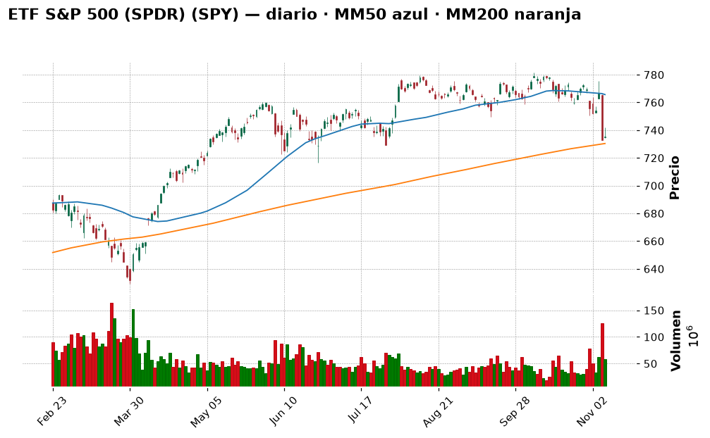
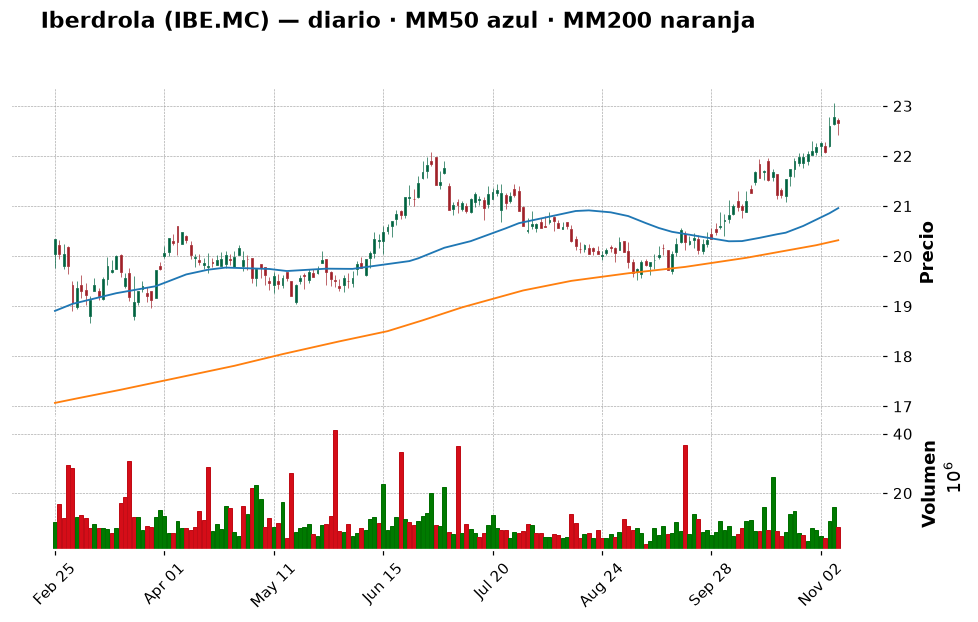
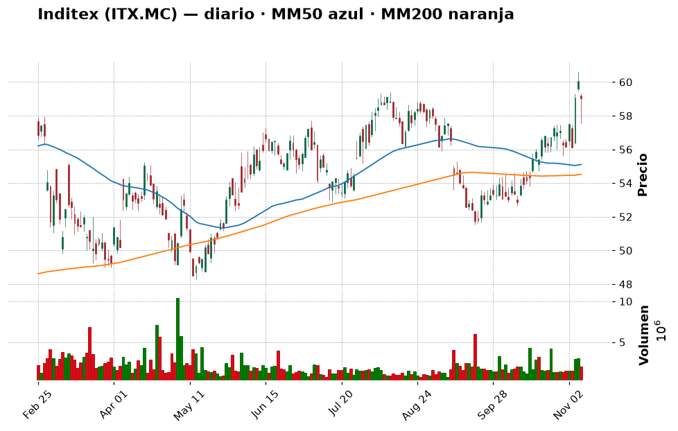
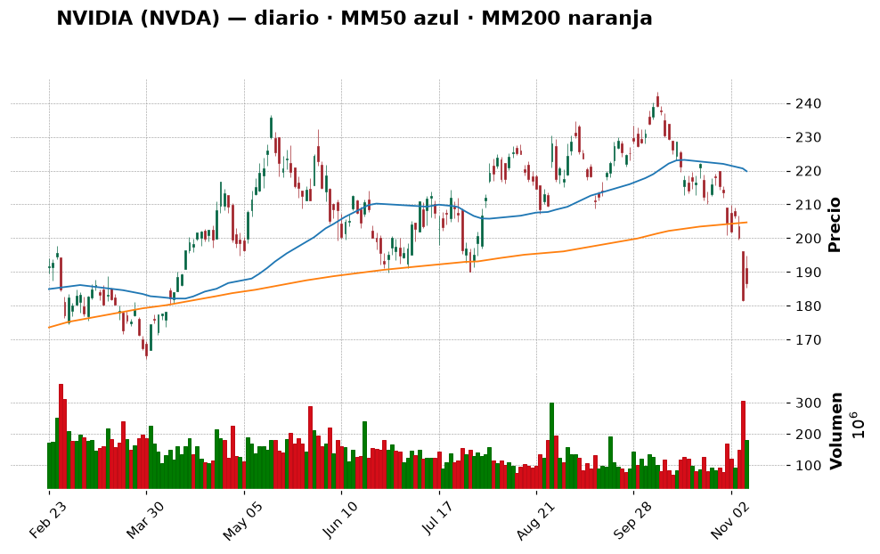
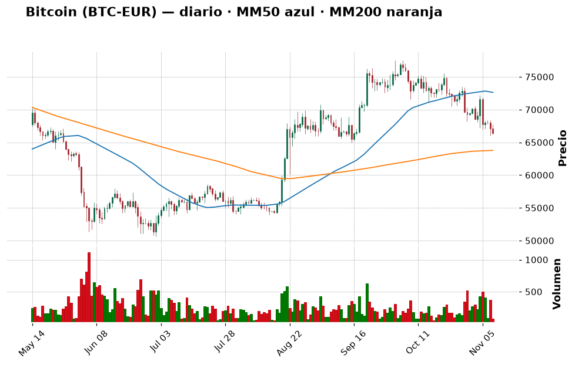
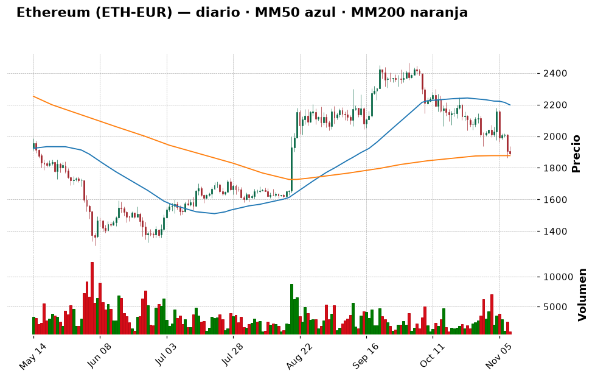

# 📈 Informe pre-apertura — lunes 9 de noviembre de 2026

> Generado automáticamente a las 08:05 (hora de Madrid) · Bolsa española abre a las 9:00 · Wall Street a las 15:30 · Cripto: 24/7
> **Termómetro del día:** 🟡 prudencia — los futuros rebotan tras una semana de ventas en tecnología, pero la volatilidad sigue alta (VIX ≈ 25,6), el IPC de EE. UU. sale mañana y el mercado descuenta una posible **subida** de tipos de la Fed.
> **Lección de hoy:** Qué es un ETF

## 1. Lo que tienes que saber hoy
- **La "fiebre de la IA" se ha enfriado.** El Nasdaq cayó casi un 5 % la semana pasada (cuarta semana seguida a la baja) y lleva un −9,6 % en un mes. Hoy los futuros de EE. UU. suben (~+0,4 % el S&P 500), pero es un rebote **frágil**: nada ha cambiado de fondo todavía.
- **Nvidia, en el centro del huracán.** Su consejo investiga la relación de su CEO, Jensen Huang, con una mujer a la que la inteligencia de EE. UU. atribuye espionaje para China. Nvidia dice no tener indicios de que se comprometieran secretos. Eso añade incertidumbre a la empresa más grande del sector.
- **Mañana martes, 14:30 h, IPC de EE. UU.** (la inflación de octubre). Con la inflación en el 3,7 % en septiembre y el mercado viendo ~80 % de probabilidad de una **subida** de tipos en diciembre, ese dato puede mover mucho la bolsa. Por eso hoy toca **preparar**, no precipitarse.

## 2. ✅ Recomendaciones del día (resumen)
| Activo | Acción | Cuánto (orientativo) | Horizonte | Por qué, en una frase | Confianza |
|---|---|---|---|---|---|
| ETF S&P 500 (SPY o equivalente UCITS) | 🟢 Comprar | 10–15 % de la cartera, en **3 tramos**; el 1.º tras el IPC del martes | Años (5+) | Base tranquila y diversificada; el índice está apoyado en su media de 200 sesiones tras caer un 6 % desde máximos | media |
| Iberdrola (IBE.MC) | ⏸️ Esperar | Hasta 5 % si retrocede a 21–22 € | Años | Gran empresa defensiva, pero hoy está "sobrecomprada" (RSI 72) y a un paso de máximos | media |
| Inditex (ITX.MC) | 🔵 Mantener | No añadir ahora | Años | Tu posición gana ~+119 %; cotiza pegada a máximos de 52 semanas | media |
| Repsol (REP.MC) | 🔵 Mantener | No añadir | Años | +77 % en un año con el petróleo alto; buena posición, pero muy ligada al conflicto con Irán | media |
| Apple (AAPL) | 🔵 Mantener | No añadir | Años | Tendencia alcista sana (+14,6 % sobre su MM200) y menos expuesta al "pinchazo" de la IA | media |
| NVIDIA (NVDA) | ⛔ Evitar | 0 € | — | Tendencia de fondo rota (−8,8 % bajo MM200) + investigación a su CEO: demasiada incertidumbre para un principiante | media |
| Bitcoin (BTC-EUR) | 🟢 Comprar | Aportación pequeña (p. ej. 25–50 €) y repetir cada mes | Años | Miedo extremo (29/100) y precio sobre su soporte de ~65.900 €; solo en modo "aportación periódica" | baja |
| Ether (ETH-EUR) | ⏸️ Esperar | 0 € hoy | Años | Está justo en su MM200 con tendencia débil; esperar a que la defienda o recupere 2.180 € | media |
| Shiba Inu (SHIB) | ⛔ Evitar | No añadir | — | Memecoin, −95 % desde su máximo: no encaja con un perfil moderado | alta |

> Día para **no hacer movimientos grandes**: dejar pasar el IPC del martes, empezar a construir el núcleo indexado (ETF del S&P 500) en tramos y, antes de nada, **corregir tu archivo de cartera** (ver sección 8): ahora mismo los números que veo de tu cartera no son fiables.

## 3. Agenda del día
| Hora (Madrid) | Evento | Por qué importa |
|---|---|---|
| Antes de las 15:30 | Resultados de KKR, Barrick Mining, Ferguson y NRG (antes de abrir Wall Street, según calendario del 6-nov) | Pistas sobre gestión de activos, oro y energía |
| Tras el cierre de EE. UU. | Resultados de Occidental (OXY), Take-Two (TTWO), Rocket Lab (RKLB) | Petróleo y tecnología "no IA" |
| Toda la semana | CoreWeave, Applied Materials y Cisco presentan resultados | Termómetro de si el gasto en IA es rentable |
| Mar 10, 14:30 | **IPC de EE. UU. (octubre)** | El dato de la semana: decide si la Fed sube tipos |
| Mar 10 y jue 12 | Huelga de maquinistas de Renfe | Impacto económico pequeño, pero ruido en España |
| Mié 11 | **Huelga general en España (11-N)** | Más ruido político que bursátil; banca prevé poco seguimiento |

## 4. Cómo llegan los mercados
### España y Europa
El **Ibex 35** cerró el viernes en **19.369,5** puntos (−0,6 % el día), pero subió un **+3,8 % en la semana** y gana un **+18,2 % en un año**: España ha aguantado mucho mejor que el Nasdaq porque pesa más la banca, la energía y las eléctricas que la tecnología. El **Euro Stoxx 50** cerró en **6.170** (−1 % el día, +0,6 % semanal).

En España la semana viene cargada de **política**: huelga general el miércoles 11, votación de los decretos de vivienda el jueves 12 y arranque de la campaña electoral el viernes 13 (Europa Press). Para la bolsa suele ser más ruido que causa de caídas. En Europa, Crédit Agricole ha propuesto fusionarse con el italiano Banco BPM con una prima del 20 %: las fusiones bancarias siguen siendo un tema caliente.

### Estados Unidos
El **S&P 500** cerró el viernes en **7.376,9** (+0,3 %), pero la semana fue mala (−2,7 %) y en un mes cae un −5 %. El **Nasdaq** cerró en 24.579 (−3,4 % semanal, −9,6 % en un mes). La causa: el mercado duda de que las enormes inversiones en IA vayan a dar beneficios, y la victoria demócrata en las elecciones de mitad de mandato (*midterms*) ha añadido incertidumbre regulatoria. Esta mañana los **futuros del S&P 500 suben ~+0,4 %** (7.429) y Asia rebota con fuerza (Taiwán +5 %).

### Macro (tipos de interés, inflación, divisas, materias primas)
- **Fed (banco central de EE. UU.):** el mercado ve ~80 % de probabilidad de que **suba** tipos 0,25 puntos en diciembre. La rentabilidad del bono a 10 años está en ~4,86 %. 💡 *Cuando los tipos suben, los ahorradores pueden ganar más en bonos y depósitos, y las acciones (sobre todo las tecnológicas "caras") pierden atractivo.*
- **Petróleo Brent:** ~96,7 $ (−1,6 %), bajando porque Trump dijo que nuevos ataques a Irán son "muy improbables" mientras haya negociaciones; pero Rubio calificó de "escandalosas" las demandas iraníes. El riesgo en el **estrecho de Ormuz** sigue vivo.
- **Euro/dólar:** 1,117 (+0,2 %). 💡 *Si el euro sube frente al dólar, tus inversiones en dólares (Apple, el ETF del S&P 500) valen un poco menos en euros, aunque no se muevan.*
- **China:** la inflación de precios industriales es la más alta en casi 4 años y medio.

## 5. Panorama técnico de la watchlist
> 💡 *Cómo leer esta tabla:* la **tendencia** resume si el precio lleva meses subiendo, bajando o de lado
> (comparando el precio con sus medias de 50 y 200 días). El **RSI** mide de 0 a 100 si las subidas o bajadas
> recientes han sido muy fuertes: por encima de 70 se dice "sobrecompra" (quizá ha subido demasiado rápido),
> por debajo de 30 "sobreventa". Son pistas, no predicciones.

| Valor | Último cierre | Día | 1 mes | 1 año | Tendencia | RSI | vs MM200 |
|---|---|---|---|---|---|---|---|
| IBEX 35 (^IBEX) | 19.369,5 | −0,60 % | +2,33 % | +18,19 % | ➡️ lateral | 53,8 🟡 | +3,5 % |
| Euro Stoxx 50 | 6.170,49 | −0,98 % | +0,71 % | +9,02 % | ➡️ lateral | 48,1 🟡 | +0,9 % |
| S&P 500 (^GSPC) | 7.376,86 | +0,31 % | −5,00 % | +8,54 % | ➡️ lateral | 35,1 🟡 | +0,7 % |
| Nasdaq Composite | 24.579,43 | +1,09 % | −9,61 % | +4,59 % | ➡️ lateral | 33,9 🟡 | −2,1 % |
| Banco Santander (SAN.MC) | 10,70 | −1,18 % | −10,19 % | +14,90 % | ➡️ lateral | 38,8 🟡 | −5,2 % |
| BBVA (BBVA.MC) | 22,73 | −0,74 % | −1,26 % | +22,57 % | ➡️ lateral | 48,7 🟡 | +5,7 % |
| Inditex (ITX.MC) | 59,04 | −1,70 % | +11,73 % | +18,48 % | ➡️ lateral | 62,8 🟡 | +8,3 % |
| Iberdrola (IBE.MC) | 22,65 | −0,53 % | +7,30 % | +27,79 % | 📈 alcista | 72,1 🔴 | +11,5 % |
| Telefónica (TEF.MC) | 3,38 | −1,83 % | −0,70 % | −7,84 % | 📉 bajista | 50,0 🟡 | −7,3 % |
| Repsol (REP.MC) | 29,90 | −1,03 % | −0,63 % | +77,50 % | 📈 alcista | 52,6 🟡 | +23,9 % |
| Apple (AAPL) | 342,37 $ | −0,52 % | +0,57 % | +26,74 % | 📈 alcista | 51,5 🟡 | +14,6 % |
| Microsoft (MSFT) | 530,61 $ | −0,99 % | +1,53 % | +4,62 % | 📈 alcista | 52,1 🟡 | +20,6 % |
| NVIDIA (NVDA) | 186,64 $ | +2,78 % | −19,02 % | −4,39 % | ➡️ lateral | 30,8 🟢 | −8,8 % |
| Amazon (AMZN) | 259,30 $ | −0,35 % | +2,06 % | +3,64 % | ➡️ lateral | 54,2 🟡 | +6,3 % |
| ETF S&P 500 (SPY) | 735,29 $ | +0,31 % | −4,99 % | +8,52 % | ➡️ lateral | 35,1 🟡 | +0,7 % |
| ETF Nasdaq 100 (QQQ) | 656,10 $ | +1,40 % | −12,24 % | +5,27 % | ➡️ lateral | 31,4 🟢 | −3,6 % |

*(🟢 = RSI bajo, posible "rebajas"; 🔴 = RSI alto, quizá demasiado rápido; 🟡 = neutral.)*

**En conjunto:** la tendencia de fondo **no está rota** en el S&P 500 (sigue por encima de su media de 200 sesiones, aunque por poco), pero el Nasdaq y Nvidia ya han perdido ese nivel: el castigo se concentra en tecnología/IA. En España, lo "estirado" son Iberdrola (RSI 72) e Inditex (casi en máximos); lo castigado, Santander (−10 % en un mes) y Telefónica (tendencia bajista).

## 6. Ideas de bolsa: qué haría un experto
### ETF S&P 500 (SPY o un equivalente UCITS) — COMPRAR (en tramos)

- **Qué es:** un fondo que cotiza en bolsa y compra de golpe las ~500 mayores empresas de EE. UU. Es la lección de hoy (sección 10).
- **Por qué es noticia hoy:** el índice ha caído un 6 % desde máximos por la venta en IA; MarketWatch avisa de que el S&P 500 se ha vuelto "una gran apuesta por la IA" porque pocas tecnológicas pesan mucho.
- **Lo que dice el gráfico:** el precio (735,3 $) ha bajado por debajo de su media de 50 sesiones (765,7) y está apoyado justo encima de la de 200 (730,4) y del soporte de 729. RSI 35: cerca de "rebajas" sin llegar a pánico. 💡 *Un **soporte** es un nivel donde en el pasado aparecieron compradores y el precio dejó de caer, como un suelo.*
- **Lo positivo:** diversificación máxima, costes bajísimos, largo plazo históricamente positivo; comprar tras una corrección suele salir mejor que comprar en máximos.
- **El riesgo:** si el IPC sale alto y la Fed sube tipos, el índice podría perder la MM200 y caer otro 3–5 %. Además, está concentrado en tecnología.
- **🧑‍💼 Recomendación: COMPRAR, en 3 tramos.** Tu cartera registrada no tiene ningún "núcleo" diversificado: es justo lo que un perfil moderado necesita primero. No lo compraría todo hoy por el IPC de mañana; el primer tramo, después del dato.
  - **Cuánto y cómo:** 10–15 % de tu cartera en total (con tu cartera registrada de ~1.400 €, unos 150–200 €), dividido en 3 compras (martes/miércoles tras el IPC, a las 2 semanas y al mes). 💡 Desde Europa normalmente no se puede comprar SPY directamente; se usa un **ETF UCITS que replique el S&P 500** (mejor de acumulación), que hace lo mismo.
  - **Horizonte:** 5 años o más.
  - **Qué me haría cambiar de opinión:** un cierre semanal del SPY por debajo de 716,6 $ (tercer soporte): pausaría los tramos siguientes hasta ver estabilización.
- **Qué mirar para entenderlo:** el IPC de mañana (si sale por debajo del 3,7 % anterior, alivio) y si el precio se mantiene sobre la línea de la MM200 del gráfico.
- **Confianza:** media

### Iberdrola (IBE.MC) — ESPERAR

- **Qué es:** la mayor eléctrica española, con redes y renovables en España, Reino Unido y EE. UU. Empresa "defensiva" y con dividendo.
- **Por qué es noticia hoy:** la demanda eléctrica para centros de datos de IA está disparada (según un análisis publicado en Investing.com, buscan hasta turbinas usadas); eso favorece a las redes eléctricas.
- **Lo que dice el gráfico:** tendencia **alcista** clara (11,5 % por encima de la MM200), a solo un 1,8 % de su máximo de 52 semanas (23,06 €). Pero el RSI está en 72: **sobrecompra**.
- **Lo positivo:** negocio estable, regulado, buen encaje para un moderado.
- **El riesgo:** comprar tras +28 % en un año y con RSI >70 suele significar pagar caro; además, si los tipos suben, las eléctricas (endeudadas) sufren.
- **🧑‍💼 Recomendación: ESPERAR.** Me gusta la empresa, no el precio de hoy. Compraría **si** retrocede hacia 21,9 € (su media de 20 sesiones) o 21,1 € (soporte).
  - **Cuánto y cómo:** hasta un 5 % de la cartera, en 2 tramos.
  - **Horizonte:** años.
  - **Qué me haría cambiar de opinión:** un cierre por debajo de 20,3 € (MM200) indicaría que la tendencia de fondo se rompe: ahí no compraría.
- **Qué mirar para entenderlo:** el RSI: cuando baje de 60 sin que el precio pierda la MM50 (20,96 €), suele ser mejor momento.
- **Confianza:** media

### Inditex (ITX.MC) — MANTENER (la tienes)

- **Qué es:** dueña de Zara, Massimo Dutti, Pull&Bear… líder mundial de moda.
- **Por qué es noticia hoy:** un análisis en Yahoo Finance sostiene que podría estar un 27 % sobrevalorada por su flujo de caja (es una opinión, no un hecho).
- **Lo que dice el gráfico:** +11,7 % en un mes, a un 2,6 % de su máximo anual (60,64 €) y pegada a la resistencia de 59,42 €. 💡 *Una **resistencia** es lo contrario de un soporte: un "techo" donde antes aparecieron vendedores.*
- **🧑‍💼 Recomendación: MANTENER.** Compraste a 26,94 € y vale 59,04 €: más que duplicada. No vendería una gran empresa que funciona, pero tampoco ampliaría pegado a máximos.
  - **Cuánto y cómo:** no añadir. Si algún día quieres más, en retrocesos hacia 55–56 € (soportes).
  - **Qué me haría cambiar de opinión:** un cierre por debajo de 54,5 € (MM200).
- **Qué mirar para entenderlo:** si supera con claridad 60,64 € (nuevo máximo) o se gira en la resistencia.
- **Confianza:** media

### NVIDIA (NVDA) — EVITAR

- **Qué es:** el gran fabricante de chips para IA.
- **Por qué es noticia hoy:** su consejo abre una investigación independiente sobre la relación de su CEO con una presunta espía china; Huang admitió la relación en un mensaje a empleados. Bernstein lo ve como "una gran distracción en el mejor caso". En operaciones fuera de horario cae.
- **Lo que dice el gráfico:** −19 % en un mes, −23 % desde máximos, por debajo de su MM200 (−8,8 %), sin soportes claros cerca y volatilidad muy alta (46,6 % anual). Volumen 1,5 veces la media: hay mucha gente vendiendo.
- **🧑‍💼 Recomendación: EVITAR.** Puede que a largo plazo sea una gran empresa, pero ahora mismo se mezclan tendencia rota + escándalo + dudas sobre la IA. "Comprar porque ha caído mucho" es intentar **coger un cuchillo que cae**.
  - **Qué me haría cambiar de opinión:** que recupere la MM200 (~204,7 $) y se cierre la investigación sin consecuencias.
- **Qué mirar para entenderlo:** compara su gráfico con el de Apple: misma bolsa, dos historias muy distintas.
- **Confianza:** media

## 7. ₿ Criptomonedas
> 💡 *Las criptomonedas cotizan 24 horas, 7 días a la semana: los precios son de esta mañana (en euros).
> Son mucho más volátiles que las acciones: caídas del 50 % o más han ocurrido varias veces.*

**Sentimiento:** Fear & Greed **29/100 (miedo**; ayer 28, hace una semana 37) · Capitalización total 2,59 billones $ (−2,44 % en 24 h, **−46 % bajo su máximo histórico** de octubre de 2025) · Dominancia de Bitcoin 57,5 %.
Hay miedo: el mercado cripto se ha contagiado de la venta en tecnología y del caso Nvidia. El domingo se liquidaron más de 1.000 millones $ en posiciones apalancadas (CoinDesk). 💡 *Una **liquidación** es el cierre forzoso de quien invirtió con dinero prestado: por eso no usamos apalancamiento.*

**Radar Coinbase** (410 monedas comprables · hoy suben 41 y bajan 321 · en 7 días suben 47 y bajan 314):
- **Mayores por capitalización (7 d):** BTC −4,9 %, ETH −7,5 %, BNB −3,6 %, XRP −12,9 %, SOL −8,7 %, DOGE −8,7 %.
- **Más suben (7 d, top 100):** INJ (+12,1 %), ARB (+7,4 %), PEPE (+5,1 %), PAXG (+4,9 %, pero es oro tokenizado, no una "cripto" de crecimiento) · **Más bajan:** WLD (−17,3 %), ENA (−15,8 %), BCH (−15 %), HYPE (−13,5 %).
La caída es **general** (casi 9 de cada 10 monedas bajan): no hay una historia concreta que justifique perseguir las pocas que suben.

| Moneda | Ranking | Precio (€) | 24 h | 7 días | 1 mes | 1 año | Tendencia | RSI | vs MM200 |
|---|---|---|---|---|---|---|---|---|---|
| Bitcoin (BTC) | #1 | 66.383,67 | −1,02 % | −3,15 % | −10,36 % | −26,76 % | ➡️ lateral | 35,2 | +4,1 % |
| Ether (ETH) | #2 | 1.888,58 | −0,96 % | −6,07 % | −15,58 % | −39,12 % | ➡️ lateral | 33,1 | +0,6 % |
| XRP (XRP) | #6 | 0,9746 | −2,32 % | −12,64 % | −22,16 % | −52,43 % | ➡️ lateral | 26,3 | −11,4 % |
| Solana (SOL) | #7 | 76,98 | −0,74 % | −6,20 % | −21,65 % | −45,99 % | ➡️ lateral | 27,4 | −0,8 % |

**Noticias que importan:**
- El Tesoro de EE. UU. corta del sistema financiero al exchange MEXC por 16.000 millones $ en flujos presuntamente ilícitos ([CoinDesk](https://www.coindesk.com/business/2026/11/07/u-s-treasury-moves-to-cut-off-crypto-exchange-mexc-over-usd16-billion-in-alleged-illicit-flows)): recuerda por qué conviene usar plataformas reguladas.
- Hackeo de Gnosis Pay con datos de tarjetas y carteras expuestos ([CoinDesk](https://www.coindesk.com/business/2026/11/07/gnosis-pay-breach-exposes-card-numbers-home-addresses-and-linked-crypto-wallets)).
- Bitcoin cayó el domingo hasta ~73.760 $, su mínimo desde agosto, y rebotó por encima de 75.000 $ ([CoinDesk](https://www.coindesk.com/markets/2026/11/09/bitcoin-drops-then-pops-as-nvidia-cheating-scandal-and-failed-iran-talks-trigger-volatility)).

### Bitcoin (BTC) — COMPRAR (solo como aportación periódica pequeña)

- **Qué es:** la primera y mayor criptomoneda, con oferta limitada a 21 millones.
- **Lo que dice el gráfico:** tendencia lateral, −28,6 % desde su máximo anual, por debajo de la MM50 (72.620 €) pero **por encima de la MM200** (63.767 €) y apoyado en el soporte de 65.898 €. RSI 35.
- **🧑‍💼 Recomendación: COMPRAR, en modo "aportación periódica".** Con miedo en el mercado y el precio sobre su MM200, es razonable empezar o seguir con compras pequeñas y regulares. Nunca de golpe.
  - **Cuánto y cómo:** tu cripto ronda el 5–6 % de la cartera registrada (estimación, ver sección 8), lejos del tope del 25 %. Pero **25 % es mucho para un perfil moderado**: yo apuntaría al 5–10 %. Por ejemplo 25–50 € al mes en BTC-EUR en Coinbase.
  - **Qué me haría cambiar de opinión:** un cierre diario por debajo de 63.700 € (MM200) → pausar aportaciones hasta que se estabilice.
- **El riesgo:** ya ha caído un 50–80 % en ciclos anteriores; puede volver a hacerlo.
- **Confianza:** baja

### Ether (ETH) — ESPERAR

- **Qué es:** la red de "contratos inteligentes" sobre la que funcionan muchas aplicaciones cripto.
- **Lo que dice el gráfico:** −15,6 % en un mes, −14 % bajo su MM50 y justo encima de la MM200 (1.877 €). El siguiente soporte está lejos (1.607 €). El domingo, ETH concentró el doble de liquidaciones que BTC.
- **🧑‍💼 Recomendación: ESPERAR.** Está en un punto de "o aguanta o cae otro 15 %". Prefiero ver que defiende los ~1.877 € unos días, o que recupera 2.180 € (resistencia).
  - **Cuánto y cómo:** 0 € hoy; si se cumple la condición, importes menores que en BTC.
  - **Qué me haría cambiar de opinión:** cierre por encima de 2.180 € → empezar aportaciones pequeñas.
- **El riesgo:** más volátil que bitcoin; las salidas de los ETF de ether pesan.
- **Confianza:** media

## 8. 💼 Tu cartera
⚠️ **Antes de nada: tu `cartera.csv` tiene errores que hacen que los números automáticos no sean fiables.** El cálculo automático dice 60.677 € con un 98,9 % en SHIB, pero no es real. Esto es lo que hay que corregir:
1. **Tickers sin sufijo de bolsa:** `REP`, `ITX`, `SLR`, `ORY` deben ser `REP.MC`, `ITX.MC`, `SLR.MC`, `ORY.MC`. `AIR` en Yahoo es **otra empresa** (estadounidense): Airbus en Madrid es `AIR.MC` (o `AIR.PA` en París). Por eso sale −52 %.
2. **Cripto:** usa el par de Coinbase: `BTC-EUR`, `SHIB-EUR`. Con `BTC` a secas, Yahoo devuelve un ETF de 33,5 $ y por eso marca −99,95 %.
3. **Tipo:** escribe `cripto` en vez de `criptomoneda` (por eso el informe cree que tienes 0 % en cripto).
4. **Precio de SHIB:** pusiste 0,06 € por moneda (coste 60.000 €). SHIB nunca ha valido eso (hoy ~0,0000039 €). Probablemente quisiste poner el importe total o te sobran ceros: revísalo.
5. **AAPL:** el precio 150,66 está marcado en EUR, pero Apple cotiza en dólares; comprueba la moneda.

**Estimación del informe** (cantidad × precios de hoy de los datos de precios y cripto; Airbus, Solaria y Oryzon a precio de coste porque no tengo su cotización):

| Activo | Cantidad | Precio medio | Precio actual | Valor (€) | G/P | Peso | Acción recomendada |
|---|---|---|---|---|---|---|---|
| Airbus (AIR) | 5 | 230 € | sin dato | ~1.150 (a coste) | ? | ~81 % | 🔵 Mantener — corrige el ticker para poder analizarla; pesa demasiado |
| Bitcoin (BTC) | 0,00113 | 74.000 € | 66.384 € | ~75,2 | −10,3 % | ~5,3 % | 🟢 Comprar — aportaciones pequeñas |
| Repsol (REP.MC) | 2 | 12,37 € | 29,90 € | ~59,8 | +141,7 % | ~4,2 % | 🔵 Mantener |
| Inditex (ITX.MC) | 1 | 26,94 € | 59,04 € | ~59,0 | +119,2 % | ~4,2 % | 🔵 Mantener |
| Apple (AAPL) | 0,15 | 150,66 | 342,37 $ | ~46,0 | ~+103 % | ~3,2 % | 🔵 Mantener |
| Solaria (SLR) | 1 | 14,99 € | sin dato | ~15 (a coste) | ? | ~1,1 % | 🔵 Mantener (sin análisis hoy) |
| Oryzon (ORY) | 4 | 3,23 € | sin dato | ~12,9 (a coste) | ? | ~0,9 % | 🔵 Mantener (sin análisis hoy) |
| Shiba Inu (SHIB) | 1.000.000 | ¿? | 0,0000039 € | ~3,9 | — | ~0,3 % | ⛔ Evitar — no añadir |

**Valor estimado:** ~1.420 € · **Cripto:** ~79 € ≈ **5,6 %** de 25 % ✅ dentro (margen hasta el tope ≈ 370 €, aunque para tu perfil no lo llenaría).

**Diagnóstico:** la cartera **no está diversificada**: una sola acción (Airbus) pesaría ~80 %, muy por encima del 10 % máximo recomendado por valor. Las posiciones antiguas (Repsol, Inditex, Apple) lo han hecho muy bien. El movimiento de un experto esta semana: **corregir el CSV**, no vender nada con prisas, y **destinar el dinero nuevo al núcleo indexado** (ETF del S&P 500 o un ETF global) para que, con el tiempo, Airbus pese menos. Lo de SHIB vale ~4 €: venderlo puede costar más en comisiones que lo que vale; simplemente no añadas más.

## 9. Análisis de riesgo
| Riesgo | Nivel | Explicación |
|---|---|---|
| IPC EE. UU. del martes | 🔴 | Un dato alto reforzaría la subida de tipos y podría tumbar el rebote |
| Venta en tecnología / IA | 🟡 | Nasdaq −9,6 % en un mes; el caso Nvidia puede alargarlo |
| Petróleo / Irán / Ormuz | 🟡 | Brent ~97 $; un cierre de Ormuz dispararía precios (bueno para Repsol, malo para casi todo lo demás) |
| Política en España | 🟢 | Huelga general y campaña: ruido, poco impacto bursátil esperado |
| Cripto | 🔴 | Miedo, liquidaciones y caída general; volatilidad muy alta |

**Qué podría salir mal hoy:** que el rebote de los futuros se deshaga en Wall Street si salen más noticias de Nvidia, y que mañana el IPC sorprenda al alza. En ese caso el SPY perdería su MM200 (730 $) y aplazaríamos los tramos; por eso hoy no recomiendo comprar nada de golpe.

## 10. 🎓 Aprende con el informe de hoy: Qué es un ETF
- **Qué es (en una frase):** un **ETF** (*Exchange Traded Fund*, fondo cotizado) es una "cesta" de muchas acciones o bonos que compras y vendes en bolsa como si fuera una sola acción.
- **Ejemplo con números:** con 100 € en un ETF del S&P 500 compras un trocito de 500 empresas a la vez: unos pocos euros en las más grandes (Nvidia, Apple, Microsoft…) y el resto repartido entre cientos de empresas. Si una empresa se hunde un 50 %, tu ETF apenas lo nota; si compras 100 € de una sola acción y cae un 50 %, pierdes 50 €.
- **Dónde lo has visto hoy:** en la idea del ETF S&P 500 (SPY) y en la tabla técnica (SPY y QQQ).
- **Por qué te importa como inversor:** es la forma más barata y sencilla de diversificar. Por eso suele ser el **núcleo** de la cartera de un inversor moderado; las acciones individuales, como satélites pequeños.
- **Error típico de principiante:** pensar que "un ETF no puede caer". Sí cae: es el mercado entero. El QQQ (Nasdaq 100) ha caído un 12 % en un mes porque está muy concentrado en tecnología. Diversificar reduce el riesgo de que **una** empresa te arruine, no el riesgo de que **todo** el mercado baje.
- **Pregunta para pensar:** si el S&P 500 cae un 5 % y tu acción de Nvidia cae un 19 %, ¿por qué el ETF ha caído menos aunque contiene Nvidia?

## 11. Consejo del día para inversores principiantes
**Ordena la casa antes de mover ficha.** Lo primero que hace un buen inversor no es comprar, sino saber exactamente qué tiene y cuánto pesa cada cosa. Hoy tu cartera tiene datos erróneos y una posición que pesa ~80 %: corrige el CSV y, a partir de ahí, construye poco a poco un núcleo indexado con aportaciones regulares. Con tanta volatilidad (VIX ~26), comprar en tramos te protege de acertar o fallar "el día".

## 12. Glosario
- **ETF:** fondo que cotiza en bolsa y replica una cesta (un índice como el S&P 500).
- **UCITS:** normativa europea de fondos; los ETF "UCITS" son los que un inversor minorista europeo puede comprar.
- **Media móvil (MM50/MM200):** precio medio de las últimas 50 o 200 sesiones; la de 200 indica la tendencia de fondo.
- **RSI:** indicador de 0 a 100 de la fuerza de las subidas/bajadas recientes (>70 sobrecompra, <30 sobreventa).
- **Soporte / resistencia:** niveles de precio que han actuado como "suelo" o "techo".
- **IPC:** índice de precios al consumo; mide la inflación.
- **VIX:** "índice del miedo" de Wall Street; por encima de 20, nerviosismo.
- **Fear & Greed:** índice de miedo/codicia cripto (0 = pánico, 100 = euforia).
- **Liquidación:** cierre forzoso de una posición hecha con dinero prestado.
- **Aportación periódica (DCA):** invertir una cantidad fija cada cierto tiempo, sin importar el precio.

## 13. Fuentes
- Investing.com — [Morning Bid: Fragile calm after AI whiplash](https://www.investing.com/news/economy-news/morning-bid-fragile-calm-after-ai-whiplash-5010505)
- Investing.com — [Wall St futures rise as investors weigh tech rebound; inflation data awaited](https://www.investing.com/news/stock-market-news/wall-st-futures-mixed-amid-ai-spending-concerns-inflation-data-awaited-5010386)
- MarketWatch — [Nvidia’s board is probing CEO Huang’s relationship with alleged spy](https://www.marketwatch.com/story/nvidias-board-will-probe-ceo-jensen-huangs-relationship-with-an-alleged-spy-heres-what-to-know-86656cd9?mod=mw_rss_topstories)
- Yahoo Finance — [Nvidia CEO row: Bernstein sees ‘heavy distraction’](https://finance.yahoo.com/markets/stocks/articles/nvidia-ceo-row-bernstein-sees-062039338.html)
- MarketWatch — [The S&P 500 could be dangerously exposed to AI](https://www.marketwatch.com/story/the-s-p-500-has-become-a-big-ai-bet-here-are-some-simple-alternatives-3c7574a4?mod=mw_rss_topstories)
- Cinco Días — [El tropiezo de la IA que comenzó en China se extiende a Estados Unidos](https://cincodias.elpais.com/mercados-financieros/2026-11-09/la-burbuja-bursatil-de-la-ia-pincho-primero-en-china-el-star-50-pierde-casi-la-mitad-de-su-valor.html)
- Cinco Días — [Joe McMonigle sobre Ormuz](https://cincodias.elpais.com/mercados-financieros/2026-11-09/joe-mcmonigle-si-se-produce-una-nueva-crisis-en-ormuz-podriamos-asistir-a-una-escalada-de-precios-muy-grave.html)
- Europa Press — [El Congreso abre la campaña votando los decretos de vivienda al día siguiente de la huelga general](https://www.europapress.es/economia/construccion-y-vivienda-00342/noticia-congreso-abre-campana-votando-decretos-vivienda-dia-siguiente-huelga-general-20261108121347.html)
- Europa Press — [Servicios mínimos en Renfe para la huelga de maquinistas del 10 y 12 de noviembre](https://www.europapress.es/economia/transportes-00343/noticia-transportes-fija-servicios-minimos-renfe-huelga-maquinistas-10-12-noviembre-20261107204525.html)
- Expansión — [La huelga del 11-N tendrá poco seguimiento entre los empleados de banca](https://www.expansion.com/empresas/banca/2026/11/08/huelga-11-n-tendra-poco-seguimiento-170-000-empleados-banca.html)
- Investing.com — [Crédit Agricole propone fusión con Banco BPM](https://es.investing.com/news/stock-market-news/credit-agricole-propone-fusion-con-banco-bpm-con-prima-del-20-y-dividendo-de-1000-millones-3917851)
- Investing.com — [China’s factory-gate inflation at fastest in nearly 4-1/2 years](https://www.investing.com/news/economy-news/chinas-october-producer-inflation-quickens-further-consumer-prices-edge-down-5010403)
- Yahoo Finance — [Inditex Stock Could Be 27% Overvalued](https://finance.yahoo.com/markets/stocks/articles/inditex-bme-itx-stock-could-221639384.html)
- Investing.com — [AI power rush sends data centres hunting for used turbines](https://www.investing.com/news/stock-market-news/analysisai-power-rush-sends-data-centres-hunting-for-used-turbines-and-jet-engines-5010537)
- CoinDesk — [Bitcoin drops, then pops as Nvidia scandal and failed Iran talks trigger volatility](https://www.coindesk.com/markets/2026/11/09/bitcoin-drops-then-pops-as-nvidia-cheating-scandal-and-failed-iran-talks-trigger-volatility)
- CoinDesk — [U.S. Treasury moves to cut off MEXC](https://www.coindesk.com/business/2026/11/07/u-s-treasury-moves-to-cut-off-crypto-exchange-mexc-over-usd16-billion-in-alleged-illicit-flows)
- CoinDesk — [Gnosis Pay breach](https://www.coindesk.com/business/2026/11/07/gnosis-pay-breach-exposes-card-numbers-home-addresses-and-linked-crypto-wallets)
- Futuros S&P 500 y euro/dólar: Yahoo Finance (cotización diferida, ~07:40 h) · Calendario IPC EE. UU.: [thriveinmarkets](https://thriveinmarkets.com/es/calendar/dates/cpi-2026/) · Resultados del día: calendario de [digrin](https://www.digrin.com/stocks/earnings_calendar/2026-11-10) / Seeking Alpha (instantánea del 6-nov, puede haber cambios)
- Precios e indicadores de bolsa: Yahoo Finance (velas diarias, último cierre disponible)
- Cripto: Coinbase (universo de monedas y velas diarias) · Coinpaprika (datos de mercado) · Fear & Greed (alternative.me)
- **Fuentes que fallaron hoy:** expansion.com (bloquea la descarga automática; usado solo vía RSS). No se encontró una previsión fechada de apertura del Ibex ni datos fiables de flujos de ETF de bitcoin de noviembre de 2026.

---
**Respuesta a la pregunta del día:** porque en el ETF Nvidia es solo una pieza (pequeña) de 500 empresas: su caída del 19 % se compensa con muchas otras que han bajado poco o incluso subido (Apple, Microsoft o las eléctricas). Eso es exactamente la **diversificación**: el ETF reparte el golpe; una acción suelta lo recibe entero.

*Este informe lo genera automáticamente una IA a partir de noticias y datos de precios públicos y de los
movimientos que has registrado. Las recomendaciones son la opinión razonada de un modelo, no
asesoramiento financiero personalizado ni regulado: no conoce toda tu situación (ingresos, deudas,
objetivos, fiscalidad). El análisis técnico es orientativo y no predice el futuro. Invertir conlleva riesgo
de pérdida, y en criptomonedas ese riesgo es muy alto. Decide tú, contrasta la información y, si lo
necesitas, consulta con un profesional.*
