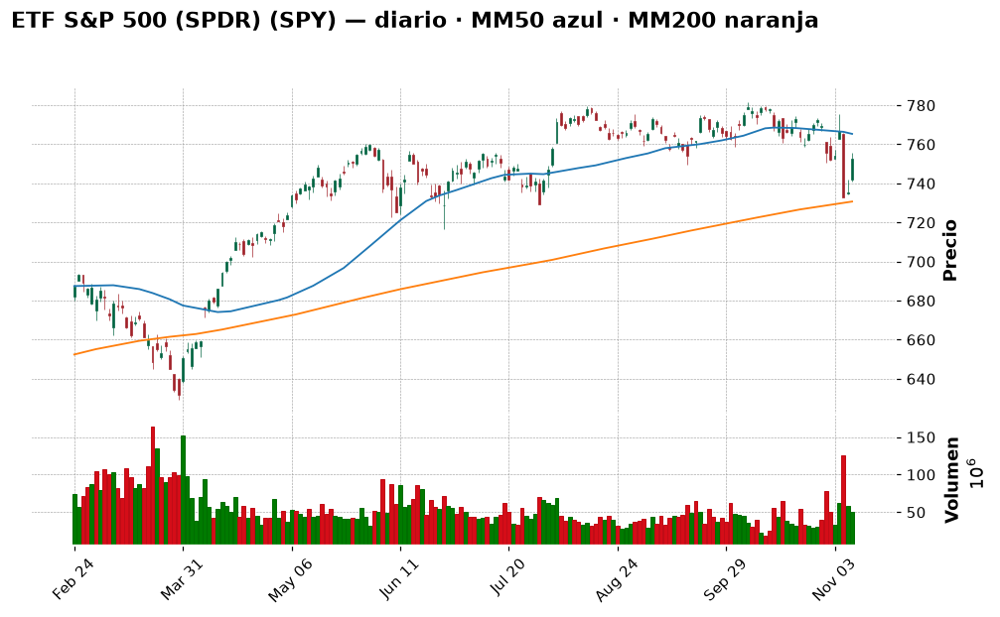
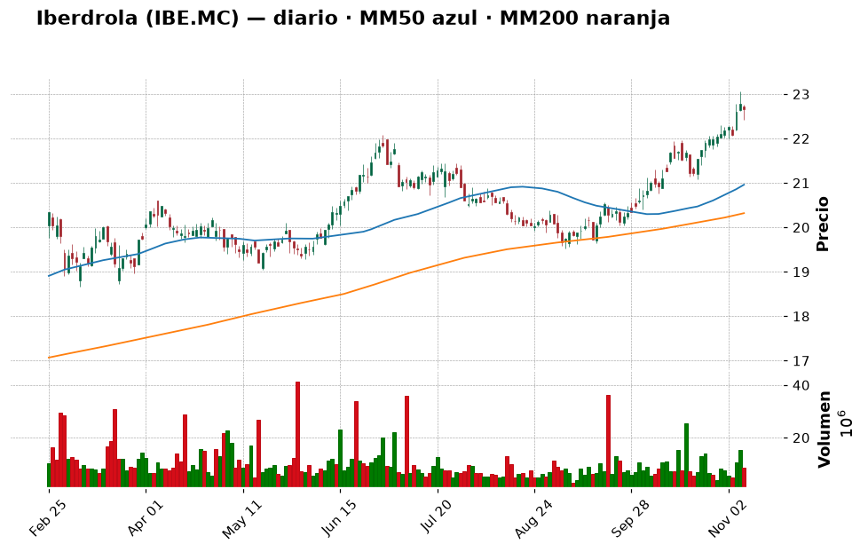
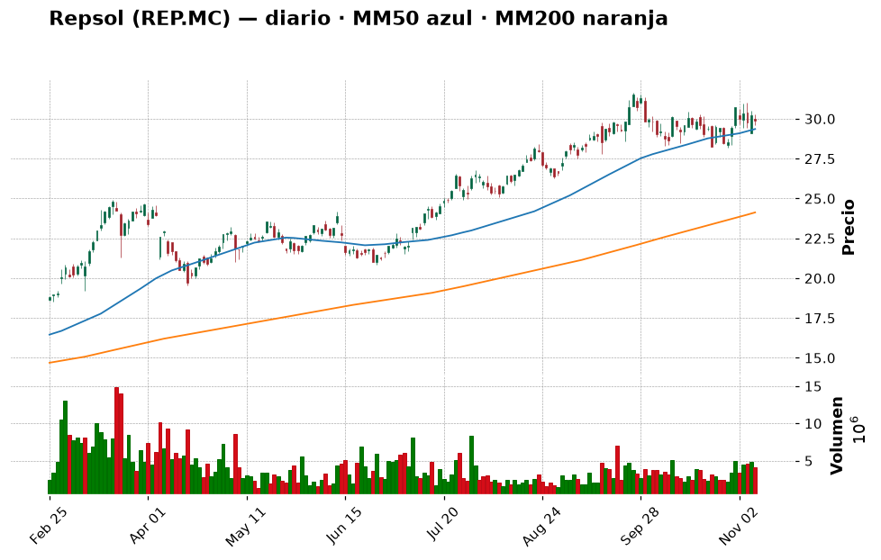
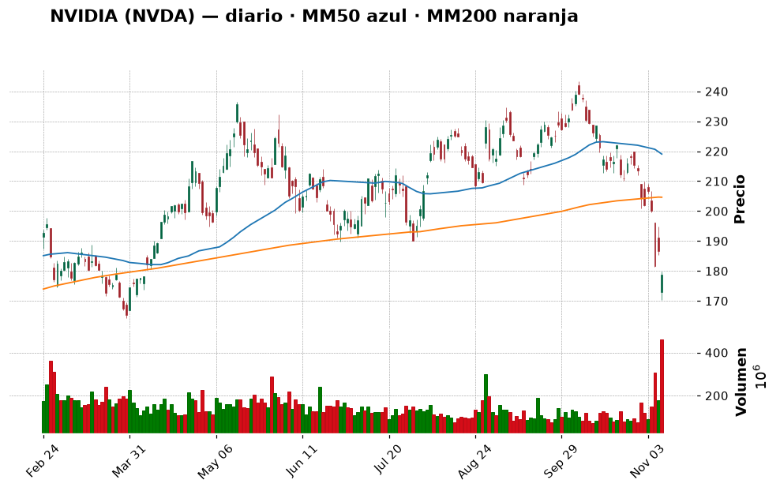
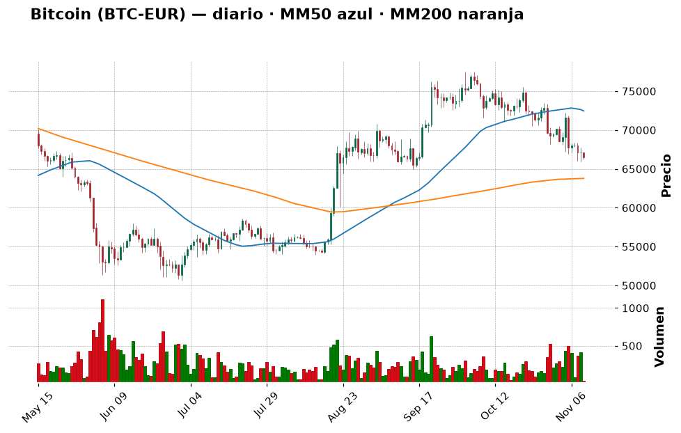
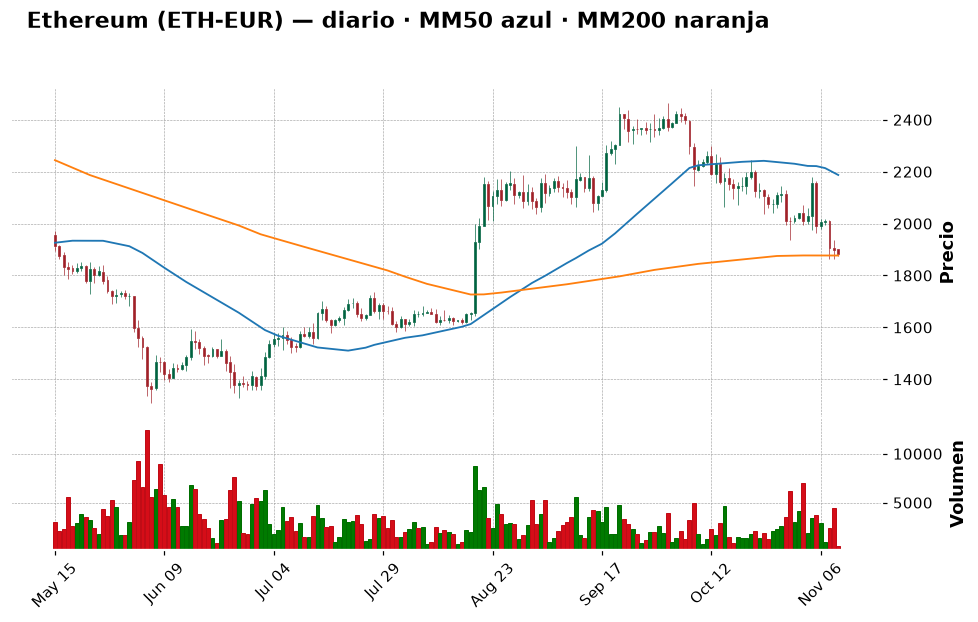
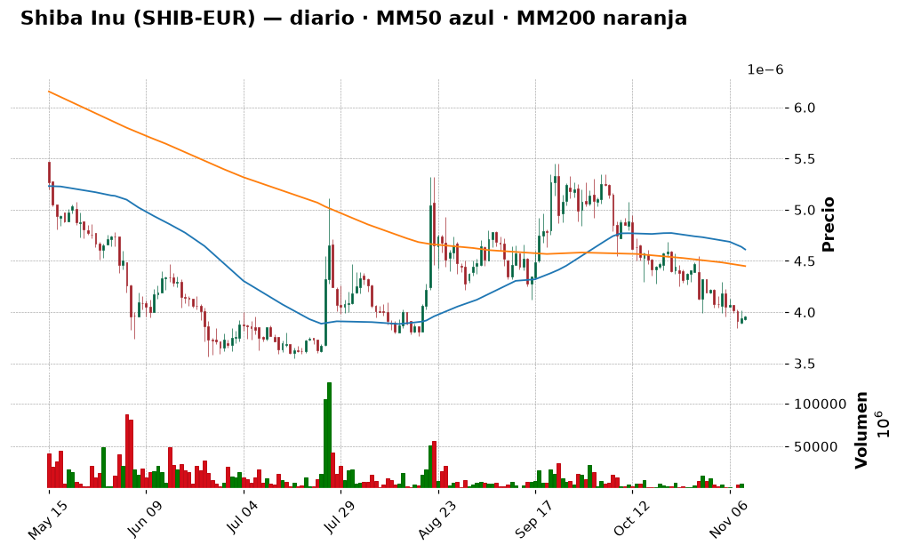

# 📈 Informe pre-apertura — martes 10 de noviembre de 2026

> Generado automáticamente a las 07:55 (hora de Madrid) · Bolsa española abre a las 9:00 · Wall Street a las 15:30 · Cripto: 24/7
> **Termómetro del día:** 🟡 prudencia — ayer hubo un rebote muy fuerte (S&P 500 +2,35 %, Ibex +1,93 %), pero hoy a las 14:30 se publica el IPC de EE. UU. y el mercado ya da un 84 % de probabilidad a una **subida** de tipos en diciembre.
> **Lección de hoy:** Qué es la inflación (IPC) y por qué mueve la bolsa

## 1. Lo que tienes que saber hoy
- **Rebote de alivio en las bolsas.** El S&P 500 subió un +2,35 % ayer (su mejor día desde abril, según Investing.com) y el Ibex un +1,93 %, hasta 19.742 puntos, su mejor nivel en un mes. Lo lideraron los chips (AMD +13 %)... excepto **Nvidia, que cayó un −4,3 %** por el escándalo de su CEO, que ahora investiga también el FBI.
- **Hoy, 14:30 h: el IPC de EE. UU. de octubre.** Se espera que los precios suban un 0,3 % en el mes (frente al 0,6 % de septiembre). Si sale **más alto**, refuerza la subida de tipos de la Fed y la bolsa podría devolver parte del rebote; si sale **más bajo**, alivio. Es la lección de hoy (sección 10).
- **Tu cartera ha cambiado mucho:** ahora tienes **9.690 €**, de los que **9.419 € (97 %) son liquidez** (7.000 € en euros + 2.717 USDC). Eso es una gran ventaja (puedes elegir cuándo y cómo entrar), pero también una tentación: **no hay que invertirlo todo de golpe**. Hoy te propongo un plan por tramos.

## 2. ✅ Recomendaciones del día (resumen)
| Activo | Acción | Cuánto (orientativo) | Horizonte | Por qué, en una frase | Confianza |
|---|---|---|---|---|---|
| ETF S&P 500 (SPY o equivalente UCITS) | 🟢 Comprar | **1.er tramo de ~650 € (≈7 %)** después del IPC; objetivo final ~35 % en 6 tramos mensuales | Años (5+) | Es el núcleo que te falta; el índice sigue por encima de su media de 200 sesiones (+3 %) | media |
| Iberdrola (IBE.MC) | ⏸️ Esperar | Hasta 5 % (~480 €) si retrocede a 21–22 € | Años | Gran empresa defensiva, pero "sobrecomprada" (RSI 72) y casi en máximos | media |
| Repsol (REP.MC) | 🔵 Mantener | No añadir | Años | Ganas un +142 %; el petróleo cae por el posible acuerdo con Irán y eso le resta impulso | media |
| Inditex (ITX.MC) | 🔵 Mantener | No añadir | Años | +119 % en tu posición, cotiza cerca de máximos de 52 semanas | media |
| Apple (AAPL) | 🔵 Mantener | No añadir | Años | Tendencia alcista sana (+17 % sobre su MM200), a un 1,3 % de máximos | media |
| NVIDIA (NVDA) | ⛔ Evitar | 0 € | — | Tendencia rota (−12,7 % bajo MM200), FBI y demanda colectiva: demasiada incertidumbre | media |
| Bitcoin (BTC-EUR) | 🟢 Comprar | **100 €** tras el IPC, desde el USDC; repetir cada mes | Años | Miedo (32/100) y precio justo sobre su soporte de 65.900 €; solo en aportaciones pequeñas | baja |
| Ether (ETH-EUR) | ⏸️ Esperar | 0 € hoy | Años | Está pegado a su MM200 (1.877 €) sin señal de giro | media |
| Shiba Inu (SHIB) | ⛔ Evitar | No añadir | — | Memecoin, −55 % en un año; no encaja con tu perfil | alta |

> Día para **arrancar el plan, no para lanzarse**: esperar al IPC de las 14:30, comprar el primer tramo del núcleo indexado (y, si quieres, una pequeña cantidad de bitcoin) y dejar el resto de la liquidez para los próximos meses.

## 3. Agenda del día
| Hora (Madrid) | Evento | Por qué importa |
|---|---|---|
| Durante el día | Intervenciones de Christine Lagarde y Philip Lane (BCE) | Pistas sobre los tipos en Europa |
| 14:30 | **IPC de EE. UU. (octubre)**: previsto +0,3 % mensual (antes 0,6 %); subyacente +0,2 % (antes 0,3 %) | El dato de la semana: decide si la Fed sube tipos en diciembre |
| 18:00 | Subasta de bonos de EE. UU. a 10 años | Si hay poca demanda, suben los tipos de los bonos y eso pesa sobre la bolsa |
| Antes de abrir Wall Street | Resultados previstos de TransDigm, Honda, Sea, On Holding, Petrobras (calendario MarketChameleon a 6-nov, horarios no confirmados) | Pistas de consumo, industria y petróleo |
| Tras el cierre de EE. UU. | **CoreWeave** (según el mismo calendario) | Termómetro del negocio de "nubes" de IA, clave para el sentimiento tecnológico |
| Mié 11 | Huelga general en España (11-N) | Más ruido político que bursátil |
| Vie 13 | IPP (precios industriales) de EE. UU. | Segunda pista de inflación de la semana |

## 4. Cómo llegan los mercados
### España y Europa
El **Ibex 35** cerró el lunes en **19.742,5** (+1,93 %), +4,1 % en la semana y +18,8 % en un año, a un 3 % de su máximo anual (20.356,5). Según Investing.com, subieron con fuerza **Solaria (+4,37 %)**, Indra (+4,16 %) y la banca (Santander +3,5 %, BBVA +2,46 %); **Repsol (−1,81 %)** fue el único gran valor en rojo por la caída del petróleo. El **Euro Stoxx 50** cerró en **6.290,5** (+1,94 %).

*Nota técnica: los datos de precios por empresa española que usa este informe son del cierre del viernes 6 (la fuente no tenía aún el del lunes); las cifras del lunes vienen de Investing.com.*

### Estados Unidos
El **S&P 500** cerró en **7.549,9** (+2,35 %) y el **Nasdaq** en 25.253 (+2,74 %). El índice de miedo **VIX** bajó un 22 % hasta 19,9. 💡 *El **VIX** mide cuánta volatilidad espera el mercado: por encima de 20–25 hay nervios; por debajo, calma.* Esta mañana los **futuros del S&P 500 suben ~+0,2 %** y los del Nasdaq 100 están planos: todo el mundo espera al IPC.

Nvidia: Trump dijo que **el FBI investiga** la relación del CEO Jensen Huang con una empresaria china señalada como presunta espía; el consejo dice que confía en él, pero accionistas han presentado una **demanda colectiva** (Investing.com). La acción cerró en 178,67 $, su mínimo desde abril.

### Macro (tipos de interés, inflación, divisas, materias primas)
- **Fed:** el mercado ve un **84 %** de probabilidad de **subida** de 0,25 puntos en diciembre (CME FedWatch, vía Investing.com), tras un buen dato de empleo. 💡 *Subir tipos es como "encarecer el dinero": frena el consumo y la inflación, pero hace menos atractivas las acciones.*
- **Petróleo Brent:** ~91 $ (−1,7 % hoy) tras caer un −4,6 % ayer por las expectativas de un acuerdo diplomático con Irán. Bueno para la inflación; malo para Repsol.
- **Euro/dólar:** ~1,123. 💡 *Ojo: tus 2.717 USDC son dólares digitales. Si el euro sube frente al dólar, valen menos en euros aunque "siempre valgan 1 $".*

## 5. Panorama técnico de la watchlist
> 💡 *Cómo leer esta tabla:* la **tendencia** resume si el precio lleva meses subiendo, bajando o de lado
> (comparando el precio con sus medias de 50 y 200 días). El **RSI** mide de 0 a 100 si las subidas o bajadas
> recientes han sido muy fuertes: por encima de 70 se dice "sobrecompra" (quizá ha subido demasiado rápido),
> por debajo de 30 "sobreventa". Son pistas, no predicciones.

| Valor | Último cierre | Día | 1 mes | 1 año | Tendencia | RSI | vs MM200 |
|---|---|---|---|---|---|---|---|
| IBEX 35 (^IBEX) | 19.742,5 (9-nov) | +1,93 % | +3,73 % | +18,82 % | ➡️ lateral | 60,1 🟡 | +5,4 % |
| Euro Stoxx 50 | 6.290,45 (9-nov) | +1,94 % | +1,90 % | +10,96 % | ➡️ lateral | 56,2 🟡 | +2,8 % |
| S&P 500 (^GSPC) | 7.549,94 (9-nov) | +2,35 % | −3,35 % | +12,34 % | ➡️ lateral | 45,8 🟡 | +3,0 % |
| Nasdaq Composite | 25.253,14 (9-nov) | +2,74 % | −7,72 % | +9,54 % | ➡️ lateral | 42,4 🟡 | +0,6 % |
| Banco Santander (SAN.MC) | 10,70 (6-nov) | −1,18 % | −10,19 % | +14,90 % | ➡️ lateral | 38,8 🟡 | −5,2 % |
| BBVA (BBVA.MC) | 22,73 (6-nov) | −0,74 % | −1,26 % | +22,57 % | ➡️ lateral | 48,7 🟡 | +5,7 % |
| Inditex (ITX.MC) | 59,04 (6-nov) | −1,70 % | +11,73 % | +18,48 % | ➡️ lateral | 62,8 🟡 | +8,3 % |
| Iberdrola (IBE.MC) | 22,65 (6-nov) | −0,53 % | +7,30 % | +27,79 % | 📈 alcista | 72,1 🔴 | +11,5 % |
| Telefónica (TEF.MC) | 3,38 (6-nov) | −1,83 % | −0,70 % | −7,84 % | 📉 bajista | 50,0 🟡 | −7,3 % |
| Repsol (REP.MC) | 29,90 (6-nov) | −1,03 % | −0,63 % | +77,50 % | 📈 alcista | 52,6 🟡 | +23,9 % |
| Airbus (AIR.PA) | 196,40 (6-nov) | −1,25 % | +4,88 % | −6,92 % | ➡️ lateral | 52,7 🟡 | +4,5 % |
| Apple (AAPL) | 350,69 $ | +2,43 % | +4,17 % | +30,00 % | 📈 alcista | 57,6 🟡 | +17,2 % |
| Microsoft (MSFT) | 545,18 $ | +2,75 % | +1,89 % | +9,67 % | 📈 alcista | 57,5 🟡 | +23,8 % |
| NVIDIA (NVDA) | 178,67 $ | −4,27 % | −22,07 % | −5,00 % | ➡️ lateral | 27,4 🟢 | −12,7 % |
| Amazon (AMZN) | 266,93 $ | +2,94 % | +1,71 % | +9,83 % | ➡️ lateral | 59,2 🟡 | +9,4 % |
| ETF S&P 500 (SPY) | 752,69 $ | +2,37 % | −3,32 % | +12,29 % | ➡️ lateral | 45,8 🟡 | +3,0 % |
| ETF Nasdaq 100 (QQQ) | 679,35 $ | +3,54 % | −9,57 % | +11,06 % | ➡️ lateral | 41,4 🟡 | −0,3 % |

*(🟢 = RSI bajo, posible "rebajas"; 🔴 = RSI alto, quizá demasiado rápido; 🟡 = neutral.)*

**En conjunto:** el rebote de ayer devolvió al S&P 500 a un +3 % sobre su media de 200 sesiones: la tendencia de fondo **sigue intacta**, aunque aún está por debajo de su media de 50 (7.676), así que no ha "recuperado" del todo. El castigo sigue concentrado en Nvidia; Apple y Microsoft están fuertes. En España, Iberdrola sigue "estirada" (RSI 72) y Telefónica es la única en tendencia bajista.

## 6. Ideas de bolsa: qué haría un experto
### ETF S&P 500 (SPY o un equivalente UCITS) — COMPRAR (1.er tramo hoy)

- **Qué es:** un fondo cotizado que compra las ~500 mayores empresas de EE. UU. de una vez (lo vimos ayer en la lección del ETF).
- **Por qué es noticia hoy:** ayer el S&P 500 sumó +2,35 % y, según 247 Wall St., ganó **1 billón de dólares** de valor en un día. La CEO de Citigroup, Jane Fraser, atribuye la caída previa a los fondos de cobertura y no espera que empeore (247 Wall St.). Hoy decide el IPC.
- **Lo que dice el gráfico:** el SPY (752,69 $) rebotó desde la zona de su media de 200 sesiones (730,7 $) y está justo debajo de varias resistencias (755,6–760,4 $) y de su MM50 (765,4 $). RSI 45,8: neutral. A un 3,7 % de su máximo de 52 semanas. En lenguaje llano: **el suelo de largo plazo aguantó**, pero aún tiene "techos" encima.
- **Lo positivo:** máxima diversificación, coste bajísimo, y tu cartera **no tiene núcleo**: es lo primero que necesita.
- **El riesgo:** un IPC caliente puede llevarlo de vuelta a 739–729 $ (soportes); además pesa mucho la tecnología.
- **🧑‍💼 Recomendación: COMPRAR, en tramos.** Tienes 9.419 € de liquidez. Mi plan: que el núcleo indexado llegue a ~35 % de tu patrimonio (~3.400 €) en **6 tramos mensuales de ~570–650 €**. El primero, **hoy después de las 14:30** (o mañana), una vez conocido el IPC: así no te juegas la entrada a un dato.
  - **Cuánto y cómo:** ~650 € hoy/mañana. 💡 Desde Europa se usa un **ETF UCITS que replique el S&P 500** (mejor de acumulación); alternativa aún más diversificada: un ETF del **MSCI World** (EE. UU. + Europa + Japón…).
  - **Horizonte:** 5 años o más.
  - **Qué me haría cambiar de opinión:** un cierre semanal del SPY por debajo de 729 $ (soporte + MM200): mantendría lo comprado, pero pausaría el siguiente tramo hasta ver estabilidad.
- **Qué mirar para entenderlo:** el IPC de hoy y si el precio supera la MM50 (línea del gráfico ~765 $): sería la señal de que el rebote es algo más que un alivio de un día.
- **Confianza:** media

### Iberdrola (IBE.MC) — ESPERAR

- **Qué es:** la mayor eléctrica española (redes y renovables en España, Reino Unido y EE. UU.). Defensiva y con dividendo.
- **Por qué es noticia hoy:** Morgan Stanley la respalda por la **aceleración de sus beneficios** (Yahoo Finance). Ayer subió un +1,37 %, hasta 22,96 € (Investing.com), rozando su máximo anual de 23,06 €.
- **Lo que dice el gráfico:** tendencia **alcista** clara (+11,5 % sobre la MM200), pero RSI 72 (**sobrecompra**) y el MACD "empeorando": el impulso se está frenando. No tiene resistencias marcadas encima porque está en máximos.
- **Lo positivo:** negocio estable y regulado, demanda eléctrica al alza por los centros de datos de IA.
- **El riesgo:** comprar en máximos con RSI > 70; si la Fed y el BCE endurecen, las eléctricas (con mucha deuda) sufren.
- **🧑‍💼 Recomendación: ESPERAR.** Encaja muy bien en tu perfil, pero a otro precio. Compraría **si** retrocede hacia 21,9 € (media de 20 sesiones) o 21,1 € (soporte).
  - **Cuánto y cómo:** hasta un 5 % (~480 €), en 2 tramos.
  - **Horizonte:** años.
  - **Qué me haría cambiar de opinión:** un cierre por debajo de 20,3 € (MM200) indicaría tendencia rota.
- **Qué mirar para entenderlo:** el RSI: cuando baje de 60 sin perder la MM50 (20,96 €), suele ser mejor momento.
- **Confianza:** media

### Repsol (REP.MC) — MANTENER (la tienes)

- **Qué es:** la petrolera española (exploración, refino, gasolineras y renovables).
- **Por qué es noticia hoy:** fue el único gran valor del Ibex en rojo ayer (−1,81 %, a 29,36 €) porque el Brent cayó un −4,6 % por el posible acuerdo con Irán (Investing.com).
- **Lo que dice el gráfico:** tendencia alcista de fondo (+23,9 % sobre la MM200, +77,5 % en un año), pero de corto plazo se ha aplanado: precio muy pegado a la MM50 (29,36 €) y MACD empeorando. Soportes en 28,3 y 27,8 €.
- **🧑‍💼 Recomendación: MANTENER.** Compraste a 12,37 €: tu posición vale más del doble. El viento a favor (petróleo caro por el conflicto) se está calmando, así que **no ampliaría**; pero tampoco vendería una empresa sólida con dividendo por un mal día.
  - **Cuánto y cómo:** no añadir.
  - **Qué me haría cambiar de opinión:** un cierre por debajo de 27,8 € (último soporte) con el Brent bajo 90 $: ahí plantearía **Reducir**.
- **Qué mirar para entenderlo:** el precio del Brent: Repsol se mueve mucho con él.
- **Confianza:** media

### NVIDIA (NVDA) — EVITAR

- **Qué es:** el gran fabricante de chips para IA.
- **Por qué es noticia hoy:** FBI investigando a su CEO, demanda colectiva de accionistas y un rival (Google) presentando nuevos chips de IA (Decrypt). Mientras, AMD subió un +13 % ayer: el dinero de los chips se va a otras empresas.
- **Lo que dice el gráfico:** −22 % en un mes, −26,6 % desde máximos, −12,7 % bajo su MM200. RSI 27 (**sobreventa**) y volumen **3,35 veces** la media: mucha gente saliendo. Sin soportes cercanos (el mínimo anual es 164,27 $).
- **🧑‍💼 Recomendación: EVITAR.** La sobreventa puede provocar rebotes, pero para un principiante comprar aquí es intentar coger un cuchillo que cae: el problema ya no es técnico, es de **confianza en la dirección**.
  - **Qué me haría cambiar de opinión:** que se cierre la investigación sin consecuencias y el precio recupere la MM200 (~204,6 $).
- **Qué mirar para entenderlo:** compara su gráfico con el de Apple: mismo sector, historias opuestas. Ya tienes exposición indirecta a Nvidia a través del ETF del S&P 500.
- **Confianza:** media

## 7. ₿ Criptomonedas
> 💡 *Las criptomonedas cotizan 24 horas, 7 días a la semana: los precios son de esta mañana (en euros).
> Son mucho más volátiles que las acciones: caídas del 50 % o más han ocurrido varias veces.*

**Sentimiento:** Fear & Greed **32/100 (miedo**; ayer 29, hace una semana 26) · Capitalización total 2,61 billones $ (+0,5 % 24 h, **−45,9 % bajo su máximo histórico** de octubre de 2025) · Dominancia de Bitcoin 57,6 %.
El miedo se suaviza un poco, pero el mercado sigue débil: CoinDesk dice que bitcoin afronta el "examen" del IPC y que un dato suave quizá solo dé un alivio breve ("bitcoin necesita compras reales, no un golpe de suerte").

**Radar Coinbase** (408 monedas comprables · hoy suben 281 y bajan 79 · en 7 días suben 84 y bajan 276):
- **Mayores por capitalización (7 d):** BTC −2,7 %, ETH −6,0 %, BNB −0,6 %, XRP −12,0 %, SOL −6,5 %, DOGE −5,3 %.
- **Más suben (7 d, top 100):** INJ (+16,1 %), PEPE (+12,9 %, memecoin), ARB (+12,1 %), RENDER (+6,8 %), PAXG (+5 %, oro tokenizado) · **Más bajan:** BCH (−13,1 %), WLD (−12,4 %), XRP (−12 %), FIL (−11,3 %), HYPE (−10,7 %).
Hoy rebota casi todo (alivio de 24 h), pero la semana sigue en rojo para 3 de cada 4 monedas: las subidas del radar son casos aislados sin una noticia sólida detrás. No hay nada que merezca perseguirse.

| Moneda | Ranking | Precio (€) | 24 h | 7 días | 1 mes | 1 año | Tendencia | RSI | vs MM200 |
|---|---|---|---|---|---|---|---|---|---|
| Bitcoin (BTC) | #1 | 66.436 | −0,98 % | −3,77 % | −11,06 % | −27,53 % | ➡️ lateral | 35,2 | +4,2 % |
| Ether (ETH) | #2 | 1.883,97 | −0,81 % | −7,08 % | −16,71 % | −38,94 % | ➡️ lateral | 32,7 | +0,4 % |
| BNB (BNB) | #4 | 613,10 | −0,34 % | −1,32 % | −8,60 % | −30,62 % | ➡️ lateral | 40,3 | +4,6 % |
| XRP (XRP) | #6 | 0,9798 | +0,18 % | −13,95 % | −22,10 % | −55,17 % | ➡️ lateral | 27,0 | −10,9 % |
| Solana (SOL) | #7 | 76,57 | −0,82 % | −7,43 % | −22,86 % | −47,09 % | ➡️ lateral | 26,9 | −1,4 % |
| Shiba Inu (SHIB) | #42 | 0,00000396 | +0,51 % | −2,94 % | −19,02 % | −54,90 % | ➡️ lateral | 35,9 | −11,0 % |

**Noticias que importan:**
- El minero **MARA vendió 13.597 BTC (~1.100 M$) en seis semanas** y planea seguir vendiendo para financiar infraestructura de IA ([CoinDesk](https://www.coindesk.com/markets/2026/11/10/bitcoin-miner-mara-sold-13-597-btc-for-usd1-1-billion-in-six-weeks-plans-to-sell-more)). Más oferta en el mercado = presión bajista.
- Los ETF de bitcoin han perdido 1.280 M$ y las apuestas de subida de tipos de la Fed llegan al 84 % ([BeInCrypto](https://beincrypto.com/fed-hike-odds-bitcoin-etf-outflows/)).
- Hackers norcoreanos crean memecoins para blanquear lo robado en el hackeo de Binance (Elliptic, vía [Cointelegraph](https://cointelegraph.com/news/north-korean-hackers-memecoins-launder-binance-hack-elliptic)): otro motivo para alejarse de las memecoins.
- El Banco de Rusia aprueba el comercio de cripto a partir del 17 de noviembre (Yahoo Finance).

### Bitcoin (BTC) — COMPRAR (poco y en tramos)

- **Qué es:** la primera y mayor criptomoneda, con oferta limitada a 21 millones.
- **Lo que dice el gráfico:** 66.436 €, justo encima de su soporte de 65.898 € y un 4,2 % por encima de la MM200 (63.773 €), pero un 8,3 % bajo la MM50 y con MACD empeorando: la tendencia de corto es bajista, la de fondo aún aguanta. Un 28,6 % bajo su máximo anual.
- **🧑‍💼 Recomendación: COMPRAR, solo 100 € y en modo aportación periódica.** Hay miedo (32/100) y estamos sobre un soporte: históricamente, comprar poco a poco con miedo ha salido mejor que comprar con euforia. Pero con ventas de mineros y salidas de ETF, **no hay prisa**.
  - **Cuánto y cómo:** 100 € tras el IPC, usando parte de tus USDC (par BTC-EUR o BTC-USDC en Coinbase), y repetir ~100 € al mes. Tu cripto pesa un 0,8 %; aunque tu tope es 25 % (margen de 3.124 €), para un perfil moderado **te sugiero no pasar del 5–10 %**.
  - **Qué me haría cambiar de opinión:** un cierre diario por debajo de 64.918 € (segundo soporte) abriría la puerta hacia 54.000 €: pausaría las compras.
- **El riesgo:** bitcoin cae un −27,5 % en un año; podría caer bastante más.
- **Confianza:** baja

### Ether (ETH) — ESPERAR

- **Qué es:** la moneda de Ethereum, la red de los "contratos inteligentes".
- **Lo que dice el gráfico:** 1.884 €, prácticamente sobre su MM200 (1.877 €), −13,9 % bajo la MM50, RSI 32,7 y MACD empeorando. El siguiente soporte está lejos (1.607 €).
- **🧑‍💼 Recomendación: ESPERAR.** Está en una "frontera": si la MM200 aguanta, podría ser buena entrada; si se pierde, hay espacio hasta 1.600 €. Esperaría a ver unos días de cierres por encima de 1.877 € o a una recuperación de 2.178 €.
  - **Qué me haría cambiar de opinión:** varios cierres por encima de la MM200 con el RSI subiendo de 40 → primer tramo pequeño (50 €).
- **El riesgo:** −39 % en un año; más débil que bitcoin en esta fase.
- **Confianza:** media

### Shiba Inu (SHIB) — EVITAR

- **Qué es:** una "memecoin" (moneda nacida como broma, sin utilidad clara).
- **Lo que dice el gráfico:** −55 % en un año, −11 % bajo su MM200, tendencia lateral sin suelo claro.
- **🧑‍💼 Recomendación: EVITAR (no añadir).** Tu posición vale ~4 €: venderla apenas cambia nada (y quizá cueste comisión); tómala como "lección pagada". No pongas más dinero.
- **El riesgo:** que pierda casi todo su valor.
- **Confianza:** alta

## 8. 💼 Tu cartera
**Valor total:** 9.689,56 € · **Invertido:** 270,34 € · **Ganancia/pérdida no realizada:** +77,99 € (+40,6 %) · **Realizada:** 0 €
**Reparto:** acciones 2,0 % · ETF 0 % · cripto 0,8 % · liquidez 97,2 % · **Cripto vs tope:** 0,8 % de 25 % ✅ dentro
**Liquidez disponible:** 9.419,22 € (97,2 %: 7.000 € en euros + 2.717 USDC ≈ 2.419 €) · **Próxima aportación:** 200 € el 2026-12-01 (en 21 días)

| Activo | Cantidad | Precio medio | Precio actual | Valor (€) | G/P | Peso | Acción recomendada |
|---|---|---|---|---|---|---|---|
| Liquidez en euros (otro bróker) | 7.000 € | — | — | 7.000,00 | — | 72,2 % | Invertir **en tramos** según el plan de abajo |
| USDC (Coinbase) | 2.717 | 1 $ | 1 $ | 2.419,22 | 0 % | 25,0 % | Usar para las compras cripto; valorar pasar parte a euros |
| Bitcoin (BTC) | 0,00113223 | 74.000 € | 66.426 € | 75,21 | −10,2 % | 0,8 % | 🟢 Comprar (100 €) — promediar a la baja con calma |
| Repsol (REP.MC) | 2 | 12,37 € | 29,90 € | 59,80 | +141,7 % | 0,6 % | 🔵 Mantener — buena posición, sin ampliar |
| Inditex (ITX.MC) | 1 | 26,94 € | 59,04 € | 59,04 | +119,2 % | 0,6 % | 🔵 Mantener — cerca de máximos |
| Apple (AAPL) | 0,15 | 171,99 $ | 350,69 $ | 46,84 | +103,9 % | 0,5 % | 🔵 Mantener — tendencia alcista sana |
| Solaria (SLR.MC) | 1 | 14,99 € | 16,15 € | 16,15 | +7,7 % | 0,2 % | 🔵 Mantener — no añadir (renovable pequeña y volátil) |
| Oryzon (ORY.MC) | 4 | 3,23 € | 2,33 € | 9,33 | −27,8 % | 0,1 % | 🔵 Mantener — posición mínima; venderla costaría más en comisión que el riesgo que quita |
| Shiba Inu (SHIB) | 1.000.000 | 0,000006 € | 0,00000397 € | 3,97 | −33,8 % | 0,04 % | ⛔ Evitar — no añadir |

Tus acciones antiguas lo han hecho muy bien (Repsol, Inditex y Apple más que duplicadas), pero son **posiciones muy pequeñas**; lo que de verdad decide tu futuro es **cómo inviertes los 9.419 € de liquidez**. Un experto no lo metería todo de golpe ni lo dejaría todo parado. Mi propuesta orientativa para los próximos 6 meses (tu `cartera.csv` no tiene errores ✅):

| Destino | Objetivo | Cómo | Por qué |
|---|---|---|---|
| Núcleo: ETF S&P 500 o MSCI World | ~35 % (~3.400 €) | 6 tramos de ~570–650 €, 1.º hoy/mañana | Base diversificada y barata |
| Grandes empresas (Iberdrola, banca, Apple…) | ~10–15 % (~1.000–1.400 €) | Solo en buenos precios (p. ej. Iberdrola a 21–22 €), máx. 5 % cada una | Satélites de calidad y dividendo |
| Cripto (BTC sobre todo, algo de ETH) | ~5 % (~500 €) | ~100 € al mes desde el USDC | Pequeña parte con potencial, sin poner en riesgo el total |
| Liquidez / colchón | ~45 % restante | Depósito o fondo monetario mientras tanto | Colchón para imprevistos (3–6 meses de gastos) y "munición" si hay caídas |

💡 *El USDC es un dólar digital: si el euro sube un 5 % frente al dólar, tus 2.717 USDC valdrán un 5 % menos en euros. Si no lo vas a usar para cripto, convertir una parte a euros elimina ese riesgo.* Recuerda apuntar cada compra en `cartera.csv` para que el informe calcule bien tus pesos.

## 9. Análisis de riesgo
| Riesgo | Nivel | Explicación |
|---|---|---|
| IPC de EE. UU. por encima de lo previsto | 🔴 | Reforzaría la subida de tipos de diciembre y podría borrar el rebote de ayer |
| Caso Nvidia / sentimiento IA | 🟡 | Nvidia pesa mucho en el S&P 500 y el Nasdaq; más noticias negativas arrastran al índice |
| Subasta de bonos a 10 años | 🟡 | Si sube mucho la rentabilidad del bono, presiona a la bolsa |
| Ventas de mineros y salidas de ETF de bitcoin | 🟡 | Más oferta y menos demanda en cripto |
| Petróleo e Irán | 🟢 | Un acuerdo bajaría la inflación (bueno), aunque resta a Repsol |
| Política en España (huelga general 11-N, campaña) | 🟢 | Ruido; poco impacto bursátil histórico |

**Qué podría salir mal hoy:** que el IPC salga en 0,5 % o más. Entonces la bolsa podría caer un 1–2 % y bitcoin perder los 65.900 €. En ese caso, **compra igualmente el primer tramo del ETF** (para eso son los tramos: si baja, el siguiente sale más barato), pero deja la compra de bitcoin para la próxima semana.

## 10. 🎓 Aprende con el informe de hoy: Qué es la inflación (IPC) y por qué mueve la bolsa
- **Qué es (en una frase):** la inflación es la subida general de los precios; el **IPC** (Índice de Precios al Consumo) la mide comparando lo que cuesta una "cesta" típica de productos (comida, alquiler, gasolina…) de un mes a otro o de un año a otro.
- **Ejemplo con números:** si tu compra mensual costaba 100 € hace un año y hoy cuesta 104 €, la inflación anual es del 4 %. Con tus 7.000 € parados en euros, al 4 % de inflación pierdes unos **280 € de poder de compra en un año** aunque el saldo no cambie. Hoy se espera que los precios en EE. UU. suban un 0,3 % en un mes (en septiembre fueron un 0,6 %).
- **Dónde lo has visto hoy:** en la agenda (14:30), en el termómetro, en la Fed (sección 4) y en el análisis de riesgo.
- **Por qué te importa como inversor:** la cadena es así → **inflación alta → el banco central sube tipos → el dinero se encarece → las empresas ganan menos y los bonos/depósitos compiten con las acciones → la bolsa suele bajar.** Y al revés. Por eso un solo dato mensual puede mover el mercado un 1–2 % en minutos. También es la razón por la que tener todo en liquidez no es "no arriesgar": la inflación es un riesgo silencioso.
- **Error típico de principiante:** reaccionar comprando o vendiendo en los minutos siguientes al dato. Los primeros movimientos son muy bruscos y a menudo se dan la vuelta. Quien invierte a años debería mirar la tendencia de la inflación durante meses, no un dato suelto.
- **Pregunta para pensar:** si el IPC de hoy sale **más bajo** de lo esperado, ¿qué crees que haría la probabilidad de subida de tipos de la Fed y, por tanto, la bolsa?

## 11. Consejo del día para inversores principiantes
**Tener mucha liquidez es una oportunidad, no una urgencia.** Al ver que el mercado rebota un 2 % en un día da la sensación de que "se escapa el tren" (eso se llama **FOMO**, miedo a quedarse fuera). Un plan escrito de tramos mensuales te protege de dos errores a la vez: meterlo todo justo antes de una caída y no invertir nunca por esperar el "momento perfecto". Decide hoy tu plan, apúntalo y síguelo, pase lo que pase con el IPC.

## 12. Glosario
- **Inflación / IPC:** subida general de precios / índice que la mide.
- **IPC subyacente:** el IPC sin energía ni alimentos frescos (los más volátiles); muestra mejor la tendencia de fondo.
- **Tipos de interés:** el "precio del dinero" que fija el banco central (Fed en EE. UU., BCE en Europa).
- **VIX:** índice que mide la volatilidad esperada en la bolsa de EE. UU.; "índice del miedo".
- **Media móvil (MM50, MM200):** precio medio de las últimas 50 o 200 sesiones; ayuda a ver la tendencia.
- **RSI:** indicador de 0 a 100 que mide la fuerza de subidas/bajadas recientes (>70 sobrecompra, <30 sobreventa).
- **MACD:** indicador que compara dos medias para ver si el impulso del precio mejora o empeora.
- **Soporte / resistencia:** niveles donde el precio suele frenar su caída ("suelo") o su subida ("techo").
- **ETF UCITS:** fondo cotizado con la normativa europea, el que puede comprar un inversor en España.
- **Stablecoin (USDC):** criptomoneda que intenta valer siempre 1 dólar.
- **Memecoin:** criptomoneda nacida como broma o moda, sin utilidad clara; muy arriesgada.
- **Tramos (DCA):** invertir una cantidad en varias compras espaciadas en el tiempo en vez de todo de golpe.
- **FOMO:** "miedo a perderse algo"; impulso de comprar porque todo sube.

## 13. Fuentes
- Investing.com — [La bolsa hoy: IBEX 35, Euro Dólar, IPC EEUU, petróleo y subasta de bonos](https://es.investing.com/news/stock-market-news/la-bolsa-hoy-ibex-35-euro-dolar-ipc-eeuu-petroleo-y-subasta-de-bonos-3920424)
- Investing.com — [U.S. stock futures steady after tech-led rebound; CPI in focus](https://www.investing.com/news/stock-market-news/us-stock-futures-steady-after-techled-rebound-cpi-in-focus-5013763)
- Investing.com — [Trump says FBI probing Nvidia CEO Huang as China controversy deepens](https://www.investing.com/news/economy-news/nvidias-outofhour-shares-fall-as-firm-probes-ceo-jensen-huang-5010476)
- Investing.com — [US consumer prices expected to have risen at slower pace in October](https://www.investing.com/news/economy-news/us-consumer-prices-expected-to-have-risen-at-slower-pace-in-october-5014085)
- CoinDesk — [Bitcoin faces U.S. CPI test as analysts warn inflation relief may not be enough](https://www.coindesk.com/markets/2026/11/10/bitcoin-faces-u-s-cpi-test-as-analysts-warn-inflation-relief-may-not-be-enough)
- CoinDesk — [Bitcoin miner MARA sold 13,597 BTC for $1.1 billion in six weeks](https://www.coindesk.com/markets/2026/11/10/bitcoin-miner-mara-sold-13-597-btc-for-usd1-1-billion-in-six-weeks-plans-to-sell-more)
- BeInCrypto — [Fed Hike Odds Hit 84% After Bitcoin ETFs Lose $1.28 Billion](https://beincrypto.com/fed-hike-odds-bitcoin-etf-outflows/)
- Cointelegraph — [North Korean hackers create memecoins to launder funds from Binance hack](https://cointelegraph.com/news/north-korean-hackers-memecoins-launder-binance-hack-elliptic)
- Yahoo Finance — [Morgan Stanley backs Iberdrola on accelerating earnings growth](https://finance.yahoo.com/markets/stocks/articles/morgan-stanley-backs-iberdrola-accelerating-111138848.html)
- 247 Wall St. — [Risk-On: S&P 500 Surges Out of the Gate, Adds $1 Trillion in Market Value](https://247wallst.com/investing/2026/11/09/risk-on-sp-500-surges-out-of-the-gate-adds-1-trillion-in-market-value/) · [Citigroup's Jane Fraser Says Hedge Funds Drove the Sell-Off](https://247wallst.com/investing/2026/11/09/citigroups-jane-fraser-says-hedge-funds-drove-the-sell-off-heres-why-she-doesnt-expect-it-to-get-worse/)
- Decrypt — [Google Takes Aim at Nvidia With New AI Chips](https://decrypt.co/382874/google-nvidia-new-ai-chips-privacy-massive-memory-ai)
- MarketChameleon — calendario de resultados (datos a 6-nov, horarios no confirmados)
- Precios e indicadores de bolsa: Yahoo Finance (velas diarias, último cierre disponible)
- Cripto: Coinbase (universo de monedas y velas diarias) · Coinpaprika (datos de mercado) · Fear & Greed (alternative.me)
- **Fuentes que fallaron hoy:** Expansión (bloqueada para lectura automática). Por tiempo no se consultaron el resto de páginas de `sources.md` (Yahoo Finance futuros/divisas/Brent, BCE, Fed, CoinDesk Markets, alternative.me); sus datos clave se han tomado de los artículos citados y de los JSON. Los datos de precios de empresas españolas son del viernes 6-nov.

---
**Respuesta a la pregunta del día:** si el IPC sale más bajo de lo esperado, el mercado pensaría que la inflación se está frenando, así que **bajaría la probabilidad de que la Fed suba tipos** en diciembre. Dinero menos caro en el futuro suele ser **bueno para la bolsa** (y para bitcoin), así que lo normal sería ver subidas, sobre todo en tecnología. Ojo: "lo normal" no es "seguro"; a veces el mercado ya lo había descontado y reacciona poco.

*Este informe lo genera automáticamente una IA a partir de noticias y datos de precios públicos y de los
movimientos que has registrado. Las recomendaciones son la opinión razonada de un modelo, no
asesoramiento financiero personalizado ni regulado: no conoce toda tu situación (ingresos, deudas,
objetivos, fiscalidad). El análisis técnico es orientativo y no predice el futuro. Invertir conlleva riesgo
de pérdida, y en criptomonedas ese riesgo es muy alto. Decide tú, contrasta la información y, si lo
necesitas, consulta con un profesional.*
