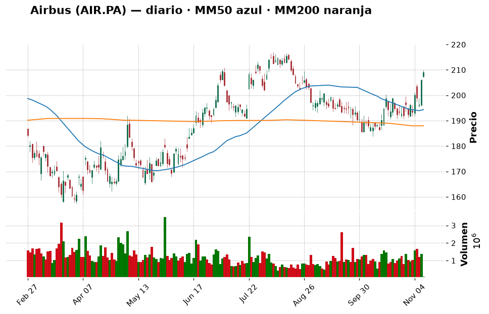

# 📈 Informe pre-apertura — martes 10 de noviembre de 2026

> Generado automáticamente a las 09:55 (hora de Madrid; versión regenerada con el nuevo procedimiento) · Bolsa española abre a las 9:00 · Wall Street a las 15:30 · Cripto: 24/7
> **Termómetro del día:** 🟡 prudencia — las bolsas europeas suben otra vez (Ibex +1,2 % en los primeros minutos), pero a las 14:30 se publica el IPC de EE. UU. y el mercado ya da un ~85 % de probabilidad a una **subida** de tipos de la Fed en diciembre.
> **Lección de hoy:** Qué es la inflación (IPC) y por qué mueve la bolsa

> ⚠️ *Nota de horario:* esta versión se generó con la bolsa europea **ya abierta**. Las cifras de España y Europa de las tablas son de los **primeros ~50 minutos de la sesión de hoy** (no un cierre). Las de EE. UU. son del cierre del lunes 9 (Wall Street aún no ha abierto).

## 1. Lo que tienes que saber hoy
- **El rebote sigue en Europa.** Ayer el S&P 500 subió un +2,35 % (su mejor día desde abril) y el Ibex un +1,93 %. Esta mañana el Ibex sube otro +1,2 % (19.979 puntos) y el Euro Stoxx 50 un +1 %. La banca tira (BBVA +2,1 %, Santander +1,9 %); Repsol vuelve a caer (−1,3 %) porque el petróleo sigue bajando.
- **Hoy, 14:30 h: el IPC de EE. UU. de octubre.** Según el consenso recogido por Reuters, se espera que los precios suban un **0,3 % en el mes** (en septiembre, 0,6 %) y la inflación "subyacente" un 0,2 % (antes 0,3 %). Los economistas calculan que la tasa anual pasaría del 3,7 % al ~3,9 %. Si sale peor de lo esperado, se refuerza la subida de tipos de diciembre y la bolsa podría devolver parte del rebote. Es la lección de hoy (sección 10).
- **Nvidia sigue en el foco.** El FBI investiga la relación de su CEO con una presunta espía china (lo dijo Trump), los accionistas han presentado una demanda colectiva y la acción cerró en su mínimo desde abril (178,67 $, −4,3 %) mientras el resto de chips subía con fuerza.
- **Tu cartera:** 9.685 €, de los que **9.415 € (97 %) son liquidez**. Es una gran ventaja (eliges cuándo y cómo entrar), pero también una tentación: **no hay que invertirlo todo de golpe**. En la sección 8 tienes un plan por tramos.

## 2. ✅ Recomendaciones del día (resumen)
| Activo | Acción | Cuánto (orientativo) | Horizonte | Por qué, en una frase | Confianza |
|---|---|---|---|---|---|
| ETF S&P 500 (SPY o equivalente UCITS) | 🟢 Comprar | **1.er tramo de ~650 € (≈7 %)** después del IPC; objetivo ~35 % en 6 tramos mensuales | Años (5+) | Es el núcleo que te falta; el índice sigue un 3 % por encima de su media de 200 sesiones | media |
| Iberdrola (IBE.MC) | ⏸️ Esperar | Hasta 5 % (~480 €) si retrocede a 21–22 € | Años | Morgan Stanley la sube a "sobreponderar" (precio objetivo 26 €), pero está muy sobrecomprada (RSI 74,7) y en máximos | media |
| Airbus (AIR.PA) | ⏸️ Esperar | Hasta 3–4 % (~300–400 €) en 2 tramos, si vuelve a ~202 € o supera 217 € | Años | Gran empresa europea con récord de pedidos, pero ha subido un +11 % en un mes y choca con una resistencia (211 €) | media |
| Repsol (REP.MC) | 🔵 Mantener | No añadir | Años | Ganas un +135 %; el petróleo cae (Brent ~90,7 $) y le resta impulso | media |
| NVIDIA (NVDA) | ⛔ Evitar | 0 € | — | Tendencia rota (−12,7 % bajo MM200), FBI y demanda colectiva | media |
| Inditex (ITX.MC) | 🔵 Mantener | No añadir | Años | +124 % en tu posición, a un 0,7 % de su máximo anual | media |
| Apple (AAPL) | 🔵 Mantener | No añadir | Años | Tendencia alcista sana (+17 % sobre su MM200) | media |
| Bitcoin (BTC-EUR) | 🟢 Comprar | **100 €** tras el IPC, desde el USDC; repetir cada mes | Años | Miedo (32/100) y precio justo sobre su soporte de 65.900 €; solo en aportaciones pequeñas | baja |
| Ether (ETH-EUR) | ⏸️ Esperar | 0 € hoy | Años | Está literalmente encima de su MM200 (1.877 €), sin señal de giro | media |
| Shiba Inu (SHIB) | ⛔ Evitar | No añadir | — | Memecoin, −55 % en un año; no encaja con tu perfil | alta |

*(El resto de la watchlist —Santander, BBVA, Telefónica, Microsoft, Amazon y el ETF del Nasdaq— tiene su veredicto en la tabla "Resto de la watchlist" de la sección 6.)*

> Día para **arrancar el plan, no para lanzarse**: esperar al IPC de las 14:30, comprar el primer tramo del núcleo indexado (y, si quieres, 100 € de bitcoin) y dejar el resto de la liquidez para los próximos meses. Las buenas empresas que hoy están caras (Iberdrola, Airbus) quedan en la "lista de la compra" con su precio objetivo de entrada.

## 3. Agenda del día
| Hora (Madrid) | Evento | Por qué importa |
|---|---|---|
| Durante el día | Intervenciones de Christine Lagarde y Philip Lane (BCE) | Pistas sobre los tipos en Europa; el BCE tuvo reunión el 29 de octubre |
| Antes de abrir Wall Street | Resultados previstos de TransDigm, Honda, Sea, On Holding y Petrobras (calendario MarketChameleon a 6-nov; horarios no confirmados) | Pistas de consumo, industria aeroespacial y petróleo |
| **14:30** | **IPC de EE. UU. (octubre)**: previsto +0,3 % mensual (antes 0,6 %); subyacente +0,2 % (antes 0,3 %) | El dato de la semana: decide si la Fed sube tipos en diciembre |
| 15:30 | Apertura de Wall Street | Primera reacción "completa" al IPC |
| 18:00 | Subasta de bonos de EE. UU. a 10 años | Si hay poca demanda, sube la rentabilidad del bono y eso pesa sobre la bolsa |
| Tras el cierre de EE. UU. | **CoreWeave** (según el mismo calendario) | Termómetro del negocio de "nubes" de IA, clave para el sentimiento tecnológico |
| Mié 11 | Huelga general en España (11-N) · Día del Veterano en EE. UU. (el mercado de bonos cierra; la bolsa abre) | Ruido político en España; menor actividad en EE. UU. |
| Jue 12 | Votación de los decretos de vivienda en España | Relevante para inmobiliarias y banca |
| Vie 13 | IPP (precios industriales) de EE. UU. · Revisión del rating de Alemania (Fitch) | Segunda pista de inflación de la semana |

## 4. Cómo llegan los mercados
### España y Europa
**Ayer (lunes 9):** el **Ibex 35** cerró en **19.742,5** (+1,93 %, +373 puntos), su mejor nivel en un mes; según Investing.com subieron con fuerza Solaria (+4,37 %), Indra (+4,16 %), ArcelorMittal (+4,02 %) y la banca (Santander +3,5 %, BBVA +2,46 %), mientras **Repsol (−1,81 %)** fue el único gran valor en rojo por la caída del petróleo. El **Euro Stoxx 50** cerró en 6.290,45 (+1,94 %) y el DAX alemán en 26.267 (+1,73 %).

**Esta mañana (datos de hoy a ~9:50, sesión en curso):** el Ibex sube un **+1,2 %, hasta 19.979** puntos, a solo un 1,9 % de su máximo de 52 semanas (20.356,5); en la semana ya gana un +6,2 %. El Euro Stoxx 50 sube un +1,0 % (6.354 según Yahoo Finance a las 9:37). Destacan BBVA (+2,1 %), Santander (+1,9 %), Airbus (+1,6 %), Telefónica (+1,0 %) e Inditex (+1,0 %); bajan Repsol (−1,3 %) e Iberdrola (−0,1 %).

💡 *Por qué España aguanta mejor que el Nasdaq:* el Ibex pesa mucho en **banca, energía y eléctricas** y poco en tecnología, así que el "pinchazo" de la IA le afecta menos. A la banca, además, le vienen bien los tipos altos (gana más con los préstamos).

En España la semana viene cargada de **política** (huelga general mañana, votación de los decretos de vivienda el jueves y arranque de la campaña electoral el viernes). Históricamente es más ruido que causa de caídas.

### Estados Unidos
El **S&P 500** cerró el lunes en **7.549,9** (+2,35 %), el **Nasdaq** en 25.253 (+2,74 %) y el Dow Jones en 52.390 (+2,15 %). Los chips lideraron el rebote: el índice de semiconductores de Filadelfia subió casi un 7 %, AMD un +13 % y Broadcom un +8,8 % (Investing.com)... con la gran excepción de Nvidia. El índice de miedo **VIX** cayó un 22 %, hasta 19,9. 💡 *El **VIX** mide cuánta volatilidad espera el mercado: por encima de 20–25 hay nervios; por debajo, calma.*

**Futuros esta mañana (Yahoo Finance, ~9:40 h de Madrid):** S&P 500 7.586 (**+0,16 %**) y Nasdaq 100 27.976 (**−0,14 %**). Traducción: el mercado está "en pausa", esperando al IPC.

Otros temas: la CEO de Citigroup, Jane Fraser, atribuye las ventas de las semanas pasadas a los fondos de cobertura y no espera que empeore (247 Wall St.); Apple lanza paquetes de pago (49,99 $) para el uso extra de IA en sus apps creativas (GuruFocus vía Yahoo Finance); Amazon celebrará su "Black Friday Week" del 19 al 30 de noviembre.

### Macro (tipos de interés, inflación, divisas, materias primas)
- **Fed:** los tipos están en el 3,75–4,00 % y el mercado ve un **~85 %** de probabilidad de **subida** de 0,25 puntos en diciembre (CME FedWatch, vía Reuters/Investing.com), tras un buen dato de empleo. La Fed no ha publicado nada relevante de política monetaria esta semana (sus últimas notas son aprobaciones bancarias). 💡 *Subir tipos es como "encarecer el dinero": frena el consumo y la inflación, pero hace menos atractivas las acciones.*
- **BCE:** su última reunión fue el 29 de octubre; hoy hablan Lagarde y Lane.
- **Petróleo Brent:** **90,73 $ (−2 %)**, tras caer un −4,6 % ayer por las expectativas de un acuerdo diplomático con Irán. Bueno para la inflación; malo para Repsol. El soporte que vigilan los analistas está en 90 $.
- **Euro/dólar:** **1,1252 (+0,3 %)**. 💡 *Ojo: tus 2.717 USDC son dólares digitales. Si el euro sube frente al dólar, valen menos en euros aunque "siempre valgan 1 $": hoy, con el euro un 0,3 % más fuerte, han "perdido" unos 7 € sin moverse.*
- **Asia:** fuerte subida, liderada por los chips coreanos (Yahoo Finance). TSMC, el gran fabricante de chips, facturó un **+60 %** en octubre por la IA (Investing.com): la demanda de IA no ha desaparecido, aunque el mercado dude de su rentabilidad.

## 5. Panorama técnico de la watchlist
> 💡 *Cómo leer esta tabla:* la **tendencia** resume si el precio lleva meses subiendo, bajando o de lado
> (comparando el precio con sus medias de 50 y 200 días). El **RSI** mide de 0 a 100 si las subidas o bajadas
> recientes han sido muy fuertes: por encima de 70 se dice "sobrecompra" (quizá ha subido demasiado rápido),
> por debajo de 30 "sobreventa". Son pistas, no predicciones.

| Valor | Último precio | Día | 1 mes | 1 año | Tendencia | RSI | vs MM200 |
|---|---|---|---|---|---|---|---|
| IBEX 35 (^IBEX) | 19.979,3 (hoy, ~9:50) | +1,20 % | +3,60 % | +20,52 % | ➡️ lateral | 63,5 🟡 | +6,6 % |
| Euro Stoxx 50 | 6.355,6 (hoy, ~9:50) | +1,04 % | +2,49 % | +13,27 % | ➡️ lateral | 59,9 🟡 | +3,9 % |
| S&P 500 (^GSPC) | 7.549,94 (9-nov) | +2,35 % | −3,35 % | +12,34 % | ➡️ lateral | 45,8 🟡 | +3,0 % |
| Nasdaq Composite | 25.253,14 (9-nov) | +2,74 % | −7,72 % | +9,54 % | ➡️ lateral | 42,4 🟡 | +0,6 % |
| Banco Santander (SAN.MC) | 11,28 (hoy) | +1,92 % | −8,01 % | +18,14 % | ➡️ lateral | 49,4 🟡 | −0,1 % |
| BBVA (BBVA.MC) | 23,77 (hoy) | +2,06 % | +0,98 % | +25,90 % | ➡️ lateral | 58,1 🟡 | +10,4 % |
| Inditex (ITX.MC) | 60,24 (hoy) | +0,97 % | +11,72 % | +23,11 % | 📈 alcista | 66,8 🟡 | +10,4 % |
| Iberdrola (IBE.MC) | 22,93 (hoy) | −0,13 % | +5,77 % | +27,57 % | 📈 alcista | 74,7 🔴 | +12,6 % |
| Telefónica (TEF.MC) | 3,44 (hoy) | +1,00 % | +7,02 % | −7,27 % | ➡️ lateral | 54,0 🟡 | −5,6 % |
| Repsol (REP.MC) | 28,98 (hoy) | −1,29 % | −0,79 % | +70,17 % | ➡️ lateral | 46,5 🟡 | +19,5 % |
| Airbus (AIR.PA) | 209,20 (hoy) | +1,55 % | +11,19 % | −0,50 % | ➡️ lateral | 65,7 🟡 | +11,3 % |
| Apple (AAPL) | 350,69 $ (9-nov) | +2,43 % | +4,17 % | +30,00 % | 📈 alcista | 57,6 🟡 | +17,2 % |
| Microsoft (MSFT) | 545,18 $ (9-nov) | +2,75 % | +1,89 % | +9,67 % | 📈 alcista | 57,5 🟡 | +23,8 % |
| NVIDIA (NVDA) | 178,67 $ (9-nov) | −4,27 % | −22,07 % | −5,00 % | ➡️ lateral | 27,4 🟢 | −12,7 % |
| Amazon (AMZN) | 266,93 $ (9-nov) | +2,94 % | +1,71 % | +9,83 % | ➡️ lateral | 59,2 🟡 | +9,4 % |
| ETF S&P 500 (SPY) | 752,69 $ (9-nov) | +2,37 % | −3,32 % | +12,29 % | ➡️ lateral | 45,8 🟡 | +3,0 % |
| ETF Nasdaq 100 (QQQ) | 679,35 $ (9-nov) | +3,54 % | −9,57 % | +11,06 % | ➡️ lateral | 41,4 🟡 | −0,3 % |

*(🟢 = RSI bajo, posible "rebajas"; 🔴 = RSI alto, quizá demasiado rápido; 🟡 = neutral. Los datos "hoy" son de la sesión en curso: el volumen aún es parcial y el precio puede cambiar mucho tras el IPC.)*

**En conjunto:** la tendencia de fondo **sigue intacta** en el S&P 500 (+3 % sobre su media de 200 sesiones), aunque aún está por debajo de su media de 50 (7.676): el rebote todavía no ha "recuperado" del todo la caída de octubre. Europa está más fuerte: el Ibex, a un paso de máximos anuales. El castigo sigue concentrado en Nvidia. En España, lo "estirado" son Iberdrola (RSI 74,7) e Inditex (casi en máximos); Santander está justo en su media de 200 sesiones (11,29 €) —una "frontera" importante— y Telefónica sigue por debajo de la suya.

## 6. Ideas de bolsa: qué haría un experto
### ETF S&P 500 (SPY o un equivalente UCITS) — COMPRAR (1.er tramo hoy)

- **Qué es:** un fondo cotizado que compra las ~500 mayores empresas de EE. UU. de una vez (lo vimos ayer en la lección del ETF).
- **Por qué es noticia hoy:** ayer el S&P 500 sumó +2,35 % y, según 247 Wall St., ganó **un billón de dólares** de valor en un día. Hoy decide el IPC. Curiosidad útil: Warren Buffett dejó instrucciones para que la herencia de su esposa se invierta un 90 % en un fondo del S&P 500 y un 10 % en bonos (The Motley Fool): el inversor más famoso del mundo recomienda, para quien no es profesional, justo este tipo de producto.
- **Lo que dice el gráfico:** el SPY (752,69 $) rebotó desde la zona de su media de 200 sesiones (730,7 $) y está justo debajo de varias resistencias (755,6–760,4 $) y de su MM50 (765,4 $). RSI 45,8: neutral. MACD "mejorando" (el impulso se gira al alza). A un 3,7 % de su máximo de 52 semanas. En lenguaje llano: **el suelo de largo plazo aguantó**, pero aún tiene "techos" encima.
- **Lo positivo:** máxima diversificación, coste bajísimo, y tu cartera **no tiene núcleo**: es lo primero que necesita.
- **El riesgo:** un IPC caliente puede llevarlo de vuelta a 739–729 $ (soportes); además pesa mucho la tecnología (incluida Nvidia).
- **🧑‍💼 Recomendación: COMPRAR, en tramos.** Tienes 9.415 € de liquidez. Mi plan: que el núcleo indexado llegue a ~35 % de tu patrimonio (~3.400 €) en **6 tramos mensuales de ~570–650 €**. El primero, **hoy después de las 14:30** (o mañana), una vez conocido el IPC: así no te juegas la entrada a un dato.
  - **Cuánto y cómo:** ~650 € hoy/mañana. 💡 Desde Europa se usa un **ETF UCITS que replique el S&P 500** (mejor de acumulación, que reinvierte los dividendos); alternativa aún más diversificada: un ETF del **MSCI World** (EE. UU. + Europa + Japón…).
  - **Horizonte:** 5 años o más.
  - **Qué me haría cambiar de opinión:** un cierre semanal del SPY por debajo de 729 $ (soporte + MM200): mantendría lo comprado, pero pausaría el siguiente tramo hasta ver estabilidad.
- **Qué mirar para entenderlo:** el IPC de hoy y si el precio supera la MM50 (línea del gráfico ~765 $): sería la señal de que el rebote es algo más que un alivio de un día.
- **Confianza:** media

### Iberdrola (IBE.MC) — ESPERAR

- **Qué es:** la mayor eléctrica española (redes y renovables en España, Reino Unido y EE. UU.). Defensiva y con dividendo.
- **Por qué es noticia hoy:** **Morgan Stanley la sube a "sobreponderar"** (antes "neutral") y eleva su precio objetivo de 22,50 € a **26 €**: espera que su beneficio por acción crezca un 10 % al año (antes 8 %) y un beneficio neto de ~10.000 M€ en 2030, por encima del consenso. Su escenario optimista es 29 € y el pesimista 19 € (Investing.com vía Yahoo Finance). 💡 *Un **precio objetivo** es lo que un analista cree que valdrá la acción en ~12 meses. Es una opinión, no una promesa.*
- **Lo que dice el gráfico:** tendencia **alcista** clara (+12,6 % sobre la MM200) y a un 0,7 % de su máximo anual (23,10 €), pero RSI **74,7 (sobrecompra)** y MACD "empeorando": el impulso se está frenando. Fíjate en el gráfico: el precio se ha separado mucho de sus medias; cuando eso pasa, suele "volver" hacia ellas.
- **Lo positivo:** negocio estable y regulado, demanda eléctrica al alza por los centros de datos de IA, y ahora un gran banco de inversión a favor.
- **El riesgo:** comprar en máximos con RSI > 70; si la Fed y el BCE endurecen, las eléctricas (con mucha deuda) sufren. Y el propio Morgan Stanley la pone 4.ª de 6 eléctricas grandes (su favorita es National Grid).
- **🧑‍💼 Recomendación: ESPERAR.** Me gusta mucho la empresa, pero no el precio de hoy. Compraría **si** retrocede hacia 22 € (su media de 20 sesiones, 22,05 €) o 21,1 € (soporte).
  - **Cuánto y cómo:** hasta un 5 % (~480 €), en 2 tramos (mitad en ~22 €, mitad en ~21 €).
  - **Horizonte:** años.
  - **Qué me haría cambiar de opinión:** un cierre por debajo de 20,4 € (MM200) indicaría tendencia rota. En sentido contrario, si el RSI baja de 60 sin que el precio caiga mucho (se "enfría" de lado), también sería una buena entrada.
- **Qué mirar para entenderlo:** el RSI y la distancia del precio a la línea de la MM50 (21,08 €).
- **Confianza:** media

### Airbus (AIR.PA) — ESPERAR (en tu lista de la compra)

- **Qué es:** el mayor fabricante de aviones comerciales del mundo (familia A320/A321, A350), además de helicópteros, defensa y espacio. Cotiza en París; es la gran empresa industrial europea.
- **Por qué es noticia hoy:** en **octubre entregó 74 aviones** (78 un año antes) y suma **621 en lo que va de año (+6,2 %)**; recibió **200 pedidos netos** en el mes. Para cumplir su objetivo anual (~870 aviones) necesita entregar unos **249 en noviembre y diciembre** (AirDataNews, Idéal Investisseur). Además, AAR firmó un acuerdo plurianual para reparar los radomos (la "nariz") de los aviones Airbus en Asia-Pacífico (PR Newswire vía Yahoo Finance).
- **Lo que dice el gráfico:** +11,2 % en un mes y +8,2 % en una semana: un rebote fuerte que lo ha llevado justo debajo de la **resistencia de 210,95 €** (hoy cotiza a 209,2 €). Está un 7,6 % por encima de la MM50 y un 11,3 % por encima de la MM200, con el MACD mejorando y RSI 65,7 (fuerte, sin llegar a sobrecompra). A un 5,5 % de su máximo anual (221,3 €). En un año, sin embargo, está plano (−0,5 %): viene de una caída de verano.
- **Lo positivo:** cartera de pedidos enorme (de más de 9.000 aviones, para muchos años de trabajo), duopolio con Boeing, y viento a favor del gasto en defensa europeo.
- **El riesgo:** el objetivo de entregas es exigente (los problemas de motores y proveedores ya lo han retrasado otras veces); si en enero confirma que no llega, la acción suele castigarse. Y comprar tras +11 % en un mes, pegado a una resistencia, es comprar "con el viento ya a favor".
- **🧑‍💼 Recomendación: ESPERAR.** Es exactamente el tipo de empresa grande y consolidada que encaja contigo, y me gustaría tenerla como **satélite**, pero no compraría con el precio chocando contra un techo. Dos formas de entrar:
  - **Cuánto y cómo:** hasta un 3–4 % (~300–400 €) en 2 tramos: el 1.º si retrocede al soporte de **~201,6 €**, o si **supera 217 €** con claridad (eso confirmaría la ruptura de las resistencias de 211–217 €).
  - **Horizonte:** años.
  - **Qué me haría cambiar de opinión:** un cierre por debajo de 188 € (MM200) o un recorte del objetivo de entregas de 2026.
- **Qué mirar para entenderlo:** los datos mensuales de entregas (los de noviembre salen a primeros de diciembre): si se acercan a 100–120 aviones/mes, el objetivo es creíble.
- **Confianza:** media

### Repsol (REP.MC) — MANTENER (la tienes)

- **Qué es:** la petrolera española (exploración, refino, gasolineras y renovables).
- **Por qué es noticia hoy:** fue el único gran valor del Ibex en rojo ayer (−1,81 %) y hoy vuelve a caer (−1,3 %, 28,98 €) porque el Brent baja a ~90,7 $ por el posible acuerdo con Irán. El jueves 12 participa en una conferencia virtual para inversores de Deutsche Bank (Yahoo Finance).
- **Lo que dice el gráfico:** la tendencia de fondo sigue positiva (+19,5 % sobre la MM200, +70 % en un año), pero de corto plazo se ha girado: ya cotiza **por debajo de su MM50** (29,42 €) y el MACD empeora. Soportes en 28,3 y 27,8 €.
- **Lo positivo:** tu posición vale más del doble (compraste a 12,37 €); empresa con dividendo atractivo.
- **El riesgo:** si se firma la paz con Irán y el petróleo cae hacia 80 $, Repsol puede corregir bastante más.
- **🧑‍💼 Recomendación: MANTENER.** El viento a favor (petróleo caro por el conflicto) se está calmando, así que **no ampliaría**; pero tampoco vendería una empresa sólida y con dividendo por dos malos días. Al ser una posición pequeña (58 €), venderla tampoco cambiaría nada en tu riesgo.
  - **Cuánto y cómo:** no añadir.
  - **Qué me haría cambiar de opinión:** un cierre por debajo de 27,8 € (último soporte) con el Brent bajo 90 $: ahí plantearía **Reducir**.
- **Qué mirar para entenderlo:** el precio del Brent (sección 4): Repsol se mueve mucho con él.
- **Confianza:** media

### NVIDIA (NVDA) — EVITAR

- **Qué es:** el gran fabricante de chips para IA.
- **Por qué es noticia hoy:** Trump dijo que **el FBI investiga** la relación de Jensen Huang con una empresaria china señalada como presunta espía; el consejo abrió una investigación interna y dice confiar en él, y accionistas han presentado una **demanda colectiva** (Investing.com). Google presenta nuevos chips de IA para competirle (Decrypt) y Michael Burry, famoso inversor bajista, dice que no tocaría la acción (Stocktwits). Mientras, AMD subió un +13 %: el dinero de los chips se va a otras empresas.
- **Lo que dice el gráfico:** −22 % en un mes, −26,6 % desde máximos, −12,7 % bajo su MM200. RSI 27 (**sobreventa**) y volumen **3,35 veces** la media: mucha gente saliendo. Sin soportes cercanos (el mínimo anual es 164,27 $).
- **🧑‍💼 Recomendación: EVITAR.** La sobreventa puede provocar rebotes, pero para un principiante comprar aquí es intentar coger un cuchillo que cae: el problema ya no es técnico, es de **confianza en la dirección**.
  - **Qué me haría cambiar de opinión:** que se cierre la investigación sin consecuencias y el precio recupere la MM200 (~204,6 $).
- **Qué mirar para entenderlo:** compara su gráfico con el de Apple: mismo sector, historias opuestas. Ya tendrás exposición indirecta a Nvidia a través del ETF del S&P 500 (es una de sus mayores posiciones): no necesitas más.
- **Confianza:** media

### Resto de la watchlist: veredicto rápido
| Valor | Acción | Por qué (1 frase) | Nivel a vigilar |
|---|---|---|---|
| Inditex (ITX.MC) — *la tienes* | 🔵 Mantener | Tendencia alcista (+10,4 % sobre MM200) y a un 0,7 % de su máximo anual (60,64 €); tu posición gana +124 %; no ampliar pegado a máximos | Soporte 56,2 €; si algún día quieres más, en retrocesos a 55–56 € |
| Apple (AAPL) — *la tienes* | 🔵 Mantener | Tendencia alcista sana, menos expuesta al "pinchazo" de la IA; lanza paquetes de pago de IA para sus apps (nueva fuente de ingresos) | Resistencia 351,7 $; soporte 338,7 $ |
| Banco Santander (SAN.MC) | ⏸️ Esperar | Rebota fuerte (+10 % en la semana) pero está justo en su MM200 (11,29 €) y un 5,9 % bajo la MM50: aún no ha confirmado el giro | Compraría si cierra varios días sobre 11,3 € y luego sobre 12,05 € |
| BBVA (BBVA.MC) | ⏸️ Esperar | Buena empresa (PER ~11, rentabilidad sobre el capital ~21 %, según Simply Wall St), +10,5 % en la semana; justo en su MM50 (23,80 €). Lanza un servicio de eSIM en Italia | Primer tramo pequeño si supera con claridad 23,8 €; soporte 22,8 € |
| Telefónica (TEF.MC) | ⛔ Evitar | Sigue un 5,6 % bajo su MM200 y −7 % en un año; sin noticias propias hoy | Solo la reconsideraría sobre 3,65 € (MM200) |
| Microsoft (MSFT) | ⏸️ Esperar | Tendencia alcista fuerte (+23,8 % sobre MM200) y a un 2,5 % de máximos; ya la tendrás dentro del ETF del S&P 500 | Entrada razonable cerca de la MM50 (517 $) |
| Amazon (AMZN) | ⏸️ Esperar | Rebota +8,7 % en la semana hasta su resistencia (267,6 $); "Black Friday Week" del 19 al 30 de noviembre | Resistencia 267,6 $; soporte 244,7 $ |
| ETF Nasdaq 100 (QQQ) | ⏸️ Esperar | Más concentrado en tecnología que el SPY (−9,6 % en un mes); para un principiante, mejor el S&P 500 o el MSCI World como núcleo | Recuperar su MM200 (681 $) |

## 7. ₿ Criptomonedas
> 💡 *Las criptomonedas cotizan 24 horas, 7 días a la semana: los precios son de esta mañana (en euros).
> Son mucho más volátiles que las acciones: caídas del 50 % o más han ocurrido varias veces.*

**Sentimiento:** Fear & Greed **32/100 (miedo**; ayer 29, hace una semana 26, hace un mes 61 "codicia") · Capitalización total 2,60 billones $ (+0,1 % 24 h, **−46,1 % bajo su máximo histórico** de octubre de 2025) · Dominancia de Bitcoin 57,6 %.
En un mes el ánimo ha pasado de codicia a miedo. El miedo se suaviza un poco estos días, pero el mercado sigue débil: CoinDesk dice que bitcoin afronta el "examen" del IPC y que un dato suave quizá solo dé un alivio breve ("bitcoin necesita compras reales, no un golpe de suerte").

**Radar Coinbase** (408 monedas comprables · hoy suben 214 y bajan 145 · en 7 días suben 79 y bajan 279):
- **Mayores por capitalización (7 d):** BTC −3,0 %, ETH −6,6 %, BNB −0,9 %, XRP −13,5 %, SOL −7,0 %, DOGE −5,6 %.
- **Más suben (7 d, top 100):** PEPE (+13,2 %, memecoin), INJ (+12,0 %), ETHFI (+10,6 %), ARB (+8,1 %), RENDER (+6,0 %) · **Más bajan:** BCH (−14,0 %), XRP (−13,5 %), WLD (−13,5 %), HYPE (−11,8 %), PUMP (−11,3 %).
La semana sigue en rojo para casi 8 de cada 10 monedas: las subidas del radar son casos aislados (y la mayor es una memecoin) sin una noticia sólida detrás. No hay nada que merezca perseguirse.

| Moneda | Ranking | Precio (€) | 24 h | 7 días | 1 mes | 1 año | Tendencia | RSI | vs MM200 |
|---|---|---|---|---|---|---|---|---|---|
| Bitcoin (BTC) | #1 | 66.260,95 | −1,24 % | −4,03 % | −11,30 % | −27,72 % | ➡️ lateral | 34,8 | +3,9 % |
| Ether (ETH) | #2 | 1.879,31 | −1,06 % | −7,31 % | −16,92 % | −39,09 % | ➡️ lateral | 32,5 | +0,1 % |
| BNB (BNB) | #4 | 612,63 | −0,23 % | −1,22 % | −8,50 % | −30,55 % | ➡️ lateral | 40,5 | +4,7 % |
| XRP (XRP) | #6 | 0,9641 | −1,42 % | −15,33 % | −23,34 % | −55,89 % | ➡️ lateral | 25,5 | −12,4 % |
| Solana (SOL) | #7 | 76,19 | −1,31 % | −7,89 % | −23,24 % | −47,35 % | ➡️ lateral | 26,5 | −1,9 % |
| Shiba Inu (SHIB) | #42 | 0,00000396 | +0,51 % | −2,94 % | −19,02 % | −54,90 % | ➡️ lateral | 35,9 | −11,0 % |

**Noticias que importan:**
- Los **ETF de bitcoin al contado de EE. UU. perdieron 201 M$ el lunes**, tras más de 1.200 M$ de salidas la semana anterior (SoSoValue, vía [Investing.com/Yahoo Finance](https://finance.yahoo.com/markets/crypto/articles/bitcoin-pinned-below-75k-regulatory-063403850.html)). Además, con el nuevo Congreso de mayoría demócrata aumenta la incertidumbre regulatoria.
- El minero **MARA vendió 13.597 BTC (~1.100 M$) en seis semanas** —el 40 % de lo que tenía— y planea seguir vendiendo para financiar infraestructura de IA ([CoinDesk](https://www.coindesk.com/markets/2026/11/10/bitcoin-miner-mara-sold-13-597-btc-for-usd1-1-billion-in-six-weeks-plans-to-sell-more)). Más oferta en el mercado = presión bajista.
- Analistas citados por [CoinDesk](https://www.coindesk.com/markets/2026/11/10/bitcoin-faces-u-s-cpi-test-as-analysts-warn-inflation-relief-may-not-be-enough) vigilan los **73.000 $** (~64.900 €): un cierre por debajo podría llevar a bitcoin hacia 68.000–70.000 $; recuperar 80.000 $ indicaría demanda más fuerte.
- Hackers norcoreanos crean memecoins para blanquear lo robado en el hackeo de Binance (Elliptic, vía [Cointelegraph](https://cointelegraph.com/news/north-korean-hackers-memecoins-launder-binance-hack-elliptic)): otro motivo para alejarse de las memecoins.
- El Banco de Rusia aprueba el comercio de cripto a partir del 17 de noviembre; el XRP Ledger presenta cuentas "resistentes a la computación cuántica" (Yahoo Finance, CoinDesk).

### Bitcoin (BTC) — COMPRAR (poco y en tramos)

- **Qué es:** la primera y mayor criptomoneda, con oferta limitada a 21 millones.
- **Lo que dice el gráfico:** 66.261 €, apenas un 0,5 % encima de su soporte de 65.898 € y un 3,9 % por encima de la MM200 (63.772 €), pero un 8,5 % bajo la MM50 y con el MACD empeorando: la tendencia de corto es bajista, la de fondo aún aguanta. Un 28,8 % bajo su máximo anual.
- **🧑‍💼 Recomendación: COMPRAR, solo 100 € y en modo aportación periódica.** Hay miedo (32/100) y estamos sobre un soporte: históricamente, comprar poco a poco con miedo ha salido mejor que comprar con euforia. Pero con ventas de mineros y salidas de ETF, **no hay prisa**.
  - **Cuánto y cómo:** 100 € tras el IPC, usando parte de tus USDC (par BTC-USDC o, si lo prefieres, BTC-EUR en Coinbase), y repetir ~100 € al mes. Tu cripto pesa un 0,8 %; aunque tu tope es 25 % (margen de 3.123 €), para un perfil moderado **te sugiero no pasar del 5–10 %**. Recuerda que **25 % es mucho**: las criptomonedas han tenido caídas del 50–80 %.
  - **Qué me haría cambiar de opinión:** un cierre diario por debajo de 64.918 € (segundo soporte) abriría la puerta hacia 54.000 €: pausaría las compras.
- **El riesgo:** bitcoin cae un −27,7 % en un año; podría caer bastante más.
- **Confianza:** baja

### Ether (ETH) — ESPERAR

- **Qué es:** la moneda de Ethereum, la red de los "contratos inteligentes" (programas que se ejecutan solos en la cadena de bloques).
- **Lo que dice el gráfico:** 1.879 €, **a un 0,1 % de su MM200** (1.877 €): está sobre la línea, literalmente. −14 % bajo la MM50, RSI 32,5 y MACD empeorando. El siguiente soporte está lejos (1.607 €).
- **🧑‍💼 Recomendación: ESPERAR.** Está en una "frontera": si la MM200 aguanta, podría ser buena entrada; si se pierde, hay espacio hasta 1.600 € (−15 %). Esperaría a ver unos días de cierres por encima de 1.877 € o una recuperación de 2.178 €.
  - **Qué me haría cambiar de opinión:** varios cierres por encima de la MM200 con el RSI subiendo de 40 → primer tramo pequeño (50 €).
- **El riesgo:** −39 % en un año; más débil que bitcoin en esta fase. Además, Vitalik Buterin (su creador) ha sido demandado en una disputa con la Fundación Ethereum (BeInCrypto): ruido, pero ruido.
- **Confianza:** media

### Shiba Inu (SHIB) — EVITAR

- **Qué es:** una "memecoin" (moneda nacida como broma, sin utilidad clara).
- **Lo que dice el gráfico:** −55 % en un año, −11 % bajo su MM200, tendencia lateral sin suelo claro.
- **🧑‍💼 Recomendación: EVITAR (no añadir).** Tu posición vale ~4 €: venderla apenas cambia nada (y quizá cueste comisión); tómala como "lección pagada". No pongas más dinero.
- **El riesgo:** que pierda casi todo su valor.
- **Confianza:** alta

## 8. 💼 Tu cartera
**Valor total:** 9.685,10 € · **Invertido:** 270,50 € · **Ganancia/pérdida no realizada:** +78,19 € (+40,7 %) · **Realizada:** 0 €
**Reparto:** acciones 2,0 % · ETF 0 % · cripto 0,8 % · liquidez 97,2 % · **Cripto vs tope:** 0,8 % de 25 % ✅ dentro (margen 3.123 €)
**Liquidez disponible:** 9.414,60 € (97,2 %: 7.000 € en euros + 2.717 USDC ≈ 2.414,60 €) · **Próxima aportación:** 200 € el 2026-12-01 (en 21 días)

| Activo | Cantidad | Precio medio | Precio actual | Valor (€) | G/P | Peso | Acción recomendada |
|---|---|---|---|---|---|---|---|
| Liquidez en euros (otro bróker) | 7.000 € | — | — | 7.000,00 | — | 72,3 % | Invertir **en tramos** según el plan de abajo |
| USDC (Coinbase) | 2.717 | 1 $ | 1 $ | 2.414,60 | 0 % | 24,9 % | Usar para las compras cripto; valorar pasar parte a euros |
| Bitcoin (BTC) | 0,00113223 | 74.000 € | 66.261 € | 75,02 | −10,5 % | 0,8 % | 🟢 Comprar (100 €) — promediar a la baja con calma |
| Inditex (ITX.MC) | 1 | 26,94 € | 60,22 € | 60,22 | +123,5 % | 0,6 % | 🔵 Mantener — cerca de máximos |
| Repsol (REP.MC) | 2 | 12,37 € | 29,01 € | 58,02 | +134,5 % | 0,6 % | 🔵 Mantener — sin ampliar |
| Apple (AAPL) | 0,15 | 171,99 $ | 350,69 $ | 46,75 | +103,9 % | 0,5 % | 🔵 Mantener — tendencia alcista sana |
| Solaria (SLR.MC) | 1 | 14,99 € | 16,86 € | 16,86 | +12,5 % | 0,2 % | 🔵 Mantener — no añadir (renovable pequeña y volátil; ayer +4,4 %) |
| Oryzon (ORY.MC) | 4 | 3,23 € | 2,42 € | 9,67 | −25,1 % | 0,1 % | 🔵 Mantener — posición mínima; venderla costaría en comisión casi lo que vale |
| Shiba Inu (SHIB) | 1.000.000 | 0,000006 € | 0,00000396 € | 3,96 | −34,0 % | 0,04 % | ⛔ Evitar — no añadir |

*(Solaria y Oryzon no están en la watchlist, así que no tienen análisis técnico ni gráfico; si quieres seguirlas a fondo, añádelas a `config.yaml`.)*

Tus acciones antiguas lo han hecho muy bien (Repsol, Inditex y Apple más que duplicadas), pero son **posiciones muy pequeñas**; lo que de verdad decide tu futuro es **cómo inviertes los 9.415 € de liquidez**. Un experto no lo metería todo de golpe ni lo dejaría todo parado (la inflación se lo come poco a poco: es la lección de hoy). Tu `cartera.csv` no tiene errores ✅. Mi propuesta orientativa para los próximos 6 meses:

| Destino | Objetivo | Cómo | Por qué |
|---|---|---|---|
| Núcleo: ETF S&P 500 o MSCI World | ~35 % (~3.400 €) | 6 tramos de ~570–650 €, 1.º hoy/mañana | Base diversificada y barata |
| Grandes empresas (Iberdrola, Airbus, banca, Apple…) | ~10–15 % (~1.000–1.400 €) | Solo en buenos precios (Iberdrola a 21–22 €, Airbus a ~202 € o sobre 217 €), máx. 5 % cada una | Satélites de calidad y dividendo |
| Cripto (BTC sobre todo, algo de ETH) | ~5 % (~500 €) | ~100 € al mes desde el USDC | Pequeña parte con potencial, sin poner en riesgo el total |
| Liquidez / colchón | ~45 % restante | Depósito o fondo monetario mientras tanto | Colchón para imprevistos (3–6 meses de gastos) y "munición" si hay caídas |

Las aportaciones mensuales de 200 € (la próxima, el 1 de diciembre) pueden alimentar estos mismos tramos: por ejemplo, 150 € al ETF y 50 € a bitcoin. Cuando la hagas, recuerda registrarla en `cartera.csv` como fila `liquidez` (`compra` de `EUR`).

💡 *El USDC es un dólar digital: si el euro sube un 5 % frente al dólar, tus 2.717 USDC valdrán un 5 % menos en euros. Si no lo vas a usar para cripto, convertir una parte a euros elimina ese riesgo.* Apunta cada compra en `cartera.csv` para que el informe calcule bien tus pesos.

## 9. Análisis de riesgo
| Riesgo | Nivel | Explicación |
|---|---|---|
| IPC de EE. UU. por encima de lo previsto | 🔴 | Reforzaría la subida de tipos de diciembre y podría borrar el rebote de estos dos días |
| Caso Nvidia / sentimiento IA | 🟡 | Nvidia pesa mucho en el S&P 500 y el Nasdaq; más noticias negativas arrastran al índice. Hoy publica CoreWeave (IA) |
| Subasta de bonos a 10 años | 🟡 | Si sube mucho la rentabilidad del bono, presiona a la bolsa |
| Ventas de mineros y salidas de ETF de bitcoin | 🟡 | Más oferta y menos demanda en cripto |
| Euro fuerte frente al dólar | 🟡 | Resta valor en euros a tus USDC, a Apple y al futuro ETF del S&P 500 |
| Petróleo e Irán | 🟢 | Un acuerdo bajaría la inflación (bueno), aunque resta a Repsol |
| Política en España (huelga general 11-N, campaña) | 🟢 | Ruido; poco impacto bursátil histórico |

**Qué podría salir mal hoy:** que el IPC salga en 0,5 % mensual o más. Entonces la bolsa podría caer un 1–2 % y bitcoin perder los 65.900 €. En ese caso, **compra igualmente el primer tramo del ETF** (para eso son los tramos: si baja, el siguiente sale más barato), pero deja la compra de bitcoin para la próxima semana. Las ideas en "Esperar" (Iberdrola, Airbus) podrían acercarse a sus precios de entrada: sería una buena noticia para tu lista de la compra.

## 10. 🎓 Aprende con el informe de hoy: Qué es la inflación (IPC) y por qué mueve la bolsa
- **Qué es (en una frase):** la inflación es la subida general de los precios; el **IPC** (Índice de Precios al Consumo) la mide comparando lo que cuesta una "cesta" típica de productos (comida, alquiler, gasolina…) de un mes a otro o de un año a otro.
- **Ejemplo con números:** si tu compra mensual costaba 100 € hace un año y hoy cuesta 104 €, la inflación anual es del 4 %. Con tus 7.000 € parados en euros, al 4 % de inflación pierdes unos **280 € de poder de compra en un año** aunque el saldo no cambie. Hoy se espera que los precios en EE. UU. suban un 0,3 % en un mes (en septiembre fueron un 0,6 %), y la tasa anual estimada es del ~3,9 %.
- **IPC general vs. subyacente:** el "subyacente" quita la energía y los alimentos frescos, que suben y bajan mucho por motivos puntuales (una guerra, una mala cosecha). Por eso los bancos centrales lo miran con lupa: muestra la tendencia de fondo. Hoy, con el petróleo bajando, el general podría salir mejor que el subyacente.
- **Dónde lo has visto hoy:** en la agenda (14:30), en el termómetro, en la Fed (sección 4), en las noticias cripto (el "examen" de bitcoin) y en el análisis de riesgo.
- **Por qué te importa como inversor:** la cadena es así → **inflación alta → el banco central sube tipos → el dinero se encarece → las empresas ganan menos y los bonos/depósitos compiten con las acciones → la bolsa suele bajar.** Y al revés. Por eso un solo dato mensual puede mover el mercado un 1–2 % en minutos. También es la razón por la que tener todo en liquidez no es "no arriesgar": la inflación es un riesgo silencioso. Y explica por qué a la banca española le va bien (gana más con tipos altos) y a las eléctricas y tecnológicas les cuesta más.
- **Error típico de principiante:** reaccionar comprando o vendiendo en los minutos siguientes al dato. Los primeros movimientos son muy bruscos y a menudo se dan la vuelta. Quien invierte a años debería mirar la tendencia de la inflación durante meses, no un dato suelto.
- **Pregunta para pensar:** si el IPC de hoy sale **más bajo** de lo esperado, ¿qué crees que haría la probabilidad de subida de tipos de la Fed y, por tanto, la bolsa?

## 11. Consejo del día para inversores principiantes
**Tener mucha liquidez es una oportunidad, no una urgencia.** Al ver que el mercado rebota un 2 % en un día da la sensación de que "se escapa el tren" (eso se llama **FOMO**, miedo a quedarse fuera). Un plan escrito de tramos mensuales te protege de dos errores a la vez: meterlo todo justo antes de una caída y no invertir nunca por esperar el "momento perfecto". Y ten una **lista de la compra con precios**: "Iberdrola a 22 €, Airbus a 202 €". Así, cuando el mercado se ponga nervioso, sabrás qué hacer en vez de reaccionar por impulso.

## 12. Glosario
- **Inflación / IPC:** subida general de precios / índice que la mide.
- **IPC subyacente:** el IPC sin energía ni alimentos frescos (los más volátiles); muestra mejor la tendencia de fondo.
- **Tipos de interés:** el "precio del dinero" que fija el banco central (Fed en EE. UU., BCE en Europa).
- **VIX:** índice que mide la volatilidad esperada en la bolsa de EE. UU.; "índice del miedo".
- **Precio objetivo:** valor al que un analista cree que llegará la acción en ~12 meses; es una opinión.
- **"Sobreponderar" (overweight):** recomendación de un analista de tener más peso de una acción del que tiene en el índice; en la práctica, "comprar".
- **Media móvil (MM50, MM200):** precio medio de las últimas 50 o 200 sesiones; ayuda a ver la tendencia.
- **RSI:** indicador de 0 a 100 que mide la fuerza de subidas/bajadas recientes (>70 sobrecompra, <30 sobreventa).
- **MACD:** indicador que compara dos medias para ver si el impulso del precio mejora o empeora.
- **Soporte / resistencia:** niveles donde el precio suele frenar su caída ("suelo") o su subida ("techo").
- **PER:** cuántas veces el beneficio anual pagas al comprar la acción (PER 11 = pagas 11 años de beneficios).
- **ETF UCITS:** fondo cotizado con la normativa europea, el que puede comprar un inversor en España.
- **Stablecoin (USDC):** criptomoneda que intenta valer siempre 1 dólar.
- **Memecoin:** criptomoneda nacida como broma o moda, sin utilidad clara; muy arriesgada.
- **Tramos (DCA):** invertir una cantidad en varias compras espaciadas en el tiempo en vez de todo de golpe.
- **FOMO:** "miedo a perderse algo"; impulso de comprar porque todo sube.

## 13. Fuentes
- Investing.com — [La bolsa hoy: IBEX 35, Euro Dólar, IPC EEUU, petróleo y subasta de bonos](https://es.investing.com/news/stock-market-news/la-bolsa-hoy-ibex-35-euro-dolar-ipc-eeuu-petroleo-y-subasta-de-bonos-3920424)
- Investing.com — [U.S. stock futures steady after tech-led rebound; CPI in focus](https://www.investing.com/news/stock-market-news/us-stock-futures-steady-after-techled-rebound-cpi-in-focus-5013763)
- Reuters vía Investing.com — [US consumer prices expected to have risen at slower pace in October](https://www.investing.com/news/economy-news/us-consumer-prices-expected-to-have-risen-at-slower-pace-in-october-5014085)
- Investing.com — [Trump says FBI probing Nvidia CEO Huang as China controversy deepens](https://www.investing.com/news/economy-news/nvidias-outofhour-shares-fall-as-firm-probes-ceo-jensen-huang-5010476)
- Investing.com — [TSMC Oct revenue jumps 60% as AI-fueled demand remains strong](https://www.investing.com/news/stock-market-news/tsmc-oct-revenue-jumps-60-as-aifueled-demand-remains-strong-5014187)
- Yahoo Finance — [Futuros S&P 500 (ES=F)](https://finance.yahoo.com/quote/ES=F/) · [Futuros Nasdaq 100 (NQ=F)](https://finance.yahoo.com/quote/NQ=F/) · [Euro Stoxx 50](https://finance.yahoo.com/quote/%5ESTOXX50E/) · [EUR/USD](https://finance.yahoo.com/quote/EURUSD=X/) · [Brent](https://finance.yahoo.com/quote/BZ=F/)
- Investing.com vía Yahoo Finance — [Morgan Stanley backs Iberdrola on accelerating earnings growth](https://finance.yahoo.com/markets/stocks/articles/morgan-stanley-backs-iberdrola-accelerating-111138848.html)
- Simply Wall St vía Yahoo Finance — [BBVA Stock May Be A Bargain On Its Italy eSIM Launch](https://finance.yahoo.com/markets/stocks/articles/bbva-bme-bbva-stock-may-052309069.html)
- GuruFocus vía Yahoo Finance — [Apple Makes Major AI Pricing Move](https://finance.yahoo.com/technology/ai/articles/apple-makes-major-ai-pricing-185711619.html)
- PR Newswire vía Yahoo Finance — [AAR signs multi-year radome repair agreement with Airbus Avionics](https://finance.yahoo.com/technology/articles/aar-signs-multi-radome-repair-223000226.html)
- AirDataNews — [Airbus delivers 74 aircraft in October, needs 249 more to meet 2026 target](https://www.airdatanews.com/airbus-delivers-74-aircraft-in-october-needs-249-more-to-meet-2026-target/) · Idéal Investisseur — [Airbus: 74 aircraft delivered in October, 621 since January](https://www.ideal-investisseur.fr/en/stock-news/airbus-74-aircraft-delivered-in-october-621-since-january-and-202-gross-orders/28855.html)
- 247 Wall St. — [Risk-On: S&P 500 Surges Out of the Gate, Adds $1 Trillion in Market Value](https://247wallst.com/investing/2026/11/09/risk-on-sp-500-surges-out-of-the-gate-adds-1-trillion-in-market-value/) · [Citigroup's Jane Fraser Says Hedge Funds Drove the Sell-Off](https://247wallst.com/investing/2026/11/09/citigroups-jane-fraser-says-hedge-funds-drove-the-sell-off-heres-why-she-doesnt-expect-it-to-get-worse/)
- The Motley Fool — [Warren Buffett's Instructions for His Wife's Inheritance Are 90% Stocks and 10% Bonds](https://www.fool.com/investing/2026/11/10/warren-buffett-s-instructions-for-his-wife-s-inheritance-are-90-stocks-and-10-bonds-here-s-how-that-mix-has-done-since-2000/)
- Reserva Federal — [Notas de prensa 2026](https://www.federalreserve.gov/newsevents/pressreleases/2026-press.htm)
- CoinDesk — [Mercados](https://www.coindesk.com/markets) · [Bitcoin faces U.S. CPI test](https://www.coindesk.com/markets/2026/11/10/bitcoin-faces-u-s-cpi-test-as-analysts-warn-inflation-relief-may-not-be-enough) · [MARA sold 13,597 BTC for $1.1 billion](https://www.coindesk.com/markets/2026/11/10/bitcoin-miner-mara-sold-13-597-btc-for-usd1-1-billion-in-six-weeks-plans-to-sell-more)
- Investing.com vía Yahoo Finance — [Bitcoin pinned below $75k as regulatory uncertainty, ETF outflows persist](https://finance.yahoo.com/markets/crypto/articles/bitcoin-pinned-below-75k-regulatory-063403850.html)
- BeInCrypto — [Fed Hike Odds Hit 84% After Bitcoin ETFs Lose $1.28 Billion](https://beincrypto.com/fed-hike-odds-bitcoin-etf-outflows/) · [Vitalik Buterin Sued](https://beincrypto.com/vitalik-buterin-sued-ethereum-foundation-firing/)
- Cointelegraph — [North Korean hackers create memecoins to launder funds from Binance hack](https://cointelegraph.com/news/north-korean-hackers-memecoins-launder-binance-hack-elliptic)
- Decrypt — [Google Takes Aim at Nvidia With New AI Chips](https://decrypt.co/382874/google-nvidia-new-ai-chips-privacy-massive-memory-ai)
- alternative.me — [Crypto Fear & Greed Index](https://alternative.me/crypto/fear-and-greed-index/)
- Bankinter — [Calendario económico](https://www.bankinter.com/blog/economia/calendario-economico) (festivo de EE. UU. del 11-nov y rating de Alemania del 13-nov) · MarketChameleon — calendario de resultados (datos a 6-nov, horarios no confirmados)
- Precios e indicadores de bolsa: Yahoo Finance (velas diarias; Europa con la sesión de hoy en curso)
- Cripto: Coinbase (universo de monedas y velas diarias) · Coinpaprika (datos de mercado) · Fear & Greed (alternative.me)
- **Fuentes que fallaron hoy:**
  - Expansión (portada de mercados y cotizaciones del Ibex): **bloqueada para la lectura automática** (el sitio rechaza la descarga). El cierre del Ibex y de sus valores se ha tomado de Investing.com y de los datos de precios.
  - BCE (notas de prensa): la página cargó, pero **sin la lista de notas** en su versión legible; solo se pudo confirmar la última reunión (29-oct).
  - Búsquedas "calendario económico hoy", "previsión apertura Ibex 35 hoy", "futuros Wall Street hoy premarket", "resultados empresariales hoy Ibex Wall Street" y "bitcoin ethereum noticias hoy…": **sin resultados fechados hoy** (solo artículos antiguos); esos datos se han cubierto con Investing.com, Yahoo Finance, CoinDesk y Bankinter. "Earnings today before the bell" solo devolvió calendarios con horarios sin confirmar. La búsqueda de Airbus en español no dio resultados recientes; se repitió en inglés con éxito.

---
**Respuesta a la pregunta del día:** si el IPC sale más bajo de lo esperado, el mercado pensaría que la inflación se está frenando, así que **bajaría la probabilidad de que la Fed suba tipos** en diciembre. Dinero menos caro en el futuro suele ser **bueno para la bolsa** (y para bitcoin), así que lo normal sería ver subidas, sobre todo en tecnología. Ojo: "lo normal" no es "seguro"; a veces el mercado ya lo había descontado y reacciona poco.

*Este informe lo genera automáticamente una IA a partir de noticias y datos de precios públicos y de los
movimientos que has registrado. Las recomendaciones son la opinión razonada de un modelo, no
asesoramiento financiero personalizado ni regulado: no conoce toda tu situación (ingresos, deudas,
objetivos, fiscalidad). El análisis técnico es orientativo y no predice el futuro. Invertir conlleva riesgo
de pérdida, y en criptomonedas ese riesgo es muy alto. Decide tú, contrasta la información y, si lo
necesitas, consulta con un profesional.*
