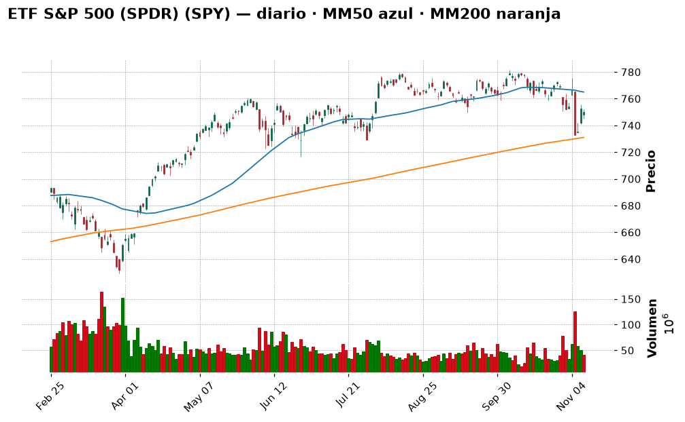
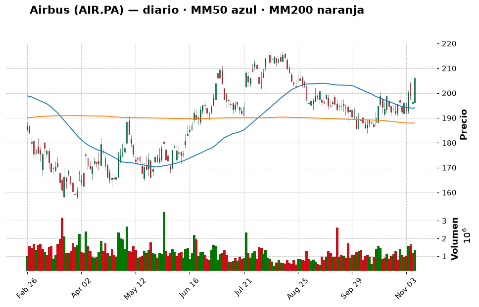
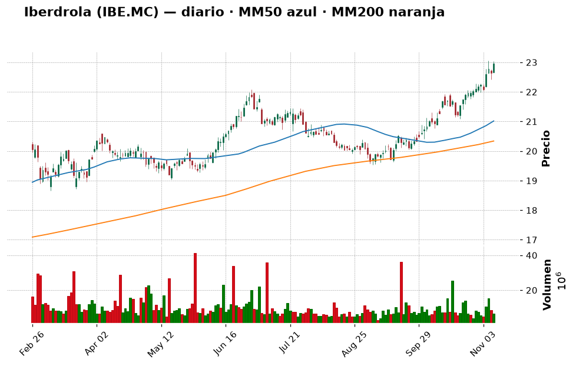
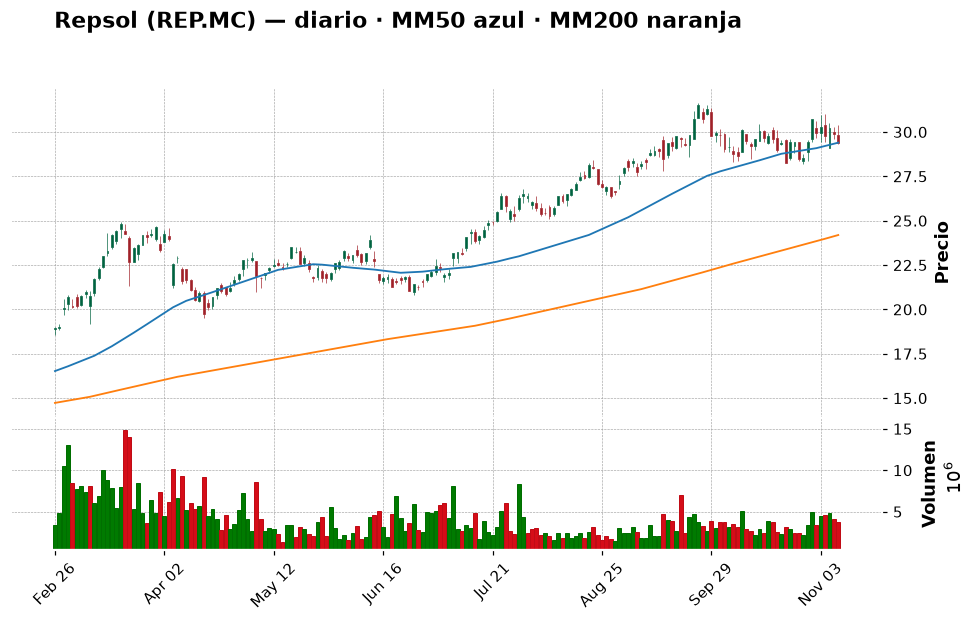
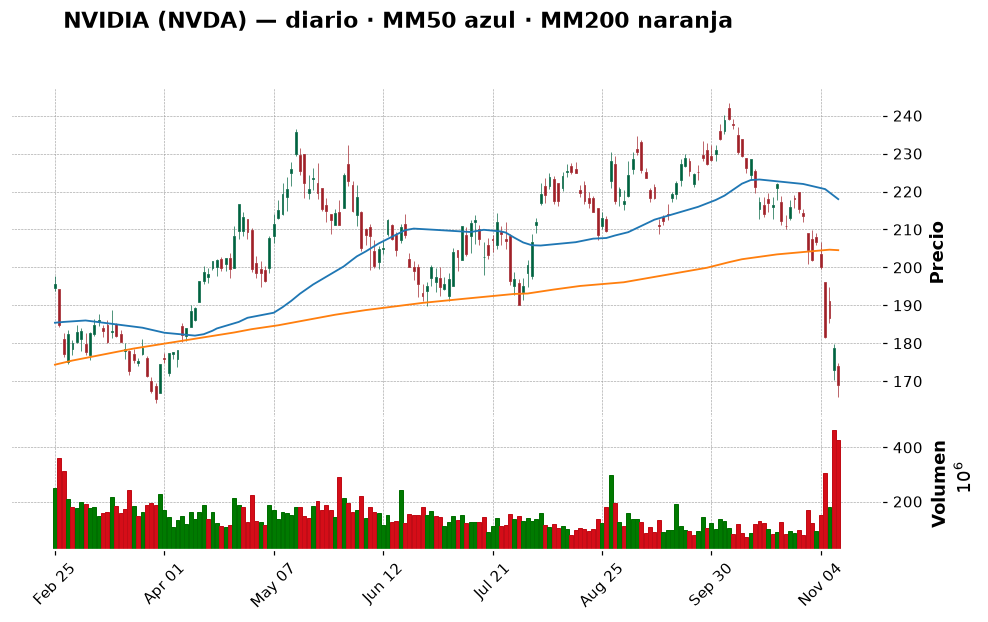
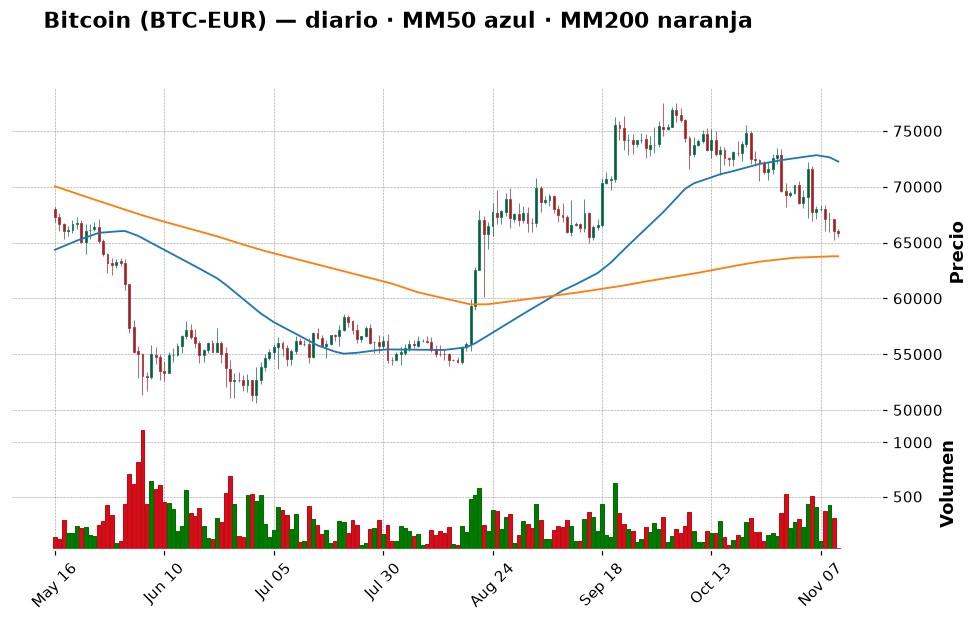
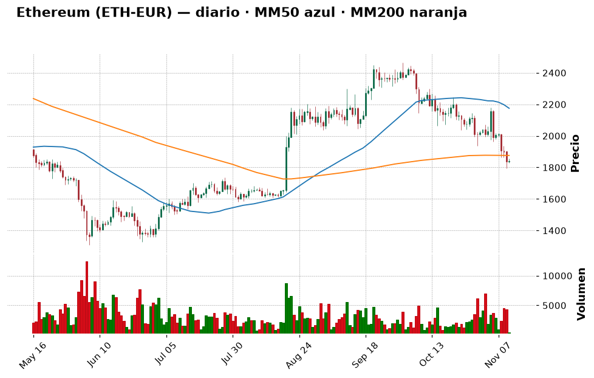

# 📈 Informe pre-apertura — miércoles 11 de noviembre de 2026

> Generado automáticamente a las 08:05 (hora de Madrid) · Bolsa española abre a las 9:00 · Wall Street a las 15:30 · Cripto: 24/7
> **Termómetro del día:** 🟡 prudencia — la inflación de EE. UU. salió peor de lo esperado y la Reserva Federal subirá tipos casi seguro en diciembre (91 %), pero los futuros de Wall Street rebotan con fuerza (Nasdaq 100 +1,6 %) gracias a los resultados de CoreWeave. Mucho ruido en ambas direcciones: buen día para **no improvisar**.
> **Lección de hoy:** Los tipos de interés y los bancos centrales (Fed y BCE)

## 1. Lo que tienes que saber hoy
- **El IPC de EE. UU. salió "caliente".** En octubre los precios subieron un **+0,4 %** en el mes (se esperaba +0,3 %) y la inflación subyacente un **+0,3 %** (se esperaba +0,2 %) (Expansión, CoinDesk). Resultado: el mercado da ya un **91 %** de probabilidad a una subida de tipos de 0,25 puntos en diciembre y un ~10 % a una de 0,50 (CME FedWatch vía Investing.com). El bono de EE. UU. a 10 años ronda el **5 %**, su nivel más alto en mucho tiempo. Por eso la lección de hoy son los **tipos de interés**.
- **Wall Street cayó ayer, pero hoy apunta a rebote.** El S&P 500 cerró en 7.520,93 (−0,38 %) y el Nasdaq en 25.065,87 (−0,74 %), lastrados por **Nvidia (−5,5 %)**, que ya ha borrado todo lo ganado en 2026. Esta madrugada, los futuros suben (S&P 500 +0,7 %, Nasdaq 100 +1,6 %) porque **CoreWeave** (alquila centros de datos para IA) presentó buenos resultados y sube más de un 16 % fuera de hora.
- **España: el Ibex se quedó a las puertas de los 20.000** (cerró en 19.936,4, +0,98 %) y es la gran bolsa que más sube en noviembre (más de un +7 % según Cinco Días). Hoy hay **huelga general** (la primera de CCOO y UGT juntos en 14 años) y el 29 de noviembre, elecciones generales: ruido político, normalmente sin gran efecto duradero en bolsa.
- **Tu cartera:** has dado el primer paso del plan — la **orden del ETF S&P 500 (SPY5.L, ~315 €)** — ✅. Ahora mismo lo correcto es **dejarla trabajar** y no adelantar tramos: con la Fed subiendo tipos puede haber mejores precios en las próximas semanas.

## 2. ✅ Recomendaciones del día (resumen)
| Activo | Acción | Cuánto (orientativo) | Horizonte | Por qué, en una frase | Confianza |
|---|---|---|---|---|---|
| ETF S&P 500 (SPY5.L / SPY) | 🔵 Mantener | Tramo 1 (~315 €) en curso; **tramo 2 (~600 €) hacia el 1 de diciembre** | Años (5+) | El plan en tramos funciona justo en semanas así; no hace falta acelerar | media |
| Airbus (AIR.PA) | ⏸️ Esperar | Hasta 3–4 % (~300–400 €) en 2 tramos si vuelve a ~202 € o cierra por encima de 217 € | Años | Muy buenas noticias (pedido de Cathay, 74 entregas en octubre), pero choca con su resistencia de 211 € | media |
| Iberdrola (IBE.MC) | ⏸️ Esperar | Hasta 5 % (~480 €) si retrocede a 21–22 € | Años | Gran empresa defensiva, pero RSI 75,7 (sobrecompra) y en máximos | media |
| Repsol (REP.MC) | 🔵 Mantener | No añadir | Años | Ganas un +137 %; el petróleo bajó de 90 $ y le quita impulso | media |
| NVIDIA (NVDA) | ⛔ Evitar | 0 € | — | Tendencia rota (−17 % bajo su MM200) y "media docena de investigaciones" | media |
| Inditex (ITX.MC) | 🔵 Mantener | No añadir | Años | +121 % en tu posición, a un paso de su máximo anual | media |
| Apple (AAPL) | 🔵 Mantener | No añadir | Años | Tendencia alcista sana (+16 % sobre su MM200) | media |
| Bitcoin (BTC-EUR) | 🟢 Comprar | **100 €** desde el USDC, solo si no lo hiciste ayer; luego ~100 €/mes | Años | Miedo (29/100) y precio cerca de su MM200; poco, en tramos y aceptando que puede bajar más | baja |
| Ether (ETH-EUR) | ⏸️ Esperar | 0 € hoy | Años | Ha perdido su MM200 (1.876 €) y el impulso sigue empeorando | media |
| Shiba Inu (SHIB) | ⛔ Evitar | No añadir | — | Memecoin, −53 % en un año; no encaja con tu perfil | alta |

*(Santander, BBVA, Telefónica, Microsoft, Amazon y el ETF del Nasdaq tienen su veredicto en la tabla "Resto de la watchlist" de la sección 6.)*

> Día de **paciencia activa**: el plan ya está en marcha (primer tramo del ETF). Con la Fed endureciendo y el bono al 5 %, la bolsa puede seguir dando sustos; eso es una **oportunidad para los próximos tramos**, no un motivo para correr. Lo único "nuevo" que tendría sentido hoy son ~100 € de bitcoin si ayer no los compraste.

## 3. Agenda del día
| Hora (Madrid) | Evento | Por qué importa |
|---|---|---|
| Todo el día | **Huelga general en España** (24 h, CCOO, UGT, CGT, CNT) por vivienda, salarios y precios | Posibles problemas en transporte; para la bolsa suele ser ruido de un día |
| Todo el día | **Día de los Veteranos en EE. UU.**: el mercado de bonos cierra (o funciona limitado); la bolsa abre con normalidad | Menos volumen en Wall Street; menos referencias del bono |
| Todo el día | **"Día del Soltero" en China** (Singles Day), la gran jornada de compras online | Termómetro del consumo chino (afecta a lujo y moda: Inditex) |
| 9:00 | Apertura de la Bolsa española | Se verá si el Ibex vuelve a intentar los 20.000 puntos |
| 15:30 | Apertura de Wall Street | Si se confirma el rebote de la tecnología (CoreWeave) o pesa más el miedo a la Fed |
| Durante el día | Resultados empresariales: **no he podido confirmar** un calendario fiable para hoy (las búsquedas solo devolvían fechas de otros años) | Mejor no suponer |
| Jue 12 | PIB del Reino Unido · Votación de los decretos de vivienda en España | Pistas de crecimiento europeo; relevante para banca e inmobiliarias |
| Vie 13 | IPP (precios industriales) de EE. UU. · Revisión del rating de Alemania (Fitch) | Segunda pista de inflación de la semana: si sale alta, más presión sobre la Fed |
| Dom 29 | Elecciones generales en España | Ruido político durante todo el mes |

## 4. Cómo llegan los mercados
### España y Europa
**Ayer (martes 10):** el **Ibex 35** cerró en **19.936,4 puntos (+0,98 %)**, pero no logró aguantar los 20.000 que tocó durante la sesión (Europa Press). En la semana acumula un **+6,0 %** y está a solo un **2 % de su máximo de 52 semanas (20.356,5)**. Según Cinco Días, el Ibex es la gran bolsa que más sube en noviembre (más de un +7 %), apoyado en la **remontada de la banca** y la **caída del petróleo**; Expansión habla de cuatro valores del Ibex que marcaron ayer máximos históricos. El **Euro Stoxx 50** cerró en **6.327,87 (+0,59 %)**.

**Banca:** Santander subió un +1,68 % (11,26 €). En lo corporativo, el banco da un primer paso para cumplir con las exigencias del BCE y **reducir el poder del presidente** (Cinco Días): Ana Botín dijo que será la última de su familia en presidir el banco (Europa Press). Además, Santander está entre los 21 bancos (con Goldman Sachs, Citi y Deutsche Bank) que comprometen **270 millones de dólares a una stablecoin bancaria ("Project Faro")** que quieren lanzar en 2027 (CoinDesk, Decrypt). 💡 *Una **stablecoin** es una criptomoneda que vale siempre 1 dólar (como tu USDC): los bancos quieren competir con Tether y Circle.*

**Aerolíneas y aeroespacial:** IAG, Ryanair, Air France-KLM y Lufthansa suben tras sus resultados gracias al **combustible más barato** (Cinco Días), y Citi ve "altamente atractiva" IAG (Expansión). El Gobierno aprobó **11.860 millones** en contratos de defensa, de los que unos **1.000 millones son para Airbus** (El País, Expansión).

⚠️ **Ojo con las fechas de los datos:** en la tabla técnica, **BBVA, Inditex, Iberdrola, Repsol y Airbus** tienen su último dato **a fecha 9-nov** (lunes): a nuestra fuente le falta el cierre del martes de esos valores. No son "el cierre de ayer".

### Estados Unidos
**Ayer:** el **S&P 500** cerró en **7.520,93 (−0,38 %)**, el **Nasdaq** en **25.065,87 (−0,74 %)** y el Dow Jones un −0,3 % (Investing.com). El rebote del lunes "chocó" con el IPC: subieron los rendimientos de los bonos y **Nvidia cayó otro −5,5 %, hasta 168,89 $**, muy cerca de su mínimo de 52 semanas (164,27 $). El "affair Huang" ya pone a Nvidia en el foco de **media docena de investigaciones** (Expansión), y Reuters informa de que una universidad ligada al ejército chino compró chips H200 pese a las restricciones de EE. UU. (Investing.com).

**Esta madrugada (futuros, ~07:40 h de Madrid, Yahoo Finance):** S&P 500 **7.594 (+0,66 %)** y Nasdaq 100 **28.270 (+1,56 %)**. El motivo: **CoreWeave** batió previsiones de ingresos, aspira a ser rentable en 2028 y su acción sube más de un 16 % fuera de hora; además **TSMC** (el gran fabricante de chips) invertirá 1.000 millones de dólares en Anthropic y OpenAI, y la bolsa de Taiwán subió un +3,1 % (Investing.com). Traducción: el mercado vuelve a creer en la demanda de IA... **por ahora**. Expansión publica hoy cuál sería "el terrible escenario para los mercados si pincha la IA en 2027": la duda no ha desaparecido.

### Macro (tipos de interés, inflación, divisas, materias primas)
- **Fed:** tipos en el 3,75–4,00 %. Tras el IPC, el mercado da un **91 %** a una subida de 0,25 en diciembre y un 10 % a una de 0,50 (Investing.com). El gobernador **Waller** dijo que con un IPC subyacente del 0,3 % (justo lo que salió) consideraría subir **medio punto**; Lorie Logan (Fed de Dallas) cree que hacen falta al menos dos subidas más, y **Goldman Sachs** espera otra en marzo. 💡 *Subir tipos es "encarecer el dinero": préstamos e hipotecas más caros, se consume menos y se frena la inflación... pero las acciones pierden atractivo frente a los bonos.*
- **BCE:** miembros del BCE y de la Fed anticipan **subidas de tipos en las reuniones de diciembre** porque la inflación sigue demasiado alta (Expansión). Ayer hablaron Philip Lane (sobre cómo comunica el BCE su política) y Piero Cipollone (sobre el euro digital).
- **Bonos:** el bono de EE. UU. a 10 años ronda el **5,0 %** (MarketWatch, Investing.com). 💡 *La **rentabilidad del bono** es lo que cobra quien presta dinero al Estado. Si un bono "casi sin riesgo" paga un 5 %, muchos inversores se preguntan para qué arriesgarse en bolsa: por eso cuando sube, la bolsa (sobre todo la tecnológica) suele sufrir.*
- **Euro/dólar:** **1,1157 (−0,1 %)**, cerca de su mínimo de 52 semanas (1,1110) (Yahoo Finance). El dólar se fortalece porque la Fed sube tipos. 💡 *Buena noticia para tus 2.717 USDC: hoy valen **2.435 €**, unos 20 € más que hace dos días, sin hacer nada. Funciona en los dos sentidos.*
- **Petróleo Brent:** ayer bajó de **90 $ por primera vez desde agosto** (−3 %) porque Trump dijo ver "avances" en las negociaciones con Irán (Expansión); esta mañana rebota hasta ~**92,5 $ (+1,1 %)** (Yahoo Finance). Más barato = bueno para la inflación y las aerolíneas; malo para Repsol.
- **España:** las subidas salariales se estancan en el 3 %, casi dos puntos por debajo del IPC (Expansión): los sueldos pierden poder de compra, que es justo uno de los motivos de la huelga de hoy.

## 5. Panorama técnico de la watchlist
> 💡 *Cómo leer esta tabla:* la **tendencia** resume si el precio lleva meses subiendo, bajando o de lado
> (comparando el precio con sus medias de 50 y 200 días). El **RSI** mide de 0 a 100 si las subidas o bajadas
> recientes han sido muy fuertes: por encima de 70 se dice "sobrecompra" (quizá ha subido demasiado rápido),
> por debajo de 30 "sobreventa". Son pistas, no predicciones.

| Valor | Último cierre | Día | 1 mes | 1 año | Tendencia | RSI | vs MM200 |
|---|---|---|---|---|---|---|---|
| IBEX 35 (^IBEX) | 19.936,4 (10-nov) | +0,98 % | +3,37 % | +20,26 % | ➡️ lateral | 62,9 🟡 | +6,4 % |
| Euro Stoxx 50 (^STOXX50E) | 6.327,87 (10-nov) | +0,59 % | +2,04 % | +12,77 % | ➡️ lateral | 58,4 🟡 | +3,4 % |
| S&P 500 (^GSPC) | 7.520,93 (10-nov) | −0,38 % | −3,67 % | +11,77 % | ➡️ lateral | 44,5 🟡 | +2,6 % |
| Nasdaq Composite (^IXIC) | 25.065,87 (10-nov) | −0,74 % | −8,00 % | +8,96 % | ➡️ lateral | 40,9 🟡 | −0,2 % |
| Banco Santander (SAN.MC) | 11,26 € (10-nov) | +1,68 % | −8,22 % | +17,86 % | ➡️ lateral | 49,0 🟡 | −0,3 % |
| BBVA (BBVA.MC) | 23,29 € (**9-nov**) | +2,46 % | +0,78 % | +23,19 % | ➡️ lateral | 54,1 🟡 | +8,2 % |
| Inditex (ITX.MC) | 59,66 € (**9-nov**) | +1,05 % | +10,77 % | +19,66 % | ➡️ lateral | 64,9 🟡 | +9,4 % |
| Iberdrola (IBE.MC) | 22,96 € (**9-nov**) | +1,37 % | +8,00 % | +28,30 % | 📈 alcista | 75,7 🔴 | +12,9 % |
| Telefónica (TEF.MC) | 3,43 € (10-nov) | +0,62 % | +6,62 % | −7,62 % | 📉 bajista | 53,2 🟡 | −6,0 % |
| Repsol (REP.MC) | 29,36 € (**9-nov**) | −1,81 % | −0,54 % | +75,76 % | ➡️ lateral | 49,0 🟡 | +21,4 % |
| Airbus (AIR.PA) | 206,00 € (**9-nov**) | +4,89 % | +9,69 % | −2,83 % | ➡️ lateral | 63,0 🟡 | +9,6 % |
| Apple (AAPL) | 348,51 $ (10-nov) | −0,62 % | +2,21 % | +29,81 % | 📈 alcista | 55,6 🟡 | +16,3 % |
| Microsoft (MSFT) | 533,16 $ (10-nov) | −2,20 % | −1,48 % | +7,31 % | 📈 alcista | 52,3 🟡 | +21,0 % |
| NVIDIA (NVDA) | 168,89 $ (10-nov) | −5,47 % | −25,38 % | −10,24 % | ➡️ lateral | 23,9 🟢 | −17,4 % |
| Amazon (AMZN) | 270,87 $ (10-nov) | +1,48 % | +4,37 % | +10,83 % | ➡️ lateral | 61,6 🟡 | +10,9 % |
| ETF S&P 500 (SPY) | 749,92 $ (10-nov) | −0,37 % | −3,62 % | +11,77 % | ➡️ lateral | 44,6 🟡 | +2,6 % |
| ETF Nasdaq 100 (QQQ) | 674,76 $ (10-nov) | −0,68 % | −9,55 % | +10,66 % | ➡️ lateral | 40,1 🟡 | −1,0 % |

*(🟢 = RSI bajo, posible "rebajas"; 🔴 = RSI alto, quizá demasiado rápido; 🟡 = neutral. En los valores marcados con **9-nov**, la columna "Día" es la variación del lunes 9, no la de ayer.)*

**En conjunto:** la imagen es de **dos velocidades**. Europa y España están fuertes (Ibex +6,4 % sobre su media de 200 sesiones y cerca de máximos), con la banca y las eléctricas tirando. EE. UU. está "de lado": el S&P 500 sigue por encima de su MM200 (7.331), lo que mantiene viva la tendencia de fondo, pero por debajo de su MM50 (7.673), y el Nasdaq está justo en su MM200: es la **frontera** que separa una corrección normal de algo peor. Lo "estirado" es Iberdrola (RSI 75,7); lo "castigado", Nvidia (RSI 23,9). Telefónica sigue en tendencia bajista.

## 6. Ideas de bolsa: qué haría un experto
### ETF S&P 500 (SPY5.L / SPY) — MANTENER (tramo 1 en marcha)

- **Qué es:** un fondo que compra de una vez las ~500 mayores empresas de EE. UU. Tu orden es la versión europea (UCITS) que cotiza en Londres, **SPY5.L**; el gráfico es del SPY estadounidense, que sigue exactamente el mismo índice.
- **Por qué es noticia hoy:** el IPC caliente y el bono al 5 % hicieron caer el índice ayer (−0,37 %), pero los futuros suben hoy un +0,7 %. Un dato curioso para entender la volatilidad: el presidente de la Fed de Chicago, Goolsbee, dijo que el gasto en centros de datos de IA se parece a un "recalentamiento a la antigua" (247 Wall St.).
- **Lo que dice el gráfico:** el SPY (749,92 $) está apoyado justo en un **soporte (749,6 $)**, por encima de su **MM200 (731 $)** pero por debajo de su **MM50 (765 $)**. RSI 44,6 (neutral) y MACD "mejorando". A un −4,1 % de su máximo de 52 semanas. En lenguaje llano: **la tendencia de fondo sigue en pie, pero el precio todavía no ha recuperado la caída de octubre**; las líneas a vigilar son 729 $ por abajo y 765 $ por arriba.
- **Lo positivo:** es el núcleo que tu cartera necesitaba, diversificado y barato. Y ya lo has empezado.
- **El riesgo:** si la Fed sube medio punto o el bono pasa claramente del 5 %, el índice podría volver a la zona de 729–739 $.
- **🧑‍💼 Recomendación: MANTENER.** Ya tienes en marcha el primer tramo (~315 €). La gracia del plan en tramos es precisamente **no tener que acertar el día**: el siguiente tramo toca **hacia el 1 de diciembre**, coincidiendo con tu aportación. Si antes de esa fecha el SPY cayera a la zona de 729–739 $ (soportes + MM200), podrías **adelantar** ese segundo tramo: comprarías más barato lo mismo.
  - **Cuánto y cómo:** tramo 2 de ~600 € (≈6 % de tu patrimonio) hacia el 1 de diciembre; objetivo ~35 % de tu patrimonio en 6 tramos. Cuando se ejecute la orden, **actualiza en `cartera.csv` el precio real** (ahora figura el estimado de 751,61 $).
  - **Horizonte:** 5 años o más.
  - **Qué me haría cambiar de opinión:** un cierre semanal del SPY por debajo de 729 $: no vendería lo comprado, pero pausaría el siguiente tramo hasta ver estabilidad.
- **Qué mirar para entenderlo:** la línea de la MM50 en el gráfico (~765 $). Si el precio la supera y se mantiene unos días, el rebote ganaría credibilidad.
- **Confianza:** media

### Airbus (AIR.PA) — ESPERAR (sigue en tu lista de la compra)

- **Qué es:** el mayor fabricante de aviones comerciales del mundo (europeo, con fábricas en Francia, Alemania y España), además de helicópteros, defensa y espacio.
- **Por qué es noticia hoy:** un buen puñado de noticias, todas positivas:
  - **Cathay Pacific** encarga **14 aviones** (11 A330-900 y 3 A321neo para HK Express) por **5.100 millones de dólares** a precio de catálogo; la aerolínea dice que obtuvo "importantes descuentos" (Yahoo Finance).
  - En **octubre Airbus entregó 74 aviones**, frente a 49 de Boeing (Yahoo Finance). Hasta septiembre llevaba 547 entregas y su objetivo anual es de ~870 (Demócrata): *mi cálculo* es que con las de octubre suma ~621 y necesita **unas 249 en noviembre y diciembre**, un ritmo exigente (en el pasado lo ha logrado acelerando a final de año, pero es el riesgo a vigilar).
  - El Gobierno español aprobó contratos de defensa con **~1.000 millones para Airbus** (Expansión).
- **Lo que dice el gráfico** (datos a 9-nov): 206 € tras un salto del +4,9 % ese día; está por encima de sus medias (MM50 194 €, MM200 188 €), RSI 63 (neutral alto) y MACD mejorando. Pero tiene **resistencias muy cerca: 211 € y 216,5–217 €**, y su máximo de 52 semanas está en 221,3 €. Soporte cercano: 201,65 €.
- **Lo positivo:** cartera de pedidos enorme, ventaja sobre Boeing, más gasto en defensa en Europa y combustible más barato que ayuda a sus clientes.
- **El riesgo:** problemas de suministro (motores, cabinas) que retrasan entregas; si no llega al objetivo de ~870, la acción lo notaría. Y en el último año ha ido de lado (−2,8 %).
- **🧑‍💼 Recomendación: ESPERAR.** El negocio va bien, pero la acción ha subido casi un +10 % en un mes y está chocando con una "pared" (211 €). Para un principiante, entrar justo debajo de una resistencia es comprar con poco margen. Compraría en dos situaciones: **(a)** un retroceso hacia ~202 € (soporte), o **(b)** un cierre claro por encima de 217 € (la pared rota).
  - **Cuánto y cómo:** hasta 3–4 % del patrimonio (~300–400 €), en 2 tramos.
  - **Horizonte:** años.
  - **Qué me haría cambiar de opinión:** un cierre por debajo de 190 € (MM200 y soporte) o un recorte del objetivo de entregas.
- **Qué mirar para entenderlo:** las entregas de noviembre (se publican a principios de diciembre) y si el precio supera 217 €.
- **Confianza:** media

### Iberdrola (IBE.MC) — ESPERAR

- **Qué es:** la mayor eléctrica española (redes y renovables en España, Reino Unido y EE. UU.). Negocio estable, con dividendo.
- **Por qué es noticia hoy:** tras subirla a "sobreponderar" el lunes, Morgan Stanley elige como su **favorita de las eléctricas europeas para 2027 a la británica National Grid**, y dice que el sector seguirá batiendo al mercado por la seguridad energética y la electrificación (Investing.com vía Yahoo Finance). Es un viento de cola para todo el sector, también para Iberdrola.
- **Lo que dice el gráfico** (datos a 9-nov): tendencia **alcista** (22,96 €, +12,9 % sobre la MM200), a un 0,4 % de su máximo de 52 semanas (23,06 €). Pero **RSI 75,7: sobrecompra**. El precio se ha alejado mucho de sus medias (MM50 21,02 €); cuando eso pasa suele "volver" un poco hacia ellas. Soportes: 21,09 € y 20,83 €.
- **Lo positivo:** defensiva, regulada, con demanda eléctrica al alza por los centros de datos.
- **El riesgo:** las eléctricas tienen mucha deuda, y **subidas de tipos del BCE y la Fed** la encarecen (ver lección de hoy). Comprar con RSI > 75 es comprar "en caliente".
- **🧑‍💼 Recomendación: ESPERAR.** Me gusta como empresa para tu núcleo de dividendos, pero no a este precio. Esperaría un retroceso a la zona de **21–22 €**.
  - **Cuánto y cómo:** hasta 5 % (~480 €), en 2 tramos.
  - **Horizonte:** años.
  - **Qué me haría cambiar de opinión:** si consolida varias semanas por encima de 23 € con el RSI ya por debajo de 70 (la sobrecompra se "enfría" sin bajar), entraría con un primer tramo más pequeño.
- **Qué mirar para entenderlo:** el RSI. Si baja de 70 sin que el precio caiga mucho, es una señal sana.
- **Confianza:** media

### Repsol (REP.MC) — MANTENER (la tienes)

- **Qué es:** la petrolera española (extracción, refino, gasolineras y renovables).
- **Por qué es noticia hoy:** el **Brent bajó de 90 $ por primera vez desde agosto** (Expansión) por los avances con Irán; esta mañana rebota a ~92,5 $. El petróleo barato es la razón por la que Repsol fue ayer de los pocos valores en rojo y las aerolíneas suben.
- **Lo que dice el gráfico** (datos a 9-nov): 29,36 €, justo en su MM50 (29,40 €) y muy por encima de su MM200 (24,19 €; +21 %). RSI 49 (neutral) y **MACD empeorando**: el impulso se está frenando tras un año espectacular (+75,8 %). Soportes: 28,3 € y 27,8 €; resistencias: 30,4 € y 31,6 € (máximo anual).
- **Lo positivo:** sigue en tendencia de fondo alcista y paga dividendo.
- **El riesgo:** si hay acuerdo con Irán, el petróleo podría bajar más.
- **🧑‍💼 Recomendación: MANTENER.** Ganas un **+137 %** en tu posición (2 acciones). No añadiría (el viento ya no sopla a favor), pero tampoco vendería: es una posición diminuta y vender te costaría comisión e impuestos por algo que sigue en tendencia de fondo.
  - **Cuánto y cómo:** no añadir.
  - **Horizonte:** años.
  - **Qué me haría cambiar de opinión:** un cierre por debajo de 27,8 € con el Brent cayendo hacia 80 $: ahí valoraría Vender.
- **Qué mirar para entenderlo:** el precio del Brent (si se mantiene por debajo de 90 $, presión para Repsol).
- **Confianza:** media

### NVIDIA (NVDA) — EVITAR

- **Qué es:** el gran fabricante de chips para inteligencia artificial.
- **Por qué es noticia hoy:** otro −5,5 % ayer, hasta 168,89 $, y ya ha borrado lo ganado en 2026 (Decrypt). El escándalo de su CEO, Jensen Huang, la ha puesto en el foco de **media docena de investigaciones** (Expansión); Cinco Días critica las "graves deficiencias de su consejo"; la empresa ha contratado a un exfiscal para investigar (MarketWatch). Por otro lado, Cathie Wood (ARK) compró 90.443 acciones aprovechando la caída (247 Wall St.).
- **Lo que dice el gráfico:** caída del −25 % en un mes; precio **−17 % bajo su MM200** y −22,5 % bajo su MM50, a un 2,8 % de su mínimo de 52 semanas (164,27 $). RSI **23,9: sobreventa**, con volumen 2,8 veces el normal (ventas intensas).
- **Lo positivo:** la demanda de IA sigue fuerte (CoreWeave, TSMC), y la sobreventa puede provocar rebotes.
- **El riesgo:** que el problema no sea el negocio sino el **gobierno corporativo** (la confianza en quién dirige). Eso no se arregla en días.
- **🧑‍💼 Recomendación: EVITAR.** 💡 *"Sobreventa" no significa "barata": significa que ha caído muy rápido.* Una tendencia rota con un escándalo abierto no es lugar para un principiante. Ya tienes exposición indirecta a Nvidia a través del ETF S&P 500 (es una de sus mayores empresas): esa es la forma prudente de "tenerla".
  - **Cuánto y cómo:** 0 €.
  - **Qué me haría cambiar de opinión:** que se aclare la investigación y el precio recupere su MM200 (~205 $).
- **Qué mirar para entenderlo:** si el mínimo de 164 $ aguanta; perderlo sería otra señal de debilidad.
- **Confianza:** media

### Resto de la watchlist: veredicto rápido
| Valor | Acción | Por qué (1 frase) | Nivel a vigilar |
|---|---|---|---|
| Banco Santander (SAN.MC) | ⏸️ Esperar | +10 % en una semana, pero sigue justo debajo de su MM200 (11,29 €); noticias: cambios de gobierno corporativo pedidos por el BCE y participación en la stablecoin bancaria "Project Faro" | Comprar si cierra sobre 11,98 € (MM50); soporte 10,34 € |
| BBVA (BBVA.MC) | ⏸️ Esperar | Tendencia de fondo sana (+8 % sobre MM200) y la subida de tipos ayuda a la banca, pero sigue por debajo de su MM50 (23,82 €) y no hay prisa; noticia: usa la IA de Riskfuel para valorar productos estructurados (Yahoo Finance) | Resistencia 25,28 €; soporte 22,77 € (datos a 9-nov) |
| Inditex (ITX.MC) | 🔵 Mantener | Tu posición gana +121 %; a un 1,6 % de su máximo anual (60,64 €); aporta 44 M€ al primer fondo de sostenibilidad textil (Europa Press) | Soporte 56,2 € (datos a 9-nov) |
| Telefónica (TEF.MC) | ⛔ Evitar | Única de la lista en tendencia **bajista** (−6 % bajo su MM200, −7,6 % en un año); sin noticias propias hoy | Revisar si supera 3,71 € |
| Apple (AAPL) | 🔵 Mantener | Tendencia alcista sana (+16 % sobre MM200), +102 % en tu posición; Binance avisa de un fallo de iOS que podría exponer claves privadas de monederos cripto (Decrypt): actualiza tu iPhone si usas apps cripto | Soporte 338,7 $; resistencia 351,7 $ |
| Microsoft (MSFT) | ⏸️ Esperar | Tendencia alcista (+21 % sobre MM200), pero −2,2 % ayer y MACD empeorando; es socio clave de la IA y el mercado aún duda | Soporte 505 $; comprar con más claridad sobre 551 $ |
| Amazon (AMZN) | ⏸️ Esperar | Buena semana (+8 %) y AWS ya factura más que 476 empresas del S&P 500 (Motley Fool); "Black Friday Week" del 19 al 30-nov | Resistencia 274,75 $; soporte 244,7 $ |
| ETF Nasdaq 100 (QQQ) | ⏸️ Esperar | Por debajo de su MM200 (−1 %) y −9,6 % en un mes; Barchart advierte de que podría caer mucho más si pincha la IA: para ti, mejor el S&P 500, más diversificado | Recuperar 681 $ (MM200); soporte 661 $ |

## 7. ₿ Criptomonedas
> 💡 *Las criptomonedas cotizan 24 horas, 7 días a la semana: los precios son de esta mañana (en euros).
> Son mucho más volátiles que las acciones: caídas del 50 % o más han ocurrido varias veces.*

**Sentimiento:** Fear & Greed **29/100 (miedo**; ayer 32, hace una semana 34, hace un mes 69 —codicia—) · Capitalización total **2,56 billones $ (−1,7 % en 24 h; −46,9 % bajo su máximo histórico de octubre de 2025)** · Dominancia de Bitcoin **57,8 %**.
En un mes el ánimo ha pasado de la codicia al miedo. La causa principal es la misma que en bolsa: **tipos más altos**. Las criptomonedas no pagan intereses, así que cuando el dinero "seguro" rinde más, pierden atractivo.

**Radar Coinbase** (408 monedas comprables · hoy suben 60 y bajan 299 · en 7 días suben 32 y bajan 329):
- **Mayores por capitalización (7 días):** BTC −5,8 %, ETH −10,8 %, BNB −3,6 %, XRP −17,2 %, SOL −11,3 %, HYPE −16,0 %, ZEC −23,2 %, DOGE −9,6 %.
- **Más suben (7 d, top 100):** INJ (+7,4 %), ETHFI (+6,7 %), PEPE (+5,2 %), RENDER (+2,7 %) · **Más bajan:** ZEC (−23,2 %), VVV (−21,7 %), WLD (−21,3 %), PUMP (−20,8 %), XRP (−17,2 %).
La caída es **general**: 9 de cada 10 monedas bajan en la semana. Las pocas que suben son pequeñas (puestos 45–100) o memecoins (PEPE): no veo ahí nada que justifique una compra para tu perfil. (PAXG, que aparece "estable", es un token respaldado por **oro**, no una oportunidad cripto.)

| Moneda | Ranking | Precio (€) | 24 h | 7 días | 1 mes | 1 año | Tendencia | RSI | vs MM200 |
|---|---|---|---|---|---|---|---|---|---|
| Bitcoin (BTC) | #1 | 65.895,73 | −0,17 % | −7,98 % | −10,06 % | −25,91 % | ➡️ lateral | 33,8 | +3,3 % |
| Ether (ETH) | #2 | 1.839,34 | +0,16 % | −14,68 % | −16,11 % | −37,61 % | ➡️ lateral | 30,5 | −2,0 % |
| XRP (XRP) | #6 | 0,9455 | 0,00 % | −18,58 % | −21,41 % | −54,19 % | ➡️ lateral | 24,1 | −14,1 % |
| Solana (SOL) | #7 | 73,95 | −0,82 % | −13,04 % | −21,94 % | −44,58 % | ➡️ lateral | 24,0 | −4,7 % |
| Shiba Inu (SHIB) | #42 | 0,00000395 | −1,50 % | −5,50 % | −14,50 % | −52,64 % | ➡️ lateral | 36,6 | −11,1 % |

**Noticias que importan:**
- **IPC caliente → bitcoin cerca de mínimos de 11 semanas** (Cointelegraph, CoinDesk): los operadores dan por hecha la subida de tipos de diciembre.
- **Salidas de los ETF de bitcoin:** −201 millones de dólares en un día, mientras la bolsa rebotaba; y la minera **MARA vendió 13.597 BTC (~1.100 M$) en seis semanas** y planea vender más (CoinDesk). Más oferta y menos demanda institucional = presión bajista.
- **Hackeos y robos** (recordatorio de por qué la custodia importa): Initia sufre su segundo ataque en 3 semanas (3,27 M$), secuestran el dominio de Across Protocol, robos en monederos LNbits, y el exchange brasileño Mercado Bitcoin reanuda retiradas tras un hackeo de 49 M$ (Cointelegraph).
- **Bancos contra las stablecoins:** Goldman, Citi, Santander y otros 18 comprometen 270 M$ para su propia stablecoin en 2027 (Decrypt, CoinDesk).
- **Regulación:** Coinbase, Kalshi y la matriz de Kraken apoyan a la CFTC en un pleito sobre "futuros perpetuos" de acciones (CoinDesk); el aliado cripto Tom Emmer, elegido "whip" de la minoría republicana (Cointelegraph).

### Bitcoin (BTC) — COMPRAR (poco y en tramos)

- **Qué es:** la primera y mayor criptomoneda; su oferta máxima está limitada a 21 millones de unidades.
- **Lo que dice el gráfico:** 65.896 € esta mañana. Acaba de perder por muy poco el soporte de ~65.900 € del que hablábamos ayer; el siguiente está en **64.918 €** y, por debajo, su **MM200 (63.768 €)**. Por encima, resistencias en 69.923 € y 70.745 €. RSI 33,8 (cerca de sobreventa) y MACD "mejorando". Está un −27,6 % por debajo de su máximo de 52 semanas (90.990 €). En llano: **está bajando hacia su "suelo de largo plazo"** (la MM200), que es donde un comprador paciente suele empezar a mirar.
- **🧑‍💼 Recomendación: COMPRAR, solo 100 €.** Si ya compraste ayer los 100 € que proponíamos, **no compres más hoy**: el siguiente tramo, con la aportación del 1 de diciembre. Si no lo hiciste, 100 € hoy desde el USDC son razonables: el miedo (29/100) suele dar mejores precios de entrada que la euforia, y se trata de una cantidad pequeña que no pone en riesgo tu patrimonio.
  - **Cuánto y cómo:** 100 € (~1 % del patrimonio) por el par **BTC-USDC o BTC-EUR en Coinbase**; luego ~100 €/mes. Tu cripto pesa un 0,8 % frente al tope del 25 % (margen de 3.130 €), pero para un perfil moderado yo no pasaría del **5 %** total en los próximos meses.
  - **Qué me haría cambiar de opinión:** un cierre diario claro por debajo de la MM200 (~63.800 €): pausaría los tramos y esperaría a ver si busca 54.000 € (siguiente soporte).
- **El riesgo:** con la Fed subiendo tipos y los ETF vendiendo, bitcoin podría caer otro 15–20 % sin que nada "esté roto". Solo invierte lo que aguantarías ver a la mitad.
- **Confianza:** baja

### Ether (ETH) — ESPERAR

- **Qué es:** la segunda criptomoneda; la red Ethereum permite programas ("smart contracts") y es la base de muchas stablecoins y aplicaciones.
- **Lo que dice el gráfico:** 1.839 €, **ya por debajo de su MM200 (1.876 €)**, con el MACD empeorando y RSI 30,5. −14,7 % en una semana y −40,7 % bajo su máximo anual. Soportes en 1.607 € y 1.581 €. Una noticia que matiza: la cola de quienes quieren dejar de hacer staking cayó de 457.840 a 5.061 ETH en un mes (BeInCrypto) — los grandes tenedores no están vendiendo en pánico.
- **🧑‍💼 Recomendación: ESPERAR.** Ha perdido su "suelo de largo plazo" y el impulso sigue a la baja. Compraría un primer tramo pequeño (50 €) si **recupera 1.876 €** (señal de que la caída fue un mal momento) o si cae a la zona de **1.600 €** (soporte).
  - **Cuánto y cómo:** 0 € hoy; luego, como mucho, la mitad de lo que pongas en bitcoin.
  - **Qué me haría cambiar de opinión:** recuperar la MM200 con el MACD girando a "mejorando".
- **El riesgo:** es más volátil que bitcoin (volatilidad anualizada 55 % frente a 38 %).
- **Confianza:** media

### Shiba Inu (SHIB) — EVITAR
- **Qué es:** una "memecoin" (moneda nacida como broma, sin uso real relevante).
- **Lo que dice el gráfico:** −52,6 % en un año, −11 % bajo su MM200, −54 % bajo su máximo de 52 semanas.
- **🧑‍💼 Recomendación: EVITAR (no añadir).** Tienes 3,95 € (compraste 6 €). Es tan poco que no merece la pena ni la comisión de venderla; quédatela como "recordatorio" de por qué no se persiguen las modas.
- **El riesgo:** que pierda casi todo su valor; con 4 € no es un problema, con 400 € sí lo sería.
- **Confianza:** alta

## 8. 💼 Tu cartera
**Valor total:** 9.705,82 € · **Invertido:** 584,77 € · **Ganancia/pérdida no realizada:** +77,67 € (+15,3 % sobre lo que pagaste) · **Realizada:** 0 €
**Reparto:** acciones 2,0 % · ETF 3,2 % · cripto 0,8 % · liquidez 94,0 % · **Cripto vs tope:** 0,8 % de 25 % ✅ dentro (margen 3.130,53 €)
**Liquidez disponible:** 9.121,05 € (94,0 %: 6.685,80 € en euros en otro bróker + 2.717 USDC ≈ 2.435,25 € en Coinbase) · **Próxima aportación:** 200 € el 2026-12-01 (en 20 días)

| Activo | Cantidad | Precio medio | Precio actual | Valor (€) | G/P | Peso | Acción recomendada |
|---|---|---|---|---|---|---|---|
| Liquidez en euros (otro bróker) | 6.685,80 € | — | — | 6.685,80 | — | 68,9 % | Seguir el plan **en tramos** (sin prisa) |
| USDC (Coinbase) | 2.717 | 1 $ | 1 $ | 2.435,25 | 0 % | 25,1 % | Fuente de las compras cripto; hoy el dólar fuerte te favorece |
| ETF SPDR S&P 500 UCITS (SPY5.L) | 0,467 | 751,61 $ | 751,61 $ (estimado) | 314,60 | 0 % | 3,2 % | 🔵 Mantener — orden pendiente; actualiza el precio real en el CSV |
| Bitcoin (BTC) | 0,00113223 | 74.000 € | 65.896 € | 74,61 | −11,0 % | 0,8 % | 🟢 Comprar (100 €, solo si no lo hiciste ayer) |
| Inditex (ITX.MC) | 1 | 26,94 € | 59,66 € | 59,66 | +121,5 % | 0,6 % | 🔵 Mantener — cerca de máximos |
| Repsol (REP.MC) | 2 | 12,37 € | 29,36 € | 58,72 | +137,4 % | 0,6 % | 🔵 Mantener — sin ampliar |
| Apple (AAPL) | 0,15 | 171,99 $ | 348,51 $ | 46,86 | +102,6 % | 0,5 % | 🔵 Mantener — tendencia alcista sana |
| Solaria (SLR.MC) | 1 | 14,99 € | 16,86 € | 16,86 | +12,4 % | 0,2 % | 🔵 Mantener — no añadir (renovable pequeña y volátil) |
| Oryzon (ORY.MC) | 4 | 3,23 € | 2,38 € | 9,51 | −26,4 % | 0,1 % | 🔵 Mantener — posición mínima; venderla costaría casi lo que vale |
| Shiba Inu (SHIB) | 1.000.000 | 0,000006 € | 0,00000395 € | 3,95 | −34,2 % | 0,04 % | ⛔ Evitar — no añadir |

*(Solaria y Oryzon no están en la watchlist, así que no tienen análisis técnico ni gráfico.)*

**Lo que ha cambiado desde ayer:** has puesto en marcha el **primer tramo del núcleo indexado** (orden de 0,467 participaciones de SPY5.L, ~315 €, apartados de tu liquidez en euros). Es exactamente lo que haría un experto: empezar por lo diversificado y barato. Tu `cartera.csv` no tiene errores ✅; solo recuerda **sustituir el precio estimado (751,61 $) por el real** cuando se ejecute la orden, para que el informe calcule bien tu ganancia o pérdida.

**¿Está diversificada?** Todavía no: el 94 % es liquidez. Eso no es malo hoy (con la Fed subiendo tipos, tener "munición" es una ventaja), pero el plan es ir invirtiéndola **mes a mes**. Recordatorio del plan orientativo (6 meses):

| Destino | Objetivo | Estado | Siguiente paso |
|---|---|---|---|
| Núcleo: ETF S&P 500 (o MSCI World) | ~35 % (~3.400 €) | Tramo 1 de 6 en marcha (~315 €) | Tramo 2 (~600 €) hacia el 1-dic, o antes si el SPY cae a 729–739 $ |
| Grandes empresas (Iberdrola, Airbus, banca…) | ~10–15 % | 0 € | Solo a buen precio: IBE a 21–22 €, AIR a ~202 € o sobre 217 € |
| Cripto (sobre todo BTC) | ~5 % (~500 €) | 0,8 % | ~100 €/mes desde el USDC |
| Liquidez / colchón | ~45 % | 94 % | Colchón de 3–6 meses de gastos; el resto, en un depósito o fondo monetario mientras espera |

💡 *Con tipos al alza, la liquidez que esperas invertir **sí puede rendir algo**: un depósito o un fondo monetario suelen seguir a los tipos del BCE. No dejes miles de euros "a cero" durante meses.*

La aportación de 200 € del 1 de diciembre puede alimentar estos tramos (por ejemplo, 150 € al ETF y 50 € a bitcoin); el reparto detallado lo verás en el informe de finales de noviembre. Cuando la hagas, regístrala en `cartera.csv` como fila `liquidez` (`compra` de `EUR`).

## 9. Análisis de riesgo
| Riesgo | Nivel | Explicación |
|---|---|---|
| Fed más agresiva (subida de 0,50 en diciembre) | 🔴 | Waller ya lo plantea; el bono al 5 % presiona a la bolsa, sobre todo a la tecnológica, y a las criptomonedas |
| Escándalo Nvidia / dudas sobre la IA | 🟡 | Nvidia pesa mucho en el S&P 500 y el Nasdaq; CoreWeave y TSMC calman, pero la duda sigue |
| Ruido político en España (huelga hoy, elecciones el 29-nov) | 🟢 | Suele afectar poco a las grandes empresas del Ibex, que facturan sobre todo fuera de España |
| Petróleo e Irán | 🟡 | Un acuerdo baja el crudo (bien para inflación y aerolíneas, mal para Repsol); una ruptura lo dispararía |
| Cripto: salidas de ETF y ventas de mineros | 🔴 | Bitcoin está perdiendo soportes; si cae bajo su MM200 (~63.800 €), puede ir a buscar 54.000 € |
| Dólar/euro | 🟢 | Hoy te favorece (USDC vale más en euros); si se gira, ese efecto se revierte |

**Qué podría salir mal hoy:** que el rebote de los futuros se apague al abrir Wall Street (como pasó ayer) y que el bono a 10 años supere con claridad el 5 %. En ese caso el S&P 500 podría ir a buscar 7.420–7.310 (soportes y MM200) y bitcoin perder su MM200. Para ti, eso **no cambia las recomendaciones**: mantener lo comprado y, si el SPY llega a 729–739 $, adelantar el segundo tramo. La ventaja de tener el 94 % en liquidez es que las caídas juegan a tu favor.

## 10. 🎓 Aprende con el informe de hoy: Los tipos de interés y los bancos centrales (Fed y BCE)
- **Qué es (en una frase):** el **tipo de interés** es el "precio del dinero" (lo que cuesta pedir prestado y lo que te pagan por ahorrar), y los **bancos centrales** —la **Fed** en EE. UU. y el **BCE** en la zona euro— lo fijan para controlar la inflación: lo **suben** para frenarla y lo **bajan** para animar la economía.
- **Ejemplo con números:** imagina que la Fed sube su tipo del 4 % al 4,25 %. Una empresa que debe 1.000 millones pasa de pagar 40 a 42,5 millones al año en intereses: gana menos. Y tú, como ahorrador, ves que un bono del Estado de EE. UU. a 10 años te paga un **5 %**: con 10.000 € cobrarías 500 € al año con muy poco riesgo. Ante esa alternativa, muchos inversores exigen más a la bolsa (o pagan menos por ella) → **las acciones bajan**, sobre todo las de crecimiento (tecnológicas), cuyo beneficio está muy en el futuro.
- **Dónde lo has visto hoy:** el IPC caliente (sección 1) → probabilidad de subida de la Fed del 91 % → bono al 5 % → caída del Nasdaq y de Nvidia (sección 4), bitcoin en mínimos de 11 semanas (sección 7), dólar más fuerte y tus USDC valiendo más en euros (secciones 4 y 8), y por qué Iberdrola, con mucha deuda, es sensible (sección 6).
- **Por qué te importa como inversor:** los tipos son la "gravedad" de los mercados: cuando suben, todo pesa más. También afectan a tu día a día: hipotecas, préstamos y lo que te paga un depósito. Y como tienes mucha liquidez, **tipos más altos significan que tu dinero en espera puede rendir más** en un depósito o fondo monetario.
- **Error típico de principiante:** pensar que "subida de tipos = vender todo". Los mercados se anticipan: una subida que ya se espera al 91 % **ya está casi descontada en los precios**. Lo que mueve de verdad la bolsa es la **sorpresa** (un dato peor de lo previsto, o una subida mayor de la esperada).
- **Pregunta para pensar:** si la Fed sube tipos y el BCE no, ¿qué suele pasar con el dólar frente al euro y cómo afecta eso a tus 2.717 USDC?

## 11. Consejo del día para inversores principiantes
**Haz que tu plan sea más fuerte que las noticias.** Ayer el mercado subió por la mañana, cayó por la tarde con el IPC y hoy rebota en los futuros por CoreWeave. Si cada titular te hiciera comprar o vender, acabarías pagando comisiones y entrando siempre tarde. Tú ya tienes un plan (tramos mensuales en el ETF, ~100 € al mes en bitcoin, una "lista de la compra" con precios para Iberdrola y Airbus). Escríbelo en un papel y, cuando dudes, pregúntate: *"¿ha cambiado algo de lo que dice el plan, o solo ha cambiado el humor del mercado?"*. Casi siempre es lo segundo.

## 12. Glosario
- **Tipo de interés:** el precio del dinero: lo que pagas por un préstamo o lo que cobras por prestar/ahorrar.
- **Banco central (Fed, BCE):** la institución que fija los tipos de interés oficiales de un país o zona (EE. UU. y la zona euro) para controlar la inflación.
- **IPC subyacente:** la inflación sin alimentos frescos ni energía, que son muy volátiles; muestra mejor la tendencia de fondo.
- **Bono a 10 años / rentabilidad del bono:** un préstamo al Estado durante 10 años; su rentabilidad es el interés anual que paga. Es la referencia del "dinero seguro".
- **Punto básico:** una centésima de punto porcentual: subir 25 puntos básicos = subir 0,25 %.
- **Stablecoin:** criptomoneda diseñada para valer siempre lo mismo (normalmente 1 dólar), como el USDC.
- **Media móvil (MM50, MM200):** el precio medio de las últimas 50 o 200 sesiones; la MM200 se usa como "frontera" de la tendencia de largo plazo.
- **Soporte / resistencia:** niveles de precio donde antes se frenaron las caídas (soporte, el "suelo") o las subidas (resistencia, el "techo").
- **RSI:** indicador de 0 a 100 que mide la fuerza de las subidas y bajadas recientes; >70 sobrecompra, <30 sobreventa.
- **MACD:** indicador del impulso; "mejorando" sugiere que la presión compradora gana fuerza, "empeorando" lo contrario.
- **Sobreventa:** cuando un precio ha caído muy rápido; no significa que esté barato ni que vaya a rebotar ya.
- **ETF UCITS:** versión europea de un ETF, que cumple la normativa de la UE y es la que normalmente puede comprar un inversor español.
- **Futuros:** contratos que se negocian antes de la apertura y anticipan hacia dónde puede abrir un índice.
- **Fear & Greed (miedo/codicia):** índice de 0 a 100 que resume el ánimo del mercado cripto.
- **Dominancia de Bitcoin:** porcentaje del valor total del mercado cripto que corresponde a bitcoin.
- **Memecoin:** criptomoneda nacida como broma o moda, sin uso real relevante.

## 13. Fuentes
- Expansión — [El IPC de EEUU sube un 0,4% en octubre por el alza de la gasolina](https://www.expansion.com/economia/2026/11/10/ipc-eeuu-sube-0-4-octubre-alza-gasolina.html)
- CoinDesk — [U.S. CPI rose stronger than expected 0.4% in October; core rate rose 0.3%](https://www.coindesk.com/markets/2026/11/10/u-s-cpi-rose-stronger-than-expected-0-4-in-october-core-rate-rose-0-3)
- Investing.com — [Nasdaq futures jump on CoreWeave earnings; hot CPI reinforces Fed hike bets](https://www.investing.com/news/stock-market-news/us-stock-futures-tick-higher-after-wall-st-slips-on-hot-cpi-nvidia-losses-5017417)
- Investing.com — [Bonds reel as hot inflation fuels jumbo Fed hike fears](https://www.investing.com/news/economy-news/bonds-reel-as-hot-inflation-fuels-jumbo-fed-hike-fears-5017511)
- Investing.com — [Fed rate hike odds in December at 88% after hot CPI](https://www.investing.com/news/economy-news/fed-rate-hike-odds-in-december-at-88-after-hot-cpi-cme-fedwatch-5017585) · [Goldman expects additional Fed rate hike in March](https://www.investing.com/news/economy-news/goldman-expects-additional-fed-rate-hike-in-march-5017688)
- MarketWatch — [Stocks fall as the 10-year Treasury yield nears 5% mark](https://www.marketwatch.com/story/why-stocks-are-falling-and-10-year-yields-are-climbing-back-near-5-after-tuesdays-inflation-report-389b8392)
- Expansión — [El BCE y la Fed anticipan subidas de tipos en las reuniones de diciembre](https://www.expansion.com/mercados/2026/11/11/bce-fed-anticipan-subidas-tipos-reuniones-diciembre.html)
- Europa Press — [El Ibex 35 pierde fuelle al cierre y no logra aguantar los 20.000 puntos](https://www.europapress.es/economia/bolsa-00348/noticia-ibex-35-pierde-fuelle-cierre-no-logra-aguantar-20000-puntos-20261110181810.html)
- Cinco Días — [El Ibex lidera las grandes Bolsas en noviembre y se prepara para asaltar máximos históricos](https://cincodias.elpais.com/mercados-financieros/2026-11-11/el-ibex-lidera-las-grandes-bolsas-en-noviembre-y-se-prepara-para-asaltar-maximos-historicos.html)
- Expansión — [Qué recorrido tienen los cuatro valores del Ibex que marcaron ayer récord](https://www.expansion.com/inversion/2026/11/11/recorrido-cuatro-valores-ibex-marcaron-ayer-record.html)
- Cinco Días — [El Santander da un primer paso para cumplir con las exigencias del BCE y reducir el poder del presidente](https://cincodias.elpais.com/companias/2026-11-11/el-santander-da-un-primer-paso-para-cumplir-con-las-exigencias-del-bce-y-reducir-el-poder-del-presidente.html)
- Europa Press — [Ana Botín asegura que ella será la última de la familia Botín en la presidencia de Banco Santander](https://www.europapress.es/economia/finanzas-00340/noticia-ana-botin-asegura-ella-sera-ultima-familia-botin-presidencia-banco-santander-20261110105501.html)
- Cinco Días — [Las aerolíneas europeas vislumbran algo de luz en medio de la tormenta](https://cincodias.elpais.com/opinion/2026-11-11/las-aerolineas-europeas-vislumbran-algo-de-luz-en-medio-de-la-tormenta.html) · Expansión — [Citi ve "altamente atractiva" la inversión en IAG](https://www.expansion.com/mercados/2026/11/10/citi-ve-altamente-atractiva-inversion-iag.html)
- Expansión — [Navantia recibe 4.600 millones en nuevos contratos de Defensa y Airbus otros 1.000](https://www.expansion.com/empresas/2026/11/10/navantia-recibe-4-600-millones-nuevos-contratos-defensa-airbus-otros-1-000.html) · El País — [El Gobierno aprueba nuevos contratos con la industria militar por 11.860 millones](https://elpais.com/economia/2026-11-10/el-gobierno-aprueba-nuevos-contratos-con-la-industria-militar-por-11860-millones.html)
- Yahoo Finance — [Cathay Pacific to buy 11 Airbus aircraft for US$5.1 bn](https://finance.yahoo.com/markets/stocks/articles/cathay-pacific-buy-11-airbus-061509430.html) · [Boeing October Jet Deliveries Decline, Trail Airbus Tally](https://finance.yahoo.com/markets/stocks/articles/boeing-october-jet-deliveries-decline-203706842.html)
- Demócrata — [Airbus rebasa las 70 entregas en septiembre y suma 547 aviones comerciales en 2026](https://www.democrata.es/economia/airbus-rebasa-las-70-entregas-en-septiembre-y-suma-547-aviones-comerciales-en-2026/)
- Investing.com vía Yahoo Finance — [Morgan Stanley Picks this UK Grid Operator as Top Utility for Europe in 2027](https://finance.yahoo.com/energy/articles/morgan-stanley-picks-uk-grid-133655839.html)
- Expansión — [El petróleo baja de 90 dólares por primera vez desde agosto](https://www.expansion.com/mercados/materias-primas/2026/11/10/petroleo-baja-90-dolares-primera-vez-agosto.html)
- Expansión — [Las alzas salariales se estancan en el 3%, casi dos puntos por debajo del IPC actual](https://www.expansion.com/economia/2026/11/11/alzas-salariales-estancan-3-dos-puntos-debajo-ipc-actual.html)
- Expansión — [El 'affair Huang' pone a Nvidia en el foco de media docena de investigaciones](https://www.expansion.com/empresas/2026/11/11/affair-huang-pone-nvidia-foco-media-docena-investigaciones.html) · Cinco Días — [El escándalo de Nvidia magnifica las graves deficiencias de su consejo](https://cincodias.elpais.com/opinion/2026-11-11/el-escandalo-de-nvidia-magnifica-las-graves-deficiencias-de-su-consejo.html) · Decrypt — [Nvidia Erases 2026 Gains](https://decrypt.co/382974/nvidia-erases-2026-gains-republicans-threaten-ceo-subpoena)
- Investing.com — [China PLA-linked university bought Nvidia H200 chips despite U.S. curbs](https://www.investing.com/news/stock-market-news/china-plalinked-university-bought-nvidia-h200-chips-despite-us-curbs--reuters-5017739) · 247 Wall St. — [Cathie Wood Is Buying Nvidia Again](https://247wallst.com/investing/2026/11/10/cathie-wood-is-buying-nvidia-again-adding-90443-shares-during-the-huang-selloff/) · MarketWatch — [Meet the former prosecutor Nvidia hired](https://www.marketwatch.com/story/meet-the-former-prosecutor-nvidia-hired-to-investigate-the-jensen-huang-spy-scandal-e8078f67?mod=mw_rss_topstories)
- Investing.com — [TSMC board approves $1 bln investment in Anthropic, OpenAI](https://www.investing.com/news/stock-market-news/tsmc-board-approves-1-bln--investment-in-anthropic-openai-shares-rise-93CH-5017730) · [Taiwan Weighted up 3.11%](https://www.investing.com/news/stock-market-news/taiwan-stocks-higher-at-close-of-trade-taiwan-weighted-up-311-5017744)
- Expansión — [Así es el terrible escenario para los mercados si pincha la IA en 2027](https://www.expansion.com/mercados/2026/11/11/asi-terrible-escenario-mercados-pincha-ia-2027.html)
- 247 Wall St. — [Fed's Goolsbee Says AI Data Centers Look Like 'Old-Fashioned Overheating'](https://247wallst.com/investing/2026/11/10/feds-goolsbee-says-ai-data-centers-look-like-old-fashioned-overheating/)
- Yahoo Finance — [BBVA deploys Riskfuel's neural pricing](https://finance.yahoo.com/news/bbva-deploys-riskfuels-neural-pricing-131300966.html) · Europa Press — [Inditex participa con más de 44 millones en el primer fondo para la sostenibilidad del sector textil](https://www.europapress.es/economia/noticia-inditex-participa-mas-44-millones-primer-fondo-sostenibilidad-sector-textil-20261110132135.html)
- Motley Fool — [Amazon's Cloud Computing Business Already Brings in More Revenue Than 476 Companies in the S&P 500](https://www.fool.com/investing/2026/11/10/amazon-cloud-computing-brings-in-more-revenue-than-476-companies-in-the-sp-500/) · Barchart — [How the QQQ Could Drop More Than 40% From Here](https://www.barchart.com/story/news/8768210/how-the-qqq-could-drop-more-than-40-from-here-even-if-it-hits-a-new-all-time-high-first)
- Decrypt — [Binance Warns of Apple iOS Flaw That Could Expose iPhone Users' Private Keys](https://decrypt.co/382928/binance-warns-of-apple-ios-flaw-that-could-expose-iphone-users-private-keys)
- Cointelegraph — [Bitcoin nears 11-week low after 'discouraging' US CPI inflation beat](https://cointelegraph.com/markets/bitcoin-11-week-low-discouraging-us-cpi-inflation) · CoinDesk — [Bitcoin breaks with stocks, declines as ETF outflows mount, MARA reduces holdings](https://www.coindesk.com/daybook-us/2026/11/10/bitcoin-breaks-with-stocks-declines-as-etf-outflows-mount-mara-sells-holdings) · [CoinDesk Markets](https://www.coindesk.com/markets)
- Decrypt — [Goldman, Citi and Global Banks Commit $270 Million to Challenge Crypto's Stablecoin Giants](https://decrypt.co/382953/goldman-citi-global-banks-270-million-challenge-crypto-stablecoin-giants)
- Cointelegraph — [Initia confirms second exploit in 3 weeks](https://cointelegraph.com/news/initia-second-crypto-exploit-three-weeks) · [Across Protocol restores website after hackers hijack domain](https://cointelegraph.com/news/across-protocol-restores-website-after-hackers-hijack-domain) · [LNbits rushes emergency patch](https://cointelegraph.com/news/lnbits-rushes-emergency-patch-after-reported-bitcoin-wallet-thefts) · [Mercado Bitcoin to resume cash withdrawals after $49M hack](https://cointelegraph.com/news/pix-withdrawals-resume-mercado-bitcoin-hack)
- CoinDesk — [Coinbase, Kalshi, Kraken parent back CFTC in legal fight over stock perpetual futures](https://www.coindesk.com/policy/2026/11/10/coinbase-kalshi-kraken-parent-back-cftc-in-legal-fight-over-stock-perpetual-futures) · Cointelegraph — [Crypto ally Tom Emmer elected House GOP minority whip](https://cointelegraph.com/news/crypto-ally-tom-emmer-elected-house-gop-minority-whip)
- BeInCrypto — [Ethereum Price Fell 20%, But Stakers Are Refusing to Sell](https://beincrypto.com/ethereum-staking-exit-queue-price-drop/)
- Huelga general: Demócrata — [Huelga general del 11 de noviembre: quién la convoca, cuánto dura y cuáles son los motivos](https://www.democrata.es/actualidad/huelga-general-11-noviembre-quien-convoca-cuanto-dura-cuales-son-motivos/) · El País — [Los sindicatos llaman a España a una huelga general por primera vez en 14 años](https://elpais.com/economia/2026-11-10/los-sindicatos-llaman-a-espana-a-una-huelga-general-por-primera-vez-en-14-anos.html)
- Agenda: InvestingLive — [Perspectivas del mercado para la semana del 9 al 13 de noviembre](https://investinglive.com/es/forex/perspectivas-del-mercado-para-la-semana-del-9-al-13-de-noviembre/)
- Banco Central Europeo — [Philip R. Lane: The science and practice of monetary policy communication](https://www.ecb.europa.eu//press/key/date/2026/html/ecb.sp261110_1~9725b7aa07.en.html) · [Piero Cipollone: Cash and the digital euro](https://www.ecb.europa.eu//press/key/date/2026/html/ecb.sp261110~9422461bad.en.html)
- Futuros, Euro Stoxx 50, euro/dólar y Brent: Yahoo Finance ([ES=F](https://finance.yahoo.com/quote/ES=F/), [NQ=F](https://finance.yahoo.com/quote/NQ=F/), [^STOXX50E](https://finance.yahoo.com/quote/%5ESTOXX50E/), [EURUSD=X](https://finance.yahoo.com/quote/EURUSD=X/), [BZ=F](https://finance.yahoo.com/quote/BZ=F/)) · [Fear & Greed (alternative.me)](https://alternative.me/crypto/fear-and-greed-index/)
- Precios e indicadores de bolsa: Yahoo Finance (velas diarias, último cierre disponible)
- Cripto: Coinbase (universo de monedas y velas diarias) · Coinpaprika (datos de mercado) · Fear & Greed (alternative.me)
- **Fuentes que fallaron hoy:**
  - Expansión (portada de mercados y página de cotizaciones del Ibex 35): bloquea el acceso automático (dos intentos); los datos se tomaron de los feeds RSS de Expansión, de Yahoo Finance y del JSON de precios.
  - Notas de prensa del BCE y de la Reserva Federal: las páginas se descargaron, pero no mostraban el listado de notas (sin datos); se usaron sus feeds RSS (BCE: discursos de Lane y Cipollone; Fed: nada relevante en el JSON).
  - Artículos de Europa Press y Cinco Días: bloquean la descarga del texto completo; se usaron sus resúmenes RSS.
  - Búsquedas "previsión apertura Ibex 35", "futuros Wall Street premarket", "resultados empresariales hoy" y "earnings today before the bell": sin resultados del 11-nov-2026 (solo de otros años); se sustituyeron por Yahoo Finance e Investing.com.
  - Búsqueda "calendario económico hoy": sin datos concretos de España/Europa para hoy.
  - Datos de precios de BBVA, Inditex, Iberdrola, Repsol y Airbus: a fecha 9-nov (falta el cierre del 10-nov en la fuente).

---
**Respuesta a la pregunta del día:** si la Fed sube tipos y el BCE no (o lo hace menos), el dólar "paga más intereses" que el euro, así que muchos inversores compran dólares y **el dólar tiende a subir frente al euro**. Como tus USDC son dólares digitales, **valen más euros** aunque sigan valiendo 1 $: es lo que ha pasado estos días (2.717 USDC han pasado de ~2.415 € a ~2.435 €). Ojo: hoy ambos bancos centrales apuntan a subir en diciembre, así que el efecto depende de **quién sube más**, y puede girarse en contra.

*Este informe lo genera automáticamente una IA a partir de noticias y datos de precios públicos y de los
movimientos que has registrado. Las recomendaciones son la opinión razonada de un modelo, no
asesoramiento financiero personalizado ni regulado: no conoce toda tu situación (ingresos, deudas,
objetivos, fiscalidad). El análisis técnico es orientativo y no predice el futuro. Invertir conlleva riesgo
de pérdida, y en criptomonedas ese riesgo es muy alto. Decide tú, contrasta la información y, si lo
necesitas, consulta con un profesional.*
