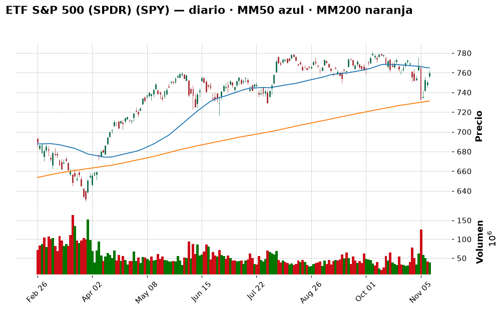
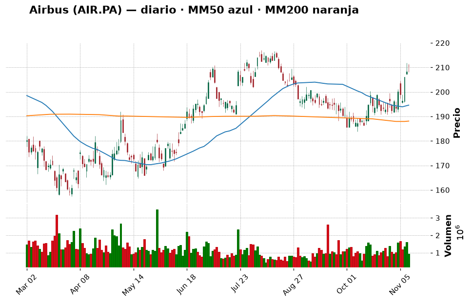
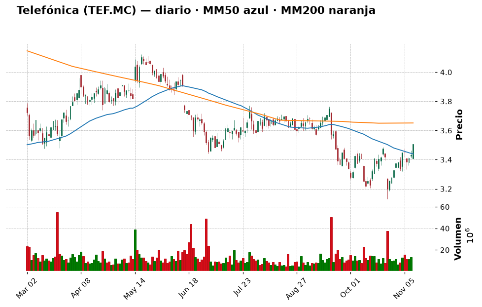
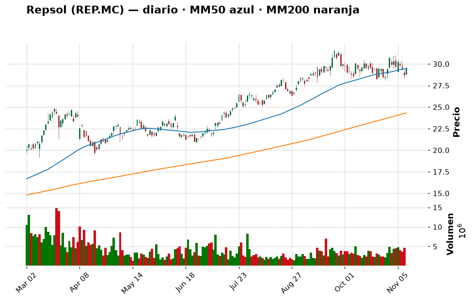
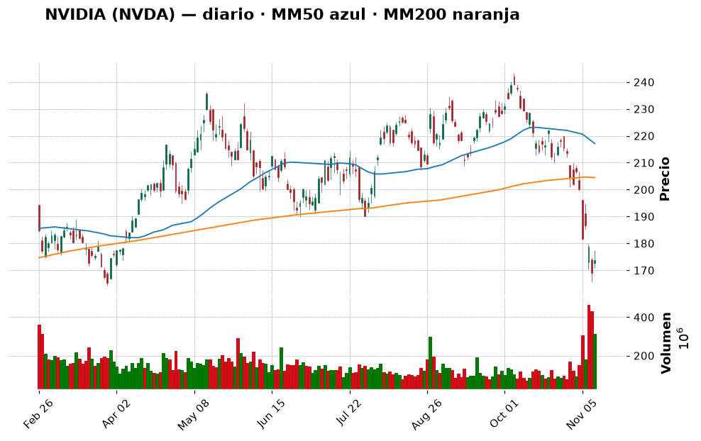
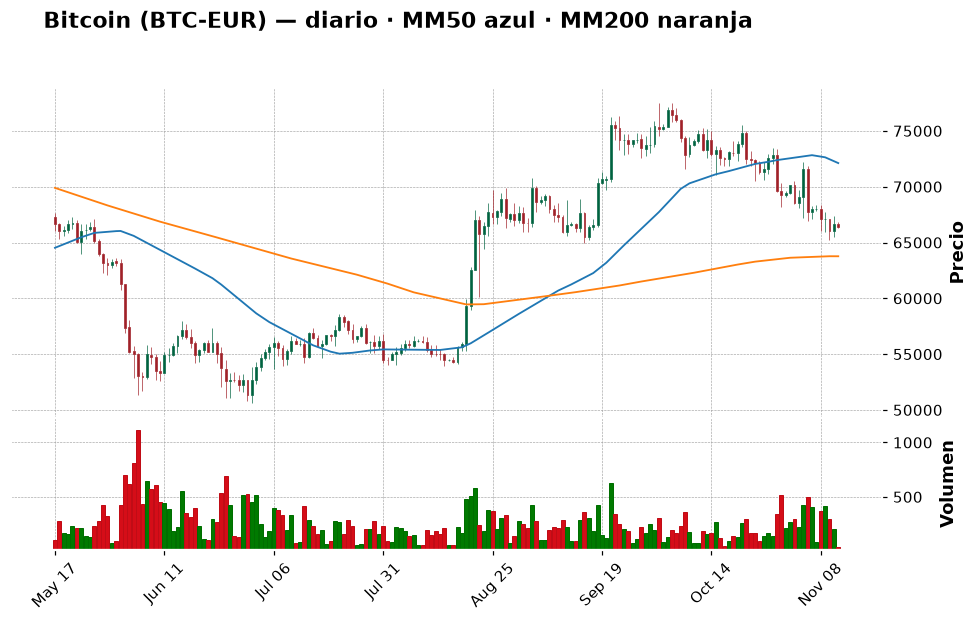
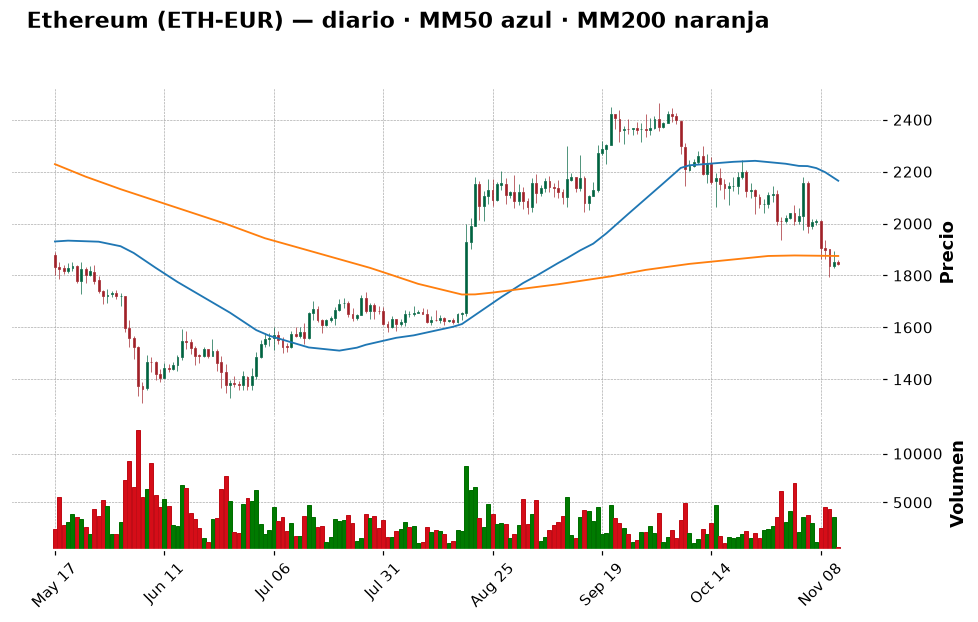

# 📈 Informe pre-apertura — jueves 12 de noviembre de 2026

> Generado automáticamente a las 07:55 (hora de Madrid) · Bolsa española abre a las 9:00 · Wall Street a las 15:30 · Cripto: 24/7
> **Termómetro del día:** 🟡 prudencia — Europa llega con fuerza (Ibex de nuevo sobre los 20.000 puntos), pero esta noche Nvidia se ha hundido un ~8 % fuera de hora porque su consejo estudia destituir a su consejero delegado, y los futuros del Nasdaq caen un −1 %. Con el bono de EE. UU. al 5 %, es un día para **seguir el plan y no improvisar**.
> **Lección de hoy:** Qué es la capitalización bursátil

## 1. Lo que tienes que saber hoy
- **Terremoto en Nvidia.** Según The Wall Street Journal, el consejo de administración se prepara para **destituir a Jensen Huang**, su fundador y consejero delegado, tras admitir una relación extramatrimonial con una mujer a la que la inteligencia de EE. UU. considera una espía china (Fortune). El consejo se reunió el miércoles por la noche y, según Reuters, **no hay plan de sucesión** (Investing.com). La acción llegó a caer **más de un 8 % fuera de hora**, y Decrypt calcula que Nvidia ha perdido **430.000 millones de dólares de valor en dos días**. Por eso la lección de hoy es la **capitalización bursátil**.
- **Wall Street abrirá a la baja; Europa, al alza.** Los futuros del S&P 500 caen un −0,4 % y los del Nasdaq 100 un −1 %, mientras que los futuros europeos suben un +0,4 % (DAX y FTSE +0,7 %) (Investing.com, Yahoo Finance). Ayer, antes del susto, el S&P 500 subió un +1,31 % y el Nasdaq un +1,60 % gracias a CoreWeave.
- **España: el Ibex recupera los 20.000** (20.027,9, +0,46 %) en plena huelga general y está a solo un **0,9 % de su récord histórico** (20.213 puntos, 11 de agosto) (Europa Press, Expansión). Hoy presenta resultados **Telefónica**: vuelve a beneficios (464 M€ hasta septiembre), mejora previsiones de caja y confirma el dividendo de 0,15 € (Expansión).
- **Tu cartera:** ¡las dos recomendaciones de ayer están hechas! ✅ **Tramo 1 del ETF S&P 500** ejecutado a 756,97 $ y **99 € de bitcoin** comprados. No hay que hacer nada más hasta la aportación del 1 de diciembre, salvo que el S&P 500 caiga a la zona de compra (729–739 $ en el SPY).

## 2. ✅ Recomendaciones del día (resumen)
| Activo | Acción | vs. ayer | Cuánto (orientativo) | Horizonte | Por qué, en una frase | Confianza |
|---|---|---|---|---|---|---|
| ETF S&P 500 (SPY / SPY5.L) | 🔵 Mantener | = | Tramo 1 hecho (~316 €); **tramo 2 (~600 €) hacia el 1-dic**, o antes si el SPY cae a 729–739 $ | Años (5+) | El susto de Nvidia es justo el tipo de caída que el plan en tramos aprovecha | media |
| Airbus (AIR.PA) | ⏸️ Esperar | = | Hasta 3–4 % (~300–400 €) en 2 tramos, si vuelve a ~202 € o cierra sobre 217 € | Años | Cerró en 210,70 €, justo pegada a su "pared" de 211 €: aún sin señal | media |
| Telefónica (TEF.MC) | ⏸️ Esperar | ↑ antes Evitar | 0 € hoy; hasta 2–3 % (~250 €) si supera 3,71 € tras resultados | Años | Vuelve a beneficios y deja de estar en tendencia bajista, pero sigue bajo su MM200 | baja |
| Repsol (REP.MC) | 🔵 Mantener | = | No añadir | Años | Ganas +139 %; Jefferies reitera "comprar" con objetivo 35 € | media |
| NVIDIA (NVDA) | ⛔ Evitar | = | 0 € | — | Crisis de liderazgo sin plan de sucesión: riesgo que un principiante no debe asumir | alta |
| Iberdrola (IBE.MC) | ⏸️ Esperar | = | Hasta 5 % (~480 €) si retrocede a 21–22 € | Años | En máximos (23,20 €) pero RSI 78: todavía más "caliente" que ayer | media |
| Inditex (ITX.MC) | 🔵 Mantener | = | No añadir | Años | +123 % en tu posición, a un 1 % de su máximo anual | media |
| Apple (AAPL) | 🔵 Mantener | = | No añadir | Años | Máximo de 52 semanas (355,63 $), tendencia alcista sana | media |
| Bitcoin (BTC-EUR) | 🔵 Mantener | ↓ antes Comprar | Compra de 99 € **ya hecha**; siguiente tramo ~50–100 € el 1-dic | Años | El tramo de este mes ya está; repetir hoy sería romper el plan | media |
| Ether (ETH-EUR) | ⏸️ Esperar | = | 0 € hoy | Años | Sigue por debajo de su MM200 (1.875 €) | media |
| Shiba Inu (SHIB) | ⛔ Evitar | = | No añadir | — | Memecoin, −53 % en un año | alta |

*(Santander, BBVA, Microsoft, Amazon y el ETF del Nasdaq tienen su veredicto en la tabla "Resto de la watchlist" de la sección 6.)*

**🔁 Seguimiento de ayer** (informe del 11-nov):
- **ETF S&P 500:** recomendábamos Mantener el tramo 1 → **ejecutado a 756,97 $** (0,4624 participaciones, 350 $) ✅. Ya gana un +0,46 % (760,47 $). El SPY cerró en 759,81 $, sin tocar ni la zona de compra (729–739 $) ni la MM50 (765 $): **el plan sigue igual**.
- **Bitcoin:** recomendábamos Comprar 100 € "solo si no lo hiciste ayer" → **comprados 99 € a 66.108,79 €** (+1 € de comisión) desde el USDC ✅. Por eso hoy la acción pasa a **Mantener**: no ha cambiado la opinión, ha cambiado tu cartera (el tramo del mes ya está hecho).
- **Airbus:** Esperar a ~202 € o a un cierre sobre 217 € → cerró en **210,70 €**: ni una cosa ni otra. Seguimos esperando.
- **Iberdrola:** Esperar a 21–22 € → subió a **23,20 € (máximo anual)** y el RSI pasó de 75,7 a 78,2. Seguimos esperando; la condición alternativa (enfriarse por debajo de 70 sin caer) tampoco se ha dado.
- **Telefónica:** cambio de **Evitar a Esperar**. Motivo concreto: hoy publica resultados con vuelta a beneficios, mejora de previsiones de caja y dividendo confirmado, y su tendencia técnica ha pasado de "bajista" a "lateral". Aún no es una compra (sigue un −4 % bajo su MM200), pero sí merece vigilarse.

> Día para **no tocar nada**: tus dos movimientos del mes ya están hechos y bien hechos. Si la caída de Nvidia arrastra al S&P 500 hacia los 729–739 $ del SPY en los próximos días, eso sería una **oportunidad para adelantar el tramo 2**, no un motivo de miedo.

## 3. Agenda del día
| Hora (Madrid) | Evento | Por qué importa |
|---|---|---|
| 8:00 | **PIB del Reino Unido (3.er trimestre)**, producción industrial y balanza comercial | Pista sobre el crecimiento en Europa; con tipos altos, se vigila si la economía se frena |
| Mañana | Confianza del consumidor en Alemania y Francia; cuenta corriente alemana | Termómetro del consumo europeo (afecta a Inditex o la banca) |
| Antes de la apertura | **Resultados de Telefónica** (nueve meses), **Siemens** y **Allianz** (Expansión, Investing.com) | Telefónica está en tu watchlist; Siemens y Allianz son pesos pesados del Euro Stoxx 50 |
| 9:00 | Apertura de la Bolsa española | ¿Ataca el Ibex su récord de 20.213 puntos? |
| 15:30 | Apertura de Wall Street | Se verá cuánto pesa la crisis de Nvidia en el índice |
| Tras el cierre de EE. UU. (~22:00) | Resultados de **Applied Materials** y **Cisco** (Investing.com) | Applied Materials fabrica las máquinas para hacer chips: termómetro de la demanda de IA en plena duda por Nvidia |
| Durante el día | **Posible anuncio del consejo de Nvidia** sobre su consejero delegado | Puede mover todo el sector tecnológico, en cualquier dirección |
| Vie 13 | IPP (precios industriales) de EE. UU. · revisión del rating de Alemania | Segunda pista de inflación de la semana; si sale alta, más presión sobre la Fed |
| Dom 29 | Elecciones generales en España | Ruido político durante el mes |

*Nota: no he podido confirmar datos de paro semanal de EE. UU. ni comparecencias de la Fed para hoy (las búsquedas no devolvieron un calendario fiable).*

## 4. Cómo llegan los mercados
### España y Europa
**Ayer (miércoles 11):** el **Ibex 35** cerró en **20.027,9 puntos (+0,46 %)** y recuperó los 20.000 en una jornada de huelga general (Europa Press). La huelga tuvo un seguimiento "muy desigual" según Expansión y "muy positivo" según UGT: como esperábamos, **para la bolsa fue ruido**. El Ibex lleva un **+7,37 % desde el 30 de octubre** y le separa un **0,9 % de su récord histórico** de 20.213 puntos (Expansión). El **Euro Stoxx 50** subió un **+1,04 %, hasta 6.393,39** (Yahoo Finance).

Por qué Europa va mejor que EE. UU. este año: Expansión habla de **"dos rotaciones que soplan a favor de Europa"** (el dinero sale de la tecnología estadounidense, cara y en duda, hacia sectores europeos como banca, energía o industria). 💡 *Una **rotación** es cuando los inversores venden un tipo de acciones y compran otro: no sale dinero de la bolsa, cambia de sitio.*

**Empresas españolas:**
- **Telefónica** vuelve a beneficios: **464 millones hasta septiembre**; mejora sus previsiones de ebitda y flujo de caja libre, recorta la de ingresos, **reduce la deuda en 1.600 millones** y confirma el dividendo de **0,15 €** (Expansión). Ayer ya subió un +2,13 % (3,50 €).
- **Santander:** Ana Botín contempla, con el tiempo, pasar a un puesto no ejecutivo, algo que agrada al BCE (Cinco Días); además, ofrece 840 € para captar clientes y pone el foco en seguros (Expansión).
- **Repsol** subió un **+3,03 %** (29,56 €): Jefferies mantiene "comprar" con precio objetivo de **35 €** y eleva su previsión de Brent para 2027 a 82,5 $ (Yahoo Finance/Investing.com).
- **Kraken** (exchange cripto) tokenizará acciones de **11 empresas españolas** en su plataforma xStocks (Expansión). 💡 *Un **token de una acción** es una copia digital que sigue su precio y se negocia 24 h; no es lo mismo que tener la acción (normalmente no da voto y depende de quien lo emite).*

### Estados Unidos
**Ayer:** el **S&P 500** cerró en **7.619,38 (+1,31 %)** y el **Nasdaq** en **25.466,19 (+1,60 %)**: CoreWeave dio "un empujón" a todo el sector de la IA (MarketWatch). Nvidia subió un +2,87 % (173,73 $) y Apple marcó **máximo de 52 semanas** (355,63 $).

**Después del cierre todo cambió.** El WSJ publicó que el consejo de Nvidia prepara la salida de Huang; la empresa dice que el consejo "tiene confianza" en él y que no cree que se hayan comprometido secretos (Fortune), pero el mercado ha votado: **−8 % fuera de hora** y bajadas de recomendación de varios brókeres (Investing.com). Como Nvidia es una de las mayores empresas del mundo, arrastra a los futuros: **S&P 500 −0,45 % (7.606) y Nasdaq 100 −0,97 % (28.198)** a las 7:38 h de Madrid (Yahoo Finance). La bolsa de Taiwán cae un −2,8 %. Curiosamente, Apple y Alphabet suben ligeramente en la sesión nocturna: parte del dinero "rota" hacia la tecnología tradicional (Stocktwits).

### Macro (tipos de interés, inflación, divisas, materias primas)
- **Bonos:** el bono de EE. UU. a 10 años sigue en el **4,99 %** y el de 30 años en el 5,34 % (Investing.com). MarketWatch señala que **el petróleo más barato ya no basta para bajar los tipos de los bonos**: la preocupación por la inflación va más allá de la energía. 💡 *Si el bono "seguro" paga casi un 5 %, las acciones tienen que ofrecer mucho para merecer el riesgo.*
- **Fed:** tras el IPC caliente, el mercado sigue dando ~90 % a una subida en diciembre (CoinDesk). No hay notas de prensa de política monetaria nuevas de la Fed esta semana (solo una de supervisión bancaria del 9-nov).
- **BCE:** sin notas de prensa nuevas en su web en los últimos días. El **Euríbor** sigue subiendo: su media provisional de noviembre es del **3,262 %** (Expansión). 💡 *El Euríbor es el tipo al que se prestan los bancos europeos; de él dependen la mayoría de hipotecas variables en España.*
- **Euro/dólar:** **1,1079 (−0,1 %)**, en su **mínimo de 52 semanas** (1,1071) (Yahoo Finance). El índice del dólar está en su nivel más alto desde abril del año pasado (Investing.com). Para ti: tus 2.605 USDC valen hoy **2.351 €**.
- **Petróleo Brent:** **92,46 $ (−0,3 %)** (Yahoo Finance). Expansión titula que "el crudo apuesta por el fin de la guerra en Irán".
- **Japón:** la inflación mayorista se acelera y el yen roza 160 por dólar; se discute una subida de tipos del Banco de Japón (Investing.com). Parece lejano, pero cuando Japón sube tipos, a veces provoca ventas en todo el mundo.

## 5. Panorama técnico de la watchlist
> 💡 *Cómo leer esta tabla:* la **tendencia** resume si el precio lleva meses subiendo, bajando o de lado
> (comparando el precio con sus medias de 50 y 200 días). El **RSI** mide de 0 a 100 si las subidas o bajadas
> recientes han sido muy fuertes: por encima de 70 se dice "sobrecompra" (quizá ha subido demasiado rápido),
> por debajo de 30 "sobreventa". Son pistas, no predicciones.

Todos los datos son del **cierre del miércoles 11-nov** (ningún valor llega con retraso hoy ✅). Recuerda: **no incluyen la caída de Nvidia fuera de hora**.

| Valor | Último cierre | Día | 1 mes | 1 año | Tendencia | RSI | vs MM200 |
|---|---|---|---|---|---|---|---|
| IBEX 35 (^IBEX) | 20.027,9 | +0,46 % | +4,25 % | +22,53 % | ➡️ lateral | 64,2 🟡 | +6,8 % |
| Euro Stoxx 50 (^STOXX50E) | 6.393,39 | +1,04 % | +3,67 % | +14,85 % | ➡️ lateral | 62,0 🟡 | +4,5 % |
| S&P 500 (^GSPC) | 7.619,38 | +1,31 % | −2,38 % | +11,52 % | ➡️ lateral | 49,7 🟡 | +3,9 % |
| Nasdaq Composite (^IXIC) | 25.466,19 | +1,60 % | −6,39 % | +8,24 % | ➡️ lateral | 45,5 🟡 | +1,4 % |
| Banco Santander (SAN.MC) | 11,29 € | +0,34 % | −7,26 % | +21,56 % | ➡️ lateral | 49,6 🟡 | +0,0 % |
| BBVA (BBVA.MC) | 23,61 € | −0,08 % | +1,68 % | +28,42 % | ➡️ lateral | 56,8 🟡 | +9,6 % |
| Inditex (ITX.MC) | 60,08 € | −0,10 % | +10,97 % | +23,29 % | 📈 alcista | 66,1 🟡 | +10,0 % |
| Iberdrola (IBE.MC) | 23,20 € | +0,91 % | +7,61 % | +28,64 % | 📈 alcista | 78,2 🔴 | +13,8 % |
| Telefónica (TEF.MC) | 3,50 € | +2,13 % | +7,78 % | −6,08 % | ➡️ lateral | 57,9 🟡 | −4,0 % |
| Repsol (REP.MC) | 29,56 € | +3,03 % | −0,20 % | +73,42 % | 📈 alcista | 50,7 🟡 | +21,6 % |
| Airbus (AIR.PA) | 210,70 € | +1,18 % | +12,98 % | +2,03 % | ➡️ lateral | 66,9 🟡 | +12,0 % |
| Apple (AAPL) | 355,63 $ | +2,04 % | +4,21 % | +31,99 % | 📈 alcista | 60,4 🟡 | +18,4 % |
| Microsoft (MSFT) | 521,13 $ | −2,26 % | −4,11 % | +2,99 % | 📈 alcista | 47,7 🟡 | +18,2 % |
| NVIDIA (NVDA) | 173,73 $ | +2,87 % | −23,98 % | −12,72 % | ➡️ lateral | 28,7 🟢 | −15,0 % |
| Amazon (AMZN) | 266,17 $ | −1,74 % | +2,94 % | +7,15 % | ➡️ lateral | 57,3 🟡 | +8,9 % |
| ETF S&P 500 (SPY) | 759,81 $ | +1,32 % | −2,34 % | +11,50 % | ➡️ lateral | 49,9 🟡 | +3,9 % |
| ETF Nasdaq 100 (QQQ) | 690,38 $ | +2,31 % | −7,15 % | +10,77 % | ➡️ lateral | 46,1 🟡 | +1,3 % |

*(🟢 = RSI bajo, posible "rebajas"; 🔴 = RSI alto, quizá demasiado rápido; 🟡 = neutral.)*

**En conjunto:** la foto de "dos velocidades" de ayer se mantiene. **Europa** sigue fuerte: el Ibex está un +6,8 % sobre su media de 200 sesiones y a un 1,6 % de su máximo de 52 semanas; Iberdrola, Inditex y Apple están prácticamente en máximos anuales. **EE. UU.** sigue "de lado": el S&P 500 está por encima de su MM200 (7.334) pero justo por debajo de su MM50 (7.673), y el Nasdaq apenas un 1,4 % sobre su MM200. Lo más "estirado" es **Iberdrola (RSI 78,2)**; lo más castigado, **Nvidia (RSI 28,7)**, y eso antes del −8 % de esta noche. Buena noticia: **Telefónica ya no aparece como bajista** (ha pasado a "lateral").

## 6. Ideas de bolsa: qué haría un experto
### ETF S&P 500 (SPY5.L / SPY) — MANTENER (tramo 1 hecho)

- **Qué es:** un fondo que compra de una vez las ~500 mayores empresas de EE. UU. Tú tienes la versión europea (UCITS) que cotiza en Londres, **SPY5.L**; el gráfico es del SPY estadounidense, que sigue exactamente el mismo índice.
- **Por qué es noticia hoy:** la crisis de Nvidia empuja los futuros del S&P 500 un −0,4 %. Nvidia es una de las mayores empresas del índice, así que **una parte de tu ETF es Nvidia**: hoy lo notarás, pero mucho menos que si tuvieras la acción suelta (ver la lección de hoy).
- **Lo que dice el gráfico:** el SPY (759,81 $) rebotó ayer un +1,3 % y está **justo encima de un soporte (759,5 $)**, por encima de su **MM200 (731 $)** y un poco por debajo de su **MM50 (765 $)**. RSI 49,9 (neutral), MACD "mejorando". A un −2,8 % de su máximo de 52 semanas (781,62 $). En lenguaje llano: **la tendencia de fondo está intacta**; el precio está en "tierra de nadie" entre la MM200 (suelo) y la MM50 (techo cercano).
- **Lo positivo:** es el núcleo diversificado y barato que tu cartera necesitaba, y ya has empezado. Tu tramo gana un +0,46 %.
- **El riesgo:** si la crisis de Nvidia contagia a otras tecnológicas o el bono supera claramente el 5 %, el índice podría volver a 729–739 $.
- **🧑‍💼 Recomendación: MANTENER.** Nada ha cambiado desde ayer: el plan es comprar en tramos para **no tener que adivinar el día**. Hoy es un buen ejemplo: si hubieras metido todo de golpe, una noticia como la de Nvidia te pillaría con todo dentro; con tramos, una caída es una **oportunidad para el siguiente**.
  - **Cuánto y cómo:** tramo 2 de ~600 € (≈6 % de tu patrimonio) **hacia el 1 de diciembre**; si antes el SPY cae a la zona de **729–739 $**, adelántalo. Objetivo: ~35 % del patrimonio en 6 tramos.
  - **Horizonte:** 5 años o más.
  - **Qué me haría cambiar de opinión:** un cierre semanal por debajo de 729 $: no vendería lo comprado, pero pausaría el siguiente tramo hasta ver estabilidad.
- **Qué mirar para entenderlo:** cuánto cae hoy el SPY frente a Nvidia. Si Nvidia cae un 8 % y el SPY solo un 0,5 %, has visto la **diversificación en acción**.
- **Confianza:** media

### Airbus (AIR.PA) — ESPERAR (sigue en tu lista de la compra)

- **Qué es:** el mayor fabricante de aviones comerciales del mundo (europeo, con fábricas en Francia, Alemania y España), además de helicópteros, defensa y espacio.
- **Por qué es noticia hoy:** sin noticias grandes nuevas. Se confirma el pedido de **Cathay Pacific** (aviones por 5.100 millones de dólares a precio de catálogo) y CDB Aviation alquila dos A321ceo a la turca Freebird (Yahoo Finance). Un análisis de Investor's Business Daily compara a Embraer (en "zona de compra" tras resultados) con Boeing y Airbus. El dato clave de fondo sigue siendo el **objetivo de ~870 entregas en 2026** (547 hasta septiembre según AirNav Radar; 74 más en octubre).
- **Lo que dice el gráfico:** 210,70 € (+1,2 % ayer, +13 % en un mes). Por encima de sus medias (MM50 194,6 €, MM200 188,1 €), RSI 66,9 (neutral alto, cerca de sobrecompra) y MACD mejorando. Pero está **justo debajo de la resistencia de 210,95 €**, con otra en **216,5–217 €**, y su máximo anual en 221,3 € (a un −4,8 %). Soporte cercano: 201,65 €.
- **Lo positivo:** cartera de pedidos enorme, ventaja clara sobre Boeing en entregas y viento de cola por el gasto en defensa europeo.
- **El riesgo:** retrasos de proveedores (motores) que impidan llegar a las 870 entregas; y comprar después de un +13 % en un mes, justo bajo una resistencia, deja poco margen.
- **🧑‍💼 Recomendación: ESPERAR.** Mantengo exactamente el plan de ayer: compraría **(a)** en un retroceso hacia ~202 € (soporte) o **(b)** con un cierre claro por encima de 217 € (la "pared" rota). Ayer no se dio ninguna de las dos.
  - **Cuánto y cómo:** hasta 3–4 % del patrimonio (~300–400 €), en 2 tramos.
  - **Horizonte:** años.
  - **Qué me haría cambiar de opinión:** un cierre por debajo de 190 € (MM200 y soporte) o un recorte del objetivo de entregas.
- **Qué mirar para entenderlo:** en el gráfico, si la vela de hoy "rompe" la línea de 211 € con fuerza o se da la vuelta hacia abajo (rechazo). Y las entregas de noviembre, a principios de diciembre.
- **Confianza:** media

### Telefónica (TEF.MC) — ESPERAR (antes Evitar)

- **Qué es:** la mayor operadora de telecomunicaciones de España (Movistar), con negocio en Alemania, Reino Unido y Brasil. Paga dividendo.
- **Por qué es noticia hoy:** presenta resultados de los nueve primeros meses: **vuelve a beneficios con 464 millones**, **mejora sus previsiones de ebitda y de flujo de caja libre** pero **recorta la de ingresos**, **reduce la deuda en 1.600 millones** y **confirma el dividendo de 0,15 €** (Expansión). 💡 *El **ebitda** es, en llano, lo que gana el negocio antes de pagar intereses, impuestos y el desgaste de sus equipos; el **flujo de caja libre** es el dinero que de verdad le sobra para pagar dividendos y deuda.*
- **Lo que dice el gráfico:** 3,50 € (+2,1 % ayer, +7,8 % en un mes). Ha superado su MM50 (3,44 €) y su tendencia ha pasado de "bajista" a "lateral", pero sigue **un −4 % por debajo de su MM200 (3,65 €)** y lejos de su máximo anual (4,12 €). Resistencia en **3,71 €**; soportes en 3,46 € y 3,44 €. RSI 57,9 (neutral).
- **Lo positivo:** menos deuda y más caja son justo lo que necesitaba; con el dividendo de 0,15 €, la rentabilidad por dividendo ronda el 4 % a este precio (*mi cálculo*: 0,15 / 3,50 ≈ 4,3 %).
- **El riesgo:** que los ingresos sigan sin crecer (por eso recortan la previsión), y el sector es muy competitivo. Además, en noviembre de 2025 la acción cayó un −13 % en un día al recortar el dividendo a la mitad: es una empresa que ya ha decepcionado.
- **🧑‍💼 Recomendación: ESPERAR.** Cambio desde **Evitar** porque hay un hecho nuevo (resultados mejores en lo que importa: caja y deuda) y el técnico ha mejorado. Pero no compraría antes de ver **cómo reacciona la bolsa hoy** y si el precio **supera 3,71 €** (resistencia) y su MM200 (3,65 €). Comprar justo el día de resultados es jugar a adivinar.
  - **Cuánto y cómo:** 0 € hoy; si se cumple la condición, hasta 2–3 % del patrimonio (~250 €) en 2 tramos.
  - **Horizonte:** años (es una idea de dividendo, no de crecimiento).
  - **Qué me haría cambiar de opinión:** un cierre por debajo de 3,27 € (soporte) me devolvería a Evitar.
- **Qué mirar para entenderlo:** la vela de hoy en el gráfico: si cierra cerca del máximo del día, el mercado "compra" los resultados; si deja una mecha larga hacia arriba y cierra abajo, los rechaza.
- **Confianza:** baja

### Repsol (REP.MC) — MANTENER (la tienes)

- **Qué es:** la petrolera española (extracción, refino, gasolineras y renovables).
- **Por qué es noticia hoy:** **Jefferies** mantiene su recomendación de "comprar" y su precio objetivo de **35 €**; dice que la retribución al accionista de 2026 que espera ha subido un 44 % y eleva su previsión de Brent para 2027 a 82,5 $ (y 95 $ para el cuarto trimestre de 2026) (Yahoo Finance/Investing.com). Ayer subió un +3,0 %.
- **Lo que dice el gráfico:** 29,56 €, ligeramente sobre su MM50 (29,44 €) y muy por encima de su MM200 (24,32 €; +21,6 %); la tendencia vuelve a figurar como **alcista**. RSI 50,7 (neutral), MACD mejorando. Resistencias en 30,43 € y 31,64 € (máximo anual); soportes en 28,29 € y 27,8 €.
- **Lo positivo:** tendencia de fondo alcista, dividendo y respaldo de analistas.
- **El riesgo:** un acuerdo de paz con Irán podría abaratar el crudo (el Brent está en 92,5 $, y Jefferies espera 82,5 $ en 2027: menos que hoy).
- **🧑‍💼 Recomendación: MANTENER.** Ganas un **+139 %** en tus 2 acciones. No ampliaría (ya tienes exposición y el petróleo está más cerca de bajar que de subir según el propio Jefferies), pero no hay motivo para vender algo que sigue en tendencia alcista.
  - **Cuánto y cómo:** no añadir.
  - **Horizonte:** años.
  - **Qué me haría cambiar de opinión:** un cierre por debajo de 27,8 € con el Brent cayendo hacia 80 $: ahí valoraría Vender.
- **Qué mirar para entenderlo:** el Brent. Por encima de 90 $, viento a favor; por debajo, presión.
- **Confianza:** media

### NVIDIA (NVDA) — EVITAR

- **Qué es:** el gran fabricante de chips para inteligencia artificial; una de las empresas más grandes del mundo por capitalización.
- **Por qué es noticia hoy:** el consejo prepara la posible destitución de su fundador y CEO, Jensen Huang (WSJ vía Fortune); se reunió el miércoles por la noche y no hay plan de sucesión (Reuters vía Investing.com). Candidatas a dirigirla de forma interina: la directora financiera **Colette Kress** o el consejero **Stephen Neal**; también se cita a **Ian Buck** (Fortune, Investing.com). Los analistas calculan una caída adicional del ~20 % si Huang es despedido (BeInCrypto vía Yahoo Finance). Las empresas chinas se apresuran a asegurarse chips de Nvidia por miedo a nuevas restricciones de EE. UU. (Investing.com).
- **Lo que dice el gráfico** (cierre del 11-nov, **antes** de la caída de esta noche): 173,73 $, −24 % en un mes, **−15 % bajo su MM200 (204 $)** y −20 % bajo su MM50. RSI 28,7 (sobreventa), volumen 1,9 veces el normal. *Mi cálculo*: un −8 % la dejaría en torno a **160 $, por debajo de su mínimo de 52 semanas (164,27 $)**, algo que no aparece todavía en el gráfico.
- **Lo positivo:** el negocio (demanda de chips para IA) sigue fuerte, como mostró CoreWeave.
- **El riesgo:** que la empresa más importante de la IA se quede **sin líder y sin plan**. La historia de destituciones de CEO fundadores sugiere que las caídas grandes a veces llegan después, no el primer día (Yahoo Finance).
- **🧑‍💼 Recomendación: EVITAR (confianza alta).** Subo la confianza de media a alta: ayer el problema era un escándalo; hoy es una **crisis de liderazgo abierta** que puede resolverse en cualquier dirección en horas. Eso es una apuesta binaria, no una inversión para un principiante. Ya tienes Nvidia "de forma prudente" dentro de tu ETF.
  - **Cuánto y cómo:** 0 €.
  - **Qué me haría cambiar de opinión:** un nuevo equipo directivo claro y el precio recuperando su MM200 (~204 $).
- **Qué mirar para entenderlo:** si pierde de forma clara el mínimo de 164 $; y compara cuánto cae Nvidia con cuánto cae el S&P 500 (lección de hoy).
- **Confianza:** alta

### Resto de la watchlist: veredicto rápido
| Valor | Acción | Por qué (1 frase) | Nivel a vigilar |
|---|---|---|---|
| Iberdrola (IBE.MC) | ⏸️ Esperar | En máximo anual (23,20 €) pero RSI 78,2, aún más sobrecomprada que ayer; sin noticias propias hoy | Comprar en 21–22 €; soporte 21,09 € |
| Inditex (ITX.MC) | 🔵 Mantener | Tu posición gana +123 %, a un 1 % de su máximo anual (60,74 €); respalda un fondo de 400 M$ para que sus proveedores reduzcan emisiones (Just Style) | Soporte 56,2 € |
| Apple (AAPL) | 🔵 Mantener | Máximo de 52 semanas tras subir +2 %; algunos ven la acción "cara para 2027" (Yahoo Finance) y Tim Cook aparece en apuestas como posible CEO de Nvidia (Benzinga) | Soporte 338,7 $ |
| Banco Santander (SAN.MC) | ⏸️ Esperar | Justo en su MM200 (11,29 €); noticias: sucesión de Ana Botín y participación en la stablecoin bancaria "Project Faro" | Comprar si cierra sobre 11,96 € (MM50); soporte 10,34 € |
| BBVA (BBVA.MC) | ⏸️ Esperar | Tendencia de fondo sana (+9,6 % sobre su MM200), pero aún bajo su MM50 (23,77 €); sin noticias propias hoy (sí la Audiencia Nacional amplía plazos del "caso BBVA", El País) | Sobre 23,77 €; soporte 22,77 € |
| Microsoft (MSFT) | ⏸️ Esperar | −2,3 % ayer y −6,2 % en la semana, MACD empeorando; Anthropic lanza una hoja de cálculo que compite con Excel (Motley Fool) | Soporte 505 $; resistencia 551 $ |
| Amazon (AMZN) | ⏸️ Esperar | −1,7 % ayer; posible juicio en Italia por IVA de importaciones (Yahoo Finance) y ARK reduce su posición | Resistencia 267,6 $; soporte 244,7 $ |
| ETF Nasdaq 100 (QQQ) | ⏸️ Esperar | Muy concentrado en tecnológicas: es el que más sufrirá lo de Nvidia (futuros −1 %); para ti, mejor el S&P 500 | Soporte 686 $ y MM200 681,7 $ |

## 7. ₿ Criptomonedas
> 💡 *Las criptomonedas cotizan 24 horas, 7 días a la semana: los precios son de esta mañana (en euros).
> Son mucho más volátiles que las acciones: caídas del 50 % o más han ocurrido varias veces.*

**Sentimiento:** Fear & Greed **28/100 (miedo**; ayer 29, hace una semana 50 —neutral—, hace un mes 57 —codicia—) · Capitalización total **2,55 billones $ (−0,25 % en 24 h; −47 % bajo su máximo histórico de octubre de 2025)** · Dominancia de Bitcoin **57,9 %**.
El miedo se mantiene pero **no empeora**: el mercado cripto está "parado" mientras la bolsa rebota y cae. Decrypt lo resume como un bitcoin que "va en reserva": salen los ETF y se encoge la oferta de stablecoins (−14.200 millones de dólares en 30 días, la mayor contracción desde junio de 2022).

**Radar Coinbase** (408 monedas comprables · hoy suben 83 y bajan 277 · en 7 días suben 17 y bajan 343):
- **Mayores por capitalización (7 días):** BTC −8,6 %, ETH −15,4 %, BNB −5,4 %, XRP −20,7 %, SOL −13,7 %, HYPE −14,6 %, ZEC −25,6 %, DOGE −12,5 %.
- **Más suben (7 d, top 100):** WLFI (+1,6 %) y… nada más en positivo: AVAX (−1,7 %), PAXG (−3,6 %, es oro tokenizado) · **Más bajan:** ZEC (−25,6 %), ENA (−21,2 %), XRP (−20,7 %), PUMP (−20,3 %), QNT (−19,9 %).
La caída es **casi total**: solo 17 de 360 monedas suben en la semana. No hay ninguna moneda que destaque con un motivo sólido (noticia + técnico); el radar no justifica comprar nada fuera del núcleo.

| Moneda | Ranking | Precio (€) | 24 h | 7 días | 1 mes | 1 año | Tendencia | RSI | vs MM200 |
|---|---|---|---|---|---|---|---|---|---|
| Bitcoin (BTC) | #1 | 66.392,37 | −0,40 % | −1,93 % | −10,53 % | −24,31 % | ➡️ lateral | 36,6 | +4,1 % |
| Ether (ETH) | #2 | 1.846,13 | −0,32 % | −7,32 % | −17,19 % | −37,36 % | ➡️ lateral | 31,7 | −1,6 % |
| XRP (XRP) | #6 | 0,9395 | −0,90 % | −12,57 % | −22,94 % | −54,40 % | ➡️ lateral | 24,0 | −14,6 % |
| Solana (SOL) | #7 | 74,67 | −0,45 % | −6,09 % | −21,65 % | −43,55 % | ➡️ lateral | 25,8 | −3,8 % |
| Shiba Inu (SHIB) | #42 | 0,0000039 | −0,76 % | −3,70 % | −15,77 % | −52,61 % | ➡️ lateral | 35,1 | −12,1 % |

*(Las variaciones de 7 días de la tabla salen de las velas de Coinbase y las del radar, de Coinpaprika: miden ventanas ligeramente distintas, por eso no coinciden.)*

**Noticias que importan:**
- **Quinto día de salidas de los ETF de bitcoin:** 1.440 millones de dólares en cinco sesiones, liderados por el IBIT de BlackRock (−269,7 M$ solo el miércoles) (BeInCrypto). Y los compradores recientes ("short-term holders") han enviado 3.600 M$ en BTC a los exchanges **vendiendo con pérdidas** (Decrypt): es el comportamiento típico de una fase de miedo.
- **MSCI confirma que sacará a Strategy** (la empresa que acumula bitcoins) y a Metaplanet de sus índices tras el cierre del 30 de noviembre (Cointelegraph). Los fondos indexados que siguen a MSCI tendrán que vender esas acciones.
- **Bitcoin camino de su primer año negativo dos años seguidos** de la historia, aunque con matices en los datos (Decrypt).
- **Seguridad:** Bitcoin Core reveló y corrigió un fallo que hacía que miles de nodos "confiaran en cualquier desconocido" en Tor, y otro de gravedad alta que podría haber parado la minería (CoinDesk, Decrypt). Corea del Sur permitirá congelar retiradas ante amenazas de hackeo (Cointelegraph). Para ti, como usuario de Coinbase, no cambia nada, pero recuerda: **la red funciona porque se corrigen fallos, no porque no existan**.
- **Adopción institucional:** **Deutsche Bank** lanza la custodia de bitcoin, ether y tres stablecoins para empresas en Europa (Decrypt, Cointelegraph). Lo positivo a largo plazo convive con lo negativo a corto.
- **Nvidia también "cotiza" en cripto:** sus contratos perpetuos en Hyperliquid cayeron un −7 % (CoinDesk), un ejemplo de los productos apalancados que **no** encajan con tu perfil.

### Bitcoin (BTC) — MANTENER (compra del mes hecha)

- **Qué es:** la primera y mayor criptomoneda; su oferta máxima está limitada a 21 millones de unidades.
- **Lo que dice el gráfico:** 66.392 € esta mañana, apenas por encima del soporte de **65.898 €** y un +4,1 % sobre su **MM200 (63.768 €)**, su "suelo de largo plazo". Por debajo, soporte en 64.918 €; por encima, resistencias en 69.923 € y 70.745 €. RSI 36,6 y MACD "mejorando": la caída **pierde fuerza**, aunque aún no hay rebote. A un −26 % de su máximo de 52 semanas (89.790 €).
- **🧑‍💼 Recomendación: MANTENER.** Ayer compraste 99 € a 66.108,79 €: ese era el tramo de este mes y hoy el precio está prácticamente igual. **No compres más hoy**, aunque el miedo tiente: la gracia de las compras periódicas es que el calendario decide por ti, no el estado de ánimo del mercado. Tu bitcoin total (0,00263 BTC, 174,51 €) tiene un precio medio de 69.887 € (incluye tu compra antigua a 74.000 €) y pierde un −5 %.
  - **Cuánto y cómo:** siguiente tramo de **~50–100 € el 1 de diciembre**, con parte de la aportación o desde el USDC, por el par BTC-EUR o BTC-USDC de Coinbase. Tu cripto pesa un **1,83 %** frente al tope del 25 % (margen de 3.004,55 €), pero recuerda que **un 25 % es mucho para un perfil moderado**: las criptomonedas han tenido caídas del 50–80 %. Yo no pasaría del **5 %** en los próximos meses.
  - **Qué me haría cambiar de opinión:** un cierre diario claro por debajo de la MM200 (~63.800 €): pausaría el tramo de diciembre y esperaría a ver si busca 54.000 € (siguiente soporte).
- **El riesgo:** con los ETF vendiendo cinco días seguidos y la Fed a punto de subir tipos, podría caer otro 15–20 % sin que nada "esté roto". Solo invierte lo que aguantarías ver a la mitad.
- **Confianza:** media

### Ether (ETH) — ESPERAR

- **Qué es:** la segunda criptomoneda; la red Ethereum permite programas ("smart contracts") y es la base de muchas stablecoins y aplicaciones.
- **Lo que dice el gráfico:** 1.846 €, **todavía un −1,6 % por debajo de su MM200 (1.875 €)**, RSI 31,7 (cerca de sobreventa) y MACD "mejorando" (ayer "empeorando"): primer síntoma de que la caída se frena. −7,3 % en una semana y −40 % bajo su máximo anual. Soportes en 1.607 € y 1.581 €. Motley Fool señala que "una señal parpadea en rojo": los ETF de ether siguen sin entradas de dinero.
- **🧑‍💼 Recomendación: ESPERAR.** Igual que ayer. Compraría un primer tramo pequeño (~50 €) si **recupera 1.875 €** (vuelta sobre su suelo de largo plazo) o si cae a la zona de **1.600 €** (soporte).
  - **Cuánto y cómo:** 0 € hoy; luego, como mucho, la mitad de lo que pongas en bitcoin.
  - **Qué me haría cambiar de opinión:** recuperar la MM200 con el MACD manteniéndose en "mejorando".
- **El riesgo:** es más volátil que bitcoin (volatilidad anualizada ~55 % frente a ~38 %).
- **Confianza:** media

### Shiba Inu (SHIB) — EVITAR
- **Qué es:** una "memecoin" (moneda nacida como broma, sin uso real relevante).
- **Lo que dice el gráfico:** −52,6 % en un año, −12 % bajo su MM200, −55 % bajo su máximo de 52 semanas.
- **🧑‍💼 Recomendación: EVITAR (no añadir).** Tienes 3,90 € (pagaste 6 €). Es tan poco que no merece la comisión de venderla; quédatela como recordatorio.
- **El riesgo:** que pierda casi todo su valor; con 4 € no es problema, con 400 € sí.
- **Confianza:** alta

## 8. 💼 Tu cartera
**Valor total:** 9.727,29 € · **Invertido:** 689,59 € · **Ganancia/pérdida no realizada:** +81,07 € (+13,3 % sobre lo que pagaste) · **Realizada:** 0 €
**Reparto:** acciones 2,0 % · ETF 3,3 % · cripto 1,8 % · liquidez 92,9 % · **Cripto vs tope:** 1,83 % de 25 % ✅ dentro (margen 3.004,55 €)
**Liquidez disponible:** 9.037,70 € (92,9 %: 6.686,30 € en euros en otro bróker + 2.605,43 USDC ≈ 2.351,40 € en Coinbase) · **Próxima aportación:** 200 € el 2026-12-01 (en 19 días)

| Activo | Cantidad | Precio medio | Precio actual | Valor (€) | G/P | Peso | Acción recomendada |
|---|---|---|---|---|---|---|---|
| Liquidez en euros (otro bróker) | 6.686,30 € | — | — | 6.686,30 | — | 68,7 % | Seguir el plan **en tramos**; mientras tanto, que rinda (depósito o fondo monetario) |
| USDC (Coinbase) | 2.605,43 | 1 $ | 1 $ | 2.351,40 | 0 % | 24,2 % | Fuente de las compras cripto; el dólar fuerte te favorece |
| ETF SPDR S&P 500 UCITS (SPY5.L) | 0,4624 | 756,97 $ | 760,47 $ | 317,34 | +0,46 % | 3,3 % | 🔵 Mantener — tramo 2 hacia el 1-dic |
| Bitcoin (BTC) | 0,00262976 | 69.886,57 € | 66.360,74 € | 174,51 | −5,05 % | 1,8 % | 🔵 Mantener — tramo del mes hecho |
| Inditex (ITX.MC) | 1 | 26,94 € | 60,08 € | 60,08 | +123,0 % | 0,6 % | 🔵 Mantener — cerca de máximos |
| Repsol (REP.MC) | 2 | 12,37 € | 29,56 € | 59,12 | +139,0 % | 0,6 % | 🔵 Mantener — sin ampliar |
| Apple (AAPL) | 0,15 | 171,99 $ | 355,63 $ | 48,14 | +106,8 % | 0,5 % | 🔵 Mantener — en máximos anuales |
| Solaria (SLR.MC) | 1 | 14,99 € | 16,60 € | 16,60 | +10,7 % | 0,2 % | 🔵 Mantener — no añadir (renovable pequeña y volátil) |
| Oryzon (ORY.MC) | 4 | 3,23 € | 2,47 € | 9,90 | −23,4 % | 0,1 % | 🔵 Mantener — posición mínima; venderla costaría casi lo que vale |
| Shiba Inu (SHIB) | 1.000.000 | 0,000006 € | 0,0000039 € | 3,90 | −35,0 % | 0,04 % | ⛔ Evitar — no añadir |

*(Solaria y Oryzon no están en la watchlist, así que no tienen análisis técnico ni gráfico.)*

**Lo que ha cambiado desde ayer:** has registrado **dos movimientos, los dos del plan** ✅:
1. El ETF SPY5.L se ejecutó a **756,97 $** (350 $ ≈ 313,70 € de tu liquidez en euros). Ya has actualizado el precio real en el CSV: perfecto.
2. Has comprado **99 € de bitcoin** (+1 € de comisión) pagando con USDC.

Tu `cartera.csv` no tiene errores. Dos detalles para afinar: en la fila de la venta de USDC indicas que el importe es estimado (111,57 USDC) y en la de euros que conviene "ajustar con el cargo real": cuando tengas los cargos exactos, corrígelos para que la liquidez cuadre al céntimo. Y fíjate en la comisión: **1 € sobre 100 € es un 1 %**. En compras pequeñas y frecuentes, las comisiones pesan; compensa agrupar (por ejemplo, una compra mensual en vez de varias).

**¿Está diversificada?** Todavía no, y es lo esperado: el 93 % es liquidez. La cartera "de inversión" (689,59 €) ya tiene la estructura correcta: el **ETF es lo que más pesa**, y es lo que más tiene que crecer. Plan orientativo (6 meses), actualizado:

| Destino | Objetivo | Estado | Siguiente paso |
|---|---|---|---|
| Núcleo: ETF S&P 500 (o MSCI World) | ~35 % (~3.400 €) | **Tramo 1 de 6 hecho** (~317 €) ✅ | Tramo 2 (~600 €) hacia el 1-dic, o antes si el SPY cae a 729–739 $ |
| Grandes empresas (Iberdrola, Airbus, banca…) | ~10–15 % | 0 € | Solo a buen precio: IBE a 21–22 €, AIR a ~202 € o sobre 217 €, TEF sobre 3,71 € |
| Cripto (sobre todo BTC) | ~5 % (~500 €) | 1,8 % (~179 €) — tramo de noviembre hecho ✅ | ~50–100 €/mes; siguiente el 1-dic |
| Liquidez / colchón | ~45 % | 93 % | Colchón de 3–6 meses de gastos; el resto, en depósito o fondo monetario mientras espera |

💡 *Con el Euríbor subiendo (3,26 % de media en noviembre), un depósito o un fondo monetario pueden darte algo por los ~6.700 € que esperan turno. Dejarlos "a cero" meses es perder dinero frente a la inflación.*

La **aportación de 200 € del 1 de diciembre** (en 19 días) puede alimentar estos tramos (por ejemplo, 150 € al ETF y 50 € a bitcoin); el reparto detallado llegará en el informe de finales de noviembre. Cuando la hagas, regístrala en `cartera.csv` como fila `liquidez` (`compra` de `EUR`).

## 9. Análisis de riesgo
| Riesgo | Nivel | Explicación |
|---|---|---|
| Crisis de liderazgo en Nvidia | 🔴 | Una de las mayores empresas del mundo, sin CEO claro ni plan de sucesión; puede arrastrar al Nasdaq y al S&P 500 |
| Fed más agresiva y bono al 5 % | 🔴 | ~90 % de probabilidad de subida en diciembre; el IPP del viernes puede añadir presión |
| Salidas de los ETF de bitcoin | 🟡 | Cinco días seguidos; presionan el precio, aunque el miedo ya está muy extendido |
| Dólar fuerte / euro en mínimos anuales | 🟡 | Encarece lo que compras en dólares (ETF, Apple), pero revaloriza tu USDC |
| Ruido político en España (elecciones 29-nov) | 🟢 | La huelga pasó sin efecto en bolsa; las grandes del Ibex facturan sobre todo fuera |
| Petróleo e Irán | 🟡 | Un acuerdo bajaría el crudo (bien para inflación y aerolíneas, mal para Repsol) |

**Qué podría salir mal hoy:** que el consejo de Nvidia anuncie la salida de Huang sin sustituto claro y la acción caiga otro 15–20 %, contagiando al resto de la tecnología. El S&P 500 podría perder un 1–2 % y el SPY acercarse a la zona de 739 $. **No cambiaría el plan:** si eso ocurre, sería la señal para **adelantar el tramo 2 del ETF**, nunca para vender lo comprado ni para "pescar" Nvidia barata.

## 10. 🎓 Aprende con el informe de hoy: Qué es la capitalización bursátil
- **Qué es (en una frase):** es lo que "vale" una empresa en bolsa: **precio de una acción × número de acciones**. Es el precio que pagarías por comprarla entera.
- **Ejemplo con números:** si una empresa tiene 100 millones de acciones y cada una vale 10 €, su capitalización es 1.000 millones de euros. Si la acción cae un 8 %, a 9,20 €, la empresa "pierde" 80 millones de valor en un día, aunque no haya cerrado ninguna fábrica. A escala Nvidia: Decrypt calcula que ha perdido **430.000 millones de dólares en dos días**: como si desaparecieran de golpe varias de las mayores empresas del Ibex 35.
- **Dónde lo has visto hoy:** en Nvidia (sección 6), en la **capitalización del mercado cripto** (2,55 billones de dólares, sección 7) y en el **ranking** de cada criptomoneda (#1 bitcoin, #42 Shiba Inu), que es una clasificación por capitalización.
- **Por qué te importa como inversor:**
  1. **Los índices se ponderan por capitalización.** En el S&P 500, las empresas más grandes pesan más. Por eso Nvidia mueve los futuros: es una de las que más pesa. Pero ninguna supera una parte pequeña del índice, así que si Nvidia cae un 8 %, tu ETF cae mucho menos.
  2. **Tamaño = estabilidad (en general).** Las empresas grandes ("large caps") suelen ser menos volátiles que las pequeñas. En cripto pasa igual: por eso las reglas de tu informe limitan el importe según el ranking (bitcoin y ether como núcleo; fuera del top 100, casi nada).
  3. **Capitalización no es beneficio.** Que Nvidia valga cientos de miles de millones menos no significa que gane menos dinero hoy; significa que los inversores **confían menos** en su futuro.
- **Error típico de principiante:** pensar que una acción "barata" en precio (como Shiba Inu a 0,0000039 € o Telefónica a 3,50 €) es una ganga y que una "cara" (Apple a 355 $) está fuera de alcance. **El precio de una acción solo no dice nada**: importa la capitalización comparada con lo que gana la empresa. Una moneda a 0,0000039 € puede ser carísima si hay billones de unidades.
- **Pregunta para pensar:** si Shiba Inu "solo" subiera hasta 1 €, ¿qué capitalización tendría si existen unos 589 billones (589.000.000.000.000) de unidades? ¿Te parece posible?

## 11. Consejo del día para inversores principiantes
**No confundas "ha caído mucho" con "está barata".** Hoy muchos titulares dirán que Nvidia es "una oportunidad" tras perder un 30 % desde máximos. Puede que lo sea dentro de un año, o puede que caiga otro 20 %: cuando lo que falla es **quién dirige la empresa**, nadie lo sabe. La regla que te protege es sencilla: **compra lo diversificado en tramos (tu ETF) y deja las apuestas sobre empresas en crisis a quien pueda permitirse perder**. Tú ya tienes Nvidia dentro del ETF, en su justa medida. Y ya has hecho lo más difícil este mes: ejecutar el plan. Ahora, lo segundo más difícil: **no hacer nada más**.

## 12. Glosario
- **Capitalización bursátil:** precio de la acción × número de acciones; lo que vale la empresa en bolsa.
- **Consejo de administración:** el grupo de personas que vigila a la dirección de una empresa en nombre de los accionistas; puede nombrar y destituir al consejero delegado (CEO).
- **Plan de sucesión:** quién sustituiría al líder de una empresa si se fuera de repente. No tenerlo es un riesgo.
- **Fuera de hora (after-hours):** negociación después del cierre oficial de la bolsa; menos volumen y movimientos más bruscos.
- **Futuros:** contratos que anticipan dónde abrirá un índice; útiles como "termómetro" antes de la apertura.
- **Rotación:** cuando el dinero sale de un tipo de acciones (p. ej. tecnología de EE. UU.) y entra en otro (p. ej. banca europea).
- **Ebitda:** beneficio del negocio antes de intereses, impuestos y amortizaciones.
- **Flujo de caja libre:** el dinero que le sobra a la empresa tras pagar su actividad e inversiones; de ahí salen dividendos y pago de deuda.
- **Rentabilidad por dividendo:** dividendo anual ÷ precio de la acción (0,15 € ÷ 3,50 € ≈ 4,3 %).
- **Euríbor:** tipo de interés al que se prestan los bancos europeos; referencia de las hipotecas variables.
- **Media móvil (MM50 / MM200):** el precio medio de los últimos 50 o 200 días; la MM200 se usa como "suelo" o "techo" de largo plazo.
- **Soporte / resistencia:** niveles de precio donde antes se frenaron las caídas (soporte) o las subidas (resistencia).
- **RSI:** indicador de 0 a 100 que mide la fuerza de las subidas o bajadas recientes (>70 sobrecompra, <30 sobreventa).
- **MACD "mejorando/empeorando":** si el impulso del precio gana o pierde fuerza.
- **Stablecoin:** criptomoneda diseñada para valer siempre 1 dólar (como tu USDC).
- **Token de una acción (acción tokenizada):** copia digital que sigue el precio de una acción; no es exactamente lo mismo que tenerla.
- **Fear & Greed:** índice de 0 a 100 del "ánimo" del mercado cripto (miedo ↔ codicia).

## 13. Fuentes
- Fortune — [Report: Nvidia preparing to oust CEO Jensen Huang after affair with woman U.S. officials deemed a Chinese spy](https://fortune.com/2026/11/11/nvidia-oust-jensen-huang-spy-affairs/)
- Investing.com (Reuters) — [Morning Bid: Jensen hangs on as Nvidia tumbles](https://www.investing.com/news/economy-news/morning-bid-jensen-hangs-on-as-nvidia-tumbles-5020411)
- Investing.com — [NVIDIA expected to oust Jensen Huang - report](https://www.investing.com/news/stock-market-news/nvidia-expected-to-oust-jensen-huang---report-5020001)
- MarketWatch — [Nasdaq futures fall as Nvidia sinks 8% after hours on report board may oust Huang](https://www.marketwatch.com/story/nasdaq-futures-fall-as-nvidia-sinks-8-after-hours-on-report-board-may-oust-huang-e99b898d) (titular y resumen RSS)
- MarketWatch — [Falling oil prices are no longer enough to bring down borrowing costs](https://www.marketwatch.com/story/falling-oil-prices-are-no-longer-enough-to-bring-down-borrowing-costs-in-the-worlds-most-important-bond-market-3176d25a)
- Yahoo Finance — [What Happens to Nvidia Stock if Jensen Huang Is Fired?](https://beincrypto.com/nvidia-stock-jensen-huang-fired-history/)
- Decrypt — [Nvidia Sheds $430B in Two Days as Jensen Huang Faces Calls to Resign](https://decrypt.co/382991/nvidia-sheds-430b-in-two-days-as-jensen-huang-faces-calls-to-resign)
- Europa Press — [El Ibex 35 cierra con un alza del 0,46% y recupera los 20.000 puntos, en una jornada de huelga](https://www.europapress.es/economia/bolsa-00348/noticia-ibex-35-cierra-alza-046-recupera-20000-puntos-jornada-huelga-20261111175233.html)
- Expansión — [Los valores que acercan al Ibex a su récord](https://www.expansion.com/inversion/2026/11/12/valores-acercan-ibex-record.html)
- Expansión — [Las dos rotaciones que soplan a favor de Europa](https://www.expansion.com/mercados/2026/11/12/dos-rotaciones-soplan-favor-europa.html)
- Expansión — [Telefónica vuelve a beneficios con 464 millones hasta septiembre](https://www.expansion.com/empresas/2026/11/12/telefonica-vuelve-beneficios-464-millones-septiembre.html)
- Expansión — [Payward (Kraken) tokenizará las acciones de 11 empresas españolas](https://www.expansion.com/mercados/2026/11/12/payward-kraken-tokenizara-acciones-11-empresas-espanolas.html)
- Expansión — [Euríbor hoy, 11 de noviembre: El Euríbor no hace huelga, escala de nuevo](https://www.expansion.com/mercados/euribor/2026/11/11/euribor-hoy-11-noviembre-euribor-huelga-escala-nuevo.html)
- Cinco Días — [Las claves: La sucesión en el Santander](https://cincodias.elpais.com/opinion/2026-11-12/las-claves-la-sucesion-en-el-santander-profesional-vision-familiar-y-participacion-en-el-capital.html)
- Yahoo Finance / Investing.com — [Jefferies Backs Two European Oil Stocks, Lifts 2027 Brent Call to $82.5](https://finance.yahoo.com/energy/articles/jefferies-backs-two-european-oil-125905910.html)
- Yahoo Finance — [Cathay Pacific orders 11 Airbus aircraft with $5.1 bn list price](https://finance.yahoo.com/markets/stocks/articles/cathay-pacific-buy-11-airbus-061509430.html)
- AirNav Radar — [Airbus delivers 72 aircraft in September 2026, bringing year-to-date total to 547](https://www.airnavradar.com/blog/airbus-delivers-72-aircraft-in-september-2026-bringing-year-to-date-total-to-547)
- Stocktwits — [AAPL, GOOG Stocks Gain Overnight As NVDA Slides](https://stocktwits.com/news-articles/markets/equity/aapl-goog-stocks-gain-overnight-as-nvd)
- BeInCrypto — [5 Days of Bitcoin ETF Outflows, Brought to You Mostly by BlackRock](https://beincrypto.com/blackrock-bitcoin-etf-outflows-five-days/)
- Decrypt — [Stablecoin Drain, ETF Outflows Leave Bitcoin 'Running on Empty'](https://decrypt.co/383094/stablecoin-drain-etf-outflows-bitcoin-running-empty)
- Decrypt — [Bitcoin Short-Term Holders Send $3.6 Billion in BTC to Exchanges at a Loss](https://decrypt.co/383077/bitcoin-short-term-holders-send-3-illion-btc-exchanges-loss)
- Decrypt — [Bitcoin Faces First Back-to-Back Annual Losses in History](https://decrypt.co/383049/bitcoin-first-back-to-back-annual-losses-history)
- Decrypt — [Deutsche Bank Goes Live With Crypto Custody](https://decrypt.co/383067/deutsche-bank-goes-live-with-crypto-custody-after-a-five-year-buildup)
- Cointelegraph — [MSCI confirms Strategy's removal from indexes at end of November](https://cointelegraph.com/news/msci-confirms-strategys-removal-from-indexes-end-november)
- CoinDesk — [Bitcoin Core reveals bug that made thousands of nodes trust any stranger on Tor](https://www.coindesk.com/tech/2026/11/12/bitcoin-core-reveals-bug-that-made-thousands-of-nodes-trust-any-stranger-on-tor) · [Mercados cripto](https://www.coindesk.com/markets)
- Yahoo Finance — futuros [S&P 500](https://finance.yahoo.com/quote/ES=F/) y [Nasdaq 100](https://finance.yahoo.com/quote/NQ=F/), [Euro Stoxx 50](https://finance.yahoo.com/quote/%5ESTOXX50E/), [EUR/USD](https://finance.yahoo.com/quote/EURUSD=X/), [Brent](https://finance.yahoo.com/quote/BZ=F/)
- [Reserva Federal — notas de prensa 2026](https://www.federalreserve.gov/newsevents/pressreleases/2026-press.htm) · [BCE — notas de prensa](https://www.ecb.europa.eu/press/pr/html/index.en.html) · [alternative.me — Fear & Greed](https://alternative.me/crypto/fear-and-greed-index/)
- Precios e indicadores de bolsa: Yahoo Finance (velas diarias, último cierre disponible)
- Cripto: Coinbase (universo de monedas y velas diarias) · Coinpaprika (datos de mercado) · Fear & Greed (alternative.me)
- **Fuentes que fallaron hoy:**
  - Expansión (portada de mercados y cotizaciones del Ibex): la herramienta de lectura no puede acceder a expansion.com (bloqueo de acceso; reintentado una vez). Datos del Ibex tomados de nuestro JSON de precios, de Europa Press y de los titulares RSS de Expansión.
  - Europa Press (artículo del cierre): mismo bloqueo de acceso; se usó el resumen RSS.
  - MarketWatch (artículo de Nvidia) y Benzinga ("Will S&P 500 Open Up or Down Today?"): bloqueo de acceso (403); se usaron sus resúmenes RSS y otras fuentes (Fortune, Investing.com).
  - BCE y Fed: las páginas cargaron pero sin notas de política monetaria nuevas esta semana.
  - Búsquedas "calendario económico hoy", "previsión apertura Ibex 35 hoy", "futuros Wall Street hoy premarket", "resultados empresariales hoy", "earnings today before the bell", "bitcoin ethereum noticias hoy" y "Airbus noticias hoy": sin resultados de hoy (devolvían fechas de otros años o resúmenes semanales); los datos del día se tomaron de Investing.com (Morning Bid), los feeds RSS y Yahoo Finance.

---
**Respuesta a la pregunta del día:** 589 billones de unidades × 1 € = **589 billones de euros** de capitalización (589.000.000.000.000 €). Eso es más de **200 veces** lo que vale hoy todo el mercado cripto (~2,3 billones de euros) y varias veces la riqueza de todo el planeta en bolsa. **Es prácticamente imposible.** Por eso el precio por unidad engaña: una moneda que "cuesta muy poco" no está barata si hay una cantidad gigantesca de ellas. La pregunta correcta nunca es "¿cuánto cuesta una?", sino "¿cuánto vale el total y lo justifica lo que hace?".

*Este informe lo genera automáticamente una IA a partir de noticias y datos de precios públicos y de los
movimientos que has registrado. Las recomendaciones son la opinión razonada de un modelo, no
asesoramiento financiero personalizado ni regulado: no conoce toda tu situación (ingresos, deudas,
objetivos, fiscalidad). El análisis técnico es orientativo y no predice el futuro. Invertir conlleva riesgo
de pérdida, y en criptomonedas ese riesgo es muy alto. Decide tú, contrasta la información y, si lo
necesitas, consulta con un profesional.*
