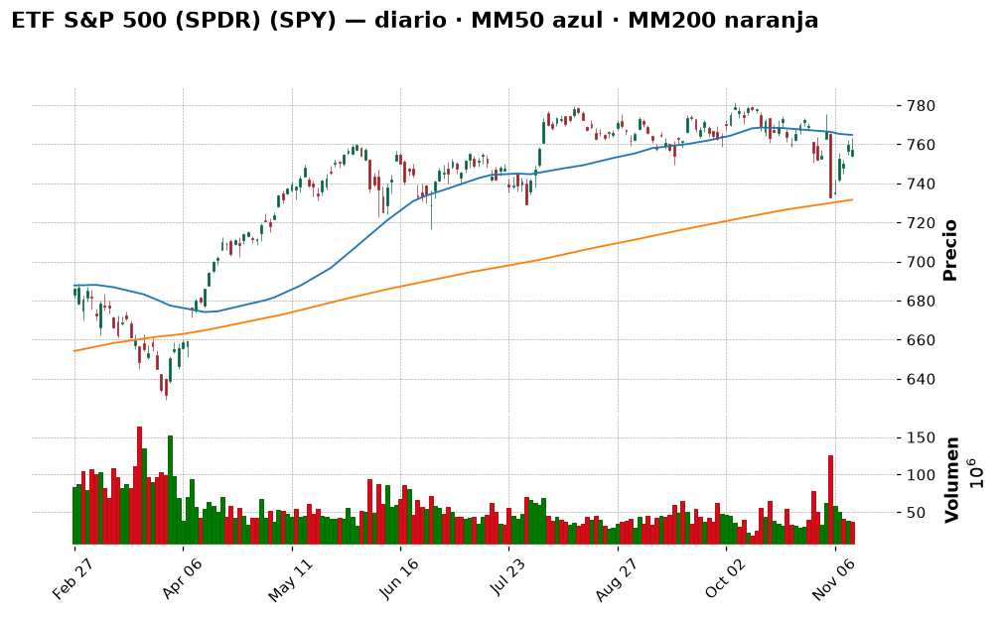
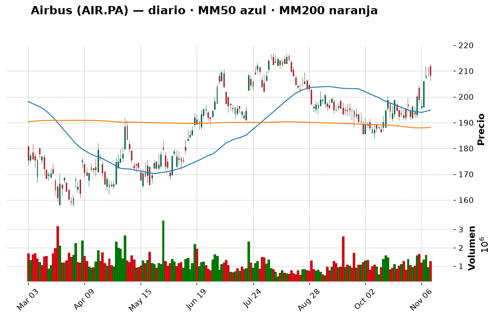
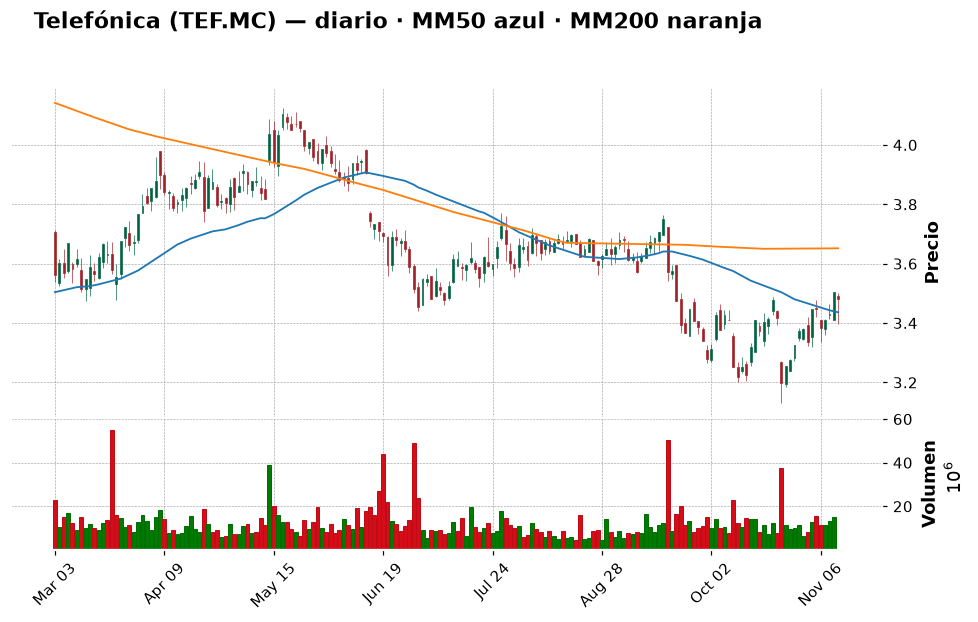
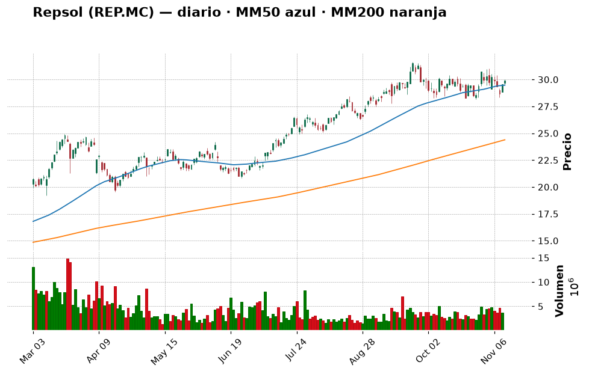
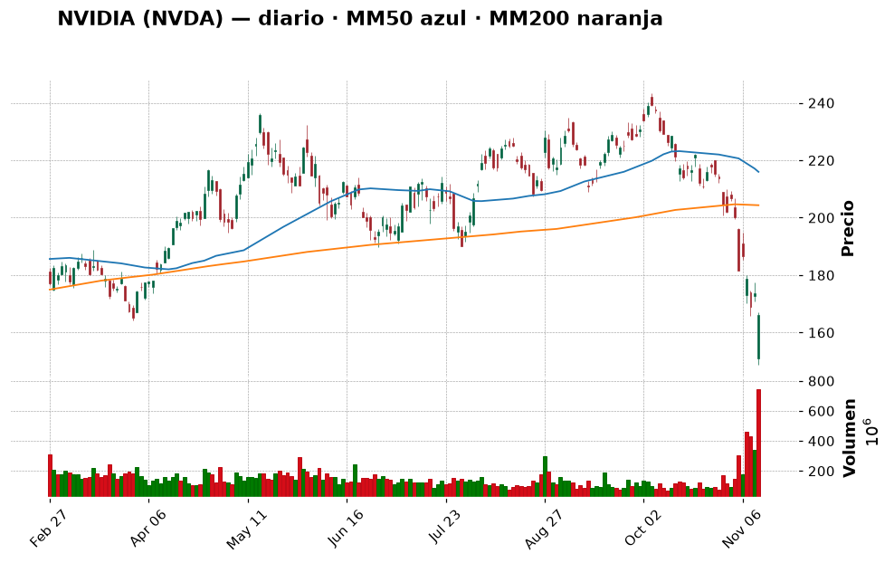
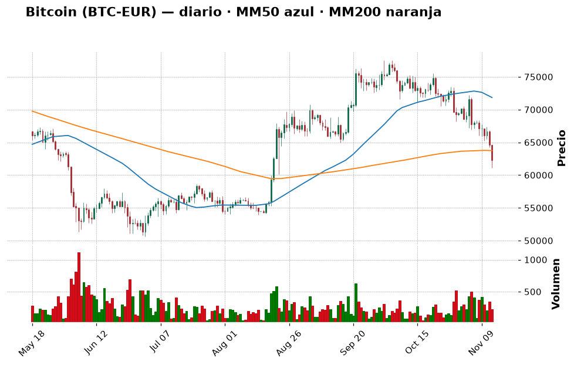
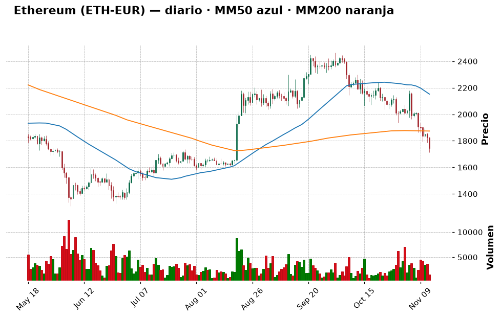

# 📈 Informe pre-apertura — viernes 13 de noviembre de 2026

> Generado automáticamente a las 07:50 (hora de Madrid) · Bolsa española abre a las 9:00 · Wall Street a las 15:30 · Cripto: 24/7
> **Termómetro del día:** 🟡 prudencia — La bolsa ha encajado bien la salida de Jensen Huang de Nvidia (el S&P 500 solo cayó un −0,35 %), pero el bono de EE. UU. a 10 años ha dado su mayor salto desde 2022 y ya paga un **5,1 %**, el dólar está en máximos de 19 meses y el mercado cripto está en **miedo extremo (20/100)**. Día para **no mover ficha** y vigilar dos niveles.
> **Lección de hoy:** La media móvil de 200 sesiones (MM200)

## 1. Lo que tienes que saber hoy
- **Nvidia ya tiene CEO interina.** Jensen Huang, fundador y consejero delegado durante tres décadas, **dimitió el jueves** y deja también el consejo; la directora financiera **Colette Kress** dirige la empresa de forma interina mientras se busca un sustituto (Investing.com, Decrypt). La acción llegó a caer un −14 % en la sesión (mínimo de 148,80 $), pero **cerró con un −4,34 % (166,19 $)**: el mercado ya había descontado gran parte del golpe. Los analistas recortan sus precios objetivo, aunque "descartan cambios en los fundamentales" (Cinco Días).
- **El problema de hoy no es Nvidia: son los tipos de interés.** El bono de EE. UU. a 10 años subió **+11,6 puntos básicos hasta el 5,105 %** y el de 2 años +14 pb hasta el 4,867 % (Investing.com/Reuters). MarketWatch habla del **mayor salto de rentabilidades desde 2022**: el mercado ya descuenta una subida de tipos de la Fed en diciembre y algunos miembros (Waller) hablan incluso de 0,50 puntos (CoinDesk). Hoy a las **14:30** se publican los **precios industriales (IPP) de EE. UU.**: si salen altos, más presión.
- **Bitcoin pierde los 70.000 $** y cae a **62.243 € (−3,7 % hoy, −8,4 % en una semana)**, su nivel más bajo desde agosto. El índice de miedo y codicia baja a **20 (miedo extremo)**, el más bajo en más de cuatro meses (Cointelegraph). Lo importante para ti: bitcoin está ahora **un −2,35 % por debajo de su media de 200 días**, justo el nivel que ayer dijimos que nos haría **pausar el próximo tramo**. Hoy aprendemos qué es esa media.
- **Tu cartera:** sin movimientos nuevos desde ayer (correcto: no tocaba hacer nada). Patrimonio de **9.722,55 €**, con el 93 % en liquidez. El plan sigue igual para todo **salvo bitcoin**, cuyo siguiente tramo queda **en pausa condicional** (ver sección 7).

## 2. ✅ Recomendaciones del día (resumen)
| Activo | Acción | vs. ayer | Cuánto (orientativo) | Horizonte | Por qué, en una frase | Confianza |
|---|---|---|---|---|---|---|
| ETF S&P 500 (SPY / SPY5.L) | 🔵 Mantener | = | Tramo 1 hecho (~319 €); **tramo 2 (~600 €) hacia el 1-dic**, o antes si el SPY cae a 729–739 $ | Años (5+) | El índice ha aguantado el golpe de Nvidia; el riesgo ahora es el bono al 5,1 %, y para eso están los tramos | media |
| Airbus (AIR.PA) | ⏸️ Esperar | = | Hasta 3–4 % (~300–400 €) en 2 tramos, si vuelve a ~202 € o cierra sobre 217 € | Años | Chocó contra su "pared" de 211 € y retrocedió a 208,25 €: el rechazo que temíamos | media |
| Telefónica (TEF.MC) | ⏸️ Esperar | = | 0 € hoy; hasta 2–3 % (~250 €) si supera 3,71 € | Años | Resultados mejores de lo esperado, pero la bolsa respondió con un −0,7 %: aún sin confirmación | baja |
| Repsol (REP.MC) | 🔵 Mantener | = | No añadir | Años | Ganas un +142 %; el Brent sube a 96 $ y la tendencia sigue alcista | media |
| NVIDIA (NVDA) | ⛔ Evitar | = (confianza alta → media) | 0 € | — | Ya hay CEO interina, pero no permanente, y crecen las restricciones de chips a China | media |
| Iberdrola (IBE.MC) | ⏸️ Esperar | = | Hasta 5 % (~480 €) si retrocede a 21–22 € | Años | Nuevo máximo (23,34 €) y RSI 79,5: cada día más "caliente" | media |
| Inditex (ITX.MC) | 🔵 Mantener | = | No añadir | Años | +122 % en tu posición, tendencia alcista intacta | media |
| Apple (AAPL) | 🔵 Mantener | = | No añadir | Años | A un paso de máximos (354,88 $), tendencia alcista sana | media |
| Bitcoin (BTC) | 🔵 Mantener | = | No vender; **tramo de diciembre en pausa** si hoy cierra por debajo de ~63.740 € | Años | Ha perdido su MM200 durante la noche: la regla que fijamos ayer se activa si se confirma al cierre | media |
| Ether (ETH) | ⏸️ Esperar | = | 0 € hoy | Años | Se aleja de su MM200 (−6,8 %) y se acerca al soporte de ~1.600 € | media |
| Shiba Inu (SHIB) | ⛔ Evitar | = | No añadir | — | Memecoin, −52 % en un año | alta |

*(El resto de la watchlist —Santander, BBVA, Solaria, Oryzon, IAG, Indra, Aena, Microsoft, Amazon, Alphabet, Berkshire, los ETF del Nasdaq y del MSCI World, ASML, LVMH, SAP y Siemens— tiene su veredicto en la tabla "Resto de la watchlist" de la sección 6.)*

**🔁 Seguimiento de ayer** (informe del 12-nov):
- **ETF S&P 500:** Mantener, con tramo 2 hacia el 1-dic o antes si el SPY caía a 729–739 $ → el SPY cerró en **757,12 $ (−0,35 %)**, lejos de esa zona. Tu tramo (SPY5.L) gana un **+0,79 %**. **Sin cambios.** Y la lección de diversificación de ayer se cumplió al pie de la letra: Nvidia −4,3 %, S&P 500 −0,35 %.
- **Nvidia:** Evitar → se cumplió el escenario "malo" (Huang fuera), pero sin el hundimiento del −20 % que algunos temían: rebotó desde el −14 % y cerró en −4,3 %. Mantengo **Evitar**, pero **bajo la confianza de alta a media**: lo que cambia es que la incertidumbre más extrema (¿quién manda?) se ha resuelto a medias con una CEO interina. Sigue sin cumplirse lo que me haría cambiar de opinión (CEO permanente y precio sobre su MM200 de ~204 $).
- **Airbus:** Esperar a ~202 € o a un cierre sobre 217 € → subió hasta la resistencia de 211 € y **retrocedió a 208,25 € (−1,2 %)**. Es el "rechazo" del que hablábamos. Seguimos esperando con los mismos niveles.
- **Telefónica:** Esperar a que supere 3,71 € tras resultados → resultados **mejores de lo previsto** (ver sección 6), pero cerró en **3,48 € (−0,7 %)**. Ni rotura ni hundimiento: seguimos esperando.
- **Bitcoin:** dijimos "si cierra claramente por debajo de la MM200 (~63.800 €), pausaría el tramo de diciembre". La vela del jueves en Coinbase **cerró en 64.614 €** (aún por encima), pero esta noche ha caído a **62.243 €**, un −2,35 % por debajo. **Si la vela de hoy cierra así, la regla se activa**: no vendemos, pero el tramo del 1-dic queda en pausa.
- **Tu `cartera.csv`:** sin movimientos nuevos desde el 11-nov. Correcto: el plan de ayer era no hacer nada.

> Día para **no hacer movimientos**: el plan en tramos está funcionando y nada de lo ocurrido lo invalida en bolsa. La única novedad es que **bitcoin está a punto de activar la señal de pausa** que nos pusimos ayer: respetar tus propias reglas es lo que diferencia un plan de una corazonada.

## 3. Agenda del día
| Hora (Madrid) | Evento | Por qué importa |
|---|---|---|
| 8:45 | **IPC de Francia** (octubre, dato final) (Reuters vía Investing.com) | Pista de inflación en la zona euro, que pesa en lo que haga el BCE |
| 9:00 | Apertura de la Bolsa española (futuros del Ibex en 19.961,5, prácticamente planos) | ¿Intenta el Ibex volver a los 20.000? |
| 11:00 | **PIB de la zona euro (3.er trimestre, avance)** y **empleo** (Reuters vía Investing.com) | Dice si la economía europea crece; con tipos altos, se vigila si se frena |
| **14:30** | **IPP (precios industriales) de EE. UU., octubre.** Previsión: +0,4 % mensual frente a +1,3 % del mes anterior (Investing.com) | Segunda pista de inflación de la semana tras el IPC "caliente". Un dato alto reforzaría la subida de tipos de la Fed en diciembre |
| 15:30 | Apertura de Wall Street | Se verá si el bono al 5,1 % pesa más que el alivio por Nvidia |
| Durante el día | **Discursos de miembros de la Fed** (Reuters) · noticias sobre el **sucesor de Huang** y las **restricciones de chips a China** | Cualquiera puede mover la tecnología y los bonos |
| Dom 29-nov | Elecciones generales en España | Ruido político durante el mes |
| 30-nov | **Salida de Strategy de los índices MSCI** | Ventas forzadas de acciones de la mayor "tesorería de bitcoin" |
| 1-dic | **Tu aportación de 200 €** | Fecha prevista del tramo 2 del ETF |
| 9-dic | Reunión de la Fed (Investing.com) | Se decide la subida de tipos que el mercado ya da por hecha |

*Nota: las búsquedas web de calendario económico no devolvieron un calendario fiable para hoy; la agenda sale del "Morning Bid" de Reuters y de Investing.com España. Investing.com da para el IPP la hora "15:30 peninsular (13:30 UTC)", lo que es contradictorio; 13:30 UTC son las **14:30** en Madrid.*

## 4. Cómo llegan los mercados
### España y Europa
**Ayer (jueves 12):** el **Ibex 35** cerró en **19.965,5 puntos (−0,31 %)** y volvió a perder los 20.000, sobre todo por la banca: **Santander −1,88 % (11,08 €)**. En verde, Naturgy (+2,47 %), Ferrovial (+1,21 %) y **Repsol (+1,15 %, 29,90 €)**, empujada por el petróleo (Investing.com España). Los futuros apuntan a una apertura **plana (19.961,5)**. El **Euro Stoxx 50** subió un **+0,09 % (6.398,98)** y el **Stoxx 600** llegó a marcar un **máximo histórico intradía (666,58)** antes de cerrar en 664,01 (+0,14 %) (Reuters vía Investing.com). Europa sigue más fuerte que EE. UU.

**Noticias de empresas y Europa:**
- **Telefónica** presentó resultados del tercer trimestre **mejores de lo previsto**: beneficio atribuido de **802 millones (+191 %)** frente a 538 millones esperados, ingresos de 8.430 millones (+4,8 %) y ebitda ajustado de 3.080 millones (+6,2 %). **Mejora** sus previsiones de ebitda (ligeramente por encima del 2,5 %) y de caja libre (~3.100 millones), pero **recorta** la de ingresos (1–1,5 %) por menores ventas de móviles (Reuters vía Yahoo Finance). La acción, sin embargo, cayó un −0,71 %.
- **BCE:** Alemania y Francia ultiman un reparto de puestos con el español **Pablo Hernández de Cos** como favorito para relevar a Lagarde (Europa Press). 💡 *El presidente del BCE marca el tono de los tipos de interés de toda la zona euro; un cambio de presidente puede cambiar, poco a poco, esa política.*
- **IAG:** Deutsche Bank recorta su precio objetivo a 600 peniques por el encarecimiento del combustible (Proactive Investors).
- **Siemens** presentó resultados con **pedidos récord** y comprará la alemana Lauterbach (herramientas para chips) (Yahoo Finance, Verdict): subió un +1,7 %.
- **Banca española:** CaixaBank reduce hasta seis veces su crecimiento hipotecario y Sabadell reordena su negocio de pagos (Expansión, titulares RSS).
- **Política:** veinte grandes empresas piden al próximo Gobierno un plan económico tras el 29-N (Expansión, titular RSS).

### Estados Unidos
**Ayer:** el **S&P 500** cerró en **7.592,40 (−0,35 %)**, el **Nasdaq** en **25.366,09 (−0,39 %)** y el **Dow Jones** en 52.297,09 (−0,36 %) (Reuters vía Investing.com). Teniendo en cuenta que **la mayor empresa de la IA perdió a su fundador**, es una caída muy pequeña: MarketWatch titula que "el S&P 500 se sacude la venta de Nvidia". Parte del dinero fue a sus rivales: **AMD +5,9 % y Broadcom +5,5 %**. En cambio, Nebius se hundió un −17 % tras rebajar previsiones (Motley Fool) y Cisco cayó pese a batir expectativas (Stocktwits). Las tecnológicas chinas caen por miedo a nuevas restricciones de chips: el presidente de la Cámara de Representantes dice que hay "consenso" en el Congreso para limitar exportaciones a China (Reuters vía Investing.com).

**Esta mañana:** los futuros del **S&P 500 caen un −0,15 % (7.603,75)** y los del **Nasdaq 100 un −0,28 % (28.305,25)** (Yahoo Finance, 7:37 h de Madrid). El VIX (índice del "miedo" de la bolsa) sube un +6,9 %, hasta 18,7: nervios, pero lejos del pánico. 💡 *El **VIX** mide cuánta volatilidad esperan los inversores en el S&P 500 para el próximo mes; por debajo de 20 se considera calma relativa, por encima de 30, miedo.*

### Macro (tipos de interés, inflación, divisas, materias primas)
- **Bonos de EE. UU.:** el de **10 años sube al 5,105 %** (máximo desde el 21 de octubre; esta mañana 5,13 %) y el de **2 años al 4,867 %**. Los futuros de la Fed descuentan **29 puntos básicos de subida en diciembre** (Reuters vía Investing.com). John Williams (Fed de Nueva York) dice que la Fed "tiene trabajo por hacer" para bajar la inflación. 💡 *Un **punto básico** es una centésima de punto porcentual: subir del 5,00 % al 5,10 % son 10 puntos básicos.* Un artículo de 24/7 Wall St. recuerda que **los bonos ya pagan más de lo que "rinden" las acciones** (beneficios entre precio), una diferencia no vista desde 2009: es el gran argumento de los que creen que la bolsa está cara.
- **Dólar:** el índice del dólar está en **máximos de 19 meses (103,18)** y camino de su mejor semana en dos meses (Reuters). El **euro/dólar** está en **1,1061**, prácticamente en su **mínimo de 52 semanas (1,1051)** (Yahoo Finance). Para ti: tus 2.605,43 USDC valen hoy **2.355,57 €**.
- **Yen:** ha tocado los **160 por dólar** y el Gobierno japonés amenaza con intervenir (Reuters). Si Japón actúa, puede haber movimientos bruscos en todas las bolsas.
- **Petróleo Brent:** **96,25 $ (+0,45 %)** esta mañana, tras subir ayer un **+3,3 % (95,82 $)** cuando Trump dijo que EE. UU. "no necesita un acuerdo con Irán" (Reuters vía Investing.com, Yahoo Finance). Petróleo más caro = más inflación = más presión para subir tipos. Bien para Repsol, mal para aerolíneas como IAG.
- **Oro:** cayó un −2,8 % ayer (3.877 $), y rebota hoy ligeramente (~3.900 $) (Investing.com).
- **España:** el bono a 10 años paga un **3,905 %** y la **prima de riesgo** está en **65 puntos básicos** (Investing.com España). 💡 *La **prima de riesgo** es lo que España paga de más que Alemania por endeudarse a 10 años; 65 pb es un nivel bajo, señal de confianza en la deuda española.*

## 5. Panorama técnico de la watchlist
> 💡 *Cómo leer esta tabla:* la **tendencia** resume si el precio lleva meses subiendo, bajando o de lado
> (comparando el precio con sus medias de 50 y 200 días). El **RSI** mide de 0 a 100 si las subidas o bajadas
> recientes han sido muy fuertes: por encima de 70 se dice "sobrecompra" (quizá ha subido demasiado rápido),
> por debajo de 30 "sobreventa". Son pistas, no predicciones.

Todos los datos son del **cierre del jueves 12-nov** (ningún valor llega con retraso hoy ✅). La watchlist ha crecido: hoy aparecen por primera vez IAG, Indra, Aena, Alphabet, Berkshire, el ETF MSCI World, ASML, LVMH, SAP y Siemens.

| Valor | Último cierre | Día | 1 mes | 1 año | Tendencia | RSI | vs MM200 |
|---|---|---|---|---|---|---|---|
| IBEX 35 (^IBEX) | 19.965,5 | −0,31 % | +3,82 % | +23,45 % | ➡️ lateral | 62,6 🟡 | +6,4 % |
| Euro Stoxx 50 (^STOXX50E) | 6.398,98 | +0,09 % | +3,37 % | +12,97 % | ➡️ lateral | 62,3 🟡 | +4,5 % |
| S&P 500 (^GSPC) | 7.592,40 | −0,35 % | −1,64 % | +10,89 % | ➡️ lateral | 48,4 🟡 | +3,5 % |
| Nasdaq Composite (^IXIC) | 25.366,09 | −0,39 % | −4,97 % | +8,09 % | ➡️ lateral | 44,6 🟡 | +0,9 % |
| Banco Santander (SAN.MC) | 11,08 € | −1,88 % | −8,64 % | +21,78 % | ➡️ lateral | 46,1 🟡 | −1,8 % |
| BBVA (BBVA.MC) | 23,53 € | −0,34 % | +1,73 % | +29,93 % | ➡️ lateral | 55,8 🟡 | +9,2 % |
| Inditex (ITX.MC) | 59,68 € | −0,67 % | +9,83 % | +26,84 % | 📈 alcista | 63,3 🟡 | +9,3 % |
| Iberdrola (IBE.MC) | 23,34 € | +0,60 % | +7,51 % | +28,63 % | 📈 alcista | 79,5 🔴 | +14,4 % |
| Telefónica (TEF.MC) | 3,48 € | −0,71 % | +7,94 % | −6,70 % | ➡️ lateral | 55,8 🟡 | −4,7 % |
| Repsol (REP.MC) | 29,90 € | +1,15 % | −0,60 % | +76,51 % | 📈 alcista | 52,8 🟡 | +22,6 % |
| Solaria (SLR.MC) | 16,36 € | −1,48 % | +4,14 % | −8,94 % | ➡️ lateral | 54,7 🟡 | −16,4 % |
| Oryzon (ORY.MC) | 2,58 € | +4,12 % | +0,16 % | −16,63 % | 📉 bajista | 56,2 🟡 | −9,9 % |
| IAG (IAG.MC) | 5,41 € | −1,39 % | +10,91 % | +24,90 % | 📈 alcista | 63,8 🟡 | +11,1 % |
| Indra (IDR.MC) | 58,20 € | −2,48 % | −6,97 % | +16,17 % | ➡️ lateral | 42,5 🟡 | +4,3 % |
| Aena (AENA.MC) | 28,74 € | +0,56 % | +13,96 % | +25,72 % | 📈 alcista | 71,5 🔴 | +10,5 % |
| Apple (AAPL) | 354,88 $ | −0,21 % | +3,48 % | +28,93 % | 📈 alcista | 59,7 🟡 | +18,0 % |
| Microsoft (MSFT) | 523,00 $ | +0,36 % | −2,00 % | +2,82 % | 📈 alcista | 48,4 🟡 | +18,6 % |
| NVIDIA (NVDA) | 166,19 $ | −4,34 % | −24,90 % | −13,96 % | ➡️ lateral | 26,0 🟢 | −18,7 % |
| Amazon (AMZN) | 267,44 $ | +0,48 % | +5,26 % | +7,36 % | ➡️ lateral | 58,2 🟡 | +9,4 % |
| ETF S&P 500 (SPY) | 757,12 $ | −0,35 % | −1,62 % | +10,85 % | ➡️ lateral | 48,5 🟡 | +3,5 % |
| ETF Nasdaq 100 (QQQ) | 688,17 $ | −0,32 % | −5,59 % | +10,71 % | ➡️ lateral | 45,4 🟡 | +0,9 % |
| Alphabet (GOOGL) | 298,70 $ | +1,79 % | −14,08 % | +2,54 % | 📉 bajista | 42,3 🟡 | −11,8 % |
| Berkshire Hathaway (BRK-B) | 589,83 $ | +0,27 % | +12,06 % | +18,66 % | 📈 alcista | 80,0 🔴 | +18,0 % |
| ETF MSCI World (IWDA.AS) | 131,60 € | +0,50 % | −0,16 % | +19,42 % | 📈 alcista | 57,6 🟡 | +7,7 % |
| Airbus (AIR.PA) | 208,25 € | −1,16 % | +9,48 % | +0,46 % | ➡️ lateral | 63,0 🟡 | +10,7 % |
| ASML (ASML.AS) | 1.376,80 € | −1,92 % | −9,91 % | +57,10 % | ➡️ lateral | 44,8 🟡 | −1,5 % |
| LVMH (MC.PA) | 404,70 € | +0,40 % | +3,89 % | −35,14 % | ➡️ lateral | 55,0 🟡 | −12,5 % |
| SAP (SAP.DE) | 212,55 € | +0,76 % | +7,93 % | −2,54 % | 📈 alcista | 60,6 🟡 | +27,8 % |
| Siemens (SIE.DE) | 281,70 € | +1,70 % | +2,42 % | +24,10 % | ➡️ lateral | 59,1 🟡 | +8,3 % |

*(🟢 = RSI bajo, posible "rebajas"; 🔴 = RSI alto, quizá demasiado rápido; 🟡 = neutral.)*

**En conjunto:** la foto de "dos velocidades" sigue igual. **Europa** está en forma: el Ibex está un +6,4 % sobre su MM200 y casi todas las grandes españolas y europeas están por encima de esa media. **EE. UU.** sigue "de lado": el S&P 500 está por encima de su MM200 (+3,5 %) pero por debajo de su MM50 (−1,0 %), y el Nasdaq casi pegado a la MM200 (+0,9 %). Lo más "estirado": **Berkshire (RSI 80)**, **Iberdrola (79,5)** y **Aena (71,5)**. Lo más castigado: **Nvidia (RSI 26)** y **Alphabet**, que acaba de hacer un **"cruce de la muerte"** (su MM50 ha bajado por debajo de su MM200, una señal clásica de debilidad de fondo). Fíjate en la última columna: hoy aprenderás por qué la "vs MM200" es probablemente la columna más útil de la tabla.

## 6. Ideas de bolsa: qué haría un experto
### ETF S&P 500 (SPY5.L / SPY) — MANTENER (tramo 1 hecho)

- **Qué es:** un fondo que compra de una vez las ~500 mayores empresas de EE. UU. Tú tienes la versión europea (UCITS) que cotiza en Londres, **SPY5.L**; el gráfico es del SPY estadounidense, que sigue el mismo índice.
- **Por qué es noticia hoy:** ha superado la "prueba Nvidia": con la mayor empresa de la IA sin su fundador, el índice solo cayó un −0,35 %. El nuevo riesgo es el **bono al 5,1 %**: cuando el "dinero seguro" paga tanto, las acciones pierden atractivo (24/7 Wall St., MarketWatch).
- **Lo que dice el gráfico:** el SPY (757,12 $) sigue en "tierra de nadie": **por encima de su MM200 (731,62 $; +3,5 %)** y **justo por debajo de su MM50 (764,80 $)**. RSI 48,5 (neutral) y MACD "mejorando". Soportes en **749,6 $** y **739,5 $**; resistencia cercana en 760,4 $. A un −3,1 % de su máximo de 52 semanas (781,62 $). En llano: **la tendencia de fondo está intacta**; la línea gruesa de la MM200 sigue siendo el suelo.
- **Lo positivo:** es tu núcleo diversificado y barato, y ya tienes el primer tramo (gana un +0,79 %).
- **El riesgo:** si el IPP de hoy sale alto y el bono sube hacia el 5,25–5,5 %, el índice podría bajar a la zona de 739 $ o incluso a su MM200.
- **🧑‍💼 Recomendación: MANTENER.** Nada ha cambiado: el plan es comprar en tramos para no tener que adivinar el día. Si el bono provoca una caída hacia **729–739 $**, eso **adelanta** el tramo 2; no lo retrasa.
  - **Cuánto y cómo:** tramo 2 de ~600 € (≈6 % de tu patrimonio) **hacia el 1 de diciembre**, o antes si el SPY cae a 729–739 $. Objetivo: ~35 % del patrimonio en 6 tramos.
  - **Horizonte:** 5 años o más.
  - **Qué me haría cambiar de opinión:** un **cierre semanal por debajo de 729 $** (es decir, por debajo de la MM200): no vendería lo comprado, pero pausaría el siguiente tramo hasta ver estabilidad.
- **Qué mirar para entenderlo:** el bono a 10 años de EE. UU. Si se queda en torno al 5 %, normal; si pasa del 5,25 %, espera turbulencias.
- **Confianza:** media

### Airbus (AIR.PA) — ESPERAR (sigue en tu lista de la compra)

- **Qué es:** el mayor fabricante de aviones comerciales del mundo (europeo, con fábricas en Francia, Alemania y España), además de helicópteros, defensa y espacio.
- **Por qué es noticia hoy:** sin noticias grandes. Llama la atención por sus avances en **enjambres de drones con IA** para defensa (Simply Wall St. vía Yahoo Finance). El dato de fondo sigue siendo el **objetivo de ~870 entregas en 2026**: llevaba **547 hasta septiembre**, así que necesita acelerar en el último trimestre (AirNav Radar, El Demócrata). Ojo al petróleo caro: no afecta directamente a Airbus, pero sí a sus clientes (aerolíneas como IAG, a la que Deutsche Bank recorta objetivo por el combustible).
- **Lo que dice el gráfico:** 208,25 € (−1,2 % ayer). Por encima de sus medias (MM50 194,84 €, MM200 188,17 €; +10,7 %), RSI 63 (neutral alto) y **MACD que pasa de "mejorando" a "empeorando"**: el impulso se frena. La clave: subió hasta la **resistencia de 210,95 €** y se dio la vuelta. Por encima, otra "pared" en **216,5–217 €** y el máximo anual en 221,3 € (a un −5,9 %). Soporte cercano: **201,65 €**.
- **Lo positivo:** cartera de pedidos enorme, ventaja sobre Boeing y viento de cola por el gasto en defensa europeo.
- **El riesgo:** no llegar a las 870 entregas por los proveedores (motores); y un mercado más nervioso por los tipos.
- **🧑‍💼 Recomendación: ESPERAR.** Mantengo exactamente el plan: compraría **(a)** en un retroceso hacia **~202 €** (soporte) o **(b)** con un **cierre claro por encima de 217 €** (pared rota). Ayer se vio el "rechazo" en la resistencia: es justo el motivo por el que no compramos a 210 €.
  - **Cuánto y cómo:** hasta 3–4 % del patrimonio (~300–400 €), en 2 tramos.
  - **Horizonte:** años.
  - **Qué me haría cambiar de opinión:** un cierre por debajo de 190 € (zona de la MM200) o un recorte del objetivo de entregas.
- **Qué mirar para entenderlo:** las entregas de noviembre (se publican a primeros de diciembre) y si el precio se acerca a 202 €.
- **Confianza:** media

### Telefónica (TEF.MC) — ESPERAR

- **Qué es:** la mayor operadora de telecomunicaciones de España (Movistar), con negocio en Alemania, Reino Unido y Brasil. Paga dividendo.
- **Por qué es noticia hoy:** sus resultados del tercer trimestre **batieron las previsiones**: beneficio de 802 millones frente a 538 esperados, ingresos +4,8 %, ebitda ajustado +6,2 % (España +2,6 %, Brasil +9,7 %, **Alemania −9,9 %**). Mejora sus objetivos de ebitda y de caja libre (~3.100 millones) y rebaja el de ingresos (1–1,5 %) (Reuters vía Yahoo Finance). Parte del beneficio viene de algo puntual: **107 millones por la venta de su sede de Gran Vía**.
- **Lo que dice el gráfico:** 3,48 € (−0,7 %). Sobre su MM50 (3,44 €) pero aún **un −4,7 % por debajo de su MM200 (3,65 €)**. La vela de ayer: abrió en 3,49 €, bajó hasta 3,40 € y **remontó hasta cerrar en 3,48 €**, cerca del máximo del día. Es una reacción **tibia**: los vendedores aparecieron pronto, pero los compradores defendieron la zona de 3,40 €. Resistencias en 3,49 € y **3,71 €**; soportes en 3,46 € y 3,44 €. RSI 55,8 (neutral), MACD "empeorando".
- **Lo positivo:** más caja y menos deuda; con el dividendo de 0,15 €, la rentabilidad por dividendo ronda el 4,3 % (*mi cálculo*: 0,15 / 3,48).
- **El riesgo:** que los ingresos no crezcan (por eso rebajan esa previsión), la debilidad de Alemania y que parte del beneficio sea extraordinario (la venta de la sede).
- **🧑‍💼 Recomendación: ESPERAR.** Igual que ayer. Los números son buenos, pero **el mercado no los ha "comprado" todavía**. Esperaría a que el precio supere **3,71 €** y su MM200 (3,65 €): sería la señal de que la tendencia de fondo ha cambiado de verdad.
  - **Cuánto y cómo:** 0 € hoy; si se cumple la condición, hasta 2–3 % del patrimonio (~250 €) en 2 tramos.
  - **Horizonte:** años (idea de dividendo, no de crecimiento).
  - **Qué me haría cambiar de opinión:** un cierre por debajo de 3,27 € (soporte) me devolvería a Evitar.
- **Qué mirar para entenderlo:** la distancia a la MM200 (−4,7 % hoy). Si se reduce a cero y la supera, es la confirmación que buscamos.
- **Confianza:** baja

### Repsol (REP.MC) — MANTENER (la tienes)

- **Qué es:** la petrolera española (extracción, refino, gasolineras y renovables).
- **Por qué es noticia hoy:** el Brent subió un +3,3 % ayer (95,82 $) y sigue subiendo esta mañana (96,25 $), después de que Trump dijera que EE. UU. no necesita un acuerdo con Irán (Reuters vía Investing.com). Repsol subió un +1,15 %.
- **Lo que dice el gráfico:** 29,90 €, por encima de su MM50 (29,47 €) y muy por encima de su MM200 (24,39 €; +22,6 %): **tendencia alcista**. RSI 52,8 (neutral), MACD mejorando. Resistencias en 30,43 € y 31,64 € (máximo anual); soportes en 28,29 € y 27,8 €.
- **Lo positivo:** tendencia alcista de fondo, dividendo y petróleo caro.
- **El riesgo:** el petróleo depende de la geopolítica (Irán) y puede girar muy rápido; un acuerdo de paz lo abarataría.
- **🧑‍💼 Recomendación: MANTENER.** Ganas un **+142 %** en tus 2 acciones. No ampliaría (el petróleo es volátil y ya tienes exposición), pero no hay motivo para vender algo que sigue en tendencia alcista.
  - **Cuánto y cómo:** no añadir.
  - **Horizonte:** años.
  - **Qué me haría cambiar de opinión:** un cierre por debajo de 27,8 € con el Brent cayendo hacia 80 $: ahí valoraría Vender.
- **Qué mirar para entenderlo:** el Brent. Por encima de 90 $, viento a favor; por debajo, presión.
- **Confianza:** media

### NVIDIA (NVDA) — EVITAR

- **Qué es:** el gran fabricante de chips para inteligencia artificial; una de las mayores empresas del mundo.
- **Por qué es noticia hoy:** **Jensen Huang dimitió** como consejero delegado y deja el consejo; **Colette Kress** (directora financiera) es CEO interina mientras se busca un sustituto (Reuters vía Investing.com, Decrypt). Reuters informa de una tercera supuesta relación (Cointelegraph). El Senado quiere que Huang y el secretario de Comercio declaren, y el Congreso se inclina por **limitar más las ventas de chips a China** (Reuters). Los analistas recortan precios objetivo, aunque creen que el negocio no cambia (Cinco Días). La acción cotiza a **~12 veces sus beneficios esperados, la valoración más baja desde 2012** (Reuters).
- **Lo que dice el gráfico:** 166,19 $ (−4,3 %), tras tocar **148,80 $**, nuevo mínimo de 52 semanas. **−18,7 % por debajo de su MM200 (204,34 $)** y −23 % bajo su MM50; la MM50 (215,96 $) sigue por encima de la MM200, pero bajando. RSI 26 (sobreventa) y volumen **3,8 veces el normal**: hubo pánico y también compradores. La "mecha" larga hacia abajo de la vela de ayer indica que a 150 $ apareció mucha demanda.
- **Lo positivo:** valoración baja para su historia y la demanda de chips para IA sigue fuerte (AMD y Broadcom subieron).
- **El riesgo:** una empresa sin líder permanente en plena guerra comercial de chips con China. Y la tendencia de fondo es claramente bajista.
- **🧑‍💼 Recomendación: EVITAR (confianza media; antes alta).** La incertidumbre más extrema se ha resuelto a medias (hay una CEO interina conocida), por eso bajo la confianza. Pero comprar una acción **un −19 % bajo su MM200** con la dirección en el aire sigue siendo "intentar coger un cuchillo que cae". Ya tienes Nvidia, en su justa medida, dentro de tu ETF.
  - **Cuánto y cómo:** 0 €.
  - **Qué me haría cambiar de opinión:** un CEO permanente con un plan claro **y** el precio recuperando su MM200 (~204 $).
- **Qué mirar para entenderlo:** si el mínimo de 148,80 $ aguanta en los próximos días; y quién será el CEO definitivo.
- **Confianza:** media

### Resto de la watchlist: veredicto rápido
| Valor | Acción | Por qué (1 frase) | Nivel a vigilar |
|---|---|---|---|
| Iberdrola (IBE.MC) | ⏸️ Esperar | Nuevo máximo anual (23,34 €) con RSI 79,5, aún más "caliente" que ayer; sin noticias propias hoy | Comprar en 21–22 €; soporte 21,09 € |
| Inditex (ITX.MC) | 🔵 Mantener | Tu posición gana +122 %, tendencia alcista; se cita a Primark como más expuesta a la huelga del 11-N que Inditex (Proactive Investors) | Soporte 56,2 €; máximo 60,74 € |
| Apple (AAPL) | 🔵 Mantener | Casi en máximos (máx. 52 sem. 359,37 $); el escándalo de Nvidia "puede enfriar la euforia de la IA" (Yahoo Finance), pero Apple depende menos de ella | Soporte 338,7 $ |
| Banco Santander (SAN.MC) | ⏸️ Esperar | Cae un −1,9 % y pierde su MM200 (−1,8 %); sin noticias propias relevantes hoy | Comprar si cierra sobre 11,92 € (MM50); soporte 10,34 € |
| BBVA (BBVA.MC) | ⏸️ Esperar | Tendencia de fondo sana (+9,2 % sobre MM200) pero justo bajo su MM50 (23,73 €); se cita entre bancos a vigilar por el relevo en el BCE (Yahoo Finance) | Sobre 23,73 €; soporte 22,77 € |
| Solaria (SLR.MC) | 🔵 Mantener | La tienes (1 acción, +9 %); sigue un −16 % bajo su MM200 y los tipos altos castigan a las renovables endeudadas: no añadir | Soporte 16,12 €; MM200 19,57 € |
| Oryzon (ORY.MC) | 🔵 Mantener | La tienes (4 acciones, −20 %); tendencia bajista y biotecnológica muy arriesgada; vender costaría casi lo que vale | Resistencia 2,61 €; soporte 2,48 € |
| IAG (IAG.MC) | ⏸️ Esperar | Tendencia alcista (+11 % sobre MM200), pero Deutsche Bank recorta objetivo a 600 peniques por el combustible caro (Proactive Investors) y el Brent sube | Soporte 4,95 €; resistencia 5,71 € |
| Indra (IDR.MC) | ⏸️ Esperar | Defensa con buena tendencia de fondo (+4,3 % sobre MM200) pero −2,5 % ayer y MACD empeorando; sin noticias propias hoy | Soporte 57,58 €; resistencia 62,66 € |
| Aena (AENA.MC) | ⏸️ Esperar | Muy buena tendencia (+14 % en un mes), pero RSI 71,5: sobrecomprada; sin noticias propias hoy | Soporte 26,3 €; máximo 29,1 € |
| Microsoft (MSFT) | ⏸️ Esperar | Caída mundial de Teams y Outlook (Yahoo Finance) y rebaja de Griffin pese a un Azure +48 %; justo sobre su MM50 (518,72 $) | Soporte 504,96 $; resistencia 551,15 $ |
| Amazon (AMZN) | ⏸️ Esperar | Lateral y pegada a su resistencia (267,56 $); sin noticias propias relevantes hoy | Cierre sobre 267,6 $; soporte 244,7 $ |
| ETF Nasdaq 100 (QQQ) | ⏸️ Esperar | Muy concentrado en tecnología: solo +0,9 % sobre su MM200; para ti, mejor el S&P 500 o el MSCI World | MM200 682 $; soporte 686 $ |
| Alphabet (GOOGL) | ⛔ Evitar | **Cruce de la muerte** y −11,8 % bajo su MM200, pese a noticias positivas (permitirá usar sus chips de IA en centros de datos de clientes, Motley Fool) | Recuperar la MM200 (338,7 $); soporte 276,9 $ |
| Berkshire Hathaway (BRK-B) | ⏸️ Esperar | Gran empresa estable en máximos históricos (Motley Fool), pero RSI 80: comprar ahora es pagar la euforia | Retroceso hacia la MM50 (528 $) |
| ETF MSCI World (IWDA.AS) | ⏸️ Esperar | Alternativa excelente al S&P 500 (más diversificada: ~1.500 empresas de países desarrollados), en tendencia alcista; no tiene sentido duplicar el núcleo ahora: elige uno | Soporte 129 €; máximo 132,42 € |
| ASML (ASML.AS) | ⏸️ Esperar | Fabrica las máquinas para hacer chips: −1,9 % ayer, justo bajo su MM200 y muy sensible a las restricciones a China | MM200 1.398 €; soporte 1.365 € |
| LVMH (MC.PA) | ⛔ Evitar | El lujo sigue en crisis (−35 % en un año, −12,5 % bajo MM200); los analistas hablan de apostar solo por los "ultra ricos" (Barron's vía Yahoo Finance) | Recuperar 431 €; soporte 380 € |
| SAP (SAP.DE) | ⏸️ Esperar | Tendencia alcista fuerte (+27,8 % sobre MM200), cerca de su máximo (219,65 €); solo noticias de agenda con inversores | Soporte 203 €; resistencia 216,65 € |
| Siemens (SIE.DE) | ⏸️ Esperar | Pedidos récord en resultados y compra de Lauterbach (Yahoo Finance, Verdict); buena empresa, pero justo bajo su resistencia de 284,65 € | Cierre sobre 286,5 €; soporte 274,35 € |

## 7. ₿ Criptomonedas
> 💡 *Las criptomonedas cotizan 24 horas, 7 días a la semana: los precios son de esta mañana (en euros).
> Son mucho más volátiles que las acciones: caídas del 50 % o más han ocurrido varias veces.*

**Sentimiento:** Fear & Greed **20/100 (miedo extremo**; ayer 28, hace una semana 28, hace un mes 62 —codicia—) · Capitalización total **2,43 billones $ (−4,85 % en 24 h; −49,6 % bajo su máximo histórico de octubre de 2025)** · Dominancia de Bitcoin **57,0 %**.
En un mes se ha pasado de "codicia" a "miedo extremo". Cuando el sentimiento llega a estos niveles, a menudo el mercado está cerca de un suelo **de corto plazo**, pero no siempre: en los mercados bajistas el miedo puede durar meses. Es un dato para **no vender por pánico**, no una señal de compra.

**Radar Coinbase** (408 monedas comprables · hoy suben 58 y bajan 294 · en 7 días suben 25 y bajan 326):
- **Mayores por capitalización (7 días):** BTC −9,1 %, ETH −13,5 %, BNB −8,3 %, XRP −13,8 %, SOL −11,1 %, HYPE −7,4 %, ZEC −25,7 %, DOGE −10,3 %.
- **Más suben (7 d, top 100):** ICP (+7,5 %), WLFI (+0,3 %) y nada más en positivo (AVAX −0,6 %, RENDER −1,5 %; PAXG −3,9 % es oro tokenizado) · **Más bajan:** ZEC (−25,7 %), UNI (−17,7 %), BCH (−17,5 %), ENA (−16,6 %), QNT (−16,0 %).
Caída **casi total** (solo 25 de 351 monedas suben en la semana). La única que sube con algo de fuerza, ICP, no tiene una noticia que lo justifique en nuestras fuentes: **no hay nada fuera del núcleo que merezca comprarse hoy**.

| Moneda | Ranking | Precio (€) | 24 h | 7 días | 1 mes | 1 año | Tendencia | RSI | vs MM200 |
|---|---|---|---|---|---|---|---|---|---|
| Bitcoin (BTC) | #1 | 62.242,71 | −3,67 % | −8,44 % | −14,64 % | −27,37 % | ➡️ lateral | 27,2 | −2,4 % |
| Ether (ETH) | #2 | 1.745,67 | −4,41 % | −13,02 % | −19,24 % | −37,18 % | ➡️ lateral | 26,4 | −6,8 % |
| XRP (XRP) | #6 | 0,9234 | −2,00 % | −12,66 % | −22,32 % | −53,76 % | ➡️ lateral | 22,8 | −16,1 % |
| Solana (SOL) | #7 | 72,02 | −2,53 % | −10,88 % | −22,63 % | −42,15 % | ➡️ lateral | 22,8 | −7,2 % |
| Shiba Inu (SHIB) | #42 | 0,00000384 | −2,54 % | −5,65 % | −15,42 % | −51,88 % | ➡️ lateral | 33,4 | −13,3 % |

*(Las variaciones de 7 días de la tabla salen de las velas de Coinbase y las del radar, de Coinpaprika: miden ventanas ligeramente distintas, por eso no coinciden. La vela de hoy aún no ha cerrado.)*

**Noticias que importan:**
- **Bitcoin por debajo de 70.000 $** (~68.600 $), su nivel más bajo desde agosto. Causas: salidas de los ETF, poca liquidez y mucho apalancamiento (Cointelegraph). La profundidad de los libros de órdenes está un ~33 % por debajo de lo normal (Talos), así que **los movimientos pueden ser bruscos en cualquier dirección**. 💡 *La **liquidez** es la facilidad para comprar o vender sin mover el precio; con poca liquidez, una venta grande hunde el precio más de lo normal.*
- **ETF de bitcoin:** quinto día seguido de salidas; en el año ya acumulan **más de 1.500 millones de dólares de salidas netas** (CoinDesk). El IBIT de BlackRock lleva más de 2.000 millones de salidas en nueve sesiones (Cointelegraph).
- **Liquidaciones:** casi **600 millones de dólares** en posiciones apalancadas alcistas liquidadas al caer bitcoin y ether a mínimos de agosto (BeInCrypto vía Yahoo Finance). 💡 *Una **liquidación** ocurre cuando alguien que ha invertido con dinero prestado pierde tanto que el exchange cierra su posición a la fuerza; esas ventas forzadas aceleran las caídas. Por eso en tu perfil nada de apalancamiento.*
- **Dólar y tipos:** el índice del dólar en máximos de 19 meses y la expectativa de subida de la Fed pesan sobre bitcoin (CoinDesk). 10x Research recuerda que, del 5 al 12 de noviembre, bitcoin cayó un −5,9 % mientras el Nasdaq 100 subía un +6,4 %: hoy cripto sufre más por los tipos que por la IA.
- **Empresas "tesorería de bitcoin":** MSCI sacará a **Strategy** de sus índices; los fondos que replican MSCI tienen 13 millones de acciones que deberán vender a finales de mes, con salidas estimadas de 1.600 millones de dólares (Expansión). **Nakamoto** debe 165 millones a Kraken, más de lo que vale en bolsa (CoinDesk). Son señales de que el modelo de "empresa que compra bitcoin con deuda" está bajo presión.
- **Seguridad:** el Departamento de Justicia de EE. UU. acusa a Corea del Norte de robar **400 millones en cripto con videollamadas falsas (deepfakes)** (Decrypt). Recuerda: nadie legítimo te pedirá tus claves ni que "verifiques" tu cuenta por videollamada.
- **Adopción:** la DTCC (la gran "cámara" de Wall Street) llevará acciones y bonos tokenizados a **Solana en 2027** (CoinDesk, Decrypt); Trump nombra nuevos responsables de la SEC y la CFTC (CoinDesk). Noticias positivas de largo plazo que hoy no mueven el precio.

### Bitcoin (BTC) — MANTENER (tramo de diciembre en pausa condicional)

- **Qué es:** la primera y mayor criptomoneda; su oferta máxima está limitada a 21 millones de unidades.
- **Lo que dice el gráfico:** 62.243 € esta mañana. **Ha perforado su MM200 (63.740 €)**, la línea que ayer llamábamos su "suelo de largo plazo", y está un −2,35 % por debajo. Ojo: la vela del jueves **cerró en 64.614 €** (todavía por encima); la de hoy está sin cerrar y llegó a tocar 61.111 €. RSI 27,2 (**sobreventa**), MACD "empeorando". Está un −13,4 % por debajo de su MM50 (71.841 €), a un −27,5 % de su máximo de 52 semanas y un +23 % sobre su mínimo (50.633 €). Resistencias en 69.923 € y 70.745 €; el siguiente **soporte relevante está lejos, en ~54.000 €**.
- **🧑‍💼 Recomendación: MANTENER (no vender, no comprar).** Ayer fijamos una regla: *"si cierra claramente por debajo de la MM200, pausaría el tramo de diciembre y esperaría a ver si busca 54.000 €"*. Hoy estamos justo ahí, aunque falta que **la vela de hoy cierre** (a la 1:00 de Madrid) por debajo de ~63.740 €. Si se confirma:
  - **No vendes nada.** Tu bitcoin pesa un 1,7 % del patrimonio: aunque cayera a 54.000 € perderías unos 22 €. Vender ahora, con miedo extremo, sería vender en el peor momento emocional.
  - **El tramo del 1-dic queda en pausa** hasta que pase una de dos cosas: que **recupere la MM200** (cierre diario sobre ~63.700 €) o que **llegue a la zona de 54.000 €**, donde compraría un tramo **pequeño** (~50 €) porque el riesgo ya habría bajado mucho.
  - **Por qué pausar y no "aprovechar la caída":** comprar periódicamente (DCA) funciona porque no intentas adivinar; pero perder la MM200 indica que la **tendencia de fondo** puede estar girando a bajista. Con un tope de cripto tan alto como el 25 %, prefiero que tu exposición crezca cuando el viento sople a favor.
  - **Cuánto y cómo:** 0 € hoy. Tu cripto pesa un **1,72 %** frente al tope del 25 % (margen de 3.017,54 €), pero recuerda que **un 25 % es mucho para un perfil moderado**: las criptomonedas han tenido caídas del 50–80 %. Mi recomendación es no pasar del **5 %** en los próximos meses.
  - **Qué me haría cambiar de opinión:** un cierre diario de nuevo **por encima de 63.740 €** reactivaría el plan normal (~50–100 € el 1-dic). Un cierre por debajo de 54.000 € me haría esperar más antes de cualquier compra.
- **El riesgo:** con poca liquidez, salidas de ETF y la Fed a punto de subir tipos, bitcoin podría bajar otro 10–15 % hasta los 54.000 € sin que "nada esté roto". Solo invierte en cripto lo que aguantarías ver a la mitad.
- **Confianza:** media

### Ether (ETH) — ESPERAR

- **Qué es:** la segunda criptomoneda; la red Ethereum permite programas ("smart contracts") y es la base de muchas stablecoins y aplicaciones.
- **Lo que dice el gráfico:** 1.745,67 € (−4,4 % hoy, −13 % en una semana), **un −6,8 % por debajo de su MM200 (1.873,93 €)**. RSI 26,4 (sobreventa) y el MACD vuelve a "empeorando" (ayer "mejorando": aquel primer síntoma de freno no se confirmó). Soportes en **1.607 €** y 1.581 €; resistencias lejanas, en ~2.178 €. A un −41 % de su máximo de 52 semanas.
- **🧑‍💼 Recomendación: ESPERAR.** Igual que ayer: compraría un primer tramo pequeño (~50 €) si **recupera la MM200 (~1.875 €)** o si cae a la zona de **~1.600 €** (soporte). Hoy está a mitad de camino entre ambos: no hay señal.
  - **Cuánto y cómo:** 0 € hoy; luego, como mucho, la mitad de lo que pongas en bitcoin, por el par ETH-EUR de Coinbase.
  - **Qué me haría cambiar de opinión:** perder con claridad los 1.580 € (cierre diario): pasaría a Evitar hasta ver estabilidad.
- **El riesgo:** es más volátil que bitcoin (volatilidad anualizada de 20 días ~58 % frente a ~42 %).
- **Confianza:** media

### Shiba Inu (SHIB) — EVITAR
- **Qué es:** una "memecoin" (moneda nacida como broma, sin uso real relevante).
- **Lo que dice el gráfico:** −51,9 % en un año, −13,3 % bajo su MM200, a solo un +8 % de su mínimo de 52 semanas.
- **🧑‍💼 Recomendación: EVITAR (no añadir).** Tienes 3,84 € (pagaste 6 €). Es tan poco que no merece la comisión de venderla; quédatela como recordatorio de por qué no se compran "pelotazos".
- **El riesgo:** que pierda casi todo su valor; con 4 € no es problema, con 400 € sí.
- **Confianza:** alta

## 8. 💼 Tu cartera
**Valor total:** 9.722,55 € · **Invertido:** 680,68 € · **Ganancia/pérdida no realizada:** +71,56 € (+11,75 % sobre lo que pagaste) · **Realizada:** 0 €
**Reparto:** acciones 2,0 % · ETF 3,3 % · cripto 1,7 % · liquidez 93,0 % · **Cripto vs tope:** 1,72 % de 25 % ✅ dentro (margen 3.017,54 €)
**Liquidez disponible:** 9.041,87 € (93,0 %: 6.686,30 € en euros en otro bróker + 2.605,43 USDC ≈ 2.355,57 € en Coinbase) · **Próxima aportación:** 200 € el 2026-12-01 (en 18 días)

| Activo | Cantidad | Precio medio | Precio actual | Valor (€) | G/P | Peso | Acción recomendada |
|---|---|---|---|---|---|---|---|
| Liquidez en euros (otro bróker) | 6.686,30 € | — | — | 6.686,30 | — | 68,8 % | Seguir el plan **en tramos**; mientras tanto, que rinda (depósito o fondo monetario) |
| USDC (Coinbase) | 2.605,43 | 1 $ | 1 $ | 2.355,57 | 0 % | 24,2 % | Fuente de las compras cripto; el dólar fuerte te favorece |
| ETF SPDR S&P 500 UCITS (SPY5.L) | 0,4624 | 756,97 $ | 762,95 $ | 318,93 | +0,79 % | 3,3 % | 🔵 Mantener — tramo 2 hacia el 1-dic |
| Bitcoin (BTC) | 0,00262976 | 69.886,57 € | 62.226,77 € | 163,64 | −10,96 % | 1,7 % | 🔵 Mantener — tramo de diciembre en pausa si pierde la MM200 al cierre |
| Repsol (REP.MC) | 2 | 12,37 € | 29,90 € | 59,80 | +141,7 % | 0,6 % | 🔵 Mantener — sin ampliar |
| Inditex (ITX.MC) | 1 | 26,94 € | 59,68 € | 59,68 | +121,5 % | 0,6 % | 🔵 Mantener — tendencia alcista |
| Apple (AAPL) | 0,15 | 171,99 $ | 354,88 $ | 48,13 | +106,3 % | 0,5 % | 🔵 Mantener — cerca de máximos |
| Solaria (SLR.MC) | 1 | 14,99 € | 16,36 € | 16,36 | +9,1 % | 0,2 % | 🔵 Mantener — no añadir |
| Oryzon (ORY.MC) | 4 | 3,23 € | 2,58 € | 10,30 | −20,3 % | 0,1 % | 🔵 Mantener — posición mínima |
| Shiba Inu (SHIB) | 1.000.000 | 0,000006 € | 0,00000384 € | 3,84 | −36,0 % | 0,04 % | ⛔ Evitar — no añadir |

**Lo que ha cambiado desde ayer:** no has registrado movimientos (el último es del 11-nov) y **era lo correcto**. El patrimonio baja ligeramente (de 9.727 € a 9.723 €) casi solo por bitcoin: tu posición pierde ahora un −11 % (−20,14 €) frente al −5 % de ayer. Mírala con perspectiva: **son 20 € de un patrimonio de casi 9.723 €**. Así es exactamente como debe sentirse una posición de riesgo bien dimensionada: molesta, pero no duele.

Tu `cartera.csv` no tiene errores. Siguen pendientes los dos ajustes de ayer: cuando tengas los cargos exactos de la compra del ETF (en euros) y del USDC usado para el bitcoin, corrígelos para que la liquidez cuadre al céntimo.

**¿Está diversificada?** Todavía no: el 93 % es liquidez, como estaba previsto en esta fase. Plan orientativo (6 meses), actualizado:

| Destino | Objetivo | Estado | Siguiente paso |
|---|---|---|---|
| Núcleo: ETF S&P 500 (o MSCI World) | ~35 % (~3.400 €) | **Tramo 1 de 6 hecho** (~319 €) ✅ | Tramo 2 (~600 €) hacia el 1-dic, o antes si el SPY cae a 729–739 $ |
| Grandes empresas (Iberdrola, Airbus, banca…) | ~10–15 % | 0 € | Solo a buen precio: IBE a 21–22 €, AIR a ~202 € o sobre 217 €, TEF sobre 3,71 € |
| Cripto (sobre todo BTC) | ~5 % (~500 €) | 1,7 % (~167 €) | **Tramo de diciembre en pausa** si BTC confirma la pérdida de la MM200; se reactiva al recuperarla o con un tramo pequeño en ~54.000 € |
| Liquidez / colchón | ~45 % | 93 % | Colchón de 3–6 meses de gastos; el resto, en depósito o fondo monetario mientras espera |

💡 *Con los tipos subiendo en todo el mundo, la liquidez que espera turno **sí puede rendir**: un depósito o un fondo monetario en euros. Que tu dinero espere no significa que tenga que estar parado.*

La **aportación de 200 € del 1 de diciembre** (en 18 días) alimentará el tramo 2 del ETF; el reparto detallado llegará en el informe de finales de noviembre (si bitcoin sigue bajo su MM200, la parte de cripto irá también al ETF o se quedará como liquidez). Cuando la hagas, regístrala en `cartera.csv` como fila `liquidez` (`compra` de `EUR`).

## 9. Análisis de riesgo
| Riesgo | Nivel | Explicación |
|---|---|---|
| Subida de tipos de la Fed y bono al 5,1 % | 🔴 | Mayor salto de rentabilidades desde 2022; el IPP de hoy puede añadir presión; diciembre ya se da casi por hecho |
| Mercado cripto en miedo extremo con poca liquidez | 🔴 | Salidas de ETF, liquidaciones y bitcoin bajo su MM200: puede haber caídas bruscas |
| Nvidia sin CEO permanente y restricciones de chips a China | 🟡 | La bolsa lo ha encajado bien, pero un endurecimiento con China afectaría a todo el sector (ASML incluida) |
| Dólar fuerte / euro en mínimos anuales | 🟡 | Encarece lo que compras en dólares (ETF, Apple), pero revaloriza tu USDC |
| Petróleo e Irán (Brent en 96 $) | 🟡 | Más inflación y más presión sobre los tipos; bueno para Repsol, malo para aerolíneas |
| Yen en 160 y posible intervención de Japón | 🟡 | Una intervención o subida de tipos en Japón puede provocar ventas en todo el mundo |
| Ruido político en España (elecciones 29-nov) | 🟢 | Prima de riesgo baja (65 pb); las grandes del Ibex facturan sobre todo fuera |

**Qué podría salir mal hoy:** que el IPP de EE. UU. salga caliente (por encima del +0,4 % previsto), que el bono a 10 años supere el 5,25 % y que eso tumbe a la vez a la bolsa y a las criptomonedas. El S&P 500 podría perder un 1–2 % y bitcoin acercarse a los 58.000–60.000 €. **No cambiaría el plan:** en bolsa, una caída hacia 729–739 $ del SPY adelantaría el tramo 2; en cripto, se mantendría la pausa hasta ver estabilidad. **Lo que nunca haría:** vender el ETF o el bitcoin por pánico.

## 10. 🎓 Aprende con el informe de hoy: La media móvil de 200 sesiones (MM200)
- **Qué es (en una frase):** es el **precio medio de los últimos 200 días de cotización** (unos 9–10 meses en bolsa; 200 días naturales en cripto), recalculado cada día; en los gráficos del informe es la línea que marca la **tendencia de fondo**.
- **Ejemplo con números:** imagina que sumas los precios de cierre de bitcoin de los últimos 200 días y divides entre 200: sale **63.740 €**. Si hoy cotiza a 62.243 €, está un **−2,35 % por debajo**: los que compraron en los últimos meses, en promedio, **van perdiendo**. En cambio, el SPY cotiza a 757 $ con una MM200 de 731,6 $ (+3,5 %): la mayoría de los que compraron en los últimos 9–10 meses **van ganando**. Y Nvidia, a 166 $ con su MM200 en 204 $ (−18,7 %): casi todos los compradores recientes pierden. Una analogía: es como la **temperatura media de los últimos 200 días**. Un día de calor en invierno no cambia la estación; pero si durante semanas hace más calor que la media, la estación está cambiando.
- **Dónde lo has visto hoy:** en la columna "vs MM200" de las tablas (secciones 5 y 7), en la regla de **pausa del tramo de bitcoin** (sección 7), en el nivel que invalida el plan del ETF (cierre semanal por debajo de 729 $, que es su MM200) y en la condición de compra de Telefónica (superar su MM200 de 3,65 €).
- **Por qué te importa como inversor:**
  1. **Separa la tendencia del ruido.** Un día malo no dice nada; estar por encima o por debajo de la MM200 durante semanas sí dice algo de la tendencia de fondo.
  2. **Muchos inversores la miran**, así que a menudo actúa como soporte (suelo) en tendencias alcistas o como resistencia (techo) en las bajistas: es casi una "profecía que se cumple sola".
  3. **Te da reglas objetivas.** "Compro tramos mientras esté por encima; pauso si la pierde" es una regla que puedes seguir sin dejarte llevar por el miedo o la euforia.
- **Error típico de principiante:** reaccionar a un **toque** dentro del día. Bitcoin ha estado esta noche por debajo de su MM200, pero lo que cuenta es el **cierre** (y, mejor aún, varios cierres seguidos). Otro error: creer que la MM200 es magia. Es solo una media: **no predice**, describe. A veces el precio la pierde dos días y la recupera (señal falsa); por eso se usa junto a otras pistas (noticias, RSI, volumen) y nunca para meter o sacar todo tu dinero de golpe.
- **Pregunta para pensar:** si mañana el SPY cerrara un día en 730 $ (por debajo de su MM200 de 731,6 $), ¿deberías vender tu ETF?

## 11. Consejo del día para inversores principiantes
**Escribe tus reglas antes de necesitarlas, y cúmplelas.** Ayer, con bitcoin a 66.400 €, escribimos con calma: "si cierra por debajo de su MM200, pausaré el próximo tramo". Hoy, con miedo extremo y titulares de "bitcoin se hunde", no hay que decidir nada nuevo: **solo hay que seguir la regla**. Así se evitan los dos errores clásicos: vender por pánico en el peor momento o "promediar a la baja" sin límite por orgullo. Una regla sencilla para tu libreta: *para cada inversión, apunta el día que compras **por qué** lo haces y **qué te haría cambiar de opinión***. Es lo que este informe hace en cada idea con "Qué me haría cambiar de opinión".

## 12. Glosario
- **Media móvil (MM50 / MM200):** el precio medio de los últimos 50 o 200 días; la MM200 marca la tendencia de fondo y suele actuar como "suelo" o "techo" de largo plazo.
- **Cruce de la muerte:** cuando la MM50 cae por debajo de la MM200; señal clásica de debilidad (lo contrario es el "cruce dorado").
- **Punto básico:** una centésima de punto porcentual (del 5,00 % al 5,10 % = 10 puntos básicos).
- **Rentabilidad de un bono:** lo que gana al año quien compra ese bono hoy; cuando sube, los bonos compiten más con las acciones.
- **IPP (índice de precios industriales):** mide cuánto suben los precios que cobran las empresas productoras; suele anticipar la inflación del consumidor.
- **VIX:** índice que mide la volatilidad esperada del S&P 500; el "termómetro del miedo" en bolsa.
- **Prima de riesgo:** lo que paga España de más que Alemania por su deuda a 10 años.
- **CEO interino:** el directivo que dirige provisionalmente una empresa mientras se elige al definitivo.
- **Precio objetivo:** el precio al que un analista cree que llegará una acción en unos 12 meses; es una opinión, no una promesa.
- **Ebitda:** beneficio del negocio antes de intereses, impuestos y amortizaciones.
- **Flujo de caja libre:** el dinero que le sobra a la empresa tras pagar su actividad e inversiones.
- **Rentabilidad por dividendo:** dividendo anual ÷ precio de la acción (0,15 € ÷ 3,48 € ≈ 4,3 %).
- **Soporte / resistencia:** niveles de precio donde antes se frenaron las caídas (soporte) o las subidas (resistencia).
- **RSI:** indicador de 0 a 100 de la fuerza de las subidas o bajadas recientes (>70 sobrecompra, <30 sobreventa).
- **MACD "mejorando/empeorando":** si el impulso del precio gana o pierde fuerza.
- **Liquidez (de un mercado):** facilidad para comprar o vender sin mover mucho el precio.
- **Liquidación:** cierre forzoso de una posición hecha con dinero prestado cuando las pérdidas superan la garantía.
- **Fear & Greed:** índice de 0 a 100 del "ánimo" del mercado cripto (miedo ↔ codicia).
- **DCA (compras periódicas):** invertir una cantidad fija cada cierto tiempo, sin intentar adivinar el mejor día.
- **Stablecoin:** criptomoneda diseñada para valer siempre 1 dólar (como tu USDC).

## 13. Fuentes
- Investing.com (Reuters) — [Wall Street ends lower as Nvidia CEO resigns; US yields up](https://www.investing.com/news/economy-news/asian-stocks-fragile-nvidia-plummets-as-board-to-decide-ceos-fate-5020170)
- Investing.com (Reuters) — [Morning Bid: Scandal topples the AI star](https://www.investing.com/news/economy-news/morning-bid-scandal-topples-the-ai-star-5024173)
- Investing.com (Reuters) — [Fed's Williams says central bank has 'work to do' to get inflation back on target](https://www.investing.com/news/economy-news/feds-williams-says-central-bank-has-work-to-do-to-get-inflation-back-on-target-5023897) (titular RSS)
- Investing.com (Reuters) — [Dollar set for best week in two months on rate hike wagers, yen tests 160](https://www.investing.com/news/economy-news/dollar-near-19month-high-on-fed-hike-bets-yen-tests-160-5023930) (titular RSS)
- Investing.com (Reuters) — [China's access to some Nvidia chips in doubt as curbs gain traction in US Congress](https://www.investing.com/news/stock-market-news/speaker-johnson-says-congress-developing-consensus-on-limiting-chip-exports-to-china-5022288) (titular RSS)
- Investing.com España — [La bolsa hoy: IBEX 35, Euro Dólar, Nvidia, oro y Bitcoin](https://es.investing.com/news/stock-market-news/la-bolsa-hoy-ibex-35-euro-dolar-nvidia-oro-y-bitcoin-3926799)
- Cinco Días — [Tijeretazo generalizado en la valoración de Nvidia](https://cincodias.elpais.com/mercados-financieros/2026-11-13/tijeretazo-generalizado-en-la-valoracion-de-nvidia-la-salida-de-huang-podria-cambiar-la-tesis-de-inversion.html) (resumen RSS)
- Decrypt — [Jensen Huang Resigns as Nvidia CEO, With CFO Colette Kress Named Interim Chief](https://decrypt.co/383134/jensen-huang-resigns-as-nvidia-ceo-with-cfo-colette-kress-named-interim-chief) (titular RSS)
- Cointelegraph — [Former Nvidia CEO Huang had third alleged affair: Reuters](https://cointelegraph.com/news/former-nvidia-ceo-huang-had-third-alleged-affair-reuters) (titular RSS)
- MarketWatch — [Bond yields just saw their biggest surge since 2022](https://www.marketwatch.com/story/bond-yields-just-saw-their-biggest-surge-since-2022-as-expectations-grow-for-more-fed-rate-hikes-d0a4f195) · [The S&P 500 is shrugging off Nvidia's selloff this week](https://www.marketwatch.com/story/the-s-p-500-is-shrugging-off-nvidias-selloff-heres-whats-keeping-the-rest-of-the-market-afloat-7cdf2f05) (titulares y resúmenes RSS)
- 24/7 Wall St. — [Treasury Bonds Now Pay More Than Stocks Earn by a Gap Last Seen in 2009](https://247wallst.com/investing/2026/11/12/treasury-bonds-now-pay-more-than-stocks-earn-by-a-gap-last-seen-in-2009-warren-buffett-warned-in-1999-what-that-does-to-stock-prices/) (titular RSS)
- Motley Fool — [Stock Market Today, Nov. 12: Nebius Group Sinks Nearly 17%](https://www.fool.com/coverage/stock-market-today/2026/11/12/stock-market-today-nov-12-nebius-group-sinks-nearly-17-after-lowering-2026-outlook/) · [Berkshire Hathaway Stock Trades at Record Levels](https://www.fool.com/investing/2026/11/12/berkshire-hathaway-stock-trades-at-record-levels-ceo-greg-abel-clearly-sees-more-room-to-run/) · [Alphabet: Google will let customers run its AI chips](https://www.fool.com/investing/2026/11/12/should-you-buy-alphabet-stock-now-that-google-will-let-customers-run-its-ai-chips-in-their-own-data-centers/)
- Stocktwits — [Cisco delivers beat and raise quarter but shares drop](https://stocktwits.com/news-articles/markets/equity/still-early-in-networking-super-cycle-cisco-delivers-beat-and-raise-quarter-but-shares-drop-amid-nvidia-linked-volatility/cNbbAvIR9OZ)
- Yahoo Finance (Reuters) — [Telefonica raises earnings and cash flow outlook after quarterly profit beat](https://finance.yahoo.com/markets/stocks/articles/telefonica-raises-earnings-cash-flow-074441932.html) · [Spain, Brazil propel Telefonica back to profit](https://finance.yahoo.com/markets/stocks/articles/spain-brazil-propel-telefonica-back-100445110.html)
- Europa Press — [Alemania y Francia ultiman un acuerdo para el reparto del BCE con De Cos como relevo de Lagarde](https://www.europapress.es/economia/macroeconomia-00338/noticia-alemania-francia-ultiman-acuerdo-reparto-bce-cos-relevo-lagarde-20261112212120.html)
- Proactive Investors — [Deutsche Bank cuts IAG price target to 600p](https://www.proactiveinvestors.com/companies/news/1101688/deutsche-bank-cuts-iag-price-target-to-600p-as-higher-fuel-costs-hit-forecasts-1101688.html) · [Primark among retailers most exposed to Spain's general strike](https://www.proactiveinvestors.com/companies/news/1101674/primark-among-retailers-most-exposed-to-spain-s-first-general-strike-since-2012-1101674.html)
- Yahoo Finance — [Siemens Q4 2026 Earnings Call Highlights: Record Orders](https://finance.yahoo.com/markets/stocks/articles/siemens-ag-siegy-q4-2026-210447254.html) · Verdict — [Siemens to acquire German chip tools firm Lauterbach](https://www.verdict.co.uk/siemens-acquire-lauterbach/)
- Yahoo Finance — [Microsoft hit by major global outage](https://uk.finance.yahoo.com/news/microsoft-hit-major-global-outage-034535921.html) · [Azure Grew 48%, Yet Griffin Securities Downgraded Microsoft](https://finance.yahoo.com/markets/stocks/articles/azure-grew-48-yet-griffin-223434737.html)
- Yahoo Finance — [Fallout from the Nvidia scandal may dampen the exuberance around the AI boom](https://finance.yahoo.com/technology/ai/articles/fallout-nvidia-scandal-may-dampen-050149172.html) · [3 Eurozone Bank Stocks Worth Watching As ECB Leadership Comes Into Focus](https://finance.yahoo.com/markets/stocks/articles/3-eurozone-bank-stocks-worth-111233205.html) · [How to Play the Luxury Slump](https://finance.yahoo.com/m/b9aa43ad-51d9-31d6-846f-2894a12f6517/how-to-play-the-luxury-slump%3A.html)
- Yahoo Finance — [Airbus Gains Attention For AI Swarm Drone Advances](https://finance.yahoo.com/technology/ai/articles/airbus-enxtpa-air-gains-attention-141426871.html) · AirNav Radar — [Airbus delivers 72 aircraft in September 2026, bringing year-to-date total to 547](https://www.airnavradar.com/blog/airbus-delivers-72-aircraft-in-september-2026-bringing-year-to-date-total-to-547) · El Demócrata — [Airbus rebasa las 70 entregas en septiembre](https://www.democrata.es/economia/airbus-rebasa-las-70-entregas-en-septiembre-y-suma-547-aviones-comerciales-en-2026/)
- Expansión — [Strategy, 'rey' de la tesorería de bitcoin, saldrá de los índices MSCI](https://www.expansion.com/mercados/criptomonedas/2026/11/13/strategy-rey-tesoreria-bitcoin-saldra-indices-msci.html) · [CaixaBank reduce hasta seis veces su crecimiento hipotecario](https://www.expansion.com/empresas/banca/2026/11/13/caixabank-reduce-seis-veces-crecimiento-hipotecario.html) · [20 grandes empresas piden al nuevo gobierno un plan económico](https://www.expansion.com/elecciones/elecciones-generales/2026/11/13/20-grandes-empresas-piden-nuevo-gobierno-plan-economico-futuro-29-n.html) (resúmenes RSS)
- Cointelegraph — [Bitcoin slides below $70K amid thin liquidity, ETF outflows](https://cointelegraph.com/markets/bitcoin-falls-below-70k-crypto-extreme-fear)
- CoinDesk — [Bitcoin ETFs are now down over $1.5 billion in net outflows for the year](https://www.coindesk.com/markets/2026/11/13/bitcoin-etfs-are-now-down-over-usd1-5-billion-in-net-outflows-for-the-year) · [Bitcoin firm Nakamoto owes Kraken $165 million](https://www.coindesk.com/markets/2026/11/13/bitcoin-firm-nakamoto-owes-kraken-usd165-million-more-than-its-entire-market-value) · [DTCC adds Solana to Wall Street tokenization plans](https://www.coindesk.com/business/2026/11/12/dtcc-adds-solana-to-wall-street-tokenization-plans-targeting-2027-rollout) · [Trump names CFTC, SEC nominees](https://www.coindesk.com/policy/2026/11/12/u-s-president-names-cftc-sec-nominees-for-first-time-in-a-year) · [Mercados cripto](https://www.coindesk.com/markets)
- BeInCrypto — [Nearly $600 Million in Crypto Longs Liquidated as Bitcoin and Ethereum Fall to August Lows](https://beincrypto.com/crypto-liquidations-bitcoin-ethereum-3-month-low/) (titular RSS)
- Decrypt — [North Korea Stole $400 Million in Crypto Using Deepfake Video Calls, DOJ Says](https://decrypt.co/383208/north-korea-stole-400-million-crypto-deepfake-video-calls) (titular RSS)
- Yahoo Finance — futuros [S&P 500](https://finance.yahoo.com/quote/ES=F/) y [Nasdaq 100](https://finance.yahoo.com/quote/NQ=F/), [Euro Stoxx 50](https://finance.yahoo.com/quote/%5ESTOXX50E/), [EUR/USD](https://finance.yahoo.com/quote/EURUSD=X/), [Brent](https://finance.yahoo.com/quote/BZ=F/)
- [Reserva Federal — notas de prensa](https://www.federalreserve.gov/newsevents/pressreleases.htm) (feed RSS: calendario provisional del FOMC de 2027 y tarifas de servicios de pago, 12-nov; nada de política monetaria) · [BCE — notas de prensa](https://www.ecb.europa.eu/press/pr/html/index.en.html) · [alternative.me — Fear & Greed](https://alternative.me/crypto/fear-and-greed-index/)
- Precios e indicadores de bolsa: Yahoo Finance (velas diarias, último cierre disponible)
- Cripto: Coinbase (universo de monedas y velas diarias) · Coinpaprika (datos de mercado) · Fear & Greed (alternative.me)
- **Fuentes que fallaron hoy:**
  - Expansión (portada de mercados y cotizaciones del Ibex): la herramienta de lectura no puede acceder a expansion.com (bloqueo de acceso; reintentado una vez). Datos del Ibex tomados de nuestro JSON de precios, de Investing.com España y de los titulares RSS de Expansión.
  - MarketWatch (artículo sobre los bonos): mismo bloqueo de acceso; se usaron su resumen RSS y los datos de Reuters vía Investing.com.
  - BCE y Reserva Federal (páginas de notas de prensa): cargaron sin un listado de notas fechadas (sin datos); se usaron sus feeds RSS (BCE: ninguna nota nueva; Fed: tres notas administrativas del 12-nov).
  - Búsquedas "calendario económico hoy", "previsión apertura Ibex 35 hoy", "futuros Wall Street hoy premarket", "resultados empresariales hoy", "earnings today before the bell" y "bitcoin ethereum noticias hoy": sin resultados de hoy (devolvían fechas de otros años o resúmenes semanales). "Airbus noticias hoy": solo datos de entregas hasta septiembre. Los datos del día se tomaron del Morning Bid de Reuters, Investing.com España, los feeds RSS y Yahoo Finance.

---
**Respuesta a la pregunta del día:** **No.** Por tres motivos: (1) **un solo cierre** por debajo de la MM200 no confirma nada: puede ser una señal falsa que se recupera al día siguiente; (2) nuestra regla para el ETF dice "**cierre semanal** por debajo de 729 $" y, aun así, la consecuencia es **pausar el siguiente tramo, no vender** lo comprado; y (3) el ETF es tu **núcleo de largo plazo** (5 años o más): está pensado precisamente para aguantar caídas temporales. La MM200 te ayuda a decidir **cuándo añadir**, no a salir corriendo. En cambio, para una inversión arriesgada y pequeña (como el bitcoin), es razonable ser más estricto con esa señal.

*Este informe lo genera automáticamente una IA a partir de noticias y datos de precios públicos y de los
movimientos que has registrado. Las recomendaciones son la opinión razonada de un modelo, no
asesoramiento financiero personalizado ni regulado: no conoce toda tu situación (ingresos, deudas,
objetivos, fiscalidad). El análisis técnico es orientativo y no predice el futuro. Invertir conlleva riesgo
de pérdida, y en criptomonedas ese riesgo es muy alto. Decide tú, contrasta la información y, si lo
necesitas, consulta con un profesional.*
