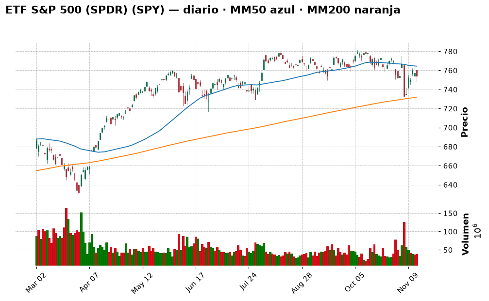
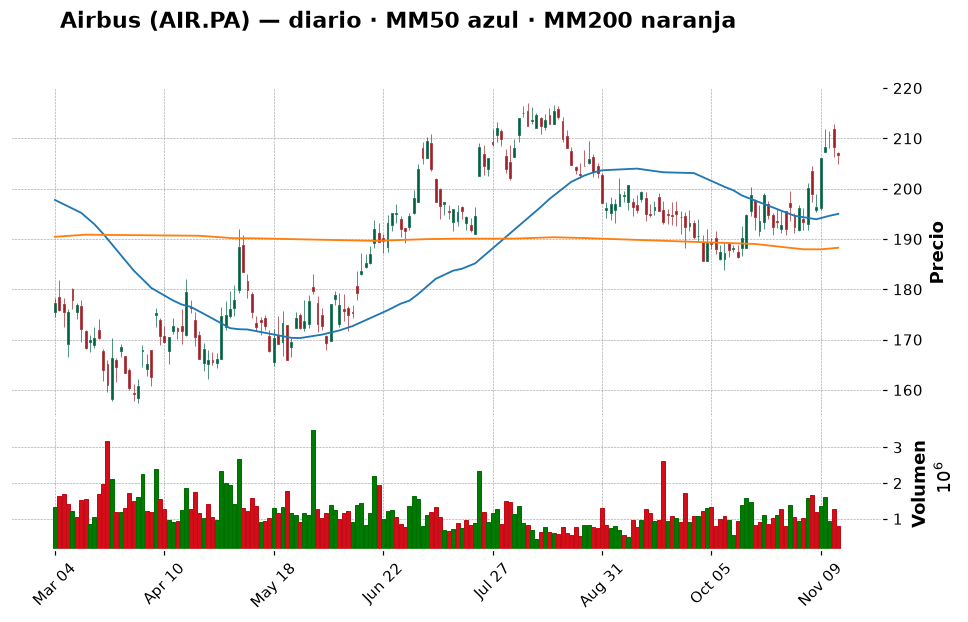
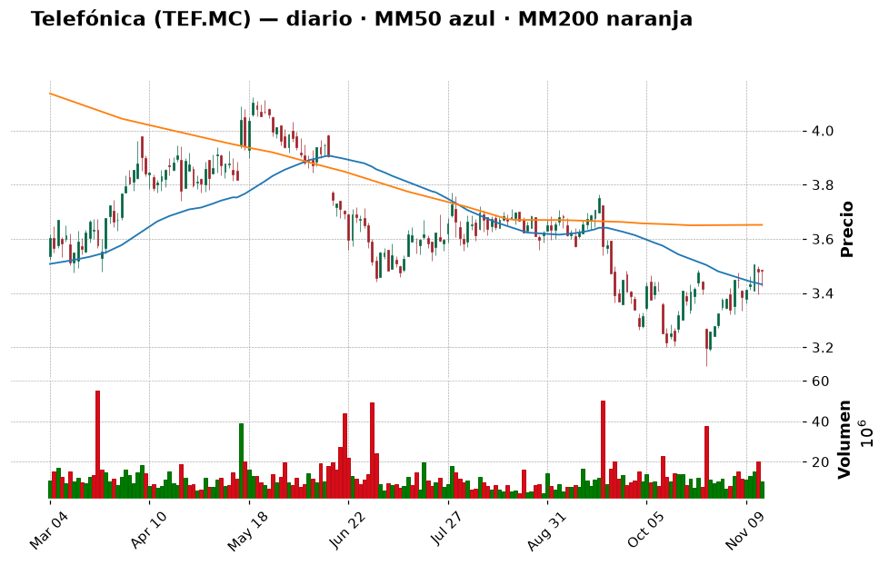
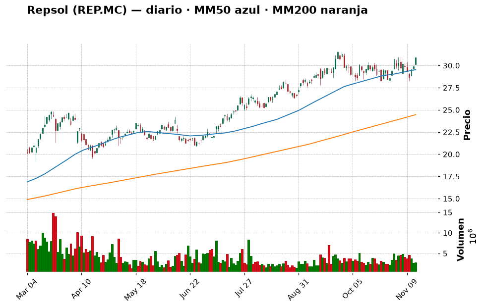
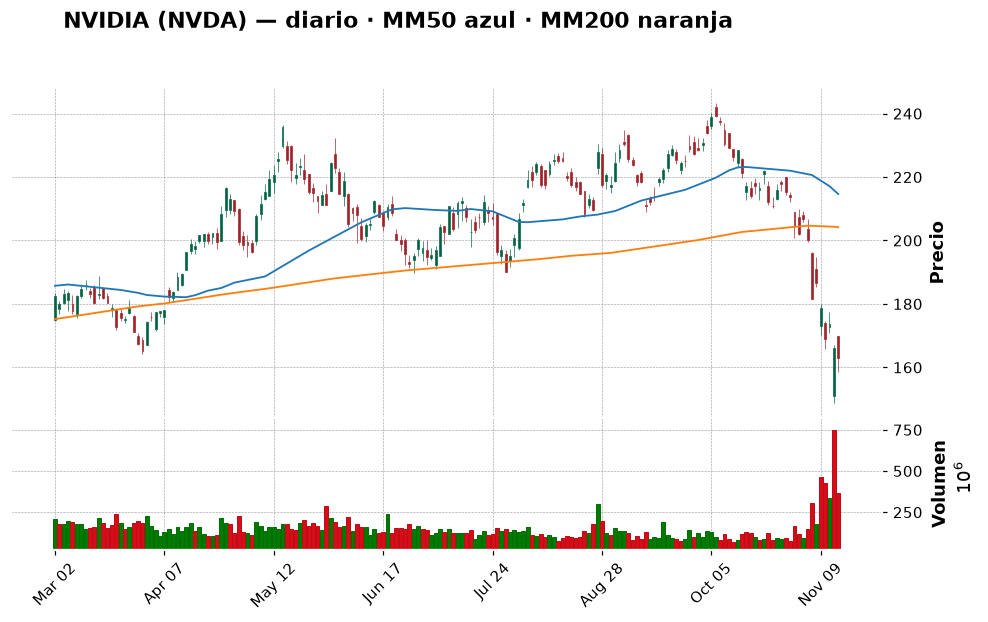
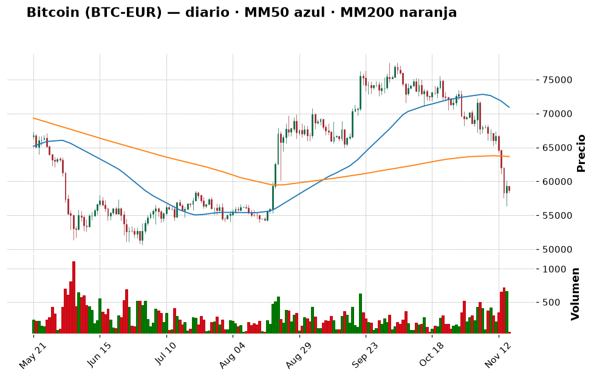
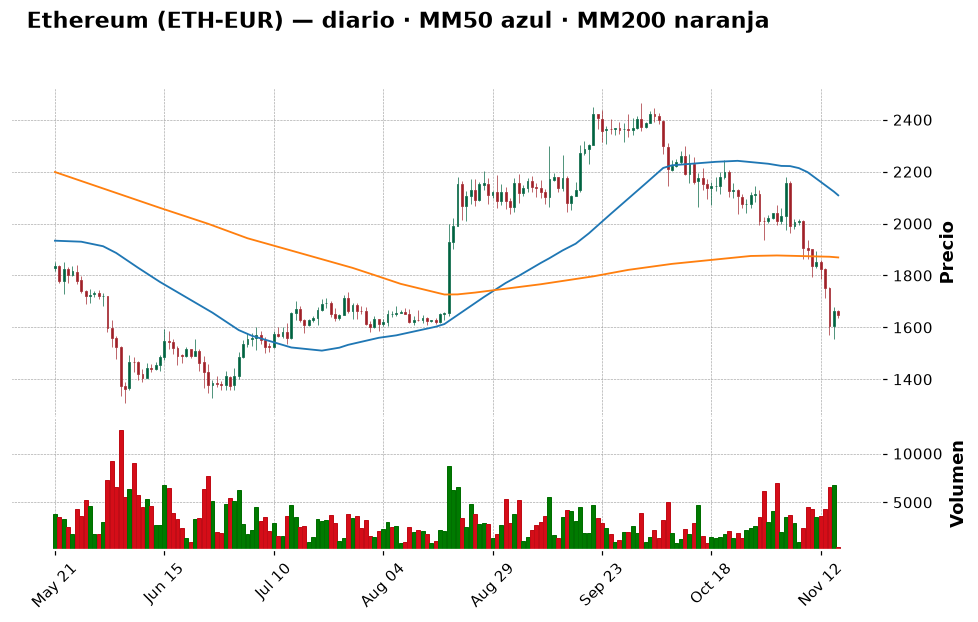
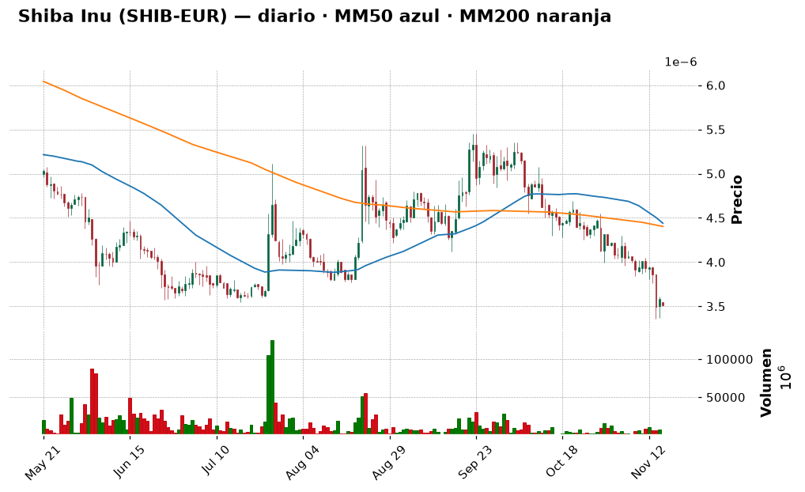

# 📈 Informe pre-apertura — lunes 16 de noviembre de 2026

> Generado automáticamente a las 08:20 (hora de Madrid) · Bolsa española abre a las 9:00 · Wall Street a las 15:30 · Cripto: 24/7
> **Termómetro del día:** 🔴 mucha incertidumbre — No porque haya pasado algo grave el fin de semana, sino porque esta semana llega un **examen con resultado imprevisible**: Nvidia presenta cuentas el **martes** con su fundador fuera (y con rumores de que quiere volver), las bolsas de chips de Asia caen con fuerza esta mañana (Taiwán más de un −4 %), los futuros del Nasdaq bajan un −1 % y el mercado cripto marca **miedo extremo (10/100)**. Subo un escalón desde el "prudencia" del viernes por esa combinación; **el plan no cambia**: no es día de comprar.
> **Lección de hoy:** El índice de miedo y codicia (Fear & Greed)

## 1. Lo que tienes que saber hoy
- **Nvidia, el gran examen de la semana.** La empresa presenta sus resultados del tercer trimestre **el martes 17, tras el cierre de Wall Street** (de madrugada en España), los primeros con **Colette Kress** como consejera delegada interina (Reuters vía Investing.com). Según el *Financial Times*, **Jensen Huang se plantea volver** apenas unos días después de dimitir y hay una campaña de directivos de Silicon Valley para traerlo de vuelta; en cambio, el secretario del Tesoro, Scott Bessent, pide que se busque un **CEO de fuera**, y el consejo ha sondeado al jefe de Arm, Rene Haas (Cointelegraph, Reuters). Investing.com España habla de una posible **oscilación de ±8 %** en la acción tras las cuentas. 💡 *Cuando un precio puede moverse mucho en cualquier dirección por un solo evento, se habla de **evento binario**: comprar justo antes es parecido a apostar a cara o cruz.*
- **Los chips arrastran a Asia y a los futuros.** Esta mañana la bolsa de **Taiwán cae más de un −4 %** (el titular de cierre de Investing.com habla de −5,74 %), el **Kospi** coreano un −2,5 % y el **Nikkei** un −2 % (Reuters, Cointelegraph). Los futuros del **Nasdaq 100 bajan un −1,04 %** y los del **S&P 500 un −0,52 %** (Yahoo Finance, 7:38 h de Madrid). Los de Europa, en cambio, apuntan a una apertura ligeramente positiva (Reuters).
- **Bitcoin confirma la señal que fijamos.** El viernes escribimos: *si la vela del día cierra por debajo de la MM200 (~63.740 €), el tramo de diciembre queda en pausa*. Cerró en **61.996 €**, el sábado bajó a **58.292 €** (con un mínimo de **56.346 €**) y esta mañana está en **58.678 €**, un **−7,8 % por debajo de su MM200**. **La regla se activa: tramo de bitcoin del 1-dic en pausa.** No vendemos nada. El miedo y codicia está en **10/100**, uno de los niveles más bajos posibles: hoy aprendemos qué significa (y qué no).
- **Tu cartera:** sin movimientos nuevos desde el 11-nov (correcto). Patrimonio de **9.720,15 €**, prácticamente igual que el viernes (−2,40 €), con un **93 % en liquidez**. Todo el plan sigue igual: el ETF espera al 1-dic, las compras de empresas siguen condicionadas a sus niveles y la cripto, en pausa.

## 2. ✅ Recomendaciones del día (resumen)
| Activo | Acción | vs. ayer | Cuánto (orientativo) | Horizonte | Por qué, en una frase | Confianza |
|---|---|---|---|---|---|---|
| ETF S&P 500 (SPY / SPY5.L) | 🔵 Mantener | = | Tramo 1 hecho (~316 €); **tramo 2 (~600 €) hacia el 1-dic**, o antes si el SPY cae a 729–739 $ | Años (5+) | Sigue sobre su MM200 (+3,1 %); si Nvidia decepciona, una caída hacia 739 $ adelantaría el tramo, no lo cancelaría | media |
| Airbus (AIR.PA) | ⏸️ Esperar | = | Hasta 3–4 % (~300–400 €) en 2 tramos, si vuelve a ~202 € o cierra sobre 217 € | Años | Cerró en 206,65 €, a mitad de camino entre ambos niveles; el cierre del espacio aéreo de EE. UU. golpeó a las aerolíneas | media |
| Telefónica (TEF.MC) | ⏸️ Esperar | = | 0 € hoy; hasta 2–3 % (~250 €) si supera 3,71 € | Años | Plana en 3,48 € pese a buenas cuentas; ahora ofrece ~1.000 M€ por una fibra brasileña | baja |
| Repsol (REP.MC) | 🔵 Mantener | = | No añadir | Años | Mejor valor del Ibex el viernes (+3,3 %, 30,89 €); tu posición gana un +150 % | media |
| NVIDIA (NVDA) | ⛔ Evitar | = | 0 € | — | Resultados el martes con la dirección en el aire: evento binario, −20 % bajo su MM200 | media |
| Iberdrola (IBE.MC) | ⏸️ Esperar | = | Hasta 5 % (~480 €) si retrocede a 21–22 € | Años | Otro máximo anual (23,70 €) y RSI 82,5: la más "caliente" de la lista | media |
| Inditex (ITX.MC) | 🔵 Mantener | = | No añadir | Años | +121 % en tu posición, tendencia alcista, a un −1,8 % de máximos | media |
| Apple (AAPL) | 🔵 Mantener | = | No añadir | Años | Máximos de 52 semanas la semana pasada; depende menos de la IA que Nvidia | media |
| Bitcoin (BTC) | 🔵 Mantener | = (pausa ya confirmada) | No vender; **tramo del 1-dic en pausa**; ~50 € solo si llega a ~54.000 € | Años | Tres cierres seguidos bajo la MM200 (−7,8 %): la regla del viernes se cumple | media |
| Ether (ETH) | ⏸️ Esperar | = | 0 € hoy | Años | Tocó 1.555 € el domingo, pero cerró sobre 1.580 €: la tesis aún no se rompe | media |
| Shiba Inu (SHIB) | ⛔ Evitar | = | No añadir | — | Memecoin, −54 % en un año, pegada a mínimos | alta |

*(El resto de la watchlist —Santander, BBVA, Solaria, Oryzon, IAG, Indra, Aena, Microsoft, Amazon, Alphabet, Berkshire, los ETF del Nasdaq y del MSCI World, ASML, LVMH, SAP y Siemens— tiene su veredicto en la tabla "Resto de la watchlist" de la sección 6.)*

**🔁 Seguimiento de ayer** (informe del viernes 13-nov):
- **Bitcoin:** "Mantener; el tramo de diciembre en pausa si la vela de hoy cierra por debajo de ~63.740 €" → cerró en **61.996 €** y después ha encadenado cierres en 58.292 € y 59.282 €. **La pausa queda confirmada.** Lo que dijimos que reactivaría el plan (un cierre sobre ~63.700 €) está hoy a un +8,5 %; la zona donde compraríamos un tramo pequeño (~54.000 €) está a un −8 %.
- **Ether:** "Esperar; pasaría a Evitar si pierde con claridad los 1.580 € en cierre diario" → el domingo **tocó 1.555 €** dentro del día, pero **cerró en 1.665 €** y hoy está en 1.646 €. No se ha cumplido la condición (un toque no es un cierre: es justo el error de principiante del que hablamos el viernes). **Sigue en Esperar.**
- **ETF S&P 500:** Mantener, tramo 2 hacia el 1-dic o antes si cae a 729–739 $ → el SPY cerró en **754,37 $ (−0,36 %)**, todavía lejos de esa zona. **Sin cambios.** Tu tramo pierde un −0,58 % (−1,85 €) porque el ETF ha bajado un poco; el dólar fuerte, de hecho, amortigua la caída al pasarlo a euros.
- **Airbus:** Esperar a ~202 € o a un cierre sobre 217 € → bajó a **206,65 € (−0,8 %)**. Ninguna señal. Seguimos esperando con los mismos niveles.
- **Telefónica:** Esperar a que supere 3,71 € → **3,48 €**, plana. Sin cambios.
- **Nvidia:** Evitar → cayó otro −2,0 % (162,85 $). Mantengo Evitar: lo que me haría cambiar de opinión (CEO permanente y precio sobre su MM200, ~204 $) está más lejos que el viernes.
- **El dato de precios industriales (IPP) de EE. UU.** que vigilábamos salió con una subida interanual del **+6,5 %, la mayor en casi cuatro años**, aunque el dato mensual fue algo más suave de lo temido (Yahoo Finance). El S&P 500 cayó un −0,40 %: no fue el escenario malo que describimos.
- **Tu `cartera.csv`:** sin movimientos desde el 11-nov. Correcto: el plan del viernes era no hacer nada.

> Día y semana para **no mover ficha**: el plan en tramos está diseñado precisamente para semanas así. Si los resultados de Nvidia provocan una caída fuerte, el ETF entraría en su "zona de compra" (729–739 $) y **adelantaríamos** el tramo 2; si salen bien, seguimos con el calendario. En cripto, la regla manda: pausa.

## 3. Agenda del día
| Hora (Madrid) | Evento | Por qué importa |
|---|---|---|
| Madrugada | Bolsas de Asia: Taiwán más de −4 %, Kospi −2,5 %, Nikkei −2 % por los chips; China publica producción industrial y ventas minoristas de octubre **más flojas** de lo previsto; el **PIB de Japón se contrae** por sorpresa (Reuters vía Investing.com) | La caída tecnológica de Asia llega a Europa y a los futuros de EE. UU. |
| 9:00 | Apertura de la Bolsa española (Reuters: futuros europeos ligeramente al alza) | El Ibex parte de 20.020 puntos, a un −1,6 % de su máximo anual; ¿aguanta los 20.000? |
| Por la mañana | **Producción industrial de la zona euro (septiembre)** (Reuters). *Hora no confirmada en nuestras fuentes; Eurostat suele publicar a las 11:00.* | Termómetro de la industria europea, que crece poco (PIB del 3.er trimestre: +0,4 %, Expansión) |
| 15:30 | Apertura de Wall Street | Primer día de la "semana Nvidia" |
| **18:00** | **Discurso del presidente de la Fed, Kevin Warsh**, sobre IA y economía en San Francisco (Investing.com España, Reuters) | Cualquier pista sobre la subida de tipos de diciembre mueve bonos, dólar y bitcoin |
| Mar 17 | **Ventas minoristas de EE. UU.** · **Resultados de Nvidia** tras el cierre de Wall Street (Reuters) | El consumo y la IA, en el mismo día. La cita más importante de la semana |
| Mié 18 | **Actas de la Fed** de octubre (Reuters; Investing.com España las sitúa el jueves) · Anthropic fija el precio de su salida a bolsa | Las actas dirán cuántos miembros de la Fed quieren subir tipos |
| Jue 19 | **Debut de Anthropic en el Nasdaq** (Expansión; horquilla orientativa de 70–78 $) · **Cumbre Trump–Xi–Putin** en Shenzhen (Xinhua vía Investing.com) · Subasta de bonos del Tesoro español (Expansión) | Una OPV gigante "absorbe" dinero de otras tecnológicas; la cumbre puede mover el petróleo y los aranceles |
| Esta semana | Resultados de **Walmart, Target, Home Depot y Lowe's** (Reuters) | Dirán si el consumidor de EE. UU. aguanta con los tipos al alza |
| Dom 29-nov | Elecciones generales en España | Ruido político; la prima de riesgo sigue baja (65 pb) |
| 30-nov | Salida de Strategy de los índices MSCI | Ventas forzadas de la mayor "tesorería de bitcoin" |
| **1-dic** | **Tu aportación de 200 €** | Fecha prevista del tramo 2 del ETF |
| 9-dic / 17-dic | Reuniones de la Fed y del BCE | La Fed, con la subida de tipos casi descontada |

*Nota: las búsquedas web del calendario económico de hoy no devolvieron ningún calendario fiable para el 16-nov; la agenda sale del "Morning Bid" de Reuters y de "La bolsa hoy" de Investing.com España.*

## 4. Cómo llegan los mercados
### España y Europa
**El viernes 13:** el **Ibex 35** cerró en **20.020,1 puntos (+0,27 %)** y recuperó los 20.000; en la semana sube un **+3,36 %** y está a un −1,6 % de su máximo de 52 semanas (20.356,5). El mejor del índice fue **Repsol (+3,31 %, 30,89 €)**, empujado por el petróleo, seguido de Redeia (+2,90 %); entre los peores, **Acciona (−7,98 %)** y Acciona Energía (−6,89 %), un mal día para las renovables que también pagó **Solaria (−3,70 %)**. Fuera del Ibex, **Oryzon se desplomó un −8,93 %** (Investing.com España; precios del JSON). El **Euro Stoxx 50** cedió un −0,19 % (6.386,86), pero el **Stoxx 600 firmó su mejor semana desde finales de junio** gracias a que el dinero salió de la tecnología estadounidense hacia Europa (Reuters vía Investing.com).

**Noticias de empresas y de España:**
- **Los grupos del Ibex ganan un récord de 59.113 millones** hasta septiembre, un +15,3 % más que en 2025, gracias a bancos, energía, ACS, Aena, Sacyr, Indra o Grifols (Expansión). 💡 *Cuando los beneficios suben más que el precio de las acciones, la bolsa se "abarata" aunque suba: por eso el Ibex puede estar en máximos sin estar necesariamente caro.*
- **Telefónica**, a través de su filial brasileña Vivo, **ofrece unos 1.000 millones de euros por Vero**, el sexto operador de fibra de Brasil (Expansión). UBS mejora la recomendación de Telefônica Brasil por "reducción de riesgos" (Investing.com España).
- **Santander** crea una nueva unidad para explotar su banca de inversión (Expansión).
- **Aena:** Vueling y Wizz Air llevan a **El Prat a un récord de pasajeros**, ya cerca de su límite técnico (Expansión).
- **Indra:** el contrato de ciberseguridad del Estado (CORA III) se enreda tras un recurso de su filial TRC y la vía judicial de Orange (El País).
- **BCE:** el español **Pablo Hernández de Cos** gana puntos para presidir el BCE (El País); otro candidato, el neerlandés Klaas Knot, advierte que el BCE "no puede sustituir una política fiscal sensata" (Investing.com). La consejera Isabel Schnabel dio un discurso titulado "Made in Europe" (BCE).
- **Exportaciones europeas a EE. UU.:** caen un −12,4 % en nueve meses por los aranceles (Expansión).
- **Política:** a dos semanas del 29-N, los partidos presentan programas (más intervención en vivienda y gasto social en el PSOE; bajadas de impuestos en PP y Vox) (Expansión, Europa Press). Bruselas decidirá el último pago del plan de recuperación el 30-N, el día después de las elecciones (El País).

### Estados Unidos
**El viernes 13:** el **S&P 500** cayó un **−0,40 % (7.561,67)**, el **Nasdaq** un **−0,91 % (25.136,27)** y el **Dow Jones** subió un **+0,10 % (52.347,55)**. Aun así, los tres índices **ganaron en la semana** y el S&P 500 y el Nasdaq cortaron una racha de **cuatro semanas de caídas** (Reuters vía Investing.com). Los **semiconductores** lideraron las caídas (índice de Filadelfia −3,4 %; AMD −8,75 %, Broadcom −4,8 %): los que el jueves subían como "alternativas a Nvidia" devolvieron la subida. 💡 *Fíjate en esto: el jueves AMD subía un +6 % y el viernes caía un −9 %. Así de rápido cambia el "relato" del mercado en una semana nerviosa.*

**Las aerolíneas cayeron en los últimos minutos (−1,4 %)** porque la autoridad aérea (FAA) ordenó **parar todas las salidas de vuelos del país** por un fallo en las comunicaciones del control aéreo (Reuters). Expansión lo describe como el **mayor bloqueo aéreo desde el 11-S, con más de 32.000 vuelos cancelados o retrasados**; Trump pide al Congreso fondos urgentes para modernizar el sistema. Es un golpe temporal para las aerolíneas (y una noticia a vigilar para IAG o Aena), no para los fabricantes de aviones como Airbus, cuyo negocio depende de pedidos a años vista.

**Otras noticias:** el Gobierno de EE. UU. planea nombrar "**campeones nacionales de IA**" a más de dos docenas de empresas, entre ellas Nvidia, Amazon, Microsoft, OpenAI y Anthropic (WSJ vía Investing.com). **Microsoft** firma un acuerdo con Cerebras que diversifica sus proveedores de chips más allá de Nvidia (Simply Wall St vía Yahoo Finance). Morgan Stanley recomienda "máxima sobreponderación" en bolsa global para 2027 (Bloomberg vía Stocktwits), mientras el gestor de bonos Jeffrey Gundlach dice que "no le interesa comprar acciones" con los bonos pagando más del 5 % (Yahoo Finance).

**Esta mañana:** futuros del **S&P 500 −0,52 % (7.543,75)** y del **Nasdaq 100 −1,04 % (27.743)** (Yahoo Finance, 7:38 h de Madrid). Reuters lo resume así: "**la venta de la IA se reanuda** mientras se acercan los resultados de Nvidia". Nvidia ha perdido unos **1,9 billones de dólares** de valor desde principios de octubre (LSEG vía Reuters).

### Macro (tipos de interés, inflación, divisas, materias primas)
- **Bonos de EE. UU.:** el de **10 años paga un 5,14 %** y el de **2 años un 4,87 %**, este último con su **mayor subida semanal desde octubre de 2024** (Reuters, Investing.com). El mercado da solo un ~8 % de probabilidad a una subida "gigante" de medio punto en diciembre, pero la de un cuarto de punto se da casi por hecha. El IPP del viernes (+6,5 % interanual) refuerza la idea de que la inflación no está vencida.
- **Dólar y euro:** el índice del dólar cerró en **103,40, su nivel más alto desde abril de 2025**, con cuatro días seguidos de subidas (Reuters). El **euro/dólar** está en **1,1016**, en su **mínimo de 52 semanas** (Yahoo Finance; la semana pasada bajó un −1 %). Para ti: tus 2.605,43 USDC valen ahora **2.365,21 €** (el viernes 2.355,57 €): **el dólar fuerte revaloriza tu liquidez en Coinbase**.
- **Japón:** el PIB del tercer trimestre se contrae por sorpresa y una consejera del Banco de Japón (Takata) pide **subir tipos rápido** (Reuters vía Investing.com). Si Japón sube tipos, el yen se fortalece y puede provocar ventas en otras bolsas: es un riesgo de fondo que conviene conocer.
- **Petróleo Brent:** **96,66 $ (+0,86 %)** esta mañana (Yahoo Finance); una huelga en el mar del Norte ha paralizado parte de la producción de Apache (Investing.com). Bien para Repsol; mal para la inflación y para las aerolíneas.
- **Oro:** cae un −1,2 % hasta ~3.838 $, **prácticamente en su mínimo de 52 semanas** (Investing.com España). Con tipos altos y dólar fuerte, ni el oro hace de refugio: Reuters titula "para los inversores, un refugio verdaderamente seguro es difícil de encontrar".
- **España:** el bono a 10 años paga un **3,944 %** y la **prima de riesgo** está en **65 puntos básicos**, estable (Investing.com España). El **euríbor** diario roza el 3,3 % (Expansión). 💡 *El **euríbor** es el tipo de interés al que se prestan los bancos europeos y la referencia de la mayoría de hipotecas variables en España; si sube, suben las cuotas.*

## 5. Panorama técnico de la watchlist
> 💡 *Cómo leer esta tabla:* la **tendencia** resume si el precio lleva meses subiendo, bajando o de lado
> (comparando el precio con sus medias de 50 y 200 días). El **RSI** mide de 0 a 100 si las subidas o bajadas
> recientes han sido muy fuertes: por encima de 70 se dice "sobrecompra" (quizá ha subido demasiado rápido),
> por debajo de 30 "sobreventa". Son pistas, no predicciones.

Todos los datos son del **cierre del viernes 13-nov** (ningún valor llega con retraso hoy ✅). Como es lunes, la columna "Día" es la variación del viernes.

| Valor | Último cierre | Día | 1 mes | 1 año | Tendencia | RSI | vs MM200 |
|---|---|---|---|---|---|---|---|
| IBEX 35 (^IBEX) | 20.020,1 | +0,27 % | +4,39 % | +26,49 % | ➡️ lateral | 63,5 🟡 | +6,7 % |
| Euro Stoxx 50 (^STOXX50E) | 6.386,86 | −0,19 % | +3,54 % | +11,55 % | ➡️ lateral | 61,2 🟡 | +4,3 % |
| S&P 500 (^GSPC) | 7.561,67 | −0,40 % | −2,36 % | +10,37 % | ➡️ lateral | 46,8 🟡 | +3,0 % |
| Nasdaq Composite (^IXIC) | 25.136,27 | −0,91 % | −5,90 % | +7,39 % | ➡️ lateral | 42,4 🟡 | 0,0 % |
| Banco Santander (SAN.MC) | 11,09 € | +0,07 % | −7,57 % | +26,41 % | ➡️ lateral | 46,3 🟡 | −1,8 % |
| BBVA (BBVA.MC) | 23,57 € | +0,17 % | +2,52 % | +33,92 % | ➡️ lateral | 56,2 🟡 | +9,3 % |
| Inditex (ITX.MC) | 59,64 € | −0,07 % | +7,58 % | +28,01 % | 📈 alcista | 63,1 🟡 | +9,1 % |
| Iberdrola (IBE.MC) | 23,70 € | +1,54 % | +10,08 % | +31,70 % | 📈 alcista | 82,5 🔴 | +16,0 % |
| Telefónica (TEF.MC) | 3,48 € | +0,03 % | +4,85 % | −4,16 % | ➡️ lateral | 55,9 🟡 | −4,6 % |
| Repsol (REP.MC) | 30,89 € | +3,31 % | +4,22 % | +84,47 % | 📈 alcista | 58,4 🟡 | +26,3 % |
| Solaria (SLR.MC) | 15,75 € | −3,70 % | +1,12 % | −10,82 % | 📉 bajista | 49,2 🟡 | −19,5 % |
| Oryzon (ORY.MC) | 2,35 € | −8,93 % | −8,14 % | −21,54 % | 📉 bajista | 39,2 🟡 | −17,7 % |
| IAG (IAG.MC) | 5,42 € | +0,22 % | +10,88 % | +28,83 % | 📈 alcista | 64,2 🟡 | +11,3 % |
| Indra (IDR.MC) | 58,80 € | +1,03 % | −6,81 % | +19,61 % | ➡️ lateral | 44,4 🟡 | +5,3 % |
| Aena (AENA.MC) | 28,78 € | +0,14 % | +11,98 % | +28,25 % | 📈 alcista | 71,8 🔴 | +10,7 % |
| Apple (AAPL) | 356,27 $ | +0,39 % | +4,17 % | +30,28 % | 📈 alcista | 60,6 🟡 | +18,3 % |
| Microsoft (MSFT) | 523,88 $ | +0,17 % | −2,88 % | +2,49 % | 📈 alcista | 48,8 🟡 | +18,7 % |
| NVIDIA (NVDA) | 162,85 $ | −2,01 % | −25,03 % | −15,97 % | ➡️ lateral | 24,9 🟢 | −20,3 % |
| Amazon (AMZN) | 266,66 $ | −0,29 % | +4,67 % | +9,20 % | 📈 alcista | 57,4 🟡 | +9,0 % |
| ETF S&P 500 (SPY) | 754,37 $ | −0,36 % | −2,26 % | +10,39 % | ➡️ lateral | 47,1 🟡 | +3,1 % |
| ETF Nasdaq 100 (QQQ) | 679,89 $ | −1,20 % | −6,61 % | +9,47 % | ➡️ lateral | 42,8 🟡 | −0,3 % |
| Alphabet (GOOGL) | 295,77 $ | −0,98 % | −15,31 % | +3,16 % | 📉 bajista | 40,6 🟡 | −12,6 % |
| Berkshire Hathaway (BRK-B) | 592,94 $ | +0,53 % | +12,79 % | +18,02 % | 📈 alcista | 80,9 🔴 | +18,5 % |
| ETF MSCI World (IWDA.AS) | 130,49 € | −0,84 % | −0,17 % | +18,90 % | 📈 alcista | 52,5 🟡 | +6,7 % |
| Airbus (AIR.PA) | 206,65 € | −0,77 % | +6,09 % | +1,22 % | 📈 alcista | 60,6 🟡 | +9,8 % |
| ASML (ASML.AS) | 1.338,80 € | −2,76 % | −8,56 % | +54,67 % | ➡️ lateral | 41,5 🟡 | −4,3 % |
| LVMH (MC.PA) | 403,45 € | −0,31 % | +1,29 % | −34,00 % | ➡️ lateral | 53,9 🟡 | −12,6 % |
| SAP (SAP.DE) | 213,45 € | +0,42 % | +6,06 % | +1,11 % | 📈 alcista | 61,7 🟡 | +28,1 % |
| Siemens (SIE.DE) | 279,40 € | −0,82 % | +3,23 % | +21,29 % | ➡️ lateral | 56,9 🟡 | +7,4 % |

*(🟢 = RSI bajo, posible "rebajas"; 🔴 = RSI alto, quizá demasiado rápido; 🟡 = neutral.)*

**En conjunto:** la foto de "dos velocidades" se acentúa. **Europa** sigue en forma: el Ibex está un +6,7 % sobre su MM200 y casi todas las grandes españolas están por encima. **EE. UU.** está justo en la frontera: el **Nasdaq está exactamente sobre su MM200 (0,0 %)** y el **ETF del Nasdaq 100 (QQQ) ya la ha perdido (−0,3 %)**; el S&P 500 aguanta un +3,0 % por encima, gracias a que no es solo tecnología. Cambios respecto al viernes: **Airbus pasa a tendencia "alcista"** (sus medias se han ordenado), **Solaria pasa de "lateral" a "bajista"** y Oryzon cae casi a su mínimo anual con un volumen 4,5 veces el normal. Lo más "estirado": **Iberdrola (RSI 82,5)**, **Berkshire (80,9)** y Aena (71,8). Lo más castigado: **Nvidia (24,9)**.

## 6. Ideas de bolsa: qué haría un experto
### ETF S&P 500 (SPY5.L / SPY) — MANTENER (tramo 1 hecho)

- **Qué es:** un fondo que compra de una vez las ~500 mayores empresas de EE. UU. Tú tienes la versión europea (UCITS) que cotiza en Londres, **SPY5.L**; el gráfico es del SPY estadounidense, que sigue el mismo índice.
- **Por qué es noticia hoy:** El País publica que "**miles de inversores españoles tienen acciones de Nvidia sin saberlo**": la empresa supone en torno a **siete de cada 100 euros** de los fondos que replican Wall Street (Trefis calcula un 6,1 % del S&P 500). Es decir, **los resultados del martes también afectan a tu ETF**, aunque de forma amortiguada.
- **Lo que dice el gráfico:** el SPY (754,37 $) sigue **por encima de su MM200 (731,92 $; +3,1 %)** y **por debajo de su MM50 (764,43 $; −1,3 %)**: tierra de nadie, como el viernes. RSI 47,1 (neutral), MACD "mejorando". Soportes en **749,6 $**, **739,5 $** y 732,7 $; resistencias cercanas en 755,6–756,7 $ y luego 775,1 $. A un −3,5 % de su máximo de 52 semanas (781,62 $). En llano: **la tendencia de fondo está intacta** y la zona de 732–739 $ (soportes + MM200) es el "suelo" que vigilar.
- **Lo positivo:** es tu núcleo diversificado y barato; incluso si Nvidia cayera un −10 % el miércoles, el efecto directo en el ETF sería de aproximadamente un −0,6 % (10 % × 6 %).
- **El riesgo:** que una decepción de Nvidia arrastre a todo el sector tecnológico (como pasa hoy en Asia), sumado a bonos al 5,1 % y a una bolsa que algunos ven cara (el CAPE de Shiller, una medida de valoración, está cerca de su nivel más alto desde la burbuja puntocom, según Motley Fool vía Yahoo Finance).
- **🧑‍💼 Recomendación: MANTENER.** El plan no cambia: compramos en tramos para no tener que adivinar qué pasará el martes. Si los resultados provocan una caída hasta **729–739 $**, eso **adelanta** el tramo 2 (comprarías más barato); si suben, seguimos con el calendario del 1-dic.
  - **Cuánto y cómo:** tramo 2 de ~600 € (≈6 % de tu patrimonio) **hacia el 1 de diciembre**, o antes si el SPY cae a 729–739 $. Objetivo: ~35 % del patrimonio en 6 tramos.
  - **Horizonte:** años (5 o más).
  - **Qué me haría cambiar de opinión:** un **cierre semanal por debajo de 729 $** (por debajo de la MM200): no vendería lo comprado, pero pausaría el siguiente tramo hasta ver estabilidad, igual que hemos hecho con bitcoin.
- **Qué mirar para entenderlo:** el miércoles por la mañana, mira cómo reacciona el **SPY** frente a **Nvidia**. Si Nvidia se mueve un ±8 % y el SPY menos de un ±1 %, estarás viendo la diversificación funcionando en directo.
- **Confianza:** media

### Airbus (AIR.PA) — ESPERAR (sigue en tu lista de la compra)

- **Qué es:** el mayor fabricante de aviones comerciales del mundo (y un actor clave en defensa y espacio en Europa).
- **Por qué es noticia hoy:** no hay noticias propias relevantes en nuestras fuentes. Lo más cercano: el **cierre del espacio aéreo de EE. UU.** hundió a las aerolíneas el viernes (Reuters), una aerolínea menor (Global Airlines) ha quebrado (Yahoo Finance) y en Reino Unido un sindicato presiona para que un contrato militar de satélites de 2.000 millones de libras no vaya a una empresa de EE. UU. (Airbus es uno de los candidatos europeos naturales, aunque la noticia no la nombra en el resumen). Según los últimos datos públicos, Airbus entregó **547 aviones hasta septiembre** y apunta a unas **870 en el año**, lo que exige acelerar en el cuarto trimestre (Demócrata).
- **Lo que dice el gráfico:** 206,65 € (−0,8 % el viernes, +5,2 % en la semana). La tendencia de fondo pasa a **"alcista"**: precio sobre la MM50 (194,99 €) y la MM200 (188,25 €), +9,8 % sobre esta última. RSI 60,6 (neutral) y MACD "empeorando". Soporte en **201,65 €**; resistencias en **210,95 €** y **216,55–217,05 €**. A un −6,6 % de su máximo de 52 semanas (221,30 €). En llano: tendencia sana, pero el precio se ha frenado dos veces en la zona de 211 € y está "en medio" de nuestros dos niveles.
- **Lo positivo:** empresa líder con años de pedidos por delante; el ruido de las aerolíneas no cambia esos pedidos.
- **El riesgo:** que no cumpla el objetivo de entregas del año (lo sabremos en enero) y la sensibilidad al petróleo caro, que aprieta a sus clientes.
- **🧑‍💼 Recomendación: ESPERAR.** Mismo plan que el viernes: compraría **(a)** en un retroceso hacia **~202 €** (soporte, −2,4 % desde aquí) o **(b)** con un **cierre claro por encima de 217 €** (resistencia rota, +5 % desde aquí). Comprar a 206 € es comprar justo en mitad del camino, sin ventaja.
  - **Cuánto y cómo:** hasta 3–4 % del patrimonio (~300–400 €), en 2 tramos.
  - **Horizonte:** años.
  - **Qué me haría cambiar de opinión:** un cierre por debajo de 190 € (zona de la MM200) o un recorte del objetivo de entregas.
- **Qué mirar para entenderlo:** los datos de entregas de noviembre (se publican a primeros de diciembre). Si sigue el ritmo de ~70 aviones al mes, el objetivo de 870 es alcanzable.
- **Confianza:** media

### Telefónica (TEF.MC) — ESPERAR

- **Qué es:** la gran operadora española de telecomunicaciones (España, Brasil, Alemania y Reino Unido).
- **Por qué es noticia hoy:** su filial brasileña **Vivo ofrece unos 1.000 millones de euros por Vero**, el sexto operador de fibra de Brasil (Expansión), y UBS mejora la recomendación de Telefônica Brasil (Investing.com España). Tras los resultados del jueves, varios análisis (Simply Wall St vía Yahoo Finance) destacan la **vuelta a beneficios** y la **mayor reducción de deuda neta desde 2021 (−10,8 %)**, aunque uno la considera ya "totalmente valorada".
- **Lo que dice el gráfico:** 3,48 € (plana el viernes, +2,8 % en la semana). **Lateral**: por encima de su MM50 (3,43 €) pero **un −4,6 % por debajo de su MM200 (3,65 €)**. RSI 55,9, MACD "empeorando". Soportes en 3,46 €, 3,44 € y **3,27 €**; resistencias en 3,49 € y **3,71–3,72 €**. A un −15,6 % de su máximo anual (4,12 €).
- **Lo positivo:** los números mejoran (beneficio, caja, deuda) y paga un dividendo atractivo.
- **El riesgo:** una compra de 1.000 millones gasta parte de la caja que debía reducir deuda; y la tendencia de fondo sigue sin girar.
- **🧑‍💼 Recomendación: ESPERAR.** Igual que el viernes: el mercado sigue sin "comprar" los buenos números. Esperaría a que el precio supere **3,71 €** (resistencia y, de paso, su MM200): sería la señal de que la tendencia de fondo ha cambiado de verdad.
  - **Cuánto y cómo:** 0 € hoy; si se cumple la condición, hasta 2–3 % del patrimonio (~250 €) en 2 tramos.
  - **Horizonte:** años.
  - **Qué me haría cambiar de opinión:** un cierre por debajo de 3,27 € (soporte) me devolvería a Evitar.
- **Qué mirar para entenderlo:** si la compra de Vero se cierra, mira cómo reacciona la acción ese día: si sube, el mercado ve la compra como inteligente; si baja, cree que paga demasiado.
- **Confianza:** baja

### Repsol (REP.MC) — MANTENER (la tienes)

- **Qué es:** la mayor petrolera española (exploración, refino, gasolineras y renovables).
- **Por qué es noticia hoy:** fue **el mejor valor del Ibex el viernes (+3,31 %)** con el petróleo por encima de 95 $; esta mañana el Brent sube a 96,66 $ y una huelga en el mar del Norte recorta producción de Apache (Investing.com).
- **Lo que dice el gráfico:** 30,89 € (+3,3 % en la semana), **tendencia alcista** y un **+26,3 % sobre su MM200 (24,46 €)**. RSI 58,4, MACD "mejorando". Resistencias inmediatas en **31,02 €** y en su máximo de 52 semanas, **31,64 €** (a solo un −2,4 %). Soportes lejos, en ~28,2–28,3 € y 27,8 €. En llano: sube con fuerza y está a punto de probar su techo anual.
- **Lo positivo:** tu posición gana un **+150 %** (pagaste 12,37 €) y la tendencia sigue a favor.
- **El riesgo:** depende del petróleo, que a su vez depende de la geopolítica (Irán, la cumbre del jueves en China): un acuerdo de paz podría bajarlo deprisa.
- **🧑‍💼 Recomendación: MANTENER.** No hay motivo para vender algo que sigue en tendencia alcista, y tampoco para ampliar: ya tienes exposición al petróleo y es un sector muy volátil (volatilidad anualizada de 20 días del 40 %, casi el doble que el S&P 500).
  - **Cuánto y cómo:** no añadir.
  - **Horizonte:** años.
  - **Qué me haría cambiar de opinión:** un cierre por debajo de 27,8 € con el Brent cayendo hacia 80 $: ahí valoraría Vender.
- **Qué mirar para entenderlo:** si supera con claridad los **31,64 €**, entraría en "máximos de 52 semanas", una zona sin vendedores atrapados por encima; si se frena ahí, es normal que retroceda un poco.
- **Confianza:** media

### NVIDIA (NVDA) — EVITAR

- **Qué es:** el gran fabricante de chips para inteligencia artificial.
- **Por qué es noticia hoy:** presenta resultados **el martes tras el cierre**. Encima de la mesa: si **Jensen Huang vuelve** (el FT dice que lo está considerando; hay una campaña "Bring Jensen Back" con más de 161.000 firmas, según sus organizadores), si se elige un **CEO de fuera** (lo pide Bessent; Trump llegó a sugerir a Tim Cook) o si el elegido es Rene Haas (Arm) (Cointelegraph, Reuters, Decrypt). Expansión cuenta que Harvey Jones es el nuevo presidente del consejo. En contra: CLSA rebaja la recomendación (precio objetivo 255 $), Microsoft diversifica proveedores con Cerebras y el analista Ming-Chi Kuo ve más pedidos para los chips de Google (Investing.com, Yahoo Finance). A favor: EE. UU. la nombrará "campeona nacional de IA" (WSJ) y Bankinter la ve "una oportunidad a estos niveles" (Expansión).
- **Lo que dice el gráfico:** 162,85 $ (−2,0 % el viernes, −12,8 % en la semana, −25 % en un mes). **Un −20,3 % por debajo de su MM200 (204,19 $)** y un −24,1 % bajo su MM50. RSI 24,9 (**sobreventa**). Mínimo del jueves en 148,80 $, que es su mínimo de 52 semanas (está un +9,4 % por encima). Resistencias muy lejos, en ~214 $. Volumen 1,7 veces el normal. Volatilidad anualizada del 52,8 %: casi el doble que Apple.
- **Lo positivo:** sigue siendo el líder del sector y el precio ya descuenta muchas malas noticias.
- **El riesgo:** que los resultados o las previsiones decepcionen, o que no haya respuesta clara sobre quién manda; se habla de un movimiento de ±8 % en un solo día.
- **🧑‍💼 Recomendación: EVITAR.** Comprar una acción en caída libre **justo antes de un evento binario** no es invertir, es apostar. No hay ninguna prisa: si los resultados son buenos y llega un CEO permanente, **habrá tiempo de comprar después**, aunque sea algo más caro. Ya tienes Nvidia, en su justa medida (~6 %), dentro de tu ETF.
  - **Cuánto y cómo:** 0 €.
  - **Horizonte:** —
  - **Qué me haría cambiar de opinión:** un CEO permanente con un plan claro **y** el precio recuperando su MM200 (~204 $). Revisaré la idea el miércoles con los resultados en la mano.
- **Qué mirar para entenderlo:** el miércoles fíjate en dos cosas: las **previsiones** del próximo trimestre (lo que la empresa espera vender, más importante que el pasado) y si dicen algo sobre el **CEO**.
- **Confianza:** media

### Resto de la watchlist: veredicto rápido
| Valor | Acción | Por qué (1 frase) | Nivel a vigilar |
|---|---|---|---|
| Iberdrola (IBE.MC) | ⏸️ Esperar | Nuevo máximo anual (23,70 €) con RSI 82,5, la más sobrecomprada de la lista; los picos del precio de la luz en Europa (>600 €/MWh) ponen a las eléctricas en el foco (Simply Wall St vía Yahoo Finance) | Comprar en 21–22 €; soporte 21,09 € |
| Inditex (ITX.MC) | 🔵 Mantener | Tu posición gana +121 %, tendencia alcista, a un −1,8 % de su máximo (60,74 €); sin noticias propias relevantes | Soporte 56,2 € |
| Apple (AAPL) | 🔵 Mantener | Tocó máximos de 52 semanas la semana pasada (Benzinga vía Yahoo Finance) y lanza su primer iPhone plegable, el "iPhone Duo" (Yahoo Finance) | Soporte 338,7 $; máximo 360,83 $ |
| Banco Santander (SAN.MC) | ⏸️ Esperar | Sigue bajo su MM200 (−1,8 %); crea una nueva unidad de banca de inversión (Expansión) | Comprar si cierra sobre su MM50, ahora 11,88 € (antes 11,92 €: la media ha bajado); soporte 10,34 € |
| BBVA (BBVA.MC) | ⏸️ Esperar | Tendencia de fondo sana (+9,3 % sobre MM200), pero justo bajo su MM50 (23,70 €); sin noticias propias | Sobre 23,70 €; soporte 22,77 € |
| Solaria (SLR.MC) | 🔵 Mantener | La tienes (1 acción, +5 %); cae −3,7 % en un mal día para las renovables (Acciona −8 %) y su tendencia pasa a **bajista**; con tipos altos, no añadir | Soporte 15,74 € (justo aquí) y 14,62 €; MM200 19,56 € |
| Oryzon (ORY.MC) | 🔵 Mantener | La tienes (4 acciones, −27 %): se desplomó −8,9 % con volumen 4,5× el normal sin una noticia que lo explique en nuestras fuentes; biotecnológica de alto riesgo, pero vale 9 € y venderla costaría casi lo mismo en comisiones | Mínimo anual 2,29 €; resistencia 2,61 € |
| IAG (IAG.MC) | ⏸️ Esperar | Tendencia alcista, pero el cierre del espacio aéreo de EE. UU. tumbó a las aerolíneas (−1,4 %, Reuters) y el combustible sigue caro | Soporte 4,95 €; resistencia 5,71 € |
| Indra (IDR.MC) | ⏸️ Esperar | Defensa y ciberseguridad con buena tendencia de fondo (+5,3 % sobre MM200), pero bajo su MM50; enredo judicial en el contrato CORA III (El País) | Soporte 57,58 €; resistencia 62,66 € |
| Aena (AENA.MC) | ⏸️ Esperar | Récord de pasajeros en El Prat (Expansión) y beneficios en máximos, pero RSI 71,8: sobrecomprada | Soporte 26,3 €; máximo 29,1 € |
| Microsoft (MSFT) | ⏸️ Esperar | Acuerdo con Cerebras para depender menos de Nvidia y conferencia Ignite esta semana (Yahoo Finance); la caída de Teams/Outlook ya está resuelta (Cointelegraph); justo sobre su MM50 (519 $) | Soporte 504,96 $; resistencia 551,15 $ |
| Amazon (AMZN) | ⏸️ Esperar | Sigue pegada a su resistencia (267,56 $); un fallo del cohete de ULA deja en tierra 40 satélites de su red de internet (Benzinga vía Yahoo Finance) | Cierre sobre 267,6 $; soporte 244,7 $ |
| ETF Nasdaq 100 (QQQ) | ⏸️ Esperar | **Pierde su MM200** (−0,3 %): muy concentrado en tecnología justo en la semana de Nvidia; para ti, mejor el S&P 500 o el MSCI World | Recuperar 682 $; soporte 661 $ |
| Alphabet (GOOGL) | ⛔ Evitar | Cruce de la muerte y −12,6 % bajo su MM200, aunque hay noticias buenas: pedidos de OpenAI y Anthropic para sus chips TPU con visibilidad hasta 2029 (Ming-Chi Kuo vía Yahoo Finance). Noticias y técnico se contradicen; me quedo con el técnico hasta que mejore | Recuperar la MM200 (338,5 $); soporte 276,9 $ |
| Berkshire Hathaway (BRK-B) | ⏸️ Esperar | Gran empresa estable en máximos, pero RSI 80,9: comprar ahora es pagar la euforia; emite bonos en yenes para cubrir su cartera japonesa (Simply Wall St vía Yahoo Finance) | Retroceso hacia la MM50 (529,7 $) |
| ETF MSCI World (IWDA.AS) | ⏸️ Esperar | Alternativa excelente al S&P 500 (más diversificada), en tendencia alcista; no tiene sentido duplicar el núcleo ahora | Soporte 129 €; máximo 132,42 € |
| ASML (ASML.AS) | ⏸️ Esperar | −2,8 % el viernes y −4,3 % bajo su MM200; hoy los chips caen con fuerza en Asia, así que probablemente abra a la baja | Soporte 1.333,8 € (muy cerca) y 1.210,6 €; MM200 1.399 € |
| LVMH (MC.PA) | ⛔ Evitar | El lujo sigue en crisis (−34 % en un año, −12,6 % bajo MM200); compra la mayoría de una tequilera (Volcan de mi Tierra), pero no cambia la tendencia | Recuperar 431 €; soporte 380 € |
| SAP (SAP.DE) | ⏸️ Esperar | Tendencia alcista fuerte (+28 % sobre MM200), cerca de su máximo (219,65 €); amplía su alianza de IA con BlackLine (Simply Wall St vía Yahoo Finance) | Soporte 203 €; resistencia 216,65 € |
| Siemens (SIE.DE) | ⏸️ Esperar | Pedidos récord recientes, pero sigue frenada bajo su resistencia (279,8–284,65 €) | Cierre sobre 286,3 €; soporte 274,35 € |

## 7. ₿ Criptomonedas
> 💡 *Las criptomonedas cotizan 24 horas, 7 días a la semana: los precios son de esta mañana (en euros).
> Son mucho más volátiles que las acciones: caídas del 50 % o más han ocurrido varias veces.*

**Sentimiento:** Fear & Greed **10/100 (miedo extremo**; ayer 10, hace una semana 29, hace un mes 55 —codicia—, según alternative.me) · Capitalización total **2,29 billones $ (+0,24 % en 24 h; −52,5 % bajo su máximo histórico de octubre de 2025)** · Dominancia de Bitcoin **56,7 %**.
Un 10 es un nivel que se ve muy pocas veces: significa que casi todos los indicadores de ánimo (caídas, volatilidad, redes sociales, dominancia) señalan **pánico**. Históricamente, comprar con miedo extremo ha salido mejor que comprar con codicia… **a largo plazo**; a corto plazo, el miedo puede durar semanas. Lo explicamos a fondo en la lección de hoy (sección 10).

**Radar Coinbase** (409 monedas comprables · hoy suben 226 y bajan 135 · en 7 días suben 19 y bajan 342):
- **Mayores por capitalización (7 días):** BTC −12,5 %, ETH −13,2 %, BNB −12,4 %, XRP −12,2 %, SOL −16,7 %, HYPE −9,1 %, ZEC −25,3 %, DOGE −13,7 %.
- **Más suben (7 d, top 100):** VVV (+0,9 %) y WLFI (+0,7 %); nada más en positivo (ICP −3,8 %, XLM −3,9 %; PAXG −6,0 % es oro tokenizado, no una cripto "normal") · **Más bajan:** ZEC (−25,3 %), PEPE (−24,1 %), UNI (−23,1 %), ARB (−22,3 %), QNT (−19,9 %).
La caída de la semana es **casi total** (solo 19 de 361 monedas suben). Hoy hay un pequeño respiro (suben 226), pero las dos únicas monedas "verdes" a 7 días apenas suben un 1 % y no tienen una noticia que lo justifique en nuestras fuentes: **no hay nada fuera del núcleo que merezca comprarse hoy**.

| Moneda | Ranking | Precio (€) | 24 h | 7 días | 1 mes | 1 año | Tendencia | RSI | vs MM200 |
|---|---|---|---|---|---|---|---|---|---|
| Bitcoin (BTC) | #1 | 58.678,38 | −1,02 % | −12,54 % | −19,04 % | −27,59 % | ➡️ lateral | 24,8 | −7,8 % |
| Ether (ETH) | #2 | 1.646,24 | −1,11 % | −13,33 % | −22,96 % | −38,13 % | ➡️ lateral | 26,8 | −11,9 % |
| XRP (XRP) | #6 | 0,8645 | −2,16 % | −11,61 % | −24,88 % | −54,62 % | ➡️ lateral | 26,8 | −20,7 % |
| Solana (SOL) | #7 | 64,66 | −2,05 % | −16,24 % | −29,72 % | −45,18 % | ➡️ lateral | 21,6 | −16,6 % |
| Shiba Inu (SHIB) | #42 | 0,00000351 | −1,96 % | −10,91 % | −20,59 % | −54,30 % | ➡️ lateral | 28,4 | −20,3 % |

*(Las variaciones de la tabla salen de las velas diarias de Coinbase —la de hoy, sin cerrar— y las del radar, de Coinpaprika: miden ventanas ligeramente distintas, por eso no coinciden.)*

**Noticias que importan:**
- **Bitcoin, mínimo de cuatro meses.** Llegó a caer cerca de 62.000 $ el sábado y la capitalización total del mercado bajó un −4 % en 24 horas (Cointelegraph); en euros, el mínimo del fin de semana en Coinbase fue de **56.346 €**. Esta mañana cotiza en torno a 64.400–64.600 $ (Investing.com España, CoinDesk). Según datos de Anchorage, **la venta la están liderando inversores estadounidenses** (Cointelegraph).
- **ETF de bitcoin:** **siete días seguidos de salidas**; el viernes salieron 185,4 millones de dólares y en noviembre ya suman unos **2.100 millones** (Decrypt). El IBIT de BlackRock lleva **11 sesiones seguidas** perdiendo dinero (Cointelegraph).
- **Las apuestas se han dado la vuelta:** en el mercado de opciones Deribit, la posición más grande es ahora la que **protege contra una caída por debajo de 60.000 $** (~900 millones de dólares), por delante de la que apostaba por los 100.000 $ (CoinDesk). 💡 *Una **opción put** es como un seguro: pagas una pequeña cantidad para tener derecho a vender a un precio fijado si el mercado cae por debajo. Que el seguro más contratado sea el de 60.000 $ dice dónde está el miedo de los profesionales.* (Para tu perfil: **nada de opciones**; esto solo sirve para leer el ánimo del mercado.)
- **La volatilidad esperada se disparó** el domingo a su nivel más alto desde junio (índice BVIV en 57) y luego bajó a 44; según Volmex, "el pánico parece estar remitiendo" (CoinDesk).
- **Europa:** **Binance cerrará todas las cuentas de usuarios europeos** el 31 de diciembre (Expansión). A ti no te afecta (usas Coinbase), pero es un recordatorio de por qué conviene usar un exchange con licencia europea. Además, el BCE y la EBA ponen las **stablecoins** en el centro del debate para revisar la normativa **MiCA** (Expansión): es relevante para tu USDC, aunque por ahora sin cambios concretos.
- **Seguridad:** el exchange surcoreano **Coinone** ha sufrido un robo de datos de clientes y avisa de intentos de *phishing* (Cointelegraph); unos atacantes desviaron potencia de minado de bitcoin de clientes de Luxor (Cointelegraph). Recuerda: activa la verificación en dos pasos en Coinbase y desconfía de cualquier correo que te pida "verificar" tu cuenta.
- **Adopción de largo plazo:** JPMorgan tiene ya cerca de 1.000 millones de dólares en ETF de bitcoin y acciones ligadas a cripto (Decrypt); Coinbase refuerza su custodia ante los riesgos futuros de la computación cuántica (Simply Wall St vía Yahoo Finance). Buenas noticias de fondo que hoy no mueven el precio.

### Bitcoin (BTC) — MANTENER (tramo de diciembre en pausa, ya confirmada)

- **Qué es:** la primera y mayor criptomoneda; su oferta máxima está limitada a 21 millones de unidades.
- **Lo que dice el gráfico:** 58.678 € esta mañana. **Tres cierres diarios seguidos por debajo de su MM200 (63.645 €)**: viernes 61.996 €, sábado 58.292 € y domingo 59.282 €. Hoy está un **−7,8 % por debajo** de esa media y un −17,3 % bajo su MM50 (70.917 €). RSI 24,8 (**sobreventa**) y MACD "empeorando". Está a un −30 % de su máximo de 52 semanas (84.100 €) y a un +15,9 % de su mínimo (50.633 €). El siguiente **soporte relevante está en ~54.000 €** (a un −8 %); las resistencias, lejos, en 69.923 € y 70.745 €. En llano: la tendencia de fondo **se ha girado a la baja** y no hay "suelo" claro hasta los 54.000 €.
- **🧑‍💼 Recomendación: MANTENER (no vender, no comprar).** La regla que escribimos con calma el jueves se ha cumplido, y la seguimos:
  - **No vendes nada.** Tu bitcoin vale 154,19 € (−16 %, −29,60 €), un **1,6 % del patrimonio**. Aunque cayera hasta 54.000 €, perderías unos 12 € más. Vender ahora, con el miedo en 10/100, sería vender en el peor momento emocional.
  - **El tramo del 1-dic queda en pausa** hasta que pase una de dos cosas: que **recupere la MM200** (cierre diario sobre ~63.650 €, hoy a un +8,5 %) o que **llegue a la zona de ~54.000 €**, donde compraría un tramo **pequeño (~50 €)** porque el riesgo ya habría bajado mucho y estaríamos sobre un soporte.
  - **Cuánto y cómo:** 0 € hoy. Tu cripto pesa un **1,62 %** frente al tope del 25 % (margen de 3.029,78 €), pero recuerda que **un 25 % es mucho para un perfil moderado**: las criptomonedas han tenido caídas del 50–80 %, y esta misma caída (−30 % desde el máximo) es un ejemplo. Mi recomendación es no pasar del **5 %** en los próximos meses. Si compras, por el par **BTC-EUR** de Coinbase o pagando con tu USDC.
  - **Qué me haría cambiar de opinión:** un cierre diario por encima de ~63.650 € reactivaría el plan normal (~50–100 € el 1-dic). Un cierre claro por debajo de 54.000 € me haría esperar más antes de cualquier compra (el siguiente nivel de referencia sería el mínimo anual, ~50.600 €).
- **El riesgo:** con salidas de ETF, apalancamiento y la Fed a punto de subir tipos, bitcoin podría visitar los 54.000 € o incluso el mínimo anual sin que "nada esté roto". Solo invierte en cripto lo que aguantarías ver a la mitad.
- **Confianza:** media

### Ether (ETH) — ESPERAR

- **Qué es:** la segunda criptomoneda; la red Ethereum permite programas ("smart contracts") y es la base de muchas stablecoins y aplicaciones.
- **Lo que dice el gráfico:** 1.646,24 € (−13,3 % en una semana), **un −11,9 % por debajo de su MM200 (1.869,51 €)**. El domingo **tocó 1.554,97 €** dentro del día, pero cerró en 1.664,77 €: el soporte de **1.580–1.607 €** aguantó **al cierre**. RSI 26,8 (sobreventa) y el MACD vuelve a "mejorando" (el impulso bajista se frena). Resistencias en 1.681,66 € y 1.736 €. A un −44 % de su máximo de 52 semanas. Curiosidad: según Yahoo Finance, las reservas de ETH en Binance están en mínimos desde 2021 mientras algunas "ballenas" (grandes inversores) compran.
- **🧑‍💼 Recomendación: ESPERAR.** La condición que me haría pasar a Evitar (perder con claridad los 1.580 € **en cierre diario**) no se ha cumplido: el toque del domingo fue solo un toque. Pero tampoco hay señal de compra. Compraría un primer tramo pequeño (~50 €) si **recupera la MM200 (~1.870 €)**; el escenario de "comprar en el soporte" de ~1.600 € ya no me convence tanto porque se ha probado y su tendencia es más débil que la de bitcoin.
  - **Cuánto y cómo:** 0 € hoy; luego, como mucho, la mitad de lo que pongas en bitcoin, por el par ETH-EUR de Coinbase.
  - **Qué me haría cambiar de opinión:** un cierre diario claro por debajo de 1.580 €: pasaría a Evitar hasta ver estabilidad.
- **El riesgo:** es más volátil que bitcoin (volatilidad anualizada de 20 días ~67 % frente a ~48 %).
- **Confianza:** media

### Shiba Inu (SHIB) — EVITAR

- **Qué es:** una "memecoin" (moneda nacida como broma, sin uso real relevante).
- **Lo que dice el gráfico:** −54 % en un año, −20,3 % bajo su MM200 y a solo un +4,5 % de su mínimo de 52 semanas.
- **🧑‍💼 Recomendación: EVITAR (no añadir).** Tienes 3,51 € (pagaste 6 €). Es tan poco que no merece la comisión de venderla; quédatela como recordatorio de por qué no se compran "pelotazos".
- **El riesgo:** que pierda casi todo su valor; con 3,51 € no es problema, con 350 € sí.
- **Confianza:** alta

## 8. 💼 Tu cartera
**Valor total:** 9.720,15 € · **Invertido:** 668,64 € · **Ganancia/pérdida no realizada:** +58,12 € (+9,52 % sobre lo que pagaste) · **Realizada:** 0 €
**Reparto:** acciones 2,0 % · ETF 3,3 % · cripto 1,6 % · liquidez 93,1 % · **Cripto vs tope:** 1,62 % de 25 % ✅ dentro (margen 3.029,78 €)
**Liquidez disponible:** 9.051,51 € (93,1 %: 6.686,30 € en euros en otro bróker + 2.605,43 USDC ≈ 2.365,21 € en Coinbase) · **Próxima aportación:** 200 € el 2026-12-01 (en 15 días)

| Activo | Cantidad | Precio medio | Precio actual | Valor (€) | G/P | Peso | Acción recomendada |
|---|---|---|---|---|---|---|---|
| Liquidez en euros (otro bróker) | 6.686,30 € | — | — | 6.686,30 | — | 68,8 % | Seguir el plan **en tramos**; mientras tanto, que rinda (depósito o fondo monetario) |
| USDC (Coinbase) | 2.605,43 | 1 $ | 1 $ | 2.365,21 | 0 % | 24,3 % | Fuente de las compras cripto (en pausa); el dólar fuerte te favorece |
| ETF SPDR S&P 500 UCITS (SPY5.L) | 0,4624 | 756,97 $ | 752,56 $ | 315,88 | −0,58 % | 3,3 % | 🔵 Mantener — tramo 2 hacia el 1-dic (o antes a 729–739 $ en el SPY) |
| Bitcoin (BTC) | 0,00262976 | 69.886,57 € | 58.631,30 € | 154,19 | −16,11 % | 1,6 % | 🔵 Mantener — tramo de diciembre **en pausa** |
| Repsol (REP.MC) | 2 | 12,37 € | 30,89 € | 61,78 | +149,7 % | 0,6 % | 🔵 Mantener — sin ampliar |
| Inditex (ITX.MC) | 1 | 26,94 € | 59,64 € | 59,64 | +121,4 % | 0,6 % | 🔵 Mantener — tendencia alcista |
| Apple (AAPL) | 0,15 | 171,99 $ | 356,27 $ | 48,51 | +107,2 % | 0,5 % | 🔵 Mantener — en máximos |
| Solaria (SLR.MC) | 1 | 14,99 € | 15,75 € | 15,75 | +5,1 % | 0,2 % | 🔵 Mantener — no añadir (tendencia bajista) |
| Oryzon (ORY.MC) | 4 | 3,23 € | 2,35 € | 9,38 | −27,4 % | 0,1 % | 🔵 Mantener — posición mínima |
| Shiba Inu (SHIB) | 1.000.000 | 0,000006 € | 0,00000351 € | 3,51 | −41,5 % | 0,04 % | ⛔ Evitar — no añadir |

**Lo que ha cambiado desde el viernes:** no has registrado movimientos (el último es del 11-nov) y **era lo correcto**. El patrimonio apenas se mueve (de 9.722,55 € a 9.720,15 €, −2,40 €) porque lo que ha bajado (bitcoin, −9,45 €; el ETF, −3 €; Oryzon, −0,92 €) se compensa con lo que ha subido (Repsol, +1,98 €) y con el **USDC, que vale 9,64 € más en euros por la subida del dólar**. Fíjate en la lección escondida: tener una parte en dólares ha actuado como un pequeño **amortiguador**.

Tu `cartera.csv` no tiene errores. Siguen pendientes dos ajustes: cuando tengas los cargos exactos de la compra del ETF (en euros) y del USDC usado para el bitcoin, corrígelos para que la liquidez cuadre al céntimo.

**¿Está diversificada?** Todavía no: el 93 % es liquidez, como estaba previsto en esta fase. Plan orientativo (6 meses), actualizado:

| Destino | Objetivo | Estado | Siguiente paso |
|---|---|---|---|
| Núcleo: ETF S&P 500 (o MSCI World) | ~35 % (~3.400 €) | **Tramo 1 de 6 hecho** (~316 €) ✅ | Tramo 2 (~600 €) hacia el 1-dic, o antes si el SPY cae a 729–739 $ (posible si Nvidia decepciona) |
| Grandes empresas (Iberdrola, Airbus, banca…) | ~10–15 % | 0 € | Solo a buen precio: IBE a 21–22 €, AIR a ~202 € o sobre 217 €, TEF sobre 3,71 €, SAN sobre 11,88 € |
| Cripto (sobre todo BTC) | ~5 % (~500 €) | 1,6 % (~158 €) | **Tramo de diciembre en pausa** (confirmada); se reactiva al recuperar la MM200 o con ~50 € en ~54.000 € |
| Liquidez / colchón | ~45 % | 93 % | Colchón de 3–6 meses de gastos; el resto, en depósito o fondo monetario mientras espera |

💡 *Con el euríbor rozando el 3,3 %, la liquidez que espera turno **sí puede rendir**: un depósito o un fondo monetario en euros. Con 6.000 € al 3 % serían unos 180 € al año (antes de impuestos), casi lo mismo que una aportación mensual.*

La **aportación de 200 € del 1 de diciembre** (en 15 días) alimentará el tramo 2 del ETF; el reparto detallado llegará en el informe de finales de noviembre. Como bitcoin está en pausa, salvo cambio, la parte de cripto irá también al ETF o se quedará como liquidez. Cuando la hagas, regístrala en `cartera.csv` como fila `liquidez` (`compra` de `EUR`).

## 9. Análisis de riesgo
| Riesgo | Nivel | Explicación |
|---|---|---|
| Resultados de Nvidia (martes) y quién será su CEO | 🔴 | Evento binario: ±8 % en Nvidia y efecto contagio en toda la tecnología (Asia ya cae hoy) |
| Subida de tipos de la Fed, bono al 5,1 % e IPP al 6,5 % | 🔴 | El dato de inflación industrial más alto en casi cuatro años; las actas de la Fed del miércoles y Warsh hoy pueden endurecer el tono |
| Mercado cripto en miedo extremo (10/100) con salidas de ETF | 🔴 | Bitcoin ha girado su tendencia de fondo; la mayor apuesta de opciones es una caída bajo 60.000 $ |
| OPV de Anthropic (jueves) | 🟡 | Una salida a bolsa gigante "aspira" dinero de otras tecnológicas y del mercado cripto (CoinDesk) |
| Japón: PIB en contracción y Banco de Japón con ganas de subir tipos | 🟡 | Un yen que se fortalece de golpe puede provocar ventas en todo el mundo |
| Petróleo (Brent ~97 $) y geopolítica (cumbre Trump–Xi–Putin el jueves) | 🟡 | Más inflación si sube; bueno para Repsol, malo para aerolíneas |
| Dólar fuerte / euro en mínimos anuales | 🟢 | Encarece lo que compras en dólares, pero revaloriza tu USDC: en tu caso, el efecto neto es positivo |
| Elecciones en España (29-nov) | 🟢 | Prima de riesgo estable en 65 pb; las grandes del Ibex facturan sobre todo fuera |

**Qué podría salir mal hoy (y esta semana):** que la caída de los chips en Asia se contagie a Europa y a Wall Street, y que el miércoles Nvidia decepcione o no aclare quién manda. El Nasdaq podría caer un 3–5 % en pocos días y el S&P 500 un 2–3 %, llevando al SPY a la zona de **739 $**. **No cambiaría el plan:** esa caída **adelantaría** el tramo 2 del ETF. En cripto, la pausa sigue; solo un tramo pequeño si bitcoin llega a ~54.000 €. **Lo que nunca haría:** vender el ETF o el bitcoin por pánico, ni comprar Nvidia "por si acaso" antes de los resultados.

## 10. 🎓 Aprende con el informe de hoy: El índice de miedo y codicia (Fear & Greed)
- **Qué es (en una frase):** es un **termómetro del ánimo** del mercado cripto, de **0 (miedo extremo)** a **100 (codicia extrema)**, que combina varias pistas: cuánto ha caído o subido bitcoin, cuánta volatilidad hay, cuánto se habla de él en redes, el peso de bitcoin frente al resto (dominancia) y las búsquedas en internet. Lo publica alternative.me cada día (en bolsa existe uno parecido, de la CNN).
- **Ejemplo con números:** hace un mes el índice marcaba **55 (codicia)** y bitcoin valía unos **72.500 €** (hoy vale 58.678 € tras caer un −19 % en un mes). Hoy marca **10**. Quien compró con la "alegría" de hace un mes pierde un 19 %; quien compre hoy compra con el "pánico" de casi todos, más barato. Pensado como en unas **rebajas**: cuando todo el mundo quiere comprar (codicia), los precios suelen estar caros; cuando nadie quiere (miedo), suelen estar más baratos. Pero ojo: **más barato no significa que no pueda abaratarse más**. En los mercados bajistas, el índice puede pasar semanas por debajo de 20.
- **Dónde lo has visto hoy:** en la línea de "Sentimiento" de la sección 7, en el termómetro del día, en la idea de bitcoin ("vender ahora, con el miedo en 10/100, sería vender en el peor momento emocional") y, indirectamente, en el mercado de opciones, donde el "seguro" contra la caída a 60.000 $ es la apuesta más popular.
- **Por qué te importa como inversor:**
  1. **Te ayuda a no actuar por impulso.** Si sientes ganas de vender todo y el índice marca 10, no estás solo: es el momento en el que más gente vende… y a menudo, el peor para hacerlo.
  2. **Es un indicador "a la contra".** Muchos inversores profesionales lo usan al revés: más prudentes cuando marca codicia, más atentos a oportunidades cuando marca miedo.
  3. **Complementa al análisis técnico, no lo sustituye.** Hoy el índice dice "pánico" (posible oportunidad) y la MM200 dice "tendencia bajista" (prudencia). Cuando dos pistas se contradicen, la respuesta prudente es la que hemos elegido: **ni vender ni comprar a lo grande**, y fijar un nivel concreto (~54.000 €) para un tramo pequeño.
- **Error típico de principiante:** pensar que "miedo extremo = compra segura" y meter mucho dinero de golpe. El índice **no dice cuándo acaba la caída**, solo cómo se siente la gente ahora. El error contrario también es frecuente: comprar cuando marca 80–90 porque "todo sube" (es el famoso **FOMO**, el miedo a quedarse fuera).
- **Pregunta para pensar:** si el índice de miedo y codicia está en 10, ¿significa que es buen momento para invertir de golpe todo tu margen cripto (unos 3.000 €) en bitcoin?

## 11. Consejo del día para inversores principiantes
**Antes de un examen, no cambies de estrategia.** Esta semana tiene un "examen" (Nvidia el martes, actas de la Fed el miércoles, Anthropic el jueves) cuyo resultado nadie conoce. Los titulares te empujarán a hacer algo: "compra Nvidia antes de que rebote", "vende antes de que se hunda". La respuesta del inversor a largo plazo es aburrida y eficaz: **mantén el plan que escribiste cuando estabas tranquilo**. Y una idea práctica que sale de la noticia de El País: **mira qué hay dentro de tus fondos**. Tu ETF de 316 € tiene unos 19 € en Nvidia (≈6 %). Conocer esa cifra te permite saber cuánto te afecta de verdad una noticia: si Nvidia cae un −10 %, tu cartera pierde unos 2 €, no 30 €. Saber cuánto te juegas es lo mejor contra el miedo.

## 12. Glosario
- **Índice de miedo y codicia (Fear & Greed):** termómetro de 0 a 100 del ánimo del mercado cripto (0 = pánico, 100 = euforia).
- **Evento binario:** acontecimiento (como unos resultados) que puede mover mucho el precio en una u otra dirección de golpe.
- **Opción put:** contrato que funciona como un seguro contra una caída de precio; producto complejo, no apto para tu perfil.
- **Volatilidad implícita:** cuánto esperan los inversores que se mueva un precio en el futuro, deducido de los precios de las opciones.
- **FOMO:** "miedo a quedarse fuera"; comprar algo solo porque está subiendo y todo el mundo habla de ello.
- **Media móvil (MM50 / MM200):** el precio medio de los últimos 50 o 200 días; la MM200 marca la tendencia de fondo.
- **Cruce de la muerte:** cuando la MM50 cae por debajo de la MM200; señal clásica de debilidad (lo contrario es el "cruce dorado").
- **Soporte / resistencia:** niveles de precio donde antes se frenaron las caídas (soporte) o las subidas (resistencia).
- **RSI:** indicador de 0 a 100 de la fuerza de las subidas o bajadas recientes (>70 sobrecompra, <30 sobreventa).
- **MACD "mejorando/empeorando":** si el impulso del precio gana o pierde fuerza.
- **IPP (índice de precios industriales):** cuánto suben los precios que cobran las empresas productoras; suele anticipar la inflación del consumidor.
- **Actas de la Fed:** el resumen detallado de lo que se discutió en la última reunión de la Reserva Federal; se publican tres semanas después.
- **OPV (oferta pública de venta):** la salida a bolsa de una empresa, cuando sus acciones empiezan a cotizar por primera vez.
- **Euríbor:** tipo de interés al que se prestan los bancos europeos; referencia de las hipotecas variables.
- **Prima de riesgo:** lo que paga España de más que Alemania por su deuda a 10 años.
- **Punto básico:** una centésima de punto porcentual (del 5,00 % al 5,10 % = 10 puntos básicos).
- **CEO interino:** directivo que dirige provisionalmente una empresa mientras se elige al definitivo.
- **Precio objetivo:** el precio al que un analista cree que llegará una acción en unos 12 meses; es una opinión, no una promesa.
- **Liquidación:** cierre forzoso de una posición hecha con dinero prestado cuando las pérdidas superan la garantía.
- **MiCA:** el reglamento europeo que regula las criptomonedas y las stablecoins.
- **Stablecoin:** criptomoneda diseñada para valer siempre 1 dólar (como tu USDC).
- **DCA (compras periódicas):** invertir una cantidad fija cada cierto tiempo, sin intentar adivinar el mejor día.

## 13. Fuentes
- Investing.com (Reuters) — [Morning Bid: AI selloff resumes as Nvidia earnings loom](https://www.investing.com/news/economy-news/morning-bid-ai-selloff-resumes-as-nvidia-earnings-loom-5028378)
- Investing.com (Reuters) — [Stocks mostly ease with tech, Nvidia concerns; airline shares fall late in session](https://www.investing.com/news/economy-news/stocks-mostly-ease-with-tech-nvidia-concerns-airline-shares-fall-late-in-session-5028294)
- Investing.com España — [La bolsa hoy: IBEX 35, Euro Dólar, Fed, oro y Bitcoin](https://es.investing.com/news/stock-market-news/la-bolsa-hoy-ibex-35-euro-dolar-fed-oro-y-bitcoin-3929006)
- Investing.com (Reuters) — [Bessent says Nvidia must 'go outside the company' to find new CEO](https://www.investing.com/news/economy-news/bessent-says-nvidia-must-go-outside-the-company-to-find-new-ceo-5028004) · [Japan's economy unexpectedly shrinks](https://www.investing.com/news/economy-news/japans-economy-unexpectedly-shrinks-in-julyseptember-as-consumption-falters-5028233) · [China's factory output, retail sales growth slow in October](https://www.investing.com/news/economy-news/chinas-factory-output-retail-sales-growth-slow-in-october-5028313) · [BOJ hawk Takata calls for quick pace of rate hikes](https://www.investing.com/news/economy-news/boj-hawk-takata-calls-for-quick-pace-of-rate-hikes-5028372) · [U.S.-China-Russia trilateral summit in Shenzhen on Nov. 19](https://www.investing.com/news/economy-news/uschinarussia-trilateral-summit-to-take-place-in-shenzhen-on-nov-19-xinhua-5028295) (titulares RSS)
- Cointelegraph — [Jensen Huang weighs Nvidia comeback days after shock exit: FT](https://cointelegraph.com/news/jensen-huang-weighs-nvidia-comeback-days-after-shock-exit) · [Bitcoin falls to 4-month low near $62K](https://cointelegraph.com/markets/bitcoin-four-month-low-62k-crypto-market-selloff) (resumen RSS)
- CoinDesk — [Bitcoin's biggest bet is now a drop below $60,000, not a rally above $100,000](https://www.coindesk.com/markets/2026/11/16/bitcoin-s-biggest-bet-is-now-a-drop-below-usd60-000-not-a-rally-above-usd100-000) · [Trump administration to name Nvidia, OpenAI and others as AI national champions](https://www.coindesk.com/markets/2026/11/16/trump-administration-to-name-nvidia-openai-and-several-others-as-u-s-ai-national-champions) · [Portada de mercados](https://www.coindesk.com/markets)
- Decrypt — Bitcoin ETFs Lose $2.1 Billion in November as Outflow Streak Hits Seven Days; Could a Former Nvidia Executive Replace Jensen Huang? (titulares y resúmenes RSS)
- Expansión — [Telefónica ofrece 1.000 millones de euros para comprar Vero en Brasil](https://www.expansion.com/empresas/2026/11/16/telefonica-ofrece-1-000-millones-euros-comprar-vero-brasil.html) · [El cierre del cielo en EEUU revela las deficiencias de su sistema aéreo](https://www.expansion.com/economia/politica/2026/11/15/cierre-cielo-eeuu-revela-deficiencias-sistema-aereo.html) · [Los grupos del Ibex ganan un récord de 59.100 millones hasta septiembre](https://www.expansion.com/empresas/2026/11/13/grupos-ibex-ganan-record-59-100-millones-septiembre.html) · [Guía para acudir a la OPV de Anthropic](https://www.expansion.com/inversion/2026/11/14/guia-acudir-opv-anthropic.html) · Binance cerrará todas las cuentas europeas · Las 'stablecoin', en el centro del debate de MiCA · Santander crea una nueva unidad de banca de inversión · Vueling y WizzAir, motores de El Prat (titulares y resúmenes RSS)
- El País — Miles de inversores españoles tienen acciones de Nvidia sin saberlo · Política y finanzas juegan a favor de Hernández de Cos para la presidencia del BCE · El contrato de ciberseguridad del Estado se enreda tras el tira y afloja de TRC (Indra) (resúmenes RSS)
- Yahoo Finance (varios: Simply Wall St, Benzinga, 24/7 Wall St, Motley Fool, BeInCrypto) — noticias por valor de la watchlist: Telefónica, Iberdrola, Apple, Microsoft, Amazon, Alphabet, Berkshire, LVMH, SAP, ETH, XRP; [PPI +6.5% YoY: Highest in Nearly 4 Years](https://finance.yahoo.com/economy/articles/ppi-6-5-yoy-highest-142200557.html)
- Yahoo Finance — [Futuros S&P 500](https://finance.yahoo.com/quote/ES=F/) · [Futuros Nasdaq 100](https://finance.yahoo.com/quote/NQ=F/) · [Euro Stoxx 50](https://finance.yahoo.com/quote/%5ESTOXX50E/) · [EUR/USD](https://finance.yahoo.com/quote/EURUSD=X/) · [Brent](https://finance.yahoo.com/quote/BZ=F/)
- Reserva Federal — [Notas de prensa 2026](https://www.federalreserve.gov/newsevents/pressreleases/2026-press.htm) (sin decisiones de política monetaria esta semana; la última nota, del 13-nov, es técnica)
- BCE — Isabel Schnabel: "Made in Europe" (discurso, 13-nov, vía RSS)
- Demócrata — [Airbus rebasa las 70 entregas en septiembre y suma 547 aviones comerciales en 2026](https://www.democrata.es/economia/airbus-rebasa-las-70-entregas-en-septiembre-y-suma-547-aviones-comerciales-en-2026/)
- alternative.me — [Índice Fear & Greed](https://alternative.me/crypto/fear-and-greed-index/)
- Precios e indicadores de bolsa: Yahoo Finance (velas diarias, último cierre disponible)
- Cripto: Coinbase (universo de monedas y velas diarias) · Coinpaprika (datos de mercado) · Fear & Greed (alternative.me)
- **Fuentes que fallaron hoy:**
  - Expansión (portada de mercados y cotización del Ibex): **acceso automático bloqueado** por el sitio en los dos intentos; el cierre del Ibex y sus valores se han tomado de Investing.com España y del JSON de precios.
  - Notas de prensa del BCE: la página carga, pero **sin el listado de notas** (contenido dinámico, sin datos); la búsqueda web alternativa solo devolvió noticias de 2025.
  - Notas de prensa de la Fed (portada): carga **sin el listado**; se ha consultado en su lugar el archivo de 2026 de la propia Fed.
  - Búsquedas web (calendario económico, previsión de apertura del Ibex, futuros, resultados del día, earnings, cripto, Airbus): **sin resultados del día de hoy** (los buscadores devolvieron páginas de otras fechas); solo la de Airbus aportó un dato útil (entregas hasta septiembre).

---
**Respuesta a la pregunta del día:** **No.** Un índice en 10 indica que el ánimo está por los suelos, lo que históricamente ha sido mejor momento para comprar que un índice en 90… **a largo plazo y de media**, pero no dice nada de cuándo terminará la caída: bitcoin podría seguir bajando hasta los 54.000 € o hasta su mínimo anual con el índice en miedo extremo durante semanas. Además, meter 3.000 € de golpe llevaría tu cripto del 1,6 % a más del 30 % de tu patrimonio, muy por encima de lo razonable para un perfil moderado (y del propio tope del 25 %). La forma sensata de aprovechar el miedo es la que usa este informe: **tramos pequeños, en niveles fijados de antemano** (~50 € en ~54.000 €), y nunca con dinero que puedas necesitar.

*Este informe lo genera automáticamente una IA a partir de noticias y datos de precios públicos y de los
movimientos que has registrado. Las recomendaciones son la opinión razonada de un modelo, no
asesoramiento financiero personalizado ni regulado: no conoce toda tu situación (ingresos, deudas,
objetivos, fiscalidad). El análisis técnico es orientativo y no predice el futuro. Invertir conlleva riesgo
de pérdida, y en criptomonedas ese riesgo es muy alto. Decide tú, contrasta la información y, si lo
necesitas, consulta con un profesional.*
