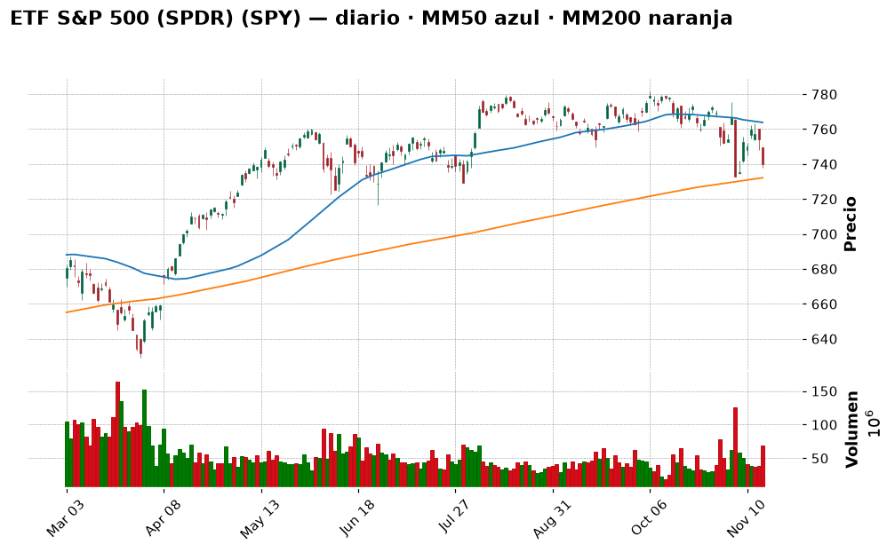
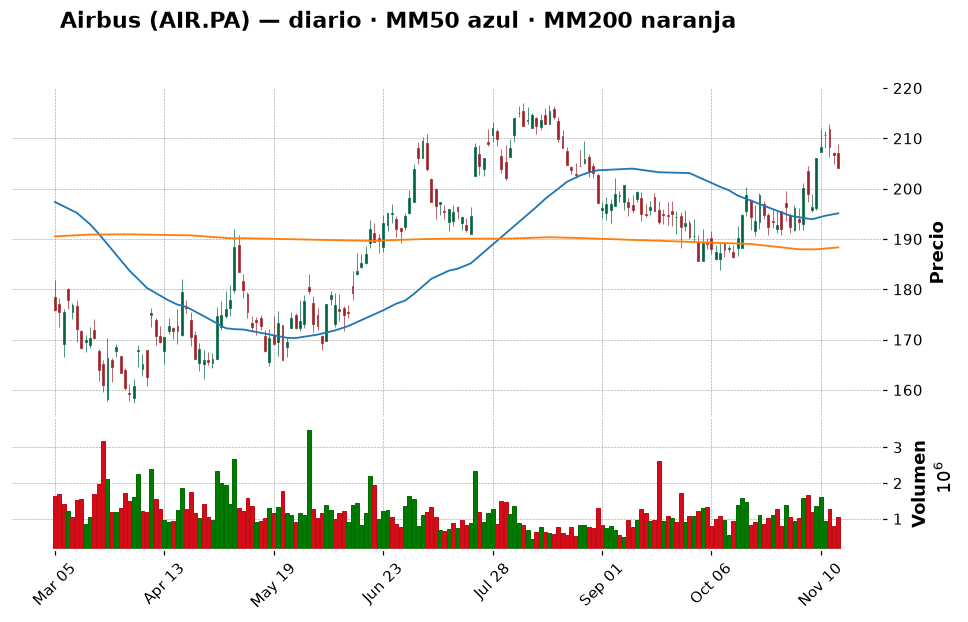
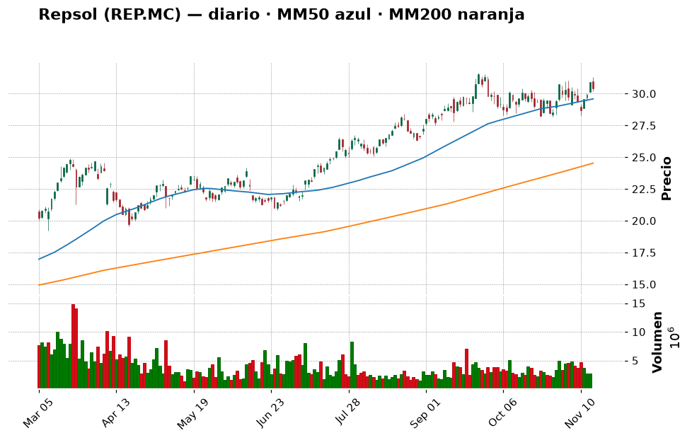
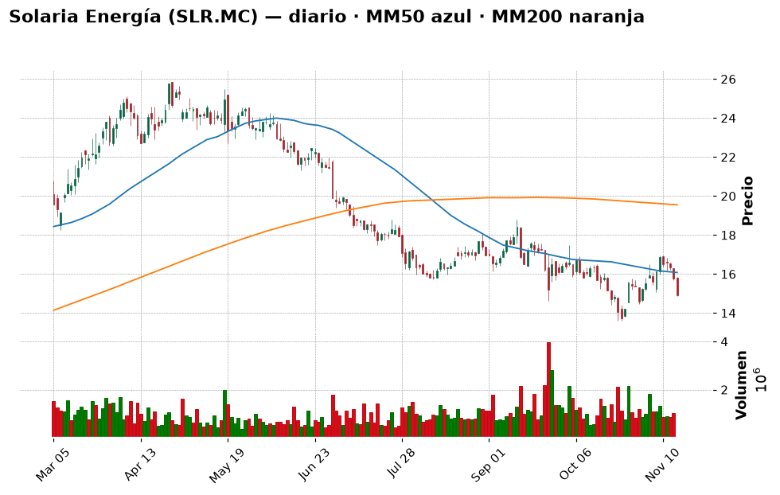
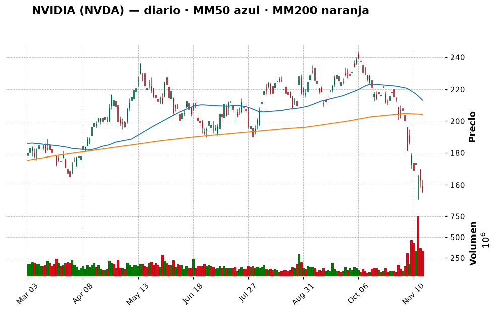
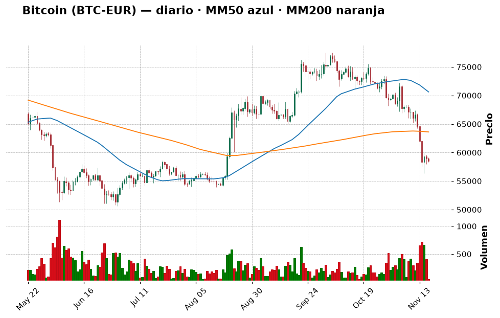
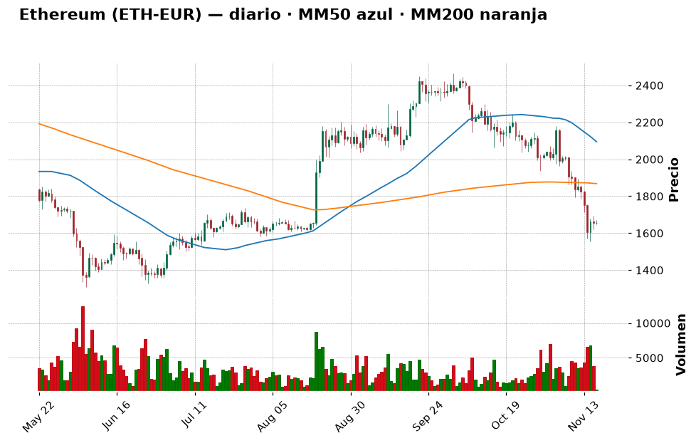
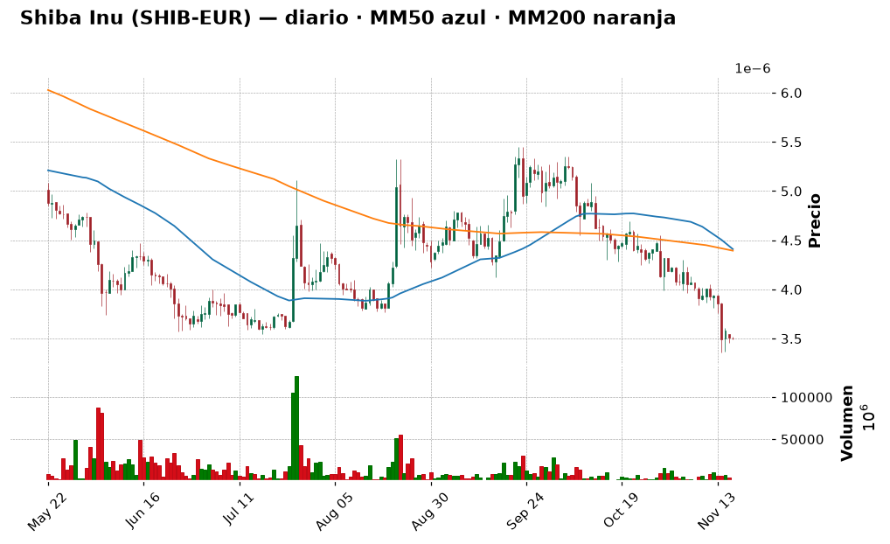

# 📈 Informe pre-apertura — martes 17 de noviembre de 2026

> Generado automáticamente a las 07:55 (hora de Madrid) · Bolsa española abre a las 9:00 · Wall Street a las 15:30 · Cripto: 24/7
> **Termómetro del día:** 🔴 mucha incertidumbre — Igual que ayer. Wall Street cayó con fuerza (S&P 500 −1,92 %, Nasdaq −2,49 %), el índice del miedo de la bolsa (VIX) sube un +18,7 % y **esta noche, hacia las 22:20 h, Nvidia presenta resultados** por primera vez sin su fundador. Encima, EE. UU. ha endurecido el acceso de China a los chips de IA. La buena noticia para ti: la caída ha llevado al ETF del S&P 500 **justo a la zona donde dijimos que compraríamos**.
> **Lección de hoy:** Soporte y resistencia

## 1. Lo que tienes que saber hoy
- **El plan se activa: el ETF ha llegado a su "zona de compra".** Llevamos días diciendo que el tramo 2 del ETF del S&P 500 se **adelantaría** si el SPY bajaba a **729–739 $**. Ayer cayó un −1,91 %, tocó un mínimo de **738,07 $** y cerró en **739,95 $**, prácticamente encima de su soporte (739,51 $) y a solo un +1,1 % de su media de 200 sesiones (732,16 $). **Recomiendo comprar hoy la mitad del tramo 2 (~300 €)** y dejar la otra mitad (~300 €) para el 1 de diciembre o para una caída a ~729–732 $, lo que llegue antes. Por qué la mitad y no todo: esta noche hay un evento capaz de mover el mercado (Nvidia), y partir la compra reduce el riesgo de "elegir mal el día".
- **Nvidia, examen esta noche.** Publica sus cuentas tras el cierre de Wall Street, hacia las **13:20 h de California (22:20 h en España)** (HeyGoTrade). La propia empresa prevé unos ingresos de **108.000 millones de dólares (±2 %)** y el consenso de analistas está algo por encima, ~108.800–109.300 millones (Seeking Alpha, MarketBeat vía resumen de búsqueda). Las opciones descuentan un movimiento de **~7,8 %** en un sentido u otro (Reuters vía Investing.com). Además, según Reuters y CNBC, **el consejo descarta que Jensen Huang vuelva** como consejero delegado y se centra en investigar su conducta; la acción cayó otro −4,12 % (156,14 $).
- **Guerra tecnológica EE. UU.–China.** Washington ha cerrado la "puerta de atrás" por la que China accedía a chips de IA a través de centros de datos del sudeste asiático (Expansión, Reuters). Hoy caen las bolsas de Corea (Kospi −2,59 %) y Taiwán (−2,18 %), y Samsung y TSMC bajan (Reuters vía Investing.com). En Europa, esto afecta sobre todo a **ASML** (−2,4 % ayer).
- **Bitcoin, sin cambios en el plan.** Está en **58.513 €**, un −8,0 % por debajo de su MM200: el tramo de diciembre **sigue en pausa** (no se compra ni se vende). El miedo y codicia sube a **12/100** desde 10, todavía "miedo extremo".
- **Tu cartera:** sin movimientos nuevos desde el 11-nov (correcto). Patrimonio de **9.717,89 €** (−2,26 € frente a ayer), **93,2 % en liquidez**. Hoy toca el primer movimiento en una semana: el medio tramo del ETF.

## 2. ✅ Recomendaciones del día (resumen)
| Activo | Acción | vs. ayer | Cuánto (orientativo) | Horizonte | Por qué, en una frase | Confianza |
|---|---|---|---|---|---|---|
| ETF S&P 500 (SPY / SPY5.L) | 🟢 Comprar más | ↑ antes Mantener | **~300 € hoy** (medio tramo 2, ≈3 % del patrimonio); los otros ~300 € el 1-dic o si el SPY cae a 729–732 $ | Años (5+) | Ha llegado a la zona de 729–739 $ que fijamos de antemano: la regla dice adelantar el tramo | media |
| Airbus (AIR.PA) | ⏸️ Esperar | = | Hasta 3–4 % (~300–400 €) en 2 tramos: el 1.º si toca ~202 € | Años | 204,15 €: a solo un −1,2 % del nivel de compra, pero aún no ha llegado | media |
| Repsol (REP.MC) | 🔵 Mantener | = | No añadir | Años | Tendencia alcista intacta (+24 % sobre MM200); demanda de ~120 M€ por el apagón | media |
| Solaria (SLR.MC) | 🔵 Mantener | = | No añadir | Años | −5,4 % ayer por dudas sobre su deuda; posición mínima (14,90 €) que no compensa vender | baja |
| NVIDIA (NVDA) | ⛔ Evitar | = | 0 € | — | Resultados esta noche, sin CEO permanente y −23,5 % bajo su MM200 | media |
| Telefónica (TEF.MC) | ⏸️ Esperar | = | 0 € hoy; hasta ~250 € si supera 3,71 € | Años | 3,50 €, sigue bajo su MM200 (3,65 €) | baja |
| Iberdrola (IBE.MC) | ⏸️ Esperar | = | Hasta 5 % (~480 €) si retrocede a 21–22 € | Años | Cae −2,4 % (23,14 €) y el RSI se enfría (66), pero sigue lejos del nivel de compra | media |
| Inditex (ITX.MC) | 🔵 Mantener | = | No añadir | Años | Máximo anual ayer (60,80 €); tu posición gana +124 % | media |
| Apple (AAPL) | 🔵 Mantener | = | No añadir | Años | Aguanta mejor que el resto de tecnológicas (−1,0 %), a un −2,2 % de máximos | media |
| Bitcoin (BTC) | 🔵 Mantener | = | No vender; **tramo del 1-dic en pausa**; ~50 € solo si llega a ~54.000 € | Años | Sigue un −8 % bajo su MM200; la regla de pausa continúa | media |
| Ether (ETH) | ⏸️ Esperar | = | 0 € hoy | Años | Cierra sobre 1.580 € (1.654,55 € ayer): ni compra ni tesis rota | media |
| Shiba Inu (SHIB) | ⛔ Evitar | = | No añadir | — | Memecoin, −53 % en un año | alta |

*(El resto de la watchlist —Santander, BBVA, Oryzon, IAG, Indra, Aena, Microsoft, Amazon, Alphabet, Berkshire, los ETF del Nasdaq y del MSCI World, ASML, LVMH, SAP y Siemens— tiene su veredicto en la tabla "Resto de la watchlist" de la sección 6.)*

**🔁 Seguimiento de ayer** (informe del lunes 16-nov):
- **ETF S&P 500:** "Mantener; tramo 2 hacia el 1-dic, **o antes si el SPY cae a 729–739 $**" → el SPY cayó un −1,91 % y **cerró en 739,95 $ tras tocar 738,07 $**: la condición se ha cumplido. **Cambio la acción de Mantener a Comprar más** precisamente porque se ha dado lo que dijimos que nos haría comprar; lo único nuevo es que, al coincidir con los resultados de Nvidia esta noche, adelanto **la mitad** del tramo y no el tramo entero.
- **Airbus:** Esperar a ~202 € o a un cierre sobre 217 € → bajó a **204,15 € (−1,2 %)**, cerrando en el mínimo del día. Se acerca a nuestro nivel de compra, pero todavía no lo ha tocado. Seguimos esperando con los mismos niveles.
- **Nvidia:** Evitar → otro −4,12 % (156,14 $), y el consejo descarta la vuelta de Huang (Reuters/CNBC). Lo que me haría cambiar de opinión (CEO permanente y precio sobre su MM200, ~204 $) está hoy más lejos. **Se mantiene Evitar.**
- **Bitcoin / Ether:** pausa del tramo de bitcoin → bitcoin sigue un −8 % bajo su MM200 (58.513 €), sin tocar los ~54.000 €; ether cerró en 1.654,55 €, por encima del nivel de invalidación (1.580 €). **Ambos sin cambios.**
- **Telefónica** (3,50 €, +0,4 %), **Repsol** (30,41 €, −1,6 %), **Iberdrola** (23,14 €, −2,4 %): ninguna toca sus niveles. Solaria pasa de idea rápida a idea completa porque fue la peor del Ibex (−5,4 %) y la tienes en cartera.
- **Tu `cartera.csv`:** sin movimientos desde el 11-nov. Correcto: ayer el plan era no hacer nada.

> Día para **ejecutar el plan, no para improvisar**: compra de ~300 € en el ETF (la caída es la que estábamos esperando), y nada más. Si esta noche Nvidia decepciona y el SPY baja a 729–732 $, la segunda mitad del tramo entrará más barata; si sale bien y el mercado rebota, ya tendrás la mitad comprada a buen precio.

## 3. Agenda del día
| Hora (Madrid) | Evento | Por qué importa |
|---|---|---|
| Madrugada | Asia en rojo por los chips: Kospi −2,59 %, Taiwán −2,18 %, Nikkei −1,3 %; las actas del banco central de Australia (RBA) muestran que la mayoría quiere **subir tipos** (Reuters vía Investing.com) | La tecnología sigue bajo presión antes de Nvidia |
| Por la mañana | Datos de empleo del Reino Unido (septiembre) (Reuters) · Consejo de Ministros: subida del **4,5 %** del sueldo de los funcionarios y del **5,3 % del salario mínimo** (1.286 €/mes) para 2027 (El País, Europa Press) · **Huelga de 24 h en el tren** (Renfe denuncia incumplimiento de servicios mínimos, El País) | Ruido doméstico; no cambia el plan |
| 9:00 | Apertura de la Bolsa española. Los futuros del Euro Stoxx 50 apuntaban a **−0,66 %** y los del DAX a −0,57 % (Reuters vía Investing.com) | El Ibex parte de 19.946,6 puntos, por debajo de los 20.000 |
| 14:30 (hora habitual) | **Ventas minoristas de EE. UU. de octubre** (Reuters) | Termómetro del consumo; un dato fuerte refuerza la subida de tipos de la Fed en diciembre |
| 15:30 | Apertura de Wall Street. Futuros del S&P 500 **−0,24 %** y del Nasdaq 100 **−0,11 %** (Yahoo Finance, 7:37 h de Madrid) | Último asalto antes de Nvidia |
| Durante el día | Discursos de miembros de la Fed: **Waller, Musalem, Hammack y Williams** (Reuters; horas no confirmadas en nuestras fuentes) | Pistas sobre el tamaño de la subida de diciembre |
| **~22:20** | **Resultados de Nvidia** (13:20 h de California); conferencia con analistas a las ~23:00 (HeyGoTrade) | El examen de la IA: movimiento esperado de ~±8 % |
| Mié 18 | **Actas de la Fed** de octubre (Reuters) · Esta semana, dato final de **inflación de la zona euro** (EFE vía Infobae; día no confirmado) | Cuántos miembros quieren subir tipos y si la inflación europea cede |
| Jue 19 | **Debut de Anthropic en bolsa** · Resultados de **Walmart** (Motley Fool vía Yahoo Finance) · Cumbre Trump–Xi–Putin en Shenzhen (APEC) | Una OPV gigante que "absorbe" dinero de otras tecnológicas y de cripto; geopolítica y aranceles |
| Dom 29-nov | Elecciones generales en España | El mercado "se ha vacunado" del riesgo político, según Cinco Días |
| **1-dic** | **Tu aportación de 200 €** | Segunda mitad del tramo 2 del ETF (si no se ha adelantado antes) |
| 9-dic / 17-dic | Reuniones de la Fed y del BCE | La Fed, con la subida casi descontada (~92 %, CoinDesk) |

*Nota: las búsquedas web del calendario económico, de la previsión de apertura del Ibex y de resultados "antes de la campana" no devolvieron ninguna página fiable fechada hoy (casi todas eran del 17-nov-2025, que fue lunes). La agenda sale del "Morning Bid" de Reuters, de Reuters/Investing.com y de los avances de resultados de Nvidia.*

## 4. Cómo llegan los mercados
### España y Europa
**El lunes 16:** el **Ibex 35** cayó un **−0,37 % hasta 19.946,6 puntos** y perdió los 20.000. Llegó a tocar 20.080 puntos, pero **cerró en el mínimo del día** (EFE vía Infobae). La peor fue **Solaria (−5,40 %)**, por las dudas de los inversores sobre la **financiación de sus proyectos de centros de datos y su deuda** (EFE), seguida de Endesa (−2,70 %) e **Iberdrola (−2,36 %)**: un mal día para las eléctricas. Las mejores, **Amadeus (+2,06 %)** y Ferrovial (+1,58 %). El Ibex sube aún un **+15,25 % en el año** (EFE). El **Euro Stoxx 50** cedió un −0,60 % (6.348,35).

**Noticias de empresas y de España:**
- **Repsol demanda a Iberdrola, Endesa, Naturgy y Red Eléctrica** por los daños del apagón de abril de 2025 en cinco de sus complejos industriales; reclama unos **120 millones de euros** (Europa Press, Euronews). Para Repsol es un importe pequeño (vale unos 35.000 millones en bolsa) y para Iberdrola también; lo relevante es que el pleito durará años. Además, Barron's (vía Yahoo Finance) destaca que **Repsol bate a Exxon y Chevron este año** y que las petroleras europeas siguen más baratas que las estadounidenses.
- **Aena baja su factura financiera** pese a la subida de tipos y de su deuda (Expansión); un análisis de Simply Wall St (vía Yahoo Finance) cree que la acción ya está "totalmente valorada".
- **Bankinter** marca un récord de capital, pero quiere más antes de pagar dividendos extra (Expansión). El **BCE** plantea una oleada de inspecciones a los bancos por la inteligencia artificial y el fraude (Cinco Días).
- **Hacienda revisa un millón de devoluciones de la Renta** y pone el foco en **plusvalías, criptomonedas** y autónomos (Expansión). 💡 *Una **plusvalía** es la ganancia que obtienes al vender algo por más de lo que pagaste. Las ganancias con cripto también tributan en España cuando vendes o cambias una moneda por otra: guarda siempre el historial de Coinbase.*
- **Anthropic** permite acudir a su OPV desde España con varias entidades (Cinco Días), y ya hay un **ETP apalancado** sobre la acción (Expansión) y un "turbofondo" que promete multiplicar por tres sus movimientos (Cinco Días). 💡 *Un producto **apalancado** multiplica las subidas… y las bajadas: si Anthropic cae un 10 %, un producto "x3" cae un 30 %. Para tu perfil, **nunca**.* Además, el FT (vía Expansión) recuerda que **las mayores OPV del año están dando pérdidas** a medida que se desinfla la fiebre de la IA.
- **Mercados y política:** Cinco Días titula que "**el mercado deja de lado las elecciones** y España se vacuna de la prima de riesgo político" y que "la deuda española resiste la incertidumbre". Morgan Stanley y Goldman Sachs siguen **muy optimistas con las bolsas** para 2027 (Expansión); Bank of America recomienda comprar ACS con un potencial de casi un 50 % (Europa Press).

### Estados Unidos
**El lunes 16:** caída generalizada. El **S&P 500 −1,92 % (7.416,59)**, el **Nasdaq −2,49 % (24.509,76)** y el **Dow Jones −1,41 % (51.608,17)** (precios del JSON y Reuters vía Investing.com). **Nvidia −4,12 %**, **Alphabet −4,07 %**, **Amazon −3,34 %** y Meta −2,38 %. El **VIX**, el "índice del miedo" de la bolsa estadounidense, subió un **+18,7 % hasta 22,91**. 💡 *El **VIX** mide cuánto esperan los inversores que se mueva el S&P 500 en el próximo mes. Por debajo de 15 suele indicar calma; por encima de 20, nervios; por encima de 30, miedo serio.* El volumen del SPY fue **1,4 veces el normal**: hubo muchas ventas, no un simple día flojo.

**Nvidia y la IA:** el consejo de Nvidia **descarta la vuelta de Jensen Huang** e investiga su conducta, pese a que la petición "Stand with Jensen" supera las 187.000 firmas y a que **Trump** dice que "no le importaría" que volviera (Reuters, CNBC/ABC vía Cointelegraph; Expansión). El secretario del Tesoro, Bessent, pide un "cambio drástico" y un CEO de fuera (247 Wall St vía Yahoo Finance). Expansión explica "por qué el mercado no se ha hundido por ahora con la crisis de la IA y Nvidia" y avisa de que los analistas temen una "**limpieza de armarios**" en las cuentas de hoy. 💡 *Una "limpieza de armarios" es cuando una nueva dirección aprovecha para reconocer de golpe todos los problemas (gastos, pérdidas, provisiones), para que los resultados futuros parezcan mejores.*

**Otras noticias:** **Berkshire Hathaway** marca máximos históricos y su 13F del tercer trimestre muestra que aumenta en Lennar (vivienda), recorta Bank of America y Capital One y abre una única posición nueva (Bending Spoons) (Stocktwits, Yahoo Finance). 💡 *El **13F** es un informe trimestral obligatorio en EE. UU. donde los grandes gestores publican qué acciones tienen. Ojo: es una foto de hace mes y medio.* David Tepper recorta Alphabet y Bill Ackman recorta Microsoft (Yahoo Finance). **Amazon** vende 5.000 millones de dólares en centros de datos (TIKR vía Yahoo Finance). La FAA mantiene retrasos tras el cierre del espacio aéreo del viernes, y United resolvió una caída de sus sistemas (MarketWatch).

**Esta mañana:** futuros del **S&P 500 −0,24 % (7.421,25)** y del **Nasdaq 100 −0,11 % (27.255,25)** (Yahoo Finance, 7:37 h de Madrid): calma tensa a la espera de la noche.

### Macro (tipos de interés, inflación, divisas, materias primas)
- **Fed:** una subida de tipos en diciembre se da prácticamente por hecha (**~92 %**, CoinDesk; "casi segura" según CME FedWatch vía Reuters). La probabilidad de una subida "doble" de medio punto cae al **~4 %** desde el ~12 % (Reuters). El **bono a 10 años** paga un **5,12 %** y el de 30 años un 5,47 % (Reuters vía Investing.com).
- **Dólar en máximos de 19 meses** (índice en 103,66, seis días seguidos de subidas) y **euro en mínimos de 19 meses** (llegó a 1,0985 $) (Reuters). Esta mañana el euro/dólar está en **1,1010** y pierde un **−6,3 % en el año** (Yahoo Finance; Expansión: "el euro ya pierde más de un 6 % anual"). Para ti: tus 2.605,43 USDC valen hoy **2.366,51 €** (+1,30 € frente a ayer).
- **Yen** cerca de 160 por dólar, el nivel donde los operadores esperan una **intervención** de Japón (Reuters). 💡 *Una **intervención** es cuando un banco central compra o vende su propia moneda para frenar un movimiento brusco; suele provocar sacudidas en otros mercados.*
- **Petróleo Brent:** **92,03 $ (−0,44 %)** (Yahoo Finance), un −16 % en un mes y por debajo de los ~96–97 $ de ayer. Reuters habla de señales de recuperación del tráfico por Ormuz. Menos presión para la inflación y las aerolíneas; algo menos de viento a favor para Repsol.
- **Oro:** ~3.850–3.877 $ la onza (Reuters), cerca de su mínimo anual con el dólar fuerte. El **cobre**, en mínimos de más de cuatro meses (Reuters).

## 5. Panorama técnico de la watchlist
> 💡 *Cómo leer esta tabla:* la **tendencia** resume si el precio lleva meses subiendo, bajando o de lado
> (comparando el precio con sus medias de 50 y 200 días). El **RSI** mide de 0 a 100 si las subidas o bajadas
> recientes han sido muy fuertes: por encima de 70 se dice "sobrecompra" (quizá ha subido demasiado rápido),
> por debajo de 30 "sobreventa". Son pistas, no predicciones.

Todos los datos son del **cierre del lunes 16-nov** (ningún valor llega con retraso hoy ✅).

| Valor | Último cierre | Día | 1 mes | 1 año | Tendencia | RSI | vs MM200 |
|---|---|---|---|---|---|---|---|
| IBEX 35 (^IBEX) | 19.946,6 | −0,37 % | +3,21 % | +25,53 % | ➡️ lateral | 61,4 🟡 | +6,2 % |
| Euro Stoxx 50 (^STOXX50E) | 6.348,35 | −0,60 % | +2,32 % | +9,69 % | ➡️ lateral | 57,6 🟡 | +3,6 % |
| S&P 500 (^GSPC) | 7.416,59 | −1,92 % | −3,17 % | +10,08 % | ➡️ lateral | 40,2 🟡 | +1,0 % |
| Nasdaq Composite (^IXIC) | 24.509,76 | −2,49 % | −6,24 % | +7,17 % | ➡️ lateral | 37,1 🟡 | −2,5 % |
| Banco Santander (SAN.MC) | 11,02 € | −0,61 % | −8,41 % | +23,57 % | ➡️ lateral | 45,1 🟡 | −2,4 % |
| BBVA (BBVA.MC) | 23,53 € | −0,17 % | +1,51 % | +32,49 % | ➡️ lateral | 55,7 🟡 | +9,1 % |
| Inditex (ITX.MC) | 60,30 € | +1,11 % | +7,95 % | +27,40 % | 📈 alcista | 65,8 🟡 | +10,3 % |
| Iberdrola (IBE.MC) | 23,14 € | −2,36 % | +6,69 % | +29,27 % | 📈 alcista | 66,3 🟡 | +13,2 % |
| Telefónica (TEF.MC) | 3,50 € | +0,43 % | +2,52 % | −3,43 % | ➡️ lateral | 57,0 🟡 | −4,2 % |
| Repsol (REP.MC) | 30,41 € | −1,55 % | +2,05 % | +86,91 % | 📈 alcista | 55,0 🟡 | +24,0 % |
| Solaria (SLR.MC) | 14,90 € | −5,40 % | −5,70 % | −16,55 % | 📉 bajista | 42,8 🟡 | −23,8 % |
| Oryzon (ORY.MC) | 2,34 € | −0,43 % | −8,32 % | −21,87 % | 📉 bajista | 38,6 🟡 | −18,0 % |
| IAG (IAG.MC) | 5,44 € | +0,37 % | +10,41 % | +27,04 % | 📈 alcista | 64,9 🟡 | +11,7 % |
| Indra (IDR.MC) | 57,70 € | −1,87 % | −9,39 % | +21,47 % | ➡️ lateral | 41,7 🟡 | +3,2 % |
| Aena (AENA.MC) | 29,18 € | +1,39 % | +13,54 % | +29,40 % | 📈 alcista | 74,8 🔴 | +12,1 % |
| Apple (AAPL) | 352,78 $ | −0,98 % | +2,71 % | +29,25 % | 📈 alcista | 57,0 🟡 | +16,9 % |
| Microsoft (MSFT) | 517,99 $ | −1,12 % | −2,09 % | +2,92 % | ➡️ lateral | 46,4 🟡 | +17,2 % |
| NVIDIA (NVDA) | 156,14 $ | −4,12 % | −27,08 % | −16,44 % | ➡️ lateral | 22,7 🟢 | −23,5 % |
| Amazon (AMZN) | 257,75 $ | −3,34 % | +3,10 % | +8,49 % | 📈 alcista | 49,6 🟡 | +5,3 % |
| ETF S&P 500 (SPY) | 739,95 $ | −1,91 % | −3,05 % | +10,11 % | ➡️ lateral | 40,4 🟡 | +1,1 % |
| ETF Nasdaq 100 (QQQ) | 661,75 $ | −2,67 % | −6,77 % | +8,77 % | ➡️ lateral | 37,8 🟡 | −3,0 % |
| Alphabet (GOOGL) | 283,72 $ | −4,07 % | −16,70 % | +1,85 % | 📉 bajista | 34,5 🟡 | −16,1 % |
| Berkshire Hathaway (BRK-B) | 592,85 $ | −0,02 % | +11,43 % | +15,54 % | 📈 alcista | 80,8 🔴 | +18,3 % |
| ETF MSCI World (IWDA.AS) | 129,99 € | −0,38 % | −0,43 % | +20,04 % | 📈 alcista | 50,3 🟡 | +6,2 % |
| Airbus (AIR.PA) | 204,15 € | −1,21 % | +2,68 % | +0,44 % | 📈 alcista | 56,8 🟡 | +8,4 % |
| ASML (ASML.AS) | 1.306,60 € | −2,41 % | −11,55 % | +47,37 % | ➡️ lateral | 38,8 🟡 | −6,7 % |
| LVMH (MC.PA) | 404,00 € | +0,14 % | +1,76 % | −33,73 % | ➡️ lateral | 54,3 🟡 | −12,4 % |
| SAP (SAP.DE) | 213,40 € | −0,02 % | +7,12 % | +3,09 % | 📈 alcista | 61,6 🟡 | +27,9 % |
| Siemens (SIE.DE) | 272,55 € | −2,45 % | +0,70 % | +22,22 % | ➡️ lateral | 50,8 🟡 | +4,6 % |

*(🟢 = sobreventa, RSI < 30 · 🟡 = zona neutral · 🔴 = sobrecompra, RSI > 70.)*

**Lectura de conjunto:** Europa resiste mucho mejor que EE. UU.: el Ibex y el Euro Stoxx 50 bajan poco y siguen claramente sobre sus MM200, mientras que en Wall Street el S&P 500 se queda a solo un +1,0 % de la suya y **el Nasdaq ya está por debajo (−2,5 %)**. La caída está **concentrada en la tecnología ligada a la IA** (Nvidia, Alphabet, ASML, QQQ), mientras que valores "de toda la vida" como Berkshire, Inditex o Aena siguen en máximos (Berkshire y Aena, de hecho, están **sobrecompradas**). Es la diversificación funcionando: no todo cae a la vez.

## 6. Ideas de bolsa: qué haría un experto
### ETF S&P 500 (SPY5.L / SPY) — COMPRAR MÁS (medio tramo 2, adelantado)

- **Qué es:** un fondo que compra de una vez las ~500 mayores empresas de EE. UU. Tú tienes la versión europea (UCITS) que cotiza en Londres, **SPY5.L**; el gráfico es del SPY estadounidense, que sigue el mismo índice.
- **Por qué es noticia hoy:** el S&P 500 cayó un −1,92 % por la "venta de la IA" y las nuevas restricciones de chips a China (Reuters). Esta noche, Nvidia (~6–7 % del índice) presenta resultados.
- **Lo que dice el gráfico:** el SPY cerró en **739,95 $** tras tocar **738,07 $**. Está justo sobre su **soporte de 739,51 $** y a un **+1,1 % de su MM200 (732,16 $)**; por debajo hay otros soportes en **732,71 $** y **729,10 $**. Es decir, entre 729 y 740 $ se juntan **tres soportes y la media de 200 sesiones**: una zona donde históricamente han aparecido compradores. Por arriba, la MM50 (763,82 $) y resistencias en 755,6–756,7 $. RSI 40,4 (neutral, sin sobreventa) y MACD "empeorando": el impulso sigue siendo bajista a corto plazo. Está a un −5,3 % de su máximo de 52 semanas (781,62 $). En llano: **la tendencia de fondo sigue intacta, pero está a prueba**.
- **Lo positivo:** compras el índice más diversificado del mundo con un descuento del ~5 % sobre su máximo, en la zona que elegimos con calma hace días, no en un arrebato.
- **El riesgo:** que Nvidia decepcione y el SPY **rompa la MM200** (cierre por debajo de ~729 $); entonces podría bajar otro 3–5 % hacia la zona de 700 $. Por eso compras solo la mitad del tramo hoy.
- **🧑‍💼 Recomendación: COMPRAR MÁS.** Es la regla que escribimos el miércoles pasado y repetimos cada día: "si cae a 729–739 $, se adelanta el tramo 2". Ha caído ahí. **Cumplir el plan** es exactamente lo que diferencia a un inversor disciplinado de uno que se deja llevar: el plan se hizo para días como hoy, cuando el instinto dice "espera, que puede bajar más".
  - **Cuánto y cómo:** **~300 € hoy** en el **SPY5.L** (en la sesión de Londres, de 9:00 a 17:30 h de España, antes de los resultados de Nvidia); eso son unas **0,44 participaciones** a ~748 $ (≈330 $ al cambio de 1,101). Usa una **orden limitada** cerca del precio de mercado para no pagar de más. La **otra mitad (~300 €)** se compra **el 1 de diciembre** (con tu aportación) **o antes si el SPY baja a 729–732 $**, lo que ocurra primero. Tras la compra, el ETF pesará ~6,3 % de tu patrimonio; objetivo ~35 % en 6 tramos.
  - **Horizonte:** años (5 o más).
  - **Qué me haría cambiar de opinión:** un **cierre semanal por debajo de 729 $** (MM200 perdida): no vendería lo comprado, pero pausaría la segunda mitad hasta ver estabilidad, igual que hacemos con bitcoin.
- **Qué mirar para entenderlo:** mañana por la mañana, compara cuánto se mueve Nvidia y cuánto el SPY. Y fíjate en el viernes: si el SPY **cierra la semana por encima de 732–739 $**, el soporte "ha aguantado" (ver la lección de hoy).
- **Confianza:** media

### Airbus (AIR.PA) — ESPERAR (cada vez más cerca)

- **Qué es:** el mayor fabricante de aviones comerciales del mundo (y un actor clave en defensa y espacio en Europa).
- **Por qué es noticia hoy:** no hay noticias propias relevantes en nuestras fuentes (las dos noticias de Yahoo Finance asociadas no hablan de Airbus: Collins Aerospace en India y una clasificación de empresas tecnológicas en Francia). El último dato público sigue siendo el de **547 entregas hasta septiembre** con un objetivo de **~870 en el año** (Demócrata, AirNav Radar), lo que exige un último trimestre fuerte. El petróleo más barato (Brent 92 $, −16 % en un mes) es una buena noticia para sus clientes, las aerolíneas.
- **Lo que dice el gráfico:** 204,15 € (−1,2 %), cerrando en el **mínimo del día**. Tendencia **alcista**: sobre su MM50 (195,10 €) y su MM200 (188,33 €, +8,4 %). RSI 56,8 y MACD "empeorando". El **soporte de 201,65 €** está a solo un −1,2 %; los siguientes, en 193,18 € y 190,90 €. Resistencias en **210,95 €** y **216,55–217,05 €**. A un −7,8 % de su máximo de 52 semanas (221,30 €).
- **Lo positivo:** tendencia de fondo sana y años de pedidos por delante.
- **El riesgo:** que no cumpla el objetivo de entregas (lo sabremos en enero) y que una caída general de las bolsas lo arrastre por debajo del soporte.
- **🧑‍💼 Recomendación: ESPERAR.** Mismos niveles que ayer y anteayer: compraría el **primer tramo si toca ~202 €** (zona del soporte de 201,65 €) o con un cierre claro **por encima de 217 €**. Hoy está a un paso del primer nivel, pero "a un paso" no es "en el nivel": si ponemos una regla, la respetamos.
  - **Cuánto y cómo:** hasta 3–4 % del patrimonio (~300–400 €) en 2 tramos. Si quieres que el plan "trabaje solo", puedes dejar una **orden limitada de compra a 202 €** por ~150–200 € (el primer tramo).
  - **Horizonte:** años.
  - **Qué me haría cambiar de opinión:** un cierre por debajo de 190 € (zona de la MM200 y del soporte de 190,90 €) o un recorte del objetivo de entregas.
- **Qué mirar para entenderlo:** si toca 202 € y **rebota** en el día, el soporte funciona; si lo atraviesa con fuerza y cierra en 198 €, ese soporte se ha roto y lo prudente sería esperar al siguiente (193 €).
- **Confianza:** media

### Repsol (REP.MC) — MANTENER (la tienes)

- **Qué es:** la mayor petrolera española (exploración, refino, gasolineras y renovables).
- **Por qué es noticia hoy:** **demanda a Iberdrola, Endesa, Naturgy y Red Eléctrica** por unos 120 millones de euros por los daños del apagón de 2025 (Europa Press, Euronews). Barron's (vía Yahoo Finance) destaca que **bate a Exxon y Chevron este año** y que Wall Street le ve más recorrido.
- **Lo que dice el gráfico:** 30,41 € (−1,6 %). Ayer llegó a 31,30 € pero no pudo con la zona de **31,02–31,64 €** (resistencia y máximo de 52 semanas) y se dio la vuelta: el petróleo bajó. Tendencia **alcista**, **+24 % sobre su MM200 (24,53 €)**; RSI 55, MACD "mejorando". Soportes en 28,29 €, 28,18 € y 27,80 €. Volatilidad anualizada del 40,6 %.
- **Lo positivo:** tu posición gana un **+146 %** (pagaste 12,37 €) y la tendencia sigue a favor.
- **El riesgo:** su suerte va atada al petróleo, que ha bajado un −16 % en un mes; si Ormuz se normaliza y la cumbre del jueves rebaja tensiones, el crudo podría seguir bajando.
- **🧑‍💼 Recomendación: MANTENER.** Nada ha cambiado: el pleito es un importe pequeño para la empresa y la tendencia sigue intacta. Tampoco ampliaría: ya tienes exposición al petróleo y es un sector muy volátil.
  - **Cuánto y cómo:** no añadir.
  - **Horizonte:** años.
  - **Qué me haría cambiar de opinión:** un cierre por debajo de 27,80 € con el Brent cayendo hacia 80 $: ahí valoraría Vender.
- **Qué mirar para entenderlo:** el gráfico de ayer es un ejemplo de manual de **resistencia**: el precio subió hasta 31,30 € y "rebotó contra el techo". Si algún día cierra por encima de 31,64 €, ese techo se habrá roto.
- **Confianza:** media

### Solaria (SLR.MC) — MANTENER (posición mínima, sin ampliar)

- **Qué es:** una empresa española de energía solar que construye y explota plantas fotovoltaicas, y que ahora quiere entrar en centros de datos.
- **Por qué es noticia hoy:** fue **la peor del Ibex ayer (−5,40 %)** porque los inversores dudan de cómo financiará sus **proyectos de centros de datos** y de su **nivel de deuda** (EFE vía Infobae). Expansión publica un análisis técnico titulado "**Solaria: en soporte y muy sobrevendido**": desde los máximos de abril hasta los mínimos de octubre perdió casi la mitad de su valor.
- **Lo que dice el gráfico:** 14,90 €, **tendencia bajista**: un −7,3 % bajo su MM50 (16,08 €) y un **−23,8 % bajo su MM200 (19,55 €)**. En una semana cae un −11,6 %. El viernes perdió el soporte de ~15,74 € y ayer bajó hasta 14,86 €. El siguiente soporte está en **14,62 €** (−1,9 %) y después en su **mínimo de 52 semanas, 13,61 €** (−8,7 %). Resistencias en 17,50 € y 18,09 €. RSI 42,8: **según nuestros datos no está en sobreventa** (eso sería por debajo de 30), así que aquí discrepo del titular de Expansión, que probablemente usa otro indicador o plazo. Volatilidad anualizada del **62 %**, de las más altas de la lista.
- **Lo positivo:** el sector solar tiene futuro a largo plazo y el precio ya ha caído mucho.
- **El riesgo:** con tipos altos, las empresas endeudadas sufren (pagan más intereses), y un proyecto nuevo y caro (centros de datos) añade incertidumbre.
- **🧑‍💼 Recomendación: MANTENER (no añadir).** Tienes **1 acción** (14,90 €, un −0,6 %, prácticamente lo que pagaste). Es tan poco dinero que **venderla costaría casi lo mismo en comisiones**, y ampliar sería ir contra una tendencia bajista clara. No es una empresa para tu "lista de la compra" mientras no recupere al menos su MM50.
  - **Cuánto y cómo:** no añadir.
  - **Horizonte:** años.
  - **Qué me haría cambiar de opinión:** para comprar, un cierre por encima de 17,50 € (resistencia) con una explicación clara de la financiación. Para preocuparse de verdad, un cierre por debajo de 13,61 € (mínimo anual).
- **Qué mirar para entenderlo:** fíjate en cómo el antiguo suelo de 15,74 € puede convertirse ahora en **techo**: si rebota y se frena justo ahí, estarás viendo el "cambio de papel" que explicamos en la lección.
- **Confianza:** baja

### NVIDIA (NVDA) — EVITAR

- **Qué es:** el gran fabricante de chips para inteligencia artificial.
- **Por qué es noticia hoy:** presenta resultados **esta noche (~22:20 h)**, con **Colette Kress** como consejera delegada interina y **Harvey Jones** como nuevo presidente (HeyGoTrade). El consejo **descarta la vuelta de Huang** (Reuters/CNBC). Guía de ingresos de **108.000 millones $** (sin China) y consenso de beneficio por acción de ~2,47–2,49 $ (MarketBeat, Barchart vía HeyGoTrade). Nvidia ha superado sus previsiones en los últimos trimestres, pero KeyBanc advierte de un "aumento material" del riesgo de ejecución y Janus Henderson habla de un posible "evento de limpieza". Además, **EE. UU. endurece el acceso de China a sus chips** (Expansión) y el informe de Investing.com España "El colapso del 'Banco Nvidia'" critica una "burbuja circular" de financiación de 530.000 millones (artículo de opinión).
- **Lo que dice el gráfico:** 156,14 $ (−4,1 %), un **−23,5 % bajo su MM200 (204,02 $)** y un −26,8 % bajo su MM50. RSI **22,7 (sobreventa)**. Solo un +4,9 % por encima de su mínimo de 52 semanas (148,80 $, tocado el jueves). **No hay soportes por debajo** en nuestros datos (está en "terreno desconocido" del último año); resistencias muy lejos, en ~214 $. Volatilidad anualizada del 52,7 %.
- **Lo positivo:** sigue siendo el líder; el precio ya descuenta muchas malas noticias.
- **El riesgo:** resultados, previsiones o comentarios sobre el CEO que decepcionen; las opciones apuntan a un movimiento de ~±8 % en un día.
- **🧑‍💼 Recomendación: EVITAR.** ¿Por qué compro el ETF hoy y no Nvidia, si las dos dependen de lo mismo esta noche? Porque en el ETF **Nvidia es solo ~6–7 %** del total: si cae un 10 %, el ETF pierde ~0,6–0,7 % por esa vía. Comprar Nvidia sola es apostarlo todo a cara o cruz, sin CEO permanente y en plena caída. **Ya la tienes en su justa medida dentro del ETF.**
  - **Cuánto y cómo:** 0 €.
  - **Horizonte:** —
  - **Qué me haría cambiar de opinión:** un CEO permanente con un plan claro **y** el precio recuperando su MM200 (~204 $). Mañana revisaré la idea con los resultados en la mano.
- **Qué mirar para entenderlo:** mañana, mira primero las **previsiones del próximo trimestre** (más importantes que el trimestre pasado) y después la reacción del precio: a veces unos buenos números caen en bolsa porque "ya se esperaban".
- **Confianza:** media

### Resto de la watchlist: veredicto rápido
| Valor | Acción | Por qué (1 frase) | Nivel a vigilar |
|---|---|---|---|
| Telefónica (TEF.MC) | ⏸️ Esperar | 3,50 €, sobre su MM50 (3,43 €) pero un −4,2 % bajo su MM200 (3,65 €); Expansión publica sus "soportes y resistencias a vigilar" | Comprar si supera 3,71 €; Evitar si cierra bajo 3,27 € |
| Iberdrola (IBE.MC) | ⏸️ Esperar | Cae −2,4 % en un mal día para las eléctricas y la demanda Repsol (~120 M€ a repartir entre cuatro); el RSI baja de 82 a 66, se enfría, pero sigue un +13 % sobre su MM200 | Comprar en 21–22 €; soporte 21,09 € |
| Inditex (ITX.MC) | 🔵 Mantener | Tu posición gana +124 %; marcó un nuevo máximo anual ayer (60,80 €) y sube aunque el mercado cae | Soporte 56,2 € |
| Apple (AAPL) | 🔵 Mantener | Aguanta mejor que el resto de tecnológicas (−1,0 %); Gene Munster dice que Nvidia "podría ser la próxima Apple" si los inversores "duermen tranquilos" (Yahoo Finance), justo la virtud de Apple | Soporte 338,7 $; máximo 360,83 $ |
| Banco Santander (SAN.MC) | ⏸️ Esperar | Sigue bajo su MM200 (−2,4 %) y su MM50 (11,85 €); el sector financiero cedió en EE. UU. (Yahoo Finance) y el BCE anuncia inspecciones por IA y fraude (Cinco Días) | Comprar si cierra sobre 11,85 €; soporte 10,34 € |
| BBVA (BBVA.MC) | ⏸️ Esperar | Tendencia de fondo sana (+9,1 % sobre MM200), pegada a su MM50 (23,66 €); sin noticias propias relevantes | Sobre 23,66 €; soporte 22,77 € |
| Oryzon (ORY.MC) | 🔵 Mantener | La tienes (4 acciones, −28 %): tendencia bajista, cerca de su mínimo anual (2,23 €); biotecnológica de alto riesgo, pero vale 9,34 € y venderla costaría casi lo mismo en comisiones | Mínimo anual 2,23 €; resistencia 2,61 € |
| IAG (IAG.MC) | ⏸️ Esperar | Tendencia alcista y el petróleo más barato le favorece, pero está cerca de su resistencia (5,71 €) y siguen los retrasos en EE. UU. tras el cierre del espacio aéreo (MarketWatch) | Cierre sobre 5,72 €; soporte 4,95 € |
| Indra (IDR.MC) | ⏸️ Esperar | −9,4 % en un mes y justo sobre su soporte (57,58 €); Arquimea, otra empresa española de defensa, busca contratos de drones del Pentágono (Expansión) | Si pierde 56,36 €, esperar más; sobre 62,66 € mejora |
| Aena (AENA.MC) | ⏸️ Esperar | Cruce dorado reciente y casi en máximos (29,32 €), pero RSI 74,8: sobrecomprada; reduce su factura financiera (Expansión), aunque Simply Wall St la ve "totalmente valorada" | Retroceso hacia la MM50 (26,29 €) |
| Microsoft (MSFT) | ⏸️ Esperar | Pegada a su MM50 (519,36 $); Bill Ackman recorta su posición (Stocktwits) y Cinco Días comenta "el apagón de Microsoft" | Soporte 504,96 $; resistencia 551,15 $ |
| Amazon (AMZN) | ⏸️ Esperar | −3,3 % ayer, de vuelta a su MM20 (257,10 $); vende 5.000 M$ en centros de datos (TIKR) y un fallo de cohete deja en tierra 40 satélites de su red (Yahoo Finance) | Soporte 244,7 $; resistencia 258–265 $ |
| ETF Nasdaq 100 (QQQ) | ⏸️ Esperar | Ya un −3,0 % bajo su MM200 y justo sobre su soporte (661,14 $); muy concentrado en la IA en la semana de Nvidia: para ti, mejor el S&P 500 o el MSCI World | Recuperar 682 $; soporte 647 $ |
| Alphabet (GOOGL) | ⛔ Evitar | −4,1 % ayer, cruce de la muerte y −16 % bajo su MM200; David Tepper recorta su posición (Yahoo Finance) | Recuperar la MM200 (338,2 $); soporte 276,9 $ |
| Berkshire Hathaway (BRK-B) | ⏸️ Esperar | Máximos históricos y RSI 80,8: comprar ahora es pagar la euforia; su 13F muestra más Lennar y menos Bank of America (Stocktwits, MarketWatch) | Retroceso hacia la MM50 (531,4 $) |
| ETF MSCI World (IWDA.AS) | ⏸️ Esperar | Alternativa excelente al S&P 500 (más diversificada) y justo sobre su soporte (129,02 €); no duplico el núcleo ahora: hoy compramos el S&P 500 | Soporte 129 €; máximo 132,42 € |
| ASML (ASML.AS) | ⏸️ Esperar | Pierde el soporte de 1.333,8 € y está un −6,7 % bajo su MM200; las nuevas restricciones de EE. UU. a China golpean a todo el sector de chips (Reuters) | Siguiente soporte 1.210,6 €; MM200 1.399,8 € |
| LVMH (MC.PA) | ⛔ Evitar | El lujo sigue en crisis (−34 % en un año, −12,4 % bajo MM200); sin noticias propias | Recuperar 431 €; soporte 380 € |
| SAP (SAP.DE) | ⏸️ Esperar | Tendencia alcista fuerte (+28 % sobre MM200), MACD "mejorando" y cerca de su máximo (219,65 €); análisis positivos sobre su nube (Yahoo Finance) | Soporte 203 €; resistencia 216,65 € |
| Siemens (SIE.DE) | ⏸️ Esperar | −2,5 % ayer, sigue frenada bajo su resistencia (279,8–284,65 €) | Cierre sobre 286,3 €; soporte 267,4 € |

## 7. ₿ Criptomonedas
> 💡 *Las criptomonedas cotizan 24 horas, 7 días a la semana: los precios son de esta mañana (en euros).
> Son mucho más volátiles que las acciones: caídas del 50 % o más han ocurrido varias veces.*

**Sentimiento:** Fear & Greed **12/100 (miedo extremo**; ayer 10, hace una semana 32, hace un mes 53, según alternative.me) · Capitalización total **2,29 billones $ (+0,04 % en 24 h; −52,5 % bajo su máximo histórico de octubre de 2025)** · Dominancia de Bitcoin **56,5 %**.
El índice sube dos puntos, pero sigue en "miedo extremo". Como vimos ayer, esto **no es una señal de compra por sí sola**: indica que el ánimo está por los suelos, no cuándo terminará la caída.

**Radar Coinbase** (407 monedas comprables · hoy suben 199 y bajan 160 · en 7 días suben 19 y bajan 340):
- **Mayores por capitalización (7 días):** BTC −14,0 %, ETH −14,2 %, BNB −14,5 %, XRP −13,2 %, SOL −16,1 %, HYPE −7,2 %, ZEC −21,1 %, DOGE −16,2 %.
- **Más suben (7 d, top 100):** solo **ICP (+1,1 %)** está en positivo; después VVV (−0,6 %), WLFI (−3,8 %) y PAXG (−5,8 %, que es **oro tokenizado**, no una cripto "normal") · **Más bajan:** PEPE (−26,7 %), UNI (−25,6 %), ENA (−25,2 %), PUMP (−23,2 %), ARB (−22,3 %).
La caída de la semana sigue siendo **casi total** (19 de 359 suben). Hoy hay un respiro leve, sin una noticia que lo explique. **No hay nada fuera del núcleo que merezca comprarse**: una moneda que "solo" cae un −1 % en una semana como esta no es una oportunidad, es una que ha caído menos.

| Moneda | Ranking | Precio (€) | 24 h | 7 días | 1 mes | 1 año | Tendencia | RSI | vs MM200 |
|---|---|---|---|---|---|---|---|---|---|
| Bitcoin (BTC) | #1 | 58.513,26 | −0,73 % | −11,35 % | −19,92 % | −26,29 % | ➡️ lateral | 24,5 | −8,0 % |
| Ether (ETH) | #2 | 1.655,12 | +0,03 % | −9,87 % | −22,84 % | −36,57 % | ➡️ lateral | 27,2 | −11,4 % |
| XRP (XRP) | #6 | 0,8683 | 0,00 % | −8,16 % | −25,38 % | −53,35 % | ➡️ lateral | 27,0 | −20,3 % |
| Solana (SOL) | #7 | 65,71 | +1,00 % | −11,87 % | −29,04 % | −41,69 % | ➡️ lateral | 23,8 | −15,2 % |
| Shiba Inu (SHIB) | #43 | 0,0000035 | −0,28 % | −12,72 % | −21,17 % | −52,64 % | ➡️ lateral | 28,1 | −20,4 % |

*(Las variaciones de la tabla salen de las velas diarias de Coinbase —la de hoy, sin cerrar— y las del radar, de Coinpaprika: miden ventanas ligeramente distintas, por eso no coinciden.)*

**Noticias que importan:**
- **Nvidia manda también en cripto.** CoinDesk avisa de que unos malos resultados esta noche podrían llevar a bitcoin **por debajo de 60.000 $**; según Nansen, la IA y las cripto "compiten por el mismo capital de riesgo": cuando cae Nvidia, el dinero se va a efectivo, no a bitcoin. Wintermute cree que el mercado está en **fase bajista** y no descarta la zona de 50.000 $. La mayor apuesta en opciones sigue siendo la que **protege contra una caída bajo 60.000 $** (900 millones $ en Deribit).
- **ETF y flujos:** siete sesiones seguidas de **salidas** de los ETF de bitcoin al contado (~1.900 millones $), y la oferta de **stablecoins ha caído 14.000–16.000 millones** en un mes (CoinDesk). Las liquidaciones superaron los **2.000 millones $** en 24 horas el domingo. En sentido contrario, los informes 13F muestran que **Wells Fargo duplicó su posición en el ETF IBIT** hasta 2.350 millones $ en el tercer trimestre (CoinDesk) y que **Strategy** y **Bitmine** (ya cerca del 5 % de todo el ether) siguen comprando (Decrypt, Cointelegraph).
- **XRP:** Evernorth, una empresa respaldada por Ripple, ha **rebajado un 60 % el valor de su XRP** en libros (CoinDesk), y XRP marca mínimos desde noviembre de 2024.
- **Seguridad (importante para ti):**
  - Unos piratas han inyectado **malware en scripts usados por 178 webs conocidas** (entre ellas Ledger, BBC o CNN) que **cambia la dirección de un monedero cuando la copias y pegas** y roba datos de tarjetas (Cointelegraph, Investing.com). Consejo práctico: si alguna vez envías cripto, **comprueba los primeros y los últimos caracteres de la dirección** antes de confirmar.
  - **Trezor** (fabricante de monederos físicos) ha sufrido su **tercera filtración de datos de clientes del año** por un proveedor de envíos: nombres, teléfonos y direcciones de 27.000 pedidos (Cointelegraph, Decrypt). Con esos datos llegan después los correos falsos de "verifica tu cuenta".
  - El exchange descentralizado **Lighter** suspendió todos los retiros tras un robo de 10,4 millones $, y un monedero de Safe perdió 6,5 millones $ (CoinDesk, Cointelegraph). Recordatorio de por qué, para tu perfil, es mejor un exchange regulado y nada de productos "DeFi" exóticos.
- **Regulación:** el Parlamento alemán propone poder **congelar o incautar cripto sin acusación penal** (CoinDesk, Cointelegraph) y en España **Hacienda revisa las ganancias con cripto** en la Renta (Expansión).

### Bitcoin (BTC) — MANTENER (tramo de diciembre en pausa)

- **Qué es:** la primera y mayor criptomoneda; su oferta máxima está limitada a 21 millones de unidades.
- **Lo que dice el gráfico:** 58.513 € esta mañana. Cuatro cierres diarios seguidos por debajo de su **MM200 (63.605 €)**: hoy está un **−8,0 % por debajo** y un −17,2 % bajo su MM50 (70.624 €). RSI 24,5 (**sobreventa**) y el MACD pasa a "mejorando": el impulso bajista **se frena**, pero no se ha dado la vuelta. Desde el sábado se mueve en un rango estrecho de ~58.000–59.300 € (con un mínimo de 56.346 € el domingo). El **soporte relevante sigue en ~54.000 €** (−7,7 %); las resistencias, en 69.923 € y 70.745 €. A un −30 % de su máximo de 52 semanas (84.100 €) y a un +15,6 % de su mínimo (50.633 €).
- **🧑‍💼 Recomendación: MANTENER (no vender, no comprar).** La regla sigue vigente y nada la ha cambiado:
  - **No vendes nada.** Tu bitcoin vale 153,88 € (−16 %, −29,90 €), un **1,6 % del patrimonio**.
  - **El tramo del 1-dic sigue en pausa** hasta que **recupere la MM200** (cierre diario sobre ~63.600 €, hoy a un +8,7 %) o **llegue a la zona de ~54.000 €**, donde compraría un tramo **pequeño (~50 €)**.
  - **Cuánto y cómo:** 0 € hoy. Tu cripto pesa un **1,62 %** frente al tope del 25 % (margen de 3.029,46 €), pero recuerda que **un 25 % es mucho para un perfil moderado**: las criptomonedas han tenido caídas del 50–80 %, y esta (−30 % desde el máximo) es un ejemplo en directo. Mi recomendación es no pasar del **5 %** en los próximos meses. Si compras, por el par **BTC-EUR** de Coinbase o con tu USDC.
  - **Qué me haría cambiar de opinión:** un cierre diario sobre ~63.600 € reactivaría el plan normal (~50–100 € el 1-dic). Un cierre claro bajo 54.000 € me haría esperar más (siguiente referencia: el mínimo anual, ~50.600 €).
- **El riesgo:** esta noche, Nvidia. Si decepciona, bitcoin puede perder los 60.000 $ (unos 54.500 €) según varios analistas; justo la zona donde compraríamos el tramo pequeño.
- **Confianza:** media

### Ether (ETH) — ESPERAR

- **Qué es:** la segunda criptomoneda; la red Ethereum permite programas ("smart contracts") y es la base de muchas stablecoins y aplicaciones.
- **Lo que dice el gráfico:** 1.655,12 € (−9,9 % en una semana), **un −11,4 % por debajo de su MM200 (1.868 €)**. Ayer cerró en 1.654,55 €: el soporte de **1.580–1.607 €** sigue aguantando al cierre desde el domingo. RSI 27,2 (sobreventa) y MACD "mejorando". Resistencias en 1.681,66 € y 1.736 €. A un −44 % de su máximo de 52 semanas.
- **🧑‍💼 Recomendación: ESPERAR.** Sin cambios: ni se ha perdido el soporte (lo que me haría pasar a Evitar) ni ha recuperado la MM200 (lo que me haría comprar un primer tramo de ~50 €). Que grandes empresas como Bitmine sigan comprando (Cointelegraph) es interesante, pero no es motivo suficiente: también compraban más arriba.
  - **Cuánto y cómo:** 0 € hoy; luego, como mucho, la mitad de lo que pongas en bitcoin, por el par ETH-EUR de Coinbase.
  - **Qué me haría cambiar de opinión:** un cierre diario claro por debajo de 1.580 €: pasaría a Evitar.
- **El riesgo:** es más volátil que bitcoin (volatilidad anualizada de 20 días ~67 % frente a ~48 %).
- **Confianza:** media

### Shiba Inu (SHIB) — EVITAR

- **Qué es:** una "memecoin" (moneda nacida como broma, sin uso real relevante).
- **Lo que dice el gráfico:** −53 % en un año, −20,4 % bajo su MM200 y a solo un +4 % de su mínimo de 52 semanas (0,00000336 €). Sin soportes por debajo en nuestros datos.
- **🧑‍💼 Recomendación: EVITAR (no añadir).** Tienes 3,50 € (pagaste 6 €). Es tan poco que no merece la comisión de venderla; quédatela como recordatorio de por qué no se compran "pelotazos".
- **El riesgo:** que pierda casi todo su valor; con 3,50 € no es problema, con 350 € sí.
- **Confianza:** alta

## 8. 💼 Tu cartera
**Valor total:** 9.717,89 € · **Invertido:** 665,08 € · **Ganancia/pérdida no realizada:** +54,38 € (+8,90 % sobre lo que pagaste) · **Realizada:** 0 €
**Reparto:** acciones 2,0 % · ETF 3,2 % · cripto 1,6 % · liquidez 93,2 % · **Cripto vs tope:** 1,62 % de 25 % ✅ dentro (margen 3.029,46 €)
**Liquidez disponible:** 9.052,81 € (93,2 %: 6.686,30 € en euros en otro bróker + 2.605,43 USDC ≈ 2.366,51 € en Coinbase) · **Próxima aportación:** 200 € el 2026-12-01 (en 14 días)

| Activo | Cantidad | Precio medio | Precio actual | Valor (€) | G/P | Peso | Acción recomendada |
|---|---|---|---|---|---|---|---|
| Liquidez en euros (otro bróker) | 6.686,30 € | — | — | 6.686,30 | — | 68,8 % | **Usar ~300 € hoy para el ETF**; el resto sigue el plan en tramos (y que rinda mientras espera) |
| USDC (Coinbase) | 2.605,43 | 1 $ | 1 $ | 2.366,51 | 0 % | 24,4 % | Fuente de las compras cripto (en pausa); el dólar fuerte te favorece |
| ETF SPDR S&P 500 UCITS (SPY5.L) | 0,4624 | 756,97 $ | 748,35 $ | 314,28 | −1,14 % | 3,2 % | 🟢 Comprar más — **~300 € hoy** (medio tramo 2) |
| Bitcoin (BTC) | 0,00262976 | 69.886,57 € | 58.513,26 € | 153,88 | −16,27 % | 1,6 % | 🔵 Mantener — tramo de diciembre **en pausa** |
| Repsol (REP.MC) | 2 | 12,37 € | 30,41 € | 60,82 | +145,8 % | 0,6 % | 🔵 Mantener — sin ampliar |
| Inditex (ITX.MC) | 1 | 26,94 € | 60,30 € | 60,30 | +123,8 % | 0,6 % | 🔵 Mantener — en máximos |
| Apple (AAPL) | 0,15 | 171,99 $ | 352,78 $ | 48,06 | +105,1 % | 0,5 % | 🔵 Mantener — aguanta bien |
| Solaria (SLR.MC) | 1 | 14,99 € | 14,90 € | 14,90 | −0,6 % | 0,2 % | 🔵 Mantener — no añadir (tendencia bajista) |
| Oryzon (ORY.MC) | 4 | 3,23 € | 2,34 € | 9,34 | −27,7 % | 0,1 % | 🔵 Mantener — posición mínima |
| Shiba Inu (SHIB) | 1.000.000 | 0,000006 € | 0,0000035 € | 3,50 | −41,7 % | 0,04 % | ⛔ Evitar — no añadir |

**Lo que ha cambiado desde ayer:** no has registrado movimientos (el último es del 11-nov). El patrimonio baja de 9.720,15 € a **9.717,89 € (−2,26 €)**: el ETF −1,60 €, Repsol −0,96 €, Solaria −0,85 €, Apple −0,45 € y bitcoin −0,31 €, compensados en parte por Inditex (+0,66 €) y por el USDC (+1,30 €, por la subida del dólar). Fíjate: **con el S&P 500 cayendo un −1,9 %, tu patrimonio apenas se ha movido un −0,02 %**. Eso es lo que hace tener casi todo en liquidez… y también la razón de que el plan sea ir invirtiéndola poco a poco: la liquidez protege, pero no crece.

Tu `cartera.csv` no tiene errores. Pendiente: cuando tengas los cargos exactos de la compra del ETF del 11-nov (en euros) y del USDC usado para el bitcoin, corrígelos para que la liquidez cuadre al céntimo.

**Cuando hagas la compra de hoy, apúntala así en `cartera.csv`** (dos filas, como hiciste el 11-nov): una fila `etf` / `compra` de `SPY5.L` con la cantidad y el precio en USD que te confirme el bróker, y otra fila `liquidez` / `venta` de `EUR` con los euros que te hayan cargado (~300 €).

**¿Está diversificada?** Todavía no: el 93 % es liquidez, como estaba previsto en esta fase. Plan orientativo (6 meses), actualizado:

| Destino | Objetivo | Estado | Siguiente paso |
|---|---|---|---|
| Núcleo: ETF S&P 500 (o MSCI World) | ~35 % (~3.400 €) | Tramo 1 de 6 hecho (~316 €) ✅ · **Tramo 2: ½ hoy (~300 €)** | 2.ª mitad del tramo 2 (~300 €) el 1-dic o si el SPY cae a 729–732 $; tramo 3 hacia mediados de diciembre |
| Grandes empresas (Iberdrola, Airbus, banca…) | ~10–15 % | 0 € | Solo a buen precio: **AIR a ~202 €** (muy cerca) o sobre 217 €, IBE a 21–22 €, TEF sobre 3,71 €, SAN sobre 11,85 € |
| Cripto (sobre todo BTC) | ~5 % (~500 €) | 1,6 % (~157 €) | **Tramo de diciembre en pausa**; se reactiva al recuperar la MM200 o con ~50 € en ~54.000 € |
| Liquidez / colchón | ~45 % | 93 % → ~90 % tras la compra | Colchón de 3–6 meses de gastos; el resto, en depósito o fondo monetario mientras espera |

La **aportación de 200 € del 1 de diciembre** (en 14 días) completará la segunda mitad del tramo 2 del ETF junto con ~100 € de la liquidez, salvo que el SPY baje antes a 729–732 $. El reparto detallado llegará en el informe de finales de noviembre. Cuando la hagas, regístrala en `cartera.csv` como fila `liquidez` (`compra` de `EUR`).

## 9. Análisis de riesgo
| Riesgo | Nivel | Explicación |
|---|---|---|
| Resultados de Nvidia (esta noche) sin CEO permanente | 🔴 | Movimiento esperado de ~±8 % y contagio a toda la tecnología, a bitcoin y al S&P 500 (y por tanto a la compra de hoy) |
| Guerra de chips EE. UU.–China | 🔴 | Nuevas restricciones justo antes de la cumbre Trump–Xi del jueves; golpea a ASML, Samsung, TSMC |
| Fed: subida de tipos casi segura, bono al 5,12 % | 🔴 | Ventas minoristas hoy, cuatro discursos de la Fed y actas mañana; un dato fuerte endurece el tono |
| Cripto en miedo extremo (12/100), salidas de ETF | 🔴 | Analistas hablan de 60.000 $ o incluso 50.000 $ si Nvidia decepciona |
| OPV de Anthropic (jueves) | 🟡 | Absorbe dinero de otras tecnológicas y de cripto; ojo a los productos apalancados que ya se ofrecen |
| Yen cerca de 160 por dólar | 🟡 | Una intervención de Japón podría sacudir otros mercados |
| Dólar fuerte / euro en mínimos de 19 meses | 🟢 | Encarece lo que compras en dólares (el ETF), pero revaloriza tu USDC; efecto neto pequeño |
| Petróleo a la baja (Brent 92 $) | 🟢 | Menos inflación y alivio para aerolíneas; algo peor para Repsol |
| Elecciones en España (29-nov) | 🟢 | El mercado "se ha vacunado" del riesgo político (Cinco Días) |

**Qué podría salir mal hoy (y esta semana):** que Nvidia decepcione esta noche y que mañana el Nasdaq caiga un 3–4 % y el S&P 500 un 1,5–2,5 %, llevando al SPY por debajo de su MM200 (~732 $). En ese caso, **la mitad que compres hoy estará en pérdidas unos días**, y es normal: por eso solo compras la mitad. La segunda mitad entraría entonces en 729–732 $ (más barata). Si el SPY cerrase **la semana por debajo de 729 $**, pausaríamos los siguientes tramos (sin vender). **Lo que nunca haría:** comprar Nvidia "por si acaso" antes de los resultados, comprar productos apalancados sobre Anthropic o vender el ETF por miedo.

## 10. 🎓 Aprende con el informe de hoy: Soporte y resistencia
- **Qué es (en una frase):** un **soporte** es una zona de precio donde, en el pasado, las caídas se frenaron porque aparecieron muchos compradores (un "suelo"); una **resistencia** es una zona donde las subidas se frenaron porque aparecieron muchos vendedores (un "techo").
- **Ejemplo con números:** imagina que un piso en tu barrio se ha vendido varias veces y, cada vez que alguien lo anuncia por debajo de 200.000 €, se vende enseguida (hay muchos compradores esperando a ese precio): 200.000 € es un **soporte**. Y cada vez que alguien pide más de 250.000 €, nadie lo compra y acaba bajando el precio: 250.000 € es una **resistencia**. En bolsa pasa lo mismo, porque mucha gente recuerda los precios del pasado y actúa en ellos. Hoy lo has visto con el **SPY**: su soporte estaba en **739,51 $**, ayer bajó hasta **738,07 $** (lo atravesó por poco dentro del día) y **cerró en 739,95 $**, justo encima. Y con **Repsol**, al revés: subió hasta **31,30 €**, chocó con la resistencia de **31,02–31,64 €** y cerró en 30,41 €.
- **Dónde lo has visto hoy:** en el ETF (sección 6: la zona de 729–739 $ que activa la compra), en Airbus (el soporte de 201,65 € que marca nuestro nivel de compra), en Repsol (la resistencia que frena la subida) y en Solaria (un soporte roto, 15,74 €, que puede convertirse en techo).
- **Por qué te importa como inversor:** los soportes y resistencias te ayudan a **decidir de antemano** dónde comprar (cerca de un soporte, donde el riesgo de seguir cayendo es menor) y qué nivel invalidaría tu idea (si el soporte se rompe al cierre, algo ha cambiado). Así no decides "por intuición" en mitad de un día nervioso. Además, cuando un soporte se rompe, a menudo **cambia de papel** y se convierte en resistencia: quien compró allí y ahora pierde dinero querrá vender cuando el precio vuelva a ese nivel "para quedarse como estaba".
- **Error típico de principiante:** tratar el soporte como una **línea exacta y garantizada**. No es un muro: es una **zona** (por eso hablamos de 729–739 $, no de 739,51 $ al céntimo), y puede romperse, sobre todo con un evento fuerte como el de esta noche. Otro error: confundir un **toque** dentro del día con una **ruptura**; lo que cuenta es el **cierre**, y mejor el semanal que el diario.
- **Pregunta para pensar:** si el viernes el SPY **cierra la semana en 725 $**, ¿qué le habrá pasado al soporte de 729–739 $, en qué podría convertirse y qué dice nuestro plan que hagamos con la compra de hoy y con la siguiente? *(Respuesta al final del informe.)*

## 11. Consejo del día para inversores principiantes
**Escribe tus reglas cuando estés tranquilo y cúmplelas cuando estés nervioso.** Hace una semana, con el mercado en calma, fijamos que compraríamos el tramo 2 si el SPY bajaba a 729–739 $. Hoy, con titulares de "venta de la IA", el VIX subiendo y Nvidia a punto de dar resultados, el instinto dirá "mejor espero a ver qué pasa". Ese instinto es justamente el que hace que muchos inversores compren solo cuando todo sube y está caro. La solución práctica: **compra solo la parte que dice el plan (la mitad), con una orden limitada, y apúntala en `cartera.csv`**. Si mañana baja más, el plan ya tiene prevista la otra mitad. No tienes que acertar el mínimo; tienes que comprar a precios razonables durante años.

## 12. Glosario
- **Soporte:** zona de precio donde, en el pasado, las caídas se frenaron por la aparición de compradores. Es una zona, no una línea exacta.
- **Resistencia:** zona de precio donde, en el pasado, las subidas se frenaron por la aparición de vendedores.
- **Cambio de papel:** cuando un soporte roto pasa a actuar como resistencia (o una resistencia superada como soporte).
- **Orden limitada:** orden de compra o venta con un precio máximo (o mínimo) fijado por ti; si el mercado no llega, no se ejecuta.
- **Tramo:** cada una de las partes en que divides una compra para no entrar todo de golpe.
- **Media móvil de 200 sesiones (MM200):** el precio medio de los últimos 200 días de bolsa; resume la tendencia de fondo.
- **RSI:** indicador de 0 a 100 que mide la fuerza de las subidas o bajadas recientes (por encima de 70, sobrecompra; por debajo de 30, sobreventa).
- **MACD:** indicador de impulso que compara dos medias móviles; "mejorando" significa que el impulso bajista se frena o el alcista crece.
- **VIX:** el "índice del miedo" de la bolsa de EE. UU.; mide cuánto movimiento esperan los inversores en el próximo mes.
- **Evento binario:** un acontecimiento (como unos resultados) que puede mover mucho el precio en cualquier dirección.
- **Previsiones ("guidance"):** lo que una empresa espera ingresar o ganar en los próximos trimestres.
- **Limpieza de armarios:** cuando una nueva dirección reconoce de golpe gastos o pérdidas para empezar "de cero".
- **13F:** informe trimestral en el que los grandes gestores de EE. UU. publican sus posiciones en acciones.
- **Producto apalancado:** producto que multiplica las subidas y las bajadas de un activo; muy arriesgado.
- **Plusvalía:** ganancia que obtienes al vender algo por más de lo que pagaste; tributa en el IRPF (también en cripto).
- **Intervención (cambiaria):** compra o venta de su propia moneda por un banco central para frenar un movimiento brusco.
- **Stablecoin:** criptomoneda diseñada para valer siempre lo mismo que una moneda tradicional (USDC ≈ 1 dólar).
- **Memecoin:** criptomoneda nacida como broma o moda, sin un uso real relevante.
- **Fear & Greed (miedo y codicia):** índice de 0 a 100 que resume el ánimo del mercado cripto.
- **Liquidación:** cierre forzoso de una posición apalancada cuando el precio va en contra.

## 13. Fuentes
- Reuters vía Investing.com — [Morning Bid: Markets shaken, not stirred, as US-China tech war heats up](https://www.investing.com/news/economy-news/morning-bid-markets-shaken-not-stirred-as-uschina-tech-war-heats-up-5031679)
- Reuters vía Investing.com — [Asia shares stumble on tech weakness ahead of Nvidia earnings](https://www.investing.com/news/economy-news/asia-shares-stumble-on-tech-weakness-ahead-of-nvidia-earnings-5031418)
- Reuters vía Investing.com — [US dollar hits 19-month peak on Fed hike bets](https://www.investing.com/news/economy-news/us-dollar-hits-19month-peak-on-fed-hike-bets-aussie-dips-5031443)
- Reuters vía Investing.com — [Nvidia rules out Huang comeback as campaign for his return grows](https://www.investing.com/news/stock-market-news/silicon-valley-leaders-back-call-for-jensen-huangs-return-to-nvidia-5029956)
- Reuters vía Investing.com — [Samsung Elec, TSMC shares fall after US announces curbs on China's chip access](https://www.investing.com/news/stock-market-news/samsung-elec-tsmc-shares-fall-after-us-announces-curbs-on-chinas-chip-access-5031711)
- Cointelegraph — [Nvidia shares fall 4% as board reportedly rules out Huang return](https://cointelegraph.com/news/nvidia-shares-fall-4-as-board-reportedly-rules-out-huang-return)
- HeyGoTrade — [Nvidia Stock Earnings Preview: What to Watch on Nov. 17](https://www.heygotrade.com/en/news/nvidia-stock-earnings-preview-ceo-succession/)
- Seeking Alpha — [Nvidia Earnings Preview: Q3 2027](https://seekingalpha.com/article/4967621-nvidia-earnings-preview-q3-2027)
- EFE vía Infobae — [El IBEX cae un 0,37 % y pierde los 20.000 puntos en una sesión de trámite](https://www.infobae.com/espana/agencias/2026/11/16/el-ibex-cae-un-037-y-pierde-los-20000-puntos-en-una-sesion-de-tramite/)
- El Boletín — [El Ibex 35 pierde los 20.000 puntos arrastrado por Solaria y las eléctricas](https://www.elboletin.com/el-ibex-35-pierde-los-20-000-puntos-tras-caer-un-037-arrastrado-por-solaria-y-las-electricas/)
- Europa Press — [Repsol lleva a los tribunales a Endesa, Iberdrola, Naturgy y Red Eléctrica por el apagón](https://www.europapress.es/economia/legal-00345/noticia-repsol-lleva-tribunales-endesa-iberdrola-naturgy-red-electrica-apagon-20261116124741.html)
- Euronews — [Repsol sues Spanish power firms for €120m over 2025 blackout](https://www.euronews.com/2026/11/16/repsol-sues-spanish-power-firms-for-120m-over-2025-blackout)
- Barron's vía Yahoo Finance — [This Spanish Oil Stock Is Beating Exxon and Chevron](https://finance.yahoo.com/m/897f1818-bc16-31b3-b8b5-47f39283d76d/this-spanish-oil-stock-is.html)
- Expansión — [Solaria: en soporte y muy sobrevendido](https://www.expansion.com/mercados/2026/11/16/solaria-soporte-sobrevendido.html) · [Por qué el mercado no se ha hundido por ahora con la crisis de la IA y Nvidia](https://www.expansion.com/mercados/2026/11/17/mercado-hundido-crisis-ia-nvidia.html) · [EEUU cierra a China la puerta de atrás a sus chips de IA](https://www.expansion.com/economia/2026/11/16/eeuu-cierra-china-puerta-atras-chips-ia-escandalo-nvidia.html) · [El euro se debilita frente al dólar y ya pierde más de un 6% anual](https://www.expansion.com/mercados/divisas/2026/11/17/euro-debilita-frente-dolar-pierde-6-anual.html) · [Hacienda revisa plusvalías, criptos y autónomos](https://www.expansion.com/economia/2026/11/17/millon-devoluciones-renta-aire-hacienda-revisa-plusvalias-criptos-autonomos.html) · [Aena baja su factura financiera](https://www.expansion.com/empresas/transporte/2026/11/17/aena-baja-factura-financiera-pese-subida-intereses-deuda.html) · [Leverage Shares lanza el primer ETP apalancado sobre Anthropic](https://www.expansion.com/inversion/2026/11/17/leverage-shares-lanza-primer-etp-apalancado-sobre-anthropic.html) (titulares y resúmenes vía RSS)
- Cinco Días — [El mercado deja de lado las elecciones y España se vacuna de la prima de riesgo político](https://cincodias.elpais.com/mercados-financieros/2026-11-17/el-mercado-deja-de-lado-las-elecciones-y-espana-se-vacuna-de-la-prima-de-riesgo-politico.html) · [Anthropic permite acudir a su OPV en España con varias entidades](https://cincodias.elpais.com/mercados-financieros/2026-11-17/anthropic-permite-acudir-a-su-opv-en-espana-con-varias-entidades-y-optar-a-mas-acciones.html) · [El BCE plantea una oleada de inspecciones a los bancos](https://cincodias.elpais.com/companias/2026-11-17/el-bce-plantea-una-oleada-de-inspecciones-a-los-bancos-por-la-inteligencia-artificial-y-el-fraude.html)
- El País / Europa Press — Subida salarial de funcionarios y SMI para 2027; huelga ferroviaria de 24 horas
- CoinDesk — [Bitcoin risks falling below $60,000 as Nvidia earnings threaten to deepen crypto sell-off](https://www.coindesk.com/markets/2026/11/16/bitcoin-risks-falling-below-usd60-000-as-nvidia-earnings-threaten-to-deepen-crypto-sell-off) · [Wells Fargo's reported BlackRock bitcoin ETF holdings double](https://www.coindesk.com/markets/2026/11/17/wells-fargo-s-reported-blackrock-bitcoin-etf-holdings-double-to-usd2-35-billion) · [Lighter suspends all withdrawals after $10.4 million crypto exploit](https://www.coindesk.com/tech/2026/11/16/lighter-suspends-all-withdrawals-after-usd10-4-million-crypto-exploit) · [Mercados cripto](https://www.coindesk.com/markets)
- Cointelegraph — [Here's what happened in crypto today](https://cointelegraph.com/news/what-happened-in-crypto-today) · [Trezor customer data exposed in 3rd partner breach this year](https://cointelegraph.com/news/trezor-customer-data-exposed-in-3rd-partner-breach-this-year) · [Hackers inject credit card, crypto-stealing malware into 178 major websites](https://cointelegraph.com/news/hackers-inject-malware-into-178-major-websites)
- Decrypt — [Saylor's Strategy Keeps Buying Bitcoin](https://decrypt.co/383347/saylor-strategy-buying-bitcoin-adding-little-orange-dip)
- Yahoo Finance — futuros del [S&P 500](https://finance.yahoo.com/quote/ES=F/) y del [Nasdaq 100](https://finance.yahoo.com/quote/NQ=F/), [Euro Stoxx 50](https://finance.yahoo.com/quote/%5ESTOXX50E/), [EUR/USD](https://finance.yahoo.com/quote/EURUSD=X/), [Brent](https://finance.yahoo.com/quote/BZ=F/); noticias por valor de la watchlist (Stocktwits, 247 Wall St, Simply Wall St, MarketWatch, TIKR, Motley Fool)
- Reserva Federal — [Notas de prensa 2026](https://www.federalreserve.gov/newsevents/pressreleases/2026-press.htm) (sin anuncios de política monetaria desde el 13-nov)
- Demócrata / AirNav Radar — entregas de Airbus hasta septiembre de 2026
- Alternative.me — [Fear & Greed Index](https://alternative.me/crypto/fear-and-greed-index/)
- Precios e indicadores de bolsa: Yahoo Finance (velas diarias, último cierre disponible)
- Cripto: Coinbase (universo de monedas y velas diarias) · Coinpaprika (datos de mercado) · Fear & Greed (alternative.me)
- **Fuentes que fallaron hoy:** Expansión (portada de mercados y cotización del Ibex: el sitio **bloquea el acceso automático**, también al reintentar; el cierre del Ibex se tomó de EFE/El Boletín y del JSON de precios) · Europa Press (artículo de la demanda de Repsol **bloqueado**; dato tomado de Euronews) · BCE (la página de notas de prensa **no mostraba el listado** al leerla automáticamente; sus discursos recientes llegan por RSS) · Búsquedas de calendario económico, previsión de apertura, resultados del día, cripto del día y Airbus: **sin resultados fechados hoy** (devolvían páginas de 2025).

---
**Respuesta a la pregunta del día:** Si el SPY cierra la semana en 725 $, el soporte de 729–739 $ (y la MM200, ~732 $) **se habrá roto**: los compradores que defendían esa zona no habrán sido suficientes. A partir de ahí, esa misma zona podría **cambiar de papel y convertirse en resistencia**: si el precio rebotara hasta ~735 $, muchos que compraron allí querrían vender "para salir sin perder". ¿Y el plan? **No vender lo comprado hoy** (el horizonte es de años y un soporte roto no rompe la tesis de invertir en las 500 mayores empresas de EE. UU.), pero **pausar la siguiente compra** hasta ver estabilidad, por ejemplo un cierre semanal de nuevo por encima de ~732 $ o un nuevo soporte claro más abajo. Es la misma regla que estamos aplicando con bitcoin.

*Este informe lo genera automáticamente una IA a partir de noticias y datos de precios públicos y de los
movimientos que has registrado. Las recomendaciones son la opinión razonada de un modelo, no
asesoramiento financiero personalizado ni regulado: no conoce toda tu situación (ingresos, deudas,
objetivos, fiscalidad). El análisis técnico es orientativo y no predice el futuro. Invertir conlleva riesgo
de pérdida, y en criptomonedas ese riesgo es muy alto. Decide tú, contrasta la información y, si lo
necesitas, consulta con un profesional.*
