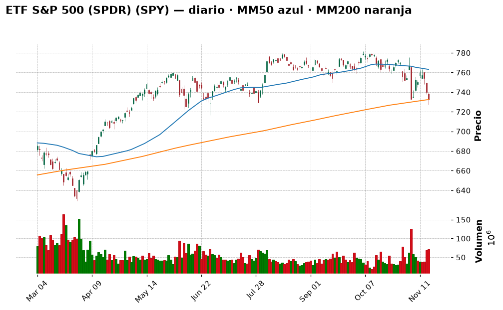
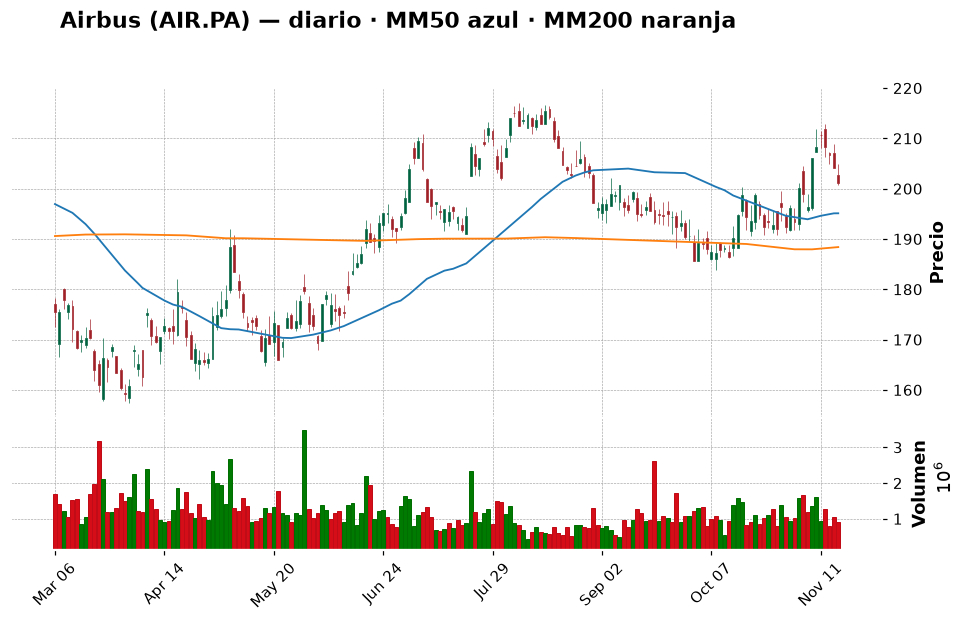
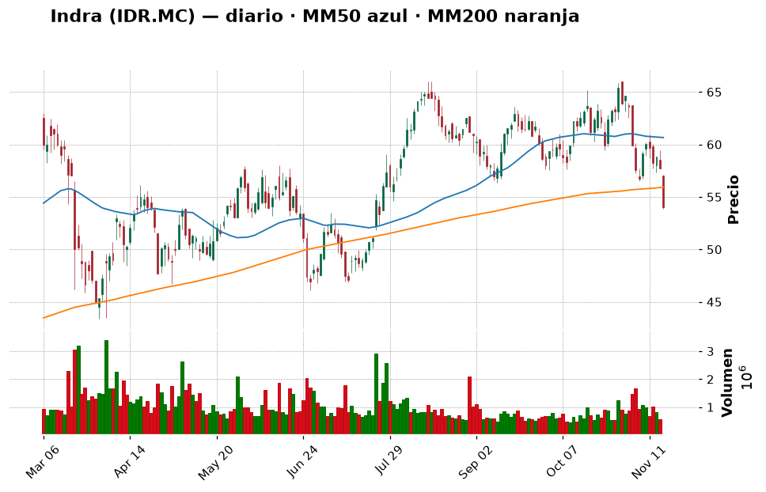
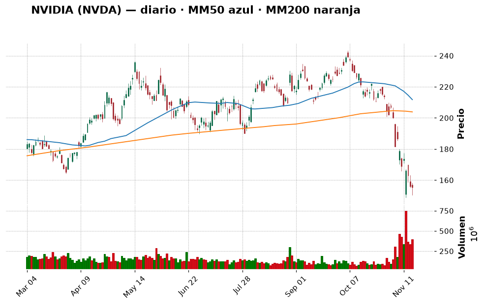
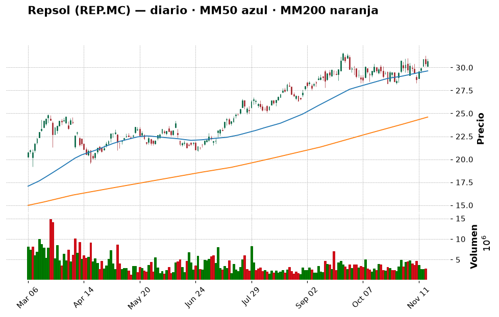
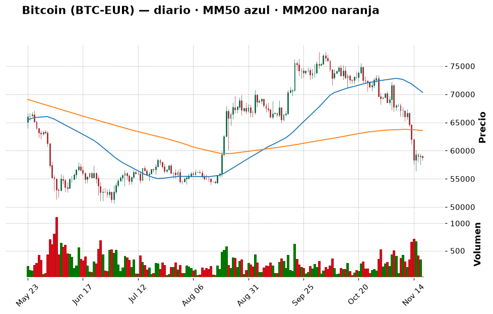
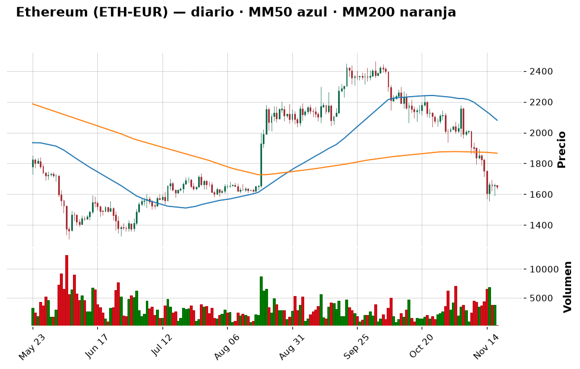
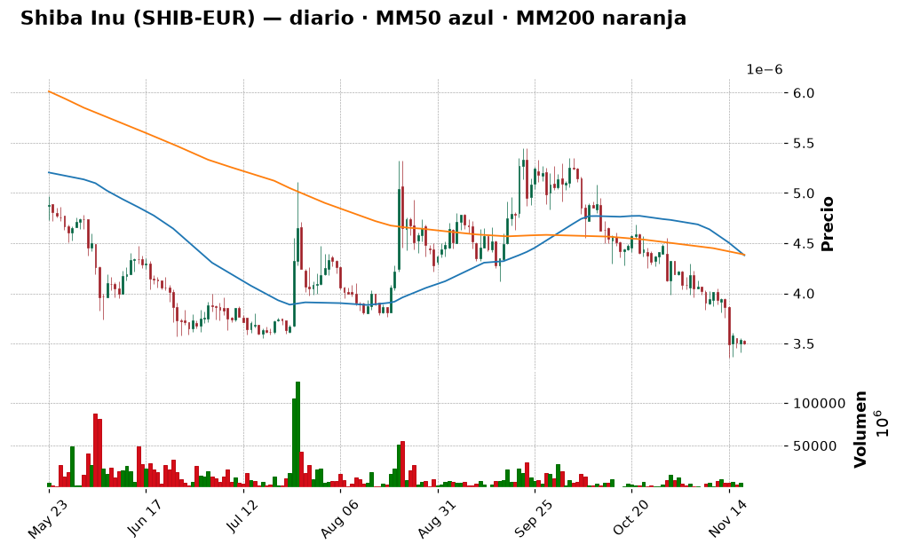

# 📈 Informe pre-apertura — miércoles 18 de noviembre de 2026

> Generado automáticamente a las 08:20 (hora de Madrid) · Bolsa española abre a las 9:00 · Wall Street a las 15:30 · Cripto: 24/7
> **Termómetro del día:** 🔴 mucha incertidumbre — Nvidia ha presentado unos resultados excelentes, pero el mercado sigue nervioso: ayer Europa vivió su peor día desde marzo (Euro Stoxx 50 −2,15 %), el VIX sube a 25,5, la SEC investiga a Nvidia según el WSJ y hoy llegan las **actas de la Fed** (20:00 h) y el **precio de salida de Anthropic** a bolsa. La parte buena para ti: dos de los niveles que fijamos de antemano (ETF y Airbus) se han alcanzado.
> **Lección de hoy:** Resultados trimestrales y previsiones (guidance)

## 1. Lo que tienes que saber hoy
- **Nvidia aprueba… y la bolsa se encoge de hombros.** Ingresó **115.800 millones de dólares** en el trimestre (+103 % en un año), muy por encima de los ~108.000 millones que ella misma preveía, y espera **130.000 millones (±3 %)** para el siguiente, frente a los 125.250 millones que esperaban los analistas (LSEG, vía investingLive y BigGo Finance). La acción llegó a subir un ~4–5 % tras el cierre, pero el entusiasmo se desinfló: según Reuters (vía Investing.com) acabó con un −0,3/−0,5 % en el mercado fuera de hora, y otras fuentes la sitúan con un +2 %. Pesan dos cosas: el consejo **descarta la vuelta de Jensen Huang** y busca un CEO con una empresa de selección, y el WSJ informa de que **la SEC investiga** la exactitud de la información que Nvidia daba a los inversores (Decrypt, Reuters). Es el ejemplo perfecto de la lección de hoy: *unos buenos números no garantizan que la acción suba*.
- **El ETF del S&P 500 llega a la parte baja de la zona de compra.** Ayer el SPY cayó otro −1,01 %, tocó un mínimo de **727,00 $** y cerró en **732,44 $**, prácticamente **encima de su media de 200 sesiones (732,34 $)**. Nuestra regla decía: la segunda mitad del tramo 2 "el 1-dic **o antes si el SPY baja a 729–732 $**". Se ha cumplido. **Recomiendo comprar ~300 € hoy** (ver sección 6: no veo en tu `cartera.csv` la compra de ayer, así que te explico qué hacer en cada caso).
- **Airbus toca nuestro nivel de compra.** Bajó hasta **200,70 €** y cerró en **201,10 €** (−1,5 %). Llevamos cuatro informes diciendo "primer tramo si toca ~202 €". **Toca comprar el primer tramo (~150–200 €)**, no más.
- **Indra se desploma un −6,41 % (54 €)** tras informaciones sobre una **investigación de la Fiscalía Anticorrupción** por posibles irregularidades en contratos y préstamos públicos de Defensa (Europa Press; Escudo Digital). Pierde además el soporte de 56,36 € que vigilábamos. **Pasa de Esperar a Evitar.**
- **Bitcoin, sin cambios:** 58.798 € (−7,5 % bajo su MM200), miedo y codicia en **11/100**. El tramo de diciembre sigue **en pausa**.

## 2. ✅ Recomendaciones del día (resumen)
| Activo | Acción | vs. ayer | Cuánto (orientativo) | Horizonte | Por qué, en una frase | Confianza |
|---|---|---|---|---|---|---|
| ETF S&P 500 (SPY / SPY5.L) | 🟢 Comprar más | = | **~300 € hoy** (≈3 % del patrimonio), una sola compra; nunca 600 € de golpe | Años (5+) | El SPY tocó 727 $ y cierra sobre su MM200: se cumple la regla de adelantar la 2.ª mitad del tramo 2 | media |
| Airbus (AIR.PA) | 🟢 Comprar | ↑ antes Esperar | **Tramo 1: ~150–200 €** (≈2 %); el tramo 2 solo con un cierre sobre 217 € o en ~193 € | Años | Ha tocado el nivel de ~202 € fijado de antemano; tendencia de fondo alcista intacta (+6,8 % sobre MM200) | media |
| Indra (IDR.MC) | ⛔ Evitar | ↓ antes Esperar | 0 € | — | Investigación de Anticorrupción y ruptura del soporte de 56,36 € | media |
| NVIDIA (NVDA) | ⛔ Evitar | = | 0 € | — | Grandes cifras, pero sin CEO permanente, con posible investigación de la SEC y −23,7 % bajo su MM200 | media |
| Repsol (REP.MC) | 🔵 Mantener | = | No añadir | Años | Tendencia alcista (+24,7 % sobre MM200), a un −3 % de máximos | media |
| Solaria (SLR.MC) | 🔵 Mantener | = | No añadir | Años | Rebote del +1,2 % sin cambiar la tendencia bajista; posición mínima | baja |
| Telefónica (TEF.MC) | ⏸️ Esperar | = | 0 € hoy; hasta ~250 € si supera 3,71 € | Años | 3,48 €, sigue bajo su MM200 (3,65 €) | baja |
| Iberdrola (IBE.MC) | ⏸️ Esperar | = | Hasta 5 % (~480 €) si retrocede a 21–22 € | Años | 22,88 €: se acerca, pero aún no está en el nivel | media |
| Inditex (ITX.MC) | 🔵 Mantener | = | No añadir | Años | A un −2 % de su máximo anual; tu posición gana +121 % | media |
| Apple (AAPL) | 🔵 Mantener | = | No añadir | Años | Aguanta (−0,25 %) pese a la caída de sus sistemas el martes | media |
| Bitcoin (BTC) | 🔵 Mantener | = | No vender; **tramo del 1-dic en pausa**; ~50 € solo si llega a ~54.000 € | Años | Sigue un −7,5 % bajo su MM200 | media |
| Ether (ETH) | ⏸️ Esperar | = | 0 € hoy | Años | Ayer tocó 1.590 € y cerró en 1.658 €: el soporte de 1.580 € aguanta | media |
| Shiba Inu (SHIB) | ⛔ Evitar | = | No añadir | — | Memecoin, −54 % en un año | alta |

*(El resto de la watchlist —Santander, BBVA, Oryzon, IAG, Aena, Microsoft, Amazon, Alphabet, Berkshire, los ETF del Nasdaq y del MSCI World, ASML, LVMH, SAP y Siemens— tiene su veredicto en la tabla "Resto de la watchlist" de la sección 6.)*

**🔁 Seguimiento de ayer** (informe del martes 17-nov):
- **ETF S&P 500:** "Comprar más ~300 € hoy; la otra mitad el 1-dic **o si el SPY cae a 729–732 $**" → el SPY bajó a **727,00 $** y cerró en **732,44 $**. La condición de la segunda mitad se ha cumplido. La invalidación (cierre **semanal** bajo 729 $) **no** se ha producido: la semana cierra el viernes. Acción sin cambios: **Comprar más**.
- **Airbus:** "Esperar; primer tramo si toca ~202 €" → mínimo de **200,70 €**, cierre en **201,10 €**. **Cambio de Esperar a Comprar** porque se ha dado exactamente lo que dijimos que nos haría comprar. Cerró un poco por debajo del soporte de 201,65 €, pero muy lejos de los 198 € que, según dijimos ayer, indicarían una ruptura clara.
- **Indra:** "Esperar; si pierde 56,36 €, esperar más" → lo perdió con fuerza (54,00 €, −6,41 %) **y** apareció una noticia nueva (investigación de Anticorrupción). Por eso **bajo de Esperar a Evitar**: ya no es solo un nivel técnico, es una duda sobre el negocio.
- **Nvidia:** "Evitar; revisaré la idea con los resultados en la mano" → los resultados son muy buenos, pero lo que nos haría cambiar de opinión (CEO permanente **y** precio sobre su MM200, ~204 $) no se ha dado: el consejo acaba de empezar la búsqueda y la acción está en 155,46 $. **Se mantiene Evitar.**
- **Bitcoin / Ether:** ni recupera la MM200 (~63.600 €) ni llega a ~54.000 €; ether toca 1.590 € y aguanta sobre 1.580 €. **Sin cambios.**
- **Tu `cartera.csv`:** **no aparece la compra del ETF de ayer** (el último movimiento sigue siendo del 11-nov). Si la hiciste, apúntala hoy (ver sección 8); si no la hiciste, no pasa nada: la compra de hoy la sustituye.

> Hoy toca **ejecutar, no improvisar**: ~300 € en el ETF y ~150–200 € en Airbus, ambas con orden limitada, y nada más. Las dos compras salen de niveles que escribimos con calma hace días; lo que no haremos es "aprovechar" la caída de Indra ni perseguir a Nvidia tras sus resultados.

## 3. Agenda del día
| Hora (Madrid) | Evento | Por qué importa |
|---|---|---|
| Madrugada | Asia, sin rumbo tras Nvidia: Nikkei −0,3 %, Asia-Pacífico sin Japón −0,1 % (quinto día de caídas) (Reuters vía Investing.com) · **Irán ataca Kuwait y Baréin** con misiles y drones, y sigue atacando petroleros en Ormuz (Reuters vía Investing.com) | Tensión geopolítica, aunque el petróleo baja |
| 8:00 (hora habitual) | **IPC del Reino Unido** de octubre (Reuters) | Termómetro de la inflación europea |
| 9:00 | Apertura de la Bolsa española. Futuros del DAX y del FTSE **−0,3 %** (Reuters vía Investing.com) | El Ibex parte de 19.625,3 puntos |
| 11:00 (hora habitual) | **Inflación final de la zona euro (IPCA) de octubre** (Reuters) · Subasta de bonos alemanes a 7 años | Si la inflación europea no cede, el BCE no bajará tipos |
| Antes de Wall Street | Resultados de **Target, Lowe's y TJX** (Reuters vía Investing.com) | El consumo estadounidense, examinado por las tiendas |
| 15:30 | Apertura de Wall Street. Futuros del S&P 500 **+0,24 % (7.376,75)** y del Nasdaq 100 **+0,59 % (27.234,75)** (Yahoo Finance, 7:38 h de Madrid) | Rebote tímido tras cuatro días de caídas |
| **20:00 (hora habitual)** | **Actas de la Fed** de su última reunión (Reuters) | Cuántos miembros quieren subir tipos y cuánto. Investing.com las titula "¿25 o 50 pb en diciembre?" |
| Durante el día | Discursos de **Barr, Williams y Kashkari** (Fed). Williams ya dijo ayer que "probablemente harán falta más subidas" (Reuters vía Investing.com) | El tono de la Fed mueve bonos, dólar y bolsa |
| Tras el cierre | Resultados de **Palo Alto Networks** · **Anthropic fija el precio de su OPV** (podría valorarse en hasta 1,4 billones $; Bloomberg vía Reuters) | Una OPV gigante que puede "absorber" dinero de otras tecnológicas |
| Jue 19 | **Debut de Anthropic en el Nasdaq** · Resultados de **Walmart** · Cumbre APEC | Ojo a los productos apalancados sobre Anthropic: nunca para tu perfil |
| Dom 29-nov | Elecciones generales en España | El mercado "se ha vacunado" del riesgo político (Cinco Días, ayer) |
| **1-dic** | **Tu aportación de 200 €** | Tramo 3 del ETF (si hoy completas el tramo 2) |
| 9-dic / 17-dic | Reuniones de la Fed y del BCE | La Fed, con una subida casi descontada |

*Nota: las búsquedas web del calendario económico, la previsión de apertura del Ibex, los resultados del día y las noticias cripto del día no devolvieron páginas fiables fechadas hoy (casi todas eran del 18-nov-2025). La agenda sale de Reuters (vía Investing.com). Las horas marcadas como "habitual" son las de costumbre para ese dato, no confirmadas hoy por nuestras fuentes.*

## 4. Cómo llegan los mercados
### España y Europa
**El martes 17:** el **Ibex 35 cayó un −1,61 % hasta 19.625,3 puntos** (Europa Press), su peor sesión en semanas, y se aleja de los 20.000. La peor fue **Indra (−6,41 %, 54 €)**, por las informaciones sobre una investigación de posibles irregularidades en contratos de Defensa (Europa Press). También cayeron con fuerza **Aena (−2,67 %)**, **Santander (−2,03 %)** e **IAG (−1,80 %)** (precios del JSON). Solo unos pocos aguantaron en verde: **Solaria (+1,21 %)** y **Repsol (+0,89 %)**. Expansión destacó la caída de **Mapfre** tras una doble rebaja de Barclays. El **Euro Stoxx 50** se desplomó un **−2,15 % (6.212,11)**: según Reuters, Europa vivió su **peor día desde marzo**, con **ASML (−5,34 %)** y **SAP (−5,58 %)** arrastradas por la "venta de la IA" y la caída del software (Salesforce perdió un −9,5 % en EE. UU.).

**Noticias de empresas y de España:**
- **Indra, Airbus, GMV y EM&E** captan **6.400 millones en créditos estatales al 0 %** para prefinanciar programas de Defensa (helicópteros, modernización) (Expansión). Ojo: según Escudo Digital, **Anticorrupción investiga precisamente contratos y préstamos públicos de más de 6.000 millones** vinculados al rearme, adjudicados sobre todo a Indra y a EM&E. Para Airbus el efecto es pequeño (es una empresa europea enorme y estos préstamos son una parte mínima de su negocio); para Indra, en cambio, es central.
- **Santander** lidera en Europa la venta de riesgo de crédito (unos 82.000 millones en "transferencias de riesgo sintético") que la banca usa para poder pagar más dividendo y recomprar acciones; S&P advierte de que los bancos más dependientes de ellas podrían necesitar más capital (Cinco Días). Además, avisa de **más costes regulatorios en EE. UU.** por su filial Webster (Expansión). 💡 *Transferir riesgo sintético es, simplificando, "pagar un seguro" a inversores para que asuman parte de las pérdidas de unos préstamos si salen mal; así el banco necesita guardar menos capital.*
- **Deutsche Bank** cae en bolsa por una filtración de millones de documentos (Cinco Días).
- Las **aerolíneas** (IAG, Air France-KLM, Lufthansa, Ryanair) recortan vuelos y buscan clientes prémium ante un **queroseno disparado**, con una factura extra de 10.000 millones solo este año (Expansión). Ryanair invertirá 500 millones en Sevilla.
- **Bruselas** mejora al **2,6 %** el crecimiento previsto para España este año, pero **eleva la inflación al 3,9 %** (Europa Press). El **Euríbor** sigue subiendo: media de noviembre en el **3,279 %** (Expansión). 💡 *El **Euríbor** es el tipo de interés al que se prestan los bancos europeos entre sí; de él dependen la mayoría de las hipotecas variables en España.*
- El español **Pablo Hernández de Cos** se perfila como próximo **presidente del BCE**, con el apoyo de Francia y Alemania (Expansión).
- Amancio Ortega compra una torre de lujo en Chicago por 180 millones (Europa Press); PLD Space ficha a Mitsubishi como primer cliente de su cohete Miura 5 (Expansión).

### Estados Unidos
**El martes 17:** cuarto día seguido de caídas. **S&P 500 −1,03 % (7.340,53)**, **Nasdaq −0,74 % (24.328,38)** y **Dow Jones −1,64 % (50.759,42)**. **Los 11 sectores del S&P 500 cayeron**; el financiero, un −1,9 %. El sector tecnológico ya pierde **~20 % desde el 6 de octubre** (Reuters vía Investing.com). El **VIX sube a 25,46 (+11 %)**. Pesaron unas **ventas minoristas sólidas** y el tono duro de la Fed (más subidas de tipos), **Salesforce (−9,5 %)** y una cadena de **caídas de sistemas** (Apple y la Agencia de Seguridad Nacional el martes, JPMorgan el lunes, Microsoft la semana pasada) (Expansión; Yahoo Finance). **Microsoft** marca mínimos de siete semanas (506,24 $).

**Nvidia, en detalle:** ingresos de **115.800 millones $ (+103 %)**, beneficio por acción ajustado de **2,68 $** y beneficio neto de **65.287 millones $ (+105 %)** (investingLive, Europa Press). Previsión de **130.000 millones** para el próximo trimestre y crecimiento esperado del **75 %** para 2028 (antes, 70 %). Le quedan **227.000 millones** autorizados para recomprar acciones. La consejera delegada interina, **Colette Kress**, defendió un enfoque "disciplinado" para financiar a clientes como CoreWeave (MarketWatch). En contra: **Huang dice que "sería un honor volver"**, pero el consejo lo descarta y crea nuevos comités de control de exportaciones (Expansión, Decrypt); el WSJ informa de una investigación de la **SEC**; el fondo **Muddy Waters** dice haber apostado contra la acción, y un informe de The Information vincula a comerciales de Nvidia con el caso de espionaje de Alibaba (Reuters vía Investing.com). Morgan Stanley rebaja su precio objetivo (Investing.com).

**Esta mañana:** futuros del **S&P 500 +0,24 %** y del **Nasdaq 100 +0,59 %** (Yahoo Finance, 7:38 h de Madrid). Un rebote modesto, nada que ver con el ~8 % que descontaban las opciones para Nvidia.

### Macro (tipos de interés, inflación, divisas, materias primas)
- **Fed:** Musalem (St. Louis) cree que harán falta **"varias" subidas antes de la primavera de 2027**, y Williams (Nueva York) que "probablemente" hagan falta más, aunque "no es momento de una acción drástica" (Reuters vía Investing.com). El mercado descuenta unas **tres subidas de 0,25 puntos** hasta mediados de 2027. Bank of America no descarta una subida de **medio punto** en diciembre (MarketWatch). El **bono a 10 años** paga un **~5,08–5,10 %**.
- **Divisas:** el índice del dólar sigue cerca de su **máximo en 19 meses (103,6)**; el **euro/dólar está en 1,0983 (−0,18 %)** esta mañana (Yahoo Finance). El yen, en 159,4 por dólar, al borde de la zona de posible intervención. Para ti: tus 2.605,43 USDC valen **2.372,50 €** (+5,99 € frente a ayer, por la subida del dólar).
- **Petróleo Brent: 92,12 $ (−1,10 %)** (Yahoo Finance), a pesar de los ataques de Irán contra Kuwait y Baréin. El mercado parece más preocupado por una economía más lenta (Druckenmiller dice estar apostando contra el cobre y avisa de debilidad en 2027, CoinDesk) que por el suministro.
- **Oro: ~3.782 $ (−2,1 %)**, plata −2,9 % y cobre −2,8 % (Reuters vía Investing.com): con tipos altos y dólar fuerte, las materias primas sufren.

## 5. Panorama técnico de la watchlist
> 💡 *Cómo leer esta tabla:* la **tendencia** resume si el precio lleva meses subiendo, bajando o de lado
> (comparando el precio con sus medias de 50 y 200 días). El **RSI** mide de 0 a 100 si las subidas o bajadas
> recientes han sido muy fuertes: por encima de 70 se dice "sobrecompra" (quizá ha subido demasiado rápido),
> por debajo de 30 "sobreventa". Son pistas, no predicciones.

Todos los datos son del **cierre del martes 17-nov** (ningún valor llega con retraso hoy ✅).

| Valor | Último cierre | Día | 1 mes | 1 año | Tendencia | RSI | vs MM200 |
|---|---|---|---|---|---|---|---|
| IBEX 35 (^IBEX) | 19.625,3 | −1,61 % | +3,08 % | +22,74 % | ➡️ lateral | 53,4 🟡 | +4,5 % |
| Euro Stoxx 50 (^STOXX50E) | 6.212,11 | −2,15 % | +1,10 % | +8,17 % | ➡️ lateral | 47,2 🟡 | +1,4 % |
| S&P 500 (^GSPC) | 7.340,53 | −1,03 % | −4,55 % | +9,01 % | ➡️ lateral | 37,2 🟡 | −0,1 % |
| Nasdaq Composite (^IXIC) | 24.328,38 | −0,74 % | −7,95 % | +6,23 % | ➡️ lateral | 35,7 🟡 | −3,3 % |
| Banco Santander (SAN.MC) | 10,80 € | −2,03 % | −8,27 % | +21,03 % | ➡️ lateral | 41,4 🟡 | −4,4 % |
| BBVA (BBVA.MC) | 23,14 € | −1,66 % | +1,80 % | +28,84 % | ➡️ lateral | 50,5 🟡 | +7,2 % |
| Inditex (ITX.MC) | 59,56 € | −1,23 % | +7,47 % | +25,44 % | 📈 alcista | 60,4 🟡 | +8,9 % |
| Iberdrola (IBE.MC) | 22,88 € | −1,12 % | +7,77 % | +26,90 % | 📈 alcista | 60,4 🟡 | +11,8 % |
| Telefónica (TEF.MC) | 3,48 € | −0,60 % | +3,02 % | −3,90 % | ➡️ lateral | 55,0 🟡 | −4,8 % |
| Repsol (REP.MC) | 30,68 € | +0,89 % | +3,61 % | +87,76 % | 📈 alcista | 56,5 🟡 | +24,7 % |
| Solaria (SLR.MC) | 15,08 € | +1,21 % | −0,53 % | −14,71 % | 📉 bajista | 44,4 🟡 | −22,8 % |
| Oryzon (ORY.MC) | 2,32 € | −0,86 % | −8,24 % | −23,56 % | 📉 bajista | 37,5 🟡 | −18,5 % |
| IAG (IAG.MC) | 5,34 € | −1,80 % | +9,33 % | +22,97 % | 📈 alcista | 59,0 🟡 | +9,5 % |
| Indra (IDR.MC) | 54,00 € | −6,41 % | −11,71 % | +14,07 % | ➡️ lateral | 34,0 🟡 | −3,5 % |
| Aena (AENA.MC) | 28,40 € | −2,67 % | +11,20 % | +25,39 % | 📈 alcista | 61,0 🟡 | +9,2 % |
| Apple (AAPL) | 351,91 $ | −0,25 % | +2,62 % | +29,18 % | 📈 alcista | 56,1 🟡 | +16,5 % |
| Microsoft (MSFT) | 506,24 $ | −2,27 % | −5,11 % | −0,77 % | ➡️ lateral | 41,9 🟡 | +14,5 % |
| NVIDIA (NVDA) | 155,46 $ | −0,44 % | −28,39 % | −18,25 % | ➡️ lateral | 22,5 🟢 | −23,7 % |
| Amazon (AMZN) | 257,89 $ | +0,05 % | −1,74 % | +9,89 % | 📈 alcista | 49,7 🟡 | +5,4 % |
| ETF S&P 500 (SPY) | 732,44 $ | −1,01 % | −4,44 % | +9,01 % | ➡️ lateral | 37,5 🟡 | +0,0 % |
| ETF Nasdaq 100 (QQQ) | 656,95 $ | −0,73 % | −8,55 % | +7,90 % | ➡️ lateral | 36,5 🟡 | −3,8 % |
| Alphabet (GOOGL) | 280,20 $ | −1,24 % | −18,59 % | +1,37 % | 📉 bajista | 32,9 🟡 | −17,1 % |
| Berkshire Hathaway (BRK-B) | 586,76 $ | −1,03 % | +10,25 % | +15,29 % | 📈 alcista | 73,1 🔴 | +17,0 % |
| ETF MSCI World (IWDA.AS) | 127,19 € | −2,15 % | −2,66 % | +17,14 % | ➡️ lateral | 40,3 🟡 | +3,9 % |
| Airbus (AIR.PA) | 201,10 € | −1,49 % | +3,48 % | −1,61 % | 📈 alcista | 52,5 🟡 | +6,8 % |
| ASML (ASML.AS) | 1.236,80 € | −5,34 % | −17,33 % | +39,00 % | ➡️ lateral | 33,7 🟡 | −11,7 % |
| LVMH (MC.PA) | 393,00 € | −2,72 % | +0,77 % | −36,57 % | 📉 bajista | 44,8 🟡 | −14,6 % |
| SAP (SAP.DE) | 201,50 € | −5,58 % | +0,83 % | −1,87 % | 📈 alcista | 43,8 🟡 | +20,7 % |
| Siemens (SIE.DE) | 269,80 € | −1,01 % | +1,35 % | +23,68 % | ➡️ lateral | 48,6 🟡 | +3,6 % |

*(🟢 = sobreventa, RSI < 30 · 🟡 = zona neutral · 🔴 = sobrecompra, RSI > 70.)*

**Lectura de conjunto:** la caída se ha **extendido**: ayer ya no era solo la tecnología, también Europa (Euro Stoxx 50 −2,15 %), la banca y casi todos los sectores. Lo más importante para ti: el **S&P 500 está justo sobre su MM200** (el SPY a un +0,01 %, el índice a un −0,1 %). Es la "línea de la tendencia de fondo" que explicamos el 13-nov, y el mercado la está poniendo a prueba. El **Nasdaq** sigue por debajo (−3,3 %). En España, el Ibex aguanta todavía un +4,5 % sobre su MM200 y valores como Repsol, Iberdrola o Inditex mantienen su tendencia alcista: no todo cae a la vez.

## 6. Ideas de bolsa: qué haría un experto
### ETF S&P 500 (SPY5.L / SPY) — COMPRAR MÁS (~300 € hoy)

- **Qué es:** un fondo que compra de una vez las ~500 mayores empresas de EE. UU. Tú tienes la versión europea (UCITS) que cotiza en Londres, **SPY5.L**; el gráfico es del SPY estadounidense, que sigue el mismo índice.
- **Por qué es noticia hoy:** cuarto día seguido de caídas del S&P 500 (−1,03 % ayer) por la "venta de la IA", las ventas minoristas sólidas y el tono duro de la Fed (Reuters). Nvidia (~6–7 % del índice) presentó buenos resultados, pero no ha servido de detonante de un rebote fuerte.
- **Lo que dice el gráfico:** el SPY tocó **727,00 $** y cerró en **732,44 $**, prácticamente **encima de su MM200 (732,34 $)**. El soporte de 739,51 $ que vimos ayer se ha perdido; el siguiente está en **729,10 $**, después **722,59 $** y **716,58 $**. Por arriba, la MM50 (763,15 $) y resistencias en 755,6–756,7 $. RSI 37,5 (neutral, cerca de la sobreventa, pero no en ella), MACD "empeorando" y volumen **1,4 veces el normal**: hubo ventas con convicción. A un −6,3 % de su máximo de 52 semanas (781,62 $). En llano: **la tendencia de fondo está en el filo**. Si aguanta aquí, buena zona de compra; si se rompe, podría bajar otro 2–3 %.
- **Lo positivo:** compras el índice más diversificado del mundo con un descuento del ~6 % sobre su máximo, justo en la zona que elegimos hace días.
- **El riesgo:** que el viernes **cierre la semana por debajo de 729 $**; entonces la MM200 estaría perdida y los siguientes niveles (722–717 $) quedarían a la vista.
- **🧑‍💼 Recomendación: COMPRAR MÁS.** La regla decía "segunda mitad del tramo 2 si el SPY cae a 729–732 $": ha bajado a 727 $. La seguimos. Lo que **no** haría es comprar más de lo previsto porque "está barato": el plan ya reparte el riesgo.
  - **Cuánto y cómo:** **~300 € hoy**, una sola compra, en el **SPY5.L** (sesión de Londres, de 9:00 a 17:30 h de España), con **orden limitada** cerca del precio de mercado. Hay dos casos:
    - **Si ayer compraste los ~300 €** (aunque no los hayas apuntado): la de hoy **completa el tramo 2**. Tu aportación del 1-dic se convertirá en el tramo 3.
    - **Si ayer no compraste:** la de hoy es esa misma media parte; **no compres 600 € para "ponerte al día"**. La otra mitad, el 1-dic con la aportación.
  - **Horizonte:** años (5 o más).
  - **Qué me haría cambiar de opinión:** un **cierre semanal (viernes) por debajo de 729 $**: no vendería nada, pero **pausaría los siguientes tramos** hasta ver estabilidad (un cierre semanal de nuevo sobre ~732 $ o un suelo claro en 717–723 $). Es la respuesta a la pregunta de ayer, aplicada.
- **Qué mirar para entenderlo:** el viernes por la noche, mira el cierre semanal del SPY. Por encima de 729 $: el soporte y la MM200 han aguantado. Por debajo: se ha roto la zona y el plan se pausa.
- **Confianza:** media

### Airbus (AIR.PA) — COMPRAR (primer tramo)

- **Qué es:** el mayor fabricante de aviones comerciales del mundo (y un actor clave en defensa y espacio en Europa).
- **Por qué es noticia hoy:** forma parte del grupo (con Indra, GMV y EM&E) que capta **6.400 millones de euros en créditos estatales al 0 %** para programas de Defensa en España (Expansión). No hay noticias nuevas sobre entregas en nuestras fuentes: el último dato público son **547 entregas hasta septiembre** con un objetivo de **~870 en el año** (Demócrata, AirNav Radar). En contra, las aerolíneas recortan vuelos por el queroseno caro (Expansión), aunque el Brent ya ha bajado a 92 $.
- **Lo que dice el gráfico:** 201,10 € (−1,5 %), tras tocar **200,70 €**. Tendencia **alcista**: sobre su MM50 (195,11 €) y su MM200 (188,39 €, +6,8 %). RSI 52,5 (neutral) y MACD "empeorando" (el impulso a corto plazo se enfría). Cerró ligeramente por debajo del soporte de 201,65 €; los siguientes soportes están en **193,18 €** y **190,90 €**. Resistencias en **210,95 €** y **216,55–217,05 €**. A un −9,1 % de su máximo de 52 semanas (221,30 €). Volatilidad anualizada del 31 %. En llano: **una corrección dentro de una tendencia sana**, en la zona donde dijimos que empezaríamos a comprar.
- **Lo positivo:** años de pedidos por delante (más de 8.700 aviones en cartera a final de 2025), un duopolio con Boeing y un negocio de defensa que crece con el rearme europeo.
- **El riesgo:** no cumplir el objetivo de entregas (lo sabremos en enero), una caída general de las bolsas que la arrastre hacia 190 €, y el ruido político alrededor de los préstamos de Defensa.
- **🧑‍💼 Recomendación: COMPRAR (primer tramo).** Es la empresa que más te interesa, con una tendencia de fondo alcista, y ha llegado al precio que fijamos con calma hace días. Por eso compro **solo el primer tramo**: si sigue bajando hacia 193 €, el segundo tramo saldrá más barato; si rebota, ya tendrás una parte.
  - **Cuánto y cómo:** **~150–200 € hoy** (≈1,5–2 % del patrimonio; con ese dinero compras **una acción**, ~201 €, o una fracción si tu bróker lo permite). **Orden limitada a ~201–202 €**: si abre más alto y no llega, no pasa nada, se queda pendiente. **Segundo tramo** (otros ~150–200 €): en la zona de **~193 €** o con un **cierre por encima de 217 €**. Tope total: 3–4 % del patrimonio.
  - **Horizonte:** años.
  - **Qué me haría cambiar de opinión:** un **cierre por debajo de 190 €** (MM200 y soporte de 190,90 € perdidos) o un recorte del objetivo de entregas. Ahí no compraría el segundo tramo y revisaría la tesis.
- **Qué mirar para entenderlo:** en las próximas sesiones, fíjate en si el precio **rebota desde 200–202 €** (el soporte funciona como "suelo") o si **cierra por debajo de ~198 €** (el suelo cede y el siguiente está en 193 €).
- **Confianza:** media

### Indra (IDR.MC) — EVITAR (antes Esperar)

- **Qué es:** la mayor empresa española de defensa y tecnología (radares, sistemas de control aéreo, simuladores, ciberseguridad).
- **Por qué es noticia hoy:** cayó un **−6,41 % (54 €)**, la peor del Ibex, por las informaciones de una **investigación de la Fiscalía** sobre posibles irregularidades en contratos de Defensa (Europa Press). Según Escudo Digital, **Anticorrupción** investiga contratos y préstamos públicos de **más de 6.000 millones** vinculados al rearme, adjudicados sobre todo a Indra y a EM&E; además, General Dynamics mantiene una batalla legal contra ambas por adjudicaciones directas. *No hemos podido leer el artículo completo de Europa Press (la web bloquea el acceso automático); el detalle sale de su titular y de Escudo Digital.*
- **Lo que dice el gráfico:** 54,00 €, con el cierre en el mínimo del día (53,84 €). Pierde el soporte de **56,36 €** que vigilábamos y queda **por debajo de su MM200 (55,94 €, −3,5 %)** y muy lejos de su MM50 (60,65 €). En un mes cae un −11,7 %; en una semana, un −10,1 %. RSI 34,0 (cerca de la sobreventa, sin llegar). Soporte inmediato en **53,18 €**; por debajo, un hueco hasta **46,85–46,12 €**. Resistencias en 57,98 € y 62,66 €. Volatilidad anualizada del **48 %**, muy alta para una gran empresa.
- **Lo positivo:** el gasto en defensa en Europa seguirá creciendo durante años, y la empresa ha duplicado su cartera de pedidos.
- **El riesgo:** una investigación judicial puede durar meses o años, y mientras tanto **nadie sabe cuánto puede costar** (multas, contratos anulados, cambios en la dirección). Ese tipo de incertidumbre es la peor para un principiante.
- **🧑‍💼 Recomendación: EVITAR.** Ayer era "Esperar" por motivos técnicos. Hoy hay un motivo de **negocio** (la investigación) y uno **técnico** (soporte y MM200 perdidos). Cuando las dos cosas apuntan en la misma dirección, lo prudente es quedarse fuera. Que haya caído mucho no la hace barata: puede caer más si aparecen detalles.
  - **Cuánto y cómo:** 0 €.
  - **Horizonte:** —
  - **Qué me haría cambiar de opinión:** que se aclare el alcance de la investigación (y que no afecte de lleno a sus contratos) **y** que el precio recupere su MM200 (~56 €) con un cierre por encima de 57,98 €.
- **Qué mirar para entenderlo:** compara esta caída con la de Airbus: ambas bajan, pero la de Airbus es "el mercado en general" y la de Indra es "una noticia propia". Saber distinguir las dos es clave para decidir si una caída es una oportunidad o una señal de alarma.
- **Confianza:** media

### NVIDIA (NVDA) — EVITAR

- **Qué es:** el gran fabricante de chips para inteligencia artificial.
- **Por qué es noticia hoy:** **ingresos de 115.800 millones $ (+103 %)**, beneficio por acción de 2,68 $ y previsión de **130.000 millones** para el próximo trimestre, por encima de lo esperado (LSEG vía investingLive; BigGo Finance). Pero el consejo **descarta la vuelta de Huang** y ha contratado una empresa de selección para buscar CEO (Decrypt), el WSJ informa de una **investigación de la SEC** (Reuters) y Muddy Waters apuesta contra la acción. Jeff Bezos cree que un CEO de fuera tendría una probabilidad "ínfima" de éxito (Yahoo Finance).
- **Lo que dice el gráfico:** 155,46 $ al cierre (antes de los resultados), un **−23,7 % bajo su MM200 (203,87 $)** y un −26,6 % bajo su MM50. RSI **22,5 (sobreventa)**; el MACD pasa a "mejorando" (el impulso bajista se frena). El martes tocó **150,33 $**, a un paso de su mínimo de 52 semanas (148,80 $). **No hay soportes por debajo** en nuestros datos; resistencias muy lejos, en ~214 $. Volumen 1,7 veces el normal.
- **Lo positivo:** el negocio va mejor que nunca: la demanda de chips para IA sigue "por las nubes".
- **El riesgo:** el problema de Nvidia ya no son las cifras sino la **gobernanza** (quién la dirige y qué información dio). Eso no se arregla con un buen trimestre.
- **🧑‍💼 Recomendación: EVITAR.** Dije ayer que revisaría la idea con los resultados en la mano. Lo he hecho: las cifras son excelentes, pero **mis dos condiciones** (CEO permanente con un plan claro **y** precio de nuevo sobre su MM200, ~204 $) **siguen sin cumplirse**. Además, ya la tienes en su justa medida dentro del ETF (~6–7 %): cuando compras el SPY5.L hoy, compras también un poco de Nvidia, diversificada.
  - **Cuánto y cómo:** 0 €.
  - **Horizonte:** —
  - **Qué me haría cambiar de opinión:** nombramiento de un CEO permanente creíble **y** un cierre sobre ~204 $.
- **Qué mirar para entenderlo:** cómo cotiza hoy a partir de las 15:30. Si unos resultados tan buenos no consiguen que suba, el mercado está diciendo que su preocupación es otra (ver la lección de hoy).
- **Confianza:** media

### Repsol (REP.MC) — MANTENER (la tienes)

- **Qué es:** la mayor petrolera española (exploración, refino, gasolineras y renovables).
- **Por qué es noticia hoy:** de los pocos valores del Ibex que **subió ayer (+0,89 %)**. Zacks (vía Yahoo Finance) se pregunta si los inversores "infravaloran" Repsol. Sigue vigente la demanda de ~120 millones a las eléctricas por el apagón de 2025 (noticia del lunes).
- **Lo que dice el gráfico:** 30,68 €, tendencia **alcista**: **+24,7 % sobre su MM200 (24,60 €)** y +3,5 % sobre su MM50. RSI 56,5, MACD "mejorando". Sube un +6,9 % en una semana. Sigue por debajo de la resistencia de **31,02–31,64 €** (máximo de 52 semanas), a un −3 %. Soportes en 28,31 € y 28,18 €. Volatilidad del 40 %.
- **Lo positivo:** tu posición gana un **+148 %** (pagaste 12,37 €) y la tendencia sigue a favor.
- **El riesgo:** el petróleo baja (Brent 92 $, −1,1 % hoy) incluso con ataques en el Golfo; si la economía se enfría, el crudo podría seguir cayendo.
- **🧑‍💼 Recomendación: MANTENER.** Nada ha cambiado: tendencia intacta y sin noticias negativas. Tampoco ampliaría: ya tienes exposición al petróleo y es un sector muy volátil.
  - **Cuánto y cómo:** no añadir.
  - **Horizonte:** años.
  - **Qué me haría cambiar de opinión:** un cierre por debajo de 28,18 € con el Brent cayendo hacia 80 $: ahí valoraría Reducir.
- **Qué mirar para entenderlo:** si algún día cierra por encima de **31,64 €**, habrá roto su techo del año; mientras tanto, cada vez que se acerque a 31 € es normal que aparezcan vendedores.
- **Confianza:** media

### Resto de la watchlist: veredicto rápido
| Valor | Acción | Por qué (1 frase) | Nivel a vigilar |
|---|---|---|---|
| Solaria (SLR.MC) | 🔵 Mantener | La tienes (1 acción, +0,6 %): rebota +1,2 % a 15,08 €, pero sigue −22,8 % bajo su MM200; venderla costaría casi lo mismo en comisiones | Resistencia 16,95 €; mínimo anual 13,61 € |
| Telefónica (TEF.MC) | ⏸️ Esperar | 3,48 €, sobre su MM50 (3,43 €) pero −4,8 % bajo su MM200 (3,65 €); sin noticias propias | Comprar si supera 3,71 €; Evitar si cierra bajo 3,27 € |
| Iberdrola (IBE.MC) | ⏸️ Esperar | Cae −1,1 % (22,88 €) y el RSI se enfría a 60; tendencia alcista sana, pero el nivel de compra está más abajo | Comprar en 21–22 €; soporte 21,09 € |
| Inditex (ITX.MC) | 🔵 Mantener | Tu posición gana +121 %; a un −2 % de su máximo anual (60,80 €), tendencia alcista | Soporte 56,2 € |
| Apple (AAPL) | 🔵 Mantener | Aguanta (−0,25 %) pese a la caída de sus sistemas el martes (Expansión, 247 Wall St) | Soporte 338,7 $; máximo 360,83 $ |
| Banco Santander (SAN.MC) | ⏸️ Esperar | −2,0 % y −4,4 % bajo su MM200; más costes regulatorios en EE. UU. y dudas sobre la venta de riesgo de crédito (Expansión, Cinco Días) | Comprar si cierra sobre 11,80 € (MM50); soporte 10,34 € |
| BBVA (BBVA.MC) | ⏸️ Esperar | Tendencia de fondo sana (+7,2 % sobre MM200), justo sobre su soporte (22,77 €); asesora una financiación geotérmica de 420 M$ (Reuters vía Yahoo Finance) | Sobre 23,62 € (MM50); soporte 22,77 € |
| Oryzon (ORY.MC) | 🔵 Mantener | La tienes (4 acciones, −28 %): tendencia bajista y a +4 % de su mínimo anual (2,23 €); vale 9,26 € y venderla costaría casi lo mismo en comisiones | Mínimo anual 2,23 €; resistencia 2,61 € |
| IAG (IAG.MC) | ⏸️ Esperar | −1,8 %; recorta vuelos por el queroseno caro (Expansión), aunque mantiene tendencia alcista | Cierre sobre 5,72 €; soporte 4,95 € |
| Aena (AENA.MC) | ⏸️ Esperar | −2,7 % y el RSI baja de 75 a 61 (se enfría la sobrecompra); cruce dorado reciente | Retroceso hacia la MM50 (26,34 €) |
| Microsoft (MSFT) | ⏸️ Esperar | Mínimos de siete semanas (506,24 $), justo sobre su soporte de 504,96 $; caídas de sistemas y competencia en IA (BeInCrypto vía Yahoo Finance) | Si pierde 504,96 $, siguiente 486 $ |
| Amazon (AMZN) | ⏸️ Esperar | Plana (+0,05 %) en un día rojo; podría ser nombrada "campeona nacional de IA" por la Casa Blanca (Yahoo Finance) | Resistencia 258–265 $; soporte 244,7 $ |
| ETF Nasdaq 100 (QQQ) | ⏸️ Esperar | −3,8 % bajo su MM200; "camino de su peor noviembre desde 2008" (247 Wall St); para ti, mejor el S&P 500 o el MSCI World | Recuperar 682,6 $; soporte 647 $ |
| Alphabet (GOOGL) | ⛔ Evitar | Cruce de la muerte y −17,1 % bajo su MM200; cerca de su soporte (276,9 $) | Recuperar la MM200 (337,9 $) |
| Berkshire Hathaway (BRK-B) | ⏸️ Esperar | RSI 73 (sobrecomprada); Buffett dona 5.500 M$ en acciones y dice que su confianza es "más fuerte que nunca" (Motley Fool) | Retroceso hacia la MM50 (533 $) |
| ETF MSCI World (IWDA.AS) | ⏸️ Esperar | Cae −2,15 % a 127,19 € y pierde el soporte de 129 €; alternativa excelente, pero hoy compramos el S&P 500 y no duplico el núcleo | Soporte 125,8 €; MM200 122,4 € |
| ASML (ASML.AS) | ⏸️ Esperar | −5,3 % y −11,7 % bajo su MM200 por las restricciones de chips a China (Yahoo Finance); se acerca a su soporte de 1.210,6 € | Si pierde 1.210,6 €, sin soportes cercanos; MM200 1.400 € |
| LVMH (MC.PA) | ⛔ Evitar | El lujo sigue en crisis (−36,6 % en un año, −14,6 % bajo MM200); solo publica sus recompras de acciones | Recuperar 431 €; soporte 380 € |
| SAP (SAP.DE) | ⏸️ Esperar | −5,6 % (201,50 €) en la venta del software tras Salesforce; sale un miembro del consejo de dirección, Thomas Saueressig (Yahoo Finance); pierde el soporte de 203 €, pero sigue +20,7 % sobre su MM200 | MM50 197,4 €; soporte 178,9 € |
| Siemens (SIE.DE) | ⏸️ Esperar | −1,0 %, pegada a su MM50 (270 €); sube el dividendo y da previsiones para 2027; Simply Wall St la ve un 12 % infravalorada (Yahoo Finance) | Cierre sobre 286,3 €; soporte 267,4 € |

## 7. ₿ Criptomonedas
> 💡 *Las criptomonedas cotizan 24 horas, 7 días a la semana: los precios son de esta mañana (en euros).
> Son mucho más volátiles que las acciones: caídas del 50 % o más han ocurrido varias veces.*

**Sentimiento:** Fear & Greed **11/100 (miedo extremo**; ayer 12, hace una semana 29, hace un mes 59, según alternative.me) · Capitalización total **2,30 billones $ (+0,29 % en 24 h; −52,3 % bajo su máximo histórico de octubre de 2025)** · Dominancia de Bitcoin **56,5 %**.
El miedo vuelve a bajar un punto: el ánimo sigue en el suelo. Como vimos el lunes, esto **no es por sí solo una señal de compra**; describe el presente, no cuándo cambiará.

**Radar Coinbase** (407 monedas comprables · hoy suben 199 y bajan 160 · en 7 días suben 25 y bajan 334):
- **Mayores por capitalización (7 días):** BTC −12,5 %, ETH −12,2 %, BNB −12,9 %, XRP −6,8 %, SOL −9,7 %, HYPE −4,0 %, ZEC −3,1 %, DOGE −12,5 %.
- **Más suben (7 d, top 100):** solo **VVV (+10,6 %)** sube; después XLM (−2,7 %), ZEC (−3,1 %), WLFI (−3,8 %) y HYPE (−4,0 %) · **Más bajan:** PEPE (−28,5 %), ENA (−25,1 %), PUMP (−23,9 %), UNI (−18,6 %), ARB (−17,3 %).
La caída de la semana sigue siendo **casi total** (25 de 359 suben). VVV es una moneda pequeña (puesto 68) que sube sola en un mercado que cae: eso no es una oportunidad para tu perfil, es un riesgo de "llegar tarde". **Nada fuera del núcleo merece compra.**

| Moneda | Ranking | Precio (€) | 24 h | 7 días | 1 mes | 1 año | Tendencia | RSI | vs MM200 |
|---|---|---|---|---|---|---|---|---|---|
| Bitcoin (BTC) | #1 | 58.798,45 | −0,38 % | −11,79 % | −19,45 % | −26,71 % | ➡️ lateral | 25,2 | −7,5 % |
| Ether (ETH) | #2 | 1.647,22 | −0,65 % | −11,06 % | −23,21 % | −38,89 % | ➡️ lateral | 27,1 | −11,7 % |
| XRP (XRP) | #6 | 0,8959 | +0,11 % | −5,50 % | −22,81 % | −53,17 % | ➡️ lateral | 32,2 | −17,8 % |
| Solana (SOL) | #7 | 68,05 | −0,45 % | −9,28 % | −27,30 % | −43,95 % | ➡️ lateral | 30,3 | −12,2 % |
| Shiba Inu (SHIB) | #43 | 0,0000035 | −1,13 % | −10,94 % | −21,70 % | −54,25 % | 📉 bajista | 29,1 | −20,2 % |

*(Las variaciones de la tabla salen de las velas diarias de Coinbase —la de hoy, sin cerrar— y las del radar, de Coinpaprika: miden ventanas ligeramente distintas, por eso no coinciden.)*

**Noticias que importan:**
- **Bitcoin, por debajo de su media de 200 semanas.** Tras caer un −12,6 % la semana pasada, cerró por debajo de su media de 200 **semanas** (~68.000 $), algo que solo ha pasado tres veces desde 2013 con una caída así. En esas tres ocasiones, bitcoin **cayó otro 10–17 %** antes de rebotar, y a los tres meses estaba más arriba (+40 %, +82 % y +6 %, aunque en 2022 luego llegó lo de FTX). CoinDesk calcula que el patrón apuntaría a **54.000–59.000 $** y advierte de que tres casos no hacen una regla. Coincide con nuestra zona de compra pequeña (~54.000 €, unos 59.000 $). 💡 *La media de 200 **semanas** es como la MM200 que vimos, pero con velas semanales: resume casi cuatro años, es decir, un ciclo entero de bitcoin.*
- **Capitulación:** Glassnode dice que las pérdidas realizadas por los inversores de bitcoin están en niveles que solo se vieron cerca de los suelos de 2018, 2020, 2022 y principios de 2023 (Decrypt). 💡 *"Capitular" es rendirse y vender con pérdidas. Cuando mucha gente lo hace a la vez, a menudo queda poca gente dispuesta a vender… pero solo se sabe que era el suelo a posteriori.*
- **ETF:** el ETF de bitcoin de BlackRock (IBIT) cortó **11 sesiones seguidas de salidas** (unos 2.350 millones $) con una entrada de 76,5 millones; CryptoQuant avisa de que "un día de entradas no cambia el panorama" (Cointelegraph). Cathie Wood (ARK) vendió Nvidia y compró acciones de Coinbase, Circle y Block (Decrypt).
- **IA contra cripto:** un directivo de Coinbase admite que las grandes OPV de IA (Anthropic) pueden estar "quitando dinero" a bitcoin (Stocktwits vía Yahoo Finance).
- **Seguridad:** dos usuarios perdieron **604.000 $** con monederos físicos Ledger manipulados comprados en una tienda de Dubái (Cointelegraph), y los ladrones del robo récord a Binance han movido 137 millones $ en ether (Decrypt). Recordatorio: compra monederos físicos solo al fabricante y desconfía de cualquier dispositivo "ya configurado".
- **Regulación:** en EE. UU., la CFTC autoriza los primeros derivados perpetuos (Decrypt) —productos apalancados, **no para ti**— y el gobernador de la Fed Waller avisa de los riesgos de la "tokenización" de activos (Cointelegraph). El Banco Mundial probará **USDC** para pagos de ayuda al desarrollo (Decrypt): una buena señal para la stablecoin en la que tienes tu liquidez de Coinbase.

### Bitcoin (BTC) — MANTENER (tramo de diciembre en pausa)

- **Qué es:** la primera y mayor criptomoneda; su oferta máxima está limitada a 21 millones de unidades.
- **Lo que dice el gráfico:** 58.798 € esta mañana. Cinco cierres diarios seguidos por debajo de su **MM200 (63.566 €)**: hoy está un **−7,5 % por debajo** y un −16,4 % bajo su MM50. RSI 25,2 (**sobreventa**) y MACD "mejorando": el impulso bajista se frena, pero no se ha dado la vuelta. Desde el sábado se mueve en un rango estrecho de **~57.500–59.600 €**. El **soporte relevante sigue en ~54.000 €** (−8,2 %); las resistencias, en 69.923 € y 70.745 €. A un −30 % de su máximo de 52 semanas (84.100 €) y a un +16 % de su mínimo (50.633 €).
- **🧑‍💼 Recomendación: MANTENER (no vender, no comprar).** La regla sigue vigente y nada la ha cambiado:
  - **No vendes nada.** Tu bitcoin vale 154,63 € (−15,9 %, −29,15 €), un **1,6 % del patrimonio**.
  - **El tramo del 1-dic sigue en pausa** hasta que **recupere la MM200** (cierre diario sobre ~63.600 €, hoy a un +8,1 %) o **llegue a la zona de ~54.000 €**, donde compraría un tramo **pequeño (~50 €)**. El análisis de CoinDesk de hoy apunta precisamente a esa zona como posible destino.
  - **Cuánto y cómo:** 0 € hoy. Tu cripto pesa un **1,63 %** frente al tope del 25 % (margen de 3.028,69 €), pero recuerda que **un 25 % es mucho para un perfil moderado**: las criptomonedas han tenido caídas del 50–80 %, y esta (−30 % desde el máximo) es un ejemplo en directo. Mi recomendación es no pasar del **5 %** en los próximos meses. Si compras, por el par **BTC-EUR** de Coinbase o con tu USDC.
  - **Qué me haría cambiar de opinión:** un cierre diario sobre ~63.600 € reactivaría el plan normal (~50–100 € el 1-dic). Un cierre claro bajo 54.000 € me haría esperar más (siguiente referencia: el mínimo anual, ~50.600 €).
- **El riesgo:** que siga el patrón histórico de "una caída más" del 10–17 % antes de girarse, o que las salidas de los ETF se reanuden.
- **Confianza:** media

### Ether (ETH) — ESPERAR

- **Qué es:** la segunda criptomoneda; la red Ethereum permite programas ("smart contracts") y es la base de muchas stablecoins y aplicaciones.
- **Lo que dice el gráfico:** 1.647,22 € (−11,1 % en una semana), **un −11,7 % por debajo de su MM200 (1.866 €)**. Ayer bajó hasta **1.590,41 €** —a un paso de nuestro nivel de invalidación (1.580 €)— y **cerró en 1.658,03 €**: el soporte de **1.580–1.607 €** aguanta al cierre por tercer día. RSI 27,1 (sobreventa) y MACD "mejorando". Resistencias en 1.681,66 € y 1.736 €. A un −44 % de su máximo de 52 semanas.
- **🧑‍💼 Recomendación: ESPERAR.** Sin cambios. Los desarrolladores debaten una mejora ("Glamsterdam") que triplicaría la capacidad de la red pero podría **romper hasta 15.000 aplicaciones automáticas** (CoinDesk, Decrypt): un recordatorio de que ether es tecnología en construcción, con más riesgo que bitcoin.
  - **Cuánto y cómo:** 0 € hoy; luego, como mucho, la mitad de lo que pongas en bitcoin, por el par ETH-EUR de Coinbase.
  - **Qué me haría cambiar de opinión:** un cierre diario claro por debajo de 1.580 €: pasaría a Evitar. Un cierre sobre la MM200 (~1.866 €): primer tramo de ~50 €.
- **El riesgo:** es más volátil que bitcoin (volatilidad anualizada ~65 % frente a ~46 %).
- **Confianza:** media

### Shiba Inu (SHIB) — EVITAR

- **Qué es:** una "memecoin" (moneda nacida como broma, sin uso real relevante).
- **Lo que dice el gráfico:** −54 % en un año, tendencia ya **bajista**, −20,2 % bajo su MM200 y a solo un +4 % de su mínimo de 52 semanas. Sin soportes por debajo en nuestros datos.
- **🧑‍💼 Recomendación: EVITAR (no añadir).** Tienes 3,50 € (pagaste 6 €). Es tan poco que no merece la comisión de venderla; quédatela como recordatorio de por qué no se compran "pelotazos".
- **El riesgo:** que pierda casi todo su valor; con 3,50 € no es problema, con 350 € sí.
- **Confianza:** alta

## 8. 💼 Tu cartera
**Valor total:** 9.718,59 € · **Invertido:** 659,79 € · **Ganancia/pérdida no realizada:** +48,22 € (+7,88 % sobre lo que pagaste) · **Realizada:** 0 €
**Reparto:** acciones 2,0 % · ETF 3,2 % · cripto 1,6 % · liquidez 93,2 % · **Cripto vs tope:** 1,63 % de 25 % ✅ dentro (margen 3.028,69 €)
**Liquidez disponible:** 9.058,80 € (93,2 %: 6.686,30 € en euros en otro bróker + 2.605,43 USDC ≈ 2.372,50 € en Coinbase) · **Próxima aportación:** 200 € el 2026-12-01 (en 13 días)

| Activo | Cantidad | Precio medio | Precio actual | Valor (€) | G/P | Peso | Acción recomendada |
|---|---|---|---|---|---|---|---|
| Liquidez en euros (otro bróker) | 6.686,30 € | — | — | 6.686,30 | — | 68,8 % | **~300 € al ETF y ~150–200 € a Airbus hoy**; el resto sigue el plan en tramos (y que rinda mientras espera) |
| USDC (Coinbase) | 2.605,43 | 1 $ | 1 $ | 2.372,50 | 0 % | 24,4 % | Fuente de las compras cripto (en pausa); el dólar fuerte te favorece |
| ETF SPDR S&P 500 UCITS (SPY5.L) | 0,4624 | 756,97 $ | 732,32 $ | 308,33 | −3,26 % | 3,2 % | 🟢 Comprar más — **~300 € hoy** |
| Bitcoin (BTC) | 0,00262976 | 69.886,57 € | 58.801,72 € | 154,63 | −15,86 % | 1,6 % | 🔵 Mantener — tramo de diciembre **en pausa** |
| Repsol (REP.MC) | 2 | 12,37 € | 30,68 € | 61,36 | +148,0 % | 0,6 % | 🔵 Mantener — sin ampliar |
| Inditex (ITX.MC) | 1 | 26,94 € | 59,56 € | 59,56 | +121,1 % | 0,6 % | 🔵 Mantener — cerca de máximos |
| Apple (AAPL) | 0,15 | 171,99 $ | 351,91 $ | 48,07 | +104,6 % | 0,5 % | 🔵 Mantener — aguanta bien |
| Solaria (SLR.MC) | 1 | 14,99 € | 15,08 € | 15,08 | +0,6 % | 0,2 % | 🔵 Mantener — no añadir (tendencia bajista) |
| Oryzon (ORY.MC) | 4 | 3,23 € | 2,32 € | 9,26 | −28,3 % | 0,1 % | 🔵 Mantener — posición mínima |
| Shiba Inu (SHIB) | 1.000.000 | 0,000006 € | 0,0000035 € | 3,50 | −41,7 % | 0,04 % | ⛔ Evitar — no añadir |

**Lo que ha cambiado desde ayer:** el patrimonio sube de 9.717,89 € a **9.718,59 € (+0,70 €)**: el ETF resta −5,95 €, Inditex −0,74 € y Oryzon −0,08 €, pero el **USDC suma +5,99 €** (por el dólar fuerte), bitcoin +0,75 €, Repsol +0,54 € y Solaria +0,18 €. Con Europa cayendo un −2 % y Wall Street un −1 %, tu patrimonio no se ha movido. Es la protección de la liquidez… y la razón para seguir invirtiéndola poco a poco.

**⚠️ Falta un movimiento:** ayer recomendamos ~300 € en el ETF y **no aparece en tu `cartera.csv`**. Si lo compraste, apúntalo (dos filas, como el 11-nov): una fila `etf` / `compra` de `SPY5.L` con la cantidad y el precio en USD que te confirme el bróker, y otra fila `liquidez` / `venta` de `EUR` con los euros cargados. Haz lo mismo con las compras de hoy: para **Airbus**, una fila `accion` / `compra` de `AIR.PA` (cantidad, precio en EUR y comisión) y otra `liquidez` / `venta` de `EUR`. Tu `cartera.csv` no tiene errores; sigue pendiente ajustar al céntimo los cargos del 11-nov.

**¿Está diversificada?** Todavía no: el 93 % es liquidez, como estaba previsto en esta fase. Plan orientativo (6 meses), actualizado:

| Destino | Objetivo | Estado | Siguiente paso |
|---|---|---|---|
| Núcleo: ETF S&P 500 (o MSCI World) | ~35 % (~3.400 €) | Tramo 1 hecho (~316 €) ✅ · Tramo 2: ½ recomendada ayer (sin registrar) · **½ hoy (~300 €)** | Si el tramo 2 queda completo: tramo 3 (~500–600 €) con la aportación del 1-dic. Pausa si el SPY cierra la semana bajo 729 $ |
| Grandes empresas (Airbus, Iberdrola, banca…) | ~10–15 % | **Airbus tramo 1 hoy (~150–200 €)** | AIR tramo 2 en ~193 € o sobre 217 €; IBE a 21–22 €; TEF sobre 3,71 €; SAN sobre 11,80 € |
| Cripto (sobre todo BTC) | ~5 % (~500 €) | 1,6 % (~158 €) | **Tramo de diciembre en pausa**; se reactiva al recuperar la MM200 o con ~50 € en ~54.000 € |
| Liquidez / colchón | ~45 % | 93 % → ~88–91 % tras las compras | Colchón de 3–6 meses de gastos; el resto, en depósito o fondo monetario mientras espera |

Si haces las dos compras de hoy (y la de ayer), habrás invertido unos **800 € en tres días**: tu liquidez bajaría al ~88 %. Es un ritmo razonable porque las compras salen de **niveles fijados de antemano**, no de un impulso. La **aportación de 200 € del 1 de diciembre** (en 13 días) irá al ETF; el reparto detallado llegará en el informe de finales de noviembre. Cuando la hagas, regístrala en `cartera.csv` como fila `liquidez` (`compra` de `EUR`).

## 9. Análisis de riesgo
| Riesgo | Nivel | Explicación |
|---|---|---|
| S&P 500 en su MM200 | 🔴 | Si el viernes cierra la semana bajo 729 $ (SPY), la tendencia de fondo se rompe y el plan del ETF se pausa |
| Fed: más subidas de tipos, bono al ~5,1 % | 🔴 | Actas hoy a las 20:00; Musalem y Williams piden más subidas; Bank of America no descarta medio punto |
| Nvidia: gobernanza e investigación de la SEC | 🔴 | Buenas cifras, pero sin CEO y con dudas sobre su información; arrastra a toda la tecnología |
| Cripto en miedo extremo (11/100) | 🔴 | El patrón histórico sugiere otra caída del 10–17 % antes de girar (CoinDesk) |
| Investigación de Defensa en España | 🟡 | Golpea a Indra; para Airbus el efecto debería ser pequeño, pero conviene vigilarlo |
| OPV de Anthropic (precio hoy, debut el jueves) | 🟡 | Puede absorber dinero de otras tecnológicas y de cripto; nada de productos apalancados |
| Irán–Golfo y Ormuz | 🟡 | Ataques a Kuwait y Baréin; por ahora el petróleo no reacciona (92 $), pero un cierre de Ormuz lo cambiaría todo |
| Dólar fuerte / euro en 1,098 | 🟢 | Encarece un poco el ETF en dólares, pero revaloriza tu USDC; efecto neto pequeño |
| Elecciones en España (29-nov) | 🟢 | El mercado "se ha vacunado" del riesgo político |

**Qué podría salir mal hoy (y esta semana):** que las actas de la Fed muestren a más miembros dispuestos a subir **medio punto** en diciembre, que el bono a 10 años supere el 5,2 % y que el S&P 500 pierda definitivamente su MM200. En ese caso, **las compras de ayer y de hoy estarían en pérdidas unos días** (es normal) y el viernes pausaríamos el siguiente tramo, sin vender. Para Airbus, el escenario negativo sería una bajada hasta ~193 €, donde precisamente compraríamos el segundo tramo. **Lo que nunca haría:** comprar Indra "porque ha caído mucho", perseguir a Nvidia después de sus resultados o comprar productos apalancados sobre Anthropic.

## 10. 🎓 Aprende con el informe de hoy: Resultados trimestrales y previsiones (guidance)
- **Qué es (en una frase):** cada tres meses, las empresas cotizadas publican sus **resultados** (cuánto han ingresado y ganado) y casi siempre una **previsión** o *guidance* (cuánto esperan ingresar en el siguiente trimestre); el precio de la acción reacciona **a la diferencia entre lo que sale y lo que se esperaba**, no al número en sí.
- **Ejemplo con números:** imagina una panadería que vale 1.000.000 € porque todo el mundo espera que el año que viene venda un 20 % más. Si anuncia que venderá un +15 %, es un crecimiento estupendo… pero **menos del esperado**, y su valor puede caer. Si anuncia un +25 %, sube. Hoy lo has visto con **Nvidia**: había prometido ~108.000 millones $ y ha ingresado **115.800 millones**; esperaban 125.250 millones de previsión y ha dado **130.000**. Ha superado todas las cifras… y aun así la acción, tras subir un ~4–5 % fuera de hora, se ha quedado en tablas. ¿Por qué? Porque la gran duda del mercado ya no son las cifras sino **quién dirige la empresa y si la SEC encuentra algo**. Además, las opciones descontaban un movimiento de ~8 %: un trimestre "muy bueno" ya estaba, en parte, en el precio.
- **Dónde lo has visto hoy:** en Nvidia (sección 6), en los resultados de Target, Lowe's y TJX de esta tarde (sección 3) y en Siemens, que sube el dividendo y da previsiones para 2027 (tabla rápida).
- **Por qué te importa como inversor:** porque te enseña a **no comprar una acción solo porque "ha presentado buenos resultados"**. La pregunta correcta es: *¿mejor o peor de lo esperado, y qué dice de los próximos trimestres?* Por eso la **previsión** suele mover más el precio que el trimestre pasado: el mercado mira hacia delante. Y te recuerda la ventaja del ETF: no tienes que acertar 500 presentaciones de resultados; el índice las promedia por ti.
- **Error típico de principiante:** comprar justo antes de los resultados "porque seguro que serán buenos" (es una apuesta a cara o cruz, un **evento binario**) o comprar al día siguiente de unas buenas cifras pensando que la subida "acaba de empezar", cuando a menudo **ya estaba descontada**. En inglés se dice *"buy the rumour, sell the news"*: se compra el rumor y se vende la noticia.
- **Pregunta para pensar:** una empresa anuncia que su beneficio ha subido un **+30 %** y su acción **cae un −8 %** ese día. Da dos posibles explicaciones. *(Respuesta al final del informe.)*

## 11. Consejo del día para inversores principiantes
**Distingue una caída "del mercado" de una caída "de la empresa".** Ayer cayeron Airbus (−1,5 %) e Indra (−6,4 %), dos empresas de defensa y aeronáutica. Parecen lo mismo, pero no lo son. Airbus baja con el resto de la bolsa, sin noticias propias negativas y dentro de una tendencia alcista: es la clase de caída que puede ser una oportunidad si ya sabías a qué precio querías comprar. Indra baja por **una noticia propia** (una investigación) que cambia lo que sabemos de la empresa: aquí lo prudente es apartarse hasta que se aclare. Antes de comprar algo que ha caído, pregúntate siempre: *¿ha cambiado algo en el negocio o solo ha cambiado el humor del mercado?* Si la respuesta es "el negocio", no hay prisa.

## 12. Glosario
- **Resultados trimestrales:** informe que cada empresa cotizada publica cada tres meses con sus ingresos, beneficios y otras cifras.
- **Previsión ("guidance"):** lo que la propia empresa espera ingresar o ganar en los próximos trimestres.
- **Consenso de analistas:** la media de lo que esperan los analistas que siguen a una empresa; es la "nota de corte" de unos resultados.
- **Beneficio por acción (BPA):** el beneficio de la empresa dividido entre el número de acciones.
- **"Comprar el rumor, vender la noticia":** cuando una buena noticia ya esperada no hace subir la acción porque ya estaba en el precio.
- **Evento binario:** un acontecimiento (como unos resultados) que puede mover mucho el precio en cualquier dirección.
- **Recompra de acciones:** cuando una empresa compra sus propias acciones en bolsa; reparte el beneficio entre menos acciones.
- **SEC:** el regulador de la bolsa de EE. UU. (el equivalente a la CNMV en España).
- **Fiscalía Anticorrupción:** la sección del Ministerio Fiscal español que investiga delitos económicos relacionados con la corrupción.
- **Actas de la Fed:** el resumen detallado de lo que se debatió en la última reunión del banco central de EE. UU.; se publica tres semanas después.
- **Euríbor:** tipo de interés al que se prestan los bancos europeos; referencia de la mayoría de hipotecas variables en España.
- **Transferencia de riesgo sintético:** operación por la que un banco paga a inversores para que asuman parte de las pérdidas de un grupo de préstamos.
- **Media de 200 semanas:** el precio medio de las últimas 200 semanas (casi cuatro años); resume la tendencia de muy largo plazo.
- **Capitulación:** momento en que muchos inversores se rinden y venden con pérdidas.
- **Media móvil de 200 sesiones (MM200):** el precio medio de los últimos 200 días de bolsa; resume la tendencia de fondo.
- **Soporte / resistencia:** zonas de precio donde, en el pasado, las caídas o las subidas se frenaron.
- **RSI:** indicador de 0 a 100 que mide la fuerza de las subidas o bajadas recientes (por encima de 70, sobrecompra; por debajo de 30, sobreventa).
- **MACD:** indicador de impulso que compara dos medias móviles; "mejorando" significa que el impulso bajista se frena o el alcista crece.
- **VIX:** el "índice del miedo" de la bolsa de EE. UU.
- **Orden limitada:** orden con un precio máximo (o mínimo) fijado por ti; si el mercado no llega, no se ejecuta.
- **Tramo:** cada una de las partes en que divides una compra para no entrar todo de golpe.
- **Stablecoin:** criptomoneda diseñada para valer siempre lo mismo que una moneda tradicional (USDC ≈ 1 dólar).
- **Memecoin:** criptomoneda nacida como broma o moda, sin un uso real relevante.
- **Producto apalancado / perpetuo:** derivado que multiplica las subidas y las bajadas de un activo; muy arriesgado.

## 13. Fuentes
- Reuters vía Investing.com — [Morning Bid: Jensen Huang's last hurrah, and a nervy future for Nvidia](https://www.investing.com/news/economy-news/morning-bid-jensen-huangs-last-hurrah-and-a-nervy-future-for-nvidia-5034758) · [Trading Day: AI trade unwind continues, but Nvidia beats](https://www.investing.com/news/economy-news/trading-day-ai-trade-unwind-continues-but-nvidia-beats-5034195) · [Asia stocks choppy after Nvidia earnings as Anthropic pricing looms](https://www.investing.com/news/economy-news/asia-stocks-set-to-snap-losing-streak-on-nvidia-beat-as-anthropic-looms-5034510) · [Iran attacks Kuwait, Bahrain as Hormuz standoff persists](https://www.investing.com/news/economy-news/iran-attacks-kuwait-bahrain-as-hormuz-standoff-persists-5034737) · [Fed's Williams says more rate hikes likely needed](https://www.investing.com/news/economy-news/feds-williams-says-more-rate-hikes-likely-needed-amid-inflation-5033876) · [Dollar holds near 19-month high](https://www.investing.com/news/economy-news/dollar-holds-near-19month-high-as-data-supports-case-for-us-rate-hikes-5034498)
- investingLive — [Nvidia tops forecasts by $7 billion as Kress steers first report since Huang exit](https://investinglive.com/stocks/nvidia-price-up-tops-forecasts-by-7-billion-as-kress-steers-first-report-since-huang-exit/) · BigGo Finance — [Nvidia Beats Estimates, Lifts Buyback Capacity to $227 Billion](https://finance.biggo.com/news/99c52df5-57c4-40d6-927d-32bd8ddfcaca) · Yahoo Finance — [NVDA Stock Gains After-Hours: Board Chairman Harvey Jones Confirms Huang Will Not Be Reinstated](https://finance.yahoo.com/markets/stocks/articles/nvda-stock-gains-hours-board-230838831.html)
- Decrypt — [Nvidia Shares Rise After Earnings Beat in First Report Since Jensen Huang's Exit](https://decrypt.co/383505/nvidia-shares-rise-earnings-beat-first-report-jensen-huang-exit) · [Bitcoin Investors Are Capitulating](https://decrypt.co/383466/bitcoin-investors-capitulating-historical-bottom-signal)
- Europa Press — [El Ibex 35 cede un 1,61% y se sitúa en los 19.625 puntos, con Indra cayendo un 6,4%](https://www.europapress.es/economia/bolsa-00348/noticia-ibex-35-cede-161-cierre-situa-19625-puntos-indra-cayendo-64-20261117181746.html) · [Indra cae un 6,41% ante noticias de investigación de posibles irregularidades en contratos de Defensa](https://www.europapress.es/economia/noticia-indra-cae-641-noticias-investigacion-posibles-irregularidades-contratos-defensa-20261117180805.html) · [Nvidia supera expectativas y gana 59.335 millones](https://www.europapress.es/economia/noticia-nvidia-supera-expectativas-gana-59335-millones-tercer-trimestre-105-mas-20261117223237.html) · Bruselas mejora el crecimiento de España (titulares y resúmenes vía RSS)
- Escudo Digital — [Anticorrupción investiga contratos y préstamos públicos por más de 6.000 millones vinculados al rearme español](https://www.escudodigital.com/defensa/desarrollo-defensa/anticorrupcion-investiga-contratos-y-prestamos-publicos-por-mas-de-6000-millones-vinculados-al-rearme-espanol.html)
- Expansión — [Indra, Airbus, GMV y EM&E captan 6.400 millones en créditos estatales](https://www.expansion.com/empresas/industria/2026/11/17/indra-airbus-gmv-em-e-captan-6-400-millones-creditos-estatales.html) · [Las aerolíneas ajustan vuelos ante el alza del fuel](https://www.expansion.com/empresas/transporte/2026/11/18/aerolineas-ajustan-vuelos-buscan-clientes-premium-alza-fuel.html) · Nvidia, Hernández de Cos, Santander/Webster, Mapfre, Euríbor, caídas de sistemas en EE. UU. (titulares y resúmenes vía RSS)
- Cinco Días — [El Santander lidera la venta de riesgo de crédito en Europa](https://cincodias.elpais.com/mercados-financieros/2026-11-18/el-santander-lidera-la-venta-de-riesgo-de-credito-en-europa-para-poder-subir-dividendo-y-recompras.html) · [Las claves: Deutsche Bank](https://cincodias.elpais.com/opinion/2026-11-18/las-claves-deutsche-bank-demasiado-pasado-por-explicar.html)
- CoinDesk — [Bitcoin's 12% slide through key support looks scary, but history says give it 3 months](https://www.coindesk.com/markets/2026/11/18/bitcoin-s-rare-12-crash-through-its-200-week-average-has-a-bullish-track-record) · [Mercados cripto](https://www.coindesk.com/markets) · Glamsterdam, Druckenmiller (vía RSS)
- Cointelegraph — [BlackRock's Bitcoin ETF snaps $2.35B outflow streak amid extreme fear](https://cointelegraph.com/markets/blackrock-ibit-outflow-streak-end-extreme-fear) · Ledger en Dubái, Waller (vía RSS)
- Yahoo Finance — futuros del [S&P 500](https://finance.yahoo.com/quote/ES=F/) y del [Nasdaq 100](https://finance.yahoo.com/quote/NQ=F/), [Euro Stoxx 50](https://finance.yahoo.com/quote/%5ESTOXX50E/), [EUR/USD](https://finance.yahoo.com/quote/EURUSD=X/), [Brent](https://finance.yahoo.com/quote/BZ=F/); noticias por valor de la watchlist (Stocktwits, 247 Wall St, Motley Fool, Simply Wall St, Zacks, BeInCrypto)
- Demócrata / AirNav Radar — entregas de Airbus hasta septiembre de 2026
- Alternative.me — [Fear & Greed Index](https://alternative.me/crypto/fear-and-greed-index/)
- Precios e indicadores de bolsa: Yahoo Finance (velas diarias, último cierre disponible)
- Cripto: Coinbase (universo de monedas y velas diarias) · Coinpaprika (datos de mercado) · Fear & Greed (alternative.me)
- **Fuentes que fallaron hoy:** Expansión (portada de mercados y cotización del Ibex: el sitio **bloquea el acceso automático**; cierre del Ibex tomado de Europa Press vía RSS y del JSON de precios) · Europa Press y MarketWatch (artículos de Indra, cierre del Ibex y Nvidia **bloqueados** al leerlos; datos tomados de sus titulares/resúmenes RSS, Escudo Digital, investingLive y Reuters) · Cointelegraph (artículo de los resultados de Nvidia: **error 404**) · BCE y Reserva Federal (las páginas de notas de prensa **no mostraban el listado** al leerlas automáticamente; sin anuncios de política monetaria en el RSS) · Búsquedas de calendario económico, previsión de apertura del Ibex, futuros, resultados del día, cripto del día y Airbus: **sin resultados fechados hoy** (devolvían páginas de 2025 o de días anteriores).

---
**Respuesta a la pregunta del día:** hay al menos dos explicaciones habituales. **1) Las expectativas eran aún más altas:** si los analistas esperaban un +40 %, un +30 % es una decepción, aunque sea un gran crecimiento. **2) La previsión (guidance) es floja:** la empresa puede decir que el próximo trimestre irá peor, y el mercado, que mira hacia delante, vende. Otras posibles: el beneficio sube por algo puntual (la venta de un negocio) y no por el negocio en sí, o aparece una noticia que preocupa más que las cifras, como le pasa hoy a Nvidia con su dirección y la investigación de la SEC.

*Este informe lo genera automáticamente una IA a partir de noticias y datos de precios públicos y de los
movimientos que has registrado. Las recomendaciones son la opinión razonada de un modelo, no
asesoramiento financiero personalizado ni regulado: no conoce toda tu situación (ingresos, deudas,
objetivos, fiscalidad). El análisis técnico es orientativo y no predice el futuro. Invertir conlleva riesgo
de pérdida, y en criptomonedas ese riesgo es muy alto. Decide tú, contrasta la información y, si lo
necesitas, consulta con un profesional.*
