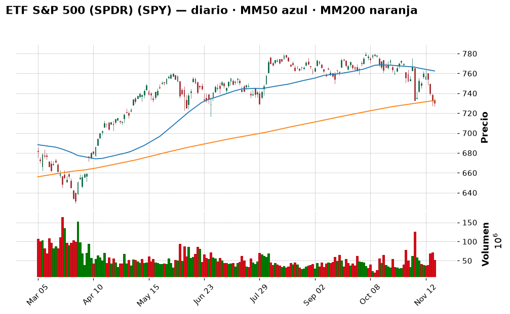
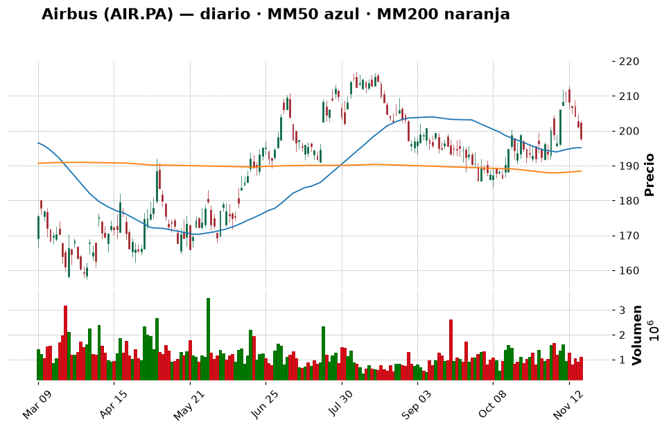
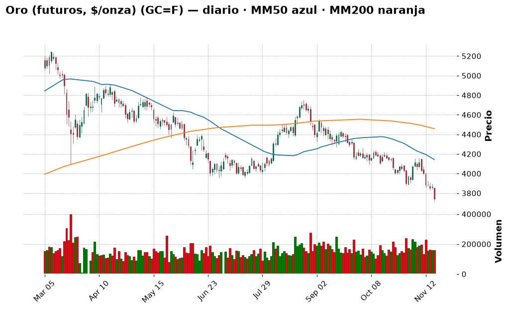
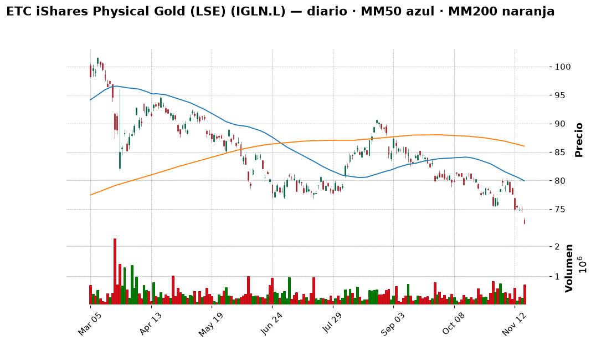
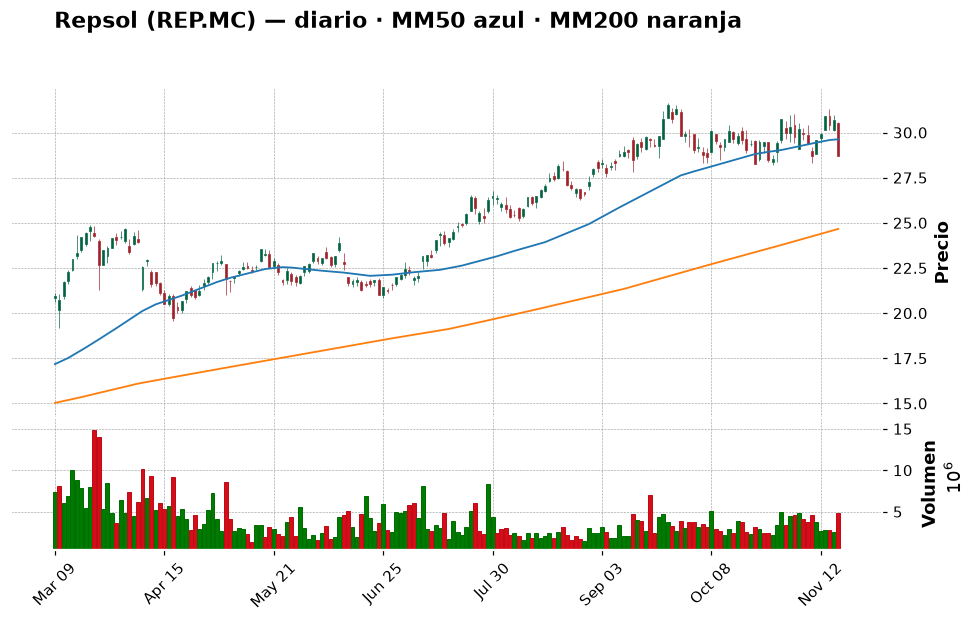
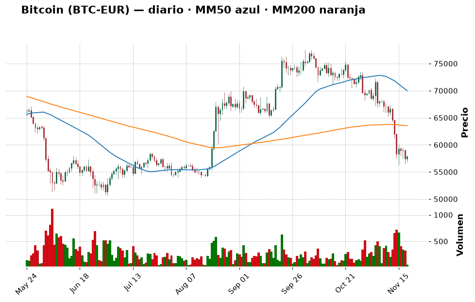
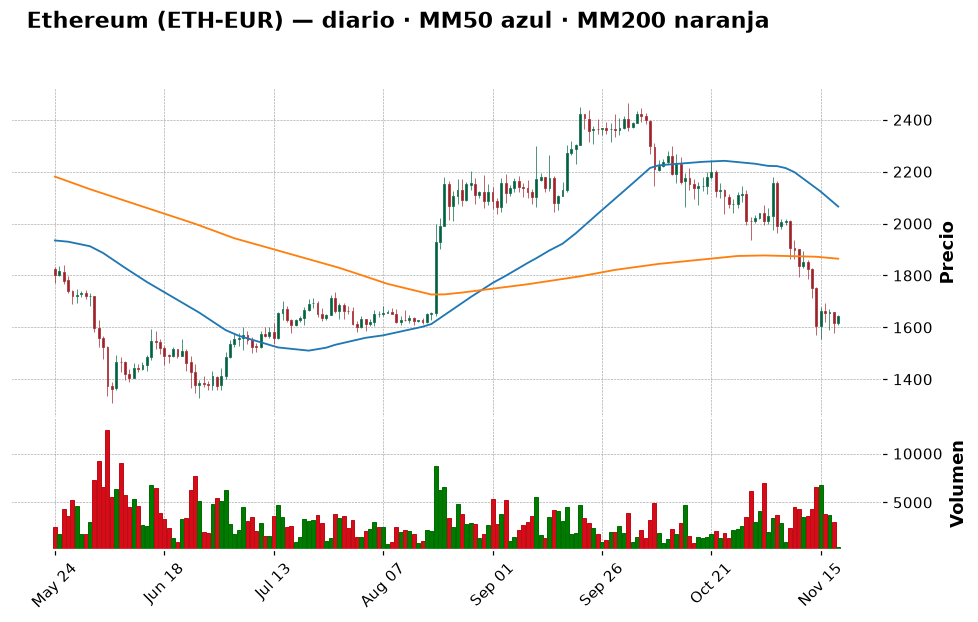
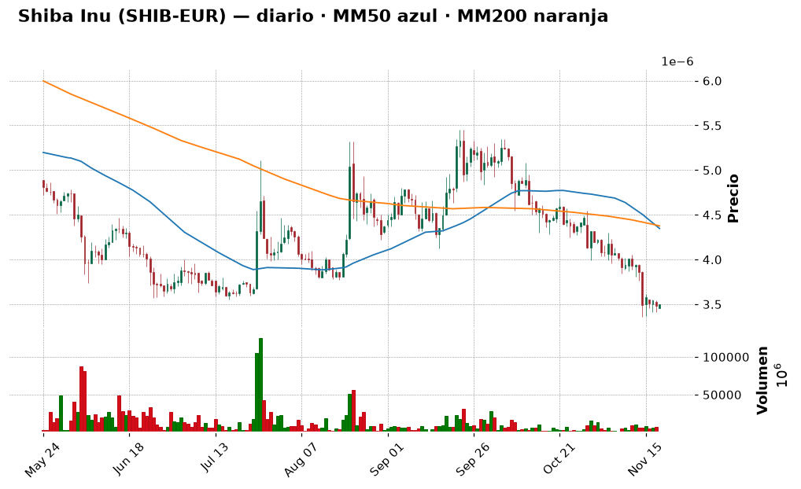

# 📈 Informe pre-apertura — jueves 19 de noviembre de 2026

> Generado automáticamente a las 07:55 (hora de Madrid) · Bolsa española abre a las 9:00 · Wall Street a las 15:30 · Cripto: 24/7
> **Termómetro del día:** 🔴 mucha incertidumbre — las actas de la Fed confirman que casi todos sus miembros quieren **más subidas de tipos** (y el gobernador Waller pide medio punto en diciembre), el S&P 500 cierra por tercer día **por debajo de su media de 200 sesiones**, el oro cae un −3 % a mínimos de más de un año y hoy debuta **Anthropic**, la mayor salida a bolsa de la historia. Los futuros de Wall Street suben con fuerza (+0,9 %), pero un rebote de un día no cambia el fondo.
> **Lección de hoy:** El oro como activo refugio (y por qué no paga intereses)

## 1. Lo que tienes que saber hoy
- **Tus compras de ayer están hechas ✅ y hoy no hay que comprar más acciones.** Registraste en `cartera.csv` la media parte del tramo 2 del ETF (**300 $ a 736,90 $**) y el primer tramo de **Airbus (0,68 acciones a 201,25 €)**. Era exactamente el plan. Ahora toca **dejar que el plan respire**: la siguiente compra del ETF es el 1-dic (con la aportación) y la de Airbus, solo si baja a ~193 €.
- **La Fed se pone más dura.** Las actas de su última reunión dicen que **casi todos** los miembros ven necesarias más subidas para devolver la inflación al 2 %, y "un par" contemplan más de 0,25 puntos en diciembre (Reuters vía Investing.com; CoinDesk). El gobernador **Waller** pide directamente **medio punto** (Decrypt). El bono de EE. UU. a 10 años paga un **5,07 %**. Eso explica casi todo lo que pasa hoy: bolsa floja, dólar fuerte y oro a la baja.
- **El oro se desploma (−3,2 %) a su nivel más bajo en 14 meses: 3.741,9 $/onza**, un **−33 % desde su máximo** de 52 semanas (5.586 $). Con los bonos pagando más del 5 % y el dólar en máximos de 18–19 meses, guardar un metal que no paga intereses "cuesta" más. **Veredicto: Esperar** (te explico en la sección 6 a qué nivel empezaría y en la lección por qué pasa esto).
- **Repsol cae un −6,4 % (28,71 €)** por el desplome del precio del gasóleo y de los márgenes de refino (XTB, Benzinga). Duele, pero **no rompe el nivel que fijamos** (28,18 €) y tu posición sigue ganando un **+132 %**. **Mantener.**
- **Novedad: con el Euríbor a 12 meses en el 3,24 % (por encima del 3 %), activamos el apartado de renta fija.** Las **Letras del Tesoro a 12 meses** pagaron un **3,045 %** en la última subasta (3-nov). Propongo **aparcar ~3.000 € de tu liquidez** en Letras a 6 y 12 meses, sin tocar el dinero de los tramos ya planificados (sección 8).

## 2. ✅ Recomendaciones del día (resumen)
| Activo | Acción | vs. ayer | Cuánto (orientativo) | Horizonte | Por qué, en una frase | Confianza |
|---|---|---|---|---|---|---|
| ETF S&P 500 (SPY / SPY5.L) | 🔵 Mantener | ↓ antes Comprar más (½ tramo 2 hecha) | 0 € hoy; **~300 € el 1-dic** si el viernes el SPY no cierra la semana bajo 729 $ | Años (5+) | Compra de ayer ejecutada; el SPY (730,20 $) aguanta justo sobre el soporte de 729,10 $ | media |
| Airbus (AIR.PA) | 🔵 Mantener | ↓ antes Comprar (tramo 1 hecho) | 0 € hoy; **tramo 2 (~150–200 €) con orden limitada en ~193 €** | Años | Tramo 1 hecho a 201,25 €; cerró en 197,78 € (bajo 198 €), camino del soporte de 193 € | media |
| Oro (IGLN.L) | ⏸️ Esperar | nueva | 0 € hoy; primer tramo de ~150 € si IGLN.L vuelve a cerrar sobre ~75 $ | Años | Caída fuerte (−3,5 %) en tendencia bajista y sin soportes por debajo: no se coge un cuchillo que cae | media |
| Letras del Tesoro (LETRAS) | 🟢 Comprar | nueva | **~3.000 € de liquidez**: 1.000 € a 6 meses y 2.000 € a 12 meses, en las próximas subastas | 6–12 meses | Tipo fijo del Estado (~2,8–3,05 %) por encima de la deuda AAA a 1 año (2,98 %) | alta |
| Repsol (REP.MC) | 🔵 Mantener | = | No añadir | Años | −6,4 % por los márgenes de refino, pero sobre el nivel de invalidación (28,18 €) y +16 % sobre su MM200 | media |
| Indra (IDR.MC) | ⛔ Evitar | = | 0 € | — | Sigue cayendo (−4,2 %, 51,74 €) con la investigación de Anticorrupción abierta | media |
| NVIDIA (NVDA) | ⛔ Evitar | = | 0 € | — | −2,9 % tras unos resultados récord: a un +1,5 % de su mínimo anual y −25,9 % bajo su MM200 | media |
| Solaria (SLR.MC) | 🔵 Mantener | = | No añadir | Años | Posición mínima; tendencia bajista (−23 % bajo MM200) | baja |
| Telefónica (TEF.MC) | ⏸️ Esperar | = | 0 € hoy; hasta ~250 € si supera 3,71 € | Años | Cae −2,6 % a 3,39 € y su tendencia pasa a bajista; aún sobre 3,27 € | baja |
| Iberdrola (IBE.MC) | ⏸️ Esperar | = | Hasta 5 % (~480 €) si retrocede a 21–22 € | Años | 22,76 €: tendencia alcista sana, pero aún sobre el nivel de compra | media |
| Inditex (ITX.MC) | 🔵 Mantener | = | No añadir | Años | Aguanta (−0,3 %) a un −2,4 % de máximos; reabre su tienda insignia en Nueva York | media |
| Apple (AAPL) | 🔵 Mantener | = | No añadir | Años | +0,15 % en un día rojo; tendencia alcista (+16,5 % sobre MM200) | media |
| Bitcoin (BTC) | 🔵 Mantener | = | No vender; **tramo del 1-dic en pausa**; ~50 € solo en ~54.000 € | Años | 57.845 €, todavía un −8,9 % bajo su MM200 | media |
| Ether (ETH) | ⏸️ Esperar | = | 0 € hoy | Años | 1.644 €: el soporte de 1.580–1.607 € sigue aguantando | media |
| Shiba Inu (SHIB) | ⛔ Evitar | = | No añadir | — | Memecoin, −53 % en un año | alta |

*(El resto de la watchlist —Santander, BBVA, Oryzon, IAG, Aena, Microsoft, Amazon, Alphabet, Berkshire, los ETF del Nasdaq y del MSCI World, ASML, LVMH, SAP y Siemens— tiene su veredicto en la tabla "Resto de la watchlist" de la sección 6.)*

**🔁 Seguimiento de ayer** (informe del miércoles 18-nov):
- **ETF S&P 500:** "Comprar más ~300 € hoy" → **hecho ✅**: 0,40711 participaciones de SPY5.L a **736,90 $** (300 $ + 1 $ de comisión). Como no apuntaste compra el día 17, esta es la **primera mitad del tramo 2**; la otra mitad va el **1-dic** con tu aportación, como dijimos. El SPY cerró ayer en **730,20 $**: por debajo de su MM200 (732,55 $), pero **por encima del soporte de 729,10 $**. La invalidación (**cierre semanal** del viernes bajo 729 $) sigue sin darse. Cambio de acción a **Mantener** porque la compra ya está hecha, no porque haya cambiado la tesis.
- **Airbus:** "Comprar el tramo 1 (~150–200 €) con orden limitada a ~201–202 €" → **hecho ✅**: 0,6795 acciones a **201,25 €** (136,76 € + 0,91 € de comisión). Luego bajó a **197,78 €** (−1,65 %), **por debajo de los ~198 €** que, según dijimos, abrían la puerta al siguiente soporte (**193,18 €**). Es justo donde está el **tramo 2**: no cambia el plan, lo acerca. La invalidación (cierre bajo 190 €) queda lejos (−3,9 %).
- **Repsol:** "Mantener; valoraría Reducir con un cierre bajo 28,18 € **y** el Brent cayendo hacia 80 $" → cerró en **28,71 €** (−6,42 %) y el Brent está en **89,43 $**. **Ninguna de las dos condiciones se cumple**: se mantiene Mantener.
- **Indra y Nvidia:** siguen cayendo (−4,19 % y −2,89 %); las condiciones para revisarlas (aclaración judicial y CEO permanente, respectivamente) no se han dado. **Evitar en ambas.**
- **Bitcoin / Ether:** ni recupera la MM200 (~63.500 €) ni toca ~54.000 €; ether sigue sobre 1.580 €. **Sin cambios.**
- **Nuevas en la tabla:** el **oro (IGLN.L)**, que a partir de hoy seguimos cada día, y las **Letras del Tesoro**, porque los tipos superan el umbral del 3 %.

> Hoy es un día para **no hacer nada en bolsa** y, si quieres, preparar el "aparcamiento" de la liquidez. Has ejecutado el plan dos días seguidos sin improvisar: eso es lo difícil. Lo que no haríamos es "aprovechar" el rebote de los futuros para comprar más, ni lanzarse al oro porque "ya ha caído mucho".

## 3. Agenda del día
| Hora (Madrid) | Evento | Por qué importa |
|---|---|---|
| Madrugada | **Asia en rojo:** Taiwán −3,4/−4,6 % (camino de un −11 % semanal), chips "al límite a la baja"; Kospi plano (Reuters vía Investing.com) | La "venta de la IA" sigue viva en Asia pese a la OPV de Anthropic |
| 9:00 | Apertura de la Bolsa española | El Ibex parte de **19.373,3** (tercera caída seguida) |
| 14:30 (hora habitual) | **Peticiones semanales de subsidio de desempleo** en EE. UU. · **Índice manufacturero de la Fed de Filadelfia** (tercer jueves del mes) | Datos fuertes = más argumentos para subir tipos |
| Antes de Wall Street | **Resultados de Walmart** (Reuters vía Investing.com; hora habitual, antes de la apertura) | El mayor minorista de EE. UU.: termómetro del consumo |
| 15:30 | Apertura de Wall Street. Futuros del **S&P 500 +0,89 % (7.405,50)** y del **Nasdaq 100 +1,57 % (27.613,75)** (Yahoo Finance, 7:37 h de Madrid) | Rebote a la espera del debut de Anthropic |
| Durante la sesión | **Debut de Anthropic en el Nasdaq.** Precio de salida **83 $** (por encima del rango de 70–78 $), **unos 81.000 millones $ captados** y valoración de **~1,5 billones $**: la mayor salida a bolsa de la historia, unas 7 veces sobresuscrita (Reuters vía Investing.com; Stocktwits) | Puede mover a todo el sector tecnológico (y a Amazon, accionista de Anthropic) |
| Todo el día | **Cumbre de Trump con Xi y Putin** (Expansión; El País) · Lanzamiento de **GTA VI** | Geopolítica y comercio con China; Sony y Take-Two, beneficiadas |
| 22:00 (aprox.) | **Primer debate Sánchez–Feijóo** (Expansión) | Elecciones generales el domingo 29-nov |
| Lun 23-nov | Huelga de maquinistas de Renfe (Europa Press) | Sin efecto relevante en bolsa |
| **1-dic** | **Tu aportación de 200 €** · Previsible subasta de Letras a 6 y 12 meses (las de 3-nov fueron el primer martes del mes; compruébalo en tesoro.es) | ½ restante del tramo 2 del ETF · aparcamiento de liquidez |
| 8–9 dic / 17 dic | Reuniones de la **Fed** y del **BCE** · 9-dic: subasta de Letras a 3 y 9 meses (Raisin) | La Fed, con una subida casi descontada |

*Nota: las búsquedas web del calendario económico, la previsión de apertura del Ibex, los futuros y los resultados del día no devolvieron páginas fiables fechadas hoy (casi todas eran de 2024–2025). La agenda sale de Reuters (vía Investing.com), Expansión y El País; las horas marcadas "habitual" son las de costumbre para ese dato, no confirmadas hoy.*

## 4. Cómo llegan los mercados
### España y Europa
**El miércoles 18:** el **Ibex 35 cayó un −1,28 % hasta 19.373,3 puntos** y pierde los 19.400 (Europa Press), su **tercera caída seguida** (Estrategias de Inversión). **Repsol fue la peor (−6,42 %)**, seguida de **Indra (−4,19 %)** y CaixaBank (−2,58 %) (El Boletín; Estrategias de Inversión). También bajaron **Telefónica (−2,56 %)**, **BBVA (−1,60 %)** y **Santander (−1,46 %)**; aguantaron **IAG (+0,37 %)** y casi plana **Inditex (−0,34 %)** (precios del JSON). El **Euro Stoxx 50** cedió un **−0,93 % (6.154,39)**, con **SAP (−3,76 %)** y **Airbus (−1,65 %)** entre las débiles y **ASML (+1,94 %)** rebotando.

**Por qué cae Repsol:** según XTB, por la **fuerte caída del precio del gasóleo** en los mercados internacionales, la consiguiente **caída de la rentabilidad de sus refinerías** y la ofensiva legal contra empresas del sector energético en España; Benzinga añade que, tras subir ~85 % en el año, muchos inversores **recogen beneficios**. Los datos lo confirman: el diferencial de refino 3-2-1 en EE. UU. ha caído un **−36 % en seis semanas** y la gasolina mayorista un ~20 % en tres (CoinDesk). Ayer mismo, Neo Next (participada por Repsol) compró pozos en el mar del Norte por **875 millones** (Expansión). 💡 *El **margen de refino** es lo que gana una refinería por transformar un barril de petróleo en gasolina, gasóleo, etc.: si el gasóleo baja más que el crudo, el margen se estrecha.*

**Noticias de empresas y de España:**
- **Inditex** reabre su tienda insignia de Zara en la **Quinta Avenida de Nueva York** y lleva allí Massimo Dutti y Bershka, punta de lanza de su expansión en EE. UU. (Expansión).
- **Santander** compensa con **venta de riesgo de crédito** el impacto en capital de las compras de **Webster y TSB**, y anticipa una aceleración en el cuarto trimestre (Expansión).
- **Siemens** contrata a KPMG para **vender su filial española Tecosa** (sistemas de seguridad) (Expansión).
- **Indra** ficha directivos del sector del automóvil (14 en tres años; el último, de Seat) (Cinco Días). Nada nuevo sobre la investigación.
- **UniCredit y Alemania** alcanzan un acuerdo sobre los términos de la **OPA sobre Commerzbank** (Reuters vía Investing.com).
- **Macro España:** JP Morgan ve la banca como la más beneficiada de un posible Gobierno PP–Vox (Cinco Días); el Gobierno aprueba subir el salario mínimo un 5,3 % para 2027 (Expansión); Bruselas y otros analistas avisan de que la **vivienda** es el principal riesgo para el crecimiento español (El País).
- **Euríbor:** el diario está en el **3,361 %** y la media de noviembre en el **3,286 %** (Expansión). El **BCE** ve "paralelismos" entre el endeudamiento para la IA y las burbujas puntocom y *subprime* (Europa Press; BCE, Informe de Estabilidad Financiera).
- **Pablo Hernández de Cos** será presidente del BCE pese al retraso del Eurogrupo (Expansión).

### Estados Unidos
**El miércoles 18:** el **S&P 500 cayó un −0,23 % (7.323,63)**, el **Dow Jones un −1,11 % (50.198)** y el **Nasdaq subió un +0,42 % (24.429,88)**. El S&P 500 **cierra por tercer día bajo su media de 200 sesiones**: según Motley Fool, pone fin a una racha de **155 sesiones seguidas por encima**. El **VIX** está en 24,56. Nvidia cayó un **−2,89 % (150,96 $)** pese a sus resultados récord: según Euronews, encadena su **peor racha desde 2008** y va camino de su séptima semana de pérdidas. **Amazon subió un +3,82 %**: su participación en Anthropic valdría unos **159.000 millones $** al precio de la OPV (247 Wall St). **Palo Alto Networks** sube tras mejorar previsiones (MarketWatch). MarketWatch habla del "mayor cambio de liderazgo en una generación": la tecnología se queda atrás y los sectores defensivos parecen caros.

**Esta mañana:** futuros del **S&P 500 +0,89 %** y del **Nasdaq 100 +1,57 %** (Yahoo Finance, 7:37 h). El impulso viene de la buena acogida de la OPV de Anthropic. Ojo: un rebote de los futuros antes de la apertura **no confirma nada**; lo que importa para nuestro plan es el **cierre del viernes** del SPY.

### Macro (tipos de interés, inflación, divisas, materias primas)
- **Fed:** las **actas** de octubre muestran que **casi todos** los miembros esperan nuevas subidas, que la decisión de no subir en octubre fue "ajustada" y que **un par** ven más de 0,25 puntos en diciembre (Cointelegraph; Reuters vía Investing.com). **Waller** pide **50 puntos básicos** y "acción agresiva"; Barr también ve apropiado subir; Daly prefiere ir con calma (CoinDesk). El mercado descuenta subidas de 0,25 en **diciembre y enero** y otra antes de abril; la probabilidad de medio punto en diciembre es del **~10 %** (CME FedWatch vía Investing.com). En contra, algunos analistas creen que la Fed mira datos "por el retrovisor": la gasolina en EE. UU. ha bajado un **−12,8 % en un mes** (CoinDesk). La directora del FMI pide endurecer la política monetaria en muchas economías por la inflación global.
- **Bonos:** el **10 años de EE. UU.** rinde un **5,07 %** y el 30 años un 5,41 % (Investing.com).
- **Divisas:** el **euro/dólar está en 1,0971 (−0,07 %)** (Yahoo Finance, 6:47 h GMT), cerca de su mínimo de 52 semanas (1,0954). El índice del dólar (DXY) en **103,8**, máximo de 18–19 meses. Para ti: el dólar fuerte revaloriza tus USDC (valen **2.374,85 €**).
- **Petróleo Brent: 89,43 $ (+0,29 %)** (Yahoo Finance), frente a 92,12 $ de ayer por la mañana: sigue bajando pese a la tensión en el Golfo. Malo para Repsol, bueno para la inflación.
- **Tipos de referencia** (de `rates_2026-11-19.json`): **BCE (facilidad de depósito) 2,50 %** · **Euríbor 12 m 3,239 %** (media de octubre; la de noviembre va por el 3,286 %, Expansión) · **deuda AAA de la zona euro a 1 año 2,978 %** (17-nov) · **Fed 4,00 %** (límite superior). 💡 *Fíjate en la diferencia: el BCE está en el 2,5 % pero el Euríbor a 12 meses en el 3,24 %. El Euríbor mira hacia delante: el mercado cree que el BCE **subirá** tipos en los próximos meses por la inflación (Bruselas la eleva al 3,9 % en España).*

**🥇 Oro:** **3.741,9 $/onza (GC=F), −3,16 % en el día, −9,7 % en un mes y −33 % desde su máximo** de 52 semanas (5.586 $); el ETC **IGLN.L** cerró en **72,45 $ (−3,45 %)**, en su **mínimo anual**. Es su cierre más bajo desde septiembre de 2025 (Investing.com vía Yahoo). Lo mueven tres cosas a la vez: **tipos más altos** (un bono al 5 % hace "caro" tener un activo que no paga nada), **dólar fuerte** (el oro se paga en dólares) y **ventas para cubrir pérdidas** en tecnología. Esta mañana rebota un **+0,8 % (~3.755 $)** con "compras de oportunidad" y ANZ ve señales técnicas de sobreventa (Investing.com vía Yahoo).

## 5. Panorama técnico de la watchlist
> 💡 *Cómo leer esta tabla:* la **tendencia** resume si el precio lleva meses subiendo, bajando o de lado
> (comparando el precio con sus medias de 50 y 200 días). El **RSI** mide de 0 a 100 si las subidas o bajadas
> recientes han sido muy fuertes: por encima de 70 se dice "sobrecompra" (quizá ha subido demasiado rápido),
> por debajo de 30 "sobreventa". Son pistas, no predicciones.

Todos los datos son del **cierre del miércoles 18-nov** (ningún valor llega con retraso hoy ✅).

| Valor | Último cierre | Día | 1 mes | 1 año | Tendencia | RSI | vs MM200 |
|---|---|---|---|---|---|---|---|
| IBEX 35 (^IBEX) | 19.373,3 | −1,28 % | +1,47 % | +22,45 % | ➡️ lateral | 48,0 🟡 | +3,1 % |
| Euro Stoxx 50 (^STOXX50E) | 6.154,39 | −0,93 % | +0,53 % | +8,09 % | ➡️ lateral | 43,6 🟡 | +0,4 % |
| S&P 500 (^GSPC) | 7.323,63 | −0,23 % | −5,04 % | +9,76 % | ➡️ lateral | 36,6 🟡 | −0,3 % |
| Nasdaq Composite (^IXIC) | 24.429,88 | +0,42 % | −7,55 % | +7,58 % | ➡️ lateral | 37,1 🟡 | −2,9 % |
| Banco Santander (SAN.MC) | 10,64 € | −1,46 % | −9,28 % | +20,84 % | ➡️ lateral | 38,9 🟡 | −5,8 % |
| BBVA (BBVA.MC) | 22,77 € | −1,60 % | +0,35 % | +28,61 % | ➡️ lateral | 46,2 🟡 | +5,5 % |
| Inditex (ITX.MC) | 59,36 € | −0,34 % | +4,95 % | +27,55 % | 📈 alcista | 59,0 🟡 | +8,5 % |
| Iberdrola (IBE.MC) | 22,76 € | −0,52 % | +7,21 % | +26,90 % | 📈 alcista | 57,8 🟡 | +11,1 % |
| Telefónica (TEF.MC) | 3,39 € | −2,56 % | −0,53 % | −7,84 % | 📉 bajista | 47,4 🟡 | −7,2 % |
| Repsol (REP.MC) | 28,71 € | −6,42 % | −1,03 % | +82,87 % | ➡️ lateral | 44,6 🟡 | +16,4 % |
| Solaria (SLR.MC) | 14,97 € | −0,73 % | +1,91 % | −13,09 % | 📉 bajista | 43,6 🟡 | −23,3 % |
| Oryzon (ORY.MC) | 2,32 € | 0,00 % | −10,23 % | −21,89 % | 📉 bajista | 37,5 🟡 | −18,5 % |
| IAG (IAG.MC) | 5,36 € | +0,37 % | +8,81 % | +24,12 % | 📈 alcista | 59,8 🟡 | +9,9 % |
| Indra (IDR.MC) | 51,74 € | −4,19 % | −17,08 % | +14,82 % | ➡️ lateral | 30,3 🟡 | −7,5 % |
| Aena (AENA.MC) | 28,22 € | −0,63 % | +7,46 % | +22,06 % | 📈 alcista | 58,3 🟡 | +8,4 % |
| Apple (AAPL) | 352,45 $ | +0,15 % | +3,81 % | +31,78 % | 📈 alcista | 56,6 🟡 | +16,5 % |
| Microsoft (MSFT) | 508,29 $ | +0,40 % | −4,43 % | +0,16 % | ➡️ lateral | 42,9 🟡 | +14,8 % |
| NVIDIA (NVDA) | 150,96 $ | −2,89 % | −30,26 % | −19,10 % | ➡️ lateral | 21,1 🟢 | −25,9 % |
| Amazon (AMZN) | 267,74 $ | +3,82 % | +1,95 % | +14,97 % | 📈 alcista | 57,2 🟡 | +9,3 % |
| ETF S&P 500 (SPY) | 730,20 $ | −0,31 % | −5,05 % | +9,69 % | ➡️ lateral | 36,6 🟡 | −0,3 % |
| ETF Nasdaq 100 (QQQ) | 659,51 $ | +0,39 % | −8,10 % | +9,25 % | ➡️ lateral | 37,7 🟡 | −3,4 % |
| Alphabet (GOOGL) | 282,44 $ | +0,80 % | −17,00 % | −0,91 % | 📉 bajista | 34,9 🟡 | −16,3 % |
| Berkshire Hathaway (BRK-B) | 574,62 $ | −2,07 % | +6,45 % | +14,18 % | 📈 alcista | 60,7 🟡 | +14,5 % |
| ETF MSCI World (IWDA.AS) | 127,10 € | −0,07 % | −2,59 % | +16,35 % | ➡️ lateral | 40,1 🟡 | +3,8 % |
| Airbus (AIR.PA) | 197,78 € | −1,65 % | +2,17 % | −2,45 % | 📈 alcista | 48,2 🟡 | +5,0 % |
| ASML (ASML.AS) | 1.260,80 € | +1,94 % | −13,37 % | +51,18 % | ➡️ lateral | 36,8 🟡 | −10,0 % |
| LVMH (MC.PA) | 388,10 € | −1,25 % | +0,35 % | −37,70 % | 📉 bajista | 41,3 🟡 | −15,6 % |
| SAP (SAP.DE) | 193,92 € | −3,76 % | −3,79 % | −5,64 % | ➡️ lateral | 36,5 🟡 | +16,1 % |
| Siemens (SIE.DE) | 266,00 € | −1,41 % | +2,21 % | +21,68 % | ➡️ lateral | 45,6 🟡 | +2,1 % |
| Oro (futuros, GC=F) | 3.741,9 $ | −3,16 % | −9,67 % | −8,16 % | 📉 bajista | 29,3 🟢 | −16,1 % |
| Oro (IGLN.L) | 72,45 $ | −3,45 % | −9,59 % | −8,53 % | 📉 bajista | 31,1 🟡 | −15,8 % |

*(🟢 = sobreventa, RSI < 30 · 🟡 = zona neutral · 🔴 = sobrecompra, RSI > 70.)*

**Lectura de conjunto:** la bolsa estadounidense está **en el filo de su tendencia de fondo**: el S&P 500 y el SPY están un −0,3 % por debajo de su MM200 (¡no un −10 %!), y el Nasdaq un −2,9 %. Es una zona de duda, no de pánico. En España el Ibex conserva un +3 % sobre su MM200 y los valores defensivos o de consumo (Iberdrola, Inditex, Aena, IAG) mantienen su tendencia alcista. Los únicos en **sobreventa** son **Nvidia** y el **oro**: dos casos donde "está muy barato" no basta, porque la causa de la caída sigue presente (la gobernanza en un caso, los tipos en el otro).

## 6. Ideas de bolsa: qué haría un experto
### ETF S&P 500 (SPY5.L / SPY) — MANTENER (½ del tramo 2 hecha)

- **Qué es:** un fondo que compra de una vez las ~500 mayores empresas de EE. UU. Tú tienes la versión europea (UCITS) que cotiza en Londres, **SPY5.L**; el gráfico es del SPY estadounidense, que sigue el mismo índice.
- **Por qué es noticia hoy:** el S&P 500 encadena su tercera sesión bajo la MM200 y rompe una racha de 155 días por encima (Motley Fool); las actas de la Fed apuntan a más subidas de tipos. Esta mañana, los futuros rebotan un +0,9 % por la OPV de Anthropic.
- **Lo que dice el gráfico:** 730,20 $, con un mínimo de 726,80 $ (casi igual que el del martes, 727,00 $): **dos días tocando la misma zona y cerrando por encima** del soporte de **729,10 $**. Por debajo, 722,59 $ y 716,58 $. Por encima, la MM200 (732,55 $) y luego la MM50 (762,51 $) y las resistencias de 755,6–756,7 $. RSI 36,6 (neutral, cerca de la sobreventa), MACD "empeorando" y volumen normal (1,0 veces la media), menos que el martes (1,4): **la presión vendedora se modera**. A un −6,6 % de su máximo de 52 semanas. En llano: el suelo de 727–729 $ está aguantando, pero aún no hay rebote.
- **Lo positivo:** ya tienes **0,87 participaciones** compradas a un precio medio de 748,72 $, dentro de la zona que elegimos. Si el soporte aguanta, el resto del plan llegará a buen precio.
- **El riesgo:** que el viernes cierre la semana bajo 729 $ (soporte y MM200 perdidos) y caiga hacia 717–723 $. Tu ETF iría unos días en pérdidas (hoy −2,4 %, −14,24 €), algo normal.
- **🧑‍💼 Recomendación: MANTENER.** La compra que tocaba está hecha. Comprar más hoy, "porque los futuros suben", sería salirse del plan.
  - **Cuánto y cómo:** 0 € hoy. **El 1-dic**, con la aportación, la **segunda mitad del tramo 2 (~300 €)**, solo si el viernes 20 el SPY **no** ha cerrado la semana bajo 729 $. Si lo cierra por debajo, pausa hasta que vuelva a cerrar una semana sobre ~732 $ o haga suelo en 717–723 $.
  - **Horizonte:** años (5 o más).
  - **Qué me haría cambiar de opinión:** el cierre semanal bajo 729 $ (pausa, no venta). Al alza, un cierre de nuevo sobre la MM200 (~733 $) confirmaría que la prueba se ha superado.
- **Qué mirar para entenderlo:** el **viernes por la noche**, el cierre del SPY. Es el único dato que necesitas para decidir el 1-dic.
- **Confianza:** media

### Airbus (AIR.PA) — MANTENER (tramo 1 hecho; tramo 2 en ~193 €)

- **Qué es:** el mayor fabricante de aviones comerciales del mundo y un actor clave en defensa y espacio en Europa.
- **Por qué es noticia hoy:** no hay noticias propias nuevas en nuestras fuentes (la búsqueda del día no dio nada fechado hoy). El último dato público sigue siendo de **547 entregas hasta septiembre** con un objetivo de **~870 en el año** (Demócrata, AirNav Radar): le exige un último trimestre muy fuerte. Su rival Boeing supera trámites de certificación del 737 MAX (Zacks vía Yahoo Finance). El queroseno sigue caro para las aerolíneas, aunque el petróleo baja.
- **Lo que dice el gráfico:** **197,78 € (−1,65 %)**, mínimo de 197,10 €. Ha perdido el soporte de 200,40 € (ahora se convierte en **resistencia**) y se dirige a la zona de **193,18 €** (y 190,88–190,90 €). Sigue sobre su MM50 (195,14 €) y su MM200 (188,42 €, +5,0 %): **la tendencia de fondo es alcista**. RSI 48,2 y MACD "empeorando": el impulso a corto plazo se enfría. Volatilidad del 30 % anual, normal para una gran industrial. A un −10,6 % de su máximo (221,30 €).
- **Lo positivo:** cartera de pedidos para años, duopolio con Boeing y negocio de defensa en crecimiento.
- **El riesgo:** que no cumpla el objetivo de entregas (lo sabremos en enero) o que el mercado general la arrastre por debajo de 190 €.
- **🧑‍💼 Recomendación: MANTENER.** Has comprado a 201,25 € y hoy pierdes un −2,4 % (−3,27 €): es normal comprar en tramos precisamente por esto. El plan ya preveía que si caía, el segundo tramo saldría más barato.
  - **Cuánto y cómo:** 0 € hoy. **Tramo 2: ~150–200 €** con **orden limitada a ~193 €** (si quieres, puedes dejarla puesta varios días; recuerda que se ejecutará sola si el precio baja hasta ahí). Alternativa: con un cierre sobre 217 € (tendencia reafirmada). Tope total de Airbus: 3–4 % del patrimonio (~300–400 €).
  - **Horizonte:** años.
  - **Qué me haría cambiar de opinión:** un **cierre por debajo de 190 €** (MM200 y soporte perdidos) o un recorte del objetivo de entregas: cancelaría la orden del tramo 2 y revisaría la tesis. No vendería por una caída de mercado.
- **Qué mirar para entenderlo:** si cae hasta 193 €, fíjate en si **rebota desde ahí** (el soporte funciona) o lo atraviesa con volumen alto.
- **Confianza:** media

### Oro (IGLN.L) — ESPERAR (nueva)

- **Qué es:** el oro es el activo refugio clásico: no depende de ninguna empresa ni gobierno. **GC=F** es su precio de referencia (futuros, en $/onza); el vehículo que puedes comprar es el **ETC IGLN.L** (iShares Physical Gold), que cotiza en Londres en dólares y está respaldado por lingotes guardados en cámaras. 💡 *Un **ETC** (exchange traded commodity) es como un ETF, pero de una materia prima: cada participación representa una cantidad de oro físico.*
- **Por qué es noticia hoy:** cayó un **−3,2 % hasta 3.741,9 $**, su cierre más bajo en más de un año; desde febrero pierde ~30 % (Investing.com vía Yahoo). Motivos: la Fed más dura (Waller pide medio punto), el bono a 10 años sobre el 5 %, el dólar en máximos de 18–19 meses y ventas para cubrir pérdidas en tecnología. Esta mañana rebota un +0,8 % con compras de oportunidad, y analistas de ANZ apuntan a sobreventa y a las compras constantes de los bancos centrales (Investing.com vía Yahoo). Druckenmiller ha tomado una posición en la minera Agnico Eagle (Yahoo Finance).
- **Lo que dice el gráfico:** tendencia **bajista**: GC=F está un **−16 % bajo su MM200** (4.457,88 $) y un −9,7 % bajo su MM50. RSI **29,3 (sobreventa)**, MACD "empeorando". Cierra **a un +0,5 % de su mínimo de 52 semanas** (3.721,8 $) y **no hay soportes por debajo** en nuestros datos; las resistencias están lejos (4.157–4.215 $). El ETC IGLN.L, igual: 72,45 $ en su mínimo anual, −15,8 % bajo su MM200 (86,02 $), RSI 31,1 y **volumen 1,6 veces el normal** (hubo ventas con convicción). Entre el 13 y el 17-nov cotizaba en ~74,8–75,4 $; esa zona es ahora su primera referencia. En llano: **es una caída fuerte dentro de una tendencia bajista, no un retroceso en una tendencia alcista.**
- **Lo positivo:** el oro diversifica de verdad: suele comportarse distinto a la bolsa a largo plazo y protege frente a crisis y pérdida de valor de las monedas. Hoy está un tercio más barato que hace unos meses.
- **El riesgo:** que la Fed suba tipos más de lo previsto y el dólar siga fuerte: el oro podría seguir cayendo varias semanas. Y recuerda que **no paga dividendos ni intereses** (ver la lección).
- **🧑‍💼 Recomendación: ESPERAR.** Para tu perfil, el oro tiene sitio como **diversificador (0–10 % del patrimonio, empezando por ~3–5 %)**. Pero hoy el técnico (bajista, sin suelos a la vista) y la macro (tipos al alza) apuntan en la misma dirección. "Ha caído mucho" no es razón suficiente: es el mismo razonamiento que te pido evitar con Indra o Nvidia.
  - **Cuánto y cómo:** 0 € hoy. **Primer tramo de ~150 € (≈1,5 %)** en IGLN.L cuando **cierre de nuevo sobre ~75 $** (volver a la zona de la semana pasada indicaría que la caída de ayer fue un exceso) o cuando el MACD pase a "mejorando" con el precio estabilizado varios días. Después, tramos de 150 € al mes hasta un 3–5 %. Nunca futuros (GC=F es solo la referencia) ni productos apalancados; PAXG (oro "tokenizado" en cripto) no sustituye al ETC.
  - **Horizonte:** años (es un seguro, no una apuesta de corto plazo).
  - **Qué me haría cambiar de opinión:** a favor, el cierre sobre ~75 $ en IGLN.L o una Fed que suavice el tono el 8–9 dic. En contra (seguir esperando más): que el bono a 10 años supere el 5,2 % y el dólar siga subiendo.
- **Qué mirar para entenderlo:** compara cada día el oro con el **bono a 10 años de EE. UU.** y el **dólar (DXY)**: cuando estos suben, el oro suele bajar, y al revés.
- **Confianza:** media

### Repsol (REP.MC) — MANTENER (la tienes)

- **Qué es:** la mayor petrolera española (exploración, refino, gasolineras y renovables).
- **Por qué es noticia hoy:** fue la peor del Ibex (**−6,42 %, 28,71 €**) por la caída del gasóleo y de los márgenes de refino y por la ofensiva legal contra el sector (XTB), con recogida de beneficios tras subir ~85 % en el año (Benzinga). Por otro lado, Neo Next (participada por Repsol) compra pozos en el mar del Norte por 875 millones y se consolida como principal productor de la zona (Expansión).
- **Lo que dice el gráfico:** cerró **en el mínimo del día** (28,71 €), con volumen 1,4 veces el normal. Pierde su MM50 (29,63 €) y la tendencia pasa de alcista a **lateral**, pero sigue un **+16,4 % sobre su MM200** (24,66 €). Justo debajo tiene una **zona de soportes en 28,18–28,31 €**; arriba, 30,43 € y la resistencia de máximos (31,02–31,64 €). RSI 44,6. Volatilidad alta (46 %).
- **Lo positivo:** tu posición gana un **+132 %** (pagaste 12,37 €) y la tendencia de fondo sigue a favor.
- **El riesgo:** un petróleo que sigue bajando (Brent 89,4 $) y unos márgenes de refino en caída. Si pierde los 28,18 €, el gráfico se debilitaría bastante.
- **🧑‍💼 Recomendación: MANTENER.** La caída es fuerte, pero **las dos condiciones que fijamos para Reducir** (cierre bajo 28,18 € **y** Brent hacia 80 $) **no se dan**. Vender tras un −6 % suele ser vender en el peor momento; mantenemos la regla, no la emoción. Tampoco ampliaría: el sector está en un mal momento.
  - **Cuánto y cómo:** no añadir.
  - **Horizonte:** años.
  - **Qué me haría cambiar de opinión:** un cierre por debajo de **28,18 €** con el Brent bajando hacia **80 $**: ahí propondría Reducir (vender 1 de tus 2 acciones para asegurar parte de la ganancia).
- **Qué mirar para entenderlo:** el **Brent** y la zona de **28,2–28,3 €**. Si rebota desde ahí, el soporte funciona; si la pierde con el crudo cayendo, la tesis se debilita.
- **Confianza:** media

### Resto de la watchlist: veredicto rápido
| Valor | Acción | Por qué (1 frase) | Nivel a vigilar |
|---|---|---|---|
| Indra (IDR.MC) | ⛔ Evitar | Sigue cayendo (−4,2 %, 51,74 €) con la investigación de Anticorrupción abierta; RSI 30, rozando la sobreventa | Hueco hasta 46,85 €; revisar solo sobre 57,98 € y con la investigación aclarada |
| NVIDIA (NVDA) | ⛔ Evitar | −2,9 % tras resultados récord; "peor racha desde 2008" (Euronews) y sin CEO permanente | Mínimo anual 148,80 $; revisar con CEO permanente y cierre sobre ~204 $ |
| Solaria (SLR.MC) | 🔵 Mantener | La tienes (1 acción, −0,1 %); tendencia bajista (−23 % bajo MM200); venderla costaría casi lo mismo en comisiones | Soportes 14,62 € y 13,61 €; resistencia 16,95 € |
| Telefónica (TEF.MC) | ⏸️ Esperar | −2,6 % a 3,39 € y la tendencia pasa a bajista; sin noticias propias | Comprar si supera 3,71 €; Evitar si cierra bajo 3,27 € |
| Iberdrola (IBE.MC) | ⏸️ Esperar | 22,76 € (−0,5 %), tendencia alcista sana (+11 % sobre MM200); el nivel de compra está más abajo | Comprar en 21–22 €; soporte 21,09 € |
| Inditex (ITX.MC) | 🔵 Mantener | Tu posición gana +120 %; reabre su tienda insignia en Nueva York (Expansión) | Soporte 56,2 €; máximo 60,80 € |
| Apple (AAPL) | 🔵 Mantener | +0,15 % en un día rojo; tendencia alcista y a −2,3 % de máximos | Soporte 338,7 $; máximo 360,83 $ |
| Banco Santander (SAN.MC) | ⏸️ Esperar | −1,5 % y −5,8 % bajo su MM200; compensa con venta de riesgo el capital de Webster y TSB (Expansión) | Comprar si cierra sobre 11,76 € (MM50); soporte 10,08 € |
| BBVA (BBVA.MC) | ⏸️ Esperar | −1,6 % y pierde el soporte de 22,77 €; tendencia de fondo aún sana (+5,5 % sobre MM200) | Sobre 23,57 € (MM50); soporte 21,82 € |
| Oryzon (ORY.MC) | 🔵 Mantener | La tienes (4 acciones, −28 %): a un +3,9 % de su mínimo anual; vale 9,26 € y venderla costaría casi lo mismo | Mínimo anual 2,23 €; resistencia 2,61 € |
| IAG (IAG.MC) | ⏸️ Esperar | +0,4 % y tendencia alcista; el queroseno caro sigue pesando en las aerolíneas | Cierre sobre 5,72 €; soporte 4,95 € |
| Aena (AENA.MC) | ⏸️ Esperar | Tendencia alcista con cruce dorado reciente; RSI 58, ya sin sobrecompra | Retroceso hacia la MM50 (26,41 €) |
| Microsoft (MSFT) | ⏸️ Esperar | +0,4 %, aguanta sobre su soporte de 504,96 $; Nadella explica las bajas voluntarias de 60.000 empleados (Yahoo Finance) | Si pierde 504,96 $, siguiente 486 $ |
| Amazon (AMZN) | ⏸️ Esperar | +3,8 %: su participación en Anthropic valdría ~159.000 M$ al precio de la OPV (247 Wall St); no persigo la subida | Resistencia 275,34 $; soporte 244,7 $ |
| ETF Nasdaq 100 (QQQ) | ⏸️ Esperar | −3,4 % bajo su MM200; más concentrado en tecnología que el S&P 500 | Recuperar 682,8 $; soporte 647 $ |
| Alphabet (GOOGL) | ⛔ Evitar | Cruce de la muerte y −16,3 % bajo su MM200; firma un acuerdo geotérmico de 50 MW (Yahoo Finance) | Soporte 276,9 $; recuperar la MM200 (337,6 $) |
| Berkshire Hathaway (BRK-B) | ⏸️ Esperar | −2,1 %; su 13F muestra que reduce Bank of America y compra Delta (TheStreet) | Retroceso hacia la MM50 (534 $) |
| ETF MSCI World (IWDA.AS) | ⏸️ Esperar | Plano (−0,07 %) sobre su soporte de 125,8 €; buena alternativa, pero ya construimos el núcleo con el S&P 500 | Soporte 125,8 €; MM200 122,5 € |
| ASML (ASML.AS) | ⏸️ Esperar | Rebota +1,9 % tras una semana de −10 %; sigue −10 % bajo su MM200 | Soporte 1.210,6 €; MM200 1.400,6 € |
| LVMH (MC.PA) | ⛔ Evitar | El lujo sigue en crisis (−37,7 % en un año, tendencia bajista) | Soporte 380 €; recuperar 431 € |
| SAP (SAP.DE) | ⏸️ Esperar | −3,8 % (193,92 €) y pierde su MM50 (197,6 €) tras la salida de Thomas Saueressig del consejo de dirección (Simply Wall St vía Yahoo); aún +16 % sobre su MM200 | Soporte 178,9 €; recuperar 216,7 € |
| Siemens (SIE.DE) | ⏸️ Esperar | −1,4 % (266 €) sobre su soporte de 265,75 €; estudia vender su filial española Tecosa (Expansión) | Soporte 262–266 €; resistencia 279,8 € |

## 7. ₿ Criptomonedas
> 💡 *Las criptomonedas cotizan 24 horas, 7 días a la semana: los precios son de esta mañana (en euros).
> Son mucho más volátiles que las acciones: caídas del 50 % o más han ocurrido varias veces.*

**Sentimiento:** Fear & Greed **10/100 (miedo extremo**; ayer 11, hace una semana 28, hace un mes 55, según alternative.me) · Capitalización total **2,27 billones $ (−1,1 % en 24 h; −52,9 % bajo su máximo histórico de octubre de 2025)** · Dominancia de Bitcoin **56,2 %**.
El miedo marca un nuevo mínimo. Como vimos el lunes, describe el ánimo de hoy, no cuándo cambiará: puede quedarse abajo semanas.

**Radar Coinbase** (407 monedas comprables · hoy suben 128 y bajan 218 · en 7 días suben 23 y bajan 325):
- **Mayores por capitalización (7 días):** BTC −13,6 %, ETH −11,9 %, BNB −12,6 %, XRP −5,8 %, SOL −9,4 %, HYPE −4,2 %, ZEC −4,3 %, DOGE −11,2 %.
- **Más suben (7 d, top 100):** solo **VVV (+17,1 %)** sube; después NEAR (−2,5 %), WLFI (−4,0 %) y POL (−4,0 %) · **Más bajan:** PUMP (−21,7 %), ENA (−21,3 %), ASTER (−20,0 %), AVAX (−18,1 %), SKY (−16,1 %).
La caída es **general** (23 de 348 suben en la semana). VVV (puesto 65) sube sola en un mercado que cae: no es una oportunidad para tu perfil, sino un riesgo de "llegar tarde". **Nada fuera del núcleo merece compra.**

| Moneda | Ranking | Precio (€) | 24 h | 7 días | 1 mes | 1 año | Tendencia | RSI | vs MM200 |
|---|---|---|---|---|---|---|---|---|---|
| Bitcoin (BTC) | #1 | 57.845,34 | +0,73 % | −10,48 % | −21,69 % | −27,03 % | ➡️ lateral | 25,1 | −8,9 % |
| Ether (ETH) | #2 | 1.644,04 | +1,58 % | −9,97 % | −24,57 % | −37,24 % | ➡️ lateral | 29,0 | −11,8 % |
| XRP (XRP) | #6 | 0,8949 | +1,57 % | −5,02 % | −24,67 % | −50,98 % | ➡️ lateral | 33,5 | −17,9 % |
| Solana (SOL) | #7 | 68,35 | +1,92 % | −7,50 % | −27,86 % | −42,39 % | ➡️ lateral | 32,5 | −11,8 % |
| Shiba Inu (SHIB) | #42 | 0,0000035 | +0,57 % | −11,17 % | −23,41 % | −52,77 % | 📉 bajista | 29,8 | −20,0 % |

*(Las variaciones de la tabla salen de las velas diarias de Coinbase —la de hoy, sin cerrar— y las del radar, de Coinpaprika: miden ventanas ligeramente distintas, por eso no coinciden.)*

**Noticias que importan:**
- **La Fed golpea a bitcoin:** cayó por debajo de **63.000 $** tras las palabras de Waller sobre una subida "de choque" de medio punto (Cointelegraph). Wintermute cree que podría bajar a la **zona de los 50.000 $** si siguen las salidas de los ETF y la presión de los tipos (CoinDesk). Esta mañana cotiza en ~63.500 $ (CoinDesk).
- **¿Culpa de Anthropic?** Muchos culpan a la OPV de "absorber" el dinero, pero analistas citados por CoinDesk y Decrypt lo ven "fácil de creer, pero erróneo": señalan más bien a las salidas de los ETF y a los tipos. CZ (Binance) anuncia "Anthropic tokenizado" en BNB Chain el día de la OPV (CoinDesk): 💡 *una acción "tokenizada" suele ser un derivado que imita el precio, sin los derechos de un accionista; la IOSCO avisa de que muchos inversores no saben lo que compran (Cinco Días).* **No es para ti.**
- **Mineros vendiendo:** MARA vendió ~1.000 millones $ en bitcoin para pagar deuda y financiar centros de datos de IA, y Riot vendió 20.264 BTC (Decrypt, CoinDesk): más oferta en el mercado.
- **ETF:** la racha de salidas del ETF de bitcoin de BlackRock terminó el martes, pero sin cifras grandes de entrada (CoinDesk).
- **Seguridad:** **Ledger confirma monederos físicos manipulados en Berlín** (además de Dubái) y pide a quien los compró allí desde enero que contacte con soporte (Decrypt, Cointelegraph). Los ladrones del robo a Binance se llevaron 192 tokens por valor de 6.300 millones $; Binance obtiene una orden mundial de congelación de 6.500 millones (Cointelegraph). Recordatorio: compra monederos físicos solo al fabricante.
- **Regulación:** senadores de EE. UU. piden ajustar las normas de la ley GENIUS sobre stablecoins (Cointelegraph); CoinShares vende todo su ether y la mitad de su solana para recomprar acciones (Decrypt).

### Bitcoin (BTC) — MANTENER (tramo de diciembre en pausa)

- **Qué es:** la primera y mayor criptomoneda; su oferta máxima está limitada a 21 millones de unidades.
- **Lo que dice el gráfico:** **57.845 €** esta mañana, seis días seguidos por debajo de su **MM200 (63.514 €)**: hoy un **−8,9 %** por debajo y un −17,4 % bajo su MM50. RSI **25,1 (sobreventa)** y MACD "mejorando": el impulso bajista se frena, pero sin giro. Sigue en el rango estrecho de los últimos días. **Soporte relevante en ~54.000 €** (−6,6 %); resistencias en 69.923 € y 70.745 €. A un −31 % de su máximo de 52 semanas (84.100 €) y a un +14 % de su mínimo (50.633 €).
- **🧑‍💼 Recomendación: MANTENER (no vender, no comprar).** La regla sigue igual:
  - **No vendes nada.** Tu bitcoin vale **152,23 € (−17,2 %, −31,55 €)**, un 1,6 % del patrimonio.
  - **El tramo del 1-dic sigue en pausa** hasta que **recupere la MM200** (cierre diario sobre ~63.500 €, hoy a un +9,8 %) o **llegue a ~54.000 €**, donde compraría un tramo **pequeño (~50 €)**. Wintermute apunta precisamente a esa zona como posible destino.
  - **Cuánto y cómo:** 0 € hoy. Tu cripto pesa un **1,6 %** frente al tope del 25 % (margen de 3.028,32 €), pero **un 25 % es mucho para un perfil moderado**: las criptomonedas han caído un 50–80 % varias veces, y hoy el mercado entero está un −53 % bajo su máximo. Mi recomendación es no pasar del **5 %** en los próximos meses. Si compras, por el par **BTC-EUR** de Coinbase o con tus USDC.
  - **Qué me haría cambiar de opinión:** un cierre diario sobre ~63.500 € reactivaría el plan normal (~50–100 € el 1-dic). Un cierre claro bajo 54.000 € me haría esperar más (siguiente referencia: ~50.600 €).
- **El riesgo:** una Fed que suba medio punto, más ventas de mineros y salidas de los ETF.
- **Confianza:** media

### Ether (ETH) — ESPERAR

- **Qué es:** la segunda criptomoneda; la red Ethereum permite programas ("smart contracts") y es la base de muchas stablecoins y aplicaciones.
- **Lo que dice el gráfico:** **1.644 €** (−10 % en una semana), un **−11,8 % bajo su MM200 (1.865 €)**. El soporte de **1.580–1.607 €** sigue aguantando al cierre; resistencia inmediata en 1.681,66 € y, más arriba, 2.178 €. RSI 29,0 (sobreventa) y MACD "mejorando". Volatilidad del 67 % anual (frente al 47 % de bitcoin).
- **🧑‍💼 Recomendación: ESPERAR.** Sin cambios. Que una gestora especializada como CoinShares venda **todo** su ether para recomprar acciones (Decrypt) no es una buena señal de demanda a corto plazo.
  - **Cuánto y cómo:** 0 € hoy; luego, como mucho, la mitad de lo que pongas en bitcoin, por el par ETH-EUR.
  - **Qué me haría cambiar de opinión:** un cierre diario por debajo de 1.580 €: pasaría a Evitar. Un cierre sobre la MM200 (~1.865 €): primer tramo de ~50 €.
- **El riesgo:** más volátil que bitcoin y con más tecnología "en construcción".
- **Confianza:** media

### Shiba Inu (SHIB) — EVITAR

- **Qué es:** una "memecoin" (moneda nacida como broma, sin uso real relevante).
- **Lo que dice el gráfico:** −53 % en un año, tendencia **bajista**, −20 % bajo su MM200 y a un paso de su mínimo de 52 semanas.
- **🧑‍💼 Recomendación: EVITAR (no añadir).** Tienes 3,50 € (pagaste 6 €). No merece la comisión de venderla; quédatela como recordatorio de por qué no se compran "pelotazos" (hoy Decrypt cuenta el caso de alguien que convirtió 300 $ en 200.000 $ con una memecoin de GTA VI: por cada historia así hay miles que lo pierden todo).
- **El riesgo:** que pierda casi todo su valor; con 3,50 € no es problema, con 350 € sí.
- **Confianza:** alta

## 8. 💼 Tu cartera
**Valor total:** 9.707,89 € · **Invertido:** 1.058,47 € (coste 1.023,95 €) · **Ganancia/pérdida no realizada:** +34,52 € (+3,37 %) · **Realizada:** 0 €
**Reparto:** acciones 3,3 % · ETF 6,0 % · cripto 1,6 % · liquidez 89,1 % · **Cripto vs tope:** 1,6 % de 25 % ✅ dentro (margen 3.028,32 €)
**Liquidez disponible:** 8.649,42 € (89,1 %: 6.274,57 € en euros en otro bróker + 2.605,43 USDC ≈ 2.374,85 € en Coinbase) · **Próxima aportación:** 200 € el 2026-12-01 (en 12 días)

| Activo | Cantidad | Precio medio | Precio actual | Valor (€) | G/P | Peso | Acción recomendada |
|---|---|---|---|---|---|---|---|
| Liquidez en euros (otro bróker) | 6.274,57 € | — | — | 6.274,57 | — | 64,6 % | **~3.000 € a Letras del Tesoro** (6 y 12 meses); el resto, para los tramos y el colchón |
| USDC (Coinbase) | 2.605,43 | 1 $ | 1 $ | 2.374,85 | 0 % | 24,5 % | Fuente de las compras cripto (en pausa) |
| ETF SPDR S&P 500 UCITS (SPY5.L) | 0,8695 | 748,72 $ | 730,75 $ | 579,14 | −2,40 % | 6,0 % | 🔵 Mantener — ½ tramo 2 el 1-dic |
| Bitcoin (BTC) | 0,00262976 | 69.886,57 € | 57.887,76 € | 152,23 | −17,17 % | 1,6 % | 🔵 Mantener — tramo de diciembre en pausa |
| Airbus (AIR.PA) | 0,6795 | 202,59 € | 197,78 € | 134,40 | −2,37 % | 1,4 % | 🔵 Mantener — tramo 2 en ~193 € |
| Inditex (ITX.MC) | 1 | 26,94 € | 59,36 € | 59,36 | +120,3 % | 0,6 % | 🔵 Mantener — cerca de máximos |
| Repsol (REP.MC) | 2 | 12,37 € | 28,71 € | 57,42 | +132,1 % | 0,6 % | 🔵 Mantener — vigilar 28,18 € |
| Apple (AAPL) | 0,15 | 171,99 $ | 352,45 $ | 48,19 | +104,9 % | 0,5 % | 🔵 Mantener |
| Solaria (SLR.MC) | 1 | 14,99 € | 14,97 € | 14,97 | −0,1 % | 0,2 % | 🔵 Mantener — no añadir |
| Oryzon (ORY.MC) | 4 | 3,23 € | 2,32 € | 9,26 | −28,3 % | 0,1 % | 🔵 Mantener — posición mínima |
| Shiba Inu (SHIB) | 1.000.000 | 0,000006 € | 0,0000035 € | 3,50 | −41,7 % | 0,04 % | ⛔ Evitar — no añadir |

*(El precio medio de Airbus, 202,59 €, incluye la comisión de 0,91 €; por eso es algo mayor que el precio de compra, 201,25 €.)*

**Lo que ha cambiado desde ayer:** registraste **dos compras ✅** (ETF por 274,06 € y Airbus por 137,67 €, ambos importes estimados: recuerda ajustarlos al céntimo con el cargo real en euros). El patrimonio pasa de 9.718,59 € a **9.707,89 € (−10,70 €)**: Repsol resta −3,94 €, Airbus −3,27 € (desde la compra), bitcoin −2,40 € y el ETF algo más por la caída del SPY y el tipo de cambio; las comisiones de las dos compras (~1,8 €) también cuentan. Tu `cartera.csv` no tiene errores.

**¿Está diversificada?** Todavía no: el 89 % es liquidez, como estaba previsto en esta fase. Plan orientativo (6 meses), actualizado:

| Destino | Objetivo | Estado | Siguiente paso |
|---|---|---|---|
| Núcleo: ETF S&P 500 (o MSCI World) | ~35 % (~3.400 €) | 6,0 % (~579 €): tramo 1 ✅ · ½ tramo 2 ✅ (18-nov) | **½ tramo 2 (~300 €) el 1-dic** si el viernes el SPY no cierra la semana bajo 729 $; luego tramo 3 (~500–600 €) a mediados de diciembre |
| Grandes empresas (Airbus, Iberdrola, banca…) | ~10–15 % | Airbus tramo 1 ✅ (~137 €) | AIR tramo 2 en ~193 € o sobre 217 €; IBE a 21–22 €; TEF sobre 3,71 €; SAN sobre 11,76 € |
| Oro (IGLN.L) | ~3–5 % (~300–500 €) | 0 % | Primer tramo de ~150 € cuando IGLN.L cierre sobre ~75 $ |
| Cripto (sobre todo BTC) | ~5 % (~500 €) | 1,6 % (~156 €) | **Tramo de diciembre en pausa**; se reactiva al recuperar la MM200 o con ~50 € en ~54.000 € |
| Liquidez: colchón + tipo fijo | ~40–45 % | 89 % | **~3.000 € a Letras** (ver abajo); el colchón de 3–6 meses de gastos, siempre disponible |

La **aportación de 200 € del 1 de diciembre** (en 12 días) irá, junto con ~100 € de la liquidez, a la segunda mitad del tramo 2 del ETF; el reparto detallado llegará en el informe del 26–30 de noviembre. Cuando la hagas, regístrala en `cartera.csv` como fila `liquidez` (`compra` de `EUR`).

### 🏦 Dónde aparcar la liquidez a tipo fijo
> 💡 *Con los tipos altos, el dinero que espera a invertirse puede ganar un interés casi sin riesgo. Referencias de hoy:
> Euríbor 12 m 3,239 % · deuda AAA a 1 año 2,978 % · BCE 2,50 %.*

| Producto | Tipo | Rentabilidad | Plazo | Garantía / riesgo | Mínimo | Fuente (fecha) |
|---|---|---|---|---|---|---|
| Letras del Tesoro a 12 meses | Deuda pública (tipo fijo) | 3,045 % (tipo medio, última subasta) | 12 meses | Estado español | 1.000 € | [Tesoro Público](https://www.tesoro.es/deuda-publica/subastas/resultado-ultimas-subastas/letras-del-tesoro) (3-nov-2026) |
| Letras del Tesoro a 9 meses | Deuda pública (tipo fijo) | 2,936 % (tipo medio) | 9 meses | Estado español | 1.000 € | [Tesoro Público](https://www.tesoro.es/deuda-publica/subastas/resultado-ultimas-subastas/letras-del-tesoro) (10-nov-2026) |
| Letras del Tesoro a 6 meses | Deuda pública (tipo fijo) | 2,822 % (tipo medio) | 6 meses | Estado español | 1.000 € | [Tesoro Público](https://www.tesoro.es/deuda-publica/subastas/resultado-ultimas-subastas/letras-del-tesoro) (3-nov-2026) |
| Letras del Tesoro a 3 meses | Deuda pública (tipo fijo) | 2,652 % (tipo medio) | 3 meses | Estado español | 1.000 € | [Tesoro Público](https://www.tesoro.es/deuda-publica/subastas/resultado-ultimas-subastas/letras-del-tesoro) (10-nov-2026) |
| Depósito WiZink 12 meses | Depósito a plazo fijo | 3,00 % TAE | 12 meses | FGD español hasta 100.000 € | 5.000 € | [HelpMyCash](https://www.helpmycash.com/mejores-depositos/) (17-nov-2026) |
| Depósito MiraltaBank 12 meses (vía Raisin) | Depósito a plazo fijo | 3,10 % TAE | 12 meses | FGD español hasta 100.000 € | 15.000 € | [HelpMyCash](https://www.helpmycash.com/mejores-depositos/) (17-nov-2026) |
| Depósito Banca Sistema 1 año (vía Raisin) | Depósito a plazo fijo | 3,30 % TAE | 12 meses | Fondo de garantía de Italia hasta 100.000 € | 5.000 € | [HelpMyCash](https://www.helpmycash.com/mejores-depositos/) (17-nov-2026) |

*No incluyo fondos monetarios ni fondos de renta fija a vencimiento: las búsquedas no devolvieron rentabilidades verificables de **este mes** (solo datos de junio o de principios de año), y la regla es no poner cifras que no se puedan comprobar. Recuerda que ambos pueden fluctuar, que su rentabilidad no está garantizada ("objetivo" no es "promesa") y que no tienen la cobertura del FGD.*

**🧑‍💼 Recomendación: COMPRAR Letras del Tesoro por ~3.000 €**, escalonadas: **~1.000 € a 6 meses** y **~2.000 € a 12 meses**, en las próximas subastas (la de 6 y 12 meses, previsiblemente a primeros de diciembre; la de 3 y 9 meses, el 9-dic). ¿Por qué Letras y no un depósito? Porque con 3.000 € **no llegas a los mínimos** de los depósitos mejor pagados (5.000–15.000 €), el emisor es el propio Estado y la Letra a 12 meses (3,045 %) paga **más que la deuda AAA de la zona euro a 1 año (2,978 %)**: es una buena oferta. Con 2.000 € al 3,045 % durante un año ganarías unos **61 € brutos**; con 1.000 € a 6 meses, unos 14 €. Poco, pero mucho más que el 0 % en la cuenta, y sin riesgo de pérdida si las mantienes hasta el vencimiento.
- **Qué queda libre (~3.275 € en euros + 2.375 € en USDC):** la ½ del tramo 2 y el tramo 3 del ETF (~800–900 €), el tramo 2 de Airbus (~200 €), Iberdrola si llega a 21–22 € (~480 €), el oro (~150–450 €) y tu **colchón de emergencia** (3–6 meses de gastos). Si no tienes ese colchón en otra cuenta, **primero el colchón** y luego las Letras. Los USDC no se tocan para esto: son tu liquidez para cripto.
- **Cómo:** las Letras se compran en la web del Tesoro (tesoro.es, con tu cuenta en el Banco de España) o a través de una entidad o bróker, que puede cobrar comisión; **compara antes**. Se compran "al descuento": pagas algo menos de 1.000 € y al vencimiento recibes 1.000 €.
- **Fiscalidad:** los intereses tributan en el IRPF como **rendimientos del capital mobiliario** (base del ahorro, 19–30 %).

## 9. Análisis de riesgo
| Riesgo | Nivel | Explicación |
|---|---|---|
| Fed: más subidas de tipos, bono al 5,07 % | 🔴 | Casi todos sus miembros piden más subidas; Waller, medio punto en diciembre |
| S&P 500 bajo su MM200 | 🔴 | Tres días por debajo (−0,3 %); el cierre del viernes del SPY decide la pausa del plan |
| Oro en caída libre | 🟡 | −33 % desde máximos y sin soportes en nuestros datos; no tienes posición, por eso solo 🟡 |
| Cripto en miedo extremo (10/100) | 🔴 | Wintermute no descarta bitcoin en los 50.000 $; mineros vendiendo |
| Petróleo y márgenes de refino a la baja | 🟡 | Golpea a Repsol (−6,4 %); alivia la inflación a medio plazo |
| OPV de Anthropic (debut hoy) | 🟡 | Puede animar o hundir a la tecnología según cómo debute; nada de productos "tokenizados" ni apalancados |
| Investigación de Defensa en España | 🟡 | Sigue golpeando a Indra; sin efecto visible en Airbus |
| Dólar fuerte / euro en 1,097 | 🟢 | Encarece un poco el ETF en dólares, pero revaloriza tus USDC |
| Elecciones en España (29-nov) | 🟢 | El mercado "se ha vacunado" del riesgo político; debate esta noche |

**Qué podría salir mal hoy (y esta semana):** que el debut de Anthropic decepcione, que el rebote de los futuros se dé la vuelta y que el SPY cierre el viernes por debajo de 729 $; entonces **pausaríamos** la compra del 1-dic, sin vender. Airbus podría bajar a 193 €, donde está precisamente nuestra orden del tramo 2. Para el oro, un dato de empleo fuerte hoy podría llevarlo a nuevos mínimos; como no tenemos posición, solo retrasaría la primera compra. **Lo que nunca haría:** vender Repsol por un mal día, comprar oro "porque está barato" sin que se estabilice, o comprar "Anthropic tokenizado".

## 10. 🎓 Aprende con el informe de hoy: El oro como activo refugio (y por qué no paga intereses)
- **Qué es (en una frase):** el oro es un **activo refugio** porque no depende de que una empresa gane dinero ni de que un gobierno pague sus deudas; a cambio, **no genera ninguna renta**: ni dividendos ni intereses. Solo ganas si su precio sube.
- **Ejemplo con números:** imagina que tienes 10.000 € para guardar un año. Si compras un bono que paga un **5 %**, en un año tendrás **10.500 €** pase lo que pase. Si compras oro, tendrás 10.000 € **más o menos lo que haya variado su precio**. Cuando los bonos pagaban un 1 %, renunciar a 100 € al año por tener oro no dolía. Con los bonos al **5 %**, renunciar a **500 €** duele mucho más, y muchos inversores venden oro para comprar bonos. A eso se le llama **coste de oportunidad**. Es exactamente lo que ha pasado esta semana: el bono de EE. UU. a 10 años supera el 5 %, la Fed habla de más subidas y el oro ha caído un **−33 % desde su máximo** (de 5.586 $ a 3.741,9 $). Además, como el oro se paga en dólares, un dólar fuerte lo encarece para quien compra con euros o yenes, y frena la demanda.
- **Dónde lo has visto hoy:** en la caída del oro (sección 4 y la idea de IGLN.L en la sección 6), en las Letras del Tesoro (sección 8: ¡ellas sí pagan intereses!) y en el bitcoin, que algunos llaman "oro digital" y que también sufre con los tipos altos.
- **Por qué te importa como inversor:** porque el oro **no es una inversión para hacerse rico**, sino un **seguro**: suele aguantar o subir cuando hay crisis, guerras, inflación descontrolada o miedo a que las monedas pierdan valor, y a menudo se mueve distinto a la bolsa. Por eso, con un 3–10 % de la cartera, puede suavizar los peores momentos. Lo que mejor le sienta son los **tipos de interés reales bajos** (💡 *tipo de interés menos inflación*): si el banco te paga un 2 % y la inflación es del 4 %, tu dinero pierde valor y el oro resulta atractivo; si los bonos pagan bastante más que la inflación, el oro pierde atractivo.
- **Error típico de principiante:** pensar que el oro "siempre sube" o que es "seguro" en el sentido de que no puede caer. Hoy lo ves: un −33 % en meses. Otro error: comprarlo en el pico del miedo, cuando sale en todos los telediarios, o comprar productos apalancados o futuros sobre el oro. Para un inversor particular, la forma sencilla es un **ETC de oro físico** como IGLN.L, en tramos.
- **Pregunta para pensar:** si el BCE y la Fed empezaran a **bajar** los tipos de interés el año que viene mientras la inflación se mantiene en el 4 %, ¿qué crees que le pasaría al precio del oro, y por qué? *(Respuesta al final del informe.)*

## 11. Consejo del día para inversores principiantes
**Cuando el plan está hecho, no hacer nada también es una decisión.** Has comprado el ETF y Airbus en los niveles que fijamos con calma. Hoy los futuros suben un 1 %, el oro "está barato" y una OPV gigante acapara los titulares: todo invita a "hacer algo". Pero cada compra fuera del plan aumenta el riesgo de comprar por impulso. Los grandes inversores pasan la mayor parte del tiempo **esperando**: tienen una lista de precios a los que comprarían y dejan que el mercado vaya hacia ellos (por eso tu orden de Airbus a ~193 € puede quedarse puesta). Mientras tanto, haz que el dinero que espera **trabaje un poco**, como las Letras del Tesoro de la sección 8, pero sin bloquear lo que necesitarás para los próximos tramos.

## 12. Glosario
- **Activo refugio:** activo al que acuden los inversores en momentos de miedo (oro, deuda pública de países solventes, a veces el dólar).
- **Coste de oportunidad:** lo que dejas de ganar por elegir una opción en lugar de otra (p. ej., los intereses de un bono que no cobras por tener oro).
- **Tipo de interés real:** el tipo de interés menos la inflación; indica si tu dinero gana o pierde poder de compra.
- **ETC (exchange traded commodity):** producto que cotiza en bolsa como un ETF y replica una materia prima; IGLN.L está respaldado por oro físico.
- **Futuros:** contratos para comprar o vender algo en una fecha futura a un precio fijado hoy; GC=F es la referencia del oro. No son para tu perfil.
- **Letras del Tesoro:** deuda pública española a corto plazo (3, 6, 9 y 12 meses), con un valor de 1.000 € cada una; se compran con descuento.
- **Subasta (del Tesoro):** el procedimiento por el que el Estado vende su deuda; el tipo medio es la rentabilidad media que obtuvieron los compradores.
- **TAE:** tasa anual equivalente; permite comparar productos de ahorro con distintos plazos y formas de pago.
- **Fondo de Garantía de Depósitos (FGD):** organismo que devuelve hasta 100.000 € por titular y entidad si un banco quiebra.
- **Fondo monetario:** fondo que invierte en deuda a muy corto plazo; rentabilidad variable y sin garantía del FGD.
- **Euríbor:** tipo de interés al que se prestan los bancos europeos; referencia de la mayoría de hipotecas variables en España.
- **Margen de refino:** lo que gana una refinería al transformar el crudo en gasolina, gasóleo y otros productos.
- **Actas de la Fed:** el resumen detallado de lo que se debatió en la última reunión del banco central de EE. UU.
- **Punto básico:** una centésima de punto porcentual (50 puntos básicos = 0,50 %).
- **OPV (oferta pública de venta):** salida a bolsa de una empresa.
- **Acción tokenizada:** representación de una acción en una cadena de bloques; muchas veces es un derivado sin los derechos del accionista.
- **Media móvil de 200 sesiones (MM200):** el precio medio de los últimos 200 días de bolsa; resume la tendencia de fondo.
- **Soporte / resistencia:** zonas de precio donde, en el pasado, las caídas o las subidas se frenaron.
- **RSI:** indicador de 0 a 100 que mide la fuerza de las subidas o bajadas recientes (más de 70, sobrecompra; menos de 30, sobreventa).
- **MACD:** indicador de impulso que compara dos medias móviles; "mejorando" significa que el impulso bajista se frena o el alcista crece.
- **VIX:** el "índice del miedo" de la bolsa de EE. UU.
- **Orden limitada:** orden con un precio máximo (o mínimo) fijado por ti; si el mercado no llega, no se ejecuta.
- **Tramo:** cada una de las partes en que divides una compra para no entrar todo de golpe.
- **Stablecoin:** criptomoneda diseñada para valer lo mismo que una moneda tradicional (USDC ≈ 1 dólar).
- **Memecoin:** criptomoneda nacida como broma o moda, sin un uso real relevante.

## 13. Fuentes
- Reuters vía Investing.com — [Morning Bid: Loading... Claude and GTA VI](https://www.investing.com/news/economy-news/morning-bid-loading--claude-and-gta-vi-5037775) · [Wall Street futures climb ahead of Anthropic's $1.5 trillion mega IPO](https://www.investing.com/news/stock-market-news/wall-street-futures-climb-ahead-of-anthropics-15-trillion-mega-ipo-5037518) · [Taiwan stocks plunge 4.6% as AI rout deepens](https://www.investing.com/news/stock-market-news/taiwan-stocks-plunge-46-as-ai-rout-deepens-chip-and-pcb-shares-hit-limitdown-5037869) · [US dollar hovers near 19-month high](https://www.investing.com/news/economy-news/us-dollar-hovers-near-19month-high-aussie-falls-after-soft-jobs-data-5037555) · [UniCredit and Germany reach deal on Commerzbank](https://www.investing.com/news/stock-market-news/unicredit-and-germany-reach-deal-on-commerzbank-takeover-terms--report-93CH-5037867) · [IMF head: global inflation calls for tightening](https://www.investing.com/news/economy-news/global-inflation-calls-for-monetary-policy-tightening-in-many-economies-imf-head-says-5037605)
- Investing.com — [Por qué el oro cayó a mínimos de 13 meses](https://es.investing.com/analysis/por-que-el-oro-cayo-a-minimos-de-13-meses-200485663) · vía Yahoo Finance: [Gold rebounds from 14-month low as bargain hunters emerge](https://finance.yahoo.com/markets/commodities/articles/gold-rebounds-14-month-low-020048872.html)
- Federal Reserve — [Minutes of the FOMC, October 27-28, 2026](https://www.federalreserve.gov/newsevents/pressreleases/monetary20261118a.htm) · Cointelegraph — [Fed officials saw October rate hold as a 'close call'](https://cointelegraph.com/markets/fed-officials-saw-october-rate-hold-as-close-call-minutes-show) · Europa Press — [Las actas de la Fed abren la puerta a subir tipos por encima de 25 puntos](https://www.europapress.es/economia/macroeconomia-00338/noticia-actas-fed-abren-puerta-subir-tipos-encima-25-puntos-diciembre-20261118203321.html) (titular vía RSS)
- CoinDesk — [Fed's rate hike push may be a mistake. Here's why](https://www.coindesk.com/markets/2026/11/19/fed-s-push-for-more-rate-hikes-leans-on-backward-looking-data-as-gas-prices-slide-analysts-argue) · [Mercados cripto](https://www.coindesk.com/markets) · [CZ says tokenized Anthropic is coming to BNB Chain](https://www.coindesk.com/markets/2026/11/19/cz-says-tokenized-anthropic-is-coming-to-bnb-chain-on-ipo-day) · [Blaming Anthropic's IPO for bitcoin's slide is 'easy to believe,' but flawed](https://www.coindesk.com/daybook-us/2026/11/18/blaming-anthropic-s-ipo-for-bitcoin-s-slide-is-easy-to-believe-but-flawed-analysts-say)
- Decrypt — [Fed's Waller Calls for 50-Basis-Point Rate Hike](https://decrypt.co/383566/fed-waller-50-basis-point-rate-hike-tokenized-finance-banks) · [Bitcoin Miners Are Selling Their Stacks to Fund the AI Boom](https://decrypt.co/383568/bitcoin-miners-selling-fund-ai-boom) · [Why CoinShares Just Sold All Its Ethereum](https://decrypt.co/383570/why-coinshares-just-sold-all-ethereum-half-solana) · [Ledger Confirms Tampered Bitcoin Wallets in Berlin](https://decrypt.co/383586/ledger-confirms-tampered-bitcoin-wallets-berlin-spreads-beyond-asia)
- Cointelegraph — [Bitcoin, stocks wobble as Fed's Waller talks of 'shock' 50-point rate hike](https://cointelegraph.com/markets/bitcoin-stocks-wobble-waller-talks-shock-50-point-rate-hike) · [Binance hackers stole 192 tokens](https://cointelegraph.com/news/binance-hackers-stole-192-tokens-across-11-networks) · [Senators warn GENIUS Act rules…](https://cointelegraph.com/news/us-senators-genius-act-rules-favor-federal-stablecoin-issuers)
- Repsol: XTB — [Las acciones de Repsol lideran las caídas del Ibex 35](https://www.xtb.com/es/analisis-de-mercado/acciones-repsol-lideran-caidas-ibex-35-que-ocurre) · Benzinga — [Repsol se desploma y arrastra al Ibex 35](https://es.benzinga.com/news/spain/stocks/repsol-acciones-caida-ibex-35-margenes-refino-181126/) · El Boletín — [El Ibex 35 cae un 1,28% arrastrado por Repsol](https://www.elboletin.com/el-ibex-35-cae-un-128-hasta-19-373-puntos-arrastrado-por-repsol-y-las-dudas-sobre-la-ia/) · Estrategias de Inversión — [El Ibex 35 recorta por tercera sesión consecutiva](https://www.estrategiasdeinversion.com/actualidad/noticias/bolsa-espana/el-ibex-35-cede-posiciones-por-tercera-sesion-n-971411)
- Expansión (titulares y resúmenes vía RSS) — [Repsol y sus socios compran pozos en Reino Unido](https://www.expansion.com/empresas/energia/2026/11/18/repsol-socios-compran-pozos-petroleo-reino-unido-875-millones.html) · [Inditex se rearma en Nueva York](https://www.expansion.com/empresas/distribucion/2026/11/19/inditex-rearma-nueva-york-zara-massimo-dutti-bershka.html) · [Santander compensa con venta de riesgo…](https://www.expansion.com/empresas/banca/2026/11/19/santander-compensa-venta-riesgo-impacto-capital-webster-tsb.html) · [Siemens ficha a KPMG para vender Tecosa](https://www.expansion.com/empresas/2026/11/19/siemens-ficha-kpmg-venta-filial-sistemas-seguridad-tecosa.html) · [Euríbor hoy](https://www.expansion.com/mercados/euribor/2026/11/18/euribor-hoy-euribor-diario-situa-3-361-apunta-recuperacion-progresiva-respecto-media-mensual.html) · [Trump llega debilitado a la cumbre con Putin y Xi](https://www.expansion.com/economia/2026/11/19/trump-llega-debilitado-cumbre-putin-xi-nvidia-midterms-fallos-tecnologicos.html) · [Llegan los debates electorales](https://www.expansion.com/opinion/2026/11/19/llegan-debates-electorales-campana-insolita.html) · [De Cos será presidente del BCE](https://www.expansion.com/mercados/2026/11/18/cos-sera-presidente-bce-pese-retraso-administrativo-eurogrupo.html)
- Europa Press (vía RSS) — [El Ibex 35 cede un 1,28% y pierde los 19.400 puntos](https://www.europapress.es/economia/bolsa-00348/noticia-ibex-35-cede-128-pierde-19400-puntos-20261118180812.html) · [El BCE ve "paralelismos" entre el endeudamiento de la IA y las burbujas](https://www.europapress.es/economia/finanzas-00340/noticia-bce-ve-paralelismos-auge-endeudamiento-ia-burbujas-puntocom-subprime-20261118144932.html)
- Cinco Días / El País — [Las claves: Nvidia se atreve a pensar en un futuro sin su gran líder](https://cincodias.elpais.com/opinion/2026-11-19/las-claves-nvidia-se-atreve-a-pensar-en-un-futuro-sin-su-gran-lider.html) · [JP Morgan: el "principal riesgo" de un futuro Gobierno del PP es Vox](https://cincodias.elpais.com/mercados-financieros/2026-11-19/jp-morgan-el-principal-riesgo-de-un-futuro-gobierno-del-pp-es-vox.html) · [¿Acciones tokenizadas o derivados?](https://cincodias.elpais.com/criptoactivos/2026-11-19/acciones-tokenizadas-o-derivados-muchos-inversores-desconocen-que-estan-comprando.html) · [Indra pesca en una industria del automóvil en crisis](https://cincodias.elpais.com/companias/2026-11-19/indra-aprovecha-la-crisis-del-automovil-para-fichar-en-el-sector-mas-de-una-decena-de-cargos-directivos-altos-y-medios.html) · [La crisis de la vivienda amenaza con enfriar el auge económico](https://elpais.com/economia/2026-11-19/menos-consumo-trabas-laborales-y-mas-desigualdad-la-crisis-de-la-vivienda-amenaza-con-enfriar-el-auge-economico-espanol.html)
- Yahoo Finance (noticias por valor) — Motley Fool: [The S&P 500 just ended a run of 155 trading days above its 200-day average](https://www.fool.com/investing/2026/11/18/the-s-and-p-500-just-ended-a-run-of-155-trading-days-above-its-200-day-average-here-s-what-followed-34-similar-runs-since-1950/) · Euronews: [Anthropic's record IPO lands as Nvidia suffers its worst run since 2008](https://www.euronews.com/2026/11/19/anthropics-record-ipo-lands-as-nvidia-suffers-its-worst-run-since-2008) · 247 Wall St: [Amazon's $18 Billion Anthropic Bet Is Worth $159 Billion](https://247wallst.com/investing/2026/11/18/amazons-18-billion-anthropic-bet-is-worth-159-billion-at-the-ipo-price-heres-what-that-is-per-amazon-share/) · Stocktwits, TheStreet, Simply Wall St, Zacks, MarketWatch
- Yahoo Finance — futuros del [S&P 500](https://finance.yahoo.com/quote/ES=F/) y del [Nasdaq 100](https://finance.yahoo.com/quote/NQ=F/), [Euro Stoxx 50](https://finance.yahoo.com/quote/%5ESTOXX50E/), [EUR/USD](https://finance.yahoo.com/quote/EURUSD=X/), [Brent](https://finance.yahoo.com/quote/BZ=F/)
- Renta fija — [Tesoro Público: resultados de las últimas subastas de Letras](https://www.tesoro.es/deuda-publica/subastas/resultado-ultimas-subastas/letras-del-tesoro) · [Raisin: rentabilidad de las Letras a 3 y 9 meses (noviembre 2026)](https://www.raisin.com/es-es/noticias/rentabilidad-letras-3-9-meses-noviembre-2026/) · [HelpMyCash: mejores depósitos de noviembre de 2026](https://www.helpmycash.com/mejores-depositos/) · BCE y FRED (tipos de referencia, vía `fetch_rates.py`)
- Airbus: Demócrata / AirNav Radar — [entregas hasta septiembre de 2026](https://www.democrata.es/economia/airbus-rebasa-las-70-entregas-en-septiembre-y-suma-547-aviones-comerciales-en-2026/)
- Alternative.me — [Fear & Greed Index](https://alternative.me/crypto/fear-and-greed-index/)
- Precios e indicadores de bolsa: Yahoo Finance (velas diarias, último cierre disponible)
- Cripto: Coinbase (universo de monedas y velas diarias) · Coinpaprika (datos de mercado) · Fear & Greed (alternative.me)
- **Fuentes que fallaron hoy:** Expansión (portada de mercados y cotización del Ibex: el sitio **bloquea el acceso automático**; datos del Ibex tomados del JSON de precios y de Europa Press/El Boletín) · Europa Press (artículos del cierre del Ibex y de las actas de la Fed **bloqueados** al leerlos; usados su titular y resumen RSS) · BCE y Reserva Federal (las páginas de notas de prensa **no mostraban el listado** al leerlas automáticamente; las actas se tomaron de su nota en el RSS y de Reuters, CoinDesk y Cointelegraph) · Búsquedas de calendario económico, previsión de apertura del Ibex, futuros, resultados del día, cripto del día, Airbus y oro: **sin resultados fechados hoy** (devolvían páginas de 2024–2025 o de días anteriores) · Búsquedas de fondos monetarios y de renta fija a vencimiento: **sin datos verificables de este mes** (por eso no aparecen en la tabla).

---
**Respuesta a la pregunta del día:** lo más probable es que el oro **subiera**. Si los tipos bajan mientras la inflación sigue en el 4 %, los **tipos reales** (tipo de interés menos inflación) se vuelven más bajos o incluso negativos: el dinero en bonos o depósitos perdería poder de compra. Entonces el coste de oportunidad de tener oro (los intereses a los que renuncias) se reduce, y el oro gana atractivo como protección frente a la inflación. Además, unos tipos más bajos en EE. UU. suelen debilitar el dólar, lo que también suele empujar al oro hacia arriba. Es el caso contrario al de esta semana, y por eso el oro y los tipos reales se vigilan juntos (aunque ninguna relación en bolsa se cumple siempre).

*Este informe lo genera automáticamente una IA a partir de noticias y datos de precios públicos y de los
movimientos que has registrado. Las recomendaciones son la opinión razonada de un modelo, no
asesoramiento financiero personalizado ni regulado: no conoce toda tu situación (ingresos, deudas,
objetivos, fiscalidad). El análisis técnico es orientativo y no predice el futuro. Invertir conlleva riesgo
de pérdida, y en criptomonedas ese riesgo es muy alto. Decide tú, contrasta la información y, si lo
necesitas, consulta con un profesional.*
