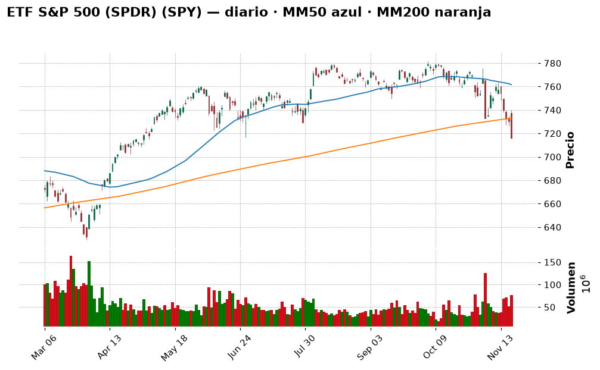
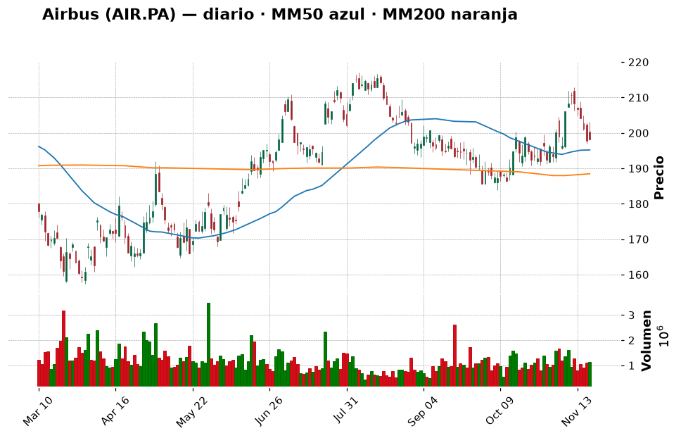
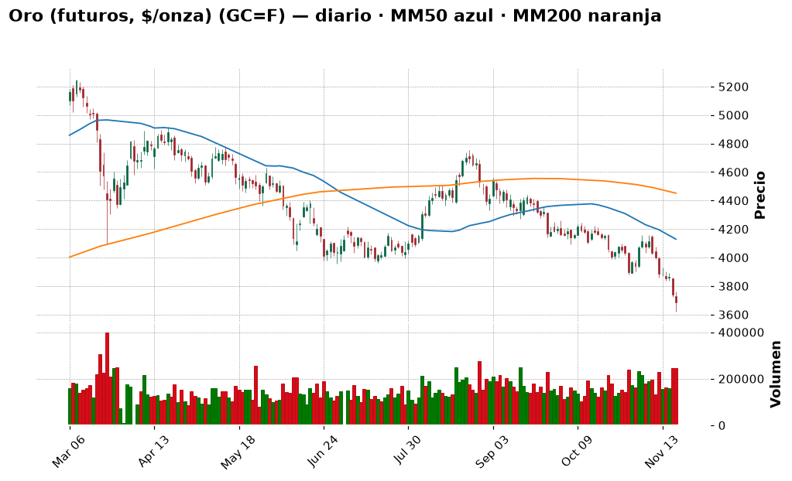
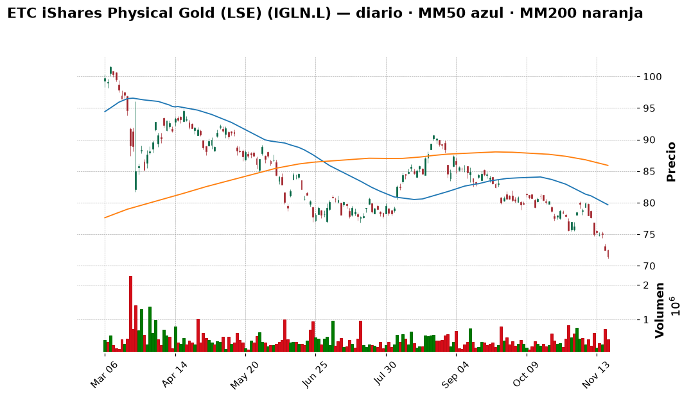
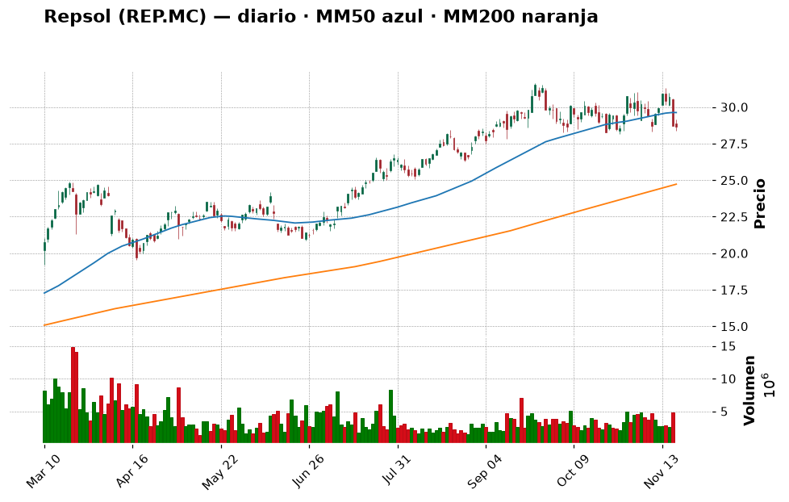
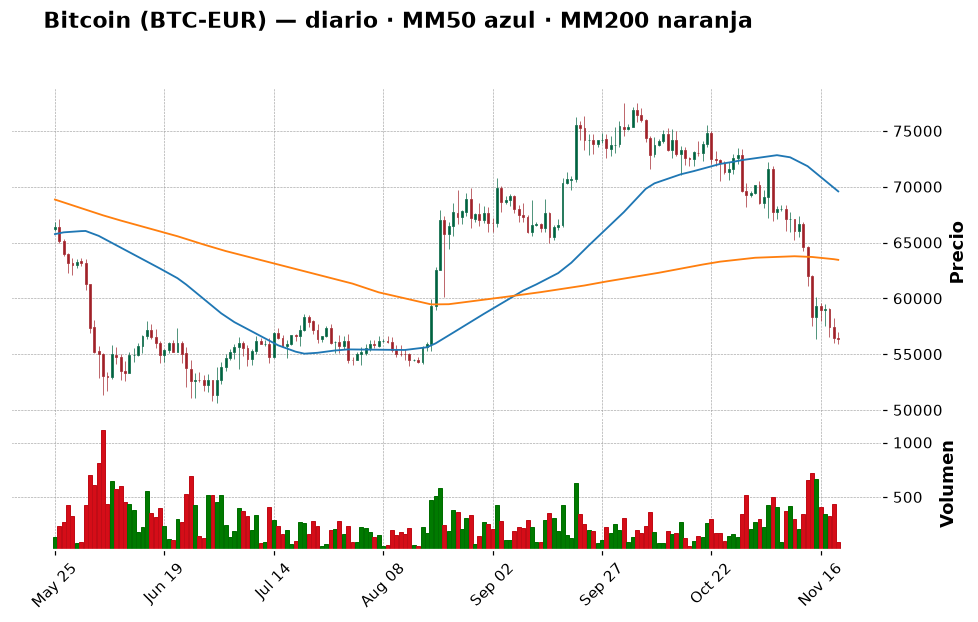
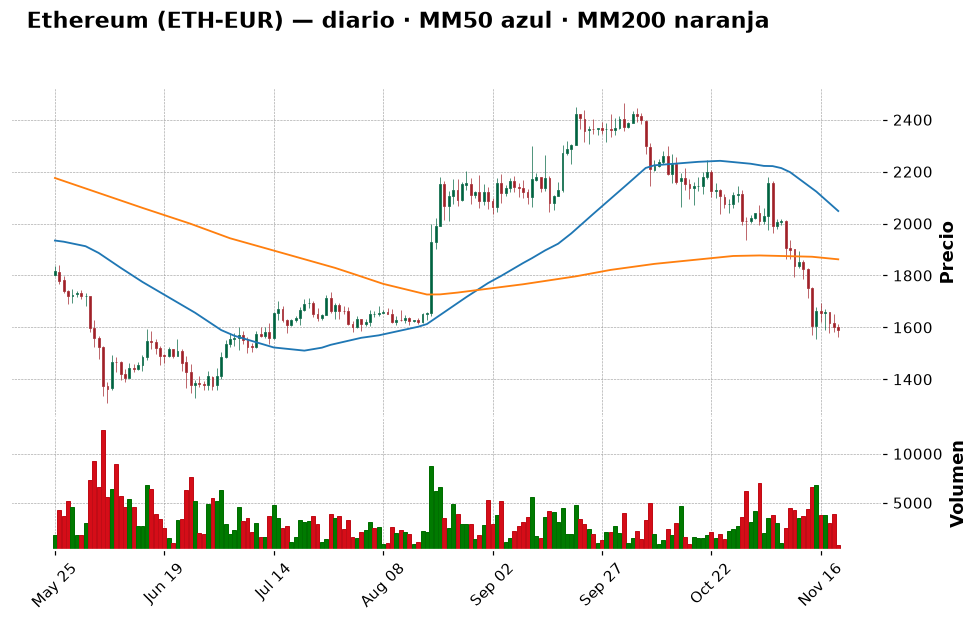
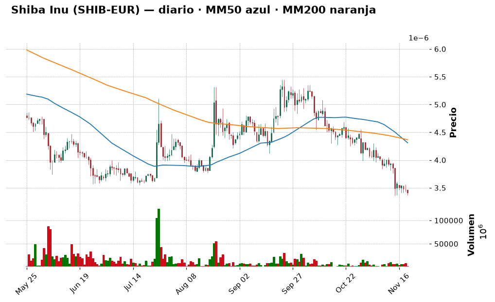

# 📈 Informe pre-apertura — viernes 20 de noviembre de 2026

> Generado automáticamente a las 07:58 (hora de Madrid) · Bolsa española abre a las 9:00 · Wall Street a las 15:30 · Cripto: 24/7
> **Termómetro del día:** 🔴 mucha incertidumbre — el S&P 500 cayó un **−2 %** el jueves (su **sexta caída seguida**) pese al estreno estrella de Anthropic, el **VIX sube a 28,4**, Asia vive su **peor semana desde 2020**, el mercado da casi por hecha una **subida de tipos de la Fed en diciembre (~96–97 %)** y el oro sigue desplomándose. Los futuros apuntan a otra apertura en rojo.
> **Lección de hoy:** Los sesgos emocionales: FOMO y pánico

## 1. Lo que tienes que saber hoy
- **Hoy no toca comprar nada, y tampoco vender.** Ayer no registraste movimientos nuevos en `cartera.csv` (el último es del 18-nov), y era lo correcto. Tu patrimonio es de **9.696,42 €**, un **−0,1 %** (−11,47 €) frente a ayer: con el 89 % en liquidez, las caídas apenas te rozan. Ese es precisamente el sentido de entrar en tramos.
- **El SPY rompió el soporte que vigilábamos.** Cerró el jueves en **715,87 $ (−1,96 %)**, por debajo de los **729,10 $** y un **−2,3 % bajo su media de 200 sesiones (MM200)**. Nuestra regla decía: *si el viernes cierra la semana por debajo de 729 $, se pausa la ½ del tramo 2 del 1-dic*. El cierre semanal es **esta noche**; para evitar la pausa, el SPY tendría que subir hoy un **+1,8 %**, y los futuros del S&P 500 caen un **−0,6 %**. **Lo más probable es que la pausa se active.** Pausa no es venta: el plan de fondo (ETF a años vista) sigue intacto.
- **Anthropic se estrenó con fuerza (+17 %), pero el mercado cayó igualmente.** Abrió a **111,50 $**, cerró a **97,17 $** frente a los 83 $ de salida y luego cedió un ~4–6 % fuera de hora (Reuters vía Investing.com). Nvidia cae por sexta sesión (−3,3 %, 145,98 $) y ha perdido **669.000 millones $** de valor en seis días (MarketWatch). Es el ejemplo perfecto de la lección de hoy: **euforia (FOMO) y pánico el mismo día**.
- **El oro no encuentra suelo:** los futuros cerraron el jueves en **3.685,5 $** (−1,5 %), pero esta madrugada se negocia en torno a **3.515–3.540 $** (CoinDesk; Investing.com vía Yahoo), camino de su **peor semana desde marzo (~−9 %)**. El ETC **IGLN.L** cerró en **71,47 $**, a solo un +0,4 % de su mínimo anual. Nuestra señal de entrada (cierre sobre ~75 $) está cada vez más lejos: **Esperar**.
- **Bitcoin y ether, al límite de sus soportes:** bitcoin **56.338 €** (mínimo de cuatro meses, CoinDesk) y ether **1.589 €**, a un 0,5 % de su soporte de 1.580 €. Miedo extremo (12/100). Sin cambios: no vender, no comprar.

## 2. ✅ Recomendaciones del día (resumen)
| Activo | Acción | vs. ayer | Cuánto (orientativo) | Horizonte | Por qué, en una frase | Confianza |
|---|---|---|---|---|---|---|
| ETF S&P 500 (SPY / SPY5.L) | 🔵 Mantener | = | 0 € hoy; **½ tramo 2 del 1-dic, probablemente en pausa** (se decide con el cierre de esta noche) | Años (5+) | Rompe 729 $ y la MM200; la tesis a largo plazo no cambia, el ritmo de compra sí | media |
| Airbus (AIR.PA) | 🔵 Mantener | = | 0 € hoy; **tramo 2 (~150–200 €) con orden limitada en ~193 €** | Años | Aguanta en 198,14 € (+0,2 %) en un día rojo; la orden del tramo 2 está a un −2,5 % | media |
| Oro (IGLN.L) | ⏸️ Esperar | = | 0 € hoy; primer tramo de ~150 € solo con cierre sobre ~75 $ | Años | Sigue cayendo (−1,4 %) sin soportes: los tipos reales en máximos le restan atractivo | media |
| Letras del Tesoro (LETRAS) | 🟢 Comprar | = | **~3.000 € de liquidez**: 1.000 € a 6 meses y 2.000 € a 12 meses, en la próxima subasta | 6–12 meses | Tipo fijo del Estado (2,82–3,05 %) por encima de la deuda AAA a 1 año (2,97 %) | alta |
| Repsol (REP.MC) | 🔵 Mantener | = | No añadir | Años | 28,65 € (−0,2 %): sobre el nivel de invalidación (28,18 €) y con el Brent en ~89,8 $ | media |
| Indra (IDR.MC) | ⛔ Evitar | = | 0 € | — | 51,40 €, RSI 29,8 (sobreventa), pero la investigación sigue abierta | media |
| NVIDIA (NVDA) | ⛔ Evitar | = | 0 € | — | Sexta caída, en su mínimo anual y ahora con una citación de California | media |
| Solaria (SLR.MC) | 🔵 Mantener | = | No añadir | Años | Cae −5,4 % (14,16 €) y pierde 14,62 €; posición mínima (14 €) | baja |
| Telefónica (TEF.MC) | ⏸️ Esperar | = | 0 € hoy; hasta ~250 € si supera 3,71 € | Años | 3,36 € (−0,9 %), aún sobre el soporte de 3,27 € | baja |
| Iberdrola (IBE.MC) | ⏸️ Esperar | = | Hasta 5 % (~480 €) si retrocede a 21–22 € | Años | 22,59 €: tendencia alcista, se acerca poco a poco al nivel de compra | media |
| Inditex (ITX.MC) | 🔵 Mantener | = | No añadir | Años | 58,44 € (−1,6 %), tendencia alcista; tu posición gana +117 % | media |
| Apple (AAPL) | 🔵 Mantener | = | No añadir | Años | 349,21 $ (−0,9 %): de lo poco que aguanta en tecnología | media |
| Bitcoin (BTC) | 🔵 Mantener | = | No vender; **tramo del 1-dic en pausa**; ~50 € solo en ~54.000 € | Años | 56.338 €, −11,2 % bajo su MM200; el soporte de 54.000 € está a un −4 % | media |
| Ether (ETH) | ⏸️ Esperar | = | 0 € hoy | Años | 1.589 €, pegado a su soporte de 1.580 €: si cierra por debajo, Evitar | media |
| Shiba Inu (SHIB) | ⛔ Evitar | = | No añadir | — | Memecoin, −52 % en un año y en mínimos | alta |

*(El resto de la watchlist —Santander, BBVA, Oryzon, IAG, Aena, Microsoft, Amazon, Alphabet, Berkshire, los ETF del Nasdaq y del MSCI World, ASML, LVMH, SAP y Siemens— tiene su veredicto en la tabla "Resto de la watchlist" de la sección 6.)*

**🔁 Seguimiento de ayer** (informe del jueves 19-nov):
- **ETF S&P 500:** "Mantener; ½ tramo 2 el 1-dic si el viernes el SPY no cierra la semana bajo 729 $" → el jueves cerró en **715,87 $**, con un mínimo de 715,65 $: **rompe el soporte de 729,10 $ y también la zona de 717–723 $** que mencionamos como siguiente apoyo. El rebote de los futuros que vimos ayer por la mañana (+0,9 %) **se dio la vuelta** por la tarde: justo lo que dijimos que no había que perseguir. La decisión de la pausa se toma con el cierre de **esta noche** (ver sección 6). La acción sigue siendo **Mantener**.
- **Airbus:** "Mantener; tramo 2 con orden limitada en ~193 €" → cerró en **198,14 € (+0,18 %)**, sin tocar 193 €. La orden no se ha ejecutado. **Sin cambios.** Si hoy se ejecuta (el Euro Stoxx 50 apunta a una apertura de −1,6 %, según Reuters), **regístrala en `cartera.csv`**.
- **Oro:** "Esperar; primer tramo con cierre de IGLN.L sobre ~75 $" → IGLN.L cerró en **71,47 $ (−1,36 %)**, más lejos de la señal. **Sin cambios.**
- **Letras del Tesoro:** "Comprar ~3.000 € en las próximas subastas" → aún no hay subasta (la próxima de 6 y 12 meses es a primeros de diciembre). **Sin cambios.**
- **Repsol:** "Mantener; Reducir con cierre bajo 28,18 € **y** Brent hacia 80 $" → **28,65 €** y Brent **89,81 $**. Ninguna condición se cumple. **Sin cambios.**
- **Bitcoin / Ether:** ni bitcoin recupera la MM200 ni toca 54.000 €; ether cerró el jueves en 1.600,87 € (sobre 1.580 €) y esta mañana está en 1.589 €. **Sin cambios, pero ether está al límite.**
- **Tu cartera:** no hay movimientos nuevos; no hay compras que descontar del plan.

> Día para **no tocar nada** y repasar el plan con calma. Hemos fijado las reglas precisamente para días como hoy: si el SPY cierra la semana bajo 729 $, el tramo se pausa *porque lo dijimos antes*, no porque nos asustemos. Y no se vende: tu ETF pierde un −2,5 % (−14,56 €), una oscilación normal en bolsa.

## 3. Agenda del día
| Hora (Madrid) | Evento | Por qué importa |
|---|---|---|
| Madrugada | **Asia, peor semana desde 2020:** Taiwán cierra con un **−6,63 %**; el Nikkei llegó a caer un −4,5 % y SoftBank un −15 % (Investing.com; 247 Wall St vía Yahoo) | La "venta de la IA" sigue golpeando a los fabricantes de chips |
| Madrugada | **IPC subyacente de Japón** de octubre: se acelera y refuerza la previsión de una subida de tipos del Banco de Japón (Reuters vía Investing.com) | Los tipos suben en casi todo el mundo (The Economist: "salvo en China") |
| 8:00 (hora habitual) | **Precios de producción de Alemania** y **ventas minoristas de Reino Unido** (Reuters vía Investing.com) | Pistas sobre la inflación en Europa |
| 9:00 | Apertura de la Bolsa española. El Ibex parte de **19.186,2** (−0,97 %; cuarta caída seguida) y los futuros del Euro Stoxx 50 apuntan a **−1,6 %** (Reuters vía Investing.com) | Previsible apertura en rojo |
| 15:30 | Apertura de Wall Street. Futuros del **S&P 500 −0,57 % (7.156,25)** y del **Nasdaq 100 −1,16 % (26.291)** (Yahoo Finance, 7:38 h de Madrid). **Vencimiento mensual de opciones** (tercer viernes) | El vencimiento puede añadir volatilidad. Segundo día de Anthropic: los futuros cripto sobre sus acciones apuntan a −5 % (CoinDesk) |
| 16:00 (hora habitual) | **Confianza del consumidor de la zona euro** (preliminar, noviembre) y **sentimiento del consumidor de la Universidad de Michigan** (final, noviembre) (agenda semanal de Bolsamanía) | ¿Afecta el ruido de la bolsa a la confianza de las familias? |
| 22:00 | **Cierre semanal del SPY** | **El dato que decide la pausa del tramo del 1-dic** |
| Mar 24 – mié 25-nov | **PCE** (la inflación que prefiere la Fed) la próxima semana; **PIB de EE. UU. del 3T el miércoles 25** (Reuters vía Investing.com; SimianX) | Si la inflación sorprende al alza, más presión sobre tipos |
| Jue 26-nov | Acción de Gracias: **Wall Street cerrado** | Semana corta en EE. UU. |
| Dom 29-nov | **Elecciones generales en España** | Ayer, primer debate: Feijóo promete bajar impuestos; Sánchez, rebajas a familias y subidas a grandes fortunas (Europa Press) |
| 1-dic | **Tu aportación de 200 €** · previsible subasta de Letras a 6 y 12 meses | Aparcamiento de liquidez; tramo del ETF según la regla |
| 8–9 dic / 9 dic / 17 dic | Reunión de la **Fed** · subasta de Letras a 3 y 9 meses · reunión del **BCE** | La Fed, con una subida de 0,25 puntos descontada al ~96–97 % |

*Nota: las búsquedas web del calendario económico, la previsión de apertura del Ibex, los futuros y los resultados del día no devolvieron páginas fiables fechadas hoy (casi todas eran de 2024–2025 o de días anteriores). La única empresa con resultados confirmados antes de la apertura en nuestras fuentes es la noruega Prosafe (Digrin), sin relevancia para ti. Las horas marcadas "habitual" son las de costumbre para ese dato, no confirmadas hoy.*

## 4. Cómo llegan los mercados
### España y Europa
**El jueves 19:** el **Ibex 35 cayó un −0,97 % hasta 19.186,2 puntos** (Europa Press), su **cuarta caída seguida**; en la semana pierde un −3,9 %. Sigue un **+2 % por encima de su MM200** (18.801,6), pero ya **por debajo de su MM50** (19.375,5): la tendencia de fondo aguanta, el corto plazo se debilita. El **Euro Stoxx 50 cedió un −0,66 % (6.113,86)** y queda **justo por debajo de su MM200** (−0,26 %). Entre tus valores y la watchlist: **Solaria fue de las peores (−5,41 %, 14,16 €)**, **SAP (−3,56 %)**, **Aena (−1,84 %)** e **Inditex (−1,55 %)**; aguantaron **Airbus (+0,18 %)**, **Siemens (+0,34 %)**, **LVMH (+0,98 %)**, **ASML (+2,17 %)** y rebotó **Oryzon (+6,82 %)** (precios del JSON).

**Noticias de empresas y de España:**
- **BBVA** recluta a **300 profesionales de banca de inversión** para crecer en Asia (Expansión). También completó una emisión de bonos perpetuos de **1.000 millones €** (Simply Wall St vía Yahoo). 💡 *Un bono **perpetuo** no tiene fecha de devolución: el banco paga intereses mientras no decida recomprarlo. Los bancos los emiten para reforzar su capital.*
- **Santander** eleva un **20 % los seguros** que vende en su red de oficinas (Expansión).
- **Acciona** puja en solitario para la reforma de la **terminal T2 del aeropuerto de El Prat** (Expansión): inversión en infraestructuras de **Aena**.
- **UniCredit–Commerzbank:** Alemania acepta la compra; Cinco Días lo ve como la puerta al "gran sueño del BCE" de tener bancos europeos más grandes.
- **Anthropic** reservó **menos del 1 %** de su salida a bolsa a inversores de España y Europa (Expansión; Cinco Días: "Nunca nos llega nada de papel").
- **Macro España:** el precio de la vivienda subirá un **7 % en 2027** con las ventas aún a la baja, según una previsión recogida por Expansión; el Gobierno ya publicó en el BOE la subida del salario mínimo a **1.286 €** al mes para 2027 (Europa Press).
- **Euríbor:** apunta a máximos anuales en noviembre (Expansión).

### Estados Unidos
**El jueves 19 fue un día muy duro:** el **S&P 500 cayó un −2,02 % (7.175,83)**, su **sexta sesión seguida en negativo**; el **Nasdaq Composite un −2,25 % (23.879,2)**, en su nivel más bajo desde el 14 de abril, y el **Dow Jones un −2,2 % (49.097)** (Reuters vía Investing.com). **Los 11 sectores del S&P 500 bajaron**, 10 de ellos más de un 1 %; solo se salvó la ciberseguridad (MarketWatch). El **VIX** (💡 *el "índice del miedo": mide cuánta volatilidad esperan los inversores en el próximo mes*) subió un +15,8 % hasta **28,44**.

**Qué pasó:** la mañana empezó con euforia por **Anthropic**, que abrió a **111,50 $ (+34 %)**; pero el entusiasmo se apagó: cerró en **97,17 $ (+17,1 %)** y bajaba otro ~4–6 % fuera de hora (Reuters vía Investing.com). El Nasdaq llegó a subir más de un 2 % y acabó en rojo (Expansión). **Nvidia** cayó un **−3,3 % (145,98 $)**, encadena seis caídas y **California le ha enviado una citación** para investigar a la empresa y las actuaciones de su exconsejero delegado (Benzinga vía Yahoo Finance). **AMD** se desplomó un **−7,7 %** por un informe bajista sobre sus vínculos con entidades chinas, e **Intuit** decepcionó con sus previsiones y alimenta las dudas sobre las empresas de software (MarketWatch). La gestora ARK compró 90 millones $ de Anthropic y vendió Nvidia (Stocktwits).

**Opiniones (interpretación, no hechos):** Dan Ives (Wedbush) llama a esto "un momento de pánico", no una tesis de la IA rota; Tom Lee (Fundstrat) dice que "se siente como el máximo dolor" y recuerda que, en los 10 casos anteriores que analizó tras seis caídas seguidas, el S&P 500 subió la semana siguiente (BeInCrypto y Stocktwits vía Yahoo). Michael Burry, que apostaba contra la IA, "se da una vuelta de honor" (Stocktwits). MarketWatch avisa de que algunos mercados empiezan a "descontar recesión" aunque los datos económicos aguantan. **Mi lectura:** nadie sabe si el rebote llega la semana que viene; por eso nuestras reglas no dependen de adivinarlo.

**Esta mañana:** futuros del **S&P 500 −0,57 %** y del **Nasdaq 100 −1,16 %** (Yahoo Finance, 7:38 h).

### Macro (tipos de interés, inflación, divisas, materias primas)
- **Fed:** tras las actas, el mercado da un **96–97 % de probabilidad a una subida de 0,25 puntos en diciembre** (CME FedWatch vía Investing.com). La presidenta de la Fed de Filadelfia, **Anna Paulson**, dice que hace falta otra subida (Investing.com vía Yahoo). JPMorgan prevé además subidas en **enero y marzo de 2027** (CoinDesk). Ayer el mercado aún dudaba entre diciembre y enero; hoy casi no duda.
- **Bonos:** el **10 años de EE. UU.** rinde un **5,006 %** (bajó algo por compras de refugio) y el 30 años un 5,38 % (Reuters vía Investing.com). Los **tipos reales a 2 años superan el 2,40 %, máximo desde 2023**, y los de 10 y 30 años están en máximos de más de dos décadas (ING vía CoinDesk). 💡 *Recuerda la lección de ayer: tipo real = tipo de interés − inflación. Cuando sube, el oro y el bitcoin, que no pagan nada, sufren.*
- **Divisas:** **euro/dólar 1,0990 (+0,15 %)** (Yahoo Finance, 7:48 h), a un paso de su mínimo de 52 semanas (1,0954). Índice del dólar (DXY) en **103,7**, cerca de su máximo de 19 meses (Reuters vía Investing.com).
- **Petróleo Brent: 89,81 $ (+0,41 %)** (Yahoo Finance, 7:38 h). *(La nota de Reuters lo sitúa en 92,56 $; las cotizaciones de la página de Yahoo llegan con retraso y no coinciden del todo: tómalo como "entre 90 y 92 $".)* Trump, Xi y Putin pactaron en su cumbre "evitar una guerra nuclear y producir más crudo" (Expansión): más oferta de petróleo es mala noticia para Repsol, buena para la inflación.
- **Tipos de referencia** (de `rates_2026-11-20.json`): **BCE (facilidad de depósito) 2,50 %** · **Euríbor 12 m 3,239 %** (media de octubre) · **deuda AAA de la zona euro a 1 año 2,974 %** (18-nov) · **Fed 4,00 %** (límite superior). El Euríbor sigue sobre el 3 %: el apartado de renta fija de la sección 8 continúa activo.

**🥇 Oro:** los futuros (**GC=F**) cerraron el jueves en **3.685,5 $/onza (−1,51 %)**, un **−11,2 % en un mes** y un **−34 % desde su máximo** de 52 semanas (5.586,2 $), con un mínimo intradía de 3.620,6 $. Y la caída continúa esta madrugada: el oro al contado se negocia en torno a **3.515–3.540 $** (CoinDesk; Investing.com vía Yahoo), camino de su **peor semana desde marzo (~−9 %)**; la plata cae un −6,6 % (41,45 $). El ETC **IGLN.L** cerró en **71,47 $ (−1,36 %)**, a un +0,4 % de su mínimo anual (71,16 $). Lo mueven los **tipos reales en máximos**, el **dólar fuerte** y las **ventas forzadas** de quien necesita liquidez para cubrir pérdidas en tecnología (Investing.com vía Yahoo). El Financial Times (vía Expansión) resume el ánimo: "el oro pierde brillo y decepciona", porque esta vez **no ha actuado como refugio**. Por el lado positivo, los bancos centrales compraron **321 toneladas en el tercer trimestre** (World Gold Council, según GoldRepublic).

## 5. Panorama técnico de la watchlist
> 💡 *Cómo leer esta tabla:* la **tendencia** resume si el precio lleva meses subiendo, bajando o de lado
> (comparando el precio con sus medias de 50 y 200 días). El **RSI** mide de 0 a 100 si las subidas o bajadas
> recientes han sido muy fuertes: por encima de 70 se dice "sobrecompra" (quizá ha subido demasiado rápido),
> por debajo de 30 "sobreventa". Son pistas, no predicciones.

Todos los datos son del **cierre del jueves 19-nov** (ningún valor llega con retraso hoy ✅).

| Valor | Último cierre | Día | 1 mes | 1 año | Tendencia | RSI | vs MM200 |
|---|---|---|---|---|---|---|---|
| IBEX 35 (^IBEX) | 19.186,2 | −0,97 % | −0,71 % | +20,16 % | ➡️ lateral | 44,5 🟡 | +2,1 % |
| Euro Stoxx 50 (^STOXX50E) | 6.113,86 | −0,66 % | −1,51 % | +8,38 % | ➡️ lateral | 41,2 🟡 | −0,3 % |
| S&P 500 (^GSPC) | 7.175,83 | −2,02 % | −7,49 % | +8,44 % | ➡️ lateral | 31,4 🟡 | −2,3 % |
| Nasdaq Composite (^IXIC) | 23.879,2 | −2,25 % | −10,57 % | +6,45 % | ➡️ lateral | 32,8 🟡 | −5,1 % |
| Banco Santander (SAN.MC) | 10,56 € | −0,77 % | −11,80 % | +19,60 % | ➡️ lateral | 37,7 🟡 | −6,5 % |
| BBVA (BBVA.MC) | 22,59 € | −0,79 % | −2,00 % | +25,64 % | ➡️ lateral | 44,2 🟡 | +4,6 % |
| Inditex (ITX.MC) | 58,44 € | −1,55 % | +2,89 % | +25,06 % | 📈 alcista | 53,0 🟡 | +6,8 % |
| Iberdrola (IBE.MC) | 22,59 € | −0,75 % | +4,87 % | +25,50 % | 📈 alcista | 54,3 🟡 | +10,2 % |
| Telefónica (TEF.MC) | 3,36 € | −0,89 % | −1,73 % | −8,18 % | 📉 bajista | 45,1 🟡 | −8,1 % |
| Repsol (REP.MC) | 28,65 € | −0,21 % | −2,42 % | +83,65 % | ➡️ lateral | 44,3 🟡 | +15,9 % |
| Solaria (SLR.MC) | 14,16 € | −5,41 % | −4,55 % | −17,96 % | 📉 bajista | 38,0 🟡 | −27,4 % |
| Oryzon (ORY.MC) | 2,47 € | +6,82 % | −4,92 % | −20,96 % | 📉 bajista | 50,7 🟡 | −12,9 % |
| IAG (IAG.MC) | 5,36 € | −0,11 % | +7,12 % | +20,74 % | 📈 alcista | 59,4 🟡 | +9,8 % |
| Indra (IDR.MC) | 51,40 € | −0,66 % | −18,67 % | +15,56 % | ➡️ lateral | 29,8 🟢 | −8,1 % |
| Aena (AENA.MC) | 27,70 € | −1,84 % | +4,61 % | +18,02 % | 📈 alcista | 51,3 🟡 | +6,4 % |
| Apple (AAPL) | 349,21 $ | −0,92 % | +1,52 % | +30,58 % | 📈 alcista | 53,0 🟡 | +15,3 % |
| Microsoft (MSFT) | 498,30 $ | −1,97 % | −6,50 % | +0,91 % | ➡️ lateral | 39,2 🟡 | +12,4 % |
| NVIDIA (NVDA) | 145,98 $ | −3,30 % | −34,23 % | −19,51 % | ➡️ lateral | 19,6 🟢 | −28,3 % |
| Amazon (AMZN) | 257,37 $ | −3,87 % | −1,91 % | +15,65 % | 📈 alcista | 49,0 🟡 | +5,0 % |
| ETF S&P 500 (SPY) | 715,87 $ | −1,96 % | −7,40 % | +8,45 % | ➡️ lateral | 31,6 🟡 | −2,3 % |
| ETF Nasdaq 100 (QQQ) | 645,04 $ | −2,19 % | −11,05 % | +8,17 % | ➡️ lateral | 33,9 🟡 | −5,6 % |
| Alphabet (GOOGL) | 272,66 $ | −3,46 % | −18,55 % | −4,09 % | 📉 bajista | 30,6 🟡 | −19,2 % |
| Berkshire Hathaway (BRK-B) | 572,04 $ | −0,45 % | +6,13 % | +13,42 % | 📈 alcista | 58,4 🟡 | +13,9 % |
| ETF MSCI World (IWDA.AS) | 126,73 € | −0,29 % | −3,41 % | +17,23 % | ➡️ lateral | 38,9 🟡 | +3,4 % |
| Airbus (AIR.PA) | 198,14 € | +0,18 % | −0,32 % | −0,95 % | 📈 alcista | 48,7 🟡 | +5,1 % |
| ASML (ASML.AS) | 1.288,20 € | +2,17 % | −13,76 % | +50,00 % | ➡️ lateral | 40,2 🟡 | −8,1 % |
| LVMH (MC.PA) | 391,90 € | +0,98 % | +0,85 % | −36,96 % | 📉 bajista | 44,9 🟡 | −14,6 % |
| SAP (SAP.DE) | 187,02 € | −3,56 % | −10,37 % | −9,48 % | ➡️ lateral | 31,4 🟡 | +11,9 % |
| Siemens (SIE.DE) | 266,90 € | +0,34 % | +0,06 % | +20,71 % | ➡️ lateral | 46,4 🟡 | +2,4 % |
| Oro (futuros, GC=F) | 3.685,5 $ | −1,51 % | −11,19 % | −9,37 % | 📉 bajista | 27,0 🟢 | −17,2 % |
| Oro (IGLN.L) | 71,47 $ | −1,36 % | −10,94 % | −9,47 % | 📉 bajista | 29,1 🟢 | −16,8 % |

*(🟢 = sobreventa, RSI < 30 · 🟡 = zona neutral · 🔴 = sobrecompra, RSI > 70.)*

**Lectura de conjunto:** la bolsa de EE. UU. ha pasado de estar "en el filo" de su tendencia de fondo (ayer, un −0,3 % bajo la MM200) a estar **claramente por debajo** (−2,3 % el S&P 500, −5,1 % el Nasdaq). Es un **deterioro técnico real**, aunque todavía moderado: el S&P 500 sigue un +8 % en el año y a un −8,5 % de su máximo. En Europa, el Ibex resiste mejor (+2 % sobre su MM200) y los valores defensivos o de consumo (**Iberdrola, Inditex, IAG, Aena, Berkshire, Apple**) mantienen su tendencia alcista. Los que están en **sobreventa** (Nvidia, Indra, el oro) tienen en común que **la causa de su caída sigue viva**: por eso "está muy barato" no basta para comprar.

## 6. Ideas de bolsa: qué haría un experto
### ETF S&P 500 (SPY5.L / SPY) — MANTENER (la ½ del tramo 2, probablemente en pausa)

- **Qué es:** un fondo que compra de una vez las ~500 mayores empresas de EE. UU. Tú tienes la versión europea (UCITS) que cotiza en Londres, **SPY5.L**; el gráfico es del SPY estadounidense, que sigue el mismo índice.
- **Por qué es noticia hoy:** sexta caída seguida del S&P 500 (−2 % el jueves), con los 11 sectores en rojo (MarketWatch) y la Fed a punto de subir tipos. El estreno de Anthropic no bastó para animar al resto del mercado.
- **Lo que dice el gráfico:** **715,87 $**, cerrando **en el mínimo del día** (715,65 $) después de haber subido hasta 739,90 $ por la mañana: una vela roja larga, con **volumen 1,46 veces el normal**. 💡 *Cuando un valor cierra en el mínimo del día con mucho volumen, indica que los vendedores mandaron hasta el final.* Ha perdido el soporte de **729,10 $** y la zona de 717–723 $. Ahora está un **−2,3 % bajo su MM200** (732,69 $) y un −6 % bajo su MM50 (761,67 $). RSI **31,6** (casi en sobreventa) y MACD "empeorando". **Nuestros datos no muestran soportes cercanos por debajo**; el mínimo de 52 semanas está en 629,28 $ (−12 %), y es una referencia lejana, no una previsión. Está a un −8,4 % de su máximo. En llano: **la tendencia de fondo se ha puesto a prueba y, por ahora, la prueba se está perdiendo.**
- **Un detalle de tu ETF:** tu SPY5.L aparece a **730,32 $** porque Londres cierra a las 17:30 (hora de Madrid), **antes** del desplome de la tarde en Wall Street. Lo normal es que hoy abra **más abajo** (en torno a un −1,5/−2 %), "poniéndose al día" con el SPY. No te asustes si lo ves al abrir.
- **Lo positivo:** tienes **0,87 participaciones** a un precio medio de **748,72 $**, y el **89 % de tu dinero sigue en liquidez**: si la caída continúa, podrás comprar más barato. Entrar en tramos está haciendo su trabajo.
- **El riesgo:** que la caída se convierta en una corrección más larga (💡 *se llama **corrección** a una caída del 10 % o más desde máximos; hoy el S&P 500 está a un −8,5 %*) mientras la Fed sube tipos. Tu ETF podría pasar unas semanas o meses en pérdidas (hoy −2,5 %, −14,56 €).
- **🧑‍💼 Recomendación: MANTENER.** No vendo: el motivo por el que compramos (crecimiento de las grandes empresas de EE. UU. a 5+ años) no ha cambiado por una semana mala. Pero **respeto la regla**: si esta noche el SPY cierra la semana por debajo de 729 $, **la ½ del tramo 2 del 1-dic queda en pausa**.
  - **Cuánto y cómo:** 0 € hoy. **Si se activa la pausa**, el dinero (~300 €) se queda en liquidez hasta que se cumpla **una** de estas condiciones: (a) el SPY **cierra una semana de nuevo sobre su MM200** (hoy ~733 $), señal de que la tendencia de fondo se recupera; o (b) el **15 de diciembre**, si para entonces el SPY se ha estabilizado (dos semanas sin nuevos mínimos), compraría **solo la mitad (~150 €)**, porque para un ETF a largo plazo una pausa infinita también es un error (nadie avisa del suelo). **Si por sorpresa el SPY cierra hoy sobre 729 $**, el tramo del 1-dic sigue como estaba (~300 €).
  - **Horizonte:** años (5 o más).
  - **Qué me haría cambiar de opinión:** vender solo lo plantearía si cambiara la tesis (no una caída de precio): algo como una recesión profunda en EE. UU. con caída de beneficios generalizada. Una caída de un −10/−15 % en sí misma, con un horizonte de años, es una oportunidad de compra escalonada, no un motivo de venta.
- **Qué mirar para entenderlo:** **esta noche, a las 22:00, el cierre del SPY**: ¿por encima o por debajo de 729 $? Después, cada viernes, si cierra la semana sobre ~733 $.
- **Confianza:** media

### Airbus (AIR.PA) — MANTENER (tramo 1 hecho; tramo 2 en ~193 €)

- **Qué es:** el mayor fabricante de aviones comerciales del mundo y un actor clave en defensa y espacio en Europa.
- **Por qué es noticia hoy:** sin noticias propias relevantes en nuestras fuentes. Su rival **Boeing marcó un mínimo de 52 semanas** el miércoles pese a cerrar un pedido de Philippine Airlines de hasta 20 Dreamliner por 12.000 millones $ (TIKR vía Yahoo). El sector tiene **carteras de pedidos récord**, pero limitadas por la cadena de suministro (Precedence Research vía Yahoo). Sigue vigente el último dato público: **547 entregas hasta septiembre** y un objetivo de **~870 en el año** (AirNav Radar), que exige un cuarto trimestre muy fuerte.
- **Lo que dice el gráfico:** **198,14 € (+0,18 %)**: llegó a subir hasta 203,15 € y volvió a bajar, pero **cerró en verde en un día rojo** para Europa. Está **entre el soporte de 193,18 €** (−2,5 %) y la **resistencia de 200,40 €** (+1,1 %). Sigue sobre su MM50 (195,18 €) y su MM200 (188,45 €, +5,1 %): **tendencia de fondo alcista**. RSI 48,7, neutral; MACD "empeorando". A un −10,5 % de su máximo (221,30 €). Volatilidad del 29,5 % anual, normal en una gran industrial.
- **Lo positivo:** muestra **fortaleza relativa** (💡 *aguanta mejor que el mercado cuando este cae: suele ser una buena señal sobre el interés de los inversores*), y tiene pedidos para años.
- **El riesgo:** que no cumpla el objetivo de entregas (lo sabremos en enero) o que el mercado general la arrastre bajo 190 €.
- **🧑‍💼 Recomendación: MANTENER.** El plan no cambia: tramo 1 hecho a 201,25 €, tramo 2 si baja a ~193 €.
  - **Cuánto y cómo:** 0 € hoy fuera de la orden. **Tramo 2: ~150–200 €** con **orden limitada en ~193 €**. Con el Euro Stoxx 50 apuntando a −1,6 % en la apertura, **la orden podría ejecutarse hoy o en los próximos días**: si ocurre, **regístrala en `cartera.csv`**. Alternativa al alza: con un cierre sobre 217 €. Tope total de Airbus: 3–4 % del patrimonio (~300–400 €).
  - **Horizonte:** años.
  - **Qué me haría cambiar de opinión:** un **cierre por debajo de 190 €** (soporte y cerca de la MM200 perdidos) o un recorte del objetivo de entregas: cancelaría la orden y revisaría la tesis.
- **Qué mirar para entenderlo:** si cae a 193 €, observa si rebota desde ahí (el soporte funciona) o lo atraviesa con volumen alto.
- **Confianza:** media

### Oro (IGLN.L) — ESPERAR

- **Qué es:** el activo refugio clásico. **GC=F** es su precio de referencia (futuros, en $/onza); el vehículo que puedes comprar es el **ETC IGLN.L** (iShares Physical Gold), que cotiza en Londres en dólares y está respaldado por lingotes.
- **Por qué es noticia hoy:** sigue el desplome: **~3.515–3.540 $ esta madrugada**, mínimo desde septiembre de 2025 y **peor semana desde marzo** (CoinDesk; Investing.com vía Yahoo). Causas: **tipos reales en máximos de décadas** (ING), dólar fuerte, una Fed que subirá tipos casi seguro y ventas forzadas para cubrir pérdidas en bolsa. Peter Schiff ve en la caída una oportunidad de compra (BeInCrypto vía Yahoo); el FT dice que "decepciona" porque no ha protegido esta vez (vía Expansión).
- **Lo que dice el gráfico:** **tendencia bajista** clara. GC=F cerró el jueves en 3.685,5 $, un **−17,2 % bajo su MM200** (4.451,55 $) y un −10,7 % bajo su MM50; RSI **27,0 (sobreventa)**, MACD "empeorando", volumen 1,34 veces el normal. **Sin soportes por debajo** en nuestros datos (el mínimo anual era 3.620,6 $ y esta madrugada ya cotiza por debajo). El ETC IGLN.L: **71,47 $**, en mínimos anuales, −16,8 % bajo su MM200 (85,91 $), RSI 29,1. La zona de ~74,8–75,4 $ de la semana pasada queda ahora un **+5 %** por encima. En llano: **cada intento de rebote dura horas y lo vuelven a vender.**
- **Lo positivo:** el oro diversifica a largo plazo, y está un tercio más barato que en su máximo. Los bancos centrales siguen comprando (321 t en el 3T, World Gold Council según GoldRepublic).
- **El riesgo:** que la caída continúe mientras suban los tipos reales. Y recuerda: **no paga dividendos ni intereses**.
- **🧑‍💼 Recomendación: ESPERAR.** Para tu perfil, el oro tiene sitio como **diversificador (0–10 % del patrimonio; empezaríamos por un 3–5 %)**, pero el técnico y la macro siguen apuntando en la misma dirección. Mantenemos exactamente la misma regla que ayer.
  - **Cuánto y cómo:** 0 € hoy. **Primer tramo de ~150 € (≈1,5 %)** en IGLN.L cuando **cierre de nuevo sobre ~75 $**, o cuando el MACD pase a "mejorando" con el precio estable varios días. Después, tramos de 150 € al mes hasta un 3–5 %. Nunca futuros ni productos apalancados; PAXG (oro "tokenizado") no sustituye al ETC.
  - **Horizonte:** años (es un seguro, no una apuesta de corto plazo).
  - **Qué me haría cambiar de opinión:** a favor, el cierre de IGLN.L sobre ~75 $ o una Fed que suavice el tono el 8–9 dic. En contra (esperar más tiempo): tipos reales que sigan subiendo.
- **Qué mirar para entenderlo:** el **rendimiento real** de los bonos de EE. UU. y el **dólar (DXY)**: mientras ambos suban, el oro lo tiene difícil.
- **Confianza:** media

### Repsol (REP.MC) — MANTENER (la tienes)

- **Qué es:** la mayor petrolera española (exploración, refino, gasolineras y renovables).
- **Por qué es noticia hoy:** sin noticias propias nuevas en nuestras fuentes. Tras el desplome del miércoles (−6,4 %) por la caída de los márgenes de refino, el jueves **casi no se movió (−0,21 %, 28,65 €)**. El pacto de Trump, Xi y Putin para "producir más crudo" (Expansión) podría presionar el petróleo a medio plazo.
- **Lo que dice el gráfico:** llegó a tocar **28,36 €** y rebotó hasta 28,65 €: **la zona de soportes de 28,18–28,31 € está haciendo su trabajo**, por ahora. Sigue bajo su MM50 (29,62 €) pero un **+15,9 % sobre su MM200** (24,72 €): tendencia de fondo positiva, corto plazo débil. RSI 44,3. Volatilidad alta (44 % anual). Resistencias en 30,43 € y 31,02–31,64 €. *(El volumen del jueves de los valores españoles aparece incompleto en nuestros datos, así que no lo interpreto.)*
- **Lo positivo:** tu posición gana un **+131,6 %** (pagaste 12,37 €) y la tendencia de fondo sigue a favor.
- **El riesgo:** un cierre bajo 28,18 € con el crudo cayendo.
- **🧑‍💼 Recomendación: MANTENER.** Las dos condiciones que fijamos para Reducir (cierre bajo **28,18 €** **y** Brent hacia **80 $**) no se cumplen: el precio está un 1,7 % por encima y el Brent en ~90 $.
  - **Cuánto y cómo:** no añadir.
  - **Horizonte:** años.
  - **Qué me haría cambiar de opinión:** ese cierre bajo 28,18 € con el Brent bajando hacia 80 $: propondría Reducir (vender 1 de tus 2 acciones para asegurar parte de la ganancia).
- **Qué mirar para entenderlo:** el **Brent** y el cierre diario frente a 28,18 €.
- **Confianza:** media

### Resto de la watchlist: veredicto rápido
| Valor | Acción | Por qué (1 frase) | Nivel a vigilar |
|---|---|---|---|
| Indra (IDR.MC) | ⛔ Evitar | 51,40 € (−0,7 %), −18,7 % en un mes y RSI 29,8; la investigación de Anticorrupción sigue abierta y no hay noticias nuevas | Hueco hasta 46,85 €; revisar solo sobre 57,98 € y con la investigación aclarada |
| NVIDIA (NVDA) | ⛔ Evitar | −3,3 %, sexta caída y en su mínimo anual; **California la cita** y estudia la actuación de su ex-CEO (Benzinga vía Yahoo); ha perdido 669.000 M$ en seis días (MarketWatch) | Mínimo anual 145,71 $; revisar con CEO permanente y cierre sobre ~204 $ (MM200) |
| Solaria (SLR.MC) | 🔵 Mantener | La tienes (1 acción, −5,5 %): cae −5,4 % y pierde el soporte de 14,62 €; venderla costaría casi lo mismo en comisiones | Siguiente soporte 13,61 € (mínimo anual); resistencia 16,95 € |
| Telefónica (TEF.MC) | ⏸️ Esperar | 3,36 € (−0,9 %), tendencia bajista; sin noticias propias | Comprar si supera 3,71 €; Evitar si cierra bajo 3,27 € |
| Iberdrola (IBE.MC) | ⏸️ Esperar | 22,59 € (−0,75 %), tendencia alcista sana (+10 % sobre MM200), sin noticias nuevas; se acerca al nivel de compra | Comprar en 21–22 €; soporte 21,09 € |
| Inditex (ITX.MC) | 🔵 Mantener | Tu posición gana +117 %; −1,6 % hoy, pero sigue alcista y cerca de máximos | Soporte 56,2 €; máximo 60,80 € |
| Apple (AAPL) | 🔵 Mantener | −0,9 % en un día de −2 %: tendencia alcista (+15 % sobre MM200); Simply Wall St la ve "un 33 % sobrevalorada" (vía Yahoo) | Soporte 338,7 $; máximo 360,83 $ |
| Banco Santander (SAN.MC) | ⏸️ Esperar | −0,8 % y −6,5 % bajo su MM200; vende un 20 % más de seguros en su red (Expansión) | Comprar si cierra sobre 11,72 € (MM50); soporte 10,08 € |
| BBVA (BBVA.MC) | ⏸️ Esperar | 22,59 €, por encima de su MM200 (+4,6 %); ficha a 300 banqueros para Asia (Expansión) y emite 1.000 M€ en bonos perpetuos | Sobre 23,52 € (MM50); soporte 21,82 € |
| Oryzon (ORY.MC) | 🔵 Mantener | La tienes (4 acciones, −23 %): rebota +6,8 % hasta 2,47 €; posición mínima (9,90 €) | Mínimo anual 2,23 €; resistencia 2,61 € |
| IAG (IAG.MC) | ⏸️ Esperar | Plana (−0,1 %) y con tendencia alcista; el queroseno caro pesa en las aerolíneas | Cierre sobre 5,72 €; soporte 4,95 € |
| Aena (AENA.MC) | ⏸️ Esperar | −1,8 %; tendencia alcista con cruce dorado reciente; Acciona puja por la reforma de la T2 de El Prat (Expansión) | Retroceso hacia la MM50 (26,47 €) |
| Microsoft (MSFT) | ⏸️ Esperar | −2 % y pierde el soporte de 504,96 $ (498,30 $); Nadella, presionado tras una caída de servicios (TheStreet vía Yahoo) | Siguiente soporte 486 $ |
| Amazon (AMZN) | ⏸️ Esperar | −3,9 % tras subir un +3,8 % el miércoles: la "fiesta Anthropic" duró un día | Soporte 244,7 $; resistencia 258–265 $ |
| ETF Nasdaq 100 (QQQ) | ⏸️ Esperar | −5,6 % bajo su MM200; más concentrado en tecnología; podría tener que comprar Anthropic pronto por las reglas de entrada rápida del índice (247 Wall St vía Yahoo) | Recuperar 683 $ (MM200) |
| Alphabet (GOOGL) | ⛔ Evitar | −3,5 %, en su mínimo anual y con cruce de la muerte (−19 % bajo su MM200) | Recuperar la MM200 (337,3 $) |
| Berkshire Hathaway (BRK-B) | ⏸️ Esperar | −0,45 %, tendencia alcista; Buffett dona 5.500 M$ (Yahoo Finance). Buen refugio relativo, pero no persigo | Retroceso hacia la MM50 (535,7 $) |
| ETF MSCI World (IWDA.AS) | ⏸️ Esperar | −0,3 % (126,73 €), +3,4 % sobre su MM200; alternativa válida, pero el núcleo lo construimos con el S&P 500 | Soporte 125,8 €; MM200 122,6 € |
| ASML (ASML.AS) | ⏸️ Esperar | Rebota +2,2 % pese a la caída de chips en Asia; sigue −8 % bajo su MM200 | Soporte 1.210,6 €; MM200 1.401 € |
| LVMH (MC.PA) | ⛔ Evitar | +1 %, pero el lujo sigue en tendencia bajista (−37 % en un año) | Soporte 380 €; recuperar 431 € |
| SAP (SAP.DE) | ⏸️ Esperar | −3,6 % (187,02 €), −12 % en una semana: el castigo al software (Intuit) le alcanza; aún +12 % sobre su MM200 | Soporte 178,9 €; recuperar 197,8 € (MM50) |
| Siemens (SIE.DE) | ⏸️ Esperar | +0,3 % (266,90 €) aguantando sobre su soporte de 265,75 € | Soporte 262–266 €; resistencia 279,8 € |

## 7. ₿ Criptomonedas
> 💡 *Las criptomonedas cotizan 24 horas, 7 días a la semana: los precios son de esta mañana (en euros).
> Son mucho más volátiles que las acciones: caídas del 50 % o más han ocurrido varias veces.*

**Sentimiento:** Fear & Greed **12/100 (miedo extremo**; ayer 10, hace una semana 20, hace un mes 63, según alternative.me) · Capitalización total **2,21 billones $ (−2,7 % en 24 h; −54,2 % bajo su máximo histórico de octubre de 2025)** · Dominancia de Bitcoin **56,2 %**.
Hace un mes el índice marcaba "codicia" (63); hoy, miedo extremo por cuarto día. Es la otra cara de la lección de hoy: en cripto, las emociones se mueven aún más rápido que en bolsa.

**Radar Coinbase** (407 monedas comprables · hoy suben 43 y bajan 314 · en 7 días suben 28 y bajan 330):
- **Mayores por capitalización (7 días):** BTC −10,2 %, ETH −10,3 %, BNB −9,8 %, XRP −6,3 %, SOL −9,7 %, HYPE −8,8 %, ZEC −10,1 %, DOGE −11,2 %, LINK −10,7 %, ADA −12,9 %.
- **Más suben (7 d, top 100):** solo **VVV (+9,3 %)** sube; después WLFI (−3,4 %), XRP (−6,3 %) y BCH (−6,7 %) · **Más bajan:** PUMP (−25,8 %), ENA (−25,4 %), ASTER (−23,2 %), SKY (−22,1 %), PEPE (−22,0 %).
Caída **general** (28 de 358 suben en la semana). El único "ganador" a 30 días es **PAXG (−8,8 % en 7 d)**, oro tokenizado: no es una oportunidad cripto, sino oro, y también cae. **Nada fuera del núcleo merece compra.**

| Moneda | Ranking | Precio (€) | 24 h | 7 días | 1 mes | 1 año | Tendencia | RSI | vs MM200 |
|---|---|---|---|---|---|---|---|---|---|
| Bitcoin (BTC) | #1 | 56.338,22 | −0,24 % | −9,13 % | −24,70 % | −24,92 % | ➡️ lateral | 21,5 | −11,2 % |
| Ether (ETH) | #2 | 1.589,10 | −0,74 % | −9,22 % | −27,77 % | −35,26 % | ➡️ lateral | 24,5 | −14,7 % |
| XRP (XRP) | #6 | 0,8823 | +0,86 % | −3,84 % | −27,33 % | −49,21 % | ➡️ lateral | 31,8 | −19,1 % |
| Solana (SOL) | #7 | 66,21 | −0,65 % | −6,61 % | −30,39 % | −42,80 % | ➡️ lateral | 28,3 | −14,5 % |
| Shiba Inu (SHIB) | #41 | 0,00000341 | −1,45 % | −11,66 % | −25,71 % | −52,31 % | 📉 bajista | 26,9 | −21,9 % |

*(Las variaciones de la tabla salen de las velas diarias de Coinbase —la de hoy, sin cerrar— y las del radar, de Coinpaprika: miden ventanas ligeramente distintas, por eso no coinciden.)*

**Noticias que importan:**
- **Bitcoin, en mínimos de cuatro meses** (~61.900 $) tras el estreno de Anthropic y la caída de la tecnología (CoinDesk). Ronda su **coste medio de minado (~62.000 $)**, y los datos de la cadena de bloques aún apuntan a más caídas, según BeInCrypto (vía Yahoo).
- **¿Cruce de la muerte?** Decrypt titula que bitcoin "entra en cruce de la muerte". En **nuestros datos** (velas diarias en euros de Coinbase) **todavía no**: la MM50 (69.578 €) sigue por encima de la MM200 (63.446 €). Distintas fuentes usan distintos precios y medias; nosotros nos quedamos con nuestros números, pero el mensaje de fondo es el mismo: la tendencia se ha debilitado mucho.
- **Citi recorta** su previsión para bitcoin el doble que para ether: la fase de consolidación "ha roto a la baja" porque "el entorno macroeconómico se ha endurecido" (Expansión).
- **ETF y grandes inversores:** las salidas de los ETF de bitcoin suman **2.900 millones $ en noviembre** (Decrypt), aunque en el tercer trimestre los grandes inversores **compraron en neto 4.000 millones $** de fondos de bitcoin, tras nueve meses vendiendo (CoinDesk). VanEck sustituye a Gemini como custodio de sus ETF (CoinDesk).
- **Ether:** su próxima gran actualización ("Glamsterdam") se retrasa probablemente a **mayo de 2027** (Cointelegraph, CoinDesk), y las reservas en los exchanges vuelven a subir, señal de presión vendedora (BeInCrypto vía Yahoo).
- **Riesgos y regulación:** Hong Kong incluye a **Hyperliquid** (la plataforma de la moneda HYPE) en su lista de plataformas "sospechosas" (Cointelegraph); la stablecoin **USDS de Sky** se encoge un 35 % tras un informe sobre financiación ilícita (CoinDesk). Recordatorio: tus USDC son de Circle, otra entidad, pero ninguna stablecoin tiene garantía de depósitos.

### Bitcoin (BTC) — MANTENER (tramo de diciembre en pausa)

- **Qué es:** la primera y mayor criptomoneda; su oferta máxima está limitada a 21 millones de unidades.
- **Lo que dice el gráfico:** **56.338 €**, siete días por debajo de su **MM200 (63.446 €)**, hoy un **−11,2 %**; un −19 % bajo su MM50. RSI **21,5 (sobreventa profunda)** y MACD "mejorando": el ritmo de caída se frena, pero sin giro. El **soporte de ~54.000 €** está ahora a un **−4,2 %**; la resistencia inmediata, en 56.625 € y luego 69.923 €. A un −33 % de su máximo de 52 semanas (84.100 €) y a un +11 % de su mínimo (50.633 €).
- **🧑‍💼 Recomendación: MANTENER (no vender, no comprar).** La regla sigue igual:
  - **No vendes nada.** Tu bitcoin vale **147,88 € (−19,5 %, −35,91 €)**, un 1,5 % del patrimonio.
  - **El tramo del 1-dic sigue en pausa** hasta que **recupere la MM200** (cierre diario sobre ~63.450 €, hoy a un +12,6 %) o **llegue a ~54.000 €**, donde compraría un tramo **pequeño (~50 €)**. Esa compra podría llegar pronto: si ocurre, hazlo por el par **BTC-EUR** o con tus USDC, y regístralo.
  - **Cuánto y cómo:** 0 € hoy. Tu cripto pesa un **1,6 %** frente al tope del 25 % (margen de 3.030 €), pero **un 25 % es mucho para un perfil moderado**: las criptomonedas han caído un 50–80 % varias veces, y hoy el mercado está un −54 % bajo su máximo. Mi recomendación sigue siendo no pasar del **5 %** en los próximos meses.
  - **Qué me haría cambiar de opinión:** un cierre diario sobre ~63.450 € reactivaría el plan normal (~50–100 € el 1-dic). Un cierre claro bajo 54.000 € me haría esperar más (siguiente referencia: ~50.600 €).
- **El riesgo:** la subida de tipos de la Fed, las salidas de los ETF y la venta de los mineros.
- **Confianza:** media

### Ether (ETH) — ESPERAR (al límite)

- **Qué es:** la segunda criptomoneda; la red Ethereum permite programas ("smart contracts") y es la base de muchas stablecoins y aplicaciones.
- **Lo que dice el gráfico:** **1.589 €** esta mañana, con un mínimo de 1.564 € en la vela de hoy (aún sin cerrar). El jueves cerró en **1.600,87 €**, todavía sobre el soporte de **1.580,84 €**; el siguiente está en 1.554,97 €. Un **−14,7 % bajo su MM200** (1.862 €). RSI 24,5 (sobreventa) y MACD "mejorando". Volatilidad del 65 % anual (frente al 46 % de bitcoin).
- **🧑‍💼 Recomendación: ESPERAR.** Sin cambios hasta que el soporte decida: el retraso de su gran actualización (Glamsterdam, a 2027) y el recorte de Citi no ayudan a corto plazo.
  - **Cuánto y cómo:** 0 € hoy; más adelante, como mucho la mitad de lo que pongas en bitcoin, por el par ETH-EUR.
  - **Qué me haría cambiar de opinión:** un **cierre diario por debajo de 1.580 €** (la vela de hoy cierra a medianoche): pasaría a **Evitar**. Un cierre sobre la MM200 (~1.862 €): primer tramo de ~50 €.
- **El riesgo:** más volátil que bitcoin y con más tecnología "en construcción".
- **Confianza:** media

### Shiba Inu (SHIB) — EVITAR

- **Qué es:** una "memecoin" (moneda nacida como broma, sin uso real relevante).
- **Lo que dice el gráfico:** −52 % en un año, tendencia **bajista**, −22 % bajo su MM200 y prácticamente en su mínimo de 52 semanas.
- **🧑‍💼 Recomendación: EVITAR (no añadir).** Tienes 3,41 € (pagaste 6 €). No merece la comisión de venderla.
- **El riesgo:** que pierda casi todo su valor; con 3,41 € no es problema, con 341 € sí.
- **Confianza:** alta

## 8. 💼 Tu cartera
**Valor total:** 9.696,42 € · **Invertido:** 1.051,17 € (coste 1.022,85 €) · **Ganancia/pérdida no realizada:** +28,32 € (+2,77 %) · **Realizada:** 0 €
**Reparto:** acciones 3,3 % · ETF 6,0 % · cripto 1,6 % · liquidez 89,2 % · **Cripto vs tope:** 1,6 % de 25 % ✅ dentro (margen 3.030,42 €)
**Liquidez disponible:** 8.645,25 € (89,2 %: 6.274,57 € en euros en otro bróker + 2.605,43 USDC ≈ 2.370,68 € en Coinbase) · **Próxima aportación:** 200 € el 2026-12-01 (en 11 días)

| Activo | Cantidad | Precio medio | Precio actual | Valor (€) | G/P | Peso | Acción recomendada |
|---|---|---|---|---|---|---|---|
| Liquidez en euros (otro bróker) | 6.274,57 € | — | — | 6.274,57 | — | 64,7 % | **~3.000 € a Letras del Tesoro** (6 y 12 meses); el resto, para tramos y colchón |
| USDC (Coinbase) | 2.605,43 | 1 $ | 1 $ | 2.370,68 | 0 % | 24,5 % | Fuente de las compras cripto (en pausa) |
| ETF SPDR S&P 500 UCITS (SPY5.L) | 0,8695 | 748,72 $ | 730,32 $ | 577,78 | −2,46 % | 6,0 % | 🔵 Mantener — ½ tramo 2 del 1-dic según el cierre de hoy |
| Bitcoin (BTC) | 0,00262976 | 69.886,57 € | 56.231,45 € | 147,88 | −19,54 % | 1,5 % | 🔵 Mantener — tramo de diciembre en pausa |
| Airbus (AIR.PA) | 0,6795 | 202,59 € | 198,14 € | 134,64 | −2,20 % | 1,4 % | 🔵 Mantener — orden del tramo 2 en ~193 € |
| Inditex (ITX.MC) | 1 | 26,94 € | 58,44 € | 58,44 | +116,9 % | 0,6 % | 🔵 Mantener |
| Repsol (REP.MC) | 2 | 12,37 € | 28,65 € | 57,30 | +131,6 % | 0,6 % | 🔵 Mantener — vigilar 28,18 € |
| Apple (AAPL) | 0,15 | 171,99 $ | 349,21 $ | 47,66 | +103,0 % | 0,5 % | 🔵 Mantener |
| Solaria (SLR.MC) | 1 | 14,99 € | 14,16 € | 14,16 | −5,5 % | 0,15 % | 🔵 Mantener — no añadir |
| Oryzon (ORY.MC) | 4 | 3,23 € | 2,47 € | 9,90 | −23,4 % | 0,1 % | 🔵 Mantener — posición mínima |
| Shiba Inu (SHIB) | 1.000.000 | 0,000006 € | 0,00000341 € | 3,41 | −43,2 % | 0,04 % | ⛔ Evitar — no añadir |

*(El precio de SPY5.L es su cierre en Londres del jueves, anterior a la caída de la tarde en Wall Street: hoy probablemente cotice más bajo. El precio medio de Airbus incluye la comisión.)*

**Lo que ha cambiado desde ayer:** sin movimientos nuevos. El patrimonio pasa de 9.707,89 € a **9.696,42 € (−11,47 €)**: bitcoin resta −4,35 €, Inditex −0,92 €, Solaria −0,81 €, Apple −0,53 €; Airbus suma +0,24 € y Oryzon +0,64 €; el resto, pequeñas variaciones de precio y del tipo de cambio (el dólar algo más débil resta unos euros a tus USDC). Tu `cartera.csv` no tiene errores. Recuerda ajustar al céntimo, cuando tengas el extracto, los importes en euros de las compras del 18-nov (marcados como "estimado").

**¿Está diversificada?** Todavía no: el 89 % es liquidez, como estaba previsto. Y, en semanas como esta, **esa liquidez es tu mejor amortiguador**: mientras el S&P 500 cae un −5,5 % en la semana, tu patrimonio solo se mueve unos euros al día, porque apenas el 11 % está invertido. Plan orientativo (6 meses), actualizado:

| Destino | Objetivo | Estado | Siguiente paso |
|---|---|---|---|
| Núcleo: ETF S&P 500 (o MSCI World) | ~35 % (~3.400 €) | 6,0 % (~578 €): tramo 1 ✅ · ½ tramo 2 ✅ (18-nov) | **½ tramo 2 (~300 €) el 1-dic solo si el SPY cierra hoy sobre 729 $**; si no, pausa hasta un cierre semanal sobre ~733 $ o, como tarde, ~150 € el 15-dic si se estabiliza |
| Grandes empresas (Airbus, Iberdrola, banca…) | ~10–15 % | Airbus tramo 1 ✅ (~138 €) | AIR tramo 2 en ~193 € (orden puesta) o sobre 217 €; IBE a 21–22 €; TEF sobre 3,71 €; SAN sobre 11,72 € |
| Oro (IGLN.L) | ~3–5 % (~300–500 €) | 0 % | Primer tramo de ~150 € cuando IGLN.L cierre sobre ~75 $ |
| Cripto (sobre todo BTC) | ~5 % (~500 €) | 1,6 % (~151 €) | **Tramo de diciembre en pausa**; ~50 € si BTC llega a ~54.000 € o al recuperar la MM200 |
| Liquidez: colchón + tipo fijo | ~40–45 % | 89 % | **~3.000 € a Letras** (ver abajo); el colchón de 3–6 meses de gastos, siempre disponible |

La **aportación de 200 € del 1 de diciembre** (en 11 días) se usará según la regla del ETF: si el tramo sigue activo, irá a la ½ del tramo 2 (con ~100 € de la liquidez); si queda en pausa, se quedará como liquidez a la espera. El reparto detallado llegará en el informe del 26–30 de noviembre. Cuando la hagas, regístrala en `cartera.csv` como fila `liquidez` (`compra` de `EUR`).

### 🏦 Dónde aparcar la liquidez a tipo fijo
> 💡 *Con los tipos altos, el dinero que espera a invertirse puede ganar un interés casi sin riesgo. Referencias de hoy:
> Euríbor 12 m 3,239 % · deuda AAA a 1 año 2,974 % · BCE 2,50 %.*

| Producto | Tipo | Rentabilidad | Plazo | Garantía / riesgo | Mínimo | Fuente (fecha) |
|---|---|---|---|---|---|---|
| Letras del Tesoro a 12 meses | Deuda pública (tipo fijo) | 3,045 % (tipo medio, última subasta) | 12 meses | Estado español | 1.000 € | [Tesoro Público](https://www.tesoro.es/deuda-publica/subastas/resultado-ultimas-subastas/letras-del-tesoro) (3-nov-2026) |
| Letras del Tesoro a 9 meses | Deuda pública (tipo fijo) | 2,936 % (tipo medio) | 9 meses | Estado español | 1.000 € | [Tesoro Público](https://www.tesoro.es/deuda-publica/subastas/resultado-ultimas-subastas/letras-del-tesoro) (10-nov-2026) |
| Letras del Tesoro a 6 meses | Deuda pública (tipo fijo) | 2,822 % (tipo medio) | 6 meses | Estado español | 1.000 € | [Tesoro Público](https://www.tesoro.es/deuda-publica/subastas/resultado-ultimas-subastas/letras-del-tesoro) (3-nov-2026) |
| Letras del Tesoro a 3 meses | Deuda pública (tipo fijo) | 2,652 % (tipo medio) | 3 meses | Estado español | 1.000 € | [Tesoro Público](https://www.tesoro.es/deuda-publica/subastas/resultado-ultimas-subastas/letras-del-tesoro) (10-nov-2026) |
| Depósito WiZink 12 meses | Depósito a plazo fijo | 3,00 % TAE | 12 meses | FGD español hasta 100.000 € | 5.000 € | [HelpMyCash](https://www.helpmycash.com/mejores-depositos/) (noviembre 2026) |
| Depósito MiraltaBank 12 meses | Depósito a plazo fijo | 3,10 % TAE | 12 meses | FGD español hasta 100.000 € | 15.000 € | [HelpMyCash](https://www.helpmycash.com/mejores-depositos/) (noviembre 2026) |

*No incluyo fondos monetarios ni fondos de renta fija a vencimiento: las rentabilidades que encontré son de **octubre o anteriores** (p. ej., fondos "objetivo" a 9–11 meses con un 2,10–2,26 % TAE **no garantizado**, registrados en la CNMV a finales de octubre; monetarios con datos de junio–agosto), y la regla es usar solo datos de este mes. Tampoco incluyo cuentas remuneradas con tipos promocionales o temporales. Recuerda que los fondos pueden fluctuar, que "objetivo" no es "garantizado" y que no tienen la cobertura del FGD. Algunas ofertas de depósitos más altas (3,50 % o más) exigen condiciones o mínimos de 20.000–25.000 €, por eso no aparecen.*

**🧑‍💼 Recomendación: COMPRAR Letras del Tesoro por ~3.000 €** (sin cambios), escalonadas: **~1.000 € a 6 meses** y **~2.000 € a 12 meses**, en la **próxima subasta de 6 y 12 meses, previsiblemente el martes 1-dic** (el Banco de España ya tiene publicada la convocatoria de diciembre; comprueba la fecha y el **plazo para hacer la petición**, que se cierra unos días antes, en tesoro.es). La de 3 y 9 meses es el **9-dic**. ¿Por qué Letras y no un depósito? Porque con 3.000 € no llegas a los mínimos de los depósitos mejor pagados (5.000–15.000 €), el emisor es el Estado y la Letra a 12 meses (3,045 %) paga **más que la deuda AAA a 1 año (2,974 %)**. Con 2.000 € al 3,045 % durante un año ganarías unos **61 € brutos**; con 1.000 € a 6 meses, unos 14 €.
- **Lo que pasa esta semana refuerza la idea:** mientras la bolsa cae un −5 % en la semana, el dinero en Letras **no se mueve y cobra su interés**. Es el complemento perfecto de una cartera que entra poco a poco en bolsa.
- **Qué queda libre (~3.275 € en euros + 2.371 € en USDC):** la ½ del tramo 2 y el tramo 3 del ETF (~800–900 €, ahora con pausa posible), el tramo 2 de Airbus (~200 €), Iberdrola si llega a 21–22 € (~480 €), el oro (~150–450 €) y tu **colchón de emergencia** (3–6 meses de gastos). Si no tienes ese colchón en otra cuenta, **primero el colchón** y luego las Letras. Los USDC se reservan para cripto.
- **Cómo:** en la web del Tesoro (tesoro.es, con una cuenta en el Banco de España) o a través de una entidad, que puede cobrar comisión; **compara antes**. Se compran "al descuento": pagas algo menos de 1.000 € y al vencimiento recibes 1.000 €.
- **Fiscalidad:** los intereses tributan en el IRPF como **rendimientos del capital mobiliario** (base del ahorro, 19–30 %).

## 9. Análisis de riesgo
| Riesgo | Nivel | Explicación |
|---|---|---|
| Bolsa de EE. UU. bajo su MM200 y seis caídas seguidas | 🔴 | S&P 500 −2,3 % bajo la MM200, VIX en 28; la pausa del tramo del ETF es probable esta noche |
| Fed: subida de tipos casi segura en diciembre | 🔴 | 96–97 % de probabilidad de +0,25 puntos; JPMorgan ve más en enero y marzo |
| "Venta de la IA" (Nvidia, AMD, Asia) | 🔴 | Asia en su peor semana desde 2020; Nvidia, en mínimos y con una investigación en California |
| Oro sin suelo | 🟡 | −34 % desde máximos; no tienes posición, por eso solo 🟡 |
| Cripto en miedo extremo (12/100) | 🔴 | Bitcoin en mínimos de cuatro meses; ether pegado a su soporte |
| Vencimiento de opciones (hoy) | 🟡 | Puede añadir movimientos bruscos durante la sesión de Wall Street |
| Petróleo y márgenes de refino | 🟡 | Repsol, a un 1,7 % de su nivel de invalidación |
| Dólar fuerte / euro en 1,099 | 🟢 | Encarece un poco el ETF en dólares, pero revaloriza tus USDC |
| Elecciones en España (29-nov) | 🟢 | De momento, sin efecto visible en la bolsa |

**Qué podría salir mal hoy (y la semana que viene):** que la caída continúe durante la sesión (futuros en rojo, vencimiento de opciones) y que el SPY cierre la semana muy por debajo de 729 $: activaríamos la pausa del ETF, **sin vender**. Airbus podría bajar hasta 193 € y ejecutar la orden del tramo 2: eso **es parte del plan**, no un error. Si el PCE de la semana que viene sale caliente, la Fed podría hablar de más subidas y la presión seguiría. **Lo que nunca haría:** vender el ETF "para volver a entrar más abajo", comprar Anthropic por FOMO en su segundo día, o comprar oro o bitcoin "porque ya han caído mucho" sin las señales que fijamos.

## 10. 🎓 Aprende con el informe de hoy: Los sesgos emocionales: FOMO y pánico
- **Qué es (en una frase):** los **sesgos emocionales** son atajos del cerebro que nos hacen tomar malas decisiones con el dinero; los dos más peligrosos son el **FOMO** (*fear of missing out*, "miedo a quedarse fuera": comprar algo porque sube y todo el mundo habla de ello) y el **pánico** (vender algo porque baja y parece que no va a parar).
- **Ejemplo con números:** ayer viste los dos **el mismo día**. **FOMO:** Anthropic salió a 83 $, abrió a **111,50 $** y cerró a **97,17 $**. Quien compró al abrir, "para no perdérselo", perdía un **−13 %** en unas horas (y otro −4/−6 % fuera de hora): con 1.000 € invertidos, **−130 €** el primer día. Quien compró a 83 $ ganaba un +17 %, pero a ese precio solo llegaron los grandes bancos (menos del 1 % de la emisión fue para inversores de España y Europa, según Expansión). **Pánico:** el S&P 500 cayó un −2 % y muchos inversores piensan en vender (MarketWatch publica hoy la carta de un lector: "La crisis de Nvidia me ha asustado, ¿vendo mis acciones?"). Imagina que tienes 10.000 € en el ETF, cae un −10 % (te quedan 9.000 €) y vendes por miedo. Si en un año recupera y sube un +15 % desde el mínimo, el ETF valdría 10.350 €, pero tú tendrías tus 9.000 € en la cuenta: **el pánico convierte una pérdida temporal en una pérdida definitiva**. Además, habría que acertar **dos veces** (cuándo salir y cuándo volver a entrar), algo que casi nadie consigue.
- **Dónde lo has visto hoy:** en el estreno de Anthropic y en la caída de Wall Street (sección 4), en el desplome del oro, que muchos compraron en máximos como "refugio" (sección 6), y en el Fear & Greed de cripto, que pasó de **codicia (63) hace un mes** a **miedo extremo (12)** hoy (sección 7): mismo mercado, emoción contraria.
- **Por qué te importa como inversor:** porque el mayor enemigo de un inversor particular no suele ser el mercado, sino **sus propias reacciones**. Muchos estudios sobre fondos muestran que el inversor medio gana menos que el propio fondo en el que invierte, precisamente porque entra después de las subidas y sale después de las caídas. La defensa no es "tener sangre fría", sino **tener reglas escritas antes** de que lleguen las emociones: tramos, niveles de compra, condiciones de pausa y de invalidación. Es lo que hemos hecho con tu ETF: la decisión de esta noche ya estaba escrita hace tres días.
- **Error típico de principiante:** pensar "esta vez es diferente" en las dos direcciones: "esta empresa solo puede subir" en plena euforia, o "esto se va a cero" en pleno pánico. Otro error: mirar la cartera diez veces al día en semanas como esta; cada vistazo es una invitación a actuar por impulso.
- **Pregunta para pensar:** si en dos semanas tu ETF cayera un −10 % y todos los titulares hablaran de "crac", ¿qué harías según tu plan, y por qué? *(Respuesta al final del informe.)*

## 11. Consejo del día para inversores principiantes
**Escribe tus reglas cuando estés tranquilo y respétalas cuando no lo estés.** Hoy es un buen día para abrir una nota y apuntar, con tus palabras, el plan de cada activo: "ETF: compro en tramos; pauso si cierra la semana bajo X; no vendo por caídas de precio", "Airbus: tramo 2 en 193 €; reviso si cierra bajo 190 €", "Bitcoin: no más del 5 %; compro 50 € en 54.000 €". Cuando el mercado se mueva fuerte, lee la nota **antes** de abrir la aplicación del bróker. Y una idea práctica: en semanas de mucho ruido, **mira la cartera una vez al día como mucho** (este informe ya lo hace por ti cada mañana).

## 12. Glosario
- **FOMO (*fear of missing out*):** miedo a quedarse fuera de una subida, que lleva a comprar tarde y caro.
- **Sesgo emocional:** tendencia a decidir por emociones (miedo, euforia) en lugar de por un plan.
- **Corrección (bursátil):** caída del 10 % o más desde máximos; si supera el 20 %, se habla de mercado bajista.
- **VIX:** el "índice del miedo" de la bolsa de EE. UU.; mide la volatilidad que se espera para el próximo mes.
- **Vencimiento de opciones:** día (el tercer viernes de cada mes) en que vencen muchos contratos de opciones; puede provocar movimientos bruscos.
- **Fortaleza relativa:** cuando un valor aguanta mejor que el mercado en las caídas (o sube más en las subidas).
- **OPV (oferta pública de venta):** salida a bolsa de una empresa.
- **Bono perpetuo:** bono sin fecha de devolución; el emisor paga intereses hasta que decide recomprarlo.
- **Tipo de interés real:** el tipo de interés menos la inflación.
- **Activo refugio:** activo al que acuden los inversores en momentos de miedo (oro, deuda pública solvente, a veces el dólar).
- **ETC (exchange traded commodity):** producto cotizado que replica una materia prima; IGLN.L está respaldado por oro físico.
- **Letras del Tesoro:** deuda pública española a corto plazo (3, 6, 9 y 12 meses), de 1.000 € cada una; se compran con descuento.
- **Subasta (del Tesoro):** procedimiento por el que el Estado vende su deuda; el tipo medio es la rentabilidad media que obtuvieron los compradores.
- **TAE:** tasa anual equivalente; permite comparar productos de ahorro con distintos plazos.
- **Fondo de Garantía de Depósitos (FGD):** devuelve hasta 100.000 € por titular y entidad si un banco quiebra.
- **Fondo monetario:** fondo que invierte en deuda a muy corto plazo; rentabilidad variable y sin garantía del FGD.
- **Euríbor:** tipo al que se prestan los bancos europeos; referencia de muchas hipotecas en España.
- **Media móvil de 200 sesiones (MM200):** el precio medio de los últimos 200 días de bolsa; resume la tendencia de fondo.
- **Cruce de la muerte:** cuando la MM50 cae por debajo de la MM200; se considera una señal bajista.
- **Soporte / resistencia:** zonas de precio donde, en el pasado, las caídas o las subidas se frenaron.
- **RSI:** indicador de 0 a 100 de la fuerza de las subidas o bajadas recientes (más de 70, sobrecompra; menos de 30, sobreventa).
- **MACD:** indicador de impulso que compara dos medias móviles; "mejorando" significa que el impulso bajista se frena o el alcista crece.
- **Orden limitada:** orden con un precio máximo (o mínimo) que fijas tú; si el mercado no llega, no se ejecuta.
- **Tramo:** cada una de las partes en que divides una compra.
- **Stablecoin:** criptomoneda diseñada para valer lo mismo que una moneda tradicional (USDC ≈ 1 dólar).
- **Memecoin:** criptomoneda nacida como broma o moda, sin uso real relevante.

## 13. Fuentes
- Reuters vía Investing.com — [Morning Bid: Anthropic's splashy IPO fails to lift AI boat](https://www.investing.com/news/economy-news/morning-bid-anthropics-splashy-ipo-fails-to-lift-ai-boat-5040706) · [Wall Street futures fall as Anthropic debut fails to revive AI trade](https://www.investing.com/news/stock-market-news/wall-street-futures-fall-as-anthropic-debut-fails-to-revive-ai-trade-5040450) · [Asian shares head for worst week since 2020](https://www.investing.com/news/economy-news/asian-shares-head-for-worst-week-since-2020-as-ai-trade-gloom-fails-to-abate-5040496) · [Taiwan Weighted down 6.63%](https://www.investing.com/news/stock-market-news/taiwan-stocks-lower-at-close-of-trade-taiwan-weighted-down-663-5040720) · [Dollar near 19-month peak](https://www.investing.com/news/economy-news/dollar-near-19month-peak-as-ai-jitters-sap-risk-appetite-5040494) · [Japan's core inflation accelerates](https://www.investing.com/news/economy-news/japans-core-inflation-accelerates-in-october-cementing-rate-hike-expectations-5040357)
- Investing.com vía Yahoo Finance — [Gold slides to 14-mth low, set for weekly drop amid Fed hike bets](https://finance.yahoo.com/markets/commodities/articles/gold-slides-14-mth-low-050203857.html)
- CoinDesk — [Here's what's crashing gold and likely weighing on bitcoin too](https://www.coindesk.com/markets/2026/11/20/here-s-what-s-crashing-gold-and-likely-weighing-on-bitcoin-too) · [Bitcoin hits four-month low after Anthropic's IPO](https://www.coindesk.com/markets/2026/11/20/bitcoin-hits-four-month-low-after-anthropic-s-ipo-as-tech-stocks-wilt) · [Anthropic shares may fall 5% at Friday's open, crypto futures suggest](https://www.coindesk.com/markets/2026/11/20/crypto-traders-have-anthropic-trading-below-its-first-nasdaq-close-on-hyperliquid) · [Big money bought a net $4 billion of bitcoin funds in Q3](https://www.coindesk.com/markets/2026/11/20/big-money-bought-a-net-usd4-billion-of-bitcoin-funds-in-q3-ending-9-months-of-selling) · [Ethereum's next big upgrade is pushed into 2027](https://www.coindesk.com/tech/2026/11/20/ethereum-s-next-big-upgrade-is-pushed-into-2027-by-apps-it-would-break) · [VanEck drops Gemini as custodian](https://www.coindesk.com/markets/2026/11/20/vaneck-drops-gemini-as-custodian-of-its-bitcoin-ether-and-sol-etfs) · [Sky's USDS stablecoin shrinks 35%](https://www.coindesk.com/business/2026/11/19/sky-s-usds-stablecoin-shrinks-35-as-usd1-5-billion-exits-reserves-after-illicit-finance-report) · [Mercados cripto](https://www.coindesk.com/markets)
- Decrypt — [Bitcoin Enters Death Cross as Anthropic IPO Fails to Lift Wall Street](https://decrypt.co/383655/bitcoin-enters-death-cross-anthropic-ipo) · [Bitcoin Struggles to Hold $64,000 as ETF Outflows Hit $2.9B in November](https://decrypt.co/383597/bitcoin-struggles-to-hold-64000-as-etf-outflows-hit-2-9b-in-november) · [Nvidia, AMD, Micron Sink as Anthropic Closes 17% Above IPO Price](https://decrypt.co/383669/nvidia-amd-micron-ai-stocks-sink-anthropic-ipo-price)
- Cointelegraph — [Hong Kong adds Hyperliquid to list of 'suspicious' crypto platforms](https://cointelegraph.com/news/hyperliquid-hong-kong-regulators-alert-list) · [Ethereum's Glamsterdam upgrade could slip to May 2027](https://cointelegraph.com/news/ethereum-glamsterdam-could-slip-to-may-2027) · [Anthropic shares open at $111.50](https://cointelegraph.com/markets/anthropic-shares-expected-to-open-above-83-ipo-price)
- MarketWatch (titulares y resúmenes vía RSS; la página bloquea la lectura automática) — [These were the only stocks that rose amid Thursday's wipeout](https://www.marketwatch.com/story/these-were-the-only-stocks-that-rose-amid-the-stock-markets-wipeout-thursday-1eaf32ba) · [Nvidia has lost $669 billion in six trading days](https://www.marketwatch.com/story/nvidias-stock-falls-further-it-has-lost-611-billion-in-six-trading-days-434af231) · [Intuit's downbeat outlook](https://www.marketwatch.com/story/intuits-downbeat-outlook-deepens-wall-streets-anxiety-about-software-companies-15b878e5) · [Markets are sending troubling signals](https://www.marketwatch.com/story/markets-are-sending-troubling-signals-about-the-state-of-the-economy-8043f20e) · ['Nvidia's turmoil has me spooked'](https://www.marketwatch.com/story/nvidia-spooked-me-should-i-sell-my-stocks-or-ride-out-the-market-turmoil-560583c6)
- Yahoo Finance (noticias por valor) — Benzinga: [Nvidia subpoenaed by California](https://finance.yahoo.com/markets/stocks/articles/bright-red-flags-nvidia-subpoenaed-045550463.html) · BeInCrypto: [Dan Ives calls tech selloff a panic moment](https://beincrypto.com/dan-ives-anthropic-ipo-tech-selloff/), [Tom Lee: 'max pain'](https://beincrypto.com/tom-lee-anthropic-ipo-max-pain/), [Bitcoin falls to mining cost level](https://beincrypto.com/bitcoin-mining-cost-hashrate-bearish/), [Could Ethereum fall to $1,500?](https://beincrypto.com/ethereum-exchange-reserves-rebound-price-falls/), [Peter Schiff on gold and bitcoin](https://beincrypto.com/peter-schiff-gold-bitcoin-falling/) · Stocktwits: [Tom Lee sees 'big payoff' ahead](https://stocktwits.com/news-articles/markets/equity/anthropic-defies-tech-rout-debut-tom-lee-big-payoff-cisco-1997-ride/cNbS5vFR9K4), [ARK loads up on Anthropic, dumps Nvidia](https://stocktwits.com/news-articles/markets/equity/cathie-wood-s-ark-invest-loads-up-anthropic-shares-dumps-nvidia-as-china-chip-sale-woes-deepen/cNbS5zBR9KI) · 247 Wall St: [Nikkei falls 4.5%, SoftBank −15%](https://247wallst.com/investing/2026/11/19/nikkei-225-falls-4-5-and-softbank-plunges-15-), [SpaceX offers a clue for QQQ holders](https://247wallst.com/investing/etf/2026/11/19/spacex-offers-a-clue-to-what-anthropics-ipo-could-mean-for-qqq-holders/) · TIKR: [Boeing sinks to a 52-week low](https://www.tikr.com/blog/boeing-sinks-to-a-52-week-low-even-as-a-12-billion-787-order-lands) · Simply Wall St (BBVA, Apple) · TheStreet (Microsoft) · Euronews: [Stocks, gold and silver fall after Anthropic IPO](https://www.euronews.com/2026/11/20/stocks-gold-and-silver-fall-after-blockbuster-anthropic-ipo)
- Expansión (titulares y resúmenes vía RSS; la web bloquea la lectura automática) — [BBVA recluta a 300 profesionales en banca de inversión](https://www.expansion.com/empresas/banca/2026/11/20/bbva-recluta-300-profesionales-banca-inversion-crecer-asia.html) · [Santander eleva un 20% los seguros](https://www.expansion.com/empresas/seguros/2026/11/20/santander-eleva-20-seguros-capta-red.html) · [Acciona puja en solitario por la T2 de El Prat](https://www.expansion.com/catalunya/2026/11/20/acciona-puja-solitario-reforma-terminal-t2-aeropuerto-prat.html) · [Citi rebaja su pronóstico sobre bitcoin](https://www.expansion.com/mercados/criptomonedas/2026/11/20/citi-rebaja-doble-pronostico-sobre-bitcoin-sobre-ethereum.html) · [El oro pierde brillo y decepciona](https://www.expansion.com/economia/financial-times/2026/11/20/oro-pierde-brillo-decepciona-inversores.html) · [Wall Street cae más de un 1% tras el estreno de Anthropic](https://www.expansion.com/mercados/2026/11/19/wall-street-cae-1-estreno-anthropic.html) · [Anthropic destina menos del 1% de la OPV a España y Europa](https://www.expansion.com/mercados/2026/11/19/anthropic-destina-1-opv-inversores-espana-europa.html) · [Trump, Xi y Putin pactan producir más crudo](https://www.expansion.com/economia/2026/11/19/trump-xi-putin-pactan-evitar-guerra-nuclear-producir-crudo.html) · [El precio de la vivienda subirá un 7%](https://www.expansion.com/economia/2026/11/20/precio-vivienda-subira-7-ventas-seguiran-caida-2027.html) · [Euríbor hoy, 19 de noviembre](https://www.expansion.com/mercados/euribor/2026/11/19/euribor-hoy-19-noviembre-euribor-mantiene-vilo-hipotecados-apuntando-maximos-anuales.html)
- Europa Press (titulares y resúmenes vía RSS) — [El Ibex 35 se deja un 0,97%](https://www.europapress.es/economia/bolsa-00348/noticia-ibex-35-deja-097-dia-estreno-anthropic-apunta-ganancias-30-20261119174856.html) · [Feijóo promete bajar los impuestos y Sánchez plantea rebajas a familias](https://www.europapress.es/economia/noticia-feijoo-promete-bajar-impuestos-sanchez-plantea-rebajas-familias-subidas-grandes-fortunas-20261119231657.html) · [El BOE publica la subida del SMI](https://www.europapress.es/economia/laboral-00346/noticia-publicado-boe-decreto-eleva-smi-53-2027-1286-euros-mensuales-20261119081708.html)
- Cinco Días / El País — [Las claves: Alemania asume que Orcel tiene las de ganar en Commerzbank](https://cincodias.elpais.com/opinion/2026-11-20/las-claves-alemania-asume-que-orcel-tiene-las-de-ganar-en-la-compra-de-commerzbank.html) · [La histórica OPV de Anthropic deja de lado a los inversores españoles](https://cincodias.elpais.com/mercados-financieros/2026-11-20/la-historica-opv-de-anthropic-deja-de-lado-a-los-inversores-espanoles-nunca-nos-llega-nada-de-papel.html) · [La operación de UniCredit y Commerzbank](https://cincodias.elpais.com/companias/2026-11-20/la-operacion-de-unicredit-y-commerzbank-abre-la-puerta-al-gran-sueno-del-bce-de-grandes-bancos-europeos.html)
- The Economist — [Bond yields are rising everywhere—except China](https://www.economist.com/finance-and-economics/2026/11/19/bond-yields-are-rising-everywhere-except-china)
- Agenda: [Bolsamanía — claves bursátiles de la semana](https://www.bolsamania.com/noticias/economia/nvidia-ipc-eurozona-actas-fed-claves-bursatiles-proxima-semana--24150244.html) · [SimianX — agenda macro de EE. UU. en noviembre de 2026](https://www.simianx.ai/es/stories/us-economic-calendar-this-month-in-your-time-zone) · [Digrin — calendario de resultados del 20-nov](https://www.digrin.com/stocks/earnings_calendar/2026-11-20)
- Oro: [GoldRepublic — bancos centrales y compras de oro](https://www.goldrepublic.com/es-es/noticias/bancos-centrales-compran-oro-precio)
- Airbus: [AirNav Radar — entregas hasta septiembre de 2026](https://www.airnavradar.com/blog/airbus-delivers-72-aircraft-in-september-2026-bringing-year-to-date-total-to-547)
- Yahoo Finance — futuros del [S&P 500](https://finance.yahoo.com/quote/ES=F/) y del [Nasdaq 100](https://finance.yahoo.com/quote/NQ=F/), [Euro Stoxx 50](https://finance.yahoo.com/quote/%5ESTOXX50E/), [EUR/USD](https://finance.yahoo.com/quote/EURUSD=X/), [Brent](https://finance.yahoo.com/quote/BZ=F/)
- Renta fija — [Tesoro Público: resultados de las últimas subastas de Letras](https://www.tesoro.es/deuda-publica/subastas/resultado-ultimas-subastas/letras-del-tesoro) · [Raisin: Letras a 3 y 9 meses (noviembre 2026)](https://www.raisin.com/es-es/noticias/rentabilidad-letras-3-9-meses-noviembre-2026/) · [Raisin: próximas subastas y Letras a 6 y 12 meses](https://www.raisin.com/es-es/noticias/letras-tesoro-6-12-meses-rentabilidad-noviembre/) · [HelpMyCash: mejores depósitos de noviembre de 2026](https://www.helpmycash.com/mejores-depositos/) · [Finect: fondos con objetivo de rentabilidad registrados en la CNMV](https://www.finect.com/usuario/eduardogarcia/articulos/santander-registra-un-fondo-de-renta-fija-con-un-objetivo-de-rentabilidad-del-210-tae-en-la-cnmv) · BCE y FRED (tipos de referencia, vía `fetch_rates.py`)
- Alternative.me — [Fear & Greed Index](https://alternative.me/crypto/fear-and-greed-index/)
- Precios e indicadores de bolsa: Yahoo Finance (velas diarias, último cierre disponible)
- Cripto: Coinbase (universo de monedas y velas diarias) · Coinpaprika (datos de mercado) · Fear & Greed (alternative.me)
- **Fuentes que fallaron hoy:** Expansión (portada de mercados y cotización del Ibex: el sitio **bloquea el acceso automático**, también al reintentarlo; datos del Ibex tomados del JSON de precios y de Europa Press) · Europa Press y MarketWatch (artículos **bloqueados** al leerlos; usados su titular y resumen RSS) · BCE y Reserva Federal (las páginas de notas de prensa **no mostraban el listado** al leerlas automáticamente; los tipos se tomaron de las API del BCE y FRED) · Búsquedas de calendario económico, previsión de apertura del Ibex, futuros, resultados del día, cripto del día, Airbus y oro: **sin resultados fechados hoy** (devolvían páginas de 2024–2025 o de días anteriores) · Búsquedas de fondos monetarios, de renta fija a vencimiento y de cuentas remuneradas: **sin datos verificables de este mes** o con ofertas promocionales/condicionadas (por eso no aparecen en la tabla).

---
**Respuesta a la pregunta del día:** según tu plan, **no venderías**: el ETF es tu inversión a 5+ años y una caída de precio no cambia la tesis (las grandes empresas de EE. UU. siguen ganando dinero). Lo que sí haría el plan es **ajustar el ritmo de compra**: si el SPY cierra semanas por debajo de su MM200, los tramos se pausan, y cuando el precio se estabiliza o recupera esa media, se reanudan (incluso con la regla de "como tarde, medio tramo" para no esperar eternamente). Una caída del −10 % con el 89 % de tu dinero en liquidez es, sobre todo, la oportunidad de comprar más barato *poco a poco*. Los titulares de "crac" son justo la señal de que el pánico está en el ambiente, y el pánico es mal consejero: por eso decidimos las reglas en frío, como hoy.

*Este informe lo genera automáticamente una IA a partir de noticias y datos de precios públicos y de los
movimientos que has registrado. Las recomendaciones son la opinión razonada de un modelo, no
asesoramiento financiero personalizado ni regulado: no conoce toda tu situación (ingresos, deudas,
objetivos, fiscalidad). El análisis técnico es orientativo y no predice el futuro. Invertir conlleva riesgo
de pérdida, y en criptomonedas ese riesgo es muy alto. Decide tú, contrasta la información y, si lo
necesitas, consulta con un profesional.*
