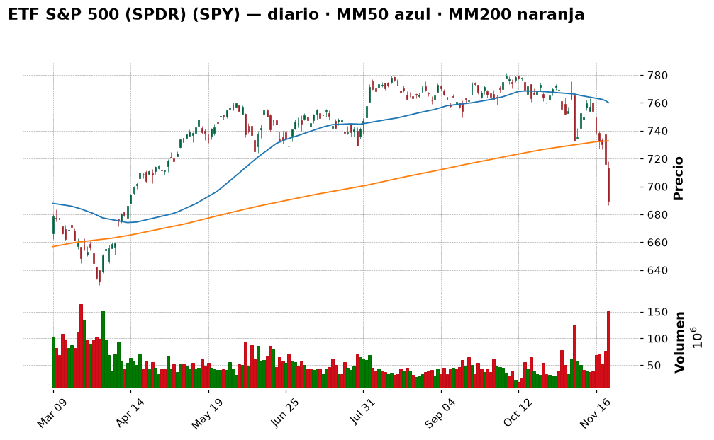
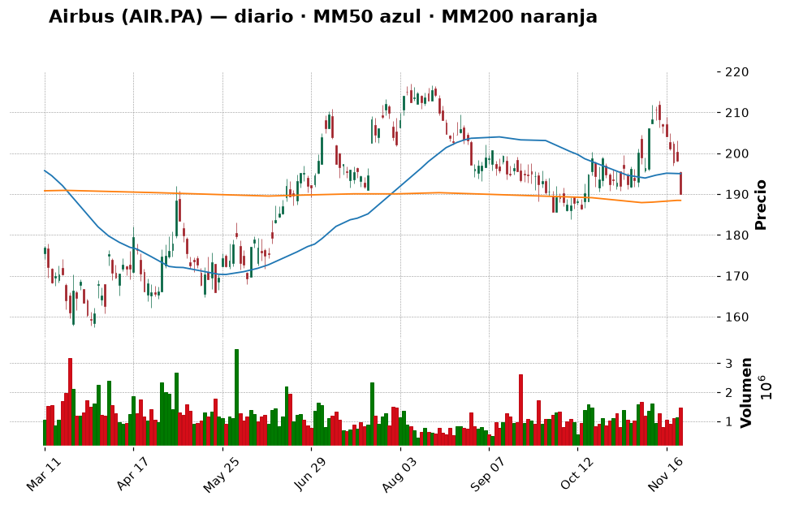
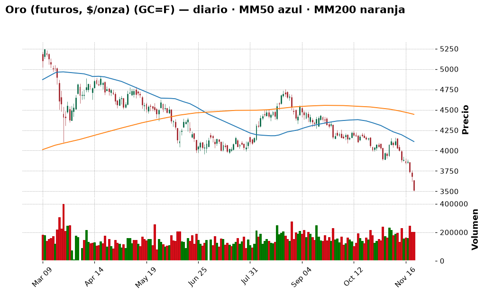
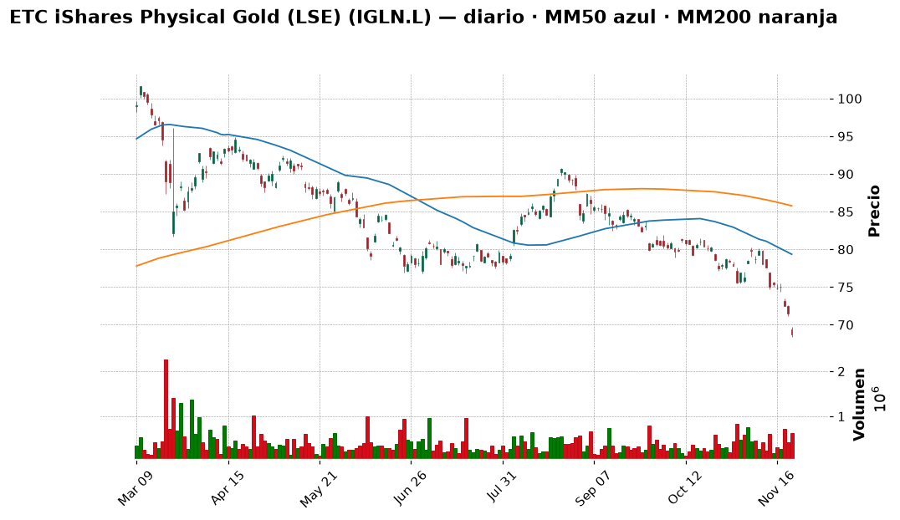
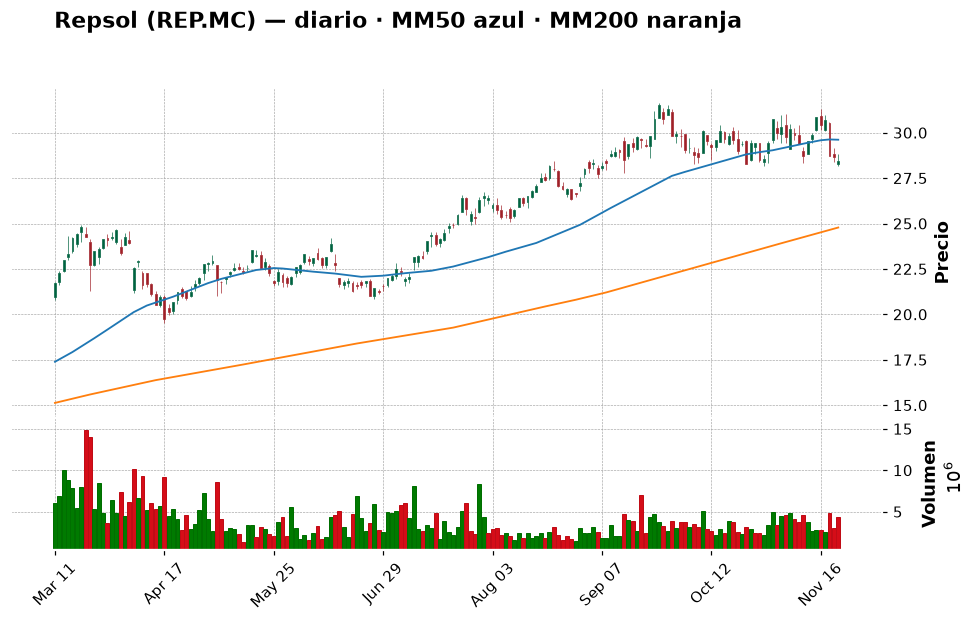
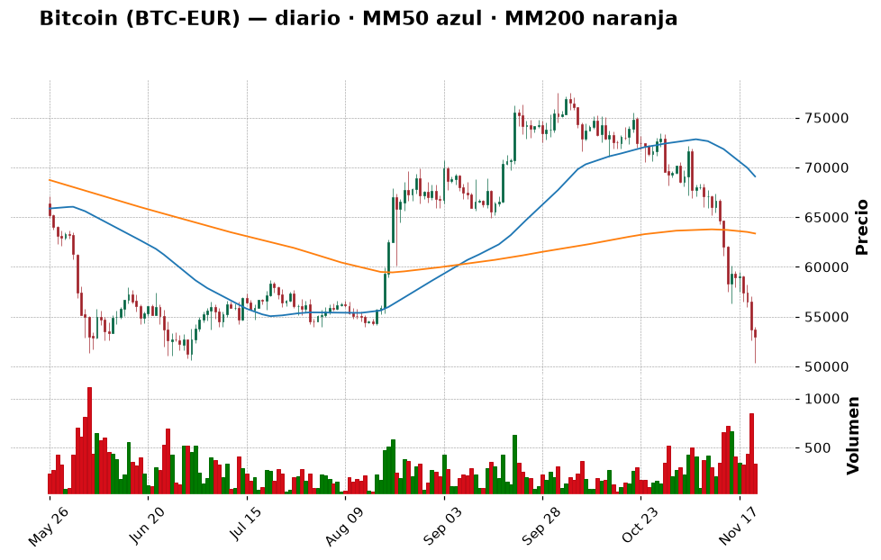
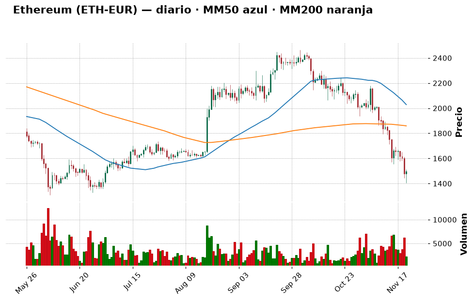
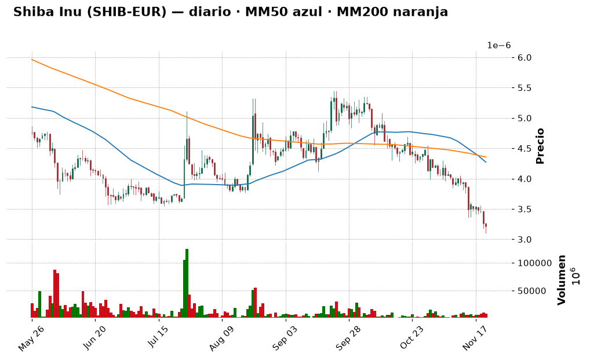

# 📈 Informe de fin de semana — sábado 21 de noviembre de 2026

> Generado a petición tuya a las 11:01 (hora de Madrid) · **Edición especial de sábado:** las bolsas están cerradas (los precios de bolsa son el cierre del viernes 20); la Bolsa española abre el **lunes 23 a las 9:00** y Wall Street a las 15:30 · Cripto: 24/7 (precios de esta mañana)
> **Termómetro:** 🔴 mucha incertidumbre — **el S&P 500 y el Dow entran en corrección** (más de un −10 % desde máximos), el Nasdaq vive **su peor semana desde 2020**, Nvidia se hunde un **−14 %** en un día por una investigación de la SEC sobre su contabilidad, el **VIX sube a 35,9**, el oro cae a mínimos de 14 meses y **bitcoin ha tocado esta madrugada 50.362 €**, su mínimo del año. Miedo extremo en todo.
> **Lección de hoy:** La diversificación (y por qué esta semana casi todo cayó a la vez)

## 1. Lo que tienes que saber hoy
- **Ha sido una de las peores semanas en años, y tu cartera casi no lo ha notado.** El S&P 500 cae un **−8,6 %** en la semana, el Nasdaq un **−10,0 %**, el Ibex un **−5,7 %**, el oro un **−9,5 %** y bitcoin un **−9 %**. Tu patrimonio: **9.662,01 €**, un **−0,6 % (−58 €)** frente al viernes pasado (9.720,15 €). La razón es que el **88 % sigue en liquidez**: hemos entrado poco a poco y a eso se debe que hoy no duela. Es el mejor ejemplo de la lección de hoy.
- **Se activa la pausa del tramo del ETF.** El SPY cerró la semana en **689,81 $**, muy por debajo de los **729 $** de nuestra regla. La ½ del tramo 2 del 1-dic **queda en pausa**, como estaba escrito. **No se vende nada.** Tu ETF pierde un **−5,7 % (−34 €)**: es normal en una corrección.
- **Airbus: tramo 2 ejecutado ✅ y, horas después, el cierre bajo 190 €.** Tu orden limitada se ejecutó el viernes a las 10:28 a **192,98 €** (ya está en `cartera.csv`). Al cierre, Airbus quedó en **189,96 €** (−4,1 %), cuatro céntimos por debajo del nivel que fijamos para **revisar la tesis**. La he revisado (sección 6): la caída es del mercado, no de la empresa, y sigue sobre su MM200. **Mantener, sin comprar más**, con una línea roja nueva y más clara.
- **Cripto: mucho movimiento, como decías.** En 24 horas se liquidaron **2.400 millones $** en apuestas apalancadas (Coinglass vía CoinDesk). Bitcoin cayó por debajo de **57.000 $** por primera vez desde septiembre de 2024 y esta madrugada tocó **50.362 €**; ahora está en **52.946 €**. **Ether cerró el viernes en 1.478 €, por debajo de 1.580 €**: según nuestra regla, **pasa a Evitar**. En bitcoin se activa el **mini-tramo de ~50 €** que habíamos previsto (sección 7).
- **Esta semana hay que actuar con las Letras del Tesoro.** La subasta de 6 y 12 meses es el **martes 1-dic**, y según el calendario del Banco de España **las peticiones se cierran unos días antes (en torno al 25–27-nov)**. Si quieres aparcar los ~3.000 € de liquidez, **haz la petición esta semana**.

## 2. ✅ Recomendaciones del día (resumen)
| Activo | Acción | vs. ayer | Cuánto (orientativo) | Horizonte | Por qué, en una frase | Confianza |
|---|---|---|---|---|---|---|
| ETF S&P 500 (SPY / SPY5.L) | 🔵 Mantener | = | 0 €; **½ tramo 2 en pausa** (se reanuda con un cierre semanal sobre ~733 $ o, como tarde, ~150 € el 15-dic si se estabiliza) | Años (5+) | El S&P 500 entra en corrección; la regla de pausa se cumple, la tesis a largo plazo no cambia | media |
| Airbus (AIR.PA) | 🔵 Mantener | = (confianza ↓) | 0 €: ya tienes el 3 % (tope del plan) | Años | Tramo 2 ejecutado a 192,98 €; cierra en 189,96 € por la caída general, aún sobre su MM200 | baja |
| Oro (IGLN.L) | ⏸️ Esperar | = | 0 €; primer tramo de ~150 € solo con cierre sobre ~75 $ | Años | −3,8 % el viernes (68,75 $); el "refugio" sigue sin funcionar con tipos reales altos | media |
| Letras del Tesoro (LETRAS) | 🟢 Comprar | = | **~3.000 €**: 1.000 € a 6 meses y 2.000 € a 12 meses en la subasta del **1-dic**; **petición esta semana** | 6–12 meses | Rentabilidad fija (2,82–3,05 %) mientras todo lo demás cae | alta |
| Repsol (REP.MC) | 🔵 Mantener | = | No añadir | Años | Tocó exactamente 28,18 € y rebotó (28,46 €); Brent ~90 $ | media |
| Indra (IDR.MC) | ⛔ Evitar | = | 0 € | — | −15,5 % en la semana (49,67 €) y la investigación sigue | media |
| NVIDIA (NVDA) | ⛔ Evitar | = (confianza ↑) | 0 € | — | −14 % el viernes: la SEC investiga posibles problemas **contables** (Reuters) | alta |
| Solaria (SLR.MC) | 🔵 Mantener | = | No añadir | Años | 13,77 €, a un +1,2 % de su mínimo anual; posición mínima | baja |
| Telefónica (TEF.MC) | ⏸️ Esperar | = | Hasta ~250 € si supera 3,71 € | Años | Plana (3,36 €) en una semana negra: aguanta sobre 3,27 € | baja |
| Iberdrola (IBE.MC) | ⏸️ Esperar | = | Hasta 5 % (~480 €) si retrocede a 21–22 € | Años | Sube (+0,35 %) el viernes negro: defensiva de verdad, pero aún sobre el nivel de compra | media |
| Inditex (ITX.MC) | 🔵 Mantener | = | No añadir | Años | 57,78 € (−1,1 %), sigue alcista; tu posición gana +114 % | media |
| Apple (AAPL) | 🔵 Mantener | = | No añadir | Años | 342,56 $ (−1,9 %), +13 % sobre su MM200 | media |
| Bitcoin (BTC) | 🟢 Comprar más | ↑ antes Mantener | **~50 € con orden limitada en ~50.600 €** (par BTC-EUR o con USDC); nada más | Años | Llega a la zona de compra pequeña que fijamos; el tramo grande sigue en pausa | baja |
| Ether (ETH) | ⛔ Evitar | ↓ antes Esperar | 0 € | — | Cerró el viernes en 1.478 €, bajo el soporte de 1.580 €: se cumple la regla | media |
| Shiba Inu (SHIB) | ⛔ Evitar | = | No añadir | — | Cruce de la muerte y −53 % en un año | alta |

*(El resto de la watchlist —Santander, BBVA, Oryzon, IAG, Aena, Microsoft, Amazon, Alphabet, Berkshire, los ETF del Nasdaq y del MSCI World, ASML, LVMH, SAP y Siemens— tiene su veredicto en la tabla "Resto de la watchlist" de la sección 6.)*

**🔁 Seguimiento de ayer** (informe del viernes 20-nov):
- **ETF S&P 500:** "Si el SPY cierra la semana bajo 729 $, la ½ del tramo 2 del 1-dic queda en pausa" → cerró en **689,81 $ (−3,64 % el viernes)**. **Pausa activada.** La acción sigue siendo Mantener: pausamos compras, no vendemos.
- **Airbus:** "Tramo 2 con orden limitada en ~193 €; revisar la tesis con un cierre bajo 190 €" → la orden se ejecutó a **192,98 €** (0,827 acciones, ~159,59 €) ✅ y el cierre fue **189,96 €**. Ambas cosas en el mismo día. Revisión de la tesis en la sección 6: **Mantener**, pero bajo la confianza a **baja** y fijo una línea roja nueva (cierre semanal bajo **183,84 €** o un recorte del objetivo de entregas → Reducir).
- **Ether:** "Un cierre diario bajo 1.580 € → pasaría a Evitar" → cerró el viernes en **1.478,24 €**. **Pasa a Evitar.**
- **Bitcoin:** "~50 € en ~54.000 €; con un cierre claro bajo 54.000 €, esperar a la siguiente referencia (~50.600 €)" → cerró el viernes en 53.699 € y esta madrugada tocó **50.362 €**. La siguiente referencia ya se ha alcanzado: **se activa el mini-tramo de ~50 €** (ver sección 7).
- **Repsol:** "Reducir con cierre bajo 28,18 € **y** Brent hacia 80 $" → tocó **28,18 €** justo, pero cerró en **28,46 €**, y el Brent está en ~90 $. **Sin cambios.**
- **Oro y Letras:** sin cambios. Novedad: ya sabemos la fecha de la subasta (1-dic) y el plazo aproximado de peticiones.
- **Tu cartera:** registraste el tramo 2 de Airbus (159,59 € + 0,91 € de comisión estimada). Nada más.

> Fin de semana para **no tocar casi nada**: la única orden nueva sería el mini-tramo de bitcoin (~50 €, con orden limitada), y la única tarea, pedir las Letras antes del 25–27-nov. Las reglas que escribimos esta semana han funcionado exactamente como debían: hemos pausado compras en la caída sin vender nada por miedo.

## 3. Agenda de la semana que viene
| Cuándo (hora de Madrid) | Evento | Por qué importa |
|---|---|---|
| Fin de semana | **Guerra Irán–EE. UU.:** un petrolero alcanzado cerca de Ormuz y Arabia Saudí intercepta tres misiles balísticos contra Riad (Reuters vía Investing.com) | Puede mover el petróleo el lunes (Repsol, inflación) |
| Lun 23, 9:00 | Apertura de la Bolsa española. El Ibex parte de **18.873,1** (−1,63 % el viernes) | Primera sesión tras la semana negra |
| Lun 23 (hora habitual) | **PMI preliminares** de noviembre de la zona euro y de EE. UU. (agenda semanal citada por Trademap) | Termómetro de la actividad económica |
| Lun 23, tras el cierre | Resultados de **Zoom** (ifyouspent) | — |
| Mar 24 | Resultados de **Medtronic** y **Analog Devices** (antes de la apertura) y de **Workday, Dell y HP** (tras el cierre) (ifyouspent) | Analog Devices y Dell: termómetro de chips y centros de datos tras el desplome de la IA |
| Mié 25, 14:30 | **PIB del 3T (2.ª estimación) y PCE de octubre** de EE. UU. (Econoday/CME; FinanceCalendar) · Resultados de **Deere** | El PCE es la inflación que mira la Fed: si sale alto, más presión para subir tipos |
| Mié 25 – vie 27 | **Plazo de peticiones de Letras** para la subasta del 1-dic (calendario del Banco de España) | **Tu tarea de la semana** |
| Jue 26 | Acción de Gracias: **Wall Street cerrado** (y viernes 27, sesión corta) | Menos volumen = movimientos más bruscos |
| Dom 29 | **Elecciones generales en España** | Sánchez anuncia la prórroga del impuesto a la banca en 2027 (Expansión): ojo con Santander y BBVA |
| Mar 1-dic | **Subasta de Letras a 6 y 12 meses** · **tu aportación de 200 €** | Aparcamiento de liquidez; el tramo del ETF, en pausa |
| 8–9 dic / 9 dic / 17 dic | Reunión de la **Fed** · Letras a 3 y 9 meses · reunión del **BCE** | La Fed, con una subida casi segura |

*Nota: las búsquedas del calendario y de resultados devolvieron agendas parciales y algunas contradictorias; las horas marcadas "habitual" no están confirmadas. Verifica las fechas en el calendario oficial antes de actuar.*

## 4. Cómo cerró la semana
### España y Europa
**Viernes 20:** el **Ibex 35 cayó un −1,63 % hasta 18.873,1 puntos** y en la semana pierde un **−5,7 %** (de 20.020 a 18.873); es su quinta caída seguida. Aún conserva un **+0,4 % sobre su MM200** (18.805), por muy poco. El **Euro Stoxx 50** se hundió un **−2,81 % (5.941,95)**, un **−7,0 % en la semana**, y ya está un −3,1 % **por debajo** de su MM200. Lo más castigado de la semana en la watchlist: **Indra (−15,5 %)**, **SAP (−14,0 %)**, **ASML (−12,8 %; −9,3 % solo el viernes)**, **Solaria (−12,5 %)**, **Siemens (−8,9 %)** y **Airbus (−8,1 %)**. Aguantaron mejor **Telefónica (−3,4 %)**, **Inditex (−3,1 %)** y **Iberdrola (−4,4 %)**, que el viernes incluso subió (+0,35 %). Oryzon fue la única que subió en la semana (+2,6 %).

**Noticias de empresas y de España:**
- **Impuesto a la banca:** Sánchez anuncia que lo **prorrogará en 2027** para recaudar **1.400 millones** y destinarlos a vivienda (Expansión). Malo para Santander (−2,25 % el viernes) y BBVA (−3,36 %).
- **Santander:** salen **1.000 millones en depósitos** hacia los neobancos, aunque su pasivo en España crece un 5 % (Expansión).
- **Banca europea:** **Intesa Sanpaolo lanza una OPA de 34.500 millones € sobre Monte dei Paschi** (Reuters vía Investing.com), después del acuerdo UniCredit–Commerzbank.
- **Airbus**, GMV y DAS Photonics piden estabilidad presupuestaria y más peso industrial en los proyectos europeos de defensa (Expansión).
- **Inditex** reabre su tienda insignia de Melbourne (Europa Press).
- **Aena:** Air Europa recurre ante el Supremo el plan de inversiones (DORA III) por limitar su crecimiento en Barajas (Expansión).
- **Centros de datos:** el Gobierno aprueba su decreto y la patronal lo recurre (Europa Press; Expansión).
- **Euríbor:** cierra la semana en un nuevo máximo, cerca del **3,4 %**; la media provisional de noviembre va por el **3,3 %** (Expansión).
- **BCE:** Francia y Alemania formalizan sus candidatos y dejan a **Hernández de Cos** a un paso de la presidencia (El País; Europa Press).

### Estados Unidos
**Viernes 20, el "viernes negro":** el **S&P 500 cayó un −3,70 % (6.910,39)**, el **Nasdaq Composite un −5,28 % (22.617,73)** y el **Dow Jones un −1,93 % (48.147)**. El **VIX** saltó un +26 % hasta **35,89**, su nivel más alto desde abril de 2025 (Reuters vía Investing.com). En la semana: **S&P 500 −8,6 %**, **Nasdaq −10,0 %** (su peor semana desde 2020) y **el S&P 500 y el Dow entran en corrección** (MarketWatch). El 94 % de las acciones del S&P 500 bajaron en la semana y los **11 sectores cayeron más de un 1 %** por primera vez desde abril de 2025 (MarketWatch). El índice de semiconductores tuvo su **peor semana en 25 años**: **2,3 billones $** de valor perdido (MarketWatch). 💡 *Se llama **corrección** a una caída de más del 10 % desde máximos; el S&P 500 está a un −11,9 %. Si llegara al −20 %, se hablaría de mercado bajista.*

**Qué pasó:**
- **Nvidia (−14,01 %, 125,53 $):** Reuters informó de que la **SEC está examinando posibles problemas contables** en la empresa; ya caía un 6 % antes de la noticia. Ha perdido **1,16 billones $** de valor en siete sesiones y encadena su peor racha semanal desde 2008 (MarketWatch). Ahora la cuestión no es solo quién la dirige, sino **si sus cifras son fiables**.
- **Anthropic** pasó de subir un 38 % a caer un 8,5 % frente a su máximo (Expansión), y MarketWatch avisa de que **miles de millones de acciones bloqueadas** podrán venderse en los próximos meses.
- **Rotación a "value":** los inversores salen de la tecnología y buscan empresas baratas y estables (Reuters vía Investing.com). En tu watchlist lo ves: **Berkshire (−0,4 %)**, **Iberdrola (+0,35 %)** o **Telefónica (+0,2 %)** aguantaron el viernes.
- La **Fed** sigue con su mensaje: Anna Paulson (Filadelfia) está abierta a **subidas consecutivas** "a ritmo deliberado" (Reuters vía Investing.com) y Lisa Cook dice que la Fed vigila la financiación del sector de la IA. **Trump** critica a la Fed por "muy politizada" y por no bajar tipos (Europa Press).

Los **futuros** cerraron el viernes en línea con el contado (S&P 500 **6.935**, −3,64 %; Nasdaq 100 **25.126,5**, −5,54 %; Yahoo Finance). No cotizan hasta la noche del domingo.

### Macro (tipos de interés, inflación, divisas, materias primas)
- **Bonos:** en el pánico, los inversores compraron deuda de EE. UU. como refugio: el **10 años bajó al 4,95 %** (−10 puntos básicos) y el 2 años al 4,65 % (Reuters vía Investing.com). 💡 *Cuando la gente compra bonos, su precio sube y su rentabilidad baja: por eso los tipos bajaron en un día de miedo.*
- **Fed:** subida de **0,25 puntos en diciembre** casi segura; las probabilidades de otra en enero han bajado algo (Reuters vía Investing.com).
- **Divisas:** **euro/dólar 1,0975** (Yahoo Finance, cierre del viernes), a un paso de su mínimo de 52 semanas (1,0954). Índice del dólar (DXY) en **103,9** (Reuters).
- **Petróleo:** el Brent cerró en torno a **90–92,6 $** según la fuente (Yahoo Finance: 89,95 $, +0,57 %; Reuters: 92,61 $), pero en la semana pierde un **−6,2 %** y en el mes un **−17 %** (Yahoo Finance). Repuntó al final del viernes por los ataques a petroleros cerca de Ormuz: seis en una semana, con el tráfico marítimo un **65 % por debajo** de antes de la guerra (Reuters vía Investing.com). UBS cree que el atractivo de las materias primas aguanta aunque baje la "prima" por el riesgo de suministro.
- **Tipos de referencia** (de `rates_2026-11-21.json`): **BCE (facilidad de depósito) 2,50 %** · **Euríbor 12 m 3,239 %** (media de octubre; la de noviembre va por el ~3,3 %) · **deuda AAA de la zona euro a 1 año 2,974 %** · **Fed 4,00 %** (límite superior). Seguimos sobre el umbral del 3 %: apartado de renta fija activo.

**🥇 Oro:** **3.515,4 $/onza (GC=F), −4,62 % el viernes**, **−9,5 % en la semana** y **−37 % desde su máximo** de 52 semanas (5.586,2 $): mínimo de 14 meses, a un +0,4 % del mínimo anual de nuestros datos. El ETC **IGLN.L** cerró en **68,75 $ (−3,81 %)**, −8,8 % en la semana. La plata cae a 40,95 $ (Reuters). **Goldman Sachs** rebajó su previsión para finales de 2026 de 4.650 $ a **4.150 $** (Reporte Minero). Causa principal: **tipos reales altos** y una Fed que sigue subiendo; además, ventas forzadas de quien necesita liquidez. El oro **no ha funcionado como refugio esta semana**, y la lección de hoy explica por qué eso puede pasar.

## 5. Panorama técnico de la watchlist
> 💡 *Cómo leer esta tabla:* la **tendencia** resume si el precio lleva meses subiendo, bajando o de lado
> (comparando el precio con sus medias de 50 y 200 días). El **RSI** mide de 0 a 100 si las subidas o bajadas
> recientes han sido muy fuertes: por encima de 70 se dice "sobrecompra" (quizá ha subido demasiado rápido),
> por debajo de 30 "sobreventa". Son pistas, no predicciones.

Datos del **cierre del viernes 20-nov** (ningún valor llega con retraso ✅). Hoy añado la columna **"Semana"**, la protagonista.

| Valor | Último cierre | Día | Semana | 1 mes | 1 año | Tendencia | RSI | vs MM200 |
|---|---|---|---|---|---|---|---|---|
| IBEX 35 (^IBEX) | 18.873,1 | −1,63 % | −5,73 % | −0,21 % | +16,93 % | ➡️ lateral | 39,2 🟡 | +0,4 % |
| Euro Stoxx 50 (^STOXX50E) | 5.941,95 | −2,81 % | −6,97 % | −2,38 % | +7,36 % | ➡️ lateral | 33,0 🟡 | −3,1 % |
| S&P 500 (^GSPC) | 6.910,39 | −3,70 % | −8,61 % | −9,83 % | +4,04 % | ➡️ lateral | 24,7 🟢 | −6,0 % |
| Nasdaq Composite (^IXIC) | 22.617,73 | −5,28 % | −10,02 % | −13,04 % | +0,24 % | ➡️ lateral | 25,6 🟢 | −10,1 % |
| Banco Santander (SAN.MC) | 10,32 € | −2,25 % | −6,94 % | −10,14 % | +14,21 % | ➡️ lateral | 34,3 🟡 | −8,6 % |
| BBVA (BBVA.MC) | 21,83 € | −3,36 % | −7,38 % | −1,62 % | +19,39 % | ➡️ lateral | 36,9 🟡 | +1,0 % |
| Inditex (ITX.MC) | 57,78 € | −1,13 % | −3,12 % | +2,74 % | +21,54 % | 📈 alcista | 49,1 🟡 | +5,6 % |
| Iberdrola (IBE.MC) | 22,67 € | +0,35 % | −4,35 % | +4,28 % | +25,70 % | 📈 alcista | 55,7 🟡 | +10,5 % |
| Telefónica (TEF.MC) | 3,36 € | +0,21 % | −3,39 % | −3,28 % | −9,79 % | 📉 bajista | 45,7 🟡 | −7,9 % |
| Repsol (REP.MC) | 28,46 € | −0,66 % | −7,87 % | +0,71 % | +82,90 % | ➡️ lateral | 43,3 🟡 | +14,9 % |
| Solaria (SLR.MC) | 13,77 € | −2,72 % | −12,54 % | −1,99 % | −16,87 % | 📉 bajista | 35,6 🟡 | −29,3 % |
| Oryzon (ORY.MC) | 2,41 € | −2,75 % | +2,56 % | −4,90 % | −23,50 % | 📉 bajista | 46,2 🟡 | −15,0 % |
| IAG (IAG.MC) | 5,24 € | −2,20 % | −3,36 % | +7,49 % | +17,34 % | 📈 alcista | 52,4 🟡 | +7,3 % |
| Indra (IDR.MC) | 49,67 € | −3,37 % | −15,53 % | −20,02 % | +12,17 % | ➡️ lateral | 27,2 🟢 | −11,2 % |
| Aena (AENA.MC) | 27,64 € | −0,22 % | −3,96 % | +4,78 % | +18,63 % | 📈 alcista | 50,5 🟡 | +6,2 % |
| Apple (AAPL) | 342,56 $ | −1,90 % | −3,85 % | −1,63 % | +27,55 % | 📈 alcista | 46,4 🟡 | +13,0 % |
| Microsoft (MSFT) | 484,52 $ | −2,77 % | −7,51 % | −7,02 % | −0,53 % | ➡️ lateral | 34,8 🟡 | +9,2 % |
| NVIDIA (NVDA) | 125,53 $ | −14,01 % | −22,92 % | −40,85 % | −32,70 % | ➡️ lateral | 15,0 🟢 | −38,3 % |
| Amazon (AMZN) | 246,82 $ | −4,10 % | −7,44 % | −1,42 % | +10,84 % | ➡️ lateral | 42,3 🟡 | +0,7 % |
| ETF S&P 500 (SPY) | 689,81 $ | −3,64 % | −8,56 % | −9,71 % | +4,10 % | ➡️ lateral | 24,9 🟢 | −5,9 % |
| ETF Nasdaq 100 (QQQ) | 608,45 $ | −5,67 % | −10,51 % | −13,63 % | +1,43 % | ➡️ lateral | 26,6 🟢 | −10,9 % |
| Alphabet (GOOGL) | 265,29 $ | −2,70 % | −10,31 % | −18,18 % | −9,40 % | 📉 bajista | 27,8 🟢 | −21,3 % |
| Berkshire Hathaway (BRK-B) | 570,00 $ | −0,36 % | −3,87 % | +4,21 % | +13,71 % | 📈 alcista | 56,6 🟡 | +13,4 % |
| ETF MSCI World (IWDA.AS) | 122,71 € | −3,17 % | −5,96 % | −5,56 % | +12,03 % | ➡️ lateral | 28,9 🟢 | +0,1 % |
| Airbus (AIR.PA) | 189,96 € | −4,13 % | −8,08 % | −2,47 % | −5,84 % | ➡️ lateral | 39,6 🟡 | +0,8 % |
| ASML (ASML.AS) | 1.168,00 € | −9,33 % | −12,76 % | −17,72 % | +35,77 % | ➡️ lateral | 32,1 🟡 | −16,6 % |
| LVMH (MC.PA) | 381,95 € | −2,54 % | −5,33 % | −1,51 % | −38,33 % | 📉 bajista | 38,3 🟡 | −16,6 % |
| SAP (SAP.DE) | 183,68 € | −1,79 % | −13,95 % | −14,71 % | −10,40 % | ➡️ lateral | 29,3 🟢 | +9,9 % |
| Siemens (SIE.DE) | 254,65 € | −4,59 % | −8,86 % | −0,41 % | +16,20 % | ➡️ lateral | 37,8 🟡 | −2,3 % |
| Oro (futuros, GC=F) | 3.515,4 $ | −4,62 % | −9,54 % | −13,42 % | −13,90 % | 📉 bajista | 21,6 🟢 | −20,9 % |
| Oro (IGLN.L) | 68,75 $ | −3,81 % | −8,76 % | −12,57 % | −13,09 % | 📉 bajista | 24,3 🟢 | −19,9 % |

*(🟢 = sobreventa, RSI < 30 · 🟡 = zona neutral · 🔴 = sobrecompra, RSI > 70.)*

**Lectura de conjunto:** en una semana, la bolsa de EE. UU. ha pasado de "dudar" sobre su MM200 a estar **un −6 % por debajo** (el Nasdaq, un −10 %). Hay **sobreventa generalizada** (RSI por debajo de 30 en el S&P 500, el Nasdaq, el SPY, el MSCI World, el oro, Nvidia, SAP…). 💡 *Una sobreventa tan extendida suele preceder a rebotes, a veces fuertes, pero no indica cuándo ni si serán duraderos: en caídas fuertes, el RSI puede quedarse abajo semanas.* La cara buena: lo **defensivo** (Iberdrola, Inditex, Berkshire, Apple, Aena, IAG) sigue en tendencia alcista. El MSCI World está **justo en** su MM200 (+0,1 %).

## 6. Ideas de bolsa: qué haría un experto
### ETF S&P 500 (SPY5.L / SPY) — MANTENER (pausa activada)

- **Qué es:** un fondo que compra de una vez las ~500 mayores empresas de EE. UU. Tú tienes la versión europea, **SPY5.L** (Londres); el gráfico es del SPY estadounidense.
- **Por qué es noticia hoy:** el S&P 500 entra en corrección tras su peor semana en mucho tiempo (−8,6 %), arrastrado por los chips y Nvidia.
- **Lo que dice el gráfico:** **689,81 $**, con un mínimo de 686,75 $ y un **volumen 2,6 veces el normal**: ventas masivas. Un **−5,9 % bajo su MM200** (732,76 $) y un −9,3 % bajo su MM50. RSI **24,9 (sobreventa)**, MACD "empeorando". Está a un **−11,8 % de su máximo** y no hay soportes cercanos en nuestros datos (el mínimo anual está en 629,28 $, un −8,8 % más abajo). En llano: **caída fuerte, rápida y con mucho volumen**, como las que suelen marcar fases de miedo, sin señal todavía de que haya terminado.
- **Tu posición:** 0,87 participaciones a 748,72 $; SPY5.L cerró el viernes en Londres a **705,71 $**: pierdes un **−5,7 % (−34,09 €)**.
- **Lo positivo:** has comprado solo **~6 % del patrimonio**; quedan ~2.800 € del objetivo del núcleo por invertir, y si la corrección continúa, se comprarán **más baratos**. Históricamente, las correcciones del S&P 500 han sido frecuentes (aproximadamente una cada año o dos) y se han recuperado, aunque el tiempo varía mucho.
- **El riesgo:** que la corrección se convierta en un mercado bajista (−20 % o más; hoy, −11,9 %). Tu ETF podría pasar meses en pérdidas.
- **🧑‍💼 Recomendación: MANTENER.** La regla de pausa se ha cumplido y la aplicamos. No se vende: la tesis (crecimiento de las grandes empresas de EE. UU. a 5+ años) no la rompe una semana mala, ni siquiera una corrección.
  - **Cuánto y cómo:** 0 € ahora. Los ~300 € de la ½ del tramo 2 esperan en liquidez hasta que se cumpla **una** de estas condiciones: (a) el SPY **cierra una semana sobre su MM200** (hoy ~733 $), o (b) el **15 de diciembre**, si el SPY lleva **dos semanas sin marcar nuevos mínimos** (es decir, sin bajar de 686,75 $), compraría **la mitad (~150 €)**. Si sigue cayendo, seguimos esperando: no hay prisa.
  - **Horizonte:** años (5 o más).
  - **Qué me haría cambiar de opinión:** solo un cambio de tesis (por ejemplo, una recesión profunda con caída generalizada de beneficios) me haría plantear Reducir. Una bajada de precio no.
- **Qué mirar para entenderlo:** cada viernes, el cierre semanal frente a ~733 $; y si el VIX (hoy 35,9) vuelve por debajo de 25, señal de que el miedo se calma.
- **Confianza:** media

### Airbus (AIR.PA) — MANTENER (tramo 2 hecho; revisión de la tesis)

- **Qué es:** el mayor fabricante de aviones comerciales del mundo y un actor clave en defensa y espacio en Europa.
- **Por qué es noticia hoy:** tu orden del tramo 2 se ejecutó el viernes a **192,98 €** y la acción cerró en **189,96 € (−4,13 %)**, con el Euro Stoxx 50 cayendo un −2,8 %. No hay noticias negativas propias en nuestras fuentes. El último dato público: **74 entregas en octubre** (621 en el año) y **1.376 pedidos brutos** hasta octubre; para cumplir su objetivo de **~870 entregas** necesita **249 más en noviembre y diciembre** (CAPA; AirData News). 💡 *Es mucho: ~125 al mes frente a las 74 de octubre. Airbus suele acelerar mucho en diciembre, pero este objetivo es exigente.*
- **Lo que dice el gráfico:** cerró **en el mínimo del día** con volumen 1,24 veces el normal. Ha perdido su MM50 (195,00 €) pero **sigue sobre su MM200 (188,44 €, +0,8 %)**. La tendencia pasa de alcista a **lateral**. RSI 39,6. El siguiente soporte está en **183,84 €** (−3,2 %); la resistencia, en 200,40 €. A un −14 % de su máximo (221,30 €).
- **Revisión de la tesis (lo que prometimos con un cierre bajo 190 €):**
  1. **¿Ha cambiado algo de la empresa?** No en nuestras fuentes: ni recortes de previsiones ni problemas nuevos. La caída del viernes fue general (Siemens −4,6 %, ASML −9,3 %, Euro Stoxx −2,8 %).
  2. **¿Ha roto la tendencia de fondo?** Todavía no: sigue sobre la MM200, por muy poco.
  3. **¿Cuál es el riesgo real?** El objetivo de entregas: si en enero Airbus no llega a ~870, el mercado lo castigará.
  - **Conclusión:** la tesis **sigue en pie, pero está más débil**. Bajo la confianza a **baja** y cambio la línea roja por una más clara.
- **Tu posición:** 1,5065 acciones a un precio medio de **197,92 €** (incluye comisiones): pierdes un **−4,0 % (−11,99 €)**. Pesa un **3,0 %** del patrimonio: estás en el tope del plan (3–4 %).
- **🧑‍💼 Recomendación: MANTENER.** No compraría más (ya estás en el tope y el momento técnico es malo), pero tampoco vendería tras ejecutar el tramo 2 hace un día por una caída de todo el mercado: sería vender por pánico.
  - **Cuánto y cómo:** 0 €. **No pongas más órdenes de compra** en Airbus.
  - **Horizonte:** años.
  - **Qué me haría cambiar de opinión (nueva línea roja):** un **cierre semanal por debajo de 183,84 €** (soporte y MM200 perdidos con claridad) **o** un recorte del objetivo de entregas → **Reducir a la mitad** (vender ~0,75 acciones). A favor: recuperar 200,40 € reafirmaría la tendencia.
- **Qué mirar para entenderlo:** el **informe de entregas de noviembre** (primeros días de diciembre): necesita una cifra claramente mayor que las 74 de octubre.
- **Confianza:** baja

### Oro (IGLN.L) — ESPERAR

- **Qué es:** el activo refugio clásico. **GC=F** es el precio de referencia (futuros, $/onza); el vehículo que puedes comprar es el **ETC IGLN.L**.
- **Por qué es noticia hoy:** **−4,6 % el viernes y −9,5 % en la semana**, en mínimos de 14 meses. Goldman Sachs recorta su previsión a 4.150 $ (Reporte Minero). La causa sigue siendo la misma: tipos reales altos, la Fed y ventas forzadas.
- **Lo que dice el gráfico:** tendencia **bajista** clara. GC=F (3.515,4 $) está un **−20,9 % bajo su MM200**, RSI **21,6 (sobreventa profunda)**, MACD "empeorando", sin soportes por debajo. IGLN.L (68,75 $): −19,9 % bajo su MM200, RSI 24,3, **volumen 1,4 veces el normal**, en mínimos anuales. Nuestra señal de entrada (~75 $) queda ahora un **+9 %** por encima.
- **Lo positivo:** cuanto más cae, mejor precio para la diversificación futura; los bancos centrales siguen comprando.
- **El riesgo:** que siga cayendo mientras los tipos reales sigan altos. Recuerda: no paga dividendos ni intereses.
- **🧑‍💼 Recomendación: ESPERAR.** Misma regla que ayer. Tener paciencia aquí es exactamente lo que nos ha ahorrado una caída de casi el 10 % esta semana.
  - **Cuánto y cómo:** 0 € hoy. **Primer tramo de ~150 €** en IGLN.L cuando **cierre sobre ~75 $** o cuando el MACD pase a "mejorando" con el precio estable varios días. Después, tramos de 150 € al mes hasta un 3–5 %. Nunca futuros ni apalancados; PAXG no sustituye al ETC.
  - **Horizonte:** años.
  - **Qué me haría cambiar de opinión:** la señal técnica de arriba, o un giro de la Fed. Si las caídas continúan, un "suelo" visible (dos o tres semanas sin nuevos mínimos) también serviría para empezar con un tramo pequeño.
- **Qué mirar para entenderlo:** los **tipos reales** de EE. UU. y el **dólar**.
- **Confianza:** media

### Repsol (REP.MC) — MANTENER (la tienes)

- **Qué es:** la mayor petrolera española.
- **Por qué es noticia hoy:** la guerra con Irán vuelve a calentar el petróleo al final del viernes (ataques a petroleros cerca de Ormuz), aunque el crudo pierde un −17 % en el mes. Además, el Gobierno aprueba la directiva del nuevo mercado de emisiones: las comercializadoras de carburantes como Repsol tendrán que comprar derechos y trasladarán el coste a los clientes (El País).
- **Lo que dice el gráfico:** **28,46 € (−0,66 %)**; el mínimo del día fue **exactamente 28,18 €**, nuestro nivel clave, y rebotó. Volumen 1,2 veces el normal. Sigue un **+14,9 % sobre su MM200** (24,78 €) y bajo su MM50 (29,61 €). RSI 43,3. En la semana, −7,9 %.
- **Tu posición:** 2 acciones a 12,37 €: ganas un **+130 % (+32,18 €)**.
- **🧑‍💼 Recomendación: MANTENER.** El soporte de 28,18 € **funcionó** el viernes y el Brent está en ~90 $, lejos de 80 $. Ninguna de las dos condiciones para Reducir se cumple.
  - **Cuánto y cómo:** no añadir.
  - **Horizonte:** años.
  - **Qué me haría cambiar de opinión:** un cierre bajo 28,18 € **y** el Brent bajando hacia 80 $ → Reducir (vender 1 de tus 2 acciones).
- **Qué mirar para entenderlo:** el lunes, el **Brent** tras el fin de semana de ataques en el Golfo.
- **Confianza:** media

### Resto de la watchlist: veredicto rápido
| Valor | Acción | Por qué (1 frase) | Nivel a vigilar |
|---|---|---|---|
| NVIDIA (NVDA) | ⛔ Evitar | −14 % el viernes y −23 % en la semana: la **SEC examina posibles problemas contables** (Reuters); si la contabilidad está en duda, ningún precio es "barato" | Revisar solo cuando la investigación se aclare y con un nuevo CEO; mínimo anual 124,5 $ |
| Indra (IDR.MC) | ⛔ Evitar | −15,5 % en la semana (49,67 €), RSI 27; la investigación sigue abierta | Soporte 46,85 €; revisar sobre 57,98 € y con la investigación aclarada |
| Solaria (SLR.MC) | 🔵 Mantener | La tienes (1 acción, −8 %): 13,77 €, a un paso de su mínimo anual (13,61 €); venderla costaría casi lo mismo en comisiones | Mínimo anual 13,61 €; resistencia 16,95 € |
| Telefónica (TEF.MC) | ⏸️ Esperar | Plana el viernes (3,36 €): resiste, pero sigue en tendencia bajista | Comprar si supera 3,71 €; Evitar si cierra bajo 3,27 € |
| Iberdrola (IBE.MC) | ⏸️ Esperar | **Sube el viernes negro** (+0,35 %, 22,67 €): defensiva y alcista (+10,5 % sobre MM200); participa en el primer corredor de camiones eléctricos con MAN (Expansión) | Comprar en 21–22 €; soporte 21,09 € |
| Inditex (ITX.MC) | 🔵 Mantener | Tu posición gana +114 %; −3,1 % en la semana, tendencia alcista intacta | Soporte 56,2 €; máximo 60,80 € |
| Apple (AAPL) | 🔵 Mantener | −3,9 % en la semana, la mitad que el mercado; +13 % sobre su MM200 | Soporte 338,7 $ (−1,1 %); luego 325,8 $ |
| Banco Santander (SAN.MC) | ⏸️ Esperar | −6,9 % en la semana; prórroga del impuesto a la banca y salida de 1.000 M€ de depósitos a neobancos (Expansión) | Soporte 10,08 €; comprar sobre 11,67 € (MM50) |
| BBVA (BBVA.MC) | ⏸️ Esperar | −3,4 % el viernes, justo sobre su soporte de 21,82 € y su MM200 (+1 %); también le afecta el impuesto | Si pierde 21,82 €, siguiente 21,20 € |
| Oryzon (ORY.MC) | 🔵 Mantener | La tienes (4 acciones, −26 %); posición mínima (9,62 €) | Mínimo anual 2,23 €; resistencia 2,60 € |
| IAG (IAG.MC) | ⏸️ Esperar | −2,2 % el viernes, aún alcista; Iberia refuerza el puente aéreo por el corte del AVE Madrid–Sevilla (Expansión) | Soporte 4,95 €; resistencia 5,72 € |
| Aena (AENA.MC) | ⏸️ Esperar | Aguanta (−0,2 %), alcista; Air Europa recurre su plan de inversiones en Barajas (Expansión) | Retroceso hacia la MM50 (26,53 €) |
| Microsoft (MSFT) | ⏸️ Esperar | −7,5 % en la semana; pierde 486 $ y cae a 484,52 $ | Siguiente soporte 477,15 $ |
| Amazon (AMZN) | ⏸️ Esperar | −7,4 % en la semana, justo sobre su MM200 (+0,7 %) | Soporte 244,7 $ |
| ETF Nasdaq 100 (QQQ) | ⏸️ Esperar | −10,5 % en la semana y −10,9 % bajo su MM200; demasiado concentrado en la tecnología que está cayendo | Recuperar 683 $ (MM200) |
| Alphabet (GOOGL) | ⛔ Evitar | Cruce de la muerte, −21 % bajo su MM200 y en mínimos anuales | Recuperar 337 $ (MM200) |
| Berkshire Hathaway (BRK-B) | ⏸️ Esperar | −0,4 % el viernes: el refugio "value" de la semana; tendencia alcista | Retroceso hacia la MM50 (536,9 $) |
| ETF MSCI World (IWDA.AS) | ⏸️ Esperar | −6 % en la semana, justo sobre su MM200 (+0,1 %); alternativa al S&P 500 más diversificada, pero también sigue la regla de pausa | Soporte 122,4 €; si pierde la MM200, esperar |
| ASML (ASML.AS) | ⏸️ Esperar | −9,3 % el viernes con el desplome de los chips (peor semana en 25 años) | Sin soportes cercanos; recuperar 1.400 € (MM200) |
| LVMH (MC.PA) | ⛔ Evitar | El lujo sigue en tendencia bajista (−38 % en un año), en el soporte de 380 € | Soporte 376–381 €; recuperar 431 € |
| SAP (SAP.DE) | ⏸️ Esperar | −14 % en la semana: el miedo al software tras Intuit; RSI 29 (sobreventa), aún +10 % sobre su MM200 | Soporte 178,9 €; recuperar 197,9 € (MM50) |
| Siemens (SIE.DE) | ⏸️ Esperar | −4,6 % el viernes (254,65 €), pierde su MM200 y queda sobre su soporte de 254,5 € | Si pierde 254,5 €, esperar más |

## 7. ₿ Criptomonedas
> 💡 *Las criptomonedas cotizan 24 horas, 7 días a la semana: los precios son de esta mañana (en euros).
> Son mucho más volátiles que las acciones: caídas del 50 % o más han ocurrido varias veces.*

**Sentimiento:** Fear & Greed **12/100 (miedo extremo**; ayer 12, hace una semana 13, hace un mes 68 "codicia", según alternative.me) · Capitalización total **2,09 billones $ (−5,35 % en 24 h; −56,7 % bajo su máximo histórico de octubre de 2025)** · Dominancia de Bitcoin **55,7 %** · Volumen de 24 h: **245.000 millones $**, casi el doble que el día anterior (133.000 millones): **pánico vendedor**.

**Qué ha pasado (el "mucho movimiento" que notabas):**
- **Liquidaciones masivas:** en 24 horas se liquidaron **2.400 millones $** en futuros cripto, más de 1.000 millones en bitcoin y 545 millones en ether; la mayor, una apuesta alcista de 51,7 millones $ en bitcoin (Coinglass vía CoinDesk). 💡 *Una **liquidación** ocurre cuando alguien que compró con dinero prestado (apalancamiento) pierde su garantía: el exchange vende sus monedas automáticamente. Esas ventas forzadas hunden aún más el precio y provocan nuevas liquidaciones: un efecto dominó. Por eso nunca usamos apalancamiento.*
- **Bitcoin bajo 57.000 $ por primera vez desde septiembre de 2024;** pierde un **28 % en el trimestre** y más de la mitad desde su máximo de octubre de 2025 (CoinDesk). Las causas: **tipos reales al alza**, una Fed más dura y la huida de los activos de riesgo junto con la tecnología.
- **ETF:** el jueves salieron **582 millones $** de los ETF de bitcoin, la mayor salida en tres semanas (Decrypt).
- **XRP cae un 10 %**, se deshacen apuestas alcistas y sus ETF bajan de 1.000 millones $ de patrimonio (CoinDesk).
- **Seguridad:** Bitcoin Core corrigió un fallo que permitía bloquear nodos repitiendo un identificador 50.000 veces; lo encontró una IA (CoinDesk). El token "Wrapped Monero" se hunde un 99 % tras ventas desde una cartera ligada a su emisor (CoinDesk; Decrypt).
- **Regulación:** el Senado de EE. UU. aprueba prohibir las apuestas de mercados de predicción sobre guerras y muertes; la CFTC dice que no habrá reglas especiales para Hyperliquid (CoinDesk); Hong Kong amplía su licencia a custodios y asesores (Cointelegraph); VanEck mantiene a **Coinbase** como custodio de sus ETF (Cointelegraph).
- **Análisis (opinión):** un analista citado por Cointelegraph ve un patrón parecido al que precedió a la caída de 2023 hacia 25.000 $. **Es una opinión, no una previsión fiable**, pero recuerda que el suelo puede estar más abajo.

**Radar Coinbase** (405 monedas comprables · en 24 h suben 27 y bajan 330 · en 7 días suben 27 y bajan 330):
- **Mayores por capitalización (7 días):** BTC −13,8 %, ETH −14,2 %, BNB −15,1 %, XRP −9,7 %, SOL −10,1 %, HYPE −15,3 %, ZEC −17,9 %, DOGE −15,5 %, LINK −12,6 %, ADA −14,5 %.
- **Más suben (7 d, top 100):** solo **VVV (+19,1 %)**; después WLFI (−7,5 %) y PAXG (−8,9 %, oro tokenizado) · **Más bajan:** PUMP (−30,0 %), ENA (−25,2 %), ASTER (−24,3 %), INJ (−23,2 %), ARB (−22,8 %).
La caída es **total**: 330 de 357 bajan. Que solo suba una moneda pequeña (VVV, puesto 65) no es una oportunidad, es una rareza. **Nada fuera del núcleo merece compra.**

| Moneda | Ranking | Precio (€) | 24 h | 7 días | 1 mes | 1 año | Tendencia | RSI | vs MM200 |
|---|---|---|---|---|---|---|---|---|---|
| Bitcoin (BTC) | #1 | 52.945,96 | −1,40 % | −9,17 % | −26,94 % | −28,38 % | ➡️ lateral | 17,6 | −16,4 % |
| Ether (ETH) | #2 | 1.495,83 | +1,19 % | −6,93 % | −29,63 % | −37,73 % | ➡️ lateral | 22,6 | −19,5 % |
| XRP (XRP) | #6 | 0,8166 | −1,59 % | −1,60 % | −29,91 % | −51,79 % | ➡️ lateral | 25,7 | −24,4 % |
| Solana (SOL) | #7 | 62,10 | −1,05 % | −2,76 % | −32,68 % | −44,43 % | ➡️ lateral | 24,3 | −19,7 % |
| Shiba Inu (SHIB) | #41 | 0,00000321 | −1,53 % | −8,02 % | −27,05 % | −52,86 % | 📉 bajista | 22,9 | −26,3 % |

*(Las variaciones de la tabla salen de las velas diarias de Coinbase —la de hoy, sin cerrar— y las del radar, de Coinpaprika: miden ventanas ligeramente distintas, por eso no coinciden. La columna "24 h" compara con el cierre de ayer a medianoche: el desplome fuerte fue el viernes por la tarde.)*

### Bitcoin (BTC) — COMPRAR MÁS (solo el mini-tramo de ~50 €)

- **Qué es:** la primera y mayor criptomoneda; oferta máxima de 21 millones de unidades.
- **Lo que dice el gráfico:** el viernes bajó de 56.466 € a **53.699 €** (mínimo de 52.618 €), y esta madrugada tocó **50.362 €**, **nuevo mínimo de 52 semanas** (el anterior era 50.633 €). Ahora rebota a **52.946 €**. Un **−16,4 % bajo su MM200** (63.353 €) y un −23 % bajo su MM50. RSI **17,6**: la sobreventa más extrema de todo el año. MACD "empeorando". Ha perdido el soporte de 54.000 €, y en nuestros datos ya no hay soportes por debajo. A un −37 % de su máximo de 52 semanas (84.100 €).
- **Tu posición:** 0,00263 BTC a un precio medio de 69.887 €: vale **139,14 € (−24,3 %, −44,65 €)**, un 1,4 % del patrimonio.
- **🧑‍💼 Recomendación: COMPRAR MÁS, pero solo el mini-tramo previsto (~50 €).** Por qué: hace días fijamos que, si bitcoin llegaba a la zona de 54.000 € (y, con un cierre claro por debajo, a ~50.600 €), compraríamos un tramo **pequeño**. El precio ha llegado. Es una compra **de plan, no de impulso**: 50 € son el 0,5 % de tu patrimonio. Lo que **no** cambia: el tramo normal del 1-dic sigue en pausa hasta que bitcoin recupere su MM200.
  - **Cuánto y cómo:** **~50 €** con **orden limitada en ~50.600 €** en el par **BTC-EUR** de Coinbase (o con tus USDC), válida unos días. Si no se ejecuta, no persigas el precio. Si se ejecuta, **regístrala en `cartera.csv`**. Tu cripto pasaría de un 1,4 % a ~1,9 % (tope del usuario: 25 %; mi recomendación para tu perfil: **no más del 5 %**, porque las criptomonedas han caído un 50–80 % varias veces y hoy el mercado ya está un −57 % bajo su máximo).
  - **Qué me haría cambiar de opinión:** un cierre diario **por debajo de ~48.000 €** (−5 % bajo el mínimo de hoy) significaría que el pánico no ha terminado: no compraría más hasta ver estabilidad. Un cierre sobre la MM200 (~63.350 €) reactivaría el plan normal (~50–100 € al mes).
- **El riesgo:** que la caída siga (el patrón de 2022–2023 llevó a bitcoin mucho más abajo). Por eso solo 50 €.
- **Confianza:** baja

### Ether (ETH) — EVITAR (antes Esperar)

- **Qué es:** la segunda criptomoneda; la red Ethereum permite programas ("smart contracts") y es la base de muchas stablecoins y aplicaciones.
- **Lo que dice el gráfico:** el viernes cerró en **1.478,24 €**, **por debajo del soporte de 1.580 €** que fijamos como línea roja; esta madrugada tocó 1.404 € y rebota a **1.495,83 €**. Un **−19,5 % bajo su MM200** (1.859 €). RSI 22,6 y MACD "mejorando". Volatilidad del 71 % anual (más que bitcoin). En nuestros datos ya no hay soportes por debajo; el mínimo de 52 semanas está en 1.309 €.
- **🧑‍💼 Recomendación: EVITAR.** **Qué ha cambiado desde ayer:** se ha cumplido la condición que habíamos escrito (cierre diario bajo 1.580 €). Además, el retraso de su gran actualización a 2027 y la caída más fuerte que bitcoin en el mes (−30 % frente a −27 %) indican que, si compras cripto, bitcoin es la opción más sólida.
  - **Cuánto y cómo:** 0 €. No tienes ether, así que no hay nada que vender.
  - **Qué me haría cambiar de opinión:** recuperar 1.580 € al cierre y mantenerlo una semana → volver a Esperar; un cierre sobre la MM200 (~1.860 €) → primer tramo de ~50 €.
- **El riesgo:** más volátil y con más tecnología "en construcción" que bitcoin.
- **Confianza:** media

### Shiba Inu (SHIB) — EVITAR

- **Qué es:** una memecoin (nacida como broma, sin uso real relevante).
- **Lo que dice el gráfico:** **cruce de la muerte** reciente (💡 *la MM50 cae por debajo de la MM200: señal bajista*), −26 % bajo su MM200, −53 % en un año, en mínimos.
- **🧑‍💼 Recomendación: EVITAR (no añadir).** Tienes 3,21 € (pagaste 6 €); no merece la comisión de venderla.
- **Confianza:** alta

## 8. 💼 Tu cartera
**Valor total:** 9.662,01 € · **Invertido:** 1.172,83 € (coste 1.184,51 €) · **Ganancia/pérdida no realizada:** −11,68 € (−0,99 %) · **Realizada:** 0 €
**Reparto:** acciones 4,9 % · ETF 5,8 % · cripto 1,5 % · liquidez 87,9 % · **Cripto vs tope:** 1,5 % de 25 % ✅ dentro (margen 3.030,87 €)
**Liquidez disponible:** 8.489,18 € (87,9 %: 6.114,07 € en euros en otro bróker + 2.605,43 USDC ≈ 2.375,11 € en Coinbase) · **Próxima aportación:** 200 € el 2026-12-01 (en 10 días)

| Activo | Cantidad | Precio medio | Precio actual | Valor (€) | G/P | Peso | Acción recomendada |
|---|---|---|---|---|---|---|---|
| Liquidez en euros (otro bróker) | 6.114,07 € | — | — | 6.114,07 | — | 63,3 % | **~3.000 € a Letras (petición esta semana)**; el resto, colchón y tramos |
| USDC (Coinbase) | 2.605,43 | 1 $ | 1 $ | 2.375,11 | 0 % | 24,6 % | ~50 € para el mini-tramo de bitcoin |
| ETF SPDR S&P 500 UCITS (SPY5.L) | 0,8695 | 748,72 $ | 705,71 $ | 559,36 | −5,74 % | 5,8 % | 🔵 Mantener — tramo en pausa |
| Airbus (AIR.PA) | 1,5065 | 197,92 € | 189,96 € | 286,18 | −4,02 % | 3,0 % | 🔵 Mantener — sin más compras; línea roja 183,84 € |
| Bitcoin (BTC) | 0,00262976 | 69.886,57 € | 52.908,30 € | 139,14 | −24,29 % | 1,4 % | 🟢 Comprar más — solo ~50 € en ~50.600 € |
| Inditex (ITX.MC) | 1 | 26,94 € | 57,78 € | 57,78 | +114,5 % | 0,6 % | 🔵 Mantener |
| Repsol (REP.MC) | 2 | 12,37 € | 28,46 € | 56,92 | +130,1 % | 0,6 % | 🔵 Mantener — vigilar 28,18 € |
| Apple (AAPL) | 0,15 | 171,99 $ | 342,56 $ | 46,84 | +99,2 % | 0,5 % | 🔵 Mantener |
| Solaria (SLR.MC) | 1 | 14,99 € | 13,78 € | 13,78 | −8,1 % | 0,1 % | 🔵 Mantener — no añadir |
| Oryzon (ORY.MC) | 4 | 3,23 € | 2,41 € | 9,62 | −25,5 % | 0,1 % | 🔵 Mantener — posición mínima |
| Shiba Inu (SHIB) | 1.000.000 | 0,000006 € | 0,00000321 € | 3,21 | −46,5 % | 0,03 % | ⛔ Evitar — no añadir |

**Lo que ha cambiado desde ayer:** registraste el **tramo 2 de Airbus** (0,827 acciones a 192,98 € + 0,91 € de comisión estimada: **ajústala si tu extracto dice otra cosa**). Tu `cartera.csv` no tiene errores. El patrimonio pasa de 9.696,42 € a **9.662,01 € (−34,41 €)**: el ETF resta −18,42 €, Airbus −8,96 € (la bajada desde la compra del tramo 2 más su comisión), bitcoin −8,74 €; el resto, pequeñas variaciones (los USDC suman +4,43 € por el tipo de cambio). **En la semana: −58 € (−0,6 %)** con el S&P 500 a −8,6 %.

**Plan orientativo (6 meses), actualizado tras la semana:**

| Destino | Objetivo | Estado | Siguiente paso |
|---|---|---|---|
| Núcleo: ETF S&P 500 (o MSCI World) | ~35 % (~3.400 €) | 5,8 % (~559 €) | **Pausa**: reanudar con un cierre semanal del SPY sobre ~733 $ o ~150 € el 15-dic si se estabiliza |
| Grandes empresas (Airbus, Iberdrola, banca…) | ~10–15 % | Airbus 3,0 % ✅ (tramos 1 y 2 completos) | Airbus: no más. Iberdrola a 21–22 €; Telefónica sobre 3,71 €; Santander sobre 11,67 € |
| Oro (IGLN.L) | ~3–5 % | 0 % | Primer tramo de ~150 € con IGLN.L sobre ~75 $ |
| Cripto (sobre todo BTC) | ~5 % (~500 €) | 1,5 % (~142 €) | **Mini-tramo ~50 € en ~50.600 €**; el tramo mensual, en pausa hasta la MM200 |
| Liquidez: colchón + tipo fijo | ~40–45 % | 88 % | **Letras: petición esta semana** para la subasta del 1-dic |

La **aportación de 200 € del 1-dic** (en 10 días): con el tramo del ETF en pausa, propongo que se quede como liquidez (o que complete las Letras si quieres redondear la petición). El reparto definitivo llegará en el informe del 26–30-nov. Cuando la hagas, regístrala en `cartera.csv` como fila `liquidez` (`compra` de `EUR`).

### 🏦 Dónde aparcar la liquidez a tipo fijo
> 💡 *Con los tipos altos, el dinero que espera a invertirse puede ganar un interés casi sin riesgo. Referencias de hoy:
> Euríbor 12 m 3,239 % · deuda AAA a 1 año 2,974 % · BCE 2,50 %.*

| Producto | Tipo | Rentabilidad | Plazo | Garantía / riesgo | Mínimo | Fuente (fecha) |
|---|---|---|---|---|---|---|
| Letras del Tesoro a 12 meses | Deuda pública (tipo fijo) | 3,045 % (tipo medio, última subasta) | 12 meses | Estado español | 1.000 € | [Tesoro Público](https://www.tesoro.es/deuda-publica/subastas/resultado-ultimas-subastas/letras-del-tesoro) (3-nov-2026) |
| Letras del Tesoro a 9 meses | Deuda pública (tipo fijo) | 2,936 % (tipo medio) | 9 meses | Estado español | 1.000 € | [Tesoro Público](https://www.tesoro.es/deuda-publica/subastas/resultado-ultimas-subastas/letras-del-tesoro) (10-nov-2026) |
| Letras del Tesoro a 6 meses | Deuda pública (tipo fijo) | 2,822 % (tipo medio) | 6 meses | Estado español | 1.000 € | [Tesoro Público](https://www.tesoro.es/deuda-publica/subastas/resultado-ultimas-subastas/letras-del-tesoro) (3-nov-2026) |
| Letras del Tesoro a 3 meses | Deuda pública (tipo fijo) | 2,652 % (tipo medio) | 3 meses | Estado español | 1.000 € | [Tesoro Público](https://www.tesoro.es/deuda-publica/subastas/resultado-ultimas-subastas/letras-del-tesoro) (10-nov-2026) |
| Depósito WiZink 12 meses | Depósito a plazo fijo | 3,00 % TAE | 12 meses | FGD español hasta 100.000 € | 5.000 € | [HelpMyCash](https://www.helpmycash.com/depositos/fimbank/deposito-a-3-meses) (noviembre 2026) |
| Depósito Banca Sistema 12 meses | Depósito a plazo fijo | 3,30 % TAE | 12 meses | Fondo de garantía de Italia hasta 100.000 € | según oferta | [HelpMyCash](https://www.helpmycash.com/depositos/fimbank/deposito-a-3-meses) · [Raisin](https://www.raisin.com/es-es/noticias/mejores-depositos-a-plazo-fijo-noviembre-2026/) (noviembre 2026) |
| Depósito MiraltaBank 12 meses | Depósito a plazo fijo | 3,10 % TAE | 12 meses | FGD español hasta 100.000 € | 15.000 € | [Raisin](https://www.raisin.com/es-es/noticias/mejores-depositos-a-plazo-fijo-noviembre-2026/) (noviembre 2026) |

*No incluyo fondos monetarios ni de renta fija a vencimiento: las búsquedas no devolvieron rentabilidades de **este mes** (los datos de monetarios son de junio–agosto, y los últimos fondos "objetivo" registrados en la CNMV que encontré son de octubre o anteriores). Tampoco incluyo cuentas remuneradas con tipos promocionales, temporales o con nómina.*

**🧑‍💼 Recomendación: COMPRAR Letras del Tesoro por ~3.000 €** (sin cambios): **~1.000 € a 6 meses y ~2.000 € a 12 meses** en la subasta del **martes 1-dic** (emisión el 4-dic), según el calendario del Banco de España y la OCU. **Lo nuevo: el plazo.** El calendario del Banco de España marca fechas límite **en torno al 25–27-nov** para las peticiones: **haz la petición esta semana** y confirma el plazo exacto en tesoro.es o con tu entidad. ¿Por qué Letras? Porque con 3.000 € no llegas a los mínimos de los mejores depósitos, el emisor es el Estado y la Letra a 12 meses (3,045 %) paga más que la deuda AAA a 1 año (2,974 %). Con 2.000 € al ~3 % durante un año, unos **61 € brutos**; con 1.000 € a 6 meses, unos 14 €. El tipo de la subasta del 1-dic puede ser algo distinto del de noviembre.
- **Esta semana lo ha demostrado:** mientras la bolsa caía un −8,6 % y el oro un −9,5 %, el dinero a tipo fijo no se mueve.
- **Qué queda libre (~3.100 € en euros + 2.375 € en USDC):** los tramos pausados del ETF (~800–900 €), Iberdrola si llega a 21–22 € (~480 €), el oro (~150–450 €) y tu **colchón de emergencia** (3–6 meses de gastos). Si no tienes ese colchón en otra cuenta, **primero el colchón**. Los USDC se reservan para cripto.
- **Cómo:** en tesoro.es (con una cuenta en el Banco de España) o a través de una entidad, que puede cobrar comisión. Se compran "al descuento".
- **Fiscalidad:** los intereses tributan en el IRPF como **rendimientos del capital mobiliario** (base del ahorro, 19–30 %).

## 9. Análisis de riesgo
| Riesgo | Nivel | Explicación |
|---|---|---|
| Corrección en Wall Street (−11,9 % el S&P 500, −18,4 % el Nasdaq) | 🔴 | VIX en 35,9; puede convertirse en mercado bajista si cae al −20 % |
| Nvidia y la SEC (contabilidad) | 🔴 | El valor más importante de la "historia de la IA", bajo sospecha contable; arrastra a todo el sector de chips |
| Fed: subida de tipos en diciembre | 🔴 | Casi segura; Paulson, abierta a subidas consecutivas |
| Cripto: pánico y liquidaciones | 🔴 | 2.400 M$ liquidados en 24 h; bitcoin en mínimos anuales |
| Guerra con Irán / Ormuz | 🟡 | Ataques a petroleros; puede disparar el crudo el lunes (bueno para Repsol, malo para la inflación) |
| Airbus en su línea roja | 🟡 | Sobre la MM200 por un +0,8 %; el objetivo de entregas es exigente |
| Oro sin suelo | 🟡 | −37 % desde máximos; no tienes posición |
| Elecciones y prórroga del impuesto a la banca | 🟡 | Santander y BBVA, presionadas |
| Tu exposición total | 🟢 | Solo el ~12 % del patrimonio está en activos con riesgo |

**Qué podría salir mal la semana que viene:** que el lunes continúe la caída (una semana corta en EE. UU. por Acción de Gracias, con menos volumen) y que un PCE alto el miércoles confirme más subidas de tipos. Entonces el S&P 500 podría acercarse al −15/−20 %, Airbus a su nueva línea roja (183,84 €) y bitcoin a 48.000 €. **Qué haríamos:** nada distinto de lo escrito. Pausa del ETF (sin vender), Reducir Airbus solo si se cumple la línea roja, y ninguna compra cripto más allá del mini-tramo. **Lo que nunca haría:** vender todo "hasta que pase", comprar Nvidia "porque está barata" o usar apalancamiento para "recuperar".

## 10. 🎓 Aprende con el informe de hoy: La diversificación (y por qué esta semana casi todo cayó a la vez)
- **Qué es (en una frase):** **diversificar** es repartir tu dinero entre cosas que **no suben y bajan a la vez**, para que un golpe en una de ellas no hunda todo tu patrimonio; el refrán es "no pongas todos los huevos en la misma cesta".
- **Ejemplo con números (esta semana):** imagina dos inversores con **10.000 €**. **Ana** lo tiene todo en Nvidia: esta semana ha perdido un **−22,9 % (−2.290 €)**. **Bruno** lo tiene repartido: 6.000 € en el ETF del S&P 500 (−8,6 %, −514 €), 3.000 € en Letras del Tesoro (0 €) y 1.000 € en oro (−8,8 %, −88 €): pierde unos **−600 € (−6 %)**. Y **tú**, con el 88 % en liquidez, has perdido **−58 € (−0,6 %)**. Misma semana, tres resultados muy distintos.
- **La parte incómoda (por qué casi todo cayó a la vez):** en momentos normales, el oro, las acciones, las criptomonedas y los bonos se mueven de forma distinta. Pero en un **pánico** muchos inversores **venden lo que pueden** para conseguir liquidez o cubrir pérdidas, y las **correlaciones suben** (💡 *la **correlación** mide si dos activos se mueven juntos: +1 = siempre en la misma dirección; 0 = sin relación; −1 = en direcciones opuestas*). Por eso esta semana el oro y el bitcoin cayeron junto a la bolsa. Lo que **sí** protegió fue lo que no depende de nadie que quiera vender: **la liquidez y la renta fija a tipo fijo** (y, el viernes, los bonos de EE. UU., cuyo tipo bajó porque la gente los compró como refugio).
- **Dónde lo has visto hoy:** en la columna "Semana" de la sección 5 (lo defensivo, como Iberdrola o Berkshire, cayó mucho menos que lo tecnológico), en el oro (sección 4), en el radar cripto (330 de 357 monedas a la baja) y en tu cartera (sección 8).
- **Por qué te importa como inversor:** la diversificación no evita las pérdidas, pero hace que sean **soportables**, y eso es lo que te permite **no vender en el peor momento**. Diversificar bien es repartir entre **tipos de activo** distintos (acciones, renta fija, liquidez, algo de oro), **regiones** y **sectores**, no solo tener muchos valores: 10 empresas de chips no están diversificadas.
- **Error típico de principiante:** creer que estás diversificado porque tienes "muchas cosas", cuando todas son tecnología o todas son cripto (20 criptomonedas distintas cayeron todas a la vez esta semana). Otro error: esperar que la diversificación funcione **todos los días**: en los pánicos falla en parte, y por eso el **colchón de liquidez** es la última línea de defensa.
- **Pregunta para pensar:** si tienes un ETF del S&P 500 y otro del Nasdaq 100, ¿estás bien diversificado? ¿Por qué? *(Respuesta al final del informe.)*

## 11. Consejo del día para inversores principiantes
**Haz el fin de semana una "revisión en frío" de una página, y no mires la cartera hasta el lunes por la tarde.** Apunta en una nota: (1) qué tienes y cuánto pesa cada cosa; (2) qué harás según el plan (aquí: pedir las Letras, poner la orden de 50 € de bitcoin si quieres, nada más); (3) qué **no** harás pase lo que pase el lunes (vender por pánico, comprar Nvidia "barata", subir el peso de cripto). Los lunes después de una semana así suelen ser muy volátiles, en las dos direcciones. La nota es tu ancla.

## 12. Glosario
- **Diversificación:** repartir el dinero entre activos que no se mueven igual, para reducir el riesgo total.
- **Correlación:** medida de cuánto se mueven juntos dos activos (de −1 a +1).
- **Corrección (bursátil):** caída de más del 10 % desde máximos; más del 20 % es un mercado bajista.
- **Liquidación (en cripto):** venta forzada de la posición de quien operaba con dinero prestado al perder su garantía.
- **Apalancamiento:** invertir con dinero prestado; multiplica ganancias y pérdidas.
- **VIX:** el "índice del miedo" de la bolsa de EE. UU.
- **Rotación (a "value"):** cuando los inversores salen de un tipo de empresas (tecnología de crecimiento) y entran en otras más baratas y estables.
- **SEC:** el regulador de los mercados de valores de EE. UU. (equivalente a la CNMV española).
- **Cruce de la muerte:** cuando la MM50 cae por debajo de la MM200; señal bajista.
- **Sobreventa:** RSI por debajo de 30; caídas muy rápidas y recientes.
- **Tipo de interés real:** el tipo de interés menos la inflación.
- **ETC:** producto cotizado que replica una materia prima; IGLN.L está respaldado por oro físico.
- **Letras del Tesoro:** deuda pública española a corto plazo (3, 6, 9 y 12 meses), de 1.000 € cada una.
- **Subasta (del Tesoro):** el procedimiento por el que el Estado vende su deuda; las peticiones se hacen unos días antes.
- **TAE:** tasa anual equivalente; permite comparar productos de ahorro.
- **FGD (Fondo de Garantía de Depósitos):** devuelve hasta 100.000 € por titular y entidad si un banco quiebra.
- **Euríbor:** tipo al que se prestan los bancos europeos; referencia de muchas hipotecas.
- **MM200:** media de los últimos 200 cierres; resume la tendencia de fondo.
- **Soporte / resistencia:** zonas de precio donde, en el pasado, las caídas o las subidas se frenaron.
- **Orden limitada:** orden con un precio fijado por ti; si el mercado no llega, no se ejecuta.
- **Tramo:** cada una de las partes en que divides una compra.
- **Stablecoin:** criptomoneda diseñada para valer lo mismo que una moneda tradicional (USDC ≈ 1 dólar).
- **Memecoin:** criptomoneda nacida como broma, sin uso real relevante.

## 13. Fuentes
- Reuters vía Investing.com — [Tech leads global stocks rout, Treasury yields fall](https://www.investing.com/news/economy-news/asian-shares-head-for-worst-week-since-2020-as-ai-trade-gloom-fails-to-abate-5040496) · [Exclusive: US SEC's Nvidia probe is examining potential accounting issues](https://www.investing.com/news/economy-news/exclusiveus-secs-nvidia-probe-is-examining-potential-accounting-issues-sources-say-5042460) · [Fed's Paulson open to back-to-back rate hikes](https://www.investing.com/news/economy-news/feds-paulson-open-to-backtoback-rate-hikes-at-steady-pace-5042425) · [Iran war sees tanker hit near Hormuz](https://www.investing.com/news/economy-news/iran-war-sees-tanker-hit-near-hormuz-as-saudi-arabia-intercepts-houthi-missiles-5043277) · [AI tech rout prompts US investors to rush into value stocks](https://www.investing.com/news/economy-news/ai-tech-rout-prompts-us-investors-to-rush-into-value-stocks-5042534) · [Fed's Cook says central bank watching AI industry financing](https://www.investing.com/news/economy-news/feds-cook-says-central-bank-watching-ai-industry-financing-5042385) · [Intesa Sanpaolo launches €34.5bn offer for Monte dei Paschi](https://www.investing.com/news/stock-market-news/intesa-sanpaolo-launches-345bn-cashandshare-offer-for-monte-dei-paschi-5043303) · [UBS flags resilient commodity investment case](https://www.investing.com/news/stock-market-news/ubs-flags-resilient-commodity-investment-case-despite-easing-oil-supply-premium-5043001)
- MarketWatch (titulares y resúmenes vía RSS) — [Dow, S&P 500 enter correction as Nasdaq suffers worst week since 2020](https://www.marketwatch.com/story/dow-s-p-500-enter-correction-as-nasdaq-suffers-worst-week-since-2020-bd74dadf) · [Chip stocks see $2.3 trillion weekly wipeout](https://www.marketwatch.com/story/chip-stocks-see-2-3-trillion-weekly-wipeout-as-panic-grips-the-ai-trade-371f2f03) · [These stocks were crushed the most this week](https://www.marketwatch.com/story/these-stocks-were-crushed-the-most-this-week-as-the-tech-wreck-accelerated-8d6f7323) · [Nvidia's stock clinches a stretch of weekly losses not seen since 2008](https://www.marketwatch.com/story/nvidias-stock-heads-for-a-stretch-of-weekly-losses-unseen-since-2008-91aba9a6) · [The hidden catch in Anthropic's IPO](https://www.marketwatch.com/story/the-hidden-catch-in-anthropics-ipo-billions-of-locked-up-shares-are-waiting-in-the-wings-279d33ce)
- CoinDesk — [Bitcoin tanks below $57,000 for the first time in two years](https://www.coindesk.com/markets/2026/11/21/bitcoin-tanks-below-usd57-000-for-the-first-time-in-two-years-and-its-not-alone) · [XRP falls 10% as long bets unwind](https://www.coindesk.com/markets/2026/11/21/xrp-falls-10-as-long-bets-unwind-and-etf-assets-slip-below-usd1-billion) · [Bitcoin nodes could be stalled by repeating one ID 50,000 times](https://www.coindesk.com/markets/2026/11/21/bitcoin-nodes-could-be-stalled-by-repeating-one-id-50-000-times-ai-found-the-bug) · [U.S. Senate passes bill to ban prediction market bets on war and death](https://www.coindesk.com/policy/2026/11/20/u-s-senated-passes-bill-to-ban-prediction-market-best-on-war-and-death) · [Mercados cripto](https://www.coindesk.com/markets)
- Decrypt — [Bitcoin ETFs Shed $582M in a Day](https://decrypt.co/383685/bitcoin-etfs-shed-582m-in-a-day-as-btc-drops-below-62k) · [Nvidia Shares Sink to 52-Week Low After Report SEC Is Probing Accounting](https://decrypt.co/383744/nvidia-shares-sink-52-week-low-sec-probing-accounting) · [Wrapped Monero Token Collapses 99%](https://decrypt.co/383732/wrapped-monero-token-collapses-99-after-13-million-hack-blamed-on-web-host)
- Cointelegraph — [Bitcoin nears repeat of chart pattern that preceded 2023's $25K retest](https://cointelegraph.com/markets/bitcoin-first-death-cross-repeat-2023-bottom-25k) · [Hong Kong pushes to bring crypto custodians under licensing rules](https://cointelegraph.com/news/hong-kong-crypto-custody-advisory-licensing-bill) · [VanEck to end Gemini ETF custody deals, keeps Coinbase](https://cointelegraph.com/news/vaneck-gemini-etf-custody-end-keep-coinbase)
- Expansión (titulares y resúmenes vía RSS; la web bloquea la lectura automática) — [Sánchez anuncia la prórroga del impuesto a la banca en 2027](https://www.expansion.com/empresas/banca/2026/11/21/sanchez-anuncia-prorroga-impuesto-banca-2027-recaudar-1-400-millones.html) · Santander: salen 1.000 millones en depósitos hacia los neobancos · [Euríbor hoy, 20 de noviembre](https://www.expansion.com/mercados/euribor/2026/11/20/euribor-hoy-20-noviembre-euribor-cierra-semana-nuevo-maximo-acerca-3-4.html) · [Airbus, GMV y DAS Photonics exigen estabilidad presupuestaria](https://www.expansion.com/empresas/2026/11/20/airbus-gmv-das-photonics-em-e-exigen-estabilidad-presupuestaria-mayor-peso-industrial-proyectos-europeos.html) · Air Europa impugna el DORA III de Aena · Anthropic, de subir más del 38 % a caer un 8,5 % · ¿Habrá rally de fin de año en las bolsas? · Iberia refuerza el puente aéreo · MAN, Disfrimur e Iberdrola presentan el primer ecosistema de transporte eléctrico
- Europa Press / El País / Cinco Días (vía RSS) — Trump califica la Fed de "muy politizada" · Zara reabre su tienda de Melbourne · El Gobierno aprueba el decreto de centros de datos · [El Gobierno desbloquea el mercado de emisiones para coches y calefacciones](https://elpais.com/economia/2026-11-20/el-gobierno-desbloquea-la-directiva-del-nuevo-mercado-de-emisiones-para-coches-y-calefacciones.html) · [El acuerdo francoalemán coloca a Hernández de Cos a un paso de la presidencia del BCE](https://elpais.com/economia/2026-11-20/hernandez-de-cos-roza-la-presidencia-del-bce-tras-conocerse-los-candidatos-de-francia-y-alemania-a-la-direccion.html) · Cinco Días: [El escándalo en Nvidia desnuda los puntos flacos de la industria de la IA](https://cincodias.elpais.com/opinion/2026-11-21/vale-todo-en-la-industria-de-la-ia-los-amorios-de-huang-no-son-el-unico-problema-de-nvidia.html)
- Yahoo Finance — futuros del [S&P 500](https://finance.yahoo.com/quote/ES=F/) y del [Nasdaq 100](https://finance.yahoo.com/quote/NQ=F/), [Euro Stoxx 50](https://finance.yahoo.com/quote/%5ESTOXX50E/), [EUR/USD](https://finance.yahoo.com/quote/EURUSD=X/), [Brent](https://finance.yahoo.com/quote/BZ=F/) (cierres del viernes 20)
- Agenda — [Trademap: agenda de la semana](https://trademap.com.br/noticias/news-8622103) · [CME/Econoday](https://www.cmegroup.com/education/events/econoday/636788) · [FinanceCalendar: PCE](https://www.financecalendar.com/event/us-personal-income-and-outlays-pce-november-2026/) · [ifyouspent: resultados de la semana de Acción de Gracias](https://news.ifyouspent.com/en/news/thanksgiving-week-earnings-dell-workday-zoom-hp-deere-november-2026)
- Airbus — [AirData News: 74 entregas en octubre](https://www.airdatanews.com/airbus-delivers-74-aircraft-in-october-needs-249-more-to-meet-2026-target/) · [CAPA: pedidos y entregas de octubre de 2026](https://centreforaviation.com/news/airbus-reports-202-commercial-aircraft-orders-and-74-deliveries-for-oct-2026-1378941)
- Oro — [Reporte Minero: el oro cae a mínimos de 14 meses](https://reporteminero.cl/noticia/noticias/2026/11/oro-cae-minimo-14-meses-dolar-tasas-fed-hawkish)
- Renta fija — [Tesoro Público: últimas subastas de Letras](https://www.tesoro.es/deuda-publica/subastas/resultado-ultimas-subastas/letras-del-tesoro) · [Banco de España: calendario de Letras 2026](https://www.bde.es/f/webbe/INF/MenuVertical/MercadoDeDeudaPublica/ProximasSubastas/Ficheros/Calendario_Letras_Web_2026.pdf) · [Banco de España: subasta de Letras a 6 y 12 meses de diciembre](https://www.bde.es/f/webbe/INF/MenuHorizontal/entidades-profesionales/mercadeuda/subastas/LETRAS6y12meses202612.pdf) · [OCU: subastas de Letras](https://www.ocu.org/dinero/deposito-inversion/noticias/subastas-letras-tesoro) · [HelpMyCash: mejores depósitos de noviembre de 2026](https://www.helpmycash.com/depositos/fimbank/deposito-a-3-meses) · [Raisin: mejores depósitos de noviembre](https://www.raisin.com/es-es/noticias/mejores-depositos-a-plazo-fijo-noviembre-2026/) · BCE y FRED (tipos de referencia, vía `fetch_rates.py`)
- Reserva Federal — [notas de prensa de 2026](https://www.federalreserve.gov/newsevents/pressreleases/2026-press.htm) (actas del FOMC del 18-nov y notas del 19–20-nov)
- Alternative.me — [Fear & Greed Index](https://alternative.me/crypto/fear-and-greed-index/)
- Precios e indicadores de bolsa: Yahoo Finance (velas diarias, cierre del viernes 20)
- Cripto: Coinbase (universo de monedas y velas diarias) · Coinpaprika (datos de mercado) · Fear & Greed (alternative.me) · Coinglass vía CoinDesk (liquidaciones)
- **Fuentes que fallaron hoy:** Expansión (portada y cotizaciones del Ibex: el sitio **bloquea el acceso automático**; datos del Ibex tomados del JSON de precios) · BCE (la página de notas de prensa **no muestra el listado** al leerla automáticamente; los tipos se tomaron de la API del BCE) · Búsquedas del cierre del Ibex, futuros, Airbus, cripto del día y oro: **sin resultados fechados hoy** (es sábado; devolvían páginas de días o años anteriores) · Búsquedas de fondos monetarios, de renta fija a vencimiento y de cuentas remuneradas: **sin datos verificables de este mes** o con ofertas promocionales/condicionadas.

---
**Respuesta a la pregunta del día:** **no del todo.** El Nasdaq 100 está formado por unas 100 grandes empresas, casi todas también están dentro del S&P 500, y las mayores (Apple, Microsoft, Nvidia, Amazon, Alphabet…) pesan mucho en los dos. Así que tener ambos ETF es, en buena parte, **tener lo mismo dos veces**, con aún más peso en tecnología. Esta semana lo has visto: el SPY cayó un −8,6 % y el QQQ un −10,5 %, en la misma dirección. Para diversificar de verdad, el complemento de un ETF de acciones de EE. UU. no es otro ETF de acciones de EE. UU., sino **otro tipo de activo** (renta fija, liquidez, algo de oro) u **otras regiones** (Europa, mercados emergentes, o un MSCI World que ya incluye EE. UU. con alrededor de un 70 % y el resto del mundo).

*Este informe lo genera automáticamente una IA a partir de noticias y datos de precios públicos y de los
movimientos que has registrado. Las recomendaciones son la opinión razonada de un modelo, no
asesoramiento financiero personalizado ni regulado: no conoce toda tu situación (ingresos, deudas,
objetivos, fiscalidad). El análisis técnico es orientativo y no predice el futuro. Invertir conlleva riesgo
de pérdida, y en criptomonedas ese riesgo es muy alto. Decide tú, contrasta la información y, si lo
necesitas, consulta con un profesional.*
