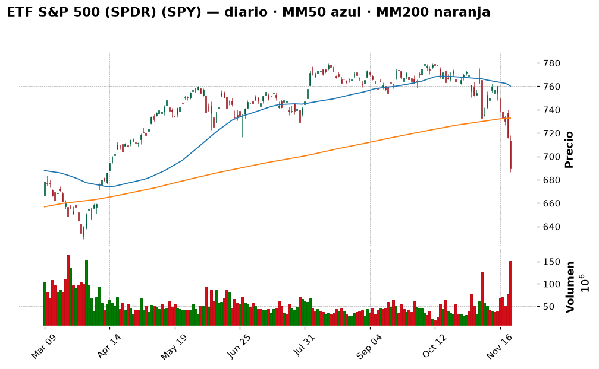
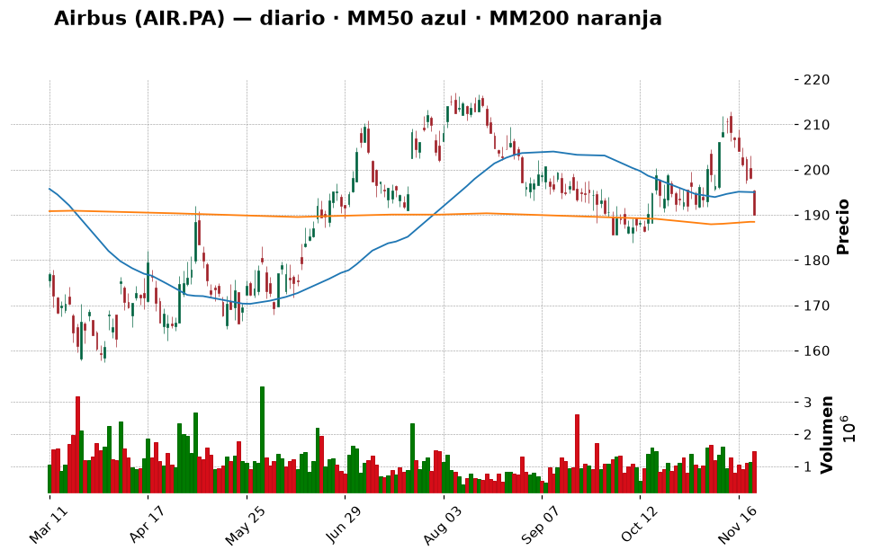
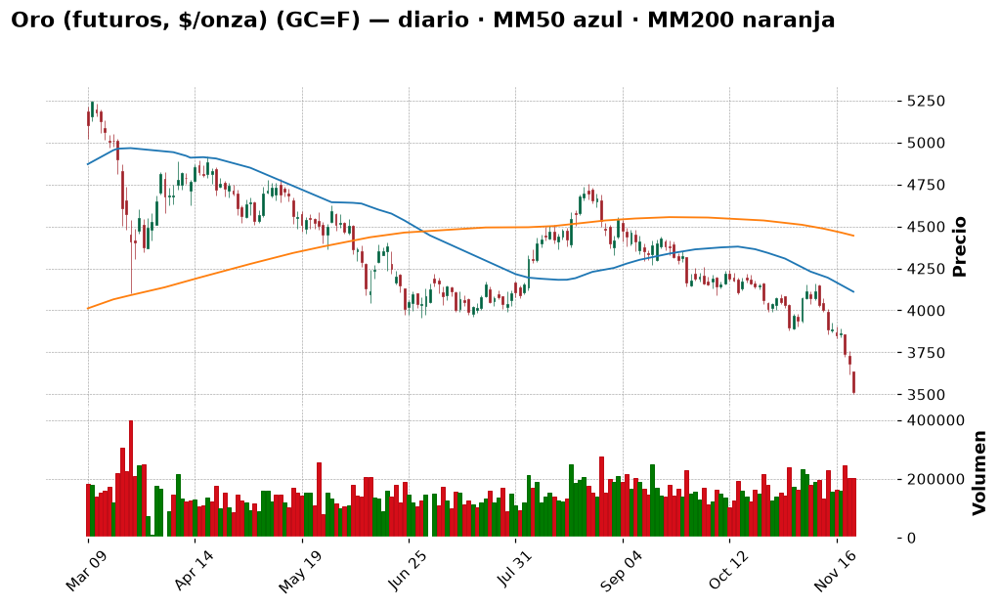
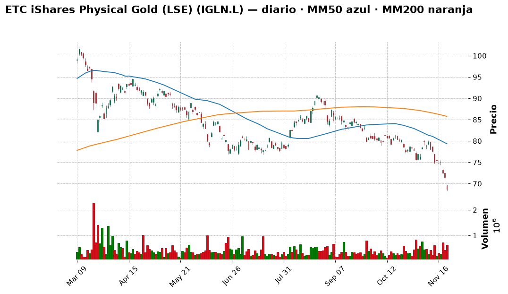
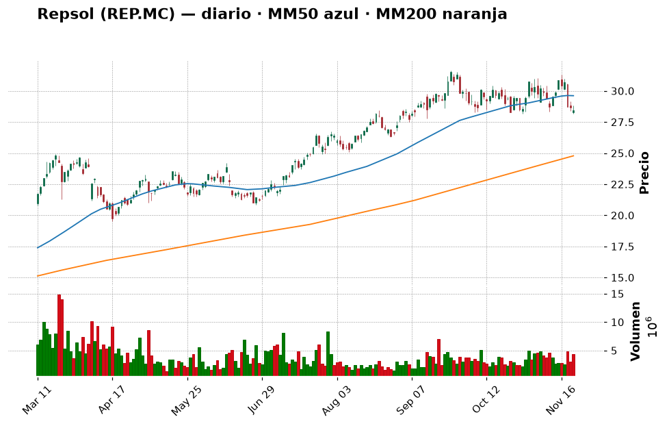
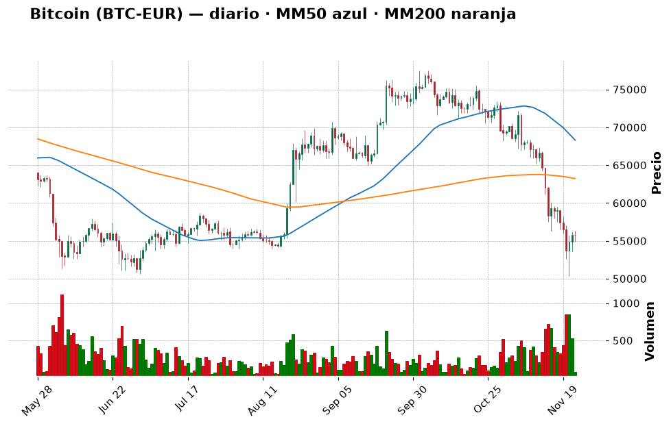
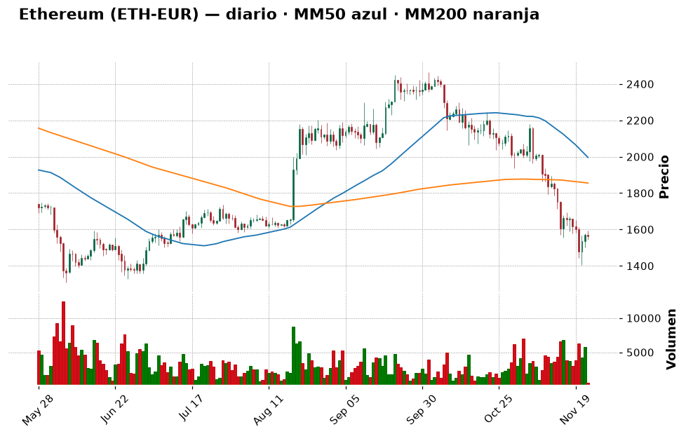
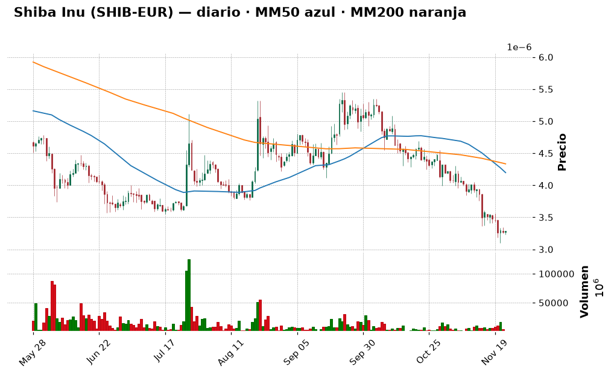

# 📈 Informe pre-apertura — lunes 23 de noviembre de 2026

> Generado automáticamente a las 07:55 (hora de Madrid) · Bolsa española abre a las 9:00 · Wall Street a las 15:30 · Cripto: 24/7
> **Termómetro del día:** 🔴 mucha incertidumbre — los futuros de Wall Street rebotan con fuerza (S&P 500 **+2,0 %**, Nasdaq 100 **+2,8 %**), pero venimos de la peor semana del Nasdaq desde 2020, el VIX cerró el viernes en **35,9**, el Fear & Greed cripto sigue en **11/100** y el miércoles llega el PCE, el dato de inflación que vigila la Fed. Un rebote de lunes no es todavía un cambio de tendencia.
> **Lección de hoy:** Las Letras del Tesoro y cómo funcionan las subastas

## 1. Lo que tienes que saber hoy
- **Esta mañana el mercado respira, pero las reglas no cambian.** Los futuros del S&P 500 suben un **+2,01 % (7.074 puntos)** y los del Nasdaq 100 un **+2,79 %** (Yahoo Finance, 07:38 de Madrid). La Bolsa española y la europea aún no han abierto: **todos los precios de bolsa de este informe son del cierre del viernes 20**. Nuestra regla del ETF se decide con el **cierre semanal** (el viernes 27) frente a ~733 $, no con un rebote de lunes. 💡 *Un **rebote** tras caídas fuertes es muy habitual —los vendedores forzados ya han vendido—, pero no garantiza que la caída haya terminado.*
- **Letras del Tesoro: tienes hasta el viernes 27-nov a las 14:00.** Según la hoja de emisión del **Banco de España**, las peticiones de particulares para la subasta del **martes 1-dic** (6 y 12 meses) se cierran el **27-nov a las 14:00** si se paga por transferencia, en efectivo o con cheque conformado (con cheque sin conformar, el 25-nov). Es **la tarea de la semana**: ~3.000 € a tipo fijo (sección 8).
- **Bitcoin rebota a 55.828 € y el mini-tramo no se persigue.** El sábado tocó **50.362 €** de madrugada, antes de que publicáramos el informe; luego subió. La orden de ~50 € en ~50.600 € **no aparece en `cartera.csv`**, así que entiendo que no se ejecutó (o no la pusiste). Hoy está un **+10 %** por encima: **no compramos más caro** de lo previsto. Bitcoin pasa a **Mantener** y la orden puede quedarse puesta hasta el 30-nov (sección 7).
- **La Fed sigue con las subidas de tipos, pero el pánico ha frenado la más agresiva.** El mercado ya no descuenta una subida de **0,50 puntos** en diciembre. Sigue viendo casi segura una de **0,25** en la reunión del **8–9 de diciembre**: el CME FedWatch le da un **93,5 %**, según Reuters vía Investing.com. Le da además un **60 %** a otra en enero, según CoinDesk.
- **Tu cartera, tranquila:** **9.660,28 €**, solo **−1,73 €** frente al sábado, con el **88 % en liquidez**. No hay movimientos nuevos en `cartera.csv` ni errores.

## 2. ✅ Recomendaciones del día (resumen)
| Activo | Acción | vs. ayer | Cuánto (orientativo) | Horizonte | Por qué, en una frase | Confianza |
|---|---|---|---|---|---|---|
| Letras del Tesoro (LETRAS) | 🟢 Comprar | = | **~3.000 €**: 1.000 € a 6 meses y 2.000 € a 12 meses en la subasta del **1-dic**; **petición antes del viernes 27-nov, 14:00** | 6–12 meses | Rentabilidad fija (2,82–3,05 % en la última subasta) con el Estado como emisor | alta |
| ETF S&P 500 (SPY / SPY5.L) | 🔵 Mantener | = | 0 €; **½ tramo 2 en pausa** (se reanuda con un cierre semanal sobre ~733 $ o ~150 € el 15-dic si se estabiliza) | Años (5+) | Los futuros rebotan +2 %, pero la regla es semanal y el SPY está un −5,9 % bajo su MM200 | media |
| Airbus (AIR.PA) | 🔵 Mantener | = | 0 €: ya tienes el 3 % (tope del plan) | Años | 189,96 €, aún sobre su MM200 (+0,8 %); la línea roja es un cierre semanal bajo 183,84 € | baja |
| Oro (IGLN.L) | ⏸️ Esperar | = | 0 €; primer tramo de ~150 € solo con cierre sobre ~75 $ | Años | Bajista y −19,9 % bajo su MM200; el "refugio" sigue sin funcionar con tipos reales altos | media |
| Repsol (REP.MC) | 🔵 Mantener | = | No añadir | Años | El soporte de 28,18 € aguantó; el Brent sigue en ~90 $ (89,86 $ esta mañana) | media |
| Indra (IDR.MC) | ⛔ Evitar | = | 0 € | — | −15,5 % la semana pasada (49,67 €) y la investigación sigue abierta | media |
| NVIDIA (NVDA) | ⛔ Evitar | = | 0 € | — | Sus futuros rebotan con la presión de Trump para que vuelva Huang, pero la SEC sigue mirando su contabilidad | alta |
| Solaria (SLR.MC) | 🔵 Mantener | = | No añadir | Años | Posición mínima (1 acción), a un +1,2 % de su mínimo anual | baja |
| Telefónica (TEF.MC) | ⏸️ Esperar | = | Hasta ~250 € si supera 3,71 € | Años | 3,36 €: aguanta sobre 3,27 €, pero sigue en tendencia bajista | baja |
| Iberdrola (IBE.MC) | ⏸️ Esperar | = | Hasta 5 % (~480 €) si retrocede a 21–22 € | Años | Defensiva y alcista (22,67 €), aún por encima de la zona de compra | media |
| Inditex (ITX.MC) | 🔵 Mantener | = | No añadir | Años | Tendencia alcista; tu posición gana +114 %; el sector textil rebaja optimismo para el invierno | media |
| Apple (AAPL) | 🔵 Mantener | = | No añadir | Años | 342,56 $, +13 % sobre su MM200: aguanta mucho mejor que el resto de la tecnología | media |
| Bitcoin (BTC) | 🔵 Mantener | ↓ antes Comprar más | 0 € a este precio; la orden de ~50 € en ~50.600 € puede seguir puesta hasta el 30-nov | Años | Rebota a 55.828 € (+10 % sobre la orden): no perseguimos el precio | baja |
| Ether (ETH) | ⛔ Evitar | = | 0 € | — | Cerró el domingo en 1.570 €, aún bajo la línea de 1.580 € | media |
| Shiba Inu (SHIB) | ⛔ Evitar | = | No añadir | — | Memecoin bajista, −52 % en un año | alta |

*(El resto de la watchlist —Santander, BBVA, Oryzon, IAG, Aena, Microsoft, Amazon, Alphabet, Berkshire, los ETF del Nasdaq y del MSCI World, ASML, LVMH, SAP y Siemens— tiene su veredicto en la tabla "Resto de la watchlist" de la sección 6.)*

**🔁 Seguimiento de ayer** (informe del sábado 21-nov):
- **Bitcoin:** "~50 € con orden limitada en ~50.600 €; si no se ejecuta, no persigas el precio" → el mínimo (50.362 €) fue de madrugada, antes del informe; después cerró el sábado en **54.888 €** y el domingo en **55.788 €**. En `cartera.csv` no hay compra. **Qué cambia:** el precio se ha alejado un +10 % de la zona de compra, así que la acción pasa de *Comprar más* a **Mantener**. No es un cambio de opinión: es la regla que escribimos.
- **ETF S&P 500:** pausa del tramo activada el viernes (cierre semanal 689,81 $ < 729 $). El rebote de los futuros no la levanta: necesita un **cierre semanal sobre ~733 $**. **Sin cambios.**
- **Airbus:** sin sesión desde el informe; 189,96 €. La línea roja nueva (cierre **semanal** bajo 183,84 € o un recorte del objetivo de entregas) sigue sin tocarse. **Sin cambios.**
- **Ether:** "volver a Esperar si recupera 1.580 € al cierre y lo mantiene una semana" → cerró el sábado en 1.536 € y el domingo en **1.570 €**; ahora, 1.565 €. Casi, pero no. **Sigue en Evitar.**
- **Letras:** novedad importante. Ya tenemos el **plazo exacto** del Banco de España: **viernes 27-nov, 14:00**. Si pagas por transferencia, el dinero tiene que estar abonado en el Banco de España antes de las **14:00 del día hábil anterior a la subasta**. Por internet (tesoro.es), el plazo depende del calendario que publica el Tesoro y no lo he podido confirmar. **Compruébalo hoy mismo.**
- **Tu cartera:** sin movimientos nuevos desde el tramo 2 de Airbus (20-nov).

> Día para **no hacer casi nada en bolsa**: dejar que el rebote (o la recaída) se desarrolle sin perseguirlo. La única tarea con fecha es **pedir las Letras antes del viernes a las 14:00**.

## 3. Agenda del día (y de la semana)
| Hora (Madrid) | Evento | Por qué importa |
|---|---|---|
| Hoy, 9:00 | Apertura de la Bolsa española. El Ibex parte de **18.873,1** (−1,63 % el viernes) | Primera sesión tras la semana negra; los futuros de EE. UU. apuntan a rebote |
| Hoy (hora sin confirmar) | **PMI preliminares de noviembre** de la zona euro y de EE. UU. (agenda semanal de Trademap; hoy no he podido confirmar la hora) | 💡 *El **PMI** es una encuesta a directores de compras: por encima de 50 la actividad crece y por debajo de 50 se contrae* |
| Hoy | **Japón cerrado** por festivo; Taiwán sube un **+2,35 %** tras perder un −17 % la semana pasada, su peor semana desde 1990 (Investing.com; Reuters) | Asia marca el tono de los chips |
| Mar 24 | Resultados de **Dell** (Digrin, hora sin especificar) y otros previstos en la agenda de la semana | Termómetro de los centros de datos y la IA |
| Mié 25, 14:30 | **PCE de octubre** en EE. UU. RBC espera un +0,3 % mensual, el 3,8 % anual el general y el 3,3 % el subyacente (CoinDesk). MUFG lo ve como "el catalizador clave" (Reuters) | Es la inflación que mira la Fed; si sale alto, más presión para subir tipos |
| Mié 25 | Termina el plazo para pedir las Letras **con cheque sin conformar** (14:00) | Si no pagas así, tu plazo es el viernes |
| Jue 26 | **Acción de Gracias: Wall Street cerrado** (y el viernes 27, sesión corta) | Menos volumen = movimientos más bruscos |
| **Vie 27, 14:00** | **Fin del plazo de peticiones de Letras** a 6 y 12 meses en el Banco de España | **Tu tarea de la semana** |
| Dom 29 | **Elecciones generales en España** | Impuesto a la banca (Santander, BBVA) y promesas fiscales |
| Mar 1-dic | **Subasta de Letras a 6 y 12 meses** · **tu aportación de 200 €** | Emisión el 4-dic |
| 8–9 dic | **Reunión de la Fed**: 93,5 % de probabilidad de subida de 0,25 puntos (CME FedWatch vía Reuters) | Tipos más altos = presión para la bolsa, el oro y el bitcoin |

## 4. Cómo llegan los mercados
### España y Europa
El **Ibex 35** cerró el viernes en **18.873,1 (−1,63 %)**, **−5,73 % en la semana**. Sigue por encima de su MM200 por muy poco (+0,4 %), y su soporte más cercano está en **18.821,9**, a un −0,3 %. El **Euro Stoxx 50** cerró en **5.941,95 (−2,81 %)**, −7 % en la semana y un −3,1 % bajo su MM200 (Yahoo Finance). No he podido leer la preapertura de Expansión porque la web bloquea la descarga automática, pero el rebote de los futuros de EE. UU. apunta a una apertura en positivo. **Eso es interpretación, no un dato.**

Noticias de empresas (titulares de Expansión, El País y Cinco Días vía RSS):
- **Santander y BBVA** "ganan la batalla en Latinoamérica a JPMorgan y Citi" (Expansión). En contra: la prórroga del impuesto a la banca y las elecciones del domingo.
- **Indra** "cierra su plan estratégico tras lanzar 1.000 millones en compras" (Expansión). No he podido abrir el artículo, así que no tengo más detalle.
- **Aerolíneas:** anticipan una subida de precios y un recorte de plazas para el próximo verano (El País). Puede ser bueno para los márgenes de IAG y regular para Aena (menos pasajeros).
- **Textil:** "los grandes grupos rebajan el optimismo y temen un menor gasto en invierno por la inflación" (Cinco Días). Afecta a Inditex.
- **Fitch:** "la flexibilidad para bajar impuestos en España no es muy significativa" (Cinco Días), en plena campaña electoral.
- **Europa:** ABB comprará la alemana Ziehl-Abegg por 2.650 millones $, y la UE e Indonesia firman un acuerdo para eliminar la mayoría de aranceles (Investing.com).

### Estados Unidos
El viernes, el **S&P 500** cayó un **−3,70 % (6.910,39)**, entró en **corrección** y perdió un **−8,6 %** en la semana. El **Nasdaq** cayó un **−5,28 %**, con su peor semana desde 2020 (−10 %). Según un titular de Benzinga, el Nasdaq 100 está a solo **49 puntos de un mercado bajista**, y el S&P 500 ya está **por debajo de todos los objetivos de fin de año** de Wall Street.

**Esta mañana:** futuros del **S&P 500 a 7.074,25 (+2,01 %)** y del **Nasdaq 100 a 25.827,25 (+2,79 %)** (Yahoo Finance, 07:38). Según Reuters, el rebote se apoya en Oracle y en Corea del Sur, que promete usar fondos de estabilización si sus bolsas siguen cayendo, mientras Asia "se prepara" para más ventas de chips. Los titulares de Yahoo hablan de "futuros de Nvidia +6 %" porque **Trump** vuelve a pedir que Nvidia readmita a **Jensen Huang** como consejero delegado (Cointelegraph; Benzinga).

💡 *Un **mercado bajista** es una caída de más del 20 % desde máximos. Una **corrección**, de más del 10 %. El S&P 500 está hoy a un −11,9 % de su máximo.*

### Macro (tipos de interés, inflación, divisas, materias primas)
- **Fed:** subida de **0,25 puntos** el 8–9 de diciembre casi segura (93,5 %). La de 0,50 ya no se descuenta: hace una semana tenía un 11,5 % (Reuters). El inversor Bill Ackman cree que la Fed "cometerá un error" si sube en diciembre (Cointelegraph). OCBC lo resume así: "el shock de tipos se ha convertido en un shock de crecimiento". 💡 *Es decir, el miedo ya no es solo que suban los tipos, sino que la economía se frene.*
- **Bonos:** el bono de EE. UU. a 10 años cerró el viernes en torno al **4,94 %** (Investing.com).
- **Divisas:** **euro/dólar 1,1005 (+0,28 %)** esta mañana (Yahoo Finance). El dólar se aleja de su máximo de 19 meses (índice DXY en 103,72) (Reuters). 💡 *Si el euro sube frente al dólar, tus activos en dólares —el ETF, Apple, los USDC— valen algo menos en euros. Por eso tus USDC "pierden" 7,56 € desde el sábado sin que haya pasado nada con ellos.*
- **Petróleo:** **Brent a 89,86 $ (−0,10 %)** (Yahoo Finance): el fin de semana de ataques en el Golfo no lo ha disparado.
- **BCE:** mantuvo los tipos en su reunión del 29-oct; Lagarde dio un discurso el 20-nov titulado "Acting in time" (BCE).
- **Tipos de referencia** (de `rates_2026-11-23.json`): **BCE (facilidad de depósito) 2,50 %** · **Euríbor 12 m 3,239 %** (media de octubre) · **deuda AAA de la zona euro a 1 año 3,004 %** (19-nov; antes, 2,974 %) · **Fed 4,00 %** (límite superior). Seguimos sobre el umbral del 3 %, así que el apartado de renta fija sigue activo.

**🥇 Oro:** cerró el viernes en **3.515,4 $/onza (GC=F), con un −4,62 %**. Pierde un **−9,5 % en la semana** y un **−37 %** desde su máximo de 52 semanas (5.586,2 $). El ETC **IGLN.L** cerró en **68,75 $ (−3,81 %)**. Hoy no tengo un precio verificado de esta mañana. Un titular de Yahoo Finance habla de un "rebote desde mínimos de 14 meses por la demanda refugio", y un analista de Morningstar dice que el oro "cotiza como un activo especulativo" (−17 % en 2026). Lo que lo mueve sigue igual: tipos reales altos, una Fed que sube tipos y un dólar fuerte, aunque hoy se debilite un poco.

## 5. Panorama técnico de la watchlist
> 💡 *Cómo leer esta tabla:* la **tendencia** resume si el precio lleva meses subiendo, bajando o de lado
> (comparando el precio con sus medias de 50 y 200 días). El **RSI** mide de 0 a 100 si las subidas o bajadas
> recientes han sido muy fuertes: por encima de 70 se dice "sobrecompra" (quizá ha subido demasiado rápido),
> por debajo de 30 "sobreventa". Son pistas, no predicciones.

Datos del **cierre del viernes 20-nov**: las bolsas no han abierto desde entonces. Ningún valor llega con retraso ✅.

| Valor | Último cierre | Día | 1 mes | 1 año | Tendencia | RSI | vs MM200 |
|---|---|---|---|---|---|---|---|
| IBEX 35 (^IBEX) | 18.873,1 | −1,63 % | −0,21 % | +16,93 % | ➡️ lateral | 39,2 🟡 | +0,4 % |
| Euro Stoxx 50 (^STOXX50E) | 5.941,95 | −2,81 % | −2,38 % | +7,36 % | ➡️ lateral | 33,0 🟡 | −3,1 % |
| S&P 500 (^GSPC) | 6.910,39 | −3,70 % | −9,83 % | +4,04 % | ➡️ lateral | 24,7 🔴 | −6,0 % |
| Nasdaq Composite (^IXIC) | 22.617,73 | −5,28 % | −13,04 % | +0,24 % | ➡️ lateral | 25,6 🔴 | −10,1 % |
| Banco Santander (SAN.MC) | 10,32 | −2,25 % | −10,14 % | +14,21 % | ➡️ lateral | 34,3 🟡 | −8,6 % |
| BBVA (BBVA.MC) | 21,83 | −3,36 % | −1,62 % | +19,39 % | ➡️ lateral | 36,9 🟡 | +1,0 % |
| Inditex (ITX.MC) | 57,78 | −1,13 % | +2,74 % | +21,54 % | 📈 alcista | 49,1 🟢 | +5,6 % |
| Iberdrola (IBE.MC) | 22,67 | +0,35 % | +4,28 % | +25,70 % | 📈 alcista | 55,7 🟢 | +10,5 % |
| Telefónica (TEF.MC) | 3,36 | +0,21 % | −3,28 % | −9,79 % | 📉 bajista | 45,7 🟢 | −7,9 % |
| Repsol (REP.MC) | 28,46 | −0,66 % | +0,71 % | +82,90 % | ➡️ lateral | 43,3 🟢 | +14,9 % |
| Solaria (SLR.MC) | 13,77 | −2,72 % | −1,99 % | −16,87 % | 📉 bajista | 35,6 🟡 | −29,3 % |
| Oryzon (ORY.MC) | 2,41 | −2,75 % | −4,90 % | −23,50 % | 📉 bajista | 46,2 🟢 | −15,0 % |
| IAG (IAG.MC) | 5,24 | −2,20 % | +7,49 % | +17,34 % | 📈 alcista | 52,4 🟢 | +7,3 % |
| Indra (IDR.MC) | 49,67 | −3,37 % | −20,02 % | +12,17 % | ➡️ lateral | 27,2 🔴 | −11,2 % |
| Aena (AENA.MC) | 27,64 | −0,22 % | +4,78 % | +18,63 % | 📈 alcista | 50,5 🟢 | +6,2 % |
| Apple (AAPL) | 342,56 | −1,90 % | −1,63 % | +27,55 % | 📈 alcista | 46,4 🟢 | +13,0 % |
| Microsoft (MSFT) | 484,52 | −2,77 % | −7,02 % | −0,53 % | ➡️ lateral | 34,8 🟡 | +9,2 % |
| NVIDIA (NVDA) | 125,53 | −14,01 % | −40,85 % | −32,70 % | ➡️ lateral | 15,0 🔴 | −38,3 % |
| Amazon (AMZN) | 246,82 | −4,10 % | −1,42 % | +10,84 % | ➡️ lateral | 42,3 🟢 | +0,7 % |
| ETF S&P 500 (SPY) | 689,81 | −3,64 % | −9,71 % | +4,10 % | ➡️ lateral | 24,9 🔴 | −5,9 % |
| ETF Nasdaq 100 (QQQ) | 608,45 | −5,67 % | −13,63 % | +1,43 % | ➡️ lateral | 26,6 🔴 | −10,9 % |
| Alphabet (GOOGL) | 265,29 | −2,70 % | −18,18 % | −9,40 % | 📉 bajista | 27,8 🔴 | −21,3 % |
| Berkshire Hathaway (BRK-B) | 570,00 | −0,36 % | +4,21 % | +13,71 % | 📈 alcista | 56,6 🟢 | +13,4 % |
| ETF MSCI World (IWDA.AS) | 122,71 | −3,17 % | −5,56 % | +12,03 % | ➡️ lateral | 28,9 🔴 | +0,1 % |
| Airbus (AIR.PA) | 189,96 | −4,13 % | −2,47 % | −5,84 % | ➡️ lateral | 39,6 🟡 | +0,8 % |
| ASML (ASML.AS) | 1.168,00 | −9,33 % | −17,72 % | +35,77 % | ➡️ lateral | 32,1 🟡 | −16,6 % |
| LVMH (MC.PA) | 381,95 | −2,54 % | −1,51 % | −38,33 % | 📉 bajista | 38,3 🟡 | −16,6 % |
| SAP (SAP.DE) | 183,68 | −1,79 % | −14,71 % | −10,40 % | ➡️ lateral | 29,3 🔴 | +9,9 % |
| Siemens (SIE.DE) | 254,65 | −4,59 % | −0,41 % | +16,20 % | ➡️ lateral | 37,8 🟡 | −2,3 % |
| Oro (GC=F) | 3.515,4 | −4,62 % | −13,42 % | −13,90 % | 📉 bajista | 21,6 🔴 | −20,9 % |
| Oro (IGLN.L) | 68,75 | −3,81 % | −12,57 % | −13,09 % | 📉 bajista | 24,3 🔴 | −19,9 % |

*(🟢 RSI 40–60, neutral · 🟡 30–40 o 60–70 · 🔴 por debajo de 30, sobreventa, o por encima de 70, sobrecompra.)*

La foto es la del viernes: **el mercado de EE. UU. está en sobreventa** (RSI del S&P 500 en 24,7, del Nasdaq en 25,6) y todos los índices han perdido la tendencia alcista. Lo que mejor aguanta es lo **defensivo y estable**: Iberdrola, Berkshire, Inditex, Aena, IAG y Apple siguen alcistas. Lo más castigado son los chips (Nvidia, ASML), el software (SAP) y el oro. La sobreventa explica en parte el rebote de esta mañana. 💡 *Cuando un activo cae muy rápido, suele haber rebotes técnicos: los vendedores se agotan por un rato. Pero en un mercado bajista también hay rebotes fuertes que luego fallan. Por eso esperamos al cierre semanal.*

## 6. Ideas de bolsa: qué haría un experto
### ETF S&P 500 (SPY5.L / SPY) — MANTENER (pausa activada)

- **Qué es:** un fondo que compra de una vez las ~500 mayores empresas de EE. UU. Tú tienes la versión europea, **SPY5.L** (Londres); el gráfico es del SPY estadounidense.
- **Por qué es noticia hoy:** tras entrar en corrección, los futuros del S&P 500 rebotan un **+2 %** esta mañana (Yahoo Finance). Según un titular de Yahoo, Ray Dalio (Bridgewater) mantiene el **16 %** de su cartera en fondos del S&P 500 incluso después de recortarlos.
- **Lo que dice el gráfico:** cerró el viernes en **689,81 $** con un volumen de **2,6 veces** lo normal. Está un **−5,9 % bajo su MM200** (732,76 $) y un −9,3 % bajo su MM50 (760,18 $). El RSI es **24,9 (sobreventa)** y el MACD está "empeorando". Las velas de la última semana son largas y rojas: ventas con prisa. Si los futuros se confirman, el SPY abriría hoy en torno a **700–705 $**, todavía lejos de los 733 $ que marca nuestra regla.
- **Tu posición:** 0,87 participaciones a 748,72 $; SPY5.L a 705,71 $: **−5,74 % (−33,98 €)**.
- **Lo positivo:** solo tienes un ~6 % del patrimonio en el ETF; si la corrección sigue, los próximos tramos se comprarán más baratos.
- **El riesgo:** que el rebote de hoy sea solo eso y el S&P 500 caiga hacia un mercado bajista (−20 %). El PCE del miércoles puede ser el detonante en las dos direcciones.
- **🧑‍💼 Recomendación: MANTENER.** No cambia nada desde el sábado. **No vendemos** porque la tesis (crecimiento de las grandes empresas de EE. UU. a 5 años o más) sigue en pie. **No compramos** porque la regla de pausa se cumple mientras no haya un cierre semanal sobre ~733 $. Comprar hoy "porque rebota" sería justo el FOMO del que hablamos la semana pasada.
  - **Cuánto y cómo:** 0 € ahora. Los ~300 € de la ½ del tramo 2 esperan en liquidez hasta que se cumpla una de dos cosas: (a) un cierre **semanal** del SPY sobre ~733 $, o (b) el **15 de diciembre**, si lleva dos semanas sin marcar nuevos mínimos (sin bajar de 686,75 $), compraría **~150 €**.
  - **Horizonte:** años (5 o más).
  - **Qué me haría cambiar de opinión:** solo un cambio de tesis, por ejemplo una recesión profunda con caída generalizada de beneficios. Una bajada de precio no.
- **Qué mirar para entenderlo:** el **cierre del viernes 27** (sesión corta por Acción de Gracias) frente a 733 $, y el **VIX**: si baja de 25, el miedo se calma.
- **Confianza:** media

### Airbus (AIR.PA) — MANTENER

- **Qué es:** el mayor fabricante de aviones comerciales del mundo y un actor clave de la defensa y el espacio en Europa.
- **Por qué es noticia hoy:** no hay noticias nuevas en nuestras fuentes; la búsqueda del día no ha devuelto nada del fin de semana. El dato que más importa llega a principios de diciembre: las **entregas de noviembre**. Para cumplir su objetivo de **~870 entregas** en el año necesita unas **249 entre noviembre y diciembre** (dato del informe del sábado, de AirData News y CAPA). Hay una noticia indirecta: las aerolíneas anticipan precios más altos y menos plazas el próximo verano (El País), señal de que **faltan aviones**. Eso es bueno para la demanda de Airbus, pero también recuerda sus problemas de suministro (motores y cabinas).
- **Lo que dice el gráfico:** **189,96 €**. Ha perdido la MM50 (195,00 €) pero sigue sobre la **MM200 (188,44 €, +0,8 %)**, con tendencia lateral. RSI 39,6. El soporte está en **183,84 €** y la resistencia en **200,40 €**. En llano: está "en el borde" de su tendencia de fondo, pero todavía dentro.
- **Tu posición:** 1,5065 acciones a 197,92 € de media: **−4,02 % (−11,99 €)**. Pesa un **3,0 %** del patrimonio, el tope del plan.
- **Lo positivo:** cartera de pedidos enorme y demanda de aviones que supera la oferta.
- **El riesgo:** que no cumpla el objetivo de entregas y lo recorte.
- **🧑‍💼 Recomendación: MANTENER.** Sin cambios. Ya tienes el peso previsto y venderías por ruido de mercado, no por la empresa.
  - **Cuánto y cómo:** 0 €. No pongas más órdenes de compra.
  - **Horizonte:** años.
  - **Qué me haría cambiar de opinión:** un **cierre semanal bajo 183,84 €** o un **recorte del objetivo de entregas** → **Reducir a la mitad** (vender ~0,75 acciones). Recuperar 200,40 € reafirmaría la tendencia.
- **Qué mirar para entenderlo:** el **informe de entregas de noviembre**, en los primeros días de diciembre. Con más de ~110 entregas, el objetivo sigue vivo.
- **Confianza:** baja

### Oro (IGLN.L) — ESPERAR

- **Qué es:** el activo refugio clásico. **GC=F** es el precio de referencia (futuros, $/onza); lo que tú puedes comprar es el ETC **IGLN.L**.
- **Por qué es noticia hoy:** viene de mínimos de 14 meses; un titular de Yahoo habla de un rebote por demanda refugio. El dólar se aleja de su máximo de 19 meses, algo que le favorece, pero la Fed sigue subiendo tipos.
- **Lo que dice el gráfico:** tendencia **bajista**. GC=F (3.515,4 $) está un −20,9 % bajo su MM200, con RSI de **21,6** (sobreventa profunda) y el MACD empeorando. IGLN.L (68,75 $) está un −19,9 % bajo su MM200, con RSI de 24,3, en mínimos anuales. No hay soportes debajo en nuestros datos.
- **Lo positivo:** cuanto más cae, mejor precio para diversificar en el futuro; los bancos centrales siguen comprando.
- **El riesgo:** que siga cayendo mientras los tipos reales estén altos. Recuerda que el oro **no paga dividendos ni intereses**: hoy, una Letra te da un ~3 % fijo.
- **🧑‍💼 Recomendación: ESPERAR.** Misma regla que el sábado. Un rebote de un día no es la señal que pedimos.
  - **Cuánto y cómo:** 0 € hoy. **Primer tramo de ~150 €** en IGLN.L con un **cierre sobre ~75 $**, o con el MACD "mejorando" y el precio estable durante dos o tres semanas sin nuevos mínimos. Después, tramos de 150 € hasta un 3–5 % del patrimonio. Nunca futuros ni apalancados; PAXG no sustituye al ETC.
  - **Horizonte:** años.
  - **Qué me haría cambiar de opinión:** la señal técnica de arriba o un giro de la Fed (dejar de subir tipos).
- **Qué mirar para entenderlo:** el **PCE del miércoles**. Si sale bajo, se esperarían menos subidas de tipos y el oro podría respirar.
- **Confianza:** media

### Repsol (REP.MC) — MANTENER (la tienes)

- **Qué es:** la mayor petrolera española.
- **Por qué es noticia hoy:** el fin de semana de tensión en el Golfo (ataques a petroleros cerca de Ormuz) **no ha disparado el petróleo**: el Brent está en **89,86 $ (−0,1 %)** esta mañana (Yahoo Finance).
- **Lo que dice el gráfico:** **28,46 €**. El viernes tocó **exactamente 28,18 €** y rebotó. Está un **+14,9 % sobre su MM200** (24,78 €) y por debajo de su MM50 (29,61 €), con RSI de 43,3. Soportes en 28,31–28,18 € y resistencia en 30,43 €.
- **Tu posición:** 2 acciones a 12,37 €: **+130 % (+32,18 €)**.
- **Lo positivo:** paga buen dividendo y el crudo sigue alto por la guerra.
- **El riesgo:** que la tensión baje de golpe y el crudo caiga hacia 80 $.
- **🧑‍💼 Recomendación: MANTENER.** No se cumple ninguna de las dos condiciones para Reducir.
  - **Cuánto y cómo:** no añadir.
  - **Horizonte:** años.
  - **Qué me haría cambiar de opinión:** un cierre bajo 28,18 € **y** el Brent bajando hacia 80 $ → Reducir (vender 1 de tus 2 acciones).
- **Qué mirar para entenderlo:** el **Brent** cada mañana y el soporte de 28,18 €.
- **Confianza:** media

### Resto de la watchlist: veredicto rápido
| Valor | Acción | Por qué (1 frase) | Nivel a vigilar |
|---|---|---|---|
| NVIDIA (NVDA) | ⛔ Evitar | Hoy sus futuros suben un +6 % porque Trump pide que vuelva Huang (Benzinga; Cointelegraph), pero la SEC sigue examinando su contabilidad; RSI 15 y −38 % bajo su MM200 | Revisar solo cuando se aclare la investigación y la dirección |
| Indra (IDR.MC) | ⛔ Evitar | "Cierra su plan estratégico tras lanzar 1.000 millones en compras" (Expansión), pero sigue la investigación; RSI 27 | Soporte 46,85 €; revisar sobre 57,98 € |
| Solaria (SLR.MC) | 🔵 Mantener | La tienes (1 acción, −8 %), cerca de su mínimo anual; vender costaría casi lo mismo en comisiones | Mínimo 13,61 €; resistencia 16,95 € |
| Telefónica (TEF.MC) | ⏸️ Esperar | Barclays mejora a Freenet por "un mejor acuerdo con Telefónica" (Yahoo Finance); su consejero delegado se ve "en primera línea" de la autonomía europea; tendencia aún bajista | Comprar sobre 3,71 €; Evitar con cierre bajo 3,27 € |
| Iberdrola (IBE.MC) | ⏸️ Esperar | La defensiva de la semana (+0,35 % el viernes negro), alcista, +10,5 % sobre su MM200 | Comprar en 21–22 €; soporte 21,09 € |
| Inditex (ITX.MC) | 🔵 Mantener | Tu posición gana +114 %; el textil teme un invierno flojo por la inflación (Cinco Días), pero la tendencia sigue alcista | Soporte 56,2 €; máximo 60,80 € |
| Apple (AAPL) | 🔵 Mantener | BTIG ve improbable un suelo del S&P 500 "mientras Apple aguante cerca de máximos" (Yahoo Finance); +13 % sobre su MM200 | Soporte 338,7 $; luego 325,8 $ |
| Banco Santander (SAN.MC) | ⏸️ Esperar | Gana cuota en Latinoamérica (Expansión), pero tiene en contra el impuesto a la banca y las elecciones del domingo; −8,6 % bajo su MM200 | Soporte 10,08 €; comprar sobre 11,67 € (MM50) |
| BBVA (BBVA.MC) | ⏸️ Esperar | En su soporte de 21,82 € y sobre su MM200 (+1 %); pendiente del 29-N | Si pierde 21,82 €, siguiente 21,20 € |
| Oryzon (ORY.MC) | 🔵 Mantener | La tienes (4 acciones, −26 %); posición mínima | Mínimo 2,23 €; resistencia 2,60 € |
| IAG (IAG.MC) | ⏸️ Esperar | Alcista; las aerolíneas prevén precios más altos y menos plazas en verano (El País): bueno para los márgenes | Soporte 4,95 €; resistencia 5,72 € |
| Aena (AENA.MC) | ⏸️ Esperar | Alcista y estable; menos plazas en verano sería un pequeño freno para el tráfico | Retroceso hacia la MM50 (26,53 €) |
| Microsoft (MSFT) | ⏸️ Esperar | −7,5 % la semana pasada; aún +9 % sobre su MM200 | Soporte 477,15 $ |
| Amazon (AMZN) | ⏸️ Esperar | Justo sobre su MM200 (+0,7 %) | Soporte 244,7 $ |
| ETF Nasdaq 100 (QQQ) | ⏸️ Esperar | A 49 puntos de un mercado bajista (Benzinga); demasiado concentrado en la tecnología que está cayendo | Recuperar 683 $ (MM200) |
| Alphabet (GOOGL) | ⛔ Evitar | Bajista, −21 % bajo su MM200 y en mínimos anuales | Recuperar 337 $ (MM200) |
| Berkshire Hathaway (BRK-B) | ⏸️ Esperar | El refugio "value" de la semana, alcista; Apple es el 25 % de su cartera de acciones | Retroceso hacia la MM50 (536,9 $) |
| ETF MSCI World (IWDA.AS) | ⏸️ Esperar | Justo sobre su MM200 (+0,1 %); misma regla de pausa que el S&P 500 | Soporte 122,4 € |
| ASML (ASML.AS) | ⏸️ Esperar | −9,3 % el viernes; Taiwán vivió su peor semana desde 1990 y hoy rebota un +2,35 % | Recuperar 1.400 € (MM200) |
| LVMH (MC.PA) | ⛔ Evitar | El lujo sigue bajista (−38 % en un año), en el soporte de 380 € | Soporte 376–381 €; recuperar 431 € |
| SAP (SAP.DE) | ⏸️ Esperar | Su director financiero prevé menos plantilla gracias a la IA y una nueva métrica de ingresos (Yahoo Finance); RSI 29 | Soporte 178,9 €; recuperar 197,9 € |
| Siemens (SIE.DE) | ⏸️ Esperar | Ha perdido su MM200 y está sobre su soporte de 254,5 € | Si pierde 254,5 €, esperar más |

## 7. ₿ Criptomonedas
> 💡 *Las criptomonedas cotizan 24 horas, 7 días a la semana: los precios son de esta mañana (en euros).
> Son mucho más volátiles que las acciones: caídas del 50 % o más han ocurrido varias veces.*

**Sentimiento:** Fear & Greed **11/100, miedo extremo** (ayer 11, hace una semana 10, hace un mes 51) · Capitalización total **2,19 billones $** (**+3,06 % en 24 h**, **−54,6 %** bajo su máximo histórico de octubre de 2025) · Dominancia de Bitcoin **56,4 %**.
El precio rebota y el miedo no se mueve: la gente sigue asustada aunque el precio suba. Eso suele indicar que el rebote es frágil, o que hay mucho dinero esperando para vender en cuanto suba un poco.

**Radar Coinbase** (405 monedas comprables · hoy suben 304 y bajan 52 · en 7 días suben 69 y bajan 288):
- **Mayores por capitalización (7 días):** BTC −5,5 %, ETH −5,5 %, BNB −6,0 %, XRP −2,0 %, SOL +0,8 %, HYPE −5,5 %, ZEC −12,3 %, DOGE −5,5 %, LINK −2,8 %, ADA −4,6 %.
- **Más suben (7 d, top 100):** VVV (+26,6 %), SOL (+0,8 %), JITOSOL (+0,7 %), TAO (+0,3 %) · **Más bajan:** SKY (−20,9 %), ARB (−12,6 %), ZEC (−12,3 %), ENA (−12,2 %), HBAR (−10,9 %).
**El rebote de 24 horas es general** (304 de 356 monedas suben), pero en la semana casi todo sigue en rojo. Solo una moneda pequeña (VVV, puesto 60) sube con fuerza, y eso es una rareza, no una oportunidad. **Nada fuera del núcleo merece compra.**

| Moneda | Ranking | Precio (€) | 24 h | 7 días | 1 mes | 1 año | Tendencia | RSI | vs MM200 |
|---|---|---|---|---|---|---|---|---|---|
| Bitcoin (BTC) | #1 | 55.828,43 | +0,07 % | −5,28 % | −22,63 % | −26,05 % | ➡️ lateral | 27,9 | −11,7 % |
| Ether (ETH) | #2 | 1.565,00 | −0,33 % | −5,41 % | −25,64 % | −35,72 % | ➡️ lateral | 30,7 | −15,6 % |
| XRP (XRP) | #6 | 0,8549 | +1,09 % | −1,54 % | −26,21 % | −51,98 % | ➡️ lateral | 32,1 | −20,8 % |
| Solana (SOL) | #7 | 65,30 | +1,38 % | +0,37 % | −28,52 % | −42,40 % | ➡️ lateral | 31,8 | −15,5 % |
| Shiba Inu (SHIB) | #41 | 0,00000329 | +0,61 % | −6,27 % | −24,89 % | −51,76 % | 📉 bajista | 26,9 | −24,1 % |

*(La columna "24 h" de la tabla compara con el cierre de anoche, medianoche UTC, según las velas de Coinbase. El rebote fuerte fue el sábado y el domingo: bitcoin pasó de 53.699 € el viernes a 55.788 € el domingo. Las cifras del radar son de Coinpaprika y miden ventanas algo distintas.)*

**Noticias que importan:**
- **"Flash crash" en Kraken:** el sábado, en el par **bitcoin/dólar canadiense** de Kraken, bitcoin se vendió a **24.250 C$ (~17.000 $)**, casi un **−70 %** bajo el precio global, en 976 operaciones. Ether bajó de 2.296 a 796 C$. Según Adam Back (Blockstream), el creador de mercado "se quedó sin dinero" y la caída **ejecutó las órdenes stop-loss** de muchos usuarios. Kraken dice que no hubo brecha de seguridad y que **las operaciones se mantienen** ([CoinDesk](https://www.coindesk.com/markets/2026/11/23/bitcoin-sold-for-usd17-000-on-kraken-s-canadian-dollar-market-and-the-trades-stand)). 💡 *Un **creador de mercado** es quien pone órdenes de compra y de venta para que siempre haya contrapartida. Si desaparece, el mercado se queda "vacío" y una venta puede ejecutarse a precios absurdos. Lección práctica en la sección 11.*
- **Rebote tras las liquidaciones:** bitcoin volvió por encima de **60.000 $** tras una ola de **1.800 millones $** en liquidaciones ([CoinDesk](https://www.coindesk.com/markets/2026/11/21/bitcoin-bounces-9-from-two-year-low-to-retake-usd60-000-as-traders-eye-monday-s-stock-open)). Esta mañana cotiza en torno a **61.200–61.400 $** (CoinDesk; Reuters).
- **ETF:** bitcoin va camino de su **peor noviembre desde 2018**, con **más de 4.000 millones $** de salidas de los ETF (titular de Yahoo Finance). Para Josh Gilbert (eToro), esas salidas son un problema "más difícil" para bitcoin que la propia Fed (CoinDesk).
- **Hackeos:** Chainflip confirma un robo de **12 millones $**, el segundo en 10 semanas (Cointelegraph), y los exchanges coreanos congelan las transferencias de CYBER por un posible ataque a su puente (Cointelegraph). La SEC acusa a unos estafadores de robar 37 millones $ con exchanges falsos (Decrypt). 💡 *Por eso solo usamos un exchange grande y regulado como Coinbase y no tocamos protocolos "DeFi" pequeños.*
- **Regulación:** el BCE busca socios para experimentar con depósitos y valores tokenizados (Cointelegraph). MSCI excluye a Strategy y Metaplanet, las empresas "tesorería de bitcoin", de sus índices (Yahoo Finance).

### Bitcoin (BTC) — MANTENER (antes Comprar más)

- **Qué es:** la primera y mayor criptomoneda, con una oferta máxima de 21 millones de unidades.
- **Lo que dice el gráfico:** cotiza a **55.828 €**. Rebotó desde el mínimo de 52 semanas del sábado (**50.362 €**) y ha recuperado el soporte de **~54.000 €**, ahora justo debajo (53.998 €). La primera resistencia está en **56.625 €** y la siguiente en **~69.900 €**. Está un **−11,7 % bajo su MM200** (63.233 €) y un −18 % bajo su MM50. El RSI sube a 27,9 (antes 17,6) y el MACD está "mejorando". En llano: ha salido de la zona de pánico, pero sigue en tendencia de fondo débil y bajo la media que marcaba nuestro plan normal.
- **Tu posición:** 0,00263 BTC a 69.887 € de media: vale **146,82 € (−20,1 %, −36,97 €)**, un 1,5 % del patrimonio.
- **🧑‍💼 Recomendación: MANTENER.** **Qué ha cambiado desde el sábado:** el precio se ha ido un +10 % por encima de la zona donde habíamos previsto el mini-tramo (~50.600 €). Comprar ahora sería perseguir el rebote, justo lo que dijimos que no haríamos.
  - **Cuánto y cómo:** 0 € a este precio. Si quieres, deja puesta (o pon) la **orden limitada de ~50 € en ~50.600 €** en BTC-EUR hasta el **30-nov**; si se ejecuta, **regístrala en `cartera.csv`**. El tramo mensual normal sigue en pausa hasta un cierre sobre la MM200 (~63.200 €). Tu tope es el 25 %, pero mi recomendación para tu perfil es no pasar del **~5 %**: las criptomonedas han caído un 50–80 % varias veces.
  - **Qué me haría cambiar de opinión:** un cierre diario **bajo ~48.000 €** → no compraría ni el mini-tramo hasta ver estabilidad. Un cierre sobre la MM200 (~63.200 €) → se reactiva el plan normal (~50–100 € al mes).
- **El riesgo:** que el rebote falle. En 2022 hubo varios rebotes del +10–20 % antes de nuevos mínimos.
- **Confianza:** baja

### Ether (ETH) — EVITAR

- **Qué es:** la segunda criptomoneda. Su red, Ethereum, permite programas ("smart contracts") y es la base de muchas stablecoins y aplicaciones.
- **Lo que dice el gráfico:** cotiza a **1.565 €**. Cerró el sábado en 1.536 € y el domingo en **1.570 €**, a 10 € de la línea de 1.580 €. La resistencia está en **1.681,66 €**; el precio está un −15,6 % bajo su MM200 (1.855 €). El RSI sube a 30,7 y el MACD está "mejorando". Un analista citado por Yahoo Finance dice que ETH "está a un pequeño descenso de los problemas", aunque ve "muy positiva" su fuerza frente a bitcoin.
- **🧑‍💼 Recomendación: EVITAR.** Sin cambios: la condición para volver a Esperar (cierre sobre 1.580 € y aguantar una semana) aún no se ha cumplido.
  - **Cuánto y cómo:** 0 €. No tienes ether.
  - **Qué me haría cambiar de opinión:** cerrar sobre 1.580 € durante una semana → Esperar; cerrar sobre la MM200 (~1.855 €) → primer tramo de ~50 €.
- **El riesgo:** es más volátil que bitcoin, y la empresa BTCS ha avisado a la SEC de que su préstamo de 54 millones $ en Aave podría liquidarse (CoinDesk). Las ventas forzadas de las "tesorerías" de ether pueden presionar el precio.
- **Confianza:** media

### Shiba Inu (SHIB) — EVITAR

- **Qué es:** una memecoin, nacida como broma y sin un uso real relevante.
- **Lo que dice el gráfico:** bajista, −24 % bajo su MM200, −52 % en un año, cerca de su mínimo anual (0,0000031 €).
- **🧑‍💼 Recomendación: EVITAR (no añadir).** Tienes 3,29 € (pagaste 6 €); venderla no compensa la comisión.
- **Confianza:** alta

## 8. 💼 Tu cartera
**Valor total:** 9.660,28 € · **Invertido:** 1.178,66 € (coste 1.182,54 €) · **Ganancia/pérdida no realizada:** −3,88 € (−0,33 %) · **Realizada:** 0 €
**Reparto:** acciones 4,9 % · ETF 5,8 % · cripto 1,6 % · liquidez 87,8 % · **Cripto vs tope:** 1,55 % de 25 % ✅ dentro (margen 3.019,95 €)
**Liquidez disponible:** 8.481,62 € (87,8 %: 6.114,07 € en euros en otro bróker + 2.605,43 USDC ≈ 2.367,55 € en Coinbase) · **Próxima aportación:** 200 € el 2026-12-01 (en 8 días)

| Activo | Cantidad | Precio medio | Precio actual | Valor (€) | G/P | Peso | Acción recomendada |
|---|---|---|---|---|---|---|---|
| Liquidez en euros (otro bróker) | 6.114,07 € | — | — | 6.114,07 | — | 63,3 % | **~3.000 € a Letras: petición antes del vie 27-nov, 14:00**; el resto, colchón y tramos |
| USDC (Coinbase) | 2.605,43 | 1 $ | 1 $ | 2.367,55 | 0 % | 24,5 % | Reserva para cripto (orden de ~50 € en ~50.600 €, opcional) |
| ETF SPDR S&P 500 UCITS (SPY5.L) | 0,8695 | 748,72 $ | 705,71 $ | 557,58 | −5,74 % | 5,8 % | 🔵 Mantener — tramo en pausa |
| Airbus (AIR.PA) | 1,5065 | 197,92 € | 189,96 € | 286,18 | −4,02 % | 3,0 % | 🔵 Mantener — línea roja 183,84 € (semanal) |
| Bitcoin (BTC) | 0,00262976 | 69.886,57 € | 55.828,98 € | 146,82 | −20,11 % | 1,5 % | 🔵 Mantener — no perseguir el rebote |
| Inditex (ITX.MC) | 1 | 26,94 € | 57,78 € | 57,78 | +114,5 % | 0,6 % | 🔵 Mantener |
| Repsol (REP.MC) | 2 | 12,37 € | 28,46 € | 56,92 | +130,1 % | 0,6 % | 🔵 Mantener — vigilar 28,18 € |
| Apple (AAPL) | 0,15 | 171,99 $ | 342,56 $ | 46,69 | +99,2 % | 0,5 % | 🔵 Mantener |
| Solaria (SLR.MC) | 1 | 14,99 € | 13,78 € | 13,78 | −8,1 % | 0,1 % | 🔵 Mantener — no añadir |
| Oryzon (ORY.MC) | 4 | 3,23 € | 2,41 € | 9,62 | −25,5 % | 0,1 % | 🔵 Mantener — posición mínima |
| Shiba Inu (SHIB) | 1.000.000 | 0,000006 € | 0,00000329 € | 3,29 | −45,2 % | 0,03 % | ⛔ Evitar — no añadir |

**Lo que ha cambiado desde el sábado:** no has registrado movimientos nuevos y `cartera.csv` no tiene errores. El patrimonio pasa de 9.662,01 € a **9.660,28 € (−1,73 €)**: bitcoin suma **+7,68 €** con el rebote, y los USDC (−7,56 €) y el ETF (−1,78 €) restan solo porque el **euro sube frente al dólar** (1,0975 → 1,1004). Recuerda revisar la **comisión real** de los dos tramos de Airbus (anotaste 0,91 € estimados en cada uno).

**¿Está bien diversificada?** El 88 % en liquidez te ha protegido en la semana negra, pero a largo plazo **es demasiado**: la inflación se come el dinero parado. Por eso el paso de esta semana no es comprar bolsa, sino **poner ~3.000 € a trabajar a tipo fijo** con las Letras. Es la forma de "invertir" sin asumir el riesgo de bolsa que hoy no queremos añadir.

**Plan orientativo (6 meses):**

| Destino | Objetivo | Estado | Siguiente paso |
|---|---|---|---|
| Núcleo: ETF S&P 500 (o MSCI World) | ~35 % (~3.400 €) | 5,8 % (~558 €) | **Pausa**: reanudar con un cierre semanal del SPY sobre ~733 $, o ~150 € el 15-dic si se estabiliza |
| Grandes empresas (Airbus, Iberdrola, banca…) | ~10–15 % | Airbus 3,0 % ✅ | Iberdrola a 21–22 €; Telefónica sobre 3,71 €; Santander sobre 11,67 € |
| Oro (IGLN.L) | ~3–5 % | 0 % | Primer tramo de ~150 € con IGLN.L sobre ~75 $ |
| Cripto (sobre todo BTC) | ~5 % (~500 €) | 1,6 % (~150 €) | Mini-tramo opcional de ~50 € en ~50.600 €; tramo mensual en pausa hasta la MM200 |
| Liquidez: colchón + tipo fijo | ~40–45 % | 88 % | **Letras: petición antes del vie 27-nov, 14:00** |

**Aportación de 200 € del 1-dic** (en 8 días): el reparto definitivo irá en el informe del 26–30-nov. La idea de partida es que se quede como liquidez, porque el ETF está en pausa. Cuando la hagas, regístrala en `cartera.csv` como fila `liquidez` (`compra` de `EUR`).

### 🏦 Dónde aparcar la liquidez a tipo fijo
> 💡 *Con los tipos altos, el dinero que espera a invertirse puede ganar un interés casi sin riesgo. Referencias de hoy:
> Euríbor 12 m 3,239 % · deuda AAA a 1 año 3,004 % · BCE 2,50 %.*

| Producto | Tipo | Rentabilidad | Plazo | Garantía / riesgo | Mínimo | Fuente (fecha) |
|---|---|---|---|---|---|---|
| Letras del Tesoro a 12 meses | Deuda pública (tipo fijo) | 3,045 % (tipo medio; marginal 3,068 %) | 12 meses (subasta 1-dic, vence 10-dic-2027) | Estado español | 1.000 € | [Tesoro Público](https://www.tesoro.es/deuda-publica/subastas/resultado-ultimas-subastas/letras-del-tesoro) (subasta del 3-nov-2026) |
| Letras del Tesoro a 6 meses | Deuda pública (tipo fijo) | 2,822 % (tipo medio) | 6 meses (subasta 1-dic, vence 4-jun-2027) | Estado español | 1.000 € | [Tesoro Público](https://www.tesoro.es/deuda-publica/subastas/resultado-ultimas-subastas/letras-del-tesoro) (3-nov-2026) |
| Letras del Tesoro a 3 y 9 meses | Deuda pública (tipo fijo) | 2,652 % / 2,936 % (tipo medio) | 3 / 9 meses (subasta 9-dic; peticiones hasta el 4-dic) | Estado español | 1.000 € | [Tesoro Público](https://www.tesoro.es/deuda-publica/subastas/resultado-ultimas-subastas/letras-del-tesoro) (10-nov-2026) |
| Depósito Miraltabank 12 meses | Depósito a plazo fijo | 3,10 % TAE | 12 meses | FGD español hasta 100.000 € | 15.000 € | [HelpMyCash](https://www.helpmycash.com/mejores-depositos/) (20-nov-2026) |
| Depósito WiZink 12 meses | Depósito a plazo fijo | 3,00 % TAE | 12 meses | FGD español hasta 100.000 € | 5.000 € | [HelpMyCash](https://www.helpmycash.com/mejores-depositos/) (20-nov-2026) |
| Depósito Mano Bank 12 meses | Depósito a plazo fijo | 3,56 % TAE | 12 meses | Fondo de garantía de Lituania hasta 100.000 € | 20.000 € | [HelpMyCash](https://www.helpmycash.com/mejores-depositos/) (20-nov-2026) |

*No incluyo fondos monetarios: no he encontrado rentabilidades de este mes (los datos más recientes son de junio a agosto). Tampoco incluyo fondos de renta fija a vencimiento: el único con objetivo publicado este mes (2,26 % TAE no garantizado) paga menos que una Letra y puede tener la suscripción cerrada. Dejo fuera las cuentas remuneradas con promociones temporales o solo para clientes nuevos.*

**🧑‍💼 Recomendación: COMPRAR Letras del Tesoro por ~3.000 €** (sin cambios): **~1.000 € a 6 meses y ~2.000 € a 12 meses** en la subasta del **martes 1-dic** (emisión el 4-dic).
- **Lo nuevo, el plazo exacto:** en el **Banco de España**, hasta el **viernes 27-nov a las 14:00** (transferencia, efectivo o cheque conformado; con cheque sin conformar, hasta el miércoles 25). Si pagas por **transferencia**, el dinero debe estar abonado en el Banco de España antes de las **14:00 del día hábil anterior a la subasta**. **Por internet** (tesoro.es, Cuenta Directa) el plazo sale del calendario del Tesoro y no lo he podido confirmar: **míralo hoy**. Si usas una entidad intermediaria, suele cerrar antes y puede cobrar comisión. **No lo dejes para el viernes.**
- **Si se te pasa el plazo:** hay subasta a **3 y 9 meses el 9-dic** (peticiones hasta el 4-dic) y la siguiente a 6 y 12 meses es el **12-ene-2027**.
- **¿Por qué Letras y no un depósito?** Con 3.000 € no llegas al mínimo de los mejores depósitos (5.000–20.000 €), el emisor es el Estado y la Letra a 12 meses (3,045 %) paga **lo mismo que la deuda AAA a 1 año** (3,004 %), la referencia de "dinero casi sin riesgo". Con 2.000 € al ~3 % durante un año ganarías unos **61 € brutos**, y con 1.000 € a 6 meses, unos 14 €. El tipo de la subasta del 1-dic puede ser algo distinto del de noviembre.
- **Qué queda libre (~3.100 € en euros + 2.368 € en USDC):** los tramos pausados del ETF (~800–900 €), Iberdrola si llega a 21–22 € (~480 €), el oro (~150–450 €) y tu **colchón de emergencia** (3–6 meses de gastos). Si no tienes ese colchón en otra cuenta, **primero el colchón**.
- **Fiscalidad:** los intereses de las Letras tributan en el IRPF como **rendimientos del capital mobiliario** (base del ahorro, 19–30 %).

## 9. Análisis de riesgo
| Riesgo | Nivel | Explicación |
|---|---|---|
| Corrección en Wall Street (S&P 500 a −11,9 % de máximos) | 🔴 | El rebote de hoy puede fallar; el Nasdaq 100 está a un paso de un mercado bajista |
| PCE del miércoles y la Fed | 🔴 | Si la inflación sale alta, se afianzan las subidas de diciembre y enero |
| Nvidia / chips | 🔴 | Incertidumbre contable y de dirección; arrastra a todo el sector (ASML, Taiwán) |
| Cripto: miedo extremo y salidas de los ETF | 🔴 | Más de 4.000 M$ de salidas en noviembre; "flash crash" en Kraken |
| Plazo de las Letras | 🟡 | Si se pasa el viernes 27 a las 14:00, la liquidez sigue parada otro mes |
| Elecciones del 29-N | 🟡 | Impuesto a la banca y promesas fiscales: Santander y BBVA |
| Guerra Irán–EE. UU. / Ormuz | 🟡 | De momento el Brent no reacciona (89,86 $) |
| Airbus en el borde de su MM200 | 🟡 | +0,8 % sobre la media; la línea roja está en 183,84 € (semanal) |
| Tu exposición total | 🟢 | Solo el ~12 % del patrimonio está en activos con riesgo |

**Qué podría salir mal esta semana:** que el rebote de hoy se deshaga, que un PCE alto el miércoles reavive el miedo a la Fed y que la semana corta de Acción de Gracias, con poco volumen, amplifique los movimientos. El SPY podría acercarse a su mínimo anual (629 $), Airbus a 183,84 € y bitcoin a 48.000 €. **Qué haríamos:** lo que ya está escrito. Pausa del ETF sin vender, Reducir Airbus solo si se cumple la línea roja y, en cripto, solo el mini-tramo de 50 € si llega a su precio. **Lo que no haría:** comprar Nvidia "porque rebota un 6 %" ni subir el peso de cripto por el rebote.

## 10. 🎓 Aprende con el informe de hoy: Las Letras del Tesoro y cómo funcionan las subastas
- **Qué es (en una frase):** una **Letra del Tesoro** es un **préstamo que tú le haces al Estado español** a corto plazo (3, 6, 9 o 12 meses). El Estado te devuelve **1.000 € por cada Letra** al vencimiento, y tú pagas hoy **algo menos**. La diferencia es tu interés.
- **Ejemplo con números:** en la última subasta a 12 meses, el tipo medio fue del **3,045 %**. Por cada Letra de 1.000 € pagarías hoy unos **970 €** y en diciembre de 2027 recibirías **1.000 €**: **unos 30 € de interés** (antes de impuestos). Esto se llama comprar **"al descuento"**: no hay cupones ni pagos intermedios; todo el interés llega al final. 💡 *Es como comprar un vale de 1.000 € que se puede canjear dentro de un año y que hoy te venden por 970 €.*
- **Cómo funciona la subasta:** el Tesoro no vende las Letras a precio fijo, sino que las **subasta**. Los grandes inversores (bancos, fondos) hacen **ofertas competitivas** ("compro X millones a este precio"), y el Tesoro acepta las mejores hasta cubrir lo que quiere emitir. Tú, como particular, haces una **petición no competitiva**: no pones precio y te adjudican al **tipo medio** que salga. 💡 *Es como ir a una subasta y decir "me quedo uno al precio medio que paguen los demás". Así no te equivocas por pujar mal.* El **tipo marginal** (3,068 % en noviembre) es el último que el Tesoro aceptó, el más alto. No es el que te aplican a ti.
- **Dónde lo has visto hoy:** en la sección 8 (la tabla de renta fija y el plazo del viernes) y en la sección 1, como la tarea de la semana.
- **Por qué te importa como inversor:** con el 88 % de tu patrimonio en liquidez, las Letras convierten dinero parado en dinero que rinde un ~3 % **sin depender de la bolsa**. Además, el plazo es corto: en 6 o 12 meses recuperas el dinero para invertirlo si la bolsa ofrece mejores precios. Así combinan la **prudencia** con la **paciencia**.
- **Error típico de principiante:** (1) **Confundir el plazo de la petición con el día de la subasta**: la subasta es el 1-dic, pero tu petición se cierra antes (el 27-nov, o antes por internet o por tu entidad). (2) Pensar que pagas 1.000 € y recibes 1.030 €. Es al revés: pagas ~970 € y recibes 1.000 €. Si pides "1.000 €", el Banco de España te devuelve la diferencia que sobre. (3) Venderlas antes de tiempo: se pueden vender en el mercado, pero el precio depende de los tipos de ese momento y podrías recibir algo menos.
- **Pregunta para pensar:** pides una Letra a 12 meses (no competitiva) y la subasta del 1-dic sale a un tipo medio del **2,9 %** en vez del 3,045 %. ¿Pagas más o menos que en noviembre? ¿Cuánto recibes al vencimiento? *(Respuesta al final del informe.)*

## 11. Consejo del día para inversores principiantes
**Usa órdenes limitadas y desconfía de los "stop-loss" automáticos en mercados poco líquidos.** El sábado, en el par bitcoin/dólar canadiense de Kraken, desapareció la contrapartida y bitcoin se vendió a ~17.000 $ cuando valía ~57.000 $. Quien tenía un **stop-loss** (una orden que vende automáticamente si el precio baja de un nivel) vendió a un precio absurdo, y **las operaciones no se anulan**. 💡 *Una **orden de mercado** dice "compra o vende ya, al precio que haya"; una **orden limitada** dice "solo a este precio o mejor".* Para ti, tres reglas: (1) compra siempre con **orden limitada**, como hicimos con Airbus y con el mini-tramo de bitcoin; (2) opera en los pares con más volumen (BTC-EUR, BTC-USD), no en pares raros; (3) en una cartera de largo plazo como la tuya, tu "stop-loss" son las **líneas rojas que revisamos al cierre** (por ejemplo, el cierre semanal de Airbus bajo 183,84 €), no una orden automática que puede saltar en un momento de pánico.

## 12. Glosario
- **Letra del Tesoro:** deuda del Estado a menos de un año; se compra por debajo de 1.000 € y se cobran 1.000 € al vencimiento.
- **Al descuento:** forma de pago de las Letras: el interés es la diferencia entre lo que pagas y lo que cobras.
- **Subasta:** el mecanismo con el que el Tesoro vende su deuda a quien ofrece mejores condiciones.
- **Petición no competitiva:** pedir Letras sin poner precio; te adjudican al tipo medio.
- **Tipo medio / tipo marginal:** el tipo medio de las ofertas aceptadas y el último (más alto) que aceptó el Tesoro.
- **Rebote técnico:** subida tras una caída fuerte, a menudo porque se agotan los vendedores; no garantiza el fin de la caída.
- **Mercado bajista:** caída de más del 20 % desde máximos (una corrección es más del 10 %).
- **PMI:** encuesta a directores de compras; por encima de 50, la actividad crece.
- **PCE:** índice de precios del consumo personal en EE. UU.; la medida de inflación que prefiere la Fed.
- **Orden de mercado / orden limitada:** comprar o vender "ya, al precio que haya" frente a "solo a este precio o mejor".
- **Stop-loss:** orden automática que vende si el precio baja de un nivel; peligrosa en mercados poco líquidos.
- **Creador de mercado:** quien da contrapartida poniendo órdenes de compra y de venta.
- **FGD (Fondo de Garantía de Depósitos):** fondo que protege hasta 100.000 € por titular y entidad si un banco quiebra.

## 13. Fuentes
- Yahoo Finance — futuros del [S&P 500](https://finance.yahoo.com/quote/ES=F/) y del [Nasdaq 100](https://finance.yahoo.com/quote/NQ=F/) (07:38), [Euro Stoxx 50](https://finance.yahoo.com/quote/%5ESTOXX50E/), [euro/dólar](https://finance.yahoo.com/quote/EURUSD=X/), [Brent](https://finance.yahoo.com/quote/BZ=F/); titulares por valor vía RSS (Benzinga, Motley Fool, etc.)
- Reuters vía Investing.com — [US futures bounce while Asia markets brace for AI wipeout](https://www.investing.com/news/economy-news/us-futures-bounce-while-asia-markets-brace-for-ai-wipeout-5044181) · [Dollar edges off 19-month high after market rout](https://www.investing.com/news/economy-news/dollar-edges-off-19month-high-after-market-rout-yen-softens-5044182) · [Taiwan stocks higher at close](https://www.investing.com/news/stock-market-news/taiwan-stocks-higher-at-close-of-trade-taiwan-weighted-up-235-5044392) · [ABB to acquire Ziehl-Abegg](https://www.investing.com/news/stock-market-news/abb-to-acquire-germanys-ziehlabegg-for-265-billion-5044422) · [EU and Indonesia sign trade deal](https://www.investing.com/news/economy-news/eu-and-indonesia-sign-trade-deal-to-eliminate-most-tariffs-93CH-5044388)
- CoinDesk — [Market rout kills 50 bps December Fed hike bets](https://www.coindesk.com/markets/2026/11/23/market-rout-kills-50-basis-points-december-fed-rate-hike-bets) · [Bitcoin sold for $17,000 on Kraken's CAD market](https://www.coindesk.com/markets/2026/11/23/bitcoin-sold-for-usd17-000-on-kraken-s-canadian-dollar-market-and-the-trades-stand) · [Bitcoin rebounds above $60,000](https://www.coindesk.com/markets/2026/11/21/bitcoin-bounces-9-from-two-year-low-to-retake-usd60-000-as-traders-eye-monday-s-stock-open) · [BTCS warns SEC on Aave loan](https://www.coindesk.com/markets/2026/11/21/ether-treasury-firm-btcs-warns-sec-its-usd54-million-aave-loan-could-be-liquidated) · [Mercados](https://www.coindesk.com/markets)
- Cointelegraph — [Trump renews call for Nvidia to rehire Jensen Huang](https://cointelegraph.com/news/trump-renews-call-for-nvidia-to-rehire-jensen-huang-as-ceo) · [Bill Ackman warns Fed will make a rate 'mistake'](https://cointelegraph.com/markets/billionaire-bill-ackman-warns-fed-rate-hikes-could-trigger-recession) · [Chainflip confirms $12M hack](https://cointelegraph.com/news/chainflip-12m-crypto-hack-10-percent-bounty) · [South Korean exchanges halt CYBER transfers](https://cointelegraph.com/news/upbit-bithumb-suspend-cyber-transfers-bridge-exploit) · [ECB seeks partners for tokenized deposits](https://cointelegraph.com/news/ecb-tokenized-deposits-securities-experiments-appia)
- Decrypt — [Fraudsters used fake crypto exchanges to steal $37 million, SEC alleges](https://decrypt.co/383752/fraudsters-fake-crypto-exchanges-steal-37-million-sec)
- Expansión (titulares vía RSS; la web bloquea la lectura automática) — [Indra cierra su plan estratégico tras lanzar 1.000 millones en compras](https://www.expansion.com/empresas/2026/11/23/indra-cierra-plan-estrategico-lanzar-1-000-millones-compras.html) · [Santander y BBVA ganan la batalla en Latinoamérica](https://www.expansion.com/empresas/banca/2026/11/23/santander-bbva-ganan-batalla-latinoamerica-jpmorgan-citi.html)
- El País / Cinco Días (vía RSS) — [Las aerolíneas anticipan una subida de precios y un recorte de plazas](https://elpais.com/economia/2026-11-23/las-aerolineas-anticipan-una-subida-de-precios-y-un-recorte-de-plazas-para-el-proximo-verano.html) · [Los grandes grupos textiles rebajan el optimismo](https://cincodias.elpais.com/companias/2026-11-23/las-grandes-grupos-textiles-rebajan-el-optimismo-y-temen-un-menor-gasto-en-invierno-por-la-inflacion.html) · [Federico Barriga (Fitch)](https://cincodias.elpais.com/mercados-financieros/2026-11-23/federico-barriga-fitch-la-flexibilidad-para-bajar-impuestos-en-espana-no-es-muy-significativa.html)
- BCE — [Christine Lagarde: Acting in time](https://www.ecb.europa.eu//press/key/date/2026/html/ecb.sp261120~e52bcc4db2.en.html) · Reserva Federal — [notas de prensa de 2026](https://www.federalreserve.gov/newsevents/pressreleases/2026-press.htm)
- Renta fija — [Tesoro Público: últimas subastas de Letras](https://www.tesoro.es/deuda-publica/subastas/resultado-ultimas-subastas/letras-del-tesoro) · Banco de España: calendario de Letras 2026 y hojas de emisión de diciembre · [HelpMyCash: mejores depósitos](https://www.helpmycash.com/mejores-depositos/) (20-nov) · [Raisin: cuentas remuneradas de noviembre](https://www.raisin.com/es-es/noticias/mejores-cuentas-remuneradas-noviembre-2026/)
- Agenda — [Digrin: resultados del 23-nov](https://www.digrin.com/stocks/earnings_calendar/2026-11-23) · [Digrin: 24-nov](https://www.digrin.com/stocks/earnings_calendar/2026-11-24)
- Precios e indicadores de bolsa: Yahoo Finance (velas diarias, último cierre disponible: viernes 20-nov)
- Cripto: Coinbase (universo de monedas y velas diarias) · Coinpaprika (datos de mercado) · [Fear & Greed](https://alternative.me/crypto/fear-and-greed-index/) (alternative.me)
- **Fuentes que fallaron hoy:**
  - Expansión (portada de mercados, cotización del Ibex y artículo de Indra): la web bloquea la descarga automática en los dos intentos.
  - Notas de prensa del BCE y de la Fed: la portada no muestra la lista; la de la Fed se completó con la página de 2026.
  - Búsquedas del día (agenda, previsión del Ibex, premercado, resultados, cripto, Airbus, oro): no devolvieron contenido del 23-nov; el buscador aún no había indexado el día.
  - Fondos monetarios: no hay datos de noviembre.

---
**Respuesta a la pregunta del día:** pagas **un poco más** por la misma Letra. Con un 3,045 % pagabas unos 970 €; con un 2,9 % pagarías unos **971 €**. Al vencimiento recibes lo mismo, **1.000 €**, así que ganas algo menos: unos **29 €** en vez de 30 €. La regla general es que, en la deuda, **cuando el tipo baja, el precio sube**, y al revés. Por eso los bonos que ya tienes valen más cuando bajan los tipos.

*Este informe lo genera automáticamente una IA a partir de noticias y datos de precios públicos y de los
movimientos que has registrado. Las recomendaciones son la opinión razonada de un modelo, no
asesoramiento financiero personalizado ni regulado: no conoce toda tu situación (ingresos, deudas,
objetivos, fiscalidad). El análisis técnico es orientativo y no predice el futuro. Invertir conlleva riesgo
de pérdida, y en criptomonedas ese riesgo es muy alto. Decide tú, contrasta la información y, si lo
necesitas, consulta con un profesional.*
