# 📈 Informe pre-apertura — martes 24 de noviembre de 2026

> Generado automáticamente a las 07:55 (hora de Madrid) · Bolsa española abre a las 9:00 · Wall Street a las 15:30 · Cripto: 24/7
> **Termómetro del día:** 🔴 mucha incertidumbre — ayer Wall Street tuvo su **mejor sesión en más de un año** (S&P 500 **+4,73 %**, Nasdaq **+6,51 %**) y el VIX bajó de 35,9 a **26,6**. Pero el S&P 500 sigue **por debajo de su MM200**, la Fed insiste en subir tipos, mañana llega el PCE y el bitcoin ya ha devuelto casi todo el rebote. Los bandazos de ±4 % en dos días son la definición de un mercado nervioso.
> **Lección de hoy:** El cruce dorado y el cruce de la muerte

## 1. Lo que tienes que saber hoy
- **Nvidia readmite a Jensen Huang como consejero delegado y la bolsa explota al alza.** Nvidia subió un **+31,48 % (165,05 $)**, su mayor subida diaria en dólares de la historia según MarketWatch: ganó más de **950.000 millones $** de capitalización en un día (Reuters). Arrastró a todo el sector: el Nasdaq ganó un +6,51 %, ASML un +8,92 % y Taiwán un **+8,99 %** esta madrugada. 💡 *Cuando una sola empresa pesa tanto en los índices, su noticia mueve a todo el mercado. Es lo que vimos en la lección de la capitalización bursátil.*
- **Un día espectacular no cambia nuestras reglas.** El ETF del S&P 500 (SPY) cerró en **722,29 $**: aún está un −1,45 % bajo su MM200 (732,91 $). Nuestra regla para reanudar el tramo del ETF es un **cierre semanal** sobre ~733 $, y se decide el **viernes 27**. Le falta un +1,5 %. Esta mañana los futuros están casi planos (+0,2 %).
- **Letras del Tesoro: quedan 3 días.** Las peticiones para la subasta del **1-dic** (6 y 12 meses) se cierran el **viernes 27-nov a las 14:00** en el Banco de España. Es la tarea de la semana: **~3.000 €** a tipo fijo (sección 8).
- **La Fed no se ablanda.** John Williams (Fed de Nueva York) dijo ayer que la inflación sigue "demasiado alta" y que "aún queda trabajo por hacer". No descartó subidas en reuniones seguidas (Reuters vía Investing.com). Por eso el oro, que había rebotado, vuelve a bajar esta mañana.
- **Repsol cierra bajo su línea de 28,18 €** (27,82 €) con el Brent en **86,2 $**. Se cumple **una** de las dos condiciones que pusimos para Reducir, no las dos. Seguimos en Mantener, con la alarma encendida (sección 6).
- **Tu cartera sube a 9.709,75 € (+49,47 € desde ayer).** Ya está en positivo en conjunto (+20,30 €, +1,71 %). No hay movimientos nuevos en `cartera.csv` ni errores.

## 2. ✅ Recomendaciones del día (resumen)
| Activo | Acción | vs. ayer | Cuánto (orientativo) | Horizonte | Por qué, en una frase | Confianza |
|---|---|---|---|---|---|---|
| Letras del Tesoro (LETRAS) | 🟢 Comprar | = | **~3.000 €**: 1.000 € a 6 meses y 2.000 € a 12 meses en la subasta del **1-dic**; **petición antes del viernes 27-nov, 14:00** | 6–12 meses | Rentabilidad fija (2,82–3,05 % en la última subasta) con el Estado como emisor | alta |
| ETF S&P 500 (SPY / SPY5.L) | 🔵 Mantener | = | 0 €; **½ tramo 2 (~300 €) en pausa** hasta un cierre semanal sobre ~733 $ (el viernes 27) o ~150 € el 15-dic si se estabiliza | Años (5+) | Rebote enorme (+4,7 %), pero aún bajo su MM200; la regla es semanal | media |
| Airbus (AIR.PA) | 🔵 Mantener | = | 0 €: ya tienes el 3 % (tope del plan) | Años | Recupera la MM50 (195,72 €) y la tendencia vuelve a ser alcista; la línea roja sigue en 183,84 € (semanal) | media |
| Oro (IGLN.L) | ⏸️ Esperar | = | 0 €; primer tramo de ~150 € solo con cierre sobre ~75 $ | Años | Rebota a 71,24 $, pero sigue bajista y la Fed insiste en subir tipos | media |
| Repsol (REP.MC) | 🔵 Mantener | = | No añadir; **Reducir 1 acción** si el Brent baja de 83 $ o cierra bajo 26,28 € | Años | Cierra bajo 28,18 € (27,82 €), pero el Brent (86 $) aún no se acerca a 80 $ | baja |
| NVIDIA (NVDA) | ⛔ Evitar | = | 0 € | — | La dirección se ha aclarado (vuelve Huang), pero las investigaciones siguen y su volatilidad es del 137 % anual | media |
| Indra (IDR.MC) | ⛔ Evitar | = | 0 € | — | Rebota a 51,54 €, pero sigue bajo su MM200 y la investigación sigue abierta | media |
| Solaria (SLR.MC) | 🔵 Mantener | = | No añadir | Años | Posición mínima (1 acción), cerca de su mínimo anual | baja |
| Telefónica (TEF.MC) | ⏸️ Esperar | = | Hasta ~250 € si supera 3,71 € | Años | 3,32 €: cae el día del rebote y sigue bajista; vigilar 3,27 € | baja |
| Iberdrola (IBE.MC) | ⏸️ Esperar | = | Hasta 5 % (~480 €) si retrocede a 21–22 € | Años | Defensiva y alcista (22,83 €), aún por encima de la zona de compra | media |
| Inditex (ITX.MC) | 🔵 Mantener | = | No añadir | Años | Tendencia alcista; tu posición gana +118 % | media |
| Apple (AAPL) | 🔵 Mantener | = | No añadir | Años | 349,08 $, +15 % sobre su MM200; tu posición gana +103 % | media |
| Bitcoin (BTC) | 🔵 Mantener | = | 0 € a este precio; la orden de ~50 € en ~50.600 € puede seguir puesta hasta el 30-nov | Años | Subió a ~64.500 $ y lo ha devuelto casi todo (55.365 €): el rebote no se confirma | baja |
| Ether (ETH) | ⛔ Evitar | = | 0 € | — | Tocó 1.685 € pero cerró en 1.567 €, otra vez bajo la línea de 1.580 € | media |
| Shiba Inu (SHIB) | ⛔ Evitar | = | No añadir | — | Memecoin bajista con "cruce de la muerte" reciente, −54 % en un año | alta |

*(El resto de la watchlist —Santander, BBVA, Oryzon, IAG, Aena, Microsoft, Amazon, Alphabet, Berkshire, los ETF del Nasdaq y del MSCI World, ASML, LVMH, SAP y Siemens— tiene su veredicto en la tabla "Resto de la watchlist" de la sección 6.)*

**🔁 Seguimiento de ayer** (informe del lunes 23-nov):
- **ETF S&P 500:** "pausa hasta un cierre semanal sobre ~733 $" → el SPY cerró en **722,29 $ (+4,71 %)**. Se acerca, pero no ha llegado, y la regla es **semanal**, no diaria. **Sin cambios.** Si el viernes cierra por encima de ~733 $, el lunes 30-nov reanudaríamos la ½ del tramo 2 (~300 €).
- **Airbus:** "Mantener; línea roja con cierre semanal bajo 183,84 €" → cerró en **195,72 € (+3,03 %)**, de nuevo sobre su MM50 (195,01 €). La tendencia que calcula nuestro sistema pasa de "lateral" a **"alcista"**. Acción sin cambios; **la confianza sube de baja a media** porque el precio se aleja de la línea roja.
- **Repsol:** "Reducir si cierra bajo 28,18 € **y** el Brent baja hacia 80 $" → ha cerrado en **27,82 €**, pero el Brent está en **86,2 $**. Solo se cumple la mitad de la regla: **sigue en Mantener** y concreto el disparador: Brent bajo 83 $ o cierre bajo 26,28 € (el siguiente soporte). La confianza baja a **baja**.
- **Nvidia:** "Evitar hasta que se aclare la investigación y la dirección" → **la dirección se ha aclarado** (Huang vuelve), pero **la investigación no**: Huang tendrá que responder ante el Congreso la semana que viene y la fiscalía de California sigue investigando (Reuters). Sigue en **Evitar**; la confianza baja de alta a **media** porque una de las dos dudas se ha resuelto.
- **Bitcoin y ether:** la orden de bitcoin en ~50.600 € no se ha tocado (mínimo de ayer, 54.876 €). Ether llegó a 1.685 € pero cerró en 1.567 €, bajo la línea de 1.580 €. **Sin cambios.**
- **Letras:** la petición sigue pendiente (no hay movimiento en `cartera.csv`, como es lógico: la subasta es el 1-dic). **Quedan tres días.**

> Día para **no dejarse llevar por la euforia**, igual que la semana pasada no nos dejamos llevar por el pánico. Mantener el núcleo, no perseguir a Nvidia y hacer la única tarea con fecha: **pedir las Letras antes del viernes a las 14:00**.

## 3. Agenda del día (y de la semana)
| Hora (Madrid) | Evento | Por qué importa |
|---|---|---|
| Hoy, 9:00 | Apertura de la Bolsa española. El Ibex parte de **19.181,1** (+1,63 % ayer) | Los futuros europeos apuntan a una apertura plana o ligeramente bajista (Euro Stoxx 50 −0,1 % en las primeras operaciones, según Reuters) |
| Hoy (hora sin confirmar) | **Índice Ifo** de clima empresarial en Alemania y encuesta **CBI** de distribución en el Reino Unido (Reuters, *Morning Bid*) | 💡 *El **Ifo** pregunta a miles de empresas alemanas cómo ven su negocio: es un termómetro de la mayor economía de Europa, de la que dependen Airbus, Siemens o SAP* |
| Hoy (hora sin confirmar) | Resultados de **Dell** y **Best Buy** (Reuters) | Dell es termómetro de los servidores para la IA; Best Buy, del consumo antes del Black Friday |
| Mié 25, 14:30 | **PCE de octubre** en EE. UU. (RBC espera +0,3 % mensual; 3,8 % anual el general y 3,3 % el subyacente, según CoinDesk) | Es la inflación que mira la Fed. Es el último gran dato antes de su reunión de diciembre |
| Mié 25 | Termina el plazo para pedir Letras **con cheque sin conformar** (14:00) | Si no pagas así, tu plazo es el viernes |
| Jue 26 | **Acción de Gracias: Wall Street cerrado** (y el viernes 27, sesión corta) | Menos volumen = movimientos más bruscos |
| **Vie 27, 14:00** | **Fin del plazo de peticiones de Letras** a 6 y 12 meses en el Banco de España | **Tu tarea de la semana** |
| Vie 27, cierre | **Cierre semanal del SPY**: ¿por encima de ~733 $? | Decide si reanudamos la ½ del tramo 2 del ETF |
| Dom 29 | **Elecciones generales en España** | Impuesto a la banca, límite a los intereses del crédito al consumo y promesas fiscales |
| Mar 1-dic | **Subasta de Letras a 6 y 12 meses** · **tu aportación de 200 €** | Emisión el 4-dic |
| Semana del 30-nov | **Huang comparece ante el Congreso** de EE. UU. (Reuters) | La prueba de fuego para la tesis "Nvidia vuelve a la normalidad" |
| 8–9 dic | **Reunión de la Fed**: se espera una subida de 0,25 puntos (Reuters) | Tipos más altos = presión para la bolsa, el oro y el bitcoin |

## 4. Cómo llegan los mercados
### España y Europa
El **Ibex 35** cerró ayer en **19.181,1 (+1,63 %)**. Vuelve a estar un **+2,0 % sobre su MM200** (18.811), aunque sigue por debajo de su MM50 (19.349) y pierde un −3,8 % en la semana. El **Euro Stoxx 50** subió un **+2,23 % (6.074,47)**, todavía un −0,9 % bajo su MM200 (Yahoo Finance). El tirón vino de la tecnología: **ASML +8,92 %**, Siemens +4,12 %, BBVA +3,07 %, Indra +3,76 % e IAG +3,70 %. Lo que más bajó fue la energía: **Repsol −2,25 %**, por la caída del petróleo, y Telefónica −1,31 %. No he podido leer la preapertura de Expansión ni la crónica de Europa Press porque las webs bloquean la descarga automática.

Noticias de empresas y de España (titulares vía RSS):
- **Banca:** el Gobierno aprobará **un límite a los intereses del crédito al consumo** dentro de un paquete de medidas que afectan a la banca (El País; no he podido abrir el artículo, así que no tengo el detalle). Se suma a la prórroga del impuesto a la banca y a las elecciones del domingo: tres frentes abiertos para Santander y BBVA.
- **Mercado:** Cinco Días titula que "los analistas se preparan para nuevos episodios de inestabilidad en un mercado más frágil", y Expansión, "Las dos claves para frenar las caídas de la Bolsa".
- **Aviación:** Plus Ultra suspende todos sus vuelos en pleno preconcurso (Europa Press). Es una aerolínea pequeña y no afecta directamente a IAG, pero puede liberar algo de demanda en las rutas con Latinoamérica.
- **Eléctricas:** Deutsche Bank se muestra optimista con las eléctricas europeas porque sus previsiones de beneficio "van por detrás" del ciclo del sector (Yahoo Finance). Es un apoyo para Iberdrola.
- **Europa:** el BCE amplía los activos basados en tecnología DLT (registros tipo blockchain) que acepta como garantía (BCE); Volkswagen inicia la negociación salarial entre protestas por los recortes de empleo (Reuters).

### Estados Unidos
Ayer fue un día histórico. El **S&P 500 subió un +4,73 % (7.237,17)**, el **Nasdaq un +6,51 % (24.089,56)** y el **Dow Jones un +3,01 % (49.595,31)**: la mejor sesión desde abril del año pasado (Stocktwits vía Yahoo). El motivo: el consejo de **Nvidia** revirtió la salida de **Jensen Huang**. Trump dice que él "cerró el acuerdo" y admite que la caída de la bolsa le empujó a llamar a la reunión del consejo (Reuters; 247wallst). Los bajistas que apostaban contra Nvidia perdieron unos **12.000 millones $** (Decrypt). Algo curioso: los valores de **consumo**, que hasta ahora eran el refugio, estuvieron entre los que más bajaron (MarketWatch). El dinero salió de lo defensivo para volver a la tecnología.

**Esta mañana:** futuros del **S&P 500 a 7.270,50 (+0,22 %)** y del **Nasdaq 100 a 26.864 (+0,21 %)** (Yahoo Finance, 07:37 de Madrid). Antes llegaron a estar planos y en −0,3 % (Reuters). El **VIX** cerró en **26,62 (−25,8 %)**. 💡 *El **VIX** mide el miedo que descuentan las opciones sobre el S&P 500: por encima de 30 es pánico y por debajo de 20, calma. Ha bajado mucho, pero sigue en zona de nervios.* Reuters avisa de que el rebote "puede no durar": Huang podría haber perdido fuerza para negociar con Trump las normas de exportación de chips a China.

### Macro (tipos de interés, inflación, divisas, materias primas)
- **Fed:** Williams (Fed de Nueva York) ve la inflación "demasiado alta", espera cerrar 2026 con un 3,5 % y no descarta subidas en reuniones seguidas. Su colega **Waller** ha dicho que podría apoyar una subida de **0,50 puntos** (Reuters vía Investing.com). El mercado da por casi segura una subida de 0,25 en diciembre. El tipo actual está en el **3,75–4,00 %**.
- **Bonos:** el bono de EE. UU. a 10 años está en el **4,92 %** y el de 30 años en el **5,30 %** (Reuters).
- **Divisas:** **euro/dólar 1,0912** (Yahoo Finance, 07:32), frente a 1,1005 ayer por la mañana: el **dólar se fortalece** (índice DXY en 104,26, cerca de su máximo de 20 meses). 💡 *Por eso tus activos en dólares (el ETF, Apple, los USDC) valen hoy algo más en euros: tus USDC "ganan" unos 20 € sin que hayas hecho nada.*
- **Petróleo:** **Brent a 86,22 $ (−0,53 %)** (Yahoo Finance) y WTI a 79,68 $ (Reuters). Ayer por la mañana estaba en 89,86 $: baja un −4 % en un día. Eso explica la caída de Repsol.
- **BCE:** sin cambios de tipos desde la reunión del 29-oct; Philip Lane habló ayer de cambio climático y política monetaria (BCE).
- **Tipos de referencia** (de `rates_2026-11-24.json`): **BCE (facilidad de depósito) 2,50 %** · **Euríbor 12 m 3,239 %** (media de octubre) · **deuda AAA de la zona euro a 1 año 2,938 %** (20-nov; antes, 3,004 %) · **Fed 4,00 %** (límite superior). El Euríbor sigue por encima del umbral del 3 %, así que el apartado de renta fija sigue activo.

**🥇 Oro:** cerró ayer en **3.651,4 $/onza (GC=F, +3,87 %)** y el ETC **IGLN.L** en **71,24 $ (+3,63 %)**. Esta mañana vuelve a bajar: unos **3.617–3.626 $ (−0,3 % a −0,95 %)**, por recogida de beneficios (Reuters; Yahoo Finance). En dos días había recuperado parte del desplome del −9 % de la semana pasada. Lo frenan una Fed que sigue subiendo tipos (el oro no paga intereses) y el regreso del apetito por el riesgo, que le resta atractivo como refugio. A favor: China ha importado una cifra récord de **209.000 millones $** en oro este año, y ANZ cree que la caída de la energía podría aliviar la inflación y la presión sobre la Fed.

## 5. Panorama técnico de la watchlist
> 💡 *Cómo leer esta tabla:* la **tendencia** resume si el precio lleva meses subiendo, bajando o de lado
> (comparando el precio con sus medias de 50 y 200 días). El **RSI** mide de 0 a 100 si las subidas o bajadas
> recientes han sido muy fuertes: por encima de 70 se dice "sobrecompra" (quizá ha subido demasiado rápido),
> por debajo de 30 "sobreventa". Son pistas, no predicciones.

Datos del **cierre del lunes 23-nov**. Ningún valor llega con retraso ✅.

| Valor | Último cierre | Día | 1 mes | 1 año | Tendencia | RSI | vs MM200 |
|---|---|---|---|---|---|---|---|
| IBEX 35 (^IBEX) | 19.181,1 | +1,63 % | +1,01 % | +17,24 % | ➡️ lateral | 46,0 🟢 | +2,0 % |
| Euro Stoxx 50 (^STOXX50E) | 6.074,47 | +2,23 % | +0,10 % | +9,61 % | ➡️ lateral | 42,5 🟢 | −0,9 % |
| S&P 500 (^GSPC) | 7.237,17 | +4,73 % | −5,07 % | +10,68 % | ➡️ lateral | 41,3 🟢 | −1,5 % |
| Nasdaq Composite (^IXIC) | 24.089,56 | +6,51 % | −7,19 % | +9,11 % | ➡️ lateral | 41,8 🟢 | −4,3 % |
| Banco Santander (SAN.MC) | 10,57 | +2,46 % | −8,13 % | +14,77 % | ➡️ lateral | 40,5 🟢 | −6,3 % |
| BBVA (BBVA.MC) | 22,50 | +3,07 % | +1,21 % | +20,97 % | ➡️ lateral | 45,4 🟢 | +4,1 % |
| Inditex (ITX.MC) | 58,68 | +1,56 % | +3,42 % | +22,12 % | 📈 alcista | 54,0 🟢 | +7,3 % |
| Iberdrola (IBE.MC) | 22,83 | +0,71 % | +4,25 % | +24,96 % | 📈 alcista | 58,4 🟢 | +11,2 % |
| Telefónica (TEF.MC) | 3,32 | −1,31 % | −2,87 % | −11,26 % | 📉 bajista | 42,3 🟢 | −9,1 % |
| Repsol (REP.MC) | 27,82 | −2,25 % | −5,57 % | +77,20 % | ➡️ lateral | 39,9 🟡 | +12,0 % |
| Solaria (SLR.MC) | 14,04 | +1,89 % | +2,26 % | −15,76 % | 📉 bajista | 38,4 🟡 | −27,8 % |
| Oryzon (ORY.MC) | 2,43 | +0,83 % | −2,96 % | −24,66 % | 📉 bajista | 47,7 🟢 | −14,3 % |
| IAG (IAG.MC) | 5,43 | +3,70 % | +15,06 % | +19,52 % | 📈 alcista | 60,6 🟡 | +11,3 % |
| Indra (IDR.MC) | 51,54 | +3,76 % | −13,99 % | +12,53 % | ➡️ lateral | 33,9 🟡 | −7,9 % |
| Aena (AENA.MC) | 27,98 | +1,23 % | +5,58 % | +19,57 % | 📈 alcista | 54,6 🟢 | +7,5 % |
| Apple (AAPL) | 349,08 | +1,90 % | +0,39 % | +31,11 % | 📈 alcista | 52,6 🟢 | +15,0 % |
| Microsoft (MSFT) | 492,50 | +1,65 % | −6,10 % | +2,94 % | ➡️ lateral | 39,1 🟡 | +10,9 % |
| NVIDIA (NVDA) | 165,05 | +31,48 % | −21,76 % | −8,63 % | ➡️ lateral | 42,9 🟢 | −18,8 % |
| Amazon (AMZN) | 255,39 | +3,47 % | +2,98 % | +17,62 % | 📈 alcista | 48,4 🟢 | +4,1 % |
| ETF S&P 500 (SPY) | 722,29 | +4,71 % | −4,96 % | +10,69 % | ➡️ lateral | 41,5 🟢 | −1,5 % |
| ETF Nasdaq 100 (QQQ) | 651,03 | +7,00 % | −7,58 % | +11,16 % | ➡️ lateral | 42,2 🟢 | −4,7 % |
| Alphabet (GOOGL) | 282,10 | +6,34 % | −11,90 % | −2,54 % | 📉 bajista | 41,0 🟢 | −16,2 % |
| Berkshire Hathaway (BRK-B) | 572,36 | +0,41 % | +5,56 % | +14,22 % | 📈 alcista | 58,2 🟢 | +13,8 % |
| ETF MSCI World (IWDA.AS) | 126,76 | +3,30 % | −2,41 % | +15,42 % | ➡️ lateral | 44,4 🟢 | +3,3 % |
| Airbus (AIR.PA) | 195,72 | +3,03 % | +1,69 % | −4,46 % | 📈 alcista | 47,1 🟢 | +3,8 % |
| ASML (ASML.AS) | 1.272,20 | +8,92 % | −9,59 % | +39,91 % | ➡️ lateral | 42,8 🟢 | −9,2 % |
| LVMH (MC.PA) | 388,80 | +1,79 % | +1,51 % | −37,83 % | 📉 bajista | 44,4 🟢 | −15,0 % |
| SAP (SAP.DE) | 186,34 | +1,45 % | −13,09 % | −10,20 % | ➡️ lateral | 33,2 🟡 | +11,4 % |
| Siemens (SIE.DE) | 265,15 | +4,12 % | +3,25 % | +18,90 % | ➡️ lateral | 46,9 🟢 | +1,7 % |
| Oro (GC=F) | 3.651,4 | +3,87 % | −8,89 % | −10,06 % | 📉 bajista | 33,2 🟡 | −17,7 % |
| Oro (IGLN.L) | 71,24 | +3,63 % | −8,09 % | −10,44 % | 📉 bajista | 34,9 🟡 | −16,8 % |

*(🟢 RSI 40–60, neutral · 🟡 30–40 o 60–70 · 🔴 por debajo de 30, sobreventa, o por encima de 70, sobrecompra.)*

En un solo día **han desaparecido casi todas las sobreventas**: el RSI del S&P 500 pasa de 24,7 a 41,3 y el de Nvidia de 15 a 42,9. Ningún valor está ya en zona roja. Pero fíjate en la última columna: **los índices de EE. UU., el Euro Stoxx 50, Nvidia, Alphabet, ASML y el oro siguen por debajo de su MM200**. El rebote ha devuelto el mercado a la "zona de decisión", pero no a una tendencia alcista. Lo que sigue en tendencia alcista sin interrupción es lo mismo que la semana pasada: **Iberdrola, Inditex, Aena, IAG, Apple, Berkshire y Amazon**, y vuelve **Airbus**. 💡 *Un rebote que sube un +5 % en un día después de caer un −9 % en una semana solo ha recuperado la mitad del camino. Para hablar de nueva tendencia, el precio tiene que mantenerse por encima de sus medias varias semanas.*

## 6. Ideas de bolsa: qué haría un experto
### ETF S&P 500 (SPY5.L / SPY) — MANTENER (pausa activada)
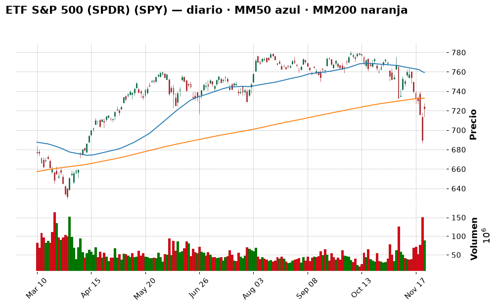

- **Qué es:** un fondo que compra de una vez las ~500 mayores empresas de EE. UU. Tú tienes la versión europea, **SPY5.L** (Londres); el gráfico es del SPY estadounidense.
- **Por qué es noticia hoy:** su mejor día en más de un año (+4,71 %) por el regreso de Huang a Nvidia. Un titular de 247wallst cuenta el caso de un inversor de 66 años que **sacó 500.000 $ del fondo indexado el viernes** y se perdió un día de cinco cifras. Lo comentamos en la sección 11.
- **Lo que dice el gráfico:** cerró en **722,29 $**, con un volumen de **1,44 veces** lo normal. El viernes marcó el mínimo de **686,75 $** y ayer recuperó gran parte de la caída con una vela verde larga. Sigue un **−1,45 % bajo su MM200** (732,91 $) y un −4,9 % bajo su MM50 (759,41 $). El RSI sube a 41,5 y el MACD pasa a **"mejorando"**. Soporte en 716,58 $ y resistencia en 755,58 $. En llano: el precio ha vuelto a la puerta de su tendencia de fondo, pero no ha entrado.
- **Tu posición:** 0,8695 participaciones a 748,72 $; SPY5.L a 725,70 $: **−3,08 % (−18,35 €)**. Ayer perdías −33,98 €.
- **Lo positivo:** el MACD gira, el miedo (VIX) baja y la caída ha llegado al −12 % desde máximos sin convertirse en mercado bajista.
- **El riesgo:** los rebotes muy fuertes son típicos de mercados nerviosos, también de los bajistas. El PCE de mañana y la Fed pueden deshacerlo. Además, depende mucho de una sola empresa (Nvidia).
- **🧑‍💼 Recomendación: MANTENER.** No cambia nada. La regla que escribimos el viernes pide un **cierre semanal** sobre ~733 $ (justo la MM200). Un día no es una semana. Si compramos hoy "porque ha subido mucho", estaríamos haciendo lo contrario de lo que nos protegió la semana pasada.
  - **Cuánto y cómo:** 0 € hoy. **Plan concreto:** si el viernes 27 (sesión corta) el SPY cierra **por encima de ~733 $**, el **lunes 30-nov** compraría la ½ del tramo 2 (**~300 €**) con una orden limitada. Si no, la alternativa sigue siendo **~150 € el 15-dic** si no ha marcado nuevos mínimos (por debajo de 686,75 $).
  - **Horizonte:** años (5 o más).
  - **Qué me haría cambiar de opinión:** solo un cambio de tesis, como una recesión profunda con caída generalizada de beneficios. Una bajada de precio no.
- **Qué mirar para entenderlo:** el cierre del **viernes** frente a 733 $ y el **PCE del miércoles**: si sale por encima de lo esperado (3,8 %), lo normal es que el rebote se frene.
- **Confianza:** media

### Airbus (AIR.PA) — MANTENER
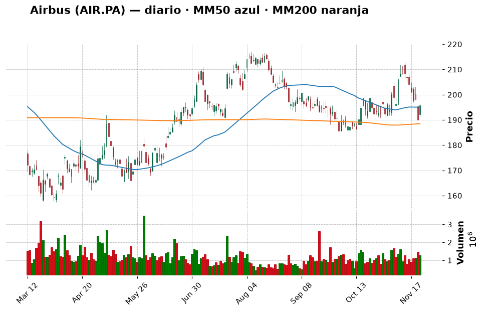

- **Qué es:** el mayor fabricante de aviones comerciales del mundo y un actor clave de la defensa y el espacio en Europa.
- **Por qué es noticia hoy:** no hay noticias propias en nuestras fuentes. Subió con el rebote general de Europa (+3,03 %). La cumbre "Choose France" anunció casi **15.000 millones €** de inversiones nuevas en Francia (Euronews), aunque el titular no habla de Airbus. Lo que importa sigue siendo el **informe de entregas de noviembre**, a principios de diciembre: en octubre entregó 74 aviones (621 en el año) y necesita **~249** entre noviembre y diciembre para cumplir su objetivo de ~870 (AirData News; CAPA).
- **Lo que dice el gráfico:** **195,72 €**. Recupera la **MM50 (195,01 €)** y se aleja de la MM200 (188,48 €, ahora a un **+3,8 %**). Nuestro sistema vuelve a ver la tendencia como **alcista**. RSI 47,1, neutral. Soporte en **193,18 €** y resistencia en **200,40 €**. En llano: el susto del viernes (189,96 €) se queda, de momento, en un susto.
- **Tu posición:** 1,5065 acciones a 197,92 € de media: **−1,11 % (−3,31 €)**. Pesa un **3,0 %** del patrimonio, el tope del plan.
- **Lo positivo:** una cartera de pedidos enorme (1.376 pedidos brutos hasta octubre) y una demanda de aviones que supera la oferta.
- **El riesgo:** que no cumpla el objetivo de entregas por los problemas de suministro (motores y cabinas) y lo recorte.
- **🧑‍💼 Recomendación: MANTENER.** Sin cambios en la acción; **la confianza sube a media** porque el precio se aleja de la línea roja y recupera su tendencia.
  - **Cuánto y cómo:** 0 €. Ya tienes el peso previsto: no compres más aunque suba.
  - **Horizonte:** años.
  - **Qué me haría cambiar de opinión:** un **cierre semanal bajo 183,84 €** o un **recorte del objetivo de entregas** → **Reducir a la mitad** (vender ~0,75 acciones). Un cierre semanal sobre 200,40 € reafirmaría la tendencia.
- **Qué mirar para entenderlo:** el **informe de entregas de noviembre**. Con más de ~110 entregas, el objetivo sigue vivo.
- **Confianza:** media

### Oro (IGLN.L) — ESPERAR
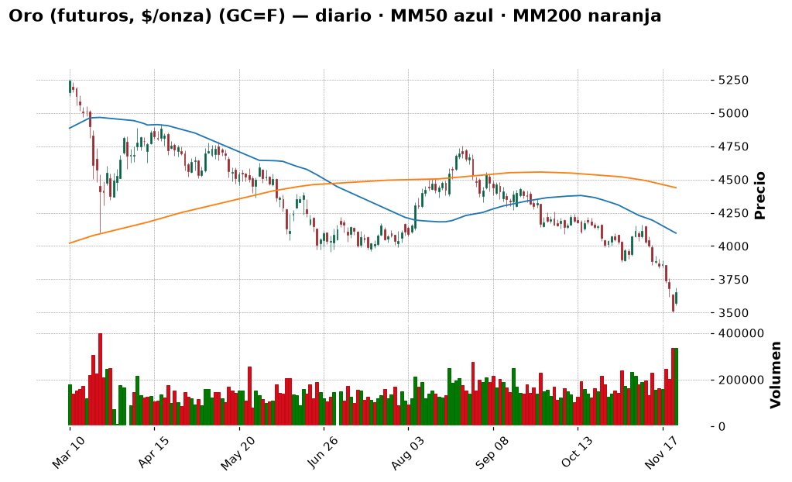
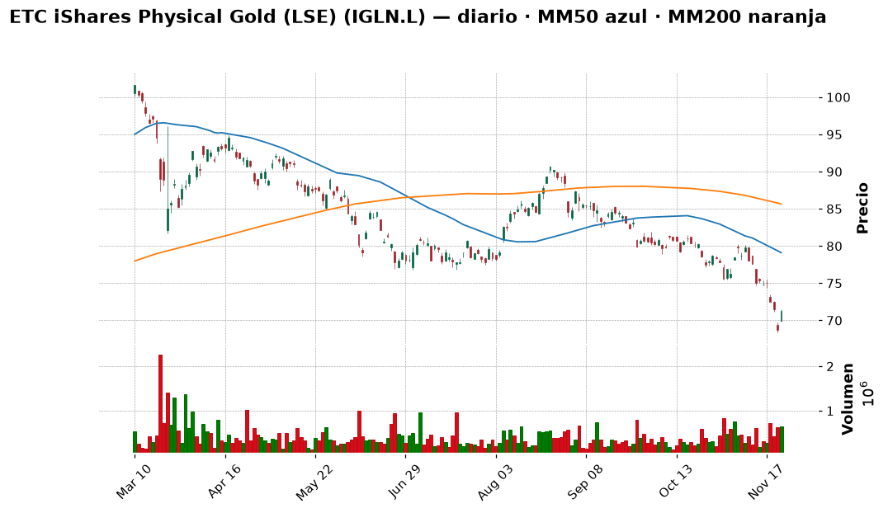

- **Qué es:** el activo refugio clásico. **GC=F** es el precio de referencia (futuros, $/onza); lo que tú puedes comprar es el ETC **IGLN.L**.
- **Por qué es noticia hoy:** rebotó un +2,7 % el viernes y un +3,87 % el lunes, desde su mínimo en más de un año (3.502,9 $). Esta mañana cede un −0,3 % a −0,95 % por recogida de beneficios y por las palabras de Williams (Reuters; Yahoo Finance).
- **Lo que dice el gráfico:** sigue **bajista**. GC=F (3.651,4 $) está un −17,7 % bajo su MM200 (4.438 $), con el RSI en 33,2 (sale de la sobreventa) y el MACD **"mejorando"**. IGLN.L (71,24 $) está un −16,8 % bajo su MM200 y a un +4,2 % de su mínimo anual (68,39 $). La primera resistencia de IGLN.L está lejos, en 80,21 $.
- **Lo positivo:** el MACD gira; los bancos centrales y China siguen comprando.
- **El riesgo:** con la Fed subiendo tipos, el oro compite con una Letra que te da un ~3 % fijo. Recuerda que **no paga dividendos ni intereses**.
- **🧑‍💼 Recomendación: ESPERAR.** Misma regla que el sábado y el lunes. Dos días de rebote son una buena señal, pero todavía no la que pedimos.
  - **Cuánto y cómo:** 0 € hoy. **Primer tramo de ~150 €** en IGLN.L con un **cierre sobre ~75 $** (le falta un +5 %), o con el MACD "mejorando" y el precio estable dos o tres semanas sin nuevos mínimos (por debajo de 68,39 $). Después, tramos de 150 € hasta un 3–5 % del patrimonio. Nunca futuros ni apalancados; PAXG no sustituye al ETC.
  - **Horizonte:** años.
  - **Qué me haría cambiar de opinión:** la señal técnica de arriba, o que la Fed deje de subir tipos.
- **Qué mirar para entenderlo:** el **PCE del miércoles**. Si sale bajo, el mercado esperaría menos subidas de tipos y el oro podría seguir rebotando.
- **Confianza:** media

### Repsol (REP.MC) — MANTENER (la tienes, con la alarma encendida)
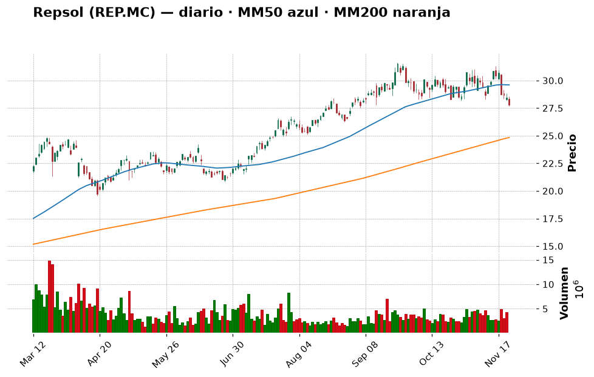

- **Qué es:** la mayor petrolera española.
- **Por qué es noticia hoy:** el **petróleo cae**. El Brent está en **86,22 $** (Yahoo Finance), frente a 89,86 $ ayer por la mañana. Cuando el mercado se anima, el dinero sale de los valores "de guerra y refugio", como la energía, y vuelve a la tecnología.
- **Lo que dice el gráfico:** **27,82 € (−2,25 %)**. Ha cerrado **por debajo de 28,18 €**, el soporte que aguantó el viernes, y está justo encima del siguiente soporte de nuestro sistema (**27,80 €**). Debajo, el siguiente está en **26,28 €**. Sigue un **+12 % sobre su MM200** (24,83 €), con el RSI en 39,9 y el MACD "empeorando". En llano: la tendencia de fondo sigue sana, pero el corto plazo se ha torcido.
- **Tu posición:** 2 acciones a 12,37 €: **+124,9 % (+30,90 €)**.
- **Lo positivo:** gran colchón de ganancias, buen dividendo y un crudo todavía alto para la historia reciente.
- **El riesgo:** que la tensión en el Golfo se relaje y el crudo baje hacia 80 $: los beneficios de Repsol dependen mucho del precio del petróleo.
- **🧑‍💼 Recomendación: MANTENER.** Nuestra regla de ayer tenía **dos** condiciones: cierre bajo 28,18 € **y** Brent bajando hacia 80 $. Se cumple la primera, pero no la segunda: 86 $ está más cerca de 90 que de 80. Vender ahora sería reaccionar a un día malo de la acción, no a un cambio en el negocio.
  - **Cuánto y cómo:** no añadir. **Reducir 1 de tus 2 acciones** si el **Brent baja de 83 $** (la mitad del camino hacia 80 $) o si la acción **cierra bajo 26,28 €**.
  - **Horizonte:** años.
  - **Qué me haría cambiar de opinión:** cualquiera de esas dos señales. Recuperar 28,42 € (la primera resistencia) apagaría la alarma.
- **Qué mirar para entenderlo:** el **Brent** cada mañana (en este informe, en la sección 4) y el cierre frente a 27,80 €.
- **Confianza:** baja

### NVIDIA (NVDA) — EVITAR (aunque haya subido un +31 %)
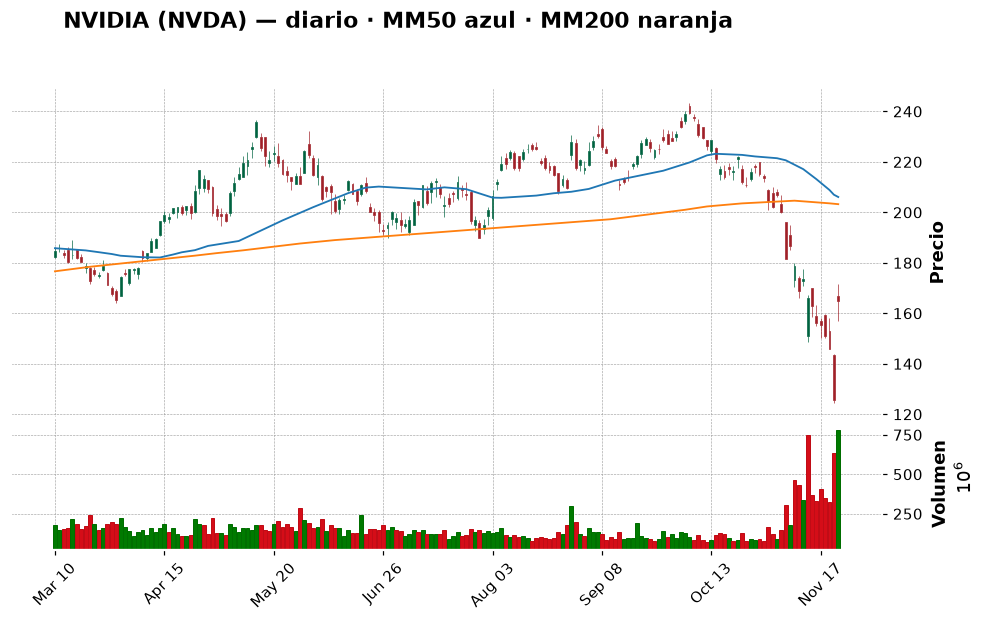

- **Qué es:** el mayor fabricante de chips para inteligencia artificial y la empresa que más pesa en el S&P 500 y el Nasdaq.
- **Por qué es noticia hoy:** el consejo readmitió a **Jensen Huang** como consejero delegado días después de haber descartado su vuelta (Decrypt; Reuters). La acción subió un **+31,48 %** con un volumen de **2,4 veces** lo normal. Ya ha recuperado más de cuatro quintas partes de lo que perdió desde su salida el 12-nov (CoinDesk). Pero quedan dudas: Huang **comparecerá ante el Congreso** la semana que viene por su relación con un presunto espía chino, y la **fiscalía de California** sigue investigando qué contó Nvidia a sus inversores sobre sus vínculos con China. Un analista de Counterpoint lo resume así: "La cuestión del CEO está resuelta; las de gobierno corporativo y geopolítica, no" (Reuters).
- **Lo que dice el gráfico:** **165,05 $**. Rebota desde el mínimo anual del viernes (124,50 $), pero sigue un **−18,8 % bajo su MM200** (203,24 $) y un −19,9 % bajo su MM50. La primera resistencia está en **213,99 $**. Su volatilidad anualizada es del **137 %**: es como si cada día pudiera moverse un ±8 %. La de un ETF del S&P 500 está en el 32 %, y eso en semanas de nervios.
- **Lo positivo:** el principal lastre (no tener al fundador al mando) ha desaparecido y los resultados del trimestre fueron muy buenos (lección del 18-nov).
- **El riesgo:** que la comparecencia o la investigación saquen algo nuevo. Además, Trump ha intervenido en el consejo, y eso abre preguntas sobre la independencia de la empresa.
- **🧑‍💼 Recomendación: EVITAR.** Ayer pedíamos dos cosas para revisarla: que se aclarase la **dirección** y la **investigación**. Se ha cumplido la primera. Comprar después de un +31 % en un día, con una comparecencia en el Congreso por delante, es justo el **FOMO** que estudiamos el 20-nov. Ya tienes exposición a Nvidia a través de tu ETF del S&P 500 (es una de las empresas que más pesan en él).
  - **Cuánto y cómo:** 0 €.
  - **Horizonte:** —
  - **Qué me haría cambiar de opinión:** que la comparecencia de la semana que viene pase sin sorpresas y el precio se estabilice → pasaría a **Esperar**, con una entrada pequeña (máximo un 2–3 % del patrimonio) solo por encima de su MM200.
- **Qué mirar para entenderlo:** la comparecencia de Huang y si el precio **mantiene** los 157 $ (el mínimo de ayer) en los próximos días o devuelve la subida.
- **Confianza:** media

### Resto de la watchlist: veredicto rápido
| Valor | Acción | Por qué (1 frase) | Nivel a vigilar |
|---|---|---|---|
| Indra (IDR.MC) | ⛔ Evitar | Rebota un +3,76 % (51,54 €) con la defensa europea y un titular sobre 580 millones € de financiación para IA de defensa (Yahoo Finance), pero sigue −7,9 % bajo su MM200 y la investigación sigue abierta | Resistencia 53,48 €; soporte 46,85 € |
| Solaria (SLR.MC) | 🔵 Mantener | La tienes (1 acción, −6 %), bajista y cerca de su mínimo anual; vender costaría casi lo mismo en comisiones | Mínimo 13,61 €; resistencia 16,95 € |
| Telefónica (TEF.MC) | ⏸️ Esperar | Bajó (−1,31 %) el día en que subía casi todo; tendencia bajista; un titular apunta a que Europa empieza a alejarse de Starlink (TIKR) | Comprar sobre 3,71 €; Evitar con cierre bajo 3,27 € |
| Iberdrola (IBE.MC) | ⏸️ Esperar | Alcista (+11,2 % sobre su MM200) y con el apoyo de Deutsche Bank al sector; sigue por encima de la zona de compra | Comprar en 21–22 €; soporte 21,09 € |
| Inditex (ITX.MC) | 🔵 Mantener | Alcista y cerca de máximos (58,68 €); tu posición gana +118 %; el Black Friday es su próxima prueba | Soporte 56,2 €; máximo 60,80 € |
| Apple (AAPL) | 🔵 Mantener | Alcista y +15 % sobre su MM200; tu posición gana +103 % | Soporte 338,7 $; resistencia 351,73 $ |
| Banco Santander (SAN.MC) | ⏸️ Esperar | Rebota (+2,46 %), pero sigue −6,3 % bajo su MM200, con el límite al crédito al consumo, el impuesto a la banca y las elecciones del domingo en contra | Soporte 10,08 €; comprar sobre 11,63 € (MM50) |
| BBVA (BBVA.MC) | ⏸️ Esperar | El soporte de 21,82 € aguantó y rebota a 22,50 € (+3,07 %); mismos frentes políticos que Santander | Resistencia 23,11 €; si pierde 21,82 €, siguiente 21,20 € |
| Oryzon (ORY.MC) | 🔵 Mantener | La tienes (4 acciones, −25 %); posición mínima | Mínimo 2,23 €; resistencia 2,60 € |
| IAG (IAG.MC) | ⏸️ Esperar | Alcista, +15 % en un mes y RSI 60,6: ya ha subido mucho; mejor esperar a un retroceso | Soporte 4,95 €; máximo 5,72 € |
| Aena (AENA.MC) | ⏸️ Esperar | Alcista, con un **cruce dorado** reciente (lección de hoy), a −4,6 % de su máximo anual | Retroceso hacia la MM50 (26,60 €) |
| Microsoft (MSFT) | ⏸️ Esperar | Sube menos que el resto (+1,65 %); sigue bajo su MM50 y +10,9 % sobre su MM200 | Soporte 486 $; resistencia 513,73 $ |
| Amazon (AMZN) | ⏸️ Esperar | Alcista (+4,1 % sobre su MM200); según el FT (vía Expansión), está a punto de comprar la start-up de IA Decart por 7.500 M$ | Soporte 244,7 $; resistencia 258,08 $ |
| ETF Nasdaq 100 (QQQ) | ⏸️ Esperar | +7 % ayer, pero −4,7 % bajo su MM200; casi la mitad del fondo está en 10 empresas (247wallst) | Recuperar 683 $ (MM200) |
| Alphabet (GOOGL) | ⛔ Evitar | Rebota un +6,34 %, pero acaba de hacer un **cruce de la muerte** (lección de hoy) y está −16 % bajo su MM200 | Recuperar 304,97 $; luego 336,8 $ (MM200) |
| Berkshire Hathaway (BRK-B) | ⏸️ Esperar | El refugio "value" sigue alcista (+13,8 % sobre su MM200); casi no participó en el rebote (+0,41 %), lo normal en un día de euforia | Retroceso hacia la MM50 (538 $) |
| ETF MSCI World (IWDA.AS) | ⏸️ Esperar | Vuelve a +3,3 % sobre su MM200 (126,76 €); es la alternativa más diversificada al S&P 500, con la misma regla de pausa | Soporte 125,8 €; resistencia 128,28 € |
| ASML (ASML.AS) | ⏸️ Esperar | +8,92 % con el regreso de Huang (Motley Fool), pero −9,2 % bajo su MM200 | Recuperar 1.401 € (MM200) |
| LVMH (MC.PA) | ⛔ Evitar | El lujo sigue bajista (−38 % en un año); el consejo de Christian Dior aprueba la fusión con Agache (Retail Insight Network), una reorganización del grupo familiar | Soporte 376–381 €; recuperar 431 € |
| SAP (SAP.DE) | ⏸️ Esperar | Solo +1,45 %: el software no participa del rebote de los chips; −12,7 % en la semana | Soporte 178,9 €; resistencia 189,2 € |
| Siemens (SIE.DE) | ⏸️ Esperar | Recupera su MM200 (+1,7 %) con un +4,12 %; pendiente del Ifo de hoy | Mantener 263 €; resistencia 279,8 € |

## 7. ₿ Criptomonedas
> 💡 *Las criptomonedas cotizan 24 horas, 7 días a la semana: los precios son de esta mañana (en euros).
> Son mucho más volátiles que las acciones: caídas del 50 % o más han ocurrido varias veces.*

**Sentimiento:** Fear & Greed **11/100, miedo extremo** (ayer 11, hace una semana 12, hace un mes 54) · Capitalización total **2,17 billones $** (**−1,12 % en 24 h**, **−55,0 %** bajo su máximo histórico de octubre de 2025) · Dominancia de Bitcoin **56,0 %**.
Lo más llamativo del día: **la bolsa vivió su mejor jornada en un año y el cripto no la acompañó**. Bitcoin llegó a ~64.500 $ y lo ha devuelto casi todo. El miedo extremo no se mueve: el mercado cripto sigue sin compradores convencidos.

**Radar Coinbase** (404 monedas comprables · hoy suben 212 y bajan 144 · en 7 días suben 66 y bajan 290):
- **Mayores por capitalización (7 días):** BTC −6,4 %, ETH −7,0 %, BNB −6,8 %, XRP −1,2 %, SOL −1,6 %, HYPE −7,6 %, ZEC −17,3 %, DOGE −4,2 %, LINK −1,0 %, ADA −3,0 %.
- **Más suben (7 d, top 100):** VVV (+19,0 %), ALGO (+1,1 %), QNT (+0,6 %) · **Más bajan:** SKY (−22,7 %), ZEC (−17,3 %), ASTER (−15,1 %), INJ (−14,6 %), ICP (−14,3 %).
En la semana, solo 66 de 356 monedas suben, y solo **una** (VVV, puesto 60) sube con fuerza. Eso es una excepción, no una oportunidad. **Nada fuera del núcleo merece compra.**

| Moneda | Ranking | Precio (€) | 24 h | 7 días | 1 mes | 1 año | Tendencia | RSI | vs MM200 |
|---|---|---|---|---|---|---|---|---|---|
| Bitcoin (BTC) | #1 | 55.364,72 | −1,36 % | −6,20 % | −22,41 % | −27,74 % | ➡️ lateral | 27,8 | −12,4 % |
| Ether (ETH) | #2 | 1.556,17 | −0,70 % | −6,14 % | −24,96 % | −39,28 % | ➡️ lateral | 30,2 | −16,0 % |
| XRP (XRP) | #6 | 0,8679 | +0,68 % | −3,02 % | −24,82 % | −55,12 % | ➡️ lateral | 34,8 | −19,6 % |
| Solana (SOL) | #7 | 65,71 | −0,44 % | −3,88 % | −27,22 % | −45,29 % | ➡️ lateral | 33,2 | −14,9 % |
| Shiba Inu (SHIB) | #40 | 0,00000336 | +0,60 % | −5,08 % | −22,04 % | −53,53 % | 📉 bajista | 31,2 | −22,3 % |

*(La columna "24 h" compara con el cierre de anoche, medianoche UTC, según las velas de Coinbase. El lunes, bitcoin llegó a 58.984 € de máximo y cerró en 56.128 €.)*

**Noticias que importan:**
- **El rebote pierde fuelle:** bitcoin superó los **64.000 $** el lunes, un +17 % desde el mínimo del sábado, y luego volvió por debajo de 62.000 $. Solo ha recuperado una cuarta parte de su caída desde los 74.000 $, y ha bajado en siete de las ocho sesiones de EE. UU. desde la salida de Huang. Wintermute cree que hacen falta **varias semanas seguidas de entradas en los ETF** para hablar de suelo ([CoinDesk](https://www.coindesk.com/markets/2026/11/23/bitcoin-rebound-already-losing-steam-as-ai-trade-returns-with-a-bank)). Hubo **más de 500 millones $** en liquidaciones de posiciones bajistas en cuatro horas ([Cointelegraph](https://cointelegraph.com/markets/bitcoin-rebounds-lows-nvidia-rally-sparks-500m-crypto-liquidations)).
- **Niveles que miran los analistas:** según Cointelegraph, Michaël van de Poppe ve la media de 200 días (~72.240 $) como "una resistencia muy, muy probable" para un rebote de alivio. Cointelegraph habla además de un "cruce de la muerte" en sus gráficos en dólares (en nuestros datos en euros aún no se ha producido; lo explicamos en la sección 10).
- **ETF:** los ETF de bitcoin perdieron **1.800 millones $** en su tercera peor semana de salidas (Cointelegraph), y ARK Invest, la gestora de Cathie Wood, **retira dos ETF de cripto** que tenía previstos ([CoinDesk](https://www.coindesk.com/business/2026/11/23/cathie-wood-s-ark-invest-pulls-the-plug-on-two-planned-crypto-etfs)).
- **Regulación:** la CFTC de EE. UU. permite a los mercados contar bitcoin como parte de sus reservas operativas (Cointelegraph), y el BCE amplía los activos basados en blockchain que acepta como garantía (BCE).
- **Hackeos:** EE. UU. intenta recuperar **1.100 millones $** robados en el hackeo de Binance ligado a Corea del Norte. Los ladrones ya han movido 247 millones $ a través de "mezcladores" para ocultar su origen ([CoinDesk](https://www.coindesk.com/business/2026/11/23/binance-hackers-push-usd247-million-through-transactions-designed-to-cloud-the-source)).
- **Ether:** la empresa BTCS ha vendido **44 millones $** en ether para reducir su deuda en Aave (Cointelegraph). Es la venta forzada que temíamos el lunes. La Fundación Ethereum dobla su equipo de seguridad: unos 72.000 millones $ en ether están en carteras que, en teoría, un futuro ordenador cuántico podría atacar ([CoinDesk](https://www.coindesk.com/markets/2026/11/23/ethereum-wallets-holding-usd72-billion-eth-are-under-threat-of-a-future-quantum-attack)).

### Bitcoin (BTC) — MANTENER
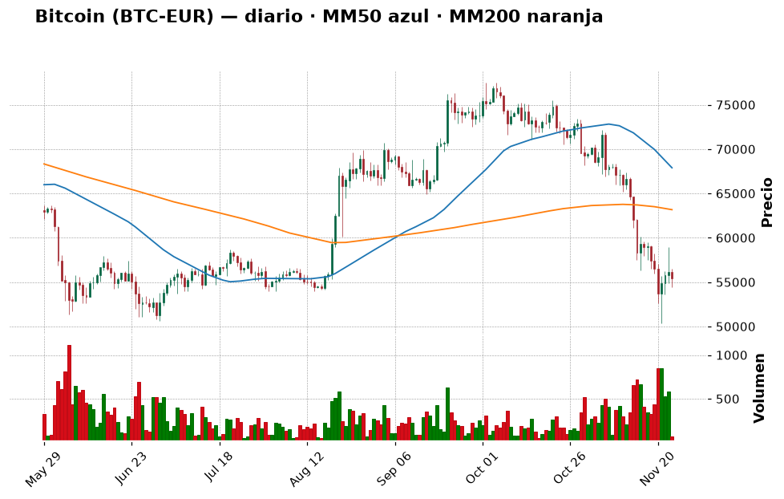

- **Qué es:** la primera y mayor criptomoneda, con una oferta máxima de 21 millones de unidades.
- **Lo que dice el gráfico:** cotiza a **55.365 €**. Ayer dejó una vela con una **sombra superior larga**: llegó a 58.984 € y cerró en 56.128 €. 💡 *Una **sombra superior larga** indica que los compradores empujaron el precio hacia arriba, pero los vendedores lo devolvieron abajo antes del cierre.* Sigue sobre el soporte de **~54.000 €** (53.998 €). La resistencia está en **56.625 €** y la siguiente en ~69.900 €. Está un **−12,4 % bajo su MM200** (63.171 €), con el RSI en 27,8 y el MACD "mejorando". Ojo: su **MM20** (61.122 €) ya está por debajo de la MM200, y la **MM50** (67.894 €) se acerca a ella. Es el posible "cruce de la muerte" de la lección de hoy.
- **Tu posición:** 0,00263 BTC a 69.887 € de media: vale **145,57 € (−20,8 %, −38,21 €)**, un 1,5 % del patrimonio.
- **🧑‍💼 Recomendación: MANTENER.** Sin cambios. Ni se ha tocado la zona de compra (~50.600 €) ni el precio ha recuperado la MM200, que reactivaría el plan normal.
  - **Cuánto y cómo:** 0 € a este precio. Si quieres, deja puesta la **orden limitada de ~50 € en ~50.600 €** en BTC-EUR hasta el **30-nov**; si se ejecuta, **regístrala en `cartera.csv`**. El tramo mensual normal sigue en pausa hasta un cierre sobre la MM200 (~63.200 €). Tu tope es el 25 %, pero mi recomendación para tu perfil es no pasar del **~5 %**: las criptomonedas han caído un 50–80 % varias veces.
  - **Qué me haría cambiar de opinión:** un cierre diario **bajo ~48.000 €** → no compraría ni el mini-tramo hasta ver estabilidad. Un cierre sobre la MM200 (~63.200 €) → se reactiva el plan normal (~50–100 € al mes).
- **El riesgo:** que, con la bolsa en euforia y el bitcoin sin subir, el dinero especulativo siga prefiriendo las acciones de IA, y que el PCE de mañana confirme más subidas de tipos.
- **Confianza:** baja

### Ether (ETH) — EVITAR
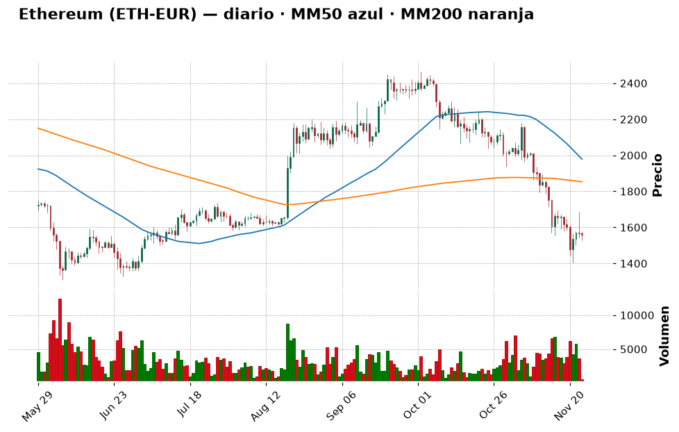

- **Qué es:** la segunda criptomoneda. Su red, Ethereum, permite programas ("smart contracts") y es la base de muchas stablecoins y aplicaciones.
- **Lo que dice el gráfico:** cotiza a **1.556 €**. Ayer llegó a **1.685 €** (por encima de la resistencia de 1.681,66 €), pero cerró en **1.567 €**, otra vez bajo la línea de 1.580 €. Está un −16 % bajo su MM200 (1.853 €), con el RSI en 30,2 y el MACD "mejorando". Otra vela con sombra superior larga: los vendedores siguen al mando.
- **🧑‍💼 Recomendación: EVITAR.** Sin cambios: la condición para volver a Esperar (cerrar sobre 1.580 € y aguantar una semana) sigue sin cumplirse, y las ventas forzadas de empresas como BTCS siguen pesando.
  - **Cuánto y cómo:** 0 €. No tienes ether.
  - **Qué me haría cambiar de opinión:** cerrar sobre 1.580 € durante una semana → Esperar; cerrar sobre la MM200 (~1.853 €) → primer tramo de ~50 €.
- **El riesgo:** es más volátil que bitcoin y sufre la presión de las "tesorerías" de ether endeudadas.
- **Confianza:** media

### Shiba Inu (SHIB) — EVITAR
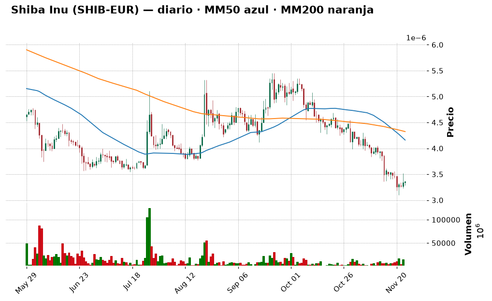

- **Qué es:** una memecoin, nacida como broma y sin un uso real relevante.
- **Lo que dice el gráfico:** bajista, −22 % bajo su MM200, −54 % en un año y cerca de su mínimo anual (0,0000031 €). Nuestro sistema detecta un **cruce de la muerte** en las últimas 20 sesiones (sección 10).
- **🧑‍💼 Recomendación: EVITAR (no añadir).** Tienes 3,36 € (pagaste 6 €); venderla no compensa la comisión.
- **Confianza:** alta

## 8. 💼 Tu cartera
**Valor total:** 9.709,75 € · **Invertido:** 1.208,06 € (coste 1.187,76 €) · **Ganancia/pérdida no realizada:** +20,30 € (+1,71 %) · **Realizada:** 0 €
**Reparto:** acciones 4,95 % · ETF 5,96 % · cripto 1,53 % · liquidez 87,56 % · **Cripto vs tope:** 1,53 % de 25 % ✅ dentro (margen 3.038,01 €)
**Liquidez disponible:** 8.501,69 € (87,56 %: 6.114,07 € en euros en otro bróker + 2.605,43 USDC ≈ 2.387,62 € en Coinbase) · **Próxima aportación:** 200 € el 2026-12-01 (en 7 días)

| Activo | Cantidad | Precio medio | Precio actual | Valor (€) | G/P | Peso | Acción recomendada |
|---|---|---|---|---|---|---|---|
| Liquidez en euros (otro bróker) | 6.114,07 € | — | — | 6.114,07 | — | 63,0 % | **~3.000 € a Letras: petición antes del vie 27-nov, 14:00**; el resto, colchón y tramos |
| USDC (Coinbase) | 2.605,43 | 1 $ | 1 $ | 2.387,62 | 0 % | 24,6 % | Reserva para cripto (orden de ~50 € en ~50.600 €, opcional) |
| ETF SPDR S&P 500 UCITS (SPY5.L) | 0,8695 | 748,72 $ | 725,70 $ | 578,23 | −3,08 % | 6,0 % | 🔵 Mantener — tramo en pausa hasta el cierre semanal |
| Airbus (AIR.PA) | 1,5065 | 197,92 € | 195,72 € | 294,86 | −1,11 % | 3,0 % | 🔵 Mantener — línea roja 183,84 € (semanal) |
| Bitcoin (BTC) | 0,00262976 | 69.886,57 € | 55.356,04 € | 145,57 | −20,79 % | 1,5 % | 🔵 Mantener — no perseguir el rebote |
| Inditex (ITX.MC) | 1 | 26,94 € | 58,68 € | 58,68 | +117,8 % | 0,6 % | 🔵 Mantener |
| Repsol (REP.MC) | 2 | 12,37 € | 27,82 € | 55,64 | +124,9 % | 0,6 % | 🔵 Mantener — Reducir 1 si Brent < 83 $ o cierre < 26,28 € |
| Apple (AAPL) | 0,15 | 171,99 $ | 349,08 $ | 47,98 | +103,0 % | 0,5 % | 🔵 Mantener |
| Solaria (SLR.MC) | 1 | 14,99 € | 14,04 € | 14,04 | −6,4 % | 0,1 % | 🔵 Mantener — no añadir |
| Oryzon (ORY.MC) | 4 | 3,23 € | 2,43 € | 9,70 | −24,9 % | 0,1 % | 🔵 Mantener — posición mínima |
| Shiba Inu (SHIB) | 1.000.000 | 0,000006 € | 0,00000336 € | 3,36 | −44,0 % | 0,03 % | ⛔ Evitar — no añadir |

**Lo que ha cambiado desde ayer:** no has registrado movimientos nuevos y `cartera.csv` no tiene errores. El patrimonio pasa de 9.660,28 € a **9.709,75 € (+49,47 €)**. Suman el ETF (**+20,65 €**), los USDC (**+20,07 €**, solo porque el dólar se ha revalorizado frente al euro: 1,1004 → 1,0912), Airbus (+8,68 €) y Apple (+1,29 €). Restan Repsol (−1,28 €) y bitcoin (−1,25 €). Por primera vez en una semana, **tus inversiones están en positivo en conjunto** (+20,30 €). Sigue pendiente revisar la **comisión real** de los dos tramos de Airbus (anotaste 0,91 € estimados en cada uno).

**¿Está bien diversificada?** El 88 % de liquidez te protegió la semana pasada. Ayer, con la bolsa subiendo un +4,7 %, te ha dejado fuera de casi todo el rebote. Así funciona la prudencia: **pierdes menos en las caídas y ganas menos en las subidas**. La solución no es comprar de golpe tras un día de euforia, sino seguir el plan por tramos y poner a trabajar la parte que espera: las **Letras** de esta semana.

**Plan orientativo (6 meses):**

| Destino | Objetivo | Estado | Siguiente paso |
|---|---|---|---|
| Núcleo: ETF S&P 500 (o MSCI World) | ~35 % (~3.400 €) | 6,0 % (~578 €) | **Pausa**: ~300 € el lunes 30-nov si el SPY cierra el viernes sobre ~733 $; si no, ~150 € el 15-dic si se estabiliza |
| Grandes empresas (Airbus, Iberdrola, banca…) | ~10–15 % | Airbus 3,0 % ✅ | Iberdrola a 21–22 €; Telefónica sobre 3,71 €; Santander sobre 11,63 € |
| Oro (IGLN.L) | ~3–5 % | 0 % | Primer tramo de ~150 € con IGLN.L sobre ~75 $ |
| Cripto (sobre todo BTC) | ~5 % (~500 €) | 1,5 % (~146 €) | Mini-tramo opcional de ~50 € en ~50.600 €; tramo mensual en pausa hasta la MM200 |
| Liquidez: colchón + tipo fijo | ~40–45 % | 88 % | **Letras: petición antes del vie 27-nov, 14:00** |

**Aportación de 200 € del 1-dic** (en 7 días): el reparto definitivo irá en el informe del viernes 27 o del lunes 30, cuando sepamos el cierre semanal del SPY. Si la regla se cumple, la idea es que **la aportación vaya al ETF** junto con la ½ del tramo 2. Si no, se queda como liquidez. Cuando la hagas, regístrala en `cartera.csv` como fila `liquidez` (`compra` de `EUR`).

### 🏦 Dónde aparcar la liquidez a tipo fijo
> 💡 *Con los tipos altos, el dinero que espera a invertirse puede ganar un interés casi sin riesgo. Referencias de hoy:
> Euríbor 12 m 3,239 % · deuda AAA a 1 año 2,938 % · BCE 2,50 %.*

| Producto | Tipo | Rentabilidad | Plazo | Garantía / riesgo | Mínimo | Fuente (fecha) |
|---|---|---|---|---|---|---|
| Letras del Tesoro a 12 meses | Deuda pública (tipo fijo) | 3,045 % (tipo medio; marginal 3,068 %) | 12 meses (subasta 1-dic, vence 10-dic-2027) | Estado español | 1.000 € | [Tesoro Público](https://www.tesoro.es/deuda-publica/subastas/resultado-ultimas-subastas/letras-del-tesoro) (subasta del 3-nov-2026) |
| Letras del Tesoro a 6 meses | Deuda pública (tipo fijo) | 2,822 % (tipo medio; marginal 2,845 %) | 6 meses (subasta 1-dic, vence 4-jun-2027) | Estado español | 1.000 € | [Tesoro Público](https://www.tesoro.es/deuda-publica/subastas/resultado-ultimas-subastas/letras-del-tesoro) (3-nov-2026) |
| Letras del Tesoro a 3 y 9 meses | Deuda pública (tipo fijo) | 2,652 % / 2,936 % (tipo medio) | 3 / 9 meses (subasta 9-dic; peticiones hasta el 4-dic) | Estado español | 1.000 € | [Tesoro Público](https://www.tesoro.es/deuda-publica/subastas/resultado-ultimas-subastas/letras-del-tesoro) (10-nov-2026) |
| Depósito WiZink 12 meses | Depósito a plazo fijo | 3,00 % TAE | 12 meses | FGD español hasta 100.000 € | 5.000 € | [HelpMyCash](https://www.helpmycash.com/mejores-depositos/) (noviembre de 2026) |
| Depósito Banca March 12 meses | Depósito a plazo fijo | 2,80 % TAE, sin condiciones | 12 meses | FGD español hasta 100.000 € | Consultar | [HelpMyCash](https://www.helpmycash.com/mejores-depositos/) (noviembre de 2026) |
| Depósito Banca Sistema 1 año (vía Raisin) | Depósito a plazo fijo | 3,30 % TAE | 12 meses | Fondo de garantía de Italia hasta 100.000 € | Consultar | [Raisin](https://www.raisin.com/es-es/noticias/mejores-depositos-a-plazo-fijo-noviembre-2026/) (noviembre de 2026) |

*No incluyo fondos monetarios porque no he encontrado rentabilidades de noviembre: las más recientes son de junio a agosto. Tampoco incluyo fondos de renta fija a vencimiento: los registros recientes en la CNMV (BBVA Bonos 2031, Kutxabank, Cajamar, CaixaBank 2029) no publican este mes una rentabilidad objetivo verificable y tienen plazos de 3 a 5 años, demasiado largos para dinero que espera tramos. Dejo fuera las cuentas remuneradas con promociones temporales o solo para clientes nuevos, y depósitos que solo dan su mejor TAE con condiciones o desde 25.000 €.*

**🧑‍💼 Recomendación: COMPRAR Letras del Tesoro por ~3.000 €** (sin cambios): **~1.000 € a 6 meses y ~2.000 € a 12 meses** en la subasta del **martes 1-dic** (emisión el 4-dic).
- **El plazo:** en el **Banco de España**, hasta el **viernes 27-nov a las 14:00** (transferencia, efectivo o cheque conformado; con cheque sin conformar, hasta mañana miércoles 25). Si pagas por transferencia, el dinero debe estar abonado en el Banco de España antes de las 14:00 del día hábil anterior a la subasta. **Por internet** (tesoro.es, Cuenta Directa) el plazo sale del calendario del Tesoro: compruébalo. Si usas una entidad intermediaria, suele cerrar antes y puede cobrar comisión. **Mejor hoy o mañana que el viernes.**
- **Si se te pasa el plazo:** hay subasta a **3 y 9 meses el 9-dic** (peticiones hasta el 4-dic) y la siguiente a 6 y 12 meses es el **12-ene-2027**.
- **¿Por qué Letras y no un depósito?** Con 3.000 € no llegas al mínimo de muchos depósitos (WiZink pide 5.000 €). Además, el emisor es el Estado, y la Letra a 12 meses (3,045 %) paga **algo más que la deuda AAA a 1 año** (2,938 %), la referencia del "dinero casi sin riesgo". Fíjate: esa referencia ha bajado del 3,004 % al 2,938 % en una semana. Si la tendencia sigue, la subasta del 1-dic podría salir **algo por debajo** del 3,045 % de noviembre. Aun así, sería una rentabilidad fija razonable. Con 2.000 € al ~3 % durante un año ganarías unos **60 € brutos**, y con 1.000 € a 6 meses, unos 14 €.
- **Qué queda libre (~3.100 € en euros + 2.388 € en USDC):** la ½ del tramo 2 del ETF (~300 €), el resto de tramos pausados (~500–600 €), Iberdrola si llega a 21–22 € (~480 €), el oro (~150–450 €) y tu **colchón de emergencia** (3–6 meses de gastos). Si no tienes ese colchón en otra cuenta, **primero el colchón**.
- **Fiscalidad:** los intereses de las Letras y de los depósitos tributan en el IRPF como **rendimientos del capital mobiliario** (base del ahorro, 19–30 %).

## 9. Análisis de riesgo
| Riesgo | Nivel | Explicación |
|---|---|---|
| Rebote frágil en Wall Street | 🔴 | +4,7 % en un día tras un −8,6 % en una semana; sigue bajo la MM200 y depende de una sola empresa |
| PCE de mañana y la Fed | 🔴 | Williams y Waller piden más subidas; un dato alto puede deshacer el rebote |
| Nvidia: Congreso e investigación | 🟡 | Huang comparece la semana que viene; la fiscalía de California sigue investigando |
| Cripto: miedo extremo y salidas de los ETF | 🔴 | 1.800 M$ de salidas en una semana; el rebote de bitcoin ya se ha deshecho |
| Plazo de las Letras | 🟡 | Si se pasa el viernes 27 a las 14:00, la liquidez sigue parada otro mes |
| Banca española: medidas y elecciones del 29-N | 🟡 | Límite al crédito al consumo, impuesto a la banca, cambio de Gobierno |
| Petróleo a la baja (Repsol) | 🟡 | Brent de 89,9 a 86,2 $ en un día; disparador de Reducir en 83 $ |
| Dólar fuerte | 🟢 | Te favorece en euros (ETF, Apple, USDC), pero presiona al oro |
| Tu exposición total | 🟢 | Solo el ~12 % del patrimonio está en activos con riesgo |

**Qué podría salir mal esta semana:** que el rebote de ayer fuera un **"rebote del gato muerto"** 💡 (*un repunte fuerte y corto dentro de una caída, como el de una pelota que bota antes de quedarse en el suelo*). Por ejemplo: un PCE alto el miércoles, una semana corta con poco volumen y nuevas dudas sobre Nvidia podrían llevar al SPY otra vez hacia 686,75 $ y al bitcoin hacia 50.000 €. **Qué haríamos:** lo que ya está escrito. El ETF sigue en pausa, sin vender. Repsol se reduce solo si se cumple su disparador y el bitcoin solo se compra en la orden de 50 €. Las Letras no dependen de la bolsa. **Lo que no haría:** comprar Nvidia o el Nasdaq "porque ya ha empezado la subida", ni vender el ETF si el rebote se deshace.

## 10. 🎓 Aprende con el informe de hoy: El cruce dorado y el cruce de la muerte
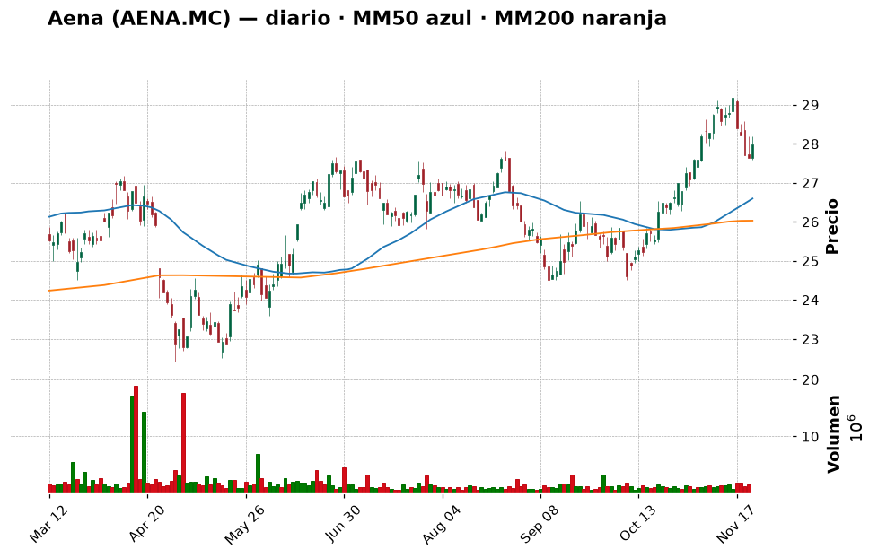
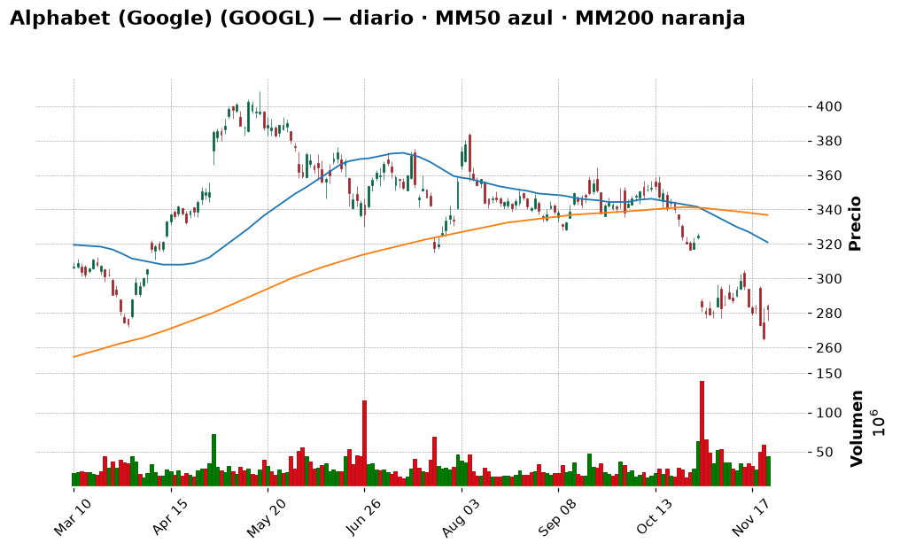

- **Qué es (en una frase):** es el momento en que la **media móvil de 50 sesiones (MM50)** cruza a la **media de 200 sesiones (MM200)**. Si la MM50 la cruza **hacia arriba**, se llama **cruce dorado** (señal de que la tendencia reciente mejora). Si la cruza **hacia abajo**, **cruce de la muerte** (la tendencia reciente empeora). 💡 *Recuerda la lección del 13-nov: la MM200 es como la "temperatura media del año" y la MM50, la "del último par de meses". Si los dos últimos meses pasan a ser más cálidos que la media del año, algo ha cambiado.*
- **Ejemplo con números:** imagina una acción que lleva un año alrededor de **100 €**: su MM200 está en ~100 €. Durante dos meses sube poco a poco hasta 115 €. Su MM50 empieza a subir (105, 108…) mientras la MM200, que promedia todo el año, apenas se mueve (101, 102…). El día que la MM50 pasa de 101,5 a 102,5 y supera a la MM200 (102) se produce el **cruce dorado**. Fíjate en el detalle: para entonces el precio **ya ha subido un +15 %**. El cruce **confirma** lo que ya ha pasado; no lo anticipa.
- **Dónde lo has visto hoy (datos de nuestro sistema):**
  - **Aena (AENA.MC):** **cruce dorado** en las últimas 20 sesiones. Su MM50 (26,60 €) está ya por encima de su MM200 (26,03 €), y el precio (27,98 €) está por encima de las dos. Es la foto de una tendencia sana.
  - **Alphabet (GOOGL):** **cruce de la muerte**. Su MM50 (320,95 $) ha caído por debajo de su MM200 (336,77 $). Ni el +6,34 % de ayer cambia eso: el precio (282,10 $) sigue muy por debajo de las dos.
  - **Shiba Inu:** también ha tenido un **cruce de la muerte** reciente.
  - **Bitcoin:** todavía no lo ha tenido en nuestros datos en euros, pero se acerca. La MM50 está en 67.894 € y la MM200 en 63.171 €, y la distancia se acorta cada día porque el precio (55.365 €) está muy por debajo de ambas. Cointelegraph ya habla de uno en sus gráficos en dólares.
- **Por qué te importa como inversor:** es una forma sencilla de saber **en qué tipo de mercado está un valor** a medio plazo, sin mirar cada día el precio. Muchos inversores y fondos lo vigilan, y por eso aparece tanto en las noticias. Para ti es una **pista de contexto**: en un valor con cruce dorado es más razonable comprar en los retrocesos (como planteamos con Iberdrola o Aena). En uno con cruce de la muerte, es más prudente esperar (como hacemos con Alphabet o con el bitcoin).
- **Error típico de principiante:** (1) **Tomarlo como una orden de compra o venta automática.** Es una señal **retrasada**: llega cuando el movimiento ya se ha producido en buena parte. A veces el cruce de la muerte aparece justo cuando el valor toca fondo, y el cruce dorado, cuando ya ha subido mucho. (2) **Olvidar el precio**: lo que importa es dónde está el precio respecto a las medias. Alphabet subió ayer un +6 % y sigue con cruce de la muerte, porque una vela no mueve una media de 50 días. (3) **Fiarse de él en valores muy volátiles**, como las memecoins: las medias se cruzan arriba y abajo y dan muchas señales falsas.
- **Pregunta para pensar:** una acción tiene su MM50 en 98 € y su MM200 en 100 €, y el precio está hoy en **110 €** después de un mes subiendo. ¿Qué cruce es probable que veamos pronto? ¿Significa eso que es buen momento para comprar justo cuando ocurra? *(Respuesta al final del informe.)*

## 11. Consejo del día para inversores principiantes
**No salgas del mercado por miedo: los mejores días llegan pegados a los peores.** El viernes, el S&P 500 cayó un **−3,70 %**; el lunes subió un **+4,73 %**. Un titular de 247wallst cuenta que un inversor de 66 años **sacó 500.000 $ de su fondo indexado el viernes** y se perdió un día de ganancias de cinco cifras. Nadie avisa del día del rebote: llega por una noticia imprevisible (hoy, la vuelta de Huang). Si en un mal día vendes 10.000 € de tu ETF tras caer un −4 %, te quedan 9.600 €. Si al día siguiente el fondo sube un +4,7 % y tú estás fuera, has perdido unos **450 €** de recuperación. Además, tienes que decidir **cuándo volver a entrar**, y suele ser más caro. Por eso nuestra regla tiene dos partes: **pausar las compras** cuando el mercado se tuerce (protege la liquidez) y **no vender el núcleo** (te mantiene dentro cuando llega el rebote). Y la otra cara de la moneda, igual de importante: **no compres de golpe el día de la euforia**. La regla que dice cuándo volver a comprar ya está escrita: el cierre semanal del viernes.

## 12. Glosario
- **Cruce dorado:** la media de 50 sesiones supera a la de 200; indica que la tendencia reciente mejora.
- **Cruce de la muerte:** la media de 50 sesiones cae por debajo de la de 200; indica que la tendencia reciente empeora.
- **Señal retrasada (en inglés, *lagging*):** indicador que confirma un movimiento después de que haya empezado, como las medias móviles.
- **VIX:** índice de volatilidad del S&P 500, conocido como "índice del miedo"; por encima de 30, pánico.
- **Volatilidad anualizada:** cuánto suele oscilar un precio en un año; Nvidia está hoy en el 137 % y el SPY en el 32 %.
- **Sombra superior (de una vela):** la línea fina por encima del cuerpo de la vela; si es larga, los vendedores devolvieron el precio hacia abajo antes del cierre.
- **Rebote del gato muerto:** subida fuerte y breve dentro de una tendencia bajista, que luego se deshace.
- **Índice Ifo:** encuesta mensual a empresas alemanas sobre la marcha de su negocio.
- **PCE:** índice de precios del consumo personal en EE. UU.; la medida de inflación que prefiere la Fed.
- **Liquidación (en cripto):** cierre forzoso de una posición apalancada cuando el precio va en contra.
- **Mezclador (*mixer*):** servicio que mezcla criptomonedas de muchos usuarios para ocultar su origen; lo usan los ladrones para blanquear lo robado.
- **Petición no competitiva (Letras):** pedir Letras sin poner precio; te adjudican al tipo medio de la subasta.
- **FGD (Fondo de Garantía de Depósitos):** fondo que protege hasta 100.000 € por titular y entidad si un banco quiebra.

## 13. Fuentes
- Yahoo Finance — futuros del [S&P 500](https://finance.yahoo.com/quote/ES=F/) y del [Nasdaq 100](https://finance.yahoo.com/quote/NQ=F/) (07:37), [Euro Stoxx 50](https://finance.yahoo.com/quote/%5ESTOXX50E/), [euro/dólar](https://finance.yahoo.com/quote/EURUSD=X/), [Brent](https://finance.yahoo.com/quote/BZ=F/) · [Gold slips after sharp rebound as Fed rate bets keep pressure on bullion](https://finance.yahoo.com/markets/commodities/articles/gold-extends-rebound-nvidia-ceo-021330781.html); titulares por valor vía RSS (Motley Fool, 247wallst, TIKR, Euronews, Stocktwits, etc.)
- Reuters vía Investing.com — [Morning Bid: Huang is back, so is the rally](https://www.investing.com/news/economy-news/morning-bid-huang-is-back-so-is-the-rally-5047075) · [Analysis: Huang's stunning Nvidia return sparks relief for battered AI trade](https://www.investing.com/news/stock-market-news/analysishuangs-stunning-nvidia-return-sparks-relief-for-battered-ai-trade-5046322) · [Fed's Williams says inflation still too high](https://www.investing.com/news/economy-news/fed-has-work-to-do-to-lower-inflation-williams-says-5046374) · [Taiwan Weighted up 8.99%](https://www.investing.com/news/stock-market-news/taiwan-stocks-higher-at-close-of-trade-taiwan-weighted-up-899-5047093) · [Volkswagen begins wage talks](https://www.investing.com/news/stock-market-news/volkswagen-begins-wage-talks-amid-protests-over-job-cuts-93CH-5047092)
- MarketWatch (titulares vía RSS) — [U.S. stocks see best day in more than a year](https://www.marketwatch.com/story/u-s-stocks-see-best-day-in-more-than-a-year-as-return-of-jensen-huang-revives-ai-enthusiasm-c3b9d274) · [Short sellers get smoked as Nvidia tallies biggest one-day gain in stock-market history](https://www.marketwatch.com/story/short-sellers-get-smoked-as-nvidia-tallies-biggest-one-day-gain-in-stock-market-history-e9dc6e9c) · [Consumer stocks were among the S&P 500's biggest losers Monday](https://www.marketwatch.com/story/consumer-stocks-seen-as-safe-bet-amid-cracks-in-ai-trade-are-among-the-s-p-500s-biggest-losers-monday-80cf8f81)
- 247wallst (vía Yahoo) — [A 66-year-old who moved $500,000 out of VOO on Friday missed a five-figure day](https://247wallst.com/investing/etf/2026/11/23/nvidia-just-jumped-more-than-30-a-66-year-old-who-moved-500000-out-of-voo-on-friday) · [Trump admits falling stocks pushed him to phone into Nvidia's board meeting](https://247wallst.com/investing/2026/11/23/trump-admits-falling-stocks-pushed-him-to-phone-into-nvidias-board-meeting-himself/)
- CoinDesk — [Bitcoin rebound already losing steam as AI trade returns](https://www.coindesk.com/markets/2026/11/23/bitcoin-rebound-already-losing-steam-as-ai-trade-returns-with-a-bank) · [Nvidia soars as Jensen Huang returns](https://www.coindesk.com/markets/2026/11/23/jensen-huang-returns-as-nvidia-ceo-as-shares-jump-27) · [ARK Invest pulls the plug on two planned crypto ETFs](https://www.coindesk.com/business/2026/11/23/cathie-wood-s-ark-invest-pulls-the-plug-on-two-planned-crypto-etfs) · [Binance hackers push $247 million through mixers](https://www.coindesk.com/business/2026/11/23/binance-hackers-push-usd247-million-through-transactions-designed-to-cloud-the-source) · [Ethereum wallets holding $72 billion under quantum threat](https://www.coindesk.com/markets/2026/11/23/ethereum-wallets-holding-usd72-billion-eth-are-under-threat-of-a-future-quantum-attack) · [Mercados](https://www.coindesk.com/markets)
- Cointelegraph — [Bitcoin rebounds 17% as Nvidia rally sparks $500M crypto liquidations](https://cointelegraph.com/markets/bitcoin-rebounds-lows-nvidia-rally-sparks-500m-crypto-liquidations) · [CFTC staff say exchanges can count Bitcoin toward operating reserves](https://cointelegraph.com/news/cftc-staff-say-exchanges-can-count-bitcoin-toward-operating-reserves) · [BTCS offloads $44M in ETH](https://cointelegraph.com/news/btcs-offloads-44m-eth-reduce-defi-debt-market-downturn) · [US seeks to recover $1.1B stolen in Binance hack](https://cointelegraph.com/news/us-seeks-11b-crypto-stolen-north-korea-binance-hack)
- Decrypt — [Nvidia reinstates Jensen Huang as CEO days after board ruled out his return](https://decrypt.co/383797/nvidia-reinstates-jensen-huang-as-ceo-days-after-board-ruled-out-his-return) · [Nvidia surge burns short sellers for $12 billion](https://decrypt.co/383815/jensen-huang-fortune-37-billion-nvidia-soars-short-sellers-rekt)
- Expansión, El País, Cinco Días y Europa Press (titulares vía RSS; las webs bloquean la lectura automática) — [El Gobierno aprobará la limitación de los intereses del crédito al consumo](https://elpais.com/economia/2026-11-23/el-gobierno-aprobara-la-limitacion-de-los-intereses-del-credito-al-consumo-en-un-paquete-de-medidas-que-afectan-a-la-banca.html) · [Los analistas se preparan para nuevos episodios de inestabilidad](https://cincodias.elpais.com/mercados-financieros/2026-11-24/los-analistas-se-preparan-para-nuevos-episodios-de-inestabilidad-en-un-mercado-mas-fragil.html) · [El mercado levanta parcialmente el castigo a Nvidia](https://cincodias.elpais.com/mercados-financieros/2026-11-24/el-mercado-levanta-parcialmente-el-castigo-a-nvidia-la-reincorporacion-de-huang-elimina-el-principal-lastre.html) · [Las dos claves para frenar las caídas de la Bolsa](https://www.expansion.com/mercados/2026/11/24/dos-claves-frenar-caidas-bolsa.html) · [Amazon, a punto de comprar Decart por 7.500 millones $](https://www.expansion.com/economia/financial-times/2026/11/23/byd-sufre-reves-despues-tribunal-prohiba-venta-suv-ue-copiar-diseno-land-rover.html) · [El Ibex 35 sube un 1,6 % y roza los 19.200 puntos](https://www.europapress.es/economia/bolsa-00348/noticia-ibex-35-sube-16-roza-19200-puntos-impulso-nasdaq-rebote-nvidia-20261123180632.html) · [Plus Ultra suspende todos sus vuelos](https://www.europapress.es/economia/noticia-plus-ultra-suspende-todas-operaciones-pleno-preconcurso-20261123164407.html)
- BCE — [ECB expands acceptance of DLT-based assets as eligible collateral](https://www.ecb.europa.eu//press/pr/date/2026/html/ecb.pr261123~76b6f57b74.en.html) · [Philip R. Lane: Climate change and monetary policy](https://www.ecb.europa.eu//press/key/date/2026/html/ecb.sp261123~b5816801a0.en.pdf)
- Airbus — [AirData News: entregas de octubre y objetivo de 2026](https://www.airdatanews.com/airbus-delivers-74-aircraft-in-october-needs-249-more-to-meet-2026-target/) · [CAPA: pedidos y entregas de octubre](https://centreforaviation.com/news/airbus-reports-202-commercial-aircraft-orders-and-74-deliveries-for-oct-2026-1378941) · [Euronews: Choose France](https://www.euronews.com/2026/11/23/nearly-15-billion-in-new-investments-announced-at-all-french-choose-france-summit)
- Renta fija — [Tesoro Público: últimas subastas de Letras](https://www.tesoro.es/deuda-publica/subastas/resultado-ultimas-subastas/letras-del-tesoro) · [Raisin: Letras a 3 y 9 meses de noviembre](https://www.raisin.com/es-es/noticias/rentabilidad-letras-3-9-meses-noviembre-2026/) · [Banco de España: calendario de Letras 2026](https://www.bde.es/f/webbe/INF/MenuVertical/MercadoDeDeudaPublica/ProximasSubastas/Ficheros/Calendario_Letras_Web_2026.pdf) · [HelpMyCash: mejores depósitos](https://www.helpmycash.com/mejores-depositos/) · [Raisin: mejores depósitos de noviembre](https://www.raisin.com/es-es/noticias/mejores-depositos-a-plazo-fijo-noviembre-2026/) · [Finect: fondos con objetivo de rentabilidad registrados en la CNMV](https://www.finect.com/usuario/eduardogarcia/articulos/kutxabank-y-cajamar-registran-fondos-de-renta-fija-con-objetivo-de-rentabilidad-en-la-cnmv) · [HelpMyCash: fondos monetarios](https://www.helpmycash.com/invertir/fondos-monetarios/)
- Agenda — [Digrin: resultados del 24-nov](https://www.digrin.com/stocks/earnings_calendar/2026-11-24)
- Precios e indicadores de bolsa: Yahoo Finance (velas diarias, último cierre disponible: lunes 23-nov)
- Cripto: Coinbase (universo de monedas y velas diarias) · Coinpaprika (datos de mercado) · [Fear & Greed](https://alternative.me/crypto/fear-and-greed-index/) (alternative.me)
- **Fuentes que fallaron hoy:**
  - Expansión (portada de mercados y cotización del Ibex): la web bloquea la descarga automática en los dos intentos.
  - El País, Cinco Días y Europa Press (artículos de la banca y del cierre del Ibex): las webs bloquean la descarga automática; uso solo sus titulares.
  - Notas de prensa del BCE y de la Fed: la portada no muestra la lista; las del BCE se completaron con su feed RSS.
  - Búsquedas del día (agenda macro, previsión del Ibex, premercado, resultados, earnings, cripto y oro): no devolvieron contenido del 24-nov; el buscador aún no había indexado el día. La agenda se completó con el *Morning Bid* de Reuters, sin horas confirmadas.
  - Fondos monetarios: no hay datos de noviembre.

---
**Respuesta a la pregunta del día:** lo probable es un **cruce dorado**. Con el precio en 110 €, cada día que pasa la MM50 sube más deprisa que la MM200, porque la de 50 días "olvida" antes los precios bajos antiguos. Pronto pasará de 98 € a más de 100 € y cruzará a la MM200. **No significa que sea el mejor momento para comprar**: cuando ocurra, el precio ya estará un +10 % por encima de las medias. El cruce confirma una tendencia, pero llega tarde. Un inversor prudente lo usa como contexto ("la tendencia es buena") y busca entrar en un **retroceso** hacia la MM50 o un soporte, en tramos, como hacemos con Iberdrola o Aena.

*Este informe lo genera automáticamente una IA a partir de noticias y datos de precios públicos y de los
movimientos que has registrado. Las recomendaciones son la opinión razonada de un modelo, no
asesoramiento financiero personalizado ni regulado: no conoce toda tu situación (ingresos, deudas,
objetivos, fiscalidad). El análisis técnico es orientativo y no predice el futuro. Invertir conlleva riesgo
de pérdida, y en criptomonedas ese riesgo es muy alto. Decide tú, contrasta la información y, si lo
necesitas, consulta con un profesional.*
