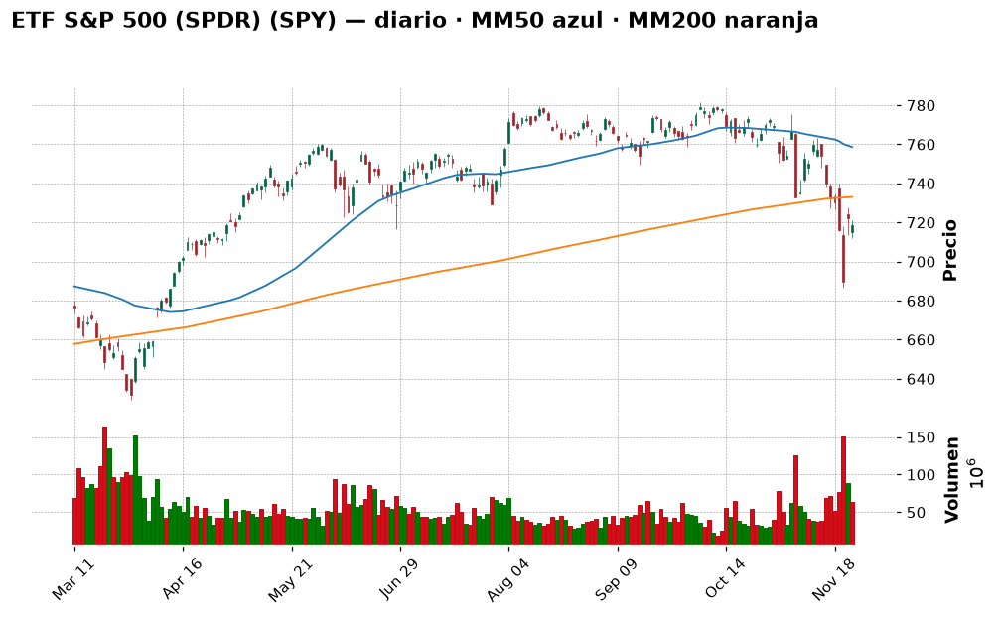
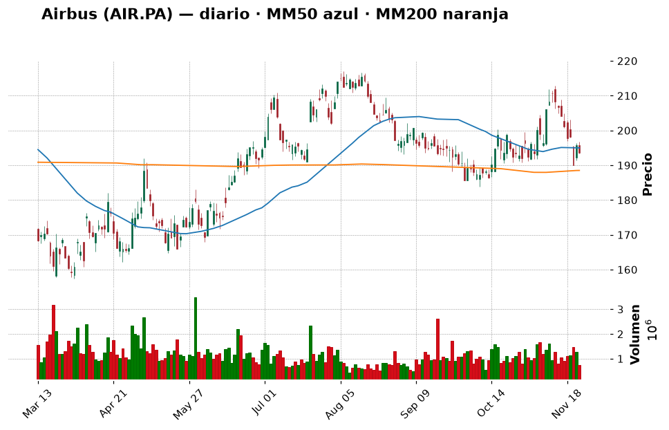
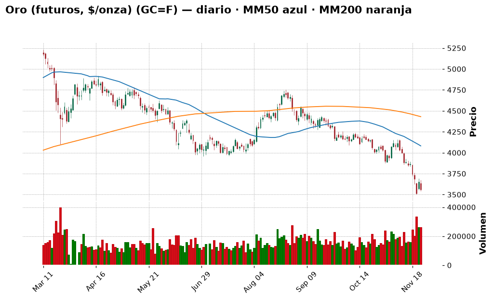
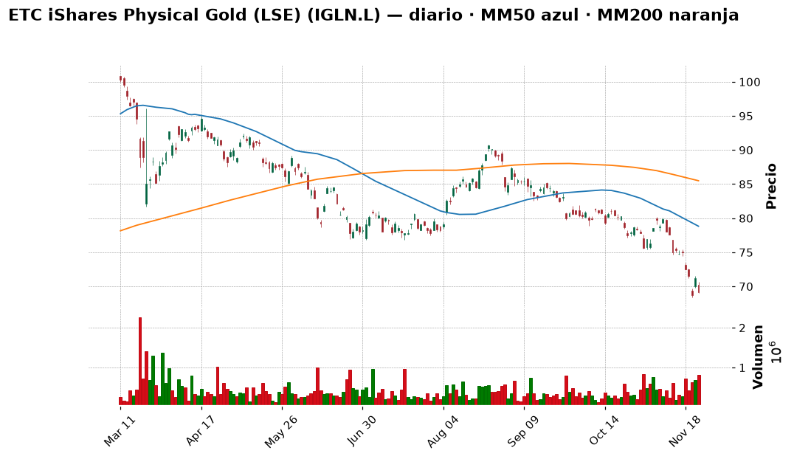
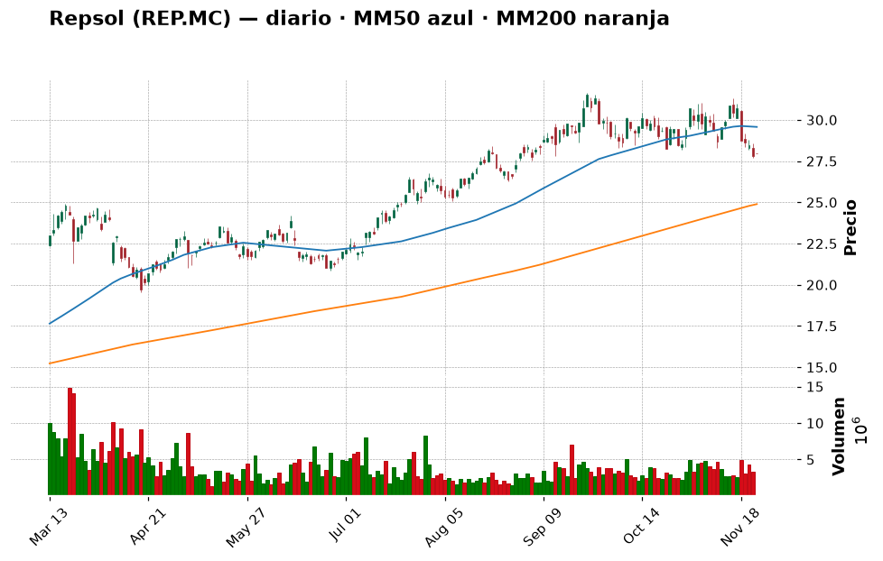
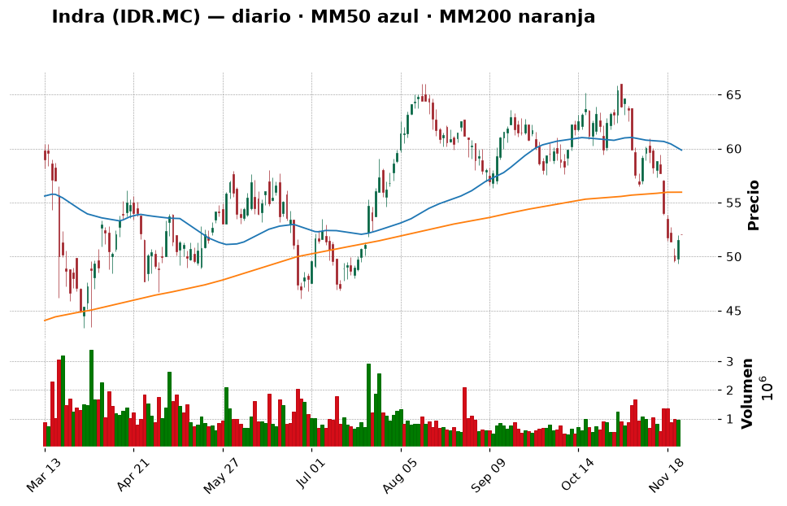
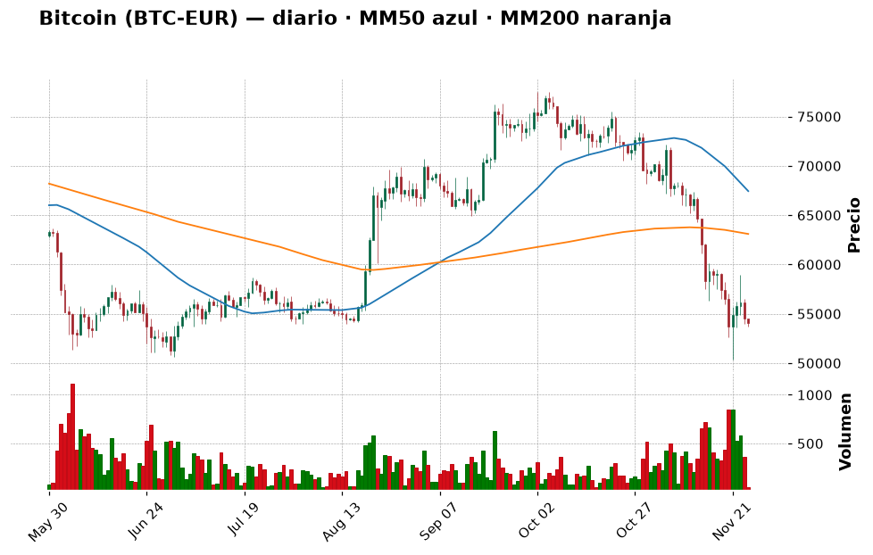
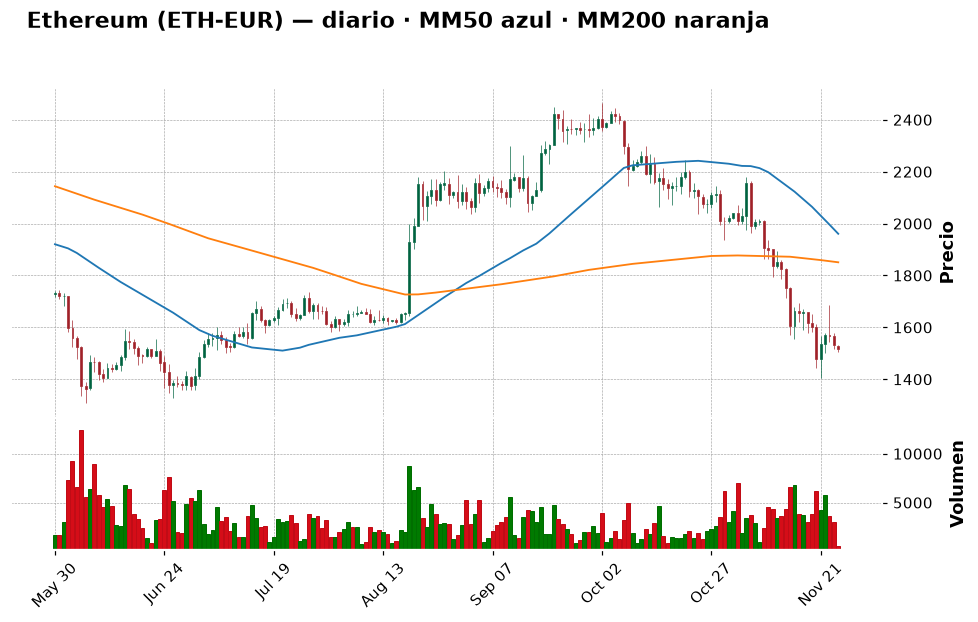

# 📈 Informe pre-apertura — miércoles 25 de noviembre de 2026

> Generado automáticamente a las 07:55 (hora de Madrid) · Bolsa española abre a las 9:00 · Wall Street a las 15:30 · Cripto: 24/7
> **Termómetro del día:** 🔴 mucha incertidumbre. Ayer la tecnología devolvió parte de la euforia del lunes: Nasdaq **−1,48 %**, Nvidia **−5,86 %**, Micron −11 %. Esta madrugada Corea cae un **−6 %** y los futuros del Nasdaq ceden un **−1,4 %**. Además, EE. UU. prepara **nuevos aranceles** a China y a la UE, y a las 14:30 llega el **PCE**, la inflación que mira la Fed, con un **96 %** de probabilidad de subida de tipos en diciembre. Todo esto en una semana corta por Acción de Gracias.
> **Lección de hoy:** El RSI: sobrecompra y sobreventa

## 1. Lo que tienes que saber hoy
- **El lunes de euforia se deshace a medias.** El S&P 500 bajó un −0,50 % (7.201,09) y el Nasdaq un −1,48 % (23.733,54). El Dow Jones, en cambio, subió un +0,9 %: el dinero salió de los chips y fue a sectores tradicionales. Nvidia cayó un **−5,86 % (155,38 $)** y arrastró a Micron (−11 %), AMD (−8,9 %) e Intel (−8,1 %) (Reuters vía Investing.com; CNBC). 💡 *Es el patrón que temíamos ayer: un rebote enorme apoyado en una sola noticia suele ser frágil.*
- **Esta mañana el ambiente es peor.** En Asia, Corea cae un −6,2 %, Taiwán un −4,7 % y el Nikkei un −2,8 %. Los futuros del **S&P 500** ceden un **−0,75 %** y los del **Nasdaq 100** un **−1,38 %** (Yahoo Finance, 07:39). El motivo: las dudas sobre la IA y que **EE. UU. ultima una nueva ronda de aranceles** a China, la UE y otros 14 países (AP, Bloomberg).
- **Hoy, a las 14:30, se publican de golpe el PCE, el PIB y el paro de EE. UU.** Se adelantan por la fiesta de Acción de Gracias de mañana. El mercado da un **96 %** de probabilidad a una **subida de tipos de la Fed** en diciembre y un 64 % a otra en enero (CME FedWatch vía Reuters). Un PCE más alto de lo esperado (consenso: +0,3 % mensual, 3,8 % anual) sería otro golpe para la bolsa, el oro y el bitcoin.
- **Nuestras reglas no cambian.** El ETF del S&P 500 (SPY) cerró en **718,78 $**, un −1,95 % bajo su MM200 (733,04 $). Para reanudar el tramo pedimos un **cierre semanal sobre ~733 $ este viernes**. Hoy parece improbable: le falta un +2 % y los futuros bajan. **No se compra nada en bolsa hoy.**
- **Letras del Tesoro: quedan dos días.** La petición para la subasta del **1-dic** (6 y 12 meses) se cierra el **viernes 27 a las 14:00** en el Banco de España. **Hoy a las 14:00** termina el plazo solo si pagas con **cheque no conformado**. Es la tarea de la semana: **~3.000 €** (sección 8).
- **El oro, en sobreventa y cerca de su mínimo del año.** Cayó un −2,45 % hasta **3.561,9 $** y esta mañana anda por ~3.520 $. Su **RSI es 30**, justo el umbral de "sobreventa" que explico en la lección de hoy. Eso **no** es por sí solo una señal de compra: seguimos en **Esperar**.
- **Tu cartera baja a 9.687,73 € (−22,02 € desde ayer).** Sigue en positivo en conjunto (+6,17 €). No hay movimientos nuevos en `cartera.csv` ni errores.

## 2. ✅ Recomendaciones del día (resumen)
| Activo | Acción | vs. ayer | Cuánto (orientativo) | Horizonte | Por qué, en una frase | Confianza |
|---|---|---|---|---|---|---|
| Letras del Tesoro (LETRAS) | 🟢 Comprar | = | **~3.000 €**: 1.000 € a 6 meses y 2.000 € a 12 meses en la subasta del **1-dic**; **petición antes del viernes 27-nov, 14:00** | 6–12 meses | Tipo fijo (2,82–3,05 % en la última subasta) con el Estado como emisor; no depende de la bolsa | alta |
| ETF S&P 500 (SPY / SPY5.L) | 🔵 Mantener | = | 0 €; **½ tramo 2 (~300 €) en pausa** hasta un cierre semanal sobre ~733 $ (viernes 27) o ~150 € el 15-dic si no marca nuevos mínimos | Años (5+) | 718,78 $, aún −1,95 % bajo su MM200; el rebote no se ha confirmado | media |
| Airbus (AIR.PA) | 🔵 Mantener | = | 0 €: ya tienes el 3 % previsto | Años | 193,64 €, lejos de la línea roja (183,84 € semanal); vende su negocio de satélites en EE. UU. | media |
| Oro (IGLN.L) | ⏸️ Esperar | = | 0 €; primer tramo de ~150 € solo con cierre sobre ~75 $ | Años | RSI 30 (sobreventa) y a un +1,1 % de su mínimo anual, pero sigue bajista y la Fed sube tipos | media |
| Repsol (REP.MC) | 🔵 Mantener | = | No añadir; **Reducir 1 acción** si el Brent baja de 83 $ o cierra bajo 26,28 € | Años | Rebota a 27,97 € y el Brent (87,4 $) sigue lejos de 83 $ | baja |
| Indra (IDR.MC) | ⛔ Evitar | = | 0 € | — | Plan ambicioso (duplicar ingresos a 2030), pero sigue −7 % bajo su MM200 | media |
| NVIDIA (NVDA) | ⛔ Evitar | = | 0 € | — | Devuelve un −5,9 % tras el +31 %; comparecencia en el Senado el 3-dic | media |
| Solaria (SLR.MC) | 🔵 Mantener | = | No añadir | Años | Posición mínima (1 acción, 13,44 €); marca un nuevo mínimo, pero vender cuesta casi lo mismo en comisión | baja |
| Telefónica (TEF.MC) | ⏸️ Esperar | = | Hasta ~250 € si supera 3,71 € | Años | Sube un +2,56 % hasta 3,40 €, pero sigue bajo su MM200 | baja |
| Iberdrola (IBE.MC) | ⏸️ Esperar | = | Hasta 5 % (~480 €) si retrocede a 21–22 € | Años | Defensiva y alcista (22,85 €), aún por encima de la zona de compra | media |
| Inditex (ITX.MC) | 🔵 Mantener | = | No añadir | Años | Alcista (58,30 €); tu posición gana +116 %; el Black Friday es su prueba | media |
| Apple (AAPL) | 🔵 Mantener | = | No añadir | Años | 354,07 $, a −1,9 % de su máximo anual; tu posición gana +106 % | media |
| Bitcoin (BTC) | 🔵 Mantener | = | 0 € a este precio; la orden de ~50 € en ~50.600 € puede seguir puesta hasta el 30-nov | Años | 54.079 €, RSI 25,7 (sobreventa) y salidas récord de los ETF en noviembre | baja |
| Ether (ETH) | ⛔ Evitar | = | 0 € | — | 1.516 €, aún más lejos de la línea de 1.580 € | media |
| Shiba Inu (SHIB) | ⛔ Evitar | = | No añadir | — | Memecoin bajista, −58 % en un año | alta |

*(El resto de la watchlist —Santander, BBVA, Oryzon, IAG, Aena, Microsoft, Amazon, Alphabet, Berkshire, los ETF del Nasdaq y del MSCI World, ASML, LVMH, SAP y Siemens— tiene su veredicto en la tabla "Resto de la watchlist" de la sección 6.)*

**🔁 Seguimiento de ayer** (informe del martes 24-nov):
- **ETF S&P 500:** "pausa hasta un cierre semanal sobre ~733 $" → el SPY bajó un −0,49 % hasta **718,78 $** y se aleja del nivel. **Sin cambios.** Si el viernes no cierra sobre ~733 $, la alternativa sigue siendo **~150 € el 15-dic**, siempre que no pierda el mínimo de 686,75 $.
- **Airbus:** "Mantener; línea roja con cierre semanal bajo 183,84 €" → cerró en **193,64 € (−1,06 %)**, otra vez justo por debajo de su MM50 (194,99 €). La tendencia vuelve a "lateral". **Acción y confianza sin cambios**: el precio sigue un +5 % por encima de la línea roja.
- **Repsol:** "Reducir 1 acción si el Brent baja de 83 $ o cierra bajo 26,28 €" → la acción **sube a 27,97 € (+0,54 %)** y el Brent está en **87,4 $**. No salta ninguna alarma. **Sin cambios.**
- **Nvidia:** "Evitar; pasaría a Esperar si la comparecencia sale bien y se estabiliza" → cayó un **−5,86 %** y la comparecencia en el Senado se ha fijado para el **3-dic** (Al Jazeera). **Sin cambios.**
- **Oro:** "Esperar; primer tramo con cierre sobre ~75 $" → bajó a **69,18 $ (−2,9 %)**, muy cerca de su mínimo anual (68,39 $). Se aleja de la señal. **Sin cambios.**
- **Bitcoin y ether:** la orden de bitcoin en ~50.600 € no se ha ejecutado (precio actual 54.079 €). Ether baja a 1.516 €. **Sin cambios.**
- **Cartera:** no has registrado movimientos nuevos. **Las Letras siguen pendientes**: la petición se puede hacer hasta el viernes.

> Día para **quedarse quieto en bolsa y hacer los deberes de renta fija**. El dato de las 14:30 puede mover mucho los precios, pero no cambia ninguna de nuestras reglas. Lo único con fecha es **pedir las Letras antes del viernes a las 14:00**.

## 3. Agenda del día (y de la semana)
| Hora (Madrid) | Evento | Por qué importa |
|---|---|---|
| Por la mañana (hora sin confirmar) | **PIB de Alemania** del 3.er trimestre (dato final), confianza del consumidor en Francia y subasta de bonos alemanes a 10 años (Reuters, *Morning Bid*) | El Ifo de ayer marcó máximos de 3,5 años (Expansión). Si el PIB lo confirma, es un apoyo para Siemens, SAP y Airbus |
| 9:00 | Apertura de la Bolsa española. El Ibex parte de **19.015,8** (−0,86 % ayer) | No he encontrado una previsión de apertura fiable (ver sección 4) |
| Hoy | Resultados de **Grenergy** (9 meses) en España | Renovable española, del sector de Solaria |
| Antes de la apertura de EE. UU. | Resultados de **Deere** (maquinaria agrícola) | Termómetro de la economía "real" y del impacto de los aranceles |
| **14:00** | Fin del plazo de Letras **solo si pagas con cheque no conformado** | Con cualquier otro medio de pago, tu plazo acaba el viernes |
| **14:30** | **EE. UU.: PCE de octubre** (consenso +0,3 % mensual y 3,8 % anual; subyacente +0,3 % y 3,2–3,3 % anual), **PIB del 3.er trimestre** (2.ª estimación, consenso ~3,5 %) y **peticiones de subsidio de paro** (~200.000) | 💡 *El **PCE** es la medida de inflación que prefiere la Fed. Si sale alto, refuerza la subida de tipos de diciembre* |
| Hoy (hora sin confirmar) | Pedidos de **bienes duraderos** de octubre en EE. UU. | Mide si las empresas invierten en maquinaria y equipos |
| 20:00 | **Libro Beige** de la Fed (hora según una sola fuente) | Resumen de cómo ven la economía las 12 sedes regionales de la Fed |
| En cualquier momento | Posible anuncio de **nuevos aranceles** de EE. UU. a China, la UE y otros 14 países (AP, Bloomberg, Axios) | Según la prensa, tope del 15 % para la UE; afectaría a exportadoras europeas como Airbus, LVMH o Siemens |
| Jue 26 | **Acción de Gracias: Wall Street cerrado**. Empieza la cumbre del Consejo Europeo | Menos volumen = movimientos más bruscos |
| **Vie 27, 14:00** | **Fin del plazo de peticiones de Letras** a 6 y 12 meses (Banco de España). **IPC adelantado de España**. Wall Street, sesión corta | **Tu tarea de la semana** |
| Vie 27, cierre | **Cierre semanal del SPY**: ¿por encima de ~733 $? | Decide si reanudamos la ½ del tramo 2 del ETF |
| Dom 29 | **Elecciones generales en España** | Banca, eléctricas e inmobiliarias, las más sensibles al resultado |
| Mar 1-dic | **Subasta de Letras a 6 y 12 meses** · **tu aportación de 200 €** | Emisión el 4-dic |
| Jue 3-dic | **Jensen Huang comparece ante el Comité de Banca del Senado** de EE. UU. (Al Jazeera) | La prueba de fuego para Nvidia |
| 8–9 dic | **Reunión de la Fed** | Se descuenta una subida de 0,25 puntos |

## 4. Cómo llegan los mercados
### España y Europa
El **Ibex 35** cayó ayer un **−0,86 % (19.015,8)**, aunque salvó los 19.000 puntos (Europa Press, titular vía RSS). Sigue un **+1,1 % sobre su MM200** (18.817), pero por debajo de su MM50 (19.338). Lo peor del día fue el acero, ArcelorMittal (−7,65 %) y Acerinox (−4,36 %), y **Solaria (−4,28 %)** (Forbes). El **Euro Stoxx 50** bajó un **−1,16 % (6.003,76)** y queda un −2,05 % bajo su MM200. Fráncfort cedió un −1,26 % y Milán un −1,84 %. Bankinter atribuye el retroceso al tono más duro de la Fed (Forbes/El Español).

**Previsión de apertura:** no he encontrado ninguna previsión fiable de hoy. Las webs de Expansión, Europa Press y Cinco Días bloquean la lectura automática. Reuters veía los futuros europeos en positivo (+0,3 %) de madrugada, antes de que se acelerasen las caídas en Asia y en los futuros de EE. UU. *Mi interpretación:* lo más probable es una apertura débil, sobre todo en tecnología (ASML, SAP).

Noticias de empresas y de España (titulares vía RSS; no he podido abrir los artículos):
- **Elecciones del domingo:** según Cinco Días, los analistas "apuestan por un Gobierno del PP y Vox", con **bancos, energéticas e inmobiliarias** liderando una nueva subida del Ibex. Expansión publica "Qué esperar de bancos, *utilities* e inmobiliarias tras el 29-N". Singular AM ve el Ibex en los **22.000 puntos en 2027** (Expansión). 💡 *Son opiniones, no hechos. Las encuestas pueden fallar, y una "subida por las elecciones" ya puede estar en parte en el precio.*
- **Indra** prevé **duplicar sus ingresos hasta 12.000 millones € en 2030** (Expansión). También puja por gestionar el tráfico del primer AVE polaco, e Hisdesat, participada por Indra, recibe un crédito de 492 millones para su tercer satélite SpainSat NG.
- **Banca:** Santander y BBVA "acotan su riesgo como grandes financiadores de la IA" (Expansión). BBVA avisa de un crecimiento más lento en banca de empresas y de un entorno más difícil en Turquía, aunque **reafirma sus objetivos** (Yahoo Finance). Ayer se aprobaron el impuesto a la banca y otras medidas antes del 29-N (Expansión).
- **Petroleras:** "Las petroleras conservan atractivo para los gestores pese a la caída del precio del crudo" (Cinco Días). Es relevante para Repsol.
- **Mercado:** Expansión titula "El temor a la 'corrección Kennedy' se cierne sobre la Bolsa" y "El periodo más alcista en Bolsa aviva el riesgo de sobrerreacción".
- **Cuentas públicas:** Bruselas avisa a España de un posible expediente por superar los límites de gasto en 2026 (Europa Press).
- **Europa:** la UE planea un fondo tecnológico de **50.000 millones €** para depender menos de EE. UU. y China (Reuters vía Investing.com). El Ifo alemán subió en noviembre a máximos de 3,5 años (Expansión).

### Estados Unidos
Ayer el **S&P 500 bajó un −0,50 % (7.201,09)**, el **Nasdaq un −1,48 % (23.733,54)** y el **Dow Jones subió un +0,9 % (~50.040)** (Reuters vía Investing.com; CNBC). La tecnología devolvió parte del rebote del lunes: Nvidia −5,86 %, Micron −11 %, AMD −8,9 %, Intel −8,1 % y HPE −16,4 %. **Anthropic** cerró en **81,91 $ (−6,5 %)**, por primera vez por debajo de su precio de salida a bolsa (83 $) en su cuarta sesión. Había abierto el primer día a 111,50 $ (CNBC; Bloomberg). 💡 *Quien compró en la euforia de la salida pierde un −27 %. Es el ejemplo de FOMO que vimos el 20-nov.* Mohamed El-Erian advierte de que las señales de alerta técnicas "van mucho más allá de Nvidia" (Stocktwits). Berkshire Hathaway, el refugio "value", marcó un máximo histórico mientras caían los valores de IA (Motley Fool).

**Esta mañana:** futuros del **S&P 500 a 7.163,50 (−0,75 %)** y del **Nasdaq 100 a 25.914 (−1,38 %)** (Yahoo Finance, 07:39 de Madrid). Tras el cierre, **Dell** se dejó un −11 % y **Ambarella** se hundió un −37 % por unas previsiones de ingresos de 70–75 M$ cuando se esperaban ~112 M$ (Yahoo Finance; CNBC). El **VIX** está en **26,36**, todavía en zona de nervios (Investing.com).

### Macro (tipos de interés, inflación, divisas, materias primas)
- **Fed:** el mercado da un **96 %** de probabilidad a una subida de 0,25 puntos en diciembre y un **64 %** a otra en enero (CME FedWatch vía Reuters). Williams (Fed de Nueva York) insiste en que "la inflación persistente apunta a una política monetaria más dura". En contra, **BlackRock** cree que el mercado exagera las subidas (BeInCrypto). La inflación también acelera fuera de EE. UU.: en Australia la subyacente está en máximos de dos años y en Japón la de servicios, en máximos de 36 años (Reuters).
- **Bonos:** el bono de EE. UU. a 10 años está en el **4,88–4,90 %** y el de 30 años en el **5,28 %** (Investing.com; Yahoo Finance).
- **Divisas:** **euro/dólar 1,0943** (Yahoo Finance, 07:49). Ayer el dólar marcó su máximo en 19 meses frente al euro (índice DXY ~104). 💡 *Con el dólar fuerte, tus activos en dólares (ETF, Apple, USDC) valen algo más en euros. Hoy el euro se recupera un poco y por eso tus USDC "pierden" unos 6 €.*
- **Petróleo:** **Brent a 87,39 $ (−1,57 %)** a las 07:38 (Yahoo Finance). El *Morning Bid* de Reuters lo situaba en 90,09 $ unas horas antes: las fuentes no coinciden, así que tomo el dato más reciente. El WTI está en 80,57 $ (Investing.com). Los hutíes amenazan con atacar puertos saudíes (Reuters), un riesgo al alza para el crudo.
- **Aranceles:** EE. UU. prepara aranceles "de la sección 301" contra China, la UE y otros 14 países por "exceso de capacidad industrial". Sustituirían a los que anuló el Tribunal Supremo. Según la prensa, el tope sería del **20 % para China** y del **15 % para la UE**, Japón y Corea, aunque las cifras no son definitivas (AP vía US News; Bloomberg; Axios).
- **BCE:** sin novedades de tipos desde el 29-oct; no hay intervenciones relevantes previstas para hoy.
- **Tipos de referencia** (de `rates_2026-11-25.json`): **BCE (facilidad de depósito) 2,50 %** · **Euríbor 12 m 3,239 %** (media de octubre) · **deuda AAA de la zona euro a 1 año 2,942 %** (23-nov) · **Fed 4,00 %** (límite superior). El Euríbor diario está "a tres milésimas de su máximo del año" (Expansión, titular). Sigue por encima del umbral del 3 %, así que el apartado de renta fija continúa activo.

**🥇 Oro:** cerró ayer en **3.561,9 $/onza (GC=F, −2,45 %)** y el ETC **IGLN.L** en **69,18 $ (−2,90 %)**. Esta mañana sigue bajando, a **~3.518–3.521 $ (−1,2 %)** (Yahoo Finance; Investing.com), cerca de su **mínimo de 15 meses** (Investing.com vía Yahoo). En un mes pierde un −11,8 % y está un **−36 %** por debajo de su máximo de enero (~5.600 $). Lo empujan las apuestas por la subida de la Fed (el oro no paga intereses) y el dólar fuerte. A largo plazo, JPMorgan prevé 4.500 $ y Commerzbank 4.100 $ a finales de 2027 (CNBC). Son previsiones, no certezas.

## 5. Panorama técnico de la watchlist
> 💡 *Cómo leer esta tabla:* la **tendencia** resume si el precio lleva meses subiendo, bajando o de lado
> (comparando el precio con sus medias de 50 y 200 días). El **RSI** mide de 0 a 100 si las subidas o bajadas
> recientes han sido muy fuertes: por encima de 70 se dice "sobrecompra" (quizá ha subido demasiado rápido),
> por debajo de 30 "sobreventa". Son pistas, no predicciones. *(Hoy es la lección del día: ver sección 10.)*

Datos del **cierre del martes 24-nov**. Ningún valor llega con retraso ✅. (En los valores españoles y algunos europeos, el último cierre lo completa Yahoo a partir de su precio de cierre publicado.)

| Valor | Último cierre | Día | 1 mes | 1 año | Tendencia | RSI | vs MM200 |
|---|---|---|---|---|---|---|---|
| IBEX 35 (^IBEX) | 19.015,8 | −0,86 % | −0,09 % | +16,22 % | ➡️ lateral | 43,2 🟢 | +1,1 % |
| Euro Stoxx 50 (^STOXX50E) | 6.003,76 | −1,16 % | −1,84 % | +7,79 % | ➡️ lateral | 39,3 🟡 | −2,1 % |
| S&P 500 (^GSPC) | 7.201,09 | −0,50 % | −6,20 % | +9,06 % | ➡️ lateral | 40,3 🟢 | −2,0 % |
| Nasdaq Composite (^IXIC) | 23.733,54 | −1,48 % | −9,31 % | +6,56 % | ➡️ lateral | 39,5 🟡 | −5,7 % |
| Banco Santander (SAN.MC) | 10,44 | −1,25 % | −6,38 % | +13,00 % | ➡️ lateral | 38,4 🟡 | −7,5 % |
| BBVA (BBVA.MC) | 21,94 | −2,49 % | −3,48 % | +18,43 % | ➡️ lateral | 40,5 🟢 | +1,4 % |
| Inditex (ITX.MC) | 58,30 | −0,65 % | +1,85 % | +21,33 % | 📈 alcista | 51,8 🟢 | +6,6 % |
| Iberdrola (IBE.MC) | 22,85 | +0,09 % | +4,01 % | +25,45 % | 📈 alcista | 58,7 🟢 | +11,3 % |
| Telefónica (TEF.MC) | 3,40 | +2,56 % | +6,44 % | −9,99 % | ➡️ lateral | 50,1 🟢 | −6,5 % |
| Repsol (REP.MC) | 27,97 | +0,54 % | −5,03 % | +77,59 % | ➡️ lateral | 41,1 🟢 | +12,4 % |
| Solaria (SLR.MC) | 13,44 | −4,28 % | −5,39 % | −19,84 % | 📉 bajista | 34,7 🟡 | −30,9 % |
| Oryzon (ORY.MC) | 2,43 | +0,08 % | −2,88 % | −28,59 % | 📉 bajista | 47,8 🟢 | −14,2 % |
| IAG (IAG.MC) | 5,34 | −1,62 % | +8,88 % | +17,87 % | 📈 alcista | 55,9 🟢 | +9,5 % |
| Indra (IDR.MC) | 52,02 | +0,93 % | −16,63 % | +11,39 % | ➡️ lateral | 35,5 🟡 | −7,0 % |
| Aena (AENA.MC) | 28,08 | +0,36 % | +5,48 % | +19,54 % | 📈 alcista | 55,8 🟢 | +7,9 % |
| Apple (AAPL) | 354,07 | +1,43 % | +2,95 % | +30,42 % | 📈 alcista | 56,7 🟢 | +16,5 % |
| Microsoft (MSFT) | 496,13 | +0,74 % | −6,85 % | +5,09 % | ➡️ lateral | 41,0 🟢 | +11,6 % |
| NVIDIA (NVDA) | 155,38 | −5,86 % | −28,06 % | −13,14 % | ➡️ lateral | 39,5 🟡 | −23,5 % |
| Amazon (AMZN) | 252,29 | −1,21 % | +1,28 % | +14,32 % | ➡️ lateral | 46,5 🟢 | +2,7 % |
| ETF S&P 500 (SPY) | 718,78 | −0,49 % | −6,09 % | +9,07 % | ➡️ lateral | 40,5 🟢 | −2,0 % |
| ETF Nasdaq 100 (QQQ) | 638,10 | −1,99 % | −10,40 % | +8,14 % | ➡️ lateral | 39,4 🟡 | −6,6 % |
| Alphabet (GOOGL) | 279,05 | −1,08 % | −11,92 % | −6,88 % | 📉 bajista | 39,6 🟡 | −17,1 % |
| Berkshire Hathaway (BRK-B) | 577,21 | +0,85 % | +5,22 % | +14,52 % | 📈 alcista | 61,4 🟢 | +14,7 % |
| ETF MSCI World (IWDA.AS) | 124,58 | −1,72 % | −4,56 % | +12,16 % | ➡️ lateral | 39,4 🟡 | +1,5 % |
| Airbus (AIR.PA) | 193,64 | −1,06 % | +0,12 % | −5,15 % | ➡️ lateral | 44,9 🟢 | +2,7 % |
| ASML (ASML.AS) | 1.201,20 | −5,58 % | −16,00 % | +33,88 % | ➡️ lateral | 38,4 🟡 | −14,3 % |
| LVMH (MC.PA) | 394,70 | +1,52 % | +2,41 % | −37,09 % | ➡️ lateral | 49,0 🟢 | −13,6 % |
| SAP (SAP.DE) | 190,08 | +2,01 % | −10,45 % | −7,21 % | ➡️ lateral | 38,3 🟡 | +13,6 % |
| Siemens (SIE.DE) | 254,65 | −3,96 % | −2,58 % | +12,18 % | ➡️ lateral | 40,5 🟢 | −2,3 % |
| Oro (GC=F) | 3.561,90 | −2,45 % | −11,80 % | −12,69 % | 📉 bajista | 30,0 🔴 | −19,6 % |
| Oro (IGLN.L) | 69,18 | −2,90 % | −11,22 % | −13,88 % | 📉 bajista | 31,0 🟡 | −19,1 % |

*Clave del RSI en la tabla:* 🟢 entre 40 y 60 (zona neutra) · 🟡 entre 30 y 40 o entre 60 y 70 (acercándose a un extremo) · 🔴 30 o menos, o 70 o más (zona extrema).

**Interpretación:** ningún valor de la lista está en **sobrecompra** (RSI > 70): el más alto es Berkshire, con 61,4. En cambio, varios rozan la **sobreventa**: el oro (30,0), Solaria (34,7), Indra (35,5), ASML y SAP (~38). El mercado está cansado de caer, pero no hay señal de giro. Los índices de EE. UU. y Europa siguen **bajo su MM200**, y solo el Ibex se mantiene por encima (+1,1 %). Lo que mejor aguanta es lo "aburrido": Iberdrola, Berkshire, Aena, Inditex y Apple, todos alcistas.

## 6. Ideas de bolsa: qué haría un experto
### ETF S&P 500 (SPY5.L / SPY) — MANTENER (pausa activada)

- **Qué es:** un fondo que replica a las 500 mayores empresas de EE. UU. Es tu **núcleo** (tienes 0,8695 participaciones del SPY5.L, la versión europea en la Bolsa de Londres; en el gráfico se usa el SPY, que se mueve igual).
- **Por qué es noticia hoy:** el rebote del lunes (+4,7 %) se frena. Ayer cayó un −0,49 % y los futuros del S&P 500 bajan esta mañana un −0,75 %. Hoy llegan el PCE y el PIB, y quizá los aranceles (Reuters; AP).
- **Lo que dice el gráfico:** el precio (718,78 $) sigue **bajo su MM200 (733,04 $)** y **muy bajo su MM50 (758,64 $)**. La tendencia es lateral. Está justo encima de su soporte de **716,58 $**, y el mínimo del pánico del día 20 queda en **686,75 $**. Su RSI de 40,5 es neutro. El **MACD "mejora"**: la caída pierde fuerza, pero aún no se ha dado la vuelta. 💡 *El **MACD** compara una media rápida con una lenta: cuando "mejora", el empuje bajista se debilita.* Está un −8 % por debajo de su máximo anual.
- **Lo positivo:** la mejor forma de invertir a largo plazo para un principiante: 500 empresas, comisiones bajas y nada que vigilar a diario.
- **El riesgo:** la tecnología pesa mucho en el índice. Si el PCE sale alto o llegan los aranceles, puede volver hacia 686 $.
- **🧑‍💼 Recomendación: MANTENER.** Sin cambios: la regla pide un **cierre semanal** sobre ~733 $, y el SPY está hoy un 2 % por debajo. Lo que hemos visto esta semana (+4,7 % el lunes, −0,5 % el martes) muestra por qué pedimos un cierre semanal y no uno diario.
  - **Cuánto y cómo:** 0 € hoy. **Plan:** si el viernes 27 (sesión corta) el SPY cierra **por encima de ~733 $**, el **lunes 30-nov** compraría la ½ del tramo 2 (**~300 €**) con una orden limitada. Si no, **~150 € el 15-dic**, siempre que no haya marcado nuevos mínimos (por debajo de 686,75 $).
  - **Horizonte:** años (5 o más).
  - **Qué me haría cambiar de opinión:** solo un cambio de tesis, como una recesión profunda con caída generalizada de beneficios. Una bajada de precio no.
- **Qué mirar para entenderlo:** el **cierre del viernes** frente a 733 $. Y hoy a las 14:30, el PCE: si sale en +0,3 % (lo esperado), el mercado no debería sorprenderse; un +0,4 % o más sería una mala noticia.
- **Confianza:** media.

### Airbus (AIR.PA) — MANTENER

- **Qué es:** el mayor fabricante de aviones del mundo junto a Boeing, con negocio también en defensa y espacio. Tienes 1,5065 acciones (3,0 % del patrimonio).
- **Por qué es noticia hoy:** **Cerberus** comprará el negocio de **satélites de Airbus en EE. UU.** (Merritt Island, Florida). No se ha publicado el precio y el cierre está previsto para finales de 2026 (Airpro News; Quartz). Es una pieza pequeña del grupo. **Entregas:** Airbus llevaba **621 aviones** hasta octubre y le faltan **249** para su objetivo de ~870. En noviembre llevaba **46** hasta el día 23, según Cirium, y los analistas esperan 90–100 en el mes (Investing.com). Además, sigue su recompra de acciones de 5.000 millones € (primer tramo de 800 M€ hasta el 23-dic). 💡 *En una **recompra**, la empresa compra sus propias acciones; quedan menos acciones en circulación y cada una "vale" un poco más del beneficio.* Por el lado negativo, los nuevos aranceles de EE. UU. a la UE (tope del 15 %, según la prensa) podrían afectar a su venta de aviones allí.
- **Lo que dice el gráfico:** el precio (193,64 €) está **justo debajo de su MM50 (194,99 €)** y un +2,7 % sobre su MM200 (188,50 €). La tendencia vuelve a "lateral". Soportes en **193,18 €** y **190,90 €**; resistencia en **200,40 €**. Su RSI es 44,9 (neutro) y el MACD "empeora". Está un −12,5 % bajo su máximo anual (221,30 €).
- **Lo positivo:** cartera de pedidos para muchos años, recompra en marcha y una demanda de aviones que no para.
- **El riesgo:** la presión de las entregas a fin de año (si no llega a ~870, puede recortar el objetivo) y los aranceles.
- **🧑‍💼 Recomendación: MANTENER.** Nada ha cambiado en la tesis. La venta del negocio espacial en EE. UU. es menor y la recompra sostiene la acción. Ya tienes el peso previsto: no compres más.
  - **Cuánto y cómo:** 0 €.
  - **Horizonte:** años.
  - **Qué me haría cambiar de opinión:** un **cierre semanal bajo 183,84 €** o un **recorte del objetivo de entregas** → **Reducir a la mitad** (vender ~0,75 acciones). Un cierre semanal sobre 200,40 € reafirmaría la tendencia.
- **Qué mirar para entenderlo:** las **entregas de noviembre** (se publican a primeros de diciembre). Si superan las ~90, el objetivo anual sigue vivo.
- **Confianza:** media.

### Oro (IGLN.L) — ESPERAR

- **Qué es:** el oro es el activo refugio clásico. El **ETC IGLN.L** (iShares Physical Gold, Bolsa de Londres, en dólares) es oro físico guardado en cámaras y es el vehículo que puedes comprar. **GC=F** (futuros) es solo la referencia del precio.
- **Por qué es noticia hoy:** cae un −2,45 % y esta mañana está cerca de su **mínimo de 15 meses**, por las apuestas a una subida de la Fed (Investing.com vía Yahoo). El dólar en máximos de 19 meses también le resta atractivo. 💡 *El oro cotiza en dólares: si el dólar sube, el oro se encarece para el resto del mundo y suele bajar.*
- **Lo que dice el gráfico:** tendencia **bajista** clara. El precio está un **−19,6 % bajo su MM200** (4.430 $) y un −12,7 % bajo su MM50. El **RSI del futuro es 30,0** (sobreventa: lección de hoy) y el del ETC, 31,0. El IGLN.L está a solo un **+1,1 % de su mínimo de 52 semanas (68,39 $)**, y el futuro a un +1,7 % del suyo (3.502,9 $). El MACD "empeora".
- **Lo positivo:** ha caído un −36 % desde su máximo. Diversifica la cartera a largo plazo y los bancos centrales siguen comprando (China ha importado una cifra récord de oro este año, según Reuters, citado en el informe de ayer).
- **El riesgo:** con la Fed subiendo tipos, el oro (que no paga intereses) tiene un **coste de oportunidad** alto: las Letras te dan ~3 %. La sobreventa puede durar semanas.
- **🧑‍💼 Recomendación: ESPERAR.** Un RSI de 30 dice que ha caído **muy deprisa**, no que haya terminado de caer. Mientras la Fed esté subiendo tipos y el precio no se dé la vuelta, prefiero no comprar. Es la regla que nos pusimos y hoy está más lejos de cumplirse.
  - **Cuánto y cómo:** 0 € hoy. **Primer tramo de ~150 €** en IGLN.L con un **cierre sobre ~75 $** (le falta un +8 %), o si el precio se estabiliza dos o tres semanas **sin perder 68,39 $** y el MACD pasa a "mejorar". Después, tramos de 150 € hasta un 3–5 % del patrimonio. Nunca futuros ni productos apalancados; PAXG no sustituye al ETC.
  - **Horizonte:** años.
  - **Qué me haría cambiar de opinión:** la señal técnica de arriba, o que la Fed deje de subir tipos. Un cierre claro **bajo 68,39 $** (nuevo mínimo anual) retrasaría aún más la entrada.
- **Qué mirar para entenderlo:** el PCE de hoy. Un dato alto = más subidas de la Fed = peor para el oro.
- **Confianza:** media.

### Repsol (REP.MC) — MANTENER (la tienes)

- **Qué es:** la petrolera española (exploración, refino, gasolineras y renovables). Tienes 2 acciones compradas en 2022 a 12,37 €: ganas un +126 %.
- **Por qué es noticia hoy:** el Brent baja un −1,6 % (87,4 $). Cinco Días titula que las petroleras "conservan atractivo para los gestores" pese a la caída del crudo. Según los analistas que cita, un Gobierno de PP y Vox favorecería a las energéticas (no he podido leer el artículo, solo el titular).
- **Lo que dice el gráfico:** el precio (27,97 €) aguanta sobre su soporte de **27,80 €** y está muy por encima de su MM200 (24,89 €, +12,4 %), pero bajo su MM50 (29,57 €). Cae un −8,8 % en la semana. Su RSI es 41 (neutro) y su volatilidad, alta (40 % anual). Primera resistencia en 28,42 €.
- **Lo positivo:** dividendo atractivo y una ganancia muy amplia en tu posición.
- **El riesgo:** depende del precio del petróleo, que lleva un mes bajando.
- **🧑‍💼 Recomendación: MANTENER.** No salta ninguno de los dos disparadores que fijamos: el Brent sigue sobre 83 $ y la acción, sobre 26,28 €.
  - **Cuánto y cómo:** no añadir. **Reducir 1 de tus 2 acciones** si el **Brent baja de 83 $** o si la acción **cierra bajo 26,28 €**.
  - **Horizonte:** años.
  - **Qué me haría cambiar de opinión:** esas dos señales. Recuperar 28,42 € apagaría la alarma.
- **Qué mirar para entenderlo:** el precio del Brent cada mañana (sección 4).
- **Confianza:** baja.

### Indra (IDR.MC) — EVITAR (de momento)

- **Qué es:** la empresa española de defensa, tecnología y control del tráfico aéreo y ferroviario.
- **Por qué es noticia hoy:** prevé **duplicar sus ingresos hasta 12.000 millones € en 2030** (Expansión, titular). Además, puja por el tráfico del primer AVE polaco, y su participada Hisdesat recibe un crédito de 492 millones para el satélite SpainSat NG (Expansión).
- **Lo que dice el gráfico:** el precio (52,02 €) rebota desde su soporte de 46,85 €, pero sigue **−7,0 % bajo su MM200 (55,96 €)** y **−13 % bajo su MM50 (59,85 €)**. Pierde un −16,6 % en un mes. Su RSI de 35,5 está cerca de la sobreventa. El MACD "mejora" y la primera resistencia está en **53,48 €**.
- **Lo positivo:** el gasto europeo en defensa sigue creciendo y el plan es muy ambicioso.
- **El riesgo:** un plan a 2030 es una **promesa** (*guidance*, lección del 18-nov), no un resultado. Su volatilidad es muy alta (48 % anual) y sigue abierta la investigación que citamos estos días.
- **🧑‍💼 Recomendación: EVITAR (sin cambios).** El plan es una buena noticia, pero el gráfico aún no lo refleja. Prefiero que el precio **demuestre** el cambio antes de entrar.
  - **Cuánto y cómo:** 0 €.
  - **Horizonte:** —
  - **Qué me haría cambiar de opinión:** un **cierre sobre su MM200 (~56 €)** con novedades favorables en la investigación → pasaría a **Esperar**, con una entrada máxima de un 2–3 % del patrimonio.
- **Qué mirar para entenderlo:** si supera la resistencia de 53,48 € en los próximos días tras el plan.
- **Confianza:** media.

### Resto de la watchlist: veredicto rápido
| Valor | Acción | Por qué (1 frase) | Nivel a vigilar |
|---|---|---|---|
| NVIDIA (NVDA) | ⛔ Evitar | Devuelve un −5,86 % (155,38 $) tras el +31 %; Huang comparece en el Senado el 3-dic; las firmas de inversión bajan su precio objetivo un 25 % (Expansión, titular) | Recuperar la MM200 (203 $) |
| Solaria (SLR.MC) | 🔵 Mantener | La tienes (1 acción, −10 %). Cae un −4,28 % y pierde el mínimo de 13,61 € que vigilábamos; vender 13 € no compensa la comisión | Resistencia 16,95 € |
| Telefónica (TEF.MC) | ⏸️ Esperar | Sube un +2,56 % (3,40 €) y recupera su MM50, pero sigue −6,5 % bajo su MM200 | Comprar sobre 3,71 €; Evitar con cierre bajo 3,27 € |
| Iberdrola (IBE.MC) | ⏸️ Esperar | Alcista y defensiva (22,85 €, +11 % sobre su MM200); el resultado del 29-N puede afectar a las eléctricas | Comprar en 21–22 €; soporte 21,09 € |
| Inditex (ITX.MC) | 🔵 Mantener | Alcista (58,30 €), a −4 % de su máximo; tu posición gana +116 %; el Black Friday es su prueba | Soporte 56,2 €; máximo 60,80 € |
| Apple (AAPL) | 🔵 Mantener | Sube un +1,43 % (354,07 $), a −1,9 % de su máximo anual; los grandes ETF vuelven a comprarla (Yahoo Finance) | Soporte 338,7 $; máximo 360,83 $ |
| Banco Santander (SAN.MC) | ⏸️ Esperar | 10,44 €, −7,5 % bajo su MM200; impuesto a la banca aprobado y elecciones el domingo | Soporte 10,08 €; comprar sobre 11,58 € (MM50) |
| BBVA (BBVA.MC) | ⏸️ Esperar | Cae un −2,49 % (21,94 €), justo encima del soporte de 21,82 €; reafirma objetivos pero avisa de Turquía | Si pierde 21,82 €, siguiente 21,20 € |
| Oryzon (ORY.MC) | 🔵 Mantener | La tienes (4 acciones, −25 %), posición mínima; elegida para el nuevo índice SIX European Growth (Yahoo Finance) | Mínimo 2,23 €; resistencia 2,60 € |
| IAG (IAG.MC) | ⏸️ Esperar | Alcista (+9,5 % sobre su MM200), pero ya ha subido mucho en el mes (+8,9 %); el cierre de Plus Ultra apenas le afecta | Soporte 4,95 €; máximo 5,72 € |
| Aena (AENA.MC) | ⏸️ Esperar | Alcista y con cruce dorado reciente (lección de ayer), a −4,2 % de su máximo | Retroceso hacia la MM50 (26,66 €) |
| Microsoft (MSFT) | ⏸️ Esperar | Aguanta (+0,74 %), +11,6 % sobre su MM200, pero bajo su MM50 | Soporte 486 $; resistencia 513,73 $ |
| Amazon (AMZN) | ⏸️ Esperar | 252,29 $, +2,7 % sobre su MM200; lanzará Amazon Autos en el Reino Unido en 2027 (Reuters) | Soporte 244,7 $; resistencia 258,08 $ |
| ETF Nasdaq 100 (QQQ) | ⏸️ Esperar | Cae un −1,99 % y queda −6,6 % bajo su MM200; muy concentrado en tecnología | Recuperar 683 $ (MM200) |
| Alphabet (GOOGL) | ⛔ Evitar | Bajista y con cruce de la muerte; −17 % bajo su MM200; demanda de Malasia por 146 M$ (Reuters) | Soporte 276,9 $; recuperar 304,97 $ |
| Berkshire Hathaway (BRK-B) | ⏸️ Esperar | Máximo histórico mientras cae la IA (Motley Fool); RSI 61,4, el más alto de la lista | Retroceso hacia la MM50 (539 $) |
| ETF MSCI World (IWDA.AS) | ⏸️ Esperar | Cae un −1,72 % (124,58 €), aún +1,5 % sobre su MM200; misma regla de pausa que el SPY | Soporte 124,27 €; resistencia 125,8 € |
| ASML (ASML.AS) | ⏸️ Esperar | Devuelve un −5,58 % (1.201,20 €) con los chips; −14 % bajo su MM200 | Recuperar 1.401 € (MM200) |
| LVMH (MC.PA) | ⛔ Evitar | Sube un +1,52 %, pero el lujo sigue −37 % en un año, con aranceles en el horizonte | Resistencia 399,55 €; soporte 376–381 € |
| SAP (SAP.DE) | ⏸️ Esperar | Rebota un +2,01 % (190,08 €) contra su resistencia de 190,26 €; su director financiero habla de posibles recortes de plantilla por la IA (Yahoo Finance) | Superar 192,12 €; soporte 178,9 € |
| Siemens (SIE.DE) | ⏸️ Esperar | Cae un −3,96 % (254,65 €) y vuelve a perder su MM200 (260,71 €) pese al buen Ifo | Soporte 254,5 €; recuperar 263 € |

## 7. ₿ Criptomonedas
> 💡 *Las criptomonedas cotizan 24 horas, 7 días a la semana: los precios son de esta mañana (en euros).
> Son mucho más volátiles que las acciones: caídas del 50 % o más han ocurrido varias veces.*

**Sentimiento:** Fear & Greed **13/100, miedo extremo** (ayer 11, hace una semana 11, hace un mes 50) · Capitalización total **2,12 billones $** (**−2,11 % en 24 h**, **−56,0 %** bajo su máximo histórico de octubre de 2025) · Dominancia de Bitcoin **56,0 %**.
Llevamos más de una semana en "miedo extremo". Decrypt titula que las pérdidas del bitcoin son "las peores desde FTX" y CoinDesk calcula que hay un **récord de 11,6 millones de BTC "en pérdidas"** (comprados más caros que el precio actual). El miedo puede ser una oportunidad a largo plazo (lección del 16-nov), pero no indica cuándo termina la caída.

**Radar Coinbase** (404 monedas comprables · en 24 h suben 32 y bajan 324):
- **Mayores por capitalización (7 días):** BTC −8,5 % · ETH −8,4 % · BNB −8,5 % · XRP −7,6 % · SOL −8,2 % · HYPE −13,9 % · ZEC −22,2 % · DOGE −7,9 % · LINK −5,3 % · ADA −6,9 %.
- **Más suben (7 d, top 100):** VVV (+19,6 %, puesto 59) y nada más en positivo: le siguen ALGO (−1,9 %) y ETC (−4,2 %) · **Más bajan:** ZEC (−22,2 %), SKY (−21,3 %), INJ (−20,5 %), AAVE (−16,2 %), ARB (−15,3 %).
La caída es **general**: de las 100 mayores, solo una sube en la semana. No hay nada en el radar que merezca una compra. Una moneda pequeña que sube un +20 % en pleno pánico suele ser una apuesta especulativa, no una tendencia.

| Moneda | Ranking | Precio (€) | 24 h | 7 días | 1 mes | 1 año | Tendencia | RSI | vs MM200 |
|---|---|---|---|---|---|---|---|---|---|
| Bitcoin (BTC) | #1 | 54.078,81 | −0,82 % | −5,83 % | −24,47 % | −28,41 % | ➡️ lateral | 25,7 | −14,3 % |
| Ether (ETH) | #2 | 1.516,21 | −0,97 % | −6,32 % | −26,98 % | −40,74 % | ➡️ lateral | 28,2 | −18,1 % |
| XRP (XRP) | #6 | 0,8393 | −0,50 % | −4,83 % | −28,24 % | −55,92 % | 📉 bajista | 31,2 | −22,2 % |
| Solana (SOL) | #7 | 62,85 | −1,01 % | −6,28 % | −30,28 % | −47,73 % | ➡️ lateral | 29,7 | −18,4 % |
| Shiba Inu (SHIB) | #40 | 0,00000321 | 0,00 % | −7,76 % | −26,54 % | −57,87 % | 📉 bajista | 26,8 | −25,6 % |

*(XRP acaba de hacer un **cruce de la muerte**: su MM50 ha bajado por debajo de su MM200. Lo explicamos ayer.)*

**Noticias que importan:**
- **Salidas récord de los ETF de bitcoin:** −570 M$ el lunes 23 y −231 M$ el martes 24. En noviembre suman **unos −4.700 a −5.000 M$**, el peor mes registrado (The Block; SoSoValue; Crypto Briefing). Los ETF de ether llevan **ocho días seguidos de salidas** (−64 M$ el martes) (TokenPost). Es la principal razón de la caída: los grandes inversores están vendiendo.
- **Ventas forzadas:** 21Shares atribuye la caída a una demanda débil y a liquidaciones forzosas (Cointelegraph). La minera **CleanSpark**, que perdió casi 1.000 M$ en su año fiscal, se plantea vender más bitcoin del que mina (Cointelegraph; MarketBeat).
- **Seguridad:** Coldcard explica cómo un fallo de su monedero de bitcoin pasó desapercibido más de cinco años (Decrypt; Cointelegraph). Una cartera vinculada al *trader* Ansem fue vaciada (~2,6 M$) y su memecoin se hundió (Decrypt). 💡 *Recordatorio: en cripto, los fallos y los robos son un riesgo real, aparte del precio.*
- **Instituciones:** el banco central checo, un año después de comprar bitcoin, no dice cuánto vale su posición, que cae al menos un 40 % (CoinDesk). BlackRock lanza en Hong Kong un fondo monetario tokenizado que acepta stablecoins (Cointelegraph). Corea del Sur quiere levantar la prohibición de las ICO (Decrypt).

### Bitcoin (BTC) — MANTENER

- **Qué es:** la primera y mayor criptomoneda, con un máximo de 21 millones de unidades. Tienes 0,00263 BTC (142,22 €, −22,6 %).
- **Lo que dice el gráfico:** el precio (54.079 €) está **−14,3 % bajo su MM200** (63.093 €) y −19,8 % bajo su MM50 (67.435 €). Su **RSI es 25,7, en sobreventa** (lección de hoy). Está justo sobre un soporte en **~54.000 €** y a un +7,4 % de su mínimo de 52 semanas (**50.362 €**). La MM50 sigue por encima de la MM200, pero baja deprisa hacia ella: un "cruce de la muerte" en las próximas semanas es posible. El MACD "mejora".
- **🧑‍💼 Recomendación: MANTENER.** Sin cambios. La sobreventa y el miedo extremo suelen aparecer cerca de los suelos, pero con **salidas récord de los ETF** no hay prisa: la orden escalonada ya cubre el escenario de más caídas.
  - **Cuánto y cómo:** 0 € a este precio. Si quieres, deja puesta la **orden limitada de ~50 € en ~50.600 €** en BTC-EUR hasta el **30-nov** (justo por encima del mínimo anual). Si se ejecuta, **regístrala en `cartera.csv`**. El tramo mensual normal sigue en pausa hasta un cierre sobre la MM200 (~63.100 €). Tu tope es el 25 %, pero para tu perfil recomiendo no pasar del **~5 %**: las criptomonedas han caído un 50–80 % varias veces.
  - **Qué me haría cambiar de opinión:** un cierre diario **bajo ~48.000 €** → no compraría ni el mini-tramo hasta ver estabilidad. Un cierre sobre la MM200 (~63.100 €) → se reactiva el plan normal (~50–100 € al mes).
- **El riesgo:** si siguen las salidas de los ETF y la Fed sube tipos, puede perder el mínimo anual. Tu posición es pequeña (1,5 % del patrimonio): aunque cayera otro −30 %, perderías unos 43 €.
- **Confianza:** baja.

### Ether (ETH) — EVITAR

- **Qué es:** la segunda criptomoneda, la "plataforma" sobre la que funcionan muchas aplicaciones (contratos inteligentes). No tienes.
- **Lo que dice el gráfico:** 1.516 € (**−18,1 % bajo su MM200**, 1.851 €), RSI 28,2 (sobreventa) y −40,7 % en un año. Sin soportes cercanos según nuestro sistema; su mínimo anual está en 1.309 €. Sus ETF llevan ocho días seguidos de salidas.
- **🧑‍💼 Recomendación: EVITAR.** Sin cambios: sigue sin cumplirse la condición para pasar a Esperar (cerrar sobre 1.580 € durante una semana), y hoy está más lejos.
  - **Cuánto y cómo:** 0 €.
  - **Qué me haría cambiar de opinión:** cerrar sobre 1.580 € durante una semana → Esperar; cerrar sobre la MM200 (~1.850 €) → primer tramo de ~50 €.
- **El riesgo:** cae más que el bitcoin en las fases de miedo y sus compradores institucionales están saliendo.
- **Confianza:** media.

### Shiba Inu (SHIB) — EVITAR
- **Qué es:** una memecoin (moneda nacida como broma, sin uso real). Tienes 1.000.000 SHIB = 3,21 € (pagaste 6 €).
- **🧑‍💼 Recomendación: EVITAR (no añadir).** Es bajista, tiene un cruce de la muerte reciente y un RSI de 26,8, y cae un −58 % en un año. Venderla no compensa la comisión; tómala como una lección de lo que **no** hay que hacer, sin añadir nunca más.
- **Confianza:** alta.

## 8. 💼 Tu cartera
**Valor total:** 9.687,73 € · **Invertido:** 1.192,30 € (coste 1.186,13 €) · **Ganancia/pérdida no realizada:** +6,17 € (+0,52 %) · **Realizada:** 0 €
**Reparto:** acciones 4,93 % · ETF 5,88 % · cripto 1,50 % · liquidez 87,69 % · **Cripto vs tope:** 1,50 % de 25 % ✅ dentro (margen 3.035,34 €)
**Liquidez disponible:** 8.495,43 € (87,69 %: 6.114,07 € en euros en otro bróker + 2.605,43 USDC ≈ 2.381,36 € en Coinbase) · **Próxima aportación:** 200 € el 2026-12-01 (en 6 días)

| Activo | Cantidad | Precio medio | Precio actual | Valor (€) | G/P | Peso | Acción recomendada |
|---|---|---|---|---|---|---|---|
| Liquidez en euros (otro bróker) | 6.114,07 € | — | — | 6.114,07 | — | 63,1 % | **~3.000 € a Letras: petición antes del vie 27-nov, 14:00**; el resto, colchón y tramos |
| USDC (Coinbase) | 2.605,43 | 1 $ | 1 $ | 2.381,36 | 0 % | 24,6 % | Reserva para cripto (orden de ~50 € en ~50.600 €, opcional) |
| ETF SPDR S&P 500 UCITS (SPY5.L) | 0,8695 | 748,72 $ | 716,26 $ | 569,21 | −4,34 % | 5,9 % | 🔵 Mantener — tramo en pausa hasta el cierre semanal |
| Airbus (AIR.PA) | 1,5065 | 197,92 € | 193,64 € | 291,73 | −2,16 % | 3,0 % | 🔵 Mantener — línea roja 183,84 € (semanal) |
| Bitcoin (BTC) | 0,00262976 | 69.886,57 € | 54.079,13 € | 142,22 | −22,62 % | 1,5 % | 🔵 Mantener — orden opcional en ~50.600 € |
| Inditex (ITX.MC) | 1 | 26,94 € | 58,30 € | 58,30 | +116,4 % | 0,6 % | 🔵 Mantener |
| Repsol (REP.MC) | 2 | 12,37 € | 27,97 € | 55,94 | +126,1 % | 0,6 % | 🔵 Mantener — Reducir 1 si Brent < 83 $ o cierre < 26,28 € |
| Apple (AAPL) | 0,15 | 171,99 $ | 354,07 $ | 48,54 | +105,9 % | 0,5 % | 🔵 Mantener |
| Solaria (SLR.MC) | 1 | 14,99 € | 13,44 € | 13,44 | −10,4 % | 0,1 % | 🔵 Mantener — no añadir |
| Oryzon (ORY.MC) | 4 | 3,23 € | 2,43 € | 9,71 | −24,8 % | 0,1 % | 🔵 Mantener — posición mínima |
| Shiba Inu (SHIB) | 1.000.000 | 0,000006 € | 0,00000321 € | 3,21 | −46,5 % | 0,03 % | ⛔ Evitar — no añadir |

**Lo que ha cambiado desde ayer:** no has registrado movimientos nuevos y `cartera.csv` no tiene errores. El patrimonio pasa de 9.709,75 € a **9.687,73 € (−22,02 €)**. Restan el ETF (**−9,02 €**), los USDC (**−6,26 €**, solo porque el euro se ha recuperado frente al dólar: 1,0912 → 1,0941), bitcoin (−3,35 €), Airbus (−3,13 €), Solaria (−0,60 €), Inditex (−0,38 €) y Shiba Inu (−0,15 €). Suman Apple (+0,56 €) y Repsol (+0,30 €). Tus inversiones siguen en positivo en conjunto (+6,17 €), gracias a las acciones antiguas (Inditex, Repsol y Apple ganan más de un +100 %). Sigue pendiente revisar la **comisión real** de los dos tramos de Airbus (anotaste 0,91 € estimados) y del ETF del día 18.

**¿Está bien diversificada?** El 88 % en liquidez hace que tu patrimonio apenas se mueva: hoy, −0,23 %, frente a un −1,5 % del Nasdaq. El riesgo es el contrario: **la inflación**. Por eso la parte que no vas a invertir en los próximos meses debería ganar un interés fijo. Esa es la tarea de esta semana con las Letras.

**Plan orientativo (6 meses):**
| Destino | Objetivo | Estado | Siguiente paso |
|---|---|---|---|
| Núcleo: ETF S&P 500 (o MSCI World) | ~35 % (~3.400 €) | 5,9 % (~569 €) | **Pausa**: ~300 € el lunes 30-nov si el SPY cierra el viernes sobre ~733 $; si no, ~150 € el 15-dic si no marca nuevos mínimos |
| Grandes empresas (Airbus, Iberdrola, banca…) | ~10–15 % | Airbus 3,0 % ✅ | Iberdrola a 21–22 €; Telefónica sobre 3,71 €; Santander sobre 11,58 € |
| Oro (IGLN.L) | ~3–5 % | 0 % | Primer tramo de ~150 € con IGLN.L sobre ~75 $ |
| Cripto (sobre todo BTC) | ~5 % (~500 €) | 1,5 % (~142 €) | Mini-tramo opcional de ~50 € en ~50.600 €; tramo mensual en pausa hasta la MM200 |
| Liquidez: colchón + tipo fijo | ~40–45 % | 88 % | **Letras: petición antes del vie 27-nov, 14:00** |

**Aportación de 200 € del 1-dic** (en 6 días): el reparto definitivo irá en el informe del viernes 27 o del lunes 30, cuando sepamos el cierre semanal del SPY. Si la regla se cumple, la idea es que **la aportación vaya al ETF** junto con la ½ del tramo 2. Si no, se queda como liquidez. Cuando la hagas, regístrala en `cartera.csv` como fila `liquidez` (`compra` de `EUR`).

### 🏦 Dónde aparcar la liquidez a tipo fijo
> 💡 *Con los tipos altos, el dinero que espera a invertirse puede ganar un interés casi sin riesgo. Referencias de hoy:
> Euríbor 12 m 3,239 % · deuda AAA a 1 año 2,942 % · BCE 2,50 %.*

| Producto | Tipo | Rentabilidad | Plazo | Garantía / riesgo | Mínimo | Fuente (fecha) |
|---|---|---|---|---|---|---|
| Letras del Tesoro a 12 meses | Deuda pública (tipo fijo) | 3,045 % (tipo medio; marginal 3,068 %, el más alto desde julio de 2024) | 12 meses (subasta 1-dic, emisión 4-dic) | Estado español | 1.000 € | [Tesoro Público](https://www.tesoro.es/deuda-publica/subastas/resultado-ultimas-subastas/letras-del-tesoro) (subasta del 3-nov-2026) |
| Letras del Tesoro a 6 meses | Deuda pública (tipo fijo) | 2,822 % (tipo medio; marginal 2,845 %) | 6 meses (subasta 1-dic) | Estado español | 1.000 € | [Tesoro Público](https://www.tesoro.es/deuda-publica/subastas/resultado-ultimas-subastas/letras-del-tesoro) (3-nov-2026) |
| Letras del Tesoro a 3 y 9 meses | Deuda pública (tipo fijo) | 2,652 % / 2,936 % (tipo medio) | 3 / 9 meses (subasta 9-dic; peticiones hasta el 4-dic) | Estado español | 1.000 € | [Tesoro Público](https://www.tesoro.es/deuda-publica/subastas/resultado-ultimas-subastas/letras-del-tesoro) (10-nov-2026) · [calendario del Banco de España](https://www.bde.es/f/webbe/INF/MenuVertical/MercadoDeDeudaPublica/ProximasSubastas/Ficheros/Calendario_Letras_Web_2026.pdf) |
| Depósito WiZink 12 meses | Depósito a plazo fijo | 3,00 % TAE | 12 meses | FGD español hasta 100.000 € | 5.000 € | [HelpMyCash](https://www.helpmycash.com/mejores-depositos/) (actualizado el 23-nov-2026) |
| Depósito MiraltaBank 12 meses | Depósito a plazo fijo | 3,10 % TAE | 12 meses | FGD español hasta 100.000 € | 15.000 € | [HelpMyCash](https://www.helpmycash.com/mejores-depositos/) (23-nov-2026) |
| Depósito Banca Sistema 1 año (vía Raisin) | Depósito a plazo fijo | 3,30 % TAE | 12 meses | Fondo de garantía de Italia hasta 100.000 € | 5.000 € | [Raisin](https://www.raisin.com/es-es/noticias/mejores-depositos-a-plazo-fijo-noviembre-2026/) (3-nov-2026) |
| Fondo monetario (p. ej. AXA Trésor Court Terme) | Fondo monetario | 2,26 % en el último año (variable, no garantizado); gastos 0,06 % | Sin plazo (liquidez en 1–2 días) | Sin FGD; riesgo muy bajo, puede fluctuar | Según comercializador | [Rankia](https://www.rankia.com/blog/fondos-inversion/5789028-mejores-fondos-monetarios) (datos al 11-nov-2026) |

*No incluyo fondos de renta fija a vencimiento: no he encontrado ninguno registrado en la CNMV este mes con datos verificables. Los depósitos con rentabilidades de ~3,5–3,6 % (vía plataformas, con bancos de Lituania o Malta) piden mínimos de 10.000–20.000 €, más de lo que te conviene inmovilizar.*

**🧑‍💼 Recomendación: COMPRAR Letras del Tesoro por ~3.000 €** (sin cambios): **~1.000 € a 6 meses y ~2.000 € a 12 meses** en la subasta del **martes 1-dic** (emisión el 4-dic).
- **Por qué Letras y no un depósito:** la Letra a 12 meses (3,045 %) rinde algo más que la deuda AAA europea a 1 año (2,942 %) y lo mismo que el mejor depósito español sin condiciones de mínimo alto (WiZink, 3,00 % TAE, desde 5.000 €). Además, el emisor es el Estado y puedes empezar con 1.000 €. Un depósito como el de Banca Sistema (3,30 %) es una alternativa razonable, pero depende del fondo de garantía italiano y de una plataforma intermediaria.
- **Cómo:** petición **no competitiva** (al tipo medio que salga en la subasta) en el Banco de España, **antes del viernes 27-nov a las 14:00**. **Hoy a las 14:00** acaba el plazo solo si pagas con cheque no conformado. 💡 *Recuerda la lección del 23-nov: pagas menos de 1.000 € por cada Letra (~970 € a 12 meses) y al vencimiento cobras 1.000 €.* También puedes pedirlas a través de una entidad financiera, aunque algunas cobran comisión: compruébalo antes.
- **Qué queda libre:** de los 6.114 € en euros, ~3.114 € siguen disponibles para el tramo del ETF (~300–450 €), el primer tramo de oro (~150 €) y un **colchón de emergencia** (lo habitual son 3–6 meses de gastos; ajústalo a tu caso). Los 2.605 USDC quedan como reserva para cripto.
- **Fiscalidad:** la diferencia entre lo que pagas y lo que cobras tributa en el IRPF como **rendimiento del capital mobiliario** (19 % hasta 6.000 €). En los fondos monetarios, "rentabilidad pasada" no es "rentabilidad garantizada".

## 9. Análisis de riesgo
| Riesgo | Nivel | Explicación |
|---|---|---|
| PCE y PIB de hoy (14:30) y la Fed | 🔴 | Con un 96 % de subida descontado, un dato alto podría hacer pensar en más subidas (enero, ya al 64 %) |
| Nuevos aranceles de EE. UU. | 🔴 | China, UE y 14 países más; Asia ya cae con fuerza (Corea −6 %) |
| Tecnología e IA | 🔴 | Nvidia −5,9 %, Micron −11 %, Anthropic bajo su precio de salida; el rebote del lunes era frágil |
| Cripto: salidas récord de los ETF | 🔴 | Casi −5.000 M$ en noviembre; miedo extremo; ventas de mineras |
| Plazo de las Letras | 🟡 | Si se pasa el viernes a las 14:00, la liquidez sigue parada otro mes |
| Elecciones del 29-N | 🟡 | Banca y eléctricas, las más sensibles; los analistas ya descuentan un cambio de Gobierno |
| Oro en mínimos | 🟡 | No tienes posición; el riesgo es entrar antes de tiempo |
| Petróleo (Repsol) | 🟡 | Brent en 87 $; disparador de Reducir en 83 $ |
| Tu exposición total | 🟢 | Solo el ~12 % del patrimonio está en activos con riesgo |

**Qué podría salir mal hoy:** un PCE más alto de lo previsto (+0,4 % mensual o más), justo cuando se anuncian los aranceles, en una semana con poco volumen por Acción de Gracias. En ese caso, el S&P 500 podría volver a la zona de 686 $ (SPY), el oro perder su mínimo anual y el bitcoin acercarse a los 50.000 €. **Qué haríamos:** lo que ya está escrito. El ETF sigue en pausa, sin vender. Del oro no compramos nada hasta ver la señal. El bitcoin solo se compra con la orden de 50 € en 50.600 €, si se ejecuta. Las Letras no dependen de la bolsa. **Lo que no haría:** comprar algo "porque está en sobreventa" (lección de hoy) ni vender el núcleo por miedo.

## 10. 🎓 Aprende con el informe de hoy: El RSI: sobrecompra y sobreventa

- **Qué es (en una frase):** el **RSI** (*Relative Strength Index*, índice de fuerza relativa) es un número de 0 a 100 que mide **cuánto han pesado las subidas frente a las bajadas en las últimas 14 sesiones**. Por encima de **70** se habla de **sobrecompra**: ha subido muy deprisa. Por debajo de **30**, de **sobreventa**: ha bajado muy deprisa. 💡 *Es como el cuentarrevoluciones de un coche: te dice si el motor va muy forzado, no hacia dónde va el coche.*
- **Ejemplo con números:** en las últimas 14 sesiones, una acción ha subido en total **10 €** (sumando los días de subida) y ha bajado **30 €** (sumando los días de bajada). La "fuerza relativa" es 10 / 30 = 0,33, y el RSI = 100 − 100 / (1 + 0,33) = **25**: sobreventa. Si fuera al revés (30 € de subidas y 10 € de bajadas), el RSI sería **75**: sobrecompra. Con 20 € de cada, sale **50**, la zona neutra.
- **Dónde lo has visto hoy (datos de nuestro sistema):**
  - **Oro (GC=F): RSI 30,0** tras caer un −11,8 % en un mes. Es la frontera de la sobreventa.
  - **Bitcoin: RSI 25,7**; **ether: 28,2**; **Shiba Inu: 26,8**. Toda la cripto está en sobreventa.
  - **Berkshire Hathaway: RSI 61,4**, el más alto de la watchlist, con máximos históricos. **Apple: 56,7.** Ningún valor está en sobrecompra (> 70).
  - Ayer el bitcoin ya tenía un RSI de 27,8 (sobreventa) y desde entonces ha seguido bajando: el RSI de hoy es más bajo, 25,7.
- **Por qué te importa como inversor:** el RSI te avisa de cuándo **no** perseguir un precio. Si algo tiene un RSI de 80 tras subir un +30 % en un mes (como Nvidia o Anthropic en sus días de euforia), comprar ahí suele ser llegar tarde. Y un RSI muy bajo te dice que el pánico es grande, algo que a largo plazo puede ser una oportunidad.
- **Error típico de principiante:** pensar que **"sobreventa = comprar ya"**. En una tendencia bajista fuerte, el RSI puede quedarse **semanas** por debajo de 30 mientras el precio sigue cayendo. Es lo que le pasa al bitcoin desde hace más de una semana. Por eso en el oro no basta con el RSI: pedimos además que el precio recupere un nivel (~75 $) o se estabilice. El RSI se usa **junto a** la tendencia (MM200) y los soportes, nunca solo.
- **Pregunta para pensar:** una acción con tendencia alcista (precio sobre su MM200) tiene un RSI de **75** tras subir un +12 % en tres semanas. ¿Deberías venderla?

## 11. Consejo del día para inversores principiantes
**Los días de datos importantes, no hagas nada que no hubieras decidido antes.** Hoy, a las 14:30, el PCE y el PIB pueden mover la bolsa un 1–2 % en minutos, en un sentido o en otro. Quien opera "a ver qué pasa" suele comprar en el pico de una buena noticia o vender en el hueco de una mala. Tú tienes un plan escrito: el ETF, pendiente del cierre del viernes; el oro, de un nivel; el bitcoin, de una orden ya fijada; y las Letras, con fecha. Si el dato sale mal, el plan ya lo tiene en cuenta. Si sale bien, también. **La disciplina consiste en dejar que las reglas decidan por ti en los días de nervios.**

## 12. Glosario
- **RSI (índice de fuerza relativa):** indicador de 0 a 100 que compara las subidas y bajadas de las últimas 14 sesiones. Más de 70 = sobrecompra; menos de 30 = sobreventa.
- **Sobrecompra / sobreventa:** un precio que ha subido (o bajado) muy deprisa en poco tiempo. No significa que vaya a girarse ya.
- **PCE:** índice de precios del gasto personal de EE. UU.; la medida de inflación preferida por la Fed.
- **MACD:** indicador que compara una media rápida con una lenta para medir el impulso de una tendencia.
- **Recompra de acciones:** cuando una empresa compra sus propias acciones; reduce el número de acciones en circulación.
- **Aranceles (sección 301):** impuestos a las importaciones que EE. UU. puede imponer si considera desleales las prácticas comerciales de otro país.
- **Coste de oportunidad:** lo que dejas de ganar por elegir una opción (p. ej., el ~3 % de las Letras que no da el oro).
- **ETF de bitcoin:** fondo cotizado que compra bitcoin; sus entradas y salidas de dinero mueven el precio.
- **Petición no competitiva:** en una subasta de Letras, aceptas el tipo medio que resulte sin fijar tú un precio.
- **FGD (Fondo de Garantía de Depósitos):** garantiza hasta 100.000 € por titular y entidad si un banco quiebra.

## 13. Fuentes
- Yahoo Finance — futuros del [S&P 500](https://finance.yahoo.com/quote/ES=F/) y del [Nasdaq 100](https://finance.yahoo.com/quote/NQ=F/) (07:39), [Euro Stoxx 50](https://finance.yahoo.com/quote/%5ESTOXX50E/), [euro/dólar](https://finance.yahoo.com/quote/EURUSD=X/) (07:49), [Brent](https://finance.yahoo.com/quote/BZ=F/) (07:38), [portada de mercados](https://finance.yahoo.com/markets/)
- Reuters vía Investing.com — [Wall St futures fall after S&P 500, Nasdaq end lower; inflation data eyed](https://www.investing.com/news/stock-market-news/wall-st-futures-fall-after-sp-500-nasdaq-end-lower-inflation-data-eyed-5049469) · [Morning Bid: Who's afraid of Jamieson Greer?](https://www.investing.com/news/economy-news/morning-bid-whos-afraid-of-jamieson-greer-5049749) · [EU plans €50 bln tech fund](https://www.investing.com/news/economy-news/eu-plans-50-bln-tech-fund-to-cut-reliance-on-us-china--report-93CH-5049765) · [GDP, jobless claims and PCE among key data due Wednesday](https://www.investing.com/news/stock-market-news/gdp-jobless-claims-and-pce-among-key-data-due-wednesday-93CH-5048884)
- CNBC — [Stock market today](https://www.cnbc.com/2026/11/24/stock-market-today-live-updates-.html) · [Anthropic stock falls below IPO price](https://www.cnbc.com/2026/11/24/anthropic-stock-ipo-price.html) · [Gold and US inflation data](https://www.cnbc.com/2026/11/24/gold-bargain-buying-us-inflation-data.html)
- Bloomberg — [Anthropic breaks below $83 IPO price](https://www.bloomberg.com/news/articles/2026-11-24/anthropic-breaks-below-83-ipo-price-in-premarket-trading) · [US said to plan new round of tariffs on China, EU](https://www.bloomberg.com/news/newsletters/2026-11-24/us-said-to-plan-new-round-of-tariffs-on-china-eu) · AP vía [US News](https://www.usnews.com/news/business/articles/2026-11-24/us-ready-to-slap-tariffs-on-china-eu-and-others-over-subsidized-production-ap-sources-say) · [Axios](https://www.axios.com/2026/11/24/trump-tariffs-china-affordability)
- Ibex y Europa — [Forbes: El Ibex 35 cae un 0,86 % al cierre](https://forbes.es/ultima-hora/1072316/el-ibex-35-cae-un-086-al-cierre-pero-salva-los-19-000-puntos/) · [El Español: Ibex en directo](https://www.elespanol.com/invertia/mercados/20261124/ibex-bolsa-directo-hoy-cotizaciones-noticias-tiempo-real/1003744469530_10.html)
- Expansión, Cinco Días/El País y Europa Press (titulares vía RSS; las webs bloquean la lectura automática) — [Indra duplicará ingresos hasta 12.000 millones para 2030](https://www.expansion.com/empresas/2026/11/25/indra-duplicara-ingresos-12-000-millones-2030.html) · [Los analistas apuestan por un Gobierno del PP y Vox](https://cincodias.elpais.com/mercados-financieros/2026-11-25/los-analistas-apuestan-por-un-gobierno-del-pp-y-vox-bancos-energeticas-e-inmobiliarias-liderarian-una-nueva-subida-del-ibex.html) · [Las petroleras conservan atractivo](https://cincodias.elpais.com/mercados-financieros/2026-11-25/las-petroleras-conservan-atractivo-para-los-gestores-pese-a-la-caida-del-precio-del-crudo.html) · [Santander y BBVA acotan su riesgo como financiadores de la IA](https://www.expansion.com/empresas/banca/2026/11/25/santander-bbva-acotan-riesgo-grandes-financiadores-ia.html) · [Nvidia: las firmas bajan su precio objetivo un 25 %](https://www.expansion.com/mercados/2026/11/25/nvidia-firmas-inversion-bajan-precio-objetivo-25.html) · [Euríbor hoy](https://www.expansion.com/mercados/euribor/2026/11/24/euribor-hoy-el-euribor-se-queda-a-tres-milesimas-de-su-maximo-del-ano-y-la-hipoteca-que-se-revisa-en-diciembre-ya-sube-casi-90-euros-al-mes.html) · [Ifo en máximos de 3,5 años](https://www.expansion.com/economia/2026/11/24/confianza-empresarial-alemana-escala-noviembre-maximos-3-5-anos.html) · [Europa Press: cierre del Ibex](https://www.europapress.es/economia/bolsa-00348/noticia-ibex-35-cae-086-cierre-salva-19000-puntos-20261124182655.html) · [Bruselas avisa a España](https://www.europapress.es/economia/noticia-bruselas-avisa-espana-expone-expediente-superar-limites-gasto-2026-20261124160636.html)
- Airbus — [Airpro News: Cerberus comprará Airbus U.S. Space Systems](https://airpronews.com/2026/11/25/cerberus-to-buy-airbus-u-s-space-systems-satellite-business/) · [Investing.com: Airbus necesita 249 entregas](https://ph.investing.com/news/stock-market-news/airbus-needs-249-deliveries-by-yearend-to-reach-870-target-93CH-2718818)
- Nvidia — [Al Jazeera: Huang y Lutnick, citados en el Senado](https://aljazeera.com/news/2026/11/13/nvidias-huang-lutnick-summoned-to-testify-to-us-senate)
- Agenda — [HeyGoTrade: Weekly economic outlook](https://www.heygotrade.com/en/news/weekly-economic-outlook-2026-11-23/) · [Digrin: resultados del 25-nov](https://www.digrin.com/stocks/earnings_calendar/2026-11-25) · [El Boletín: agenda de la semana](https://www.elboletin.com/el-ipc-y-las-elecciones-generales-en-espana-el-pib-de-eeuu-y-la-opep-marcan-la-agenda-financiera-de-la-semana/)
- Cripto — [CoinDesk Markets](https://www.coindesk.com/markets) · [CoinDesk: el banco central checo y su bitcoin](https://www.coindesk.com/markets/2026/11/23/a-year-after-buying-bitcoin-czech-central-bank-won-t-say-what-it-s-worth) · [The Block: salidas de los ETF de bitcoin](https://www.theblock.co/news/markets/2026-11-24-bitcoin-etfs-another-570-million-net-outflows-november-total-nears-5-billion-btc-dips-below-60k-445548) · [TokenPost: ETF de ether](https://www.tokenpost.com/news/investing/62502) · [Cointelegraph: 21Shares](https://cointelegraph.com/news/bitcoin-selloff-weak-demand-forced-liquidations-21shares) · [Cointelegraph: CleanSpark](https://cointelegraph.com/news/cleanspark-weighs-selling-more-bitcoin-than-it-mines-to-de-risk-books) · [Decrypt: pérdidas de bitcoin, las peores desde FTX](https://decrypt.co/383909/bitcoin-losses-worst-since-ftx-is-bottom-near) · [Decrypt: Coldcard](https://decrypt.co/383930/coldcard-bitcoin-exploit-how-hidden-flaw-survived-years-audits) · [Decrypt: monedero de Ansem](https://decrypt.co/383889/ansem-meme-coin-crashes-wallet-drain-bullpen-security-breach) · [Cointelegraph: BlackRock en Hong Kong](https://cointelegraph.com/news/blackrock-launches-tokenized-money-market-fund-stablecoins-hong-kong)
- Renta fija — [Tesoro Público: últimas subastas de Letras](https://www.tesoro.es/deuda-publica/subastas/resultado-ultimas-subastas/letras-del-tesoro) · [Banco de España: calendario de Letras 2026](https://www.bde.es/f/webbe/INF/MenuVertical/MercadoDeDeudaPublica/ProximasSubastas/Ficheros/Calendario_Letras_Web_2026.pdf) · [HelpMyCash: mejores depósitos](https://www.helpmycash.com/mejores-depositos/) · [Raisin: depósitos de noviembre](https://www.raisin.com/es-es/noticias/mejores-depositos-a-plazo-fijo-noviembre-2026/) · [Rankia: fondos monetarios](https://www.rankia.com/blog/fondos-inversion/5789028-mejores-fondos-monetarios)
- Tipos de referencia: API de datos del BCE y FRED (St. Louis Fed)
- Precios e indicadores de bolsa: Yahoo Finance (velas diarias, último cierre disponible: martes 24-nov)
- Cripto: Coinbase (universo de monedas y velas diarias) · Coinpaprika (datos de mercado) · [Fear & Greed](https://alternative.me/crypto/fear-and-greed-index/) (alternative.me)
- **Fuentes que fallaron hoy:**
  - Expansión (portada de mercados, cotización del Ibex y artículos de Indra y aranceles), Europa Press (cierre del Ibex) y Cinco Días (elecciones): las webs bloquean la descarga automática en los dos intentos; uso solo sus titulares y completo el cierre del Ibex con Forbes y El Español.
  - Notas de prensa del BCE y de la Fed: las portadas cargan la lista con un script y no muestran las notas recientes; las del BCE y la Fed se completan con sus feeds RSS.
  - Previsión de apertura del Ibex: ninguna búsqueda devolvió una previsión de hoy.
  - Fondos de renta fija a vencimiento: no hay registros en la CNMV con datos de este mes.
  - Calendario de subastas en la web del Tesoro: error 404; se usó el calendario en PDF del Banco de España.

---
**Respuesta a la pregunta del día:** **no necesariamente.** Un RSI de 75 dice que la acción ha subido muy deprisa, no que vaya a caer. En una tendencia alcista sana, el RSI puede pasar semanas por encima de 70. Lo prudente es **no comprar más en ese momento**, porque te arriesgas a pagar el "calentón", y esperar a que se enfríe hacia 50 o a que el precio retroceda a un soporte. Vender solo tendría sentido si cambia la tesis (el negocio empeora) o si la posición pesa demasiado en tu cartera. Es el mismo error de principiante que el de hoy, al revés: el RSI solo no es una orden de compra ni de venta.

*Este informe lo genera automáticamente una IA a partir de noticias y datos de precios públicos y de los
movimientos que has registrado. Las recomendaciones son la opinión razonada de un modelo, no
asesoramiento financiero personalizado ni regulado: no conoce toda tu situación (ingresos, deudas,
objetivos, fiscalidad). El análisis técnico es orientativo y no predice el futuro. Invertir conlleva riesgo
de pérdida, y en criptomonedas ese riesgo es muy alto. Decide tú, contrasta la información y, si lo
necesitas, consulta con un profesional.*
