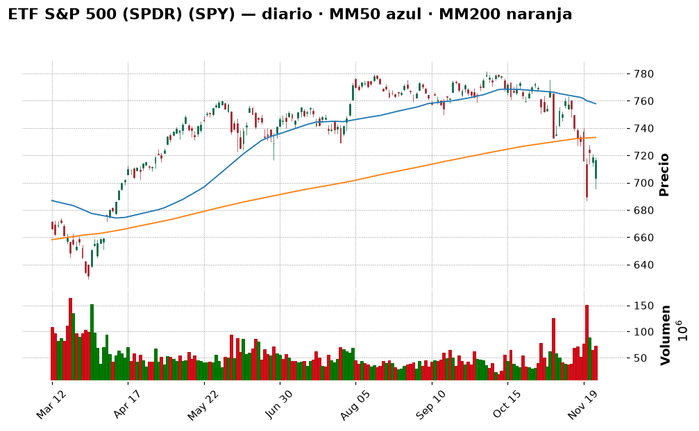
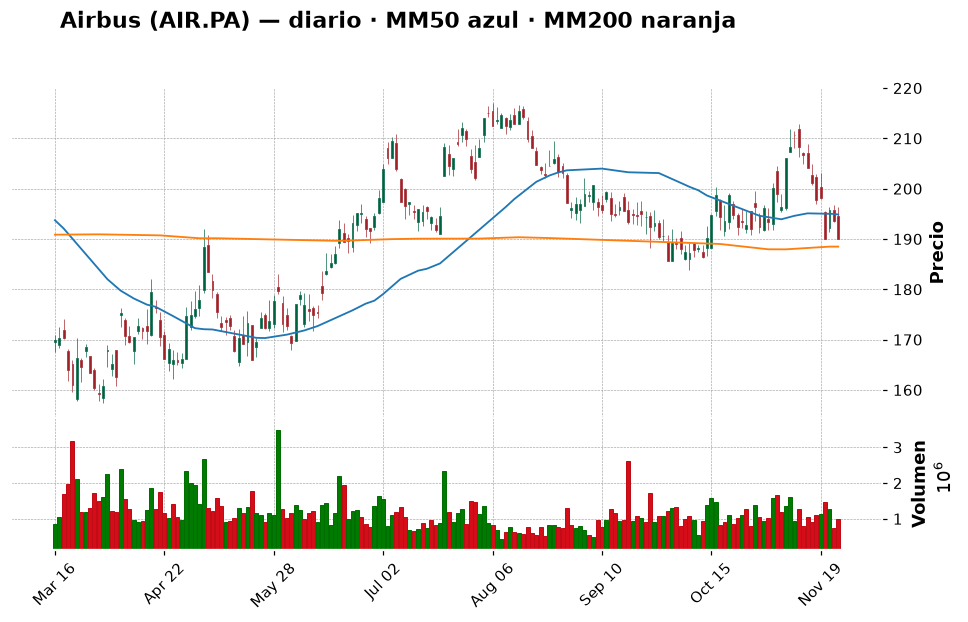
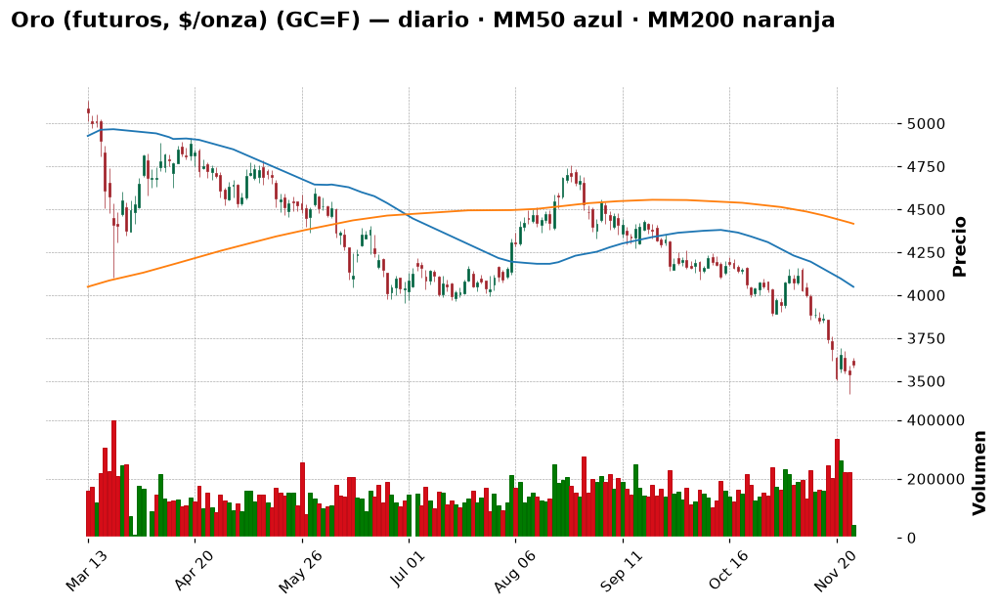
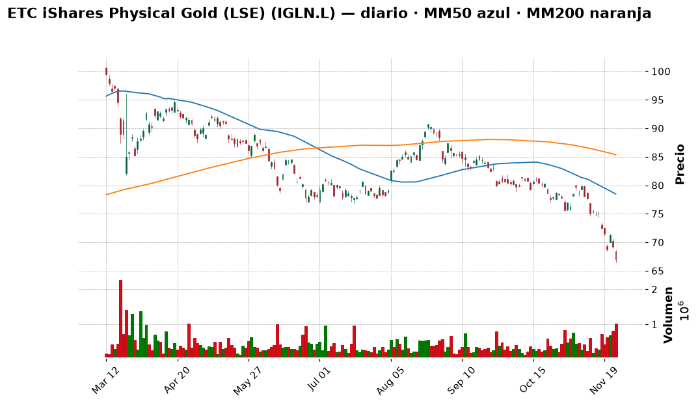
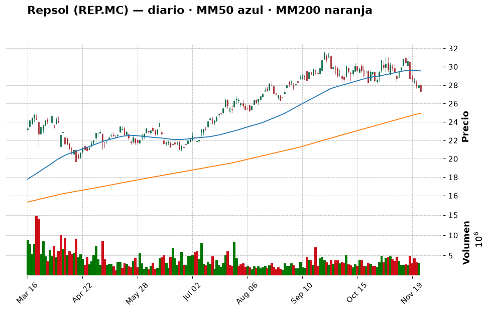
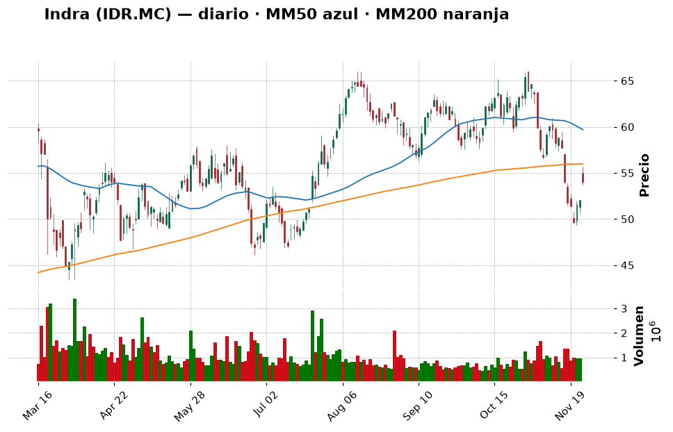
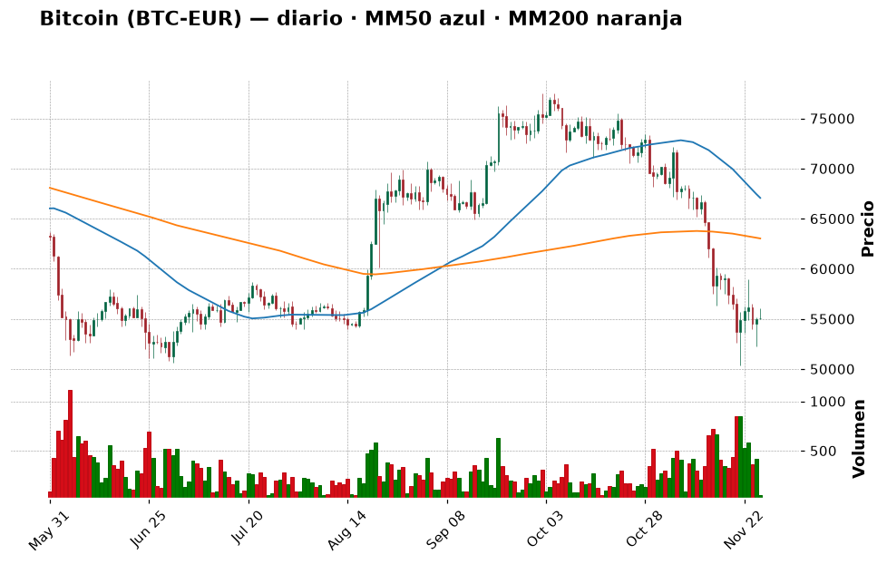
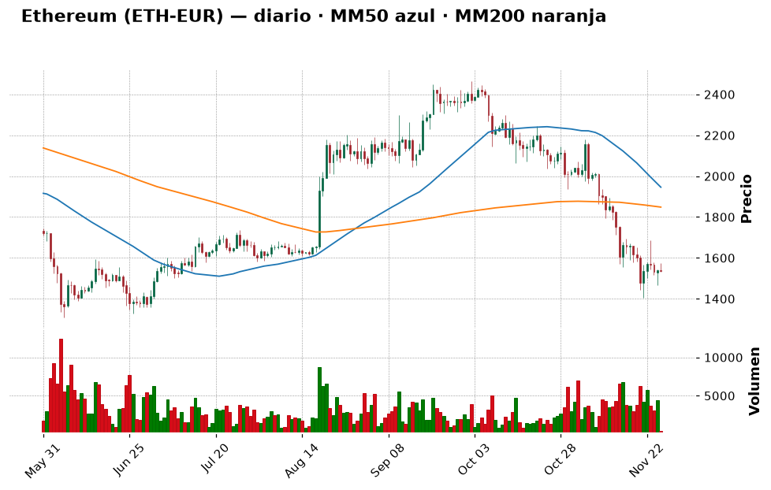

# 📈 Informe pre-apertura — jueves 26 de noviembre de 2026

> Generado automáticamente a las 07:55 (hora de Madrid) · Bolsa española abre a las 9:00 · **Wall Street hoy cerrado (Acción de Gracias)** · Cripto: 24/7
> **Termómetro del día:** 🟡 prudencia. Ayer fue un día duro en Europa: Ibex **−2,0 %**, con la banca a la cabeza. Los motivos fueron tres: los nuevos aranceles de EE. UU., una inflación subyacente americana del **3,3 %** (la más alta en casi tres años) y un **Brent cerca de 95 $** tras un ataque hutí a una refinería saudí. Esta madrugada el ambiente mejora. Asia rebota con fuerza (Taiwán +2,6 %, Nikkei +1,7 %) y los futuros de EE. UU. suben un +0,4–0,6 %. Además, los aranceles no entrarían en vigor antes de febrero o marzo. Bajo de 🔴 a 🟡 porque hoy hay menos catalizadores y Asia se calma, pero el VIX sigue alto (28,3).
> **Lección de hoy:** El petróleo y las materias primas: por qué el Brent mueve la bolsa

## 1. Lo que tienes que saber hoy
- **Europa se llevó el golpe ayer.** El **Ibex cayó un −2,00 % hasta 18.635,8 puntos**, su mínimo de tres meses, y vuelve a quedar **bajo su MM200** (18.821). El **Euro Stoxx 50** perdió un **−1,82 % (5.894,46)**. Bajaron sobre todo los bancos: **Santander −3,96 %** y **BBVA −3,01 %**. El detonante fue el anuncio de EE. UU. de **nuevos aranceles a China, la UE y otros 12 países**, junto con la subida del crudo (Europa Press, Press Digital, Mi Bolsillo). La excepción fue **Indra (+3,81 %)**, que lideró el Ibex tras presentar su plan a 2030.
- **El PCE salió "caliente" por dentro.** La inflación general de octubre quedó en el **3,8 %** anual, como se esperaba. La **subyacente** (sin energía ni alimentos) subió al **3,3 %**, frente al 3,2 % previsto (Cointelegraph, Reuters vía Yahoo). El mercado da ya un **94–98 %** de probabilidad a una **subida de tipos de la Fed en diciembre** (CME FedWatch). 💡 *La **inflación subyacente** quita lo más volátil (gasolina, comida) y muestra la tendencia de fondo de los precios. Es la que más mira la Fed.*
- **Wall Street aguantó mejor de lo que parecía.** El S&P 500 bajó un **−0,25 % (7.182,78)**, el Nasdaq un **−0,62 % (23.585,80)** y el Dow Jones subió un +0,33 %. Durante la sesión, el Nasdaq 100 estuvo cerca de entrar en "mercado bajista" (−20 % desde máximos), pero recuperó buena parte de lo perdido (Reuters vía Yahoo Finance). **Hoy Wall Street está cerrado** por Acción de Gracias, y mañana tendrá una sesión corta.
- **El petróleo se dispara.** El **Brent subió un +3,51 % hasta 94,61 $** al cierre de ayer, tras un ataque hutí reivindicado contra la refinería saudí de **Ras Tanura** (EFE vía Infobae). La coalición no ha confirmado daños. Es lo que explico en la **lección de hoy**. Para tu cartera: Repsol se aleja aún más del disparador de venta (Brent < 83 $).
- **Mañana, viernes 27, a las 14:00 se cierra el plazo de las Letras.** Es la tarea de la semana: **~3.000 €** en la subasta del **1-dic** (6 y 12 meses). La Letra a 12 meses pagó un **3,045 %** en la última subasta. El Euríbor diario está en el 3,351 % (Expansión).
- **El oro cierra en mínimo anual en Londres, pero rebota esta mañana.** El ETC **IGLN.L** cayó un −3,15 % hasta **67,00 $** y perdió el mínimo de 68,39 $ que vigilábamos. El futuro (GC=F) llegó a bajar de 3.500 $ y esta mañana sube un **+1,7 % (3.595,7 $)**. **Seguimos en Esperar.**
- **Tu cartera baja a 9.663,91 € (−23,82 € desde ayer).** Por primera vez tus inversiones quedan ligeramente en negativo en conjunto (**−10,77 €, −0,91 %**). No hay movimientos nuevos en `cartera.csv` ni errores.

## 2. ✅ Recomendaciones del día (resumen)
| Activo | Acción | vs. ayer | Cuánto (orientativo) | Horizonte | Por qué, en una frase | Confianza |
|---|---|---|---|---|---|---|
| Letras del Tesoro (LETRAS) | 🟢 Comprar | = | **~3.000 €**: 1.000 € a 6 meses y 2.000 € a 12 meses en la subasta del **1-dic**; **petición antes de mañana, viernes 27-nov, a las 14:00** | 6–12 meses | Tipo fijo (2,82–3,05 % en la última subasta) con el Estado como emisor; no depende de la bolsa | alta |
| ETF S&P 500 (SPY / SPY5.L) | 🔵 Mantener | = | 0 €; **½ tramo 2 (~300 €) en pausa** hasta un cierre semanal sobre ~733 $ (mañana) o ~150 € el 15-dic si no marca nuevos mínimos | Años (5+) | 716,70 $, un −2,25 % bajo su MM200; necesitaría un +2,3 % en la sesión corta de mañana | media |
| Airbus (AIR.PA) | 🔵 Mantener | = | 0 €: ya tienes el 3 % previsto | Años | 190,00 €, aún un +3,4 % sobre la línea roja (183,84 €, cierre semanal); aranceles no antes de febrero | media |
| Oro (IGLN.L) | ⏸️ Esperar | = | 0 €; primer tramo de ~150 € solo con cierre sobre ~75 $ o tras 2–3 semanas de estabilidad | Años | Pierde su mínimo anual (67,00 $) con la Fed a punto de subir tipos | media |
| Repsol (REP.MC) | 🔵 Mantener | = | No añadir; **Reducir 1 acción** si el Brent baja de 83 $ o cierra bajo 26,28 € | Años | Baja a 27,34 € con el Ibex, pero el Brent (94,6 $) está muy lejos de 83 $ | baja |
| Indra (IDR.MC) | ⛔ Evitar | = | 0 € | — | Sube un +3,81 % (54,00 €) con su plan a 2030, pero sigue un −3,5 % bajo su MM200 | media |
| NVIDIA (NVDA) | ⛔ Evitar | = | 0 € | — | Cae otro −3,91 % (149,30 $); S&P Global pone su calificación crediticia en vigilancia negativa | media |
| Solaria (SLR.MC) | 🔵 Mantener | = | No añadir | Años | Posición mínima (1 acción, 13,05 €); nuevo mínimo anual, pero venderla cuesta casi lo mismo en comisión | baja |
| Telefónica (TEF.MC) | ⏸️ Esperar | = | Hasta ~250 € si supera 3,71 € | Años | Baja a 3,36 € y la tendencia pasa a bajista; Evitar si cierra bajo 3,27 € | baja |
| Iberdrola (IBE.MC) | ⏸️ Esperar | = | Hasta 5 % (~480 €) si retrocede a 21–22 € | Años | La más defensiva del día (−0,57 %, 22,72 €), aún sobre la zona de compra | media |
| Inditex (ITX.MC) | 🔵 Mantener | = | No añadir | Años | Alcista (57,46 €); tu posición gana +113 %; mañana es Black Friday | media |
| Apple (AAPL) | 🔵 Mantener | = | No añadir | Años | Sube un +0,43 % (355,58 $) en plena caída tecnológica; tu posición gana +107 % | media |
| Bitcoin (BTC) | 🔵 Mantener | = | 0 € a este precio; la orden de ~50 € en ~50.600 € puede seguir puesta hasta el 30-nov | Años | 55.087 €, RSI 29 (sobreventa), quinta semana de salidas en los ETF | baja |
| Ether (ETH) | ⛔ Evitar | = | 0 € | — | 1.535 €, todavía bajo la línea de 1.580 € | media |
| Shiba Inu (SHIB) | ⛔ Evitar | = | No añadir | — | Memecoin bajista, −55 % en un año | alta |

*(El resto de la watchlist —Santander, BBVA, Oryzon, IAG, Aena, Microsoft, Amazon, Alphabet, Berkshire, los ETF del Nasdaq y del MSCI World, ASML, LVMH, SAP y Siemens— tiene su veredicto en la tabla "Resto de la watchlist" de la sección 6.)*

**🔁 Seguimiento de ayer** (informe del miércoles 25-nov):
- **ETF S&P 500:** "pausa hasta un cierre semanal sobre ~733 $" → el SPY bajó un −0,29 % hasta **716,70 $**, justo sobre su soporte de 716,58 $. Para cumplir la regla mañana necesitaría subir un **+2,3 %** en una sesión corta. Es poco probable, así que lo más probable es pasar al plan alternativo: **~150 € el 15-dic**, siempre que no pierda el mínimo de 686,75 $. **Sin cambios.**
- **Airbus:** "Mantener; línea roja con cierre semanal bajo 183,84 €" → cerró en **190,00 € (−1,88 %)**, ahora bajo su MM50 (194,86 €) pero sobre su MM200 (188,49 €). Los aranceles se han anunciado, pero no se aplicarían antes de febrero o marzo (Reuters vía Yahoo). **Sin cambios**: la línea roja se juzga con el cierre de mañana, viernes.
- **Oro:** "un cierre claro bajo 68,39 $ retrasaría aún más la entrada" → **ha ocurrido**: el IGLN.L cerró en **67,00 $** (−3,15 %). Seguimos en **Esperar** y la condición de entrada no cambia (cierre sobre ~75 $ o estabilidad de 2–3 semanas). Ahora el suelo a vigilar es el nuevo mínimo de 66,47 $.
- **Repsol:** "Reducir 1 acción si el Brent < 83 $ o cierre < 26,28 €" → la acción baja a **27,34 € (−2,25 %)**, arrastrada por el Ibex, y el Brent **sube** a 94,6 $. No salta ningún disparador. **Sin cambios.**
- **Indra:** "Evitar; pasaría a Esperar con un cierre sobre la MM200 (~56 €)" → sube un **+3,81 %, hasta 54,00 €**, y supera la resistencia de 53,48 €, pero aún le falta un +3,6 % para la MM200 (55,97 €). **Sin cambios**, aunque se acerca a la señal.
- **Bitcoin y ether:** la orden de bitcoin en ~50.600 € no se ha ejecutado (precio actual 55.087 €). Ether sigue bajo 1.580 €. **Sin cambios.**
- **Cartera:** no has registrado movimientos nuevos. **Las Letras siguen pendientes y el plazo acaba mañana a las 14:00.**

> Día tranquilo por obligación: Wall Street cierra y Europa intenta rebotar tras el −2 % de ayer. **No compres nada en bolsa.** Lo único que no puede esperar es **pedir las Letras antes de mañana a las 14:00**.

## 3. Agenda del día (y de lo que queda de semana)
| Hora (Madrid) | Evento | Por qué importa |
|---|---|---|
| Todo el día | **Acción de Gracias: Wall Street y el mercado de bonos de EE. UU. cerrados** | Sin la referencia americana, Europa suele moverse con poco volumen. Los futuros de EE. UU. y las cripto sí cotizan |
| 9:00 | Apertura de la Bolsa española. El Ibex parte de **18.635,8** (−2,00 % ayer) | No he encontrado una previsión de apertura fiable; Asia y los futuros apuntan a un rebote |
| Hoy | **Cumbre del Consejo Europeo.** Según Expansión (titular), los líderes eligen hoy a **Pablo Hernández de Cos** presidente del BCE; El País dice que Países Bajos "se resiste a aceptar la derrota" | Sería el primer español al frente del BCE. Sustituiría a Lagarde cuando acabe su mandato (31-oct-2027), así que no cambia los tipos de hoy |
| **Vie 27, 14:00** | **Fin del plazo de peticiones de Letras** a 6 y 12 meses (Banco de España) | **Tu tarea de la semana** |
| Vie 27 | **IPC adelantado de España** de noviembre. **Black Friday**. Wall Street abre en **sesión corta** (cierra a las 19:00 de Madrid) | El IPC importa para el BCE; el Black Friday, para Inditex, Amazon y el consumo |
| Vie 27, cierre | **Cierre semanal del SPY** (¿sobre ~733 $?) y de **Airbus** (¿sobre 183,84 €?) | Deciden el tramo del ETF y la línea roja de Airbus |
| Dom 29 | **Elecciones generales en España** · **Reunión de la OPEP+** para fijar la producción de 2027 (FXEmpire) | Banca y eléctricas, las más sensibles al resultado; la OPEP+ puede mover el petróleo |
| Lun 30 | Último día de la orden opcional de bitcoin en ~50.600 € | Si no se ha ejecutado, la retiramos |
| Mar 1-dic | **Subasta de Letras a 6 y 12 meses** · **tu aportación de 200 €** | Emisión el 4-dic |
| Jue 3-dic | Jensen Huang (Nvidia) comparece en el Senado de EE. UU. | Prueba clave para Nvidia |
| Vie 4-dic | **Empleo de EE. UU. de noviembre** · fin del plazo de Letras a 3 y 9 meses (subasta del 9-dic) | Último gran dato antes de la Fed |
| 8–9 dic | **Reunión de la Fed** | Se descuenta una subida de 0,25 puntos |

## 4. Cómo llegan los mercados
### España y Europa
El **Ibex 35 cayó un −2,00 % hasta 18.635,8 puntos**, su nivel más bajo en tres meses (Europa Press, titular; Mi Bolsillo). Encadena una semana de −3,8 % y vuelve a quedar **un −1,0 % bajo su MM200** (18.821). Su RSI de 37,6 se acerca a la zona de sobreventa. El motivo fue doble: el anuncio de **nuevos aranceles de EE. UU.** y el **petróleo por encima de 93 $** (Press Digital). La **banca** sufrió más: Santander −3,96 % (10,03 €), BBVA −3,01 % (21,28 €) y CaixaBank. 💡 *Los bancos caen cuando el mercado teme una economía más débil: menos créditos y más impagos.* La excepción fue **Indra, +3,81 %**, por su nuevo plan estratégico.

El **Euro Stoxx 50 bajó un −1,82 % (5.894,46)**, ya un −3,8 % bajo su MM200. **ASML se dejó un −5,79 %** por las nuevas restricciones de EE. UU. a la venta de equipos de chips a China, que también hundieron a Applied Materials (−6 %) y Lam Research (−7 %) en Wall Street (247 Wall St; Yahoo Finance). **Siemens** perdió un −3,59 %.

**Previsión de apertura:** ninguna búsqueda ha devuelto una previsión fiable de hoy y la web de Expansión bloquea la lectura automática. *Mi interpretación:* con Asia rebotando (Taiwán +2,6 %, Hong Kong +1,9 %) y los futuros de EE. UU. en positivo, lo más probable es un **rebote moderado**, pero con poco volumen porque Wall Street está cerrado.

Noticias de empresas y de España (titulares vía RSS):
- **Indra** eleva su objetivo de ingresos para 2030 a **más de 12.000 millones €** (antes 10.000 M) y su margen al **12,5 %**. Prevé **más de 3.100 M€ de flujo de caja libre** en 2026–2030. El dividendo queda como última prioridad (*payout* del 15–25 %) (Reuters vía Yahoo Finance). Cinco Días cuenta que su presidente quiere fabricar blindados a un ritmo tres veces mayor.
- **Repsol**, junto con Eni, se compromete a invertir **2.000 millones $ en Venezuela** en cinco años (gas de Cardón IV), según un documento del Gobierno venezolano. Ninguna de las dos empresas lo ha confirmado. Venezuela le debía a Repsol unos 5.400 M$ a finales de 2025 (Reuters vía Yahoo Finance).
- **Banca:** BBVA pedirá su **exclusión de la Bolsa de Londres** por su bajo volumen (Expansión). Santander nombra un nuevo responsable de banca de inversión para Europa y España (Expansión).
- **Eléctricas:** rechazan que la CNMC desvíe un superávit de las redes (Cinco Días). Afecta a Iberdrola.
- **Aerolíneas:** el precio del combustible de aviones en Europa marcó en octubre su máximo desde el inicio de la crisis (Europa Press). Es negativo para IAG.
- **Elecciones del domingo:** Expansión calcula que los decretos sociales del Gobierno suman **2,5 puntos de déficit** y titula que "los analistas piden sostenibilidad fiscal". El País recuerda que el salario medio está en máximos desde 2006 (2.497 €/mes). 💡 *Son opiniones y cifras de campaña: tómalas con cautela.*
- **Mercado:** "Los inversores se refugian en los bonos tras la tormenta de la IA" (Expansión). Es la misma idea que nuestras Letras.

### Estados Unidos
Ayer el **S&P 500 bajó un −0,25 % (7.182,78)**, el **Nasdaq un −0,62 % (23.585,80)** y el **Dow Jones subió un +0,33 % (50.182,95)**. El Russell 2000, de empresas pequeñas, ganó un +0,71 % (Yahoo Finance). Fue una sesión muy volátil: el **Nasdaq 100 estuvo a punto de entrar en mercado bajista** antes de recortar pérdidas (Reuters vía Yahoo). El **VIX subió a 28,29 (+7,3 %)**. 💡 *El **VIX** es el "termómetro del miedo" de Wall Street: por encima de 20–25 indica nervios.*
- **Nvidia cayó un −3,91 % (149,30 $).** S&P Global ha puesto su calificación crediticia AA **en vigilancia con implicaciones negativas** por dudas sobre la independencia de su consejo (Reuters vía Yahoo). Además, según el FT, Nvidia ha dejado de enviar servidores de IA a **Malasia, Singapur, Tailandia e Indonesia** por los nuevos controles de exportación de EE. UU. (Investing.com). También pagará **290 M$** para cerrar una demanda antigua (Decrypt).
- **Amazon cayó un −3,12 % (244,43 $)** y ya está bajo su MM200. Trump amenaza con un "impuesto tremendo" a las tecnológicas que construyan centros de datos fuera de EE. UU. (Yahoo Finance).
- **Apple subió un +0,43 %** y algunos medios la presentan como "refugio" dentro de la tecnología (BeInCrypto). Michael Burry, famoso por *The Big Short*, dice estar ahora "casi totalmente comprado" (Yahoo Finance; Motley Fool).

**Esta mañana:** los futuros del **S&P 500 están en 7.225,50 (+0,41 %)** y los del **Nasdaq 100 en 26.252,25 (+0,58 %)** (Yahoo Finance; la página no deja clara la hora exacta). En Asia, el índice MSCI de la región sube un +1,3 % y corta **ocho sesiones seguidas de caídas**. La japonesa **Kioxia** sube un +12–14 % tras colaborar con Nvidia en memoria. El Banco de Corea **sube tipos** al 3,25 % (Reuters vía Yahoo; Investing.com).

### Macro (tipos de interés, inflación, divisas, materias primas)
- **Inflación y Fed:** PCE de octubre +0,3 % mensual, **3,8 % anual**; subyacente +0,3 % y **3,3 % anual**, la más alta en casi tres años (Cointelegraph). El **PIB del 3.er trimestre** se revisa al alza, al **4,3 % anualizado** (Reuters vía Yahoo; Expansión lo publica como un 1,1 % trimestral). El mercado da un **94,4 %** de probabilidad a una subida de la Fed en diciembre a las 17:01 de ayer y **98 %** según Reuters esta madrugada. 💡 *Una economía que crece fuerte y una inflación que no baja: la combinación que lleva a la Fed a subir tipos.* JPMorgan cree que **la Fed es el mayor riesgo para la bolsa en 2027** (247 Wall St).
- **Aranceles:** EE. UU. anuncia aranceles de **hasta el 20 %** a China, la UE y otros 12 países (Expansión, Europa Press; titulares). Según Reuters, **no entrarían en vigor antes de febrero o marzo** y han sido "menos disruptivos de lo temido".
- **Bonos:** el bono de EE. UU. a 10 años baja **8 puntos básicos, al 4,85 %** (Reuters vía Yahoo). 💡 *Un punto básico es una centésima de punto porcentual: 8 pb = 0,08 %.*
- **Divisas:** **euro/dólar 1,0966** (−0,14 %; Yahoo Finance, 07:46). El índice del dólar está en 103,77 (Reuters). El dólar se toma un respiro por Acción de Gracias (Investing.com).
- **Petróleo:** el **Brent cerró en 94,61 $ (+3,51 %)** y el WTI en 83,68 $ (EFE vía Infobae). Esta mañana ronda los **94,8–95,3 $** (Reuters vía Yahoo; FXEmpire). La página de cotización de Yahoo mostraba 90,72 $ con datos incoherentes, así que no la uso. El motivo es el **ataque hutí reivindicado contra Ras Tanura** (Arabia Saudí), sin daños confirmados. El domingo se reúne la **OPEP+**. Hace una semana estaba en ~87 $ (lección de hoy).
- **Asia endurece:** además de Corea, un miembro del Banco de Japón ve posible subir tipos "a un ritmo más rápido" (Investing.com). La inflación es un problema global.
- **BCE:** sin novedades de tipos (última reunión el 29-oct). Hoy, posible elección de Hernández de Cos como próximo presidente (ver agenda).
- **Tipos de referencia** (de `rates_2026-11-26.json`): **BCE (facilidad de depósito) 2,50 %** · **Euríbor 12 m 3,239 %** (media de octubre; el diario de ayer, 3,351 %, según Expansión) · **deuda AAA de la zona euro a 1 año 2,945 %** (24-nov) · **Fed 4,00 %** (límite superior). Siguen por encima del umbral del 3 %: el apartado de renta fija continúa activo.

**🥇 Oro:** el futuro **GC=F** está esta mañana en **3.595,7 $/onza (+1,69 %** en la vela de hoy, que aún no ha cerrado). Ayer llegó a bajar **por debajo de 3.500 $** (su mínimo de 52 semanas en el futuro está en 3.425,2 $) y luego rebotó (Reuters vía Yahoo). El ETC **IGLN.L** cerró en Londres en **67,00 $ (−3,15 %)**, un **nuevo mínimo anual**. Cerró antes del rebote del oro en EE. UU., así que hoy probablemente recupere algo. En un mes pierde un −11,3 % (GC=F) y un −14,9 % (IGLN.L). Lo presionan la inflación alta, que asegura la subida de la Fed (el oro no paga intereses), y el dólar fuerte. Ni siquiera el ataque en Arabia Saudí le ha dado su papel de refugio.

## 5. Panorama técnico de la watchlist
> 💡 *Cómo leer esta tabla:* la **tendencia** resume si el precio lleva meses subiendo, bajando o de lado
> (comparando el precio con sus medias de 50 y 200 días). El **RSI** mide de 0 a 100 si las subidas o bajadas
> recientes han sido muy fuertes: por encima de 70 se dice "sobrecompra" (quizá ha subido demasiado rápido),
> por debajo de 30 "sobreventa". Son pistas, no predicciones.

Datos del **cierre del miércoles 25-nov** (el oro GC=F, del precio de esta mañana). Ningún valor llega con retraso ✅. En los valores españoles y en varios europeos, el último cierre lo completa Yahoo con su precio de cierre publicado.

| Valor | Último cierre | Día | 1 mes | 1 año | Tendencia | RSI | vs MM200 |
|---|---|---|---|---|---|---|---|
| IBEX 35 (^IBEX) | 18.635,8 | −2,00 % | −2,74 % | +13,83 % | ➡️ lateral | 37,6 🟡 | −1,0 % |
| Euro Stoxx 50 (^STOXX50E) | 5.894,46 | −1,82 % | −4,38 % | +6,88 % | ➡️ lateral | 34,9 🟡 | −3,8 % |
| S&P 500 (^GSPC) | 7.182,78 | −0,25 % | −6,99 % | +7,12 % | ➡️ lateral | 39,7 🟡 | −2,3 % |
| Nasdaq Composite (^IXIC) | 23.585,80 | −0,62 % | −10,92 % | +3,12 % | ➡️ lateral | 38,6 🟡 | −6,3 % |
| Banco Santander (SAN.MC) | 10,03 | −3,96 % | −11,00 % | +8,49 % | ➡️ lateral | 32,9 🟡 | −11,2 % |
| BBVA (BBVA.MC) | 21,28 | −3,01 % | −6,26 % | +14,62 % | ➡️ lateral | 35,6 🟡 | −1,7 % |
| Inditex (ITX.MC) | 57,46 | −1,44 % | +0,81 % | +19,09 % | 📈 alcista | 47,0 🟢 | +5,0 % |
| Iberdrola (IBE.MC) | 22,72 | −0,57 % | +3,41 % | +24,94 % | 📈 alcista | 55,6 🟢 | +10,6 % |
| Telefónica (TEF.MC) | 3,36 | −1,35 % | +3,10 % | −10,09 % | 📉 bajista | 46,4 🟢 | −7,8 % |
| Repsol (REP.MC) | 27,34 | −2,25 % | −4,00 % | +71,09 % | ➡️ lateral | 37,8 🟡 | +9,6 % |
| Solaria (SLR.MC) | 13,05 | −2,83 % | −16,13 % | −21,66 % | 📉 bajista | 32,5 🟡 | −32,7 % |
| Oryzon (ORY.MC) | 2,36 | −2,97 % | −6,14 % | −29,67 % | 📉 bajista | 42,9 🟢 | −16,5 % |
| IAG (IAG.MC) | 5,21 | −2,54 % | +6,68 % | +14,99 % | 📈 alcista | 49,5 🟢 | +6,5 % |
| Indra (IDR.MC) | 54,00 | +3,81 % | −14,58 % | +17,39 % | ➡️ lateral | 41,8 🟢 | −3,5 % |
| Aena (AENA.MC) | 27,90 | −0,64 % | +3,33 % | +18,93 % | 📈 alcista | 53,1 🟢 | +7,2 % |
| Apple (AAPL) | 355,58 | +0,43 % | +2,44 % | +28,87 % | 📈 alcista | 57,9 🟢 | +16,8 % |
| Microsoft (MSFT) | 489,93 | −1,25 % | −7,79 % | +3,36 % | ➡️ lateral | 38,7 🟡 | +10,1 % |
| NVIDIA (NVDA) | 149,30 | −3,91 % | −31,49 % | −18,21 % | ➡️ lateral | 37,5 🟡 | −26,4 % |
| Amazon (AMZN) | 244,43 | −3,12 % | −3,43 % | +8,02 % | ➡️ lateral | 42,0 🟢 | −0,5 % |
| ETF S&P 500 (SPY) | 716,70 | −0,29 % | −6,88 % | +7,17 % | ➡️ lateral | 39,8 🟡 | −2,3 % |
| ETF Nasdaq 100 (QQQ) | 633,93 | −0,65 % | −12,11 % | +4,75 % | ➡️ lateral | 38,6 🟡 | −7,3 % |
| Alphabet (GOOGL) | 273,10 | −2,13 % | −14,81 % | −14,28 % | 📉 bajista | 36,9 🟡 | −18,8 % |
| Berkshire Hathaway (BRK-B) | 579,32 | +0,37 % | +6,69 % | +14,08 % | 📈 alcista | 62,7 🟡 | +15,0 % |
| ETF MSCI World (IWDA.AS) | 122,34 | −1,80 % | −7,04 % | +10,22 % | ➡️ lateral | 35,1 🟡 | −0,4 % |
| Airbus (AIR.PA) | 190,00 | −1,88 % | −1,42 % | −7,07 % | ➡️ lateral | 41,4 🟢 | +0,8 % |
| ASML (ASML.AS) | 1.131,60 | −5,79 % | −23,02 % | +25,26 % | ➡️ lateral | 34,6 🟡 | −19,2 % |
| LVMH (MC.PA) | 391,00 | −0,94 % | +0,71 % | −38,47 % | 📉 bajista | 46,4 🟢 | −14,3 % |
| SAP (SAP.DE) | 189,82 | −0,14 % | −10,95 % | −8,17 % | ➡️ lateral | 38,1 🟡 | +13,4 % |
| Siemens (SIE.DE) | 245,50 | −3,59 % | −7,78 % | +7,63 % | ➡️ lateral | 35,9 🟡 | −5,8 % |
| Oro (GC=F) | 3.595,70 | +1,69 % | −11,25 % | −13,15 % | 📉 bajista | 33,9 🟡 | −18,6 % |
| Oro (IGLN.L) | 67,00 | −3,15 % | −14,88 % | −17,13 % | 📉 bajista | 27,6 🔴 | −21,5 % |

*Clave del RSI en la tabla:* 🟢 entre 40 y 60 (zona neutra) · 🟡 entre 30 y 40 o entre 60 y 70 (acercándose a un extremo) · 🔴 30 o menos, o 70 o más (zona extrema).

**Interpretación:** casi toda la lista está "cansada": 18 de los 31 valores tienen un RSI entre 30 y 40. El único en sobreventa es el **IGLN.L (27,6)**. Los **cuatro índices** están ya **bajo su MM200**: al Euro Stoxx, el S&P 500 y el Nasdaq se suma ahora el Ibex. El ETF MSCI World y Amazon acaban de perderla por muy poco. Lo que mejor aguanta sigue siendo lo "aburrido": Iberdrola, Berkshire, Apple, Aena e Inditex, todos alcistas. Telefónica pasa de "lateral" a **"bajista"**. **Aena** mantiene su cruce dorado reciente (lección del 24-nov).

## 6. Ideas de bolsa: qué haría un experto
### ETF S&P 500 (SPY5.L / SPY) — MANTENER (pausa activada)

- **Qué es:** un fondo que replica a las 500 mayores empresas de EE. UU. Es tu **núcleo**: tienes 0,8695 participaciones del SPY5.L, la versión europea en la Bolsa de Londres. En el gráfico se usa el SPY, que se mueve igual.
- **Por qué es noticia hoy:** ayer bajó poco (−0,29 %) en un día de aranceles e inflación alta, y esta mañana sus futuros suben un +0,4 %. Hoy no cotiza en EE. UU. por Acción de Gracias y mañana tendrá sesión corta.
- **Lo que dice el gráfico:** el precio (716,70 $) se apoya **justo encima de su soporte de 716,58 $** y sigue **bajo su MM200 (733,16 $)** y su MM50 (757,89 $). La tendencia es lateral, con RSI de 39,8. El MACD "mejora": la caída pierde fuerza, pero no ha girado. El mínimo del pánico del 20-nov está en **686,75 $**. Cotiza un −8,3 % bajo su máximo anual (781,62 $).
- **Lo positivo:** sigue siendo la mejor forma de invertir a largo plazo para un principiante: 500 empresas, comisiones bajas y nada que vigilar a diario. Ayer, la "empresa media" del índice subió mientras caía la tecnología (Trefis; Russell 2000 +0,7 %): el mercado no se hunde entero.
- **El riesgo:** la Fed subiendo tipos con una inflación que no baja, y el peso de las tecnológicas (Nvidia, Amazon) en el índice.
- **🧑‍💼 Recomendación: MANTENER.** Sin cambios. La regla pide un **cierre semanal** sobre ~733 $ y mañana necesitaría un +2,3 % en una sesión de medio día. Es improbable, y no vamos a cambiar la regla porque "casi" se cumpla.
  - **Cuánto y cómo:** 0 € hoy. **Plan:** si mañana el SPY cierra **por encima de ~733 $**, el **lunes 30-nov** compraría la ½ del tramo 2 (**~300 €**) con una orden limitada. Si no, **~150 € el 15-dic**, siempre que no haya marcado nuevos mínimos (por debajo de 686,75 $).
  - **Horizonte:** años (5 o más).
  - **Qué me haría cambiar de opinión:** solo un cambio de tesis, como una recesión profunda con caída generalizada de beneficios. Una bajada de precio no.
- **Qué mirar para entenderlo:** el soporte de **716,58 $**. Si lo pierde con claridad, el siguiente apoyo es 686,75 $. Un cierre semanal sobre 733 $ sería la primera señal de que el rebote es real.
- **Confianza:** media.

### Airbus (AIR.PA) — MANTENER

- **Qué es:** el mayor fabricante de aviones del mundo junto a Boeing, con negocio también en defensa y espacio. Tienes 1,5065 acciones (2,96 % del patrimonio).
- **Por qué es noticia hoy:** EE. UU. ha anunciado **aranceles de hasta el 20 %** a la UE y a otros países (Expansión, Europa Press). Según Reuters, no entrarían en vigor antes de febrero o marzo. Airbus vende muchos aviones a aerolíneas americanas, así que le afecta. Sigue adelante la venta de su negocio de satélites en EE. UU. a Cerberus (Axios). El **combustible de aviones en Europa** está en máximos desde el inicio de la crisis (Europa Press). A corto plazo eso pesa más a las aerolíneas que a Airbus, pero a largo plazo **refuerza la demanda de aviones nuevos, que gastan menos**.
- **Lo que dice el gráfico:** el precio (190,00 €) ha perdido su MM50 (194,86 €), pero está **justo sobre su MM200 (188,49 €, +0,8 %)**. Su soporte es la propia línea roja, **183,84 €**, y su resistencia, 200,40 €. RSI 41,4 (neutro) y MACD "empeora". Está un −14 % por debajo de su máximo anual (221,30 €).
- **Lo positivo:** cartera de pedidos para muchos años, recompra de acciones en marcha (5.000 M€) y una demanda de aviones que no para.
- **El riesgo:** los aranceles y las entregas de fin de año. Le faltaban 249 aviones para su objetivo de ~870 a finales de octubre (Investing.com).
- **🧑‍💼 Recomendación: MANTENER.** Los aranceles eran el riesgo que ya señalábamos y no cambian la tesis a largo plazo: Airbus y Boeing son prácticamente los dos únicos fabricantes y las aerolíneas no pueden sustituirlos. La línea roja sigue un +3,4 % por debajo.
  - **Cuánto y cómo:** 0 €. Ya tienes el peso previsto.
  - **Horizonte:** años.
  - **Qué me haría cambiar de opinión:** un **cierre semanal bajo 183,84 €** (mañana es el primer examen) o un **recorte del objetivo de entregas** → **Reducir a la mitad** (vender ~0,75 acciones). Un cierre semanal sobre 200,40 € reafirmaría la tendencia.
- **Qué mirar para entenderlo:** el **cierre de mañana**. Si queda sobre la MM200 (~188,5 €), la tendencia de fondo sigue intacta. Y a primeros de diciembre, las **entregas de noviembre** (se esperan 90–100).
- **Confianza:** media.

### Oro (IGLN.L) — ESPERAR

- **Qué es:** el oro es el activo refugio clásico. El **ETC IGLN.L** (iShares Physical Gold, Bolsa de Londres, en dólares) es oro físico guardado en cámaras y es el vehículo que puedes comprar. **GC=F** (futuros) es solo la referencia del precio.
- **Por qué es noticia hoy:** la inflación subyacente al 3,3 % asegura una subida de la Fed y el oro, que no paga intereses, sufre. Ayer bajó brevemente de 3.500 $ y luego rebotó (Reuters vía Yahoo). El IGLN.L cerró antes del rebote y marcó un **nuevo mínimo anual**. Llama la atención que ni un ataque en Arabia Saudí lo haya hecho subir. 💡 *Cuando los tipos suben, el "refugio" que gana es la renta fija, que sí paga intereses. Por eso las Letras van primero en tu plan.*
- **Lo que dice el gráfico:** tendencia **bajista** clara. El IGLN.L está un **−21,5 % bajo su MM200** (85,34 $) y su RSI de 27,6 está en **sobreventa** (lección de ayer). Su mínimo de 52 semanas es ahora **66,47 $**. El futuro está un −18,6 % bajo su MM200 (4.415 $), con un RSI de 33,9 y un MACD que "mejora" gracias al rebote de esta mañana.
- **Lo positivo:** ha caído un −36 % desde su máximo de enero, diversifica la cartera a largo plazo y los bancos centrales siguen comprando.
- **El riesgo:** el **coste de oportunidad** (las Letras pagan ~3 % y el oro, 0 %) y una sobreventa que puede durar semanas.
- **🧑‍💼 Recomendación: ESPERAR.** Lo que ayer dijimos que "retrasaría la entrada" ya ha pasado: el ETC ha perdido su mínimo anual. No es momento de adelantarse.
  - **Cuánto y cómo:** 0 € hoy. **Primer tramo de ~150 €** en IGLN.L con un **cierre sobre ~75 $** (le falta un +12 %), o tras **2–3 semanas sin nuevos mínimos** (sin perder 66,47 $) y con el MACD "mejorando". Después, tramos de 150 € hasta un 3–5 % del patrimonio. Nunca futuros ni productos apalancados; PAXG no sustituye al ETC.
  - **Horizonte:** años.
  - **Qué me haría cambiar de opinión:** esas señales técnicas, o que la Fed deje de subir tipos.
- **Qué mirar para entenderlo:** el cierre de hoy del IGLN.L. Si recupera los 68 $ con el rebote del futuro, habrá sido un "pinchazo" puntual. Si no, la tendencia sigue mandando.
- **Confianza:** media.

### Repsol (REP.MC) — MANTENER (la tienes)

- **Qué es:** la petrolera española (exploración, refino, gasolineras y renovables). Tienes 2 acciones compradas en 2022 a 12,37 €: ganas un +121 %.
- **Por qué es noticia hoy:** el **Brent sube un +3,5 % hasta 94,61 $** por el ataque hutí reivindicado contra Ras Tanura (EFE). Además, Repsol y Eni se comprometen a invertir **2.000 M$ en Venezuela**, según el Gobierno venezolano (sin confirmar por las empresas) (Reuters vía Yahoo).
- **Lo que dice el gráfico:** el precio (27,34 €) bajó un −2,25 % con el resto del Ibex, a pesar del petróleo. Está **bajo su MM50 (29,53 €)** pero muy por encima de su MM200 (24,94 €, +9,6 %). Soportes en **26,28 €** (el disparador) y 25,08 €; resistencia en 28,42 €. RSI 37,8. Su volatilidad es alta.
- **Lo positivo:** el petróleo caro mejora sus beneficios y tu posición tiene un colchón de ganancias muy amplio.
- **El riesgo:** Venezuela (país que no ha pagado sus deudas) y un petróleo que se mueve con titulares: si el ataque resulta menor o la OPEP+ bombea más el domingo, el Brent puede bajar tan rápido como subió.
- **🧑‍💼 Recomendación: MANTENER.** Sin cambios. Los dos disparadores de Reducir (Brent < 83 $ o cierre bajo 26,28 €) están lejos, y el petróleo juega hoy a su favor. *¿Por qué bajó entonces la acción?* Porque ayer pesó más el miedo general a la economía (aranceles, banca) que el precio del crudo. Lo explico en la lección.
  - **Cuánto y cómo:** no añadir (ya tienes una petrolera y no conviene concentrar más en energía). **Reducir 1 de tus 2 acciones** si el **Brent baja de 83 $** o la acción **cierra bajo 26,28 €**.
  - **Horizonte:** años.
  - **Qué me haría cambiar de opinión:** esas dos señales. Recuperar 28,42 € la devolvería a su tendencia.
- **Qué mirar para entenderlo:** el Brent cada mañana y la reunión de la OPEP+ del domingo.
- **Confianza:** baja.

### Indra (IDR.MC) — EVITAR (de momento, pero se acerca)

- **Qué es:** la empresa española de defensa, tecnología y control del tráfico aéreo y ferroviario.
- **Por qué es noticia hoy:** su plan **Forward2030**: ingresos de **más de 12.000 M€ en 2030** (crecimiento del 17 % anual), margen del **12,5 %** y más de **3.100 M€ de caja libre** en cinco años. El crecimiento a partir de 2027 sería solo orgánico, sin compras. El dividendo queda en último lugar (15–25 % del beneficio) (Reuters vía Yahoo Finance). El mercado lo premió: **+3,81 %**, la mejor del Ibex en un día de caídas (Europa Press).
- **Lo que dice el gráfico:** el precio (54,00 €) supera la resistencia de 53,48 € que vigilábamos, pero sigue **−3,5 % bajo su MM200 (55,97 €)** y −9,5 % bajo su MM50 (59,69 €). RSI 41,8 y MACD "mejorando": el impulso está cambiando. Su soporte está lejos, en 46,85 €.
- **Lo positivo:** un plan creíble, en un sector (defensa europea) con viento a favor durante años.
- **El riesgo:** un plan es una **promesa** (*guidance*, lección del 18-nov), no un resultado. Es muy volátil (~48 % anual) y apenas pagará dividendo: su atractivo depende de que crezca como dice.
- **🧑‍💼 Recomendación: EVITAR (sin cambios).** Está muy cerca de la señal que pusimos (un cierre sobre la MM200), pero aún no la ha dado. Un día de subida tras un plan suele ser emoción. Prefiero ver que el precio **se mantiene** sobre los 56 €.
  - **Cuánto y cómo:** 0 €.
  - **Horizonte:** —
  - **Qué me haría cambiar de opinión:** un **cierre sobre ~56 €** → pasaría a **Esperar**, con una entrada máxima de un 2–3 % del patrimonio (~200–290 €) en dos tramos.
- **Qué mirar para entenderlo:** si los próximos días mantiene los 53,5 € (la resistencia superada se convierte en soporte, lección del 17-nov) y se acerca a 56 €.
- **Confianza:** media.

### Resto de la watchlist: veredicto rápido
| Valor | Acción | Por qué (1 frase) | Nivel a vigilar |
|---|---|---|---|
| NVIDIA (NVDA) | ⛔ Evitar | −3,91 % (149,30 $); S&P Global pone su rating en vigilancia negativa y deja de enviar servidores a cuatro países asiáticos (FT) | Recuperar la MM200 (203 $) |
| Solaria (SLR.MC) | 🔵 Mantener | La tienes (1 acción, −13 %); nuevo mínimo anual (13,05 €), −32,7 % bajo su MM200; vender 13 € no compensa la comisión | Resistencia 16,95 € |
| Telefónica (TEF.MC) | ⏸️ Esperar | 3,36 € (−1,35 %); la tendencia pasa a "bajista" | Comprar sobre 3,71 €; Evitar con cierre bajo 3,27 € |
| Iberdrola (IBE.MC) | ⏸️ Esperar | La que mejor aguantó (−0,57 %, 22,72 €); las eléctricas rechazan el desvío del superávit de redes de la CNMC (Cinco Días) | Comprar en 21–22 €; soporte 21,09 € |
| Inditex (ITX.MC) | 🔵 Mantener | Alcista (57,46 €), tu posición gana +113 %; mañana, Black Friday | Soporte 56,2 €; máximo 60,80 € |
| Apple (AAPL) | 🔵 Mantener | Sube (+0,43 %, 355,58 $) en plena caída tecnológica, a −1,5 % de su máximo; retira de su tienda el chatbot de MiniMax (Investing.com) | Soporte 338,7 $; máximo 360,83 $ |
| Banco Santander (SAN.MC) | ⏸️ Esperar | −3,96 % (10,03 €); pierde el soporte de 10,08 € y queda −11 % bajo su MM200 | Comprar solo sobre 11,53 € (MM50); mínimo anual 8,94 € |
| BBVA (BBVA.MC) | ⏸️ Esperar | −3,01 % (21,28 €), pierde 21,82 € y queda bajo su MM200; pedirá salir de la Bolsa de Londres (Expansión) | Soportes 21,20 € y 21,03 € |
| Oryzon (ORY.MC) | 🔵 Mantener | La tienes (4 acciones, −27 %), posición mínima | Mínimo 2,23 €; resistencia 2,60 € |
| IAG (IAG.MC) | ⏸️ Esperar | −2,54 % (5,21 €): el combustible de aviones en máximos y el Brent a 95 $ le restan margen | Soporte 4,95 €; máximo 5,72 € |
| Aena (AENA.MC) | ⏸️ Esperar | Alcista y con cruce dorado reciente; bajó poco (−0,64 %) | Retroceso hacia la MM50 (26,72 €) |
| Microsoft (MSFT) | ⏸️ Esperar | −1,25 % (489,93 $), +10 % sobre su MM200; amenaza de Trump a los centros de datos en el extranjero | Soporte 486 $; resistencia 513,73 $ |
| Amazon (AMZN) | ⏸️ Esperar | −3,12 % (244,43 $), pierde su MM200 por poco; mañana empieza el Black Friday | Soporte 244,3 $; recuperar 249,7 $ |
| ETF Nasdaq 100 (QQQ) | ⏸️ Esperar | −7,3 % bajo su MM200; estuvo cerca de "mercado bajista" ayer | Recuperar 683,5 $ (MM200) |
| Alphabet (GOOGL) | ⛔ Evitar | Bajista y con cruce de la muerte; −18,8 % bajo su MM200 | Recuperar 304,97 $ |
| Berkshire Hathaway (BRK-B) | ⏸️ Esperar | Alcista (579,32 $), +15 % en 2026 y batiendo al S&P 500 (247 Wall St); RSI 62,7, el más alto | Retroceso hacia la MM50 (540 $) |
| ETF MSCI World (IWDA.AS) | ⏸️ Esperar | −1,80 % (122,34 €); pierde su MM200 (122,79 €) por poco; misma regla de pausa que el SPY | Recuperar 125,8 € |
| ASML (ASML.AS) | ⏸️ Esperar | −5,79 % (1.131,60 €) por las nuevas restricciones de EE. UU. a los equipos de chips para China; −19 % bajo su MM200 | Recuperar 1.401 € (MM200) |
| LVMH (MC.PA) | ⛔ Evitar | Bajista, −38 % en un año; los aranceles a la UE pesan sobre el lujo | Soporte 376–381 €; resistencia 399,55 € |
| SAP (SAP.DE) | ⏸️ Esperar | Aguanta (−0,14 %, 189,82 €) bajo su resistencia de 190,26 € | Superar 192,12 €; soporte 178,9 € |
| Siemens (SIE.DE) | ⏸️ Esperar | −3,59 % (245,50 €), −5,8 % bajo su MM200; muy expuesta a aranceles y China | Recuperar 260,7 € (MM200) |

## 7. ₿ Criptomonedas
> 💡 *Las criptomonedas cotizan 24 horas, 7 días a la semana: los precios son de esta mañana (en euros).
> Son mucho más volátiles que las acciones: caídas del 50 % o más han ocurrido varias veces.*

**Sentimiento:** Fear & Greed **11/100, miedo extremo** (ayer 13, hace una semana 10, hace un mes 48) · Capitalización total **2,16 billones $** (**+1,76 % en 24 h**, **−55,2 %** bajo su máximo histórico de octubre de 2025) · Dominancia de Bitcoin **56,2 %**.
Pese a un pequeño rebote en 24 horas, el sentimiento sigue en mínimos. CoinDesk recoge que veteranos del sector creen que "esta vez parece diferente" y se preparan "para más dolor", y Galaxy ve margen para más caídas. El miedo extremo prolongado ha coincidido otras veces con zonas de suelo (lección del 16-nov), pero no avisa de cuándo termina la caída.

**Radar Coinbase** (404 monedas comprables · en 24 h suben 310 y bajan 44 · en 7 días suben 52 y bajan 302):
- **Mayores por capitalización (7 días):** BTC −5,0 % · ETH −6,5 % · BNB −5,7 % · XRP −3,1 % · SOL −5,6 % · HYPE −10,4 % · ZEC −20,1 % · DOGE −5,1 % · LINK −0,1 % · ADA −4,1 %.
- **Más suben (7 d, top 100):** VVV (+19,6 %, puesto 56), ALGO (+2,0 %), BCH (+0,4 %) · **Más bajan:** ZEC (−20,1 %), INJ (−14,6 %), AAVE (−13,1 %), ICP (−10,8 %), HYPE (−10,4 %).
El rebote de hoy es **general pero pequeño** (310 de 354 suben en 24 h), dentro de una semana claramente negativa. **Chainlink (LINK)** es de las pocas grandes que aguanta la semana, justo cuando Fidelity ha solicitado un ETF de LINK (Bankless). Una solicitud no es una aprobación, y su tendencia sigue siendo lateral bajo su MM200: no lo convierto en idea.

| Moneda | Ranking | Precio (€) | 24 h | 7 días | 1 mes | 1 año | Tendencia | RSI | vs MM200 |
|---|---|---|---|---|---|---|---|---|---|
| Bitcoin (BTC) | #1 | 55.087,30 | +0,16 % | −2,45 % | −24,12 % | −29,40 % | ➡️ lateral | 29,0 | −12,6 % |
| Ether (ETH) | #2 | 1.535,45 | −0,32 % | −4,09 % | −27,19 % | −41,13 % | ➡️ lateral | 29,9 | −16,9 % |
| XRP (XRP) | #6 | 0,8650 | +1,21 % | −1,12 % | −27,48 % | −54,85 % | 📉 bajista | 36,4 | −19,9 % |
| Solana (SOL) | #7 | 64,30 | +0,17 % | −3,51 % | −29,30 % | −47,85 % | ➡️ lateral | 32,7 | −16,5 % |
| Shiba Inu (SHIB) | #40 | 0,00000330 | +0,92 % | −4,62 % | −25,00 % | −55,35 % | 📉 bajista | 31,5 | −23,2 % |

*(En la tabla, 24 h y 7 días salen de las velas de Coinbase en euros; en el radar, de Coinpaprika en dólares. Por eso no coinciden exactamente.)*

**Noticias que importan:**
- **Bitcoin rebota hasta ~60.400 $** (+2 %), pero los ETF de bitcoin al contado van camino de su **quinta semana seguida de salidas** (SoSoValue vía Investing.com). Expansión titula que "la sangría en los ETF borra los 60.000 dólares del bitcoin". El PCE alto refuerza la subida de la Fed, que perjudica a los activos sin rendimiento (Cointelegraph).
- **Regulación en EE. UU.:** avanza en la Cámara de Representantes una ley para que el Gobierno de EE. UU. no pueda vender sus bitcoins durante 20 años, la **reserva estratégica** (CoinDesk). Los senadores demócratas piden a la SEC que retire exenciones a las cripto y a las acciones "tokenizadas" (Cointelegraph). En Europa, el **Senado francés** tumba un nuevo impuesto cripto y la obligación de declarar los monederos propios (CoinDesk), y la autoridad bancaria europea pide normas para el préstamo DeFi (CoinDesk).
- **Seguridad:** más de **1.000 mineros de bitcoin** trabajaron sin saberlo para un ladrón tras un desvío de rutas de internet (CoinDesk; Cointelegraph). El regulador británico prepara normas más duras para las DeFi tras el hackeo a Binance (Cointelegraph). 💡 *Otro recordatorio de que en cripto el riesgo no es solo el precio.*
- **Ether y las DeFi caen el doble que bitcoin** cuando vuelve la venta en bolsa (CoinDesk). Es lo que estamos viendo con ETH.

### Bitcoin (BTC) — MANTENER

- **Qué es:** la primera y mayor criptomoneda, con un máximo de 21 millones de unidades. Tienes 0,00263 BTC (145,01 €, −21,1 %).
- **Lo que dice el gráfico:** el precio (55.087 €) está un **−12,6 % bajo su MM200** (63.026 €) y un −17,9 % bajo su MM50 (67.072 €). Su RSI de 29,0 sigue en sobreventa. Se apoya en el soporte de **~53.970 €** y su primera resistencia está en 56.625 €. El mínimo de 52 semanas (**50.362 €**) queda un −8,6 % más abajo. La MM50 sigue por encima de la MM200, pero se acerca: un "cruce de la muerte" en las próximas semanas es posible. El MACD "mejora".
- **🧑‍💼 Recomendación: MANTENER.** Sin cambios. El rebote de hoy es pequeño y las salidas de los ETF continúan. No hay motivo para cambiar el plan escalonado.
  - **Cuánto y cómo:** 0 € a este precio. Si quieres, deja puesta la **orden limitada de ~50 € en ~50.600 €** en BTC-EUR hasta el **lunes 30-nov**. Si se ejecuta, **regístrala en `cartera.csv`**. El tramo mensual normal sigue en pausa hasta un cierre sobre la MM200 (~63.000 €). Tu tope es el 25 %, pero para tu perfil recomiendo no pasar del **~5 %** (hoy tienes un 1,5 %): las criptomonedas han caído un 50–80 % varias veces.
  - **Qué me haría cambiar de opinión:** un cierre diario **bajo ~48.000 €** → no compraría ni el mini-tramo hasta ver estabilidad. Un cierre sobre la MM200 (~63.000 €) → se reactiva el plan normal (~50–100 € al mes).
- **El riesgo:** si siguen las salidas de los ETF y la Fed sube tipos, puede perder el mínimo anual. Tu posición es pequeña: aunque cayera otro −30 %, perderías unos 44 €.
- **Confianza:** baja.

### Ether (ETH) — EVITAR

- **Qué es:** la segunda criptomoneda, la "plataforma" sobre la que funcionan muchas aplicaciones (contratos inteligentes). No tienes.
- **Lo que dice el gráfico:** 1.535 € (**−16,9 % bajo su MM200**, 1.849 €), RSI 29,9 y −41 % en un año. Soporte en 1.404 € y mínimo anual en 1.312,50 €; resistencia en 1.682 €.
- **🧑‍💼 Recomendación: EVITAR.** Sin cambios: sigue sin cerrar sobre 1.580 € durante una semana, la condición para pasar a Esperar. Además, en las caídas baja el doble que bitcoin (CoinDesk).
  - **Cuánto y cómo:** 0 €.
  - **Qué me haría cambiar de opinión:** cerrar sobre 1.580 € durante una semana → Esperar; cerrar sobre la MM200 (~1.850 €) → primer tramo de ~50 €.
- **El riesgo:** es más volátil que bitcoin y sus ETF siguen perdiendo dinero.
- **Confianza:** media.

### Shiba Inu (SHIB) — EVITAR
- **Qué es:** una memecoin (moneda nacida como broma, sin uso real). Tienes 1.000.000 SHIB = 3,31 € (pagaste 6 €).
- **🧑‍💼 Recomendación: EVITAR (no añadir).** Es bajista, tiene un cruce de la muerte, cae un −55 % en un año y está un −23 % bajo su MM200. Venderla no compensa la comisión: tómala como una lección de lo que **no** hay que hacer.
- **Confianza:** alta.

## 8. 💼 Tu cartera
**Valor total:** 9.663,91 € · **Invertido:** 1.173,95 € (coste 1.184,72 €) · **Ganancia/pérdida no realizada:** −10,77 € (−0,91 %) · **Realizada:** 0 €
**Reparto:** acciones 4,86 % · ETF 5,75 % · cripto 1,53 % · liquidez 87,85 % · **Cripto vs tope:** 1,53 % de 25 % ✅ dentro (margen 3.023,54 €)
**Liquidez disponible:** 8.489,96 € (87,85 %: 6.114,07 € en euros en otro bróker + 2.605,43 USDC ≈ 2.375,89 € en Coinbase) · **Próxima aportación:** 200 € el 2026-12-01 (en 5 días)

| Activo | Cantidad | Precio medio | Precio actual | Valor (€) | G/P | Peso | Acción recomendada |
|---|---|---|---|---|---|---|---|
| Liquidez en euros (otro bróker) | 6.114,07 € | — | — | 6.114,07 | — | 63,3 % | **~3.000 € a Letras: petición antes de mañana, vie 27-nov, a las 14:00**; el resto, colchón y tramos |
| USDC (Coinbase) | 2.605,43 | 1 $ | 1 $ | 2.375,89 | 0 % | 24,6 % | Reserva para cripto (orden opcional de ~50 € en ~50.600 €) |
| ETF SPDR S&P 500 UCITS (SPY5.L) | 0,8695 | 748,72 $ | 701,43 $ | 556,14 | −6,32 % | 5,8 % | 🔵 Mantener — tramo en pausa hasta el cierre semanal |
| Airbus (AIR.PA) | 1,5065 | 197,92 € | 190,00 € | 286,24 | −4,00 % | 3,0 % | 🔵 Mantener — línea roja 183,84 € (semanal) |
| Bitcoin (BTC) | 0,00262976 | 69.886,57 € | 55.143,35 € | 145,01 | −21,10 % | 1,5 % | 🔵 Mantener — orden opcional en ~50.600 € |
| Inditex (ITX.MC) | 1 | 26,94 € | 57,46 € | 57,46 | +113,3 % | 0,6 % | 🔵 Mantener |
| Repsol (REP.MC) | 2 | 12,37 € | 27,34 € | 54,68 | +121,0 % | 0,6 % | 🔵 Mantener — Reducir 1 si Brent < 83 $ o cierre < 26,28 € |
| Apple (AAPL) | 0,15 | 171,99 $ | 355,58 $ | 48,64 | +106,7 % | 0,5 % | 🔵 Mantener |
| Solaria (SLR.MC) | 1 | 14,99 € | 13,05 € | 13,05 | −12,9 % | 0,1 % | 🔵 Mantener — no añadir |
| Oryzon (ORY.MC) | 4 | 3,23 € | 2,36 € | 9,42 | −27,1 % | 0,1 % | 🔵 Mantener — posición mínima |
| Shiba Inu (SHIB) | 1.000.000 | 0,000006 € | 0,00000331 € | 3,31 | −44,8 % | 0,03 % | ⛔ Evitar — no añadir |

**Lo que ha cambiado desde ayer:** no has registrado movimientos nuevos y `cartera.csv` no tiene errores. El patrimonio pasa de 9.687,73 € a **9.663,91 € (−23,82 €, −0,25 %)**. Restan el ETF (**−13,07 €**), Airbus (−5,49 €), los USDC (**−5,47 €**, solo porque el euro sube frente al dólar: 1,0941 → 1,0966), Repsol (−1,26 €), Inditex (−0,84 €), Solaria (−0,39 €) y Oryzon (−0,29 €). Suman bitcoin (+2,79 €), Apple (+0,10 €) y Shiba Inu (+0,10 €). Tus inversiones pasan a **−10,77 € en conjunto**: las compras de noviembre (ETF, Airbus, bitcoin) pierden algo más de lo que ganan las acciones antiguas. 💡 *Es normal y temporal: has empezado a invertir en plena corrección, y por eso lo haces en tramos.* Sigue pendiente revisar la **comisión real** de los dos tramos de Airbus (anotaste 0,91 € estimados) y del ETF del día 18.

**¿Está bien diversificada?** Hoy tu patrimonio baja un −0,25 % en un día en que el Ibex cayó un −2 %: el 88 % de liquidez te protege. El riesgo contrario es **la inflación**: con precios subiendo al ~3–4 %, el dinero parado pierde poder de compra. Por eso la parte que no vas a invertir en los próximos meses debería ganar un interés fijo, y por eso las Letras son la tarea de mañana.

**Plan orientativo (6 meses):**
| Destino | Objetivo | Estado | Siguiente paso |
|---|---|---|---|
| Núcleo: ETF S&P 500 (o MSCI World) | ~35 % (~3.400 €) | 5,8 % (~556 €) | **Pausa**: ~300 € el lunes 30-nov si el SPY cierra mañana sobre ~733 $; si no, ~150 € el 15-dic si no marca nuevos mínimos |
| Grandes empresas (Airbus, Iberdrola, banca…) | ~10–15 % | Airbus 3,0 % ✅ | Iberdrola a 21–22 €; Telefónica sobre 3,71 €; Santander sobre 11,53 €; Indra solo con cierre sobre ~56 € |
| Oro (IGLN.L) | ~3–5 % | 0 % | Primer tramo de ~150 € con IGLN.L sobre ~75 $ o tras 2–3 semanas sin nuevos mínimos |
| Cripto (sobre todo BTC) | ~5 % (~500 €) | 1,5 % (~145 €) | Mini-tramo opcional de ~50 € en ~50.600 € hasta el 30-nov; tramo mensual en pausa hasta la MM200 |
| Liquidez: colchón + tipo fijo | ~40–45 % | 88 % | **Letras: petición antes de mañana, vie 27-nov, a las 14:00** |

**Aportación de 200 € del 1-dic** (en 5 días): el reparto definitivo irá en el informe del lunes 30, cuando conozcamos el cierre semanal del SPY. Si la regla se cumple, la aportación iría al ETF junto con la ½ del tramo 2. Si no (lo más probable hoy), se quedará como liquidez para el tramo del 15-dic. Cuando la recibas, regístrala en `cartera.csv` como fila `liquidez` (`compra` de `EUR`).

### 🏦 Dónde aparcar la liquidez a tipo fijo
> 💡 *Con los tipos altos, el dinero que espera a invertirse puede ganar un interés casi sin riesgo. Referencias de hoy:
> Euríbor 12 m 3,239 % · deuda AAA a 1 año 2,945 % · BCE 2,50 %.*

| Producto | Tipo | Rentabilidad | Plazo | Garantía / riesgo | Mínimo | Fuente (fecha) |
|---|---|---|---|---|---|---|
| Letras del Tesoro a 12 meses | Deuda pública (tipo fijo) | 3,045 % (tipo medio; marginal 3,068 %, el más alto desde julio de 2024) | 12 meses (subasta 1-dic, emisión 4-dic) | Estado español | 1.000 € | [Tesoro Público](https://www.tesoro.es/deuda-publica/subastas/resultado-ultimas-subastas/letras-del-tesoro) (subasta del 3-nov-2026) |
| Letras del Tesoro a 6 meses | Deuda pública (tipo fijo) | 2,822 % (tipo medio; marginal 2,845 %) | 6 meses (subasta 1-dic) | Estado español | 1.000 € | [Tesoro Público](https://www.tesoro.es/deuda-publica/subastas/resultado-ultimas-subastas/letras-del-tesoro) (3-nov-2026) |
| Letras del Tesoro a 3 y 9 meses | Deuda pública (tipo fijo) | 2,652 % / 2,936 % (tipo medio) | 3 / 9 meses (subasta 9-dic; peticiones hasta el 4-dic) | Estado español | 1.000 € | [Tesoro Público](https://www.tesoro.es/deuda-publica/subastas/resultado-ultimas-subastas/letras-del-tesoro) (10-nov-2026) · [Raisin](https://www.raisin.com/es-es/noticias/rentabilidad-letras-3-9-meses-noviembre-2026/) |
| Depósito WiZink 12 meses | Depósito a plazo fijo | 3,00 % TAE | 12 meses | FGD español hasta 100.000 € | 5.000 € | [HelpMyCash](https://www.helpmycash.com/mejores-depositos/) (noviembre de 2026) |
| Depósito MiraltaBank 12 meses | Depósito a plazo fijo | 3,10 % TAE | 12 meses | FGD español hasta 100.000 € | 15.000 € | [HelpMyCash](https://www.helpmycash.com/mejores-depositos/) (noviembre de 2026) |
| Depósito Banca Sistema 1 año (vía Raisin) | Depósito a plazo fijo | 3,30 % TAE | 12 meses | Fondo de garantía de Italia hasta 100.000 € | 5.000 € | [Raisin](https://www.raisin.com/es-es/noticias/mejores-depositos-a-plazo-fijo-noviembre-2026/) (noviembre de 2026) |
| Fondo monetario (p. ej. AXA Trésor Court Terme) | Fondo monetario | 2,26 % en el último año (variable, no garantizado); gastos 0,06 % | Sin plazo (liquidez en 1–2 días) | Sin FGD; riesgo muy bajo, puede fluctuar | Según comercializador | [Rankia](https://www.rankia.com/blog/fondos-inversion/5789028-mejores-fondos-monetarios) (datos al 11-nov-2026) |

*No incluyo fondos de renta fija a vencimiento: los registros en la CNMV que he encontrado (Kutxabank, Cajamar, BBVA 2031, GVC Gaesco 2031) no tienen una rentabilidad objetivo publicada este mes, y varios vencen a 5 años, demasiado lejos para esta liquidez. Tampoco incluyo depósitos con condiciones de vinculación o mínimos de 25.000 €.*

**🧑‍💼 Recomendación: COMPRAR Letras del Tesoro por ~3.000 €** (sin cambios): **~1.000 € a 6 meses y ~2.000 € a 12 meses** en la subasta del **martes 1-dic** (emisión el 4-dic).
- **⏰ Último aviso:** la petición se cierra **mañana, viernes 27-nov, a las 14:00** en el Banco de España. Si se pasa el plazo, la siguiente oportunidad a 12 meses es en enero. Como alternativa, en diciembre quedarían las Letras a 3 y 9 meses (peticiones hasta el 4-dic, subasta del 9-dic).
- **Por qué Letras y no un depósito:** la Letra a 12 meses (3,045 %) rinde algo más que la deuda AAA europea a 1 año (2,945 %) y que el mejor depósito español sin mínimos altos (WiZink, 3,00 % TAE, desde 5.000 €). Además, el emisor es el Estado y puedes empezar con 1.000 €. El depósito de Banca Sistema (3,30 %) es una alternativa razonable, pero depende del fondo de garantía italiano y de una plataforma intermediaria. Ayer el mercado nos dio una lección: con la Fed subiendo tipos, los inversores "se refugian en los bonos" (Expansión), no en el oro.
- **Cómo:** petición **no competitiva** (al tipo medio que salga en la subasta) en el Banco de España. 💡 *Recuerda la lección del 23-nov: pagas menos de 1.000 € por cada Letra (~970 € a 12 meses) y al vencimiento cobras 1.000 €.* También puedes pedirlas a través de una entidad financiera, aunque algunas cobran comisión: compruébalo antes.
- **Qué queda libre:** de los 6.114 € en euros, ~3.114 € siguen disponibles para el tramo del ETF (~150–450 €), el primer tramo de oro (~150 €) y un **colchón de emergencia** (lo habitual son 3–6 meses de gastos; ajústalo a tu caso). Los 2.605 USDC quedan como reserva para cripto.
- **Fiscalidad:** la diferencia entre lo que pagas y lo que cobras tributa en el IRPF como **rendimiento del capital mobiliario** (19 % hasta 6.000 €). En los fondos monetarios, "rentabilidad pasada" no es "rentabilidad garantizada".

## 9. Análisis de riesgo
| Riesgo | Nivel | Explicación |
|---|---|---|
| Fed e inflación | 🔴 | Subyacente al 3,3 % y PIB al 4,3 %: subida casi segura en diciembre y quizá más en 2027 |
| Aranceles de EE. UU. | 🟡 | Anunciados (hasta el 20 %), pero no antes de febrero o marzo; afectan a Airbus, LVMH, Siemens y la banca europea |
| Petróleo y Oriente Medio | 🔴 | Brent +3,5 % por el ataque a Ras Tanura; OPEP+ el domingo. Malo para IAG y la inflación, bueno para Repsol |
| Tecnología e IA | 🔴 | Nvidia en vigilancia crediticia negativa, restricciones a chips (ASML −5,8 %), Nasdaq 100 cerca de mercado bajista |
| Cripto | 🔴 | Miedo extremo (11) y quinta semana de salidas de los ETF |
| Plazo de las Letras | 🟡 | **Mañana a las 14:00**: si se pasa, la liquidez sigue parada otro mes |
| Elecciones del 29-N | 🟡 | La banca ya cae con fuerza (Santander −11 % en un mes) |
| Poco volumen por festivo | 🟡 | Hoy y mañana, movimientos más bruscos con poca liquidez |
| Tu exposición total | 🟢 | Solo el ~12 % del patrimonio está en activos con riesgo |

**Qué podría salir mal hoy:** sin Wall Street, Europa podría no aprovechar el rebote asiático. Una noticia de Oriente Medio (confirmación de daños en Ras Tanura) o de la cumbre europea sobre los aranceles bastaría para otra jornada de caídas con poco volumen. En ese caso, el Ibex buscaría los 18.300–18.400 y Airbus se acercaría a su línea roja antes del cierre semanal. **Qué haríamos:** lo que ya está escrito. Airbus se juzga con el **cierre de mañana**, no con un día de pánico. El ETF sigue en pausa, sin vender. Las Letras no dependen de nada de esto. **Lo que no haría:** comprar Repsol "porque sube el petróleo" ni vender lo que tienes por un titular.

## 10. 🎓 Aprende con el informe de hoy: El petróleo y las materias primas: por qué el Brent mueve la bolsa
- **Qué es (en una frase):** las **materias primas** son los productos básicos que se compran y venden en todo el mundo con un precio único: petróleo, gas, oro, cobre, trigo… El **Brent** es el precio de referencia del petróleo en Europa: lo que cuesta un barril (159 litros) de crudo del mar del Norte, en dólares. 💡 *Es como el "precio oficial del pan" de la economía mundial: casi todo lo que se fabrica o se transporta lo necesita.*
- **Ejemplo con números:** hace una semana el Brent rondaba los **87 $** y ayer cerró en **94,61 $**, un **+8,7 %**, casi todo por un solo titular (el ataque reivindicado contra Ras Tanura). Una aerolínea que gasta **1.000 millones $ al año** en combustible, si ese coste sube un 8 %, paga **80 millones más** que le salen del beneficio. Una petrolera que vende 1.000 millones $ de crudo ingresa 80 millones más. Y tú, si llenas un depósito de 50 litros a 1,60 €, pagarías unos 6 € más al mes si la subida llega a la gasolinera (unos 0,12 €/litro). Esa subida generalizada de costes es **inflación**.
- **Dónde lo has visto hoy:**
  - **Repsol (sección 6):** el crudo sube un +3,5 % y aun así la acción **cae** un −2,25 %. *¿Por qué?* Porque ayer pesó más el miedo general (aranceles, banca, economía) que el precio del barril. La relación existe, pero no funciona cada día.
  - **IAG (resto de la watchlist):** el combustible de aviones está en máximos y la acción baja un −2,5 %. Para una aerolínea, el petróleo es su segundo mayor gasto.
  - **La Fed (sección 4):** un petróleo más caro mantiene alta la inflación y da más motivos a la Fed para subir tipos. Malo para la bolsa, el oro y las cripto.
  - **El oro (sección 6):** es también una materia prima, pero se comporta distinto: no se "gasta", se guarda. Por eso puede bajar el mismo día que sube el petróleo.
- **Por qué te importa como inversor:** el petróleo es una **palanca que mueve muchas cosas a la vez**: beneficios de petroleras y aerolíneas, inflación, tipos de interés y, al final, casi toda la bolsa. Entenderlo te ayuda a interpretar por qué un ataque a miles de kilómetros puede bajar tu ETF o subir tu Repsol. Por eso pusimos un **disparador** en Repsol (Brent < 83 $): tu acción depende de esa materia prima.
- **Error típico de principiante:** comprar una petrolera **después** de un titular de guerra, "porque va a subir el petróleo". El precio reacciona en minutos, así que cuando lo lees ya está en el precio. Además, estas subidas por miedo suelen deshacerse si los daños son menores de lo temido o si la OPEP+ bombea más, como puede pasar el domingo. Otro error es invertir en petróleo con **futuros o productos apalancados**: para un principiante, nunca.
- **Pregunta para pensar:** si el domingo la OPEP+ decide **aumentar mucho la producción** y el Brent cae de 95 $ a 80 $, ¿qué pasaría con tu plan para Repsol y qué esperarías para IAG?

## 11. Consejo del día para inversores principiantes
**Los festivos y los plazos no se negocian: apúntalos.** Hoy Wall Street está cerrado y mañana hace media sesión. Muchos inversores lo olvidan, lanzan órdenes que no se ejecutan o se encuentran con movimientos raros por el poco volumen. Al mismo tiempo, tu decisión más importante de la semana no tiene nada que ver con la bolsa: es una **fecha límite** (las Letras, mañana a las 14:00). Un buen hábito es tener un **calendario de inversor** con tres tipos de fechas: plazos (Letras, aportaciones), datos que pueden mover el mercado (Fed, empleo, IPC) y festivos de cada bolsa. Cumplir los plazos te da más rentabilidad que acertar con el precio.

## 12. Glosario
- **Materia prima:** producto básico con un precio mundial (petróleo, gas, oro, cobre, trigo).
- **Brent:** precio de referencia del petróleo en Europa, en dólares por barril (159 litros). El **WTI** es la referencia en EE. UU.
- **OPEP+:** grupo de países productores de petróleo (Arabia Saudí, Rusia…) que se pone de acuerdo sobre cuánto extraer.
- **Inflación subyacente:** inflación sin energía ni alimentos frescos; muestra la tendencia de fondo de los precios.
- **PCE:** índice de precios del gasto personal de EE. UU.; la medida de inflación preferida por la Fed.
- **VIX:** índice que mide el miedo en Wall Street a partir del precio de las opciones; por encima de 20–25 indica nervios.
- **Mercado bajista:** caída de un −20 % o más desde el último máximo.
- **Punto básico:** una centésima de punto porcentual (0,01 %).
- **Calificación crediticia en vigilancia negativa (CreditWatch):** aviso de una agencia de que puede rebajar la nota de solvencia de una empresa.
- **Aranceles:** impuestos a las importaciones que encarecen los productos extranjeros.
- **Petición no competitiva:** en una subasta de Letras, aceptas el tipo medio que resulte sin fijar tú un precio.
- **FGD (Fondo de Garantía de Depósitos):** garantiza hasta 100.000 € por titular y entidad si un banco quiebra.

## 13. Fuentes
- Yahoo Finance — futuros del [S&P 500](https://finance.yahoo.com/quote/ES=F/) y del [Nasdaq 100](https://finance.yahoo.com/quote/NQ=F/), [Euro Stoxx 50](https://finance.yahoo.com/quote/%5ESTOXX50E/), [euro/dólar](https://finance.yahoo.com/quote/EURUSD=X/) (07:46), [Brent](https://finance.yahoo.com/quote/BZ=F/) (datos incoherentes, no usados) · [IBD: Dow Jones Futures Rise After Nasdaq Slashes Losses](https://finance.yahoo.com/m/158e82fc-b889-34b6-8704-99a49e9a83ae/dow-jones-futures-rise-after.html)
- Reuters vía Yahoo Finance — [Asian stocks rally as Taiwan, South Korea rebound; Nvidia risks linger](https://finance.yahoo.com/markets/world-indices/articles/asian-stocks-rally-taiwan-south-053137366.html) · [Gold eases as U.S. inflation data reinforces Fed rate-hike bets](https://finance.yahoo.com/markets/commodities/articles/gold-eases-u-inflation-data-035043521.html) · [Indra raises 2030 revenue target](https://finance.yahoo.com/markets/stocks/articles/indra-raises-2030-revenue-target-074236383.html) · [Eni and Repsol commit $2 billion to Venezuela](https://finance.yahoo.com/energy/articles/eni-repsol-commit-2-billion-180500763.html)
- Investing.com — [Nvidia stops shipping AI servers to 4 Southeast Asian countries (FT)](https://www.investing.com/news/stock-market-news/nvidia-stops-shipping-ai-servers-to-4-southeast-asian-countries-ft-5052075) · [Bitcoin se recupera hasta los 60.500 dólares](https://es.investing.com/news/cryptocurrency-news/bitcoin-se-recupera-hasta-los-60500-dolares-pero-persisten-los-temores-regulatorios-3944528) · [Dollar rally takes a pause for Thanksgiving](https://www.investing.com/news/economy-news/dollar-steady-as-sliding-yields-temper-safehaven-bid-5051883) · [BOJ's Tamura flags faster pace of rate hikes](https://www.investing.com/news/economy-news/bojs-tamura-flags-faster-pace-of-rate-hikes-amid-inflation-risk-5051988) · [Kioxia jumps 14%](https://www.investing.com/news/stock-market-news/kioxia-jumps-14-after-nvidia-collaboration-as-chip-stocks-rebound-5052074)
- Petróleo — [Infobae (EFE): el Brent sube más de un 3,5 % y roza los 95 dólares](https://www.infobae.com/america/agencias/2026/11/25/el-crudo-brent-sube-mas-de-35-y-roza-los-95-dolares-tras-ataque-huti-a-refineria-saudi/) · [FXEmpire: ataques hutíes antes de la OPEP+](https://www.fxempire.es/forecasts/article/pronostico-de-gas-natural-y-petroleo-ataques-huties-elevan-el-crudo-antes-de-la-opep-podra-el-wti-superar-8497-305832) · [Europa Press: combustible de aviones en máximos](https://www.europapress.es/economia/transportes-00343/noticia-precios-combustible-aviones-europa-alcanzan-maximo-octubre-inicio-crisis-20261125171052.html) (titular)
- Ibex y España — [Press Digital: el Ibex 35 cae un 2 %](https://www.pressdigital.es/articulo/economia/2026-11-25/6108785-ibex-35-cae-2-borde-18600-puntos-ante-regreso-aranceles-trump) · [Mi Bolsillo: mínimo de 3 meses](https://www.mibolsillo.com/noticias/golpe-a-la-banca-en-madrid-ibex-35-toca-minimo-de-3-meses-tras-caida-de-santander-y-caixabank-20261125-0029.html) · [Teleceuta: cierre del 25-nov](https://teleceuta.com/ibex-35-del-25-de-noviembre-retrocede-un-200/) · Europa Press (titulares vía RSS): [cierre del Ibex](https://www.europapress.es/economia/bolsa-00348/noticia-ibex-35-cae-borde-18600-puntos-regreso-aranceles-trump-20261125181543.html), [Indra lidera las subidas](https://www.europapress.es/economia/bolsa-00348/noticia-indra-lidera-subidas-ibex-35-381-cierre-presentar-nueva-hoja-ruta-20261125181021.html), [nuevos aranceles](https://www.europapress.es/economia/macroeconomia-00338/noticia-eeuu-impone-nuevos-aranceles-china-ue-otros-doce-paises-20261125155124.html)
- Expansión y Cinco Días/El País (titulares vía RSS; las webs bloquean la lectura automática) — [Trump plantea aranceles de hasta el 20 %](https://www.expansion.com/economia/2026/11/25/trump-plantea-nuevos-aranceles-20-frente-china-ue-12-paises.html) · [PIB de EE. UU. revisado al 1,1 %](https://www.expansion.com/economia/2026/11/25/pib-eeuu-revisa-alza-1-1-tercer-trimestre-2026.html) · [Los inversores se refugian en los bonos](https://www.expansion.com/mercados/renta-fija/2026/11/26/inversores-refugian-bonos-tormenta-ia.html) · [Los líderes europeos eligen hoy a De Cos](https://www.expansion.com/mercados/2026/11/26/lideres-europeos-eligen-hoy-cos-presidente-bce.html) · [Euríbor hoy, 3,351 %](https://www.expansion.com/mercados/euribor/2026/11/25/euribor-hoy-da-respiro-baja-3-351-noviembre-mes-caro-ano-hipoteca.html) · [BBVA saldrá de la Bolsa de Londres](https://www.expansion.com/empresas/banca/2026/11/25/bbva-solicitara-exclusion-bolsa-londres-volumen-negociacion.html) · [La sangría en los ETF borra los 60.000 $ del bitcoin](https://www.expansion.com/mercados/criptomonedas/2026/11/25/sangria-etf-borra-60-000-dolares-bitcoin.html) · [Sánchez suma 2,5 puntos al déficit](https://www.expansion.com/elecciones/elecciones-generales/2026/11/26/sanchez-suma-2-5-puntos-deficit-aluvion-decretos-sociales.html) · [Las eléctricas rechazan el desvío del superávit](https://cincodias.elpais.com/companias/2026-11-26/las-electricas-rechazan-la-desviacion-de-un-superavit-en-las-redes-aprobada-por-la-cnmc.html) · [Indra y los blindados](https://cincodias.elpais.com/companias/2026-11-26/recasens-copia-en-indra-el-modelo-chino-del-automovil-acelerar-por-tres-los-ritmos-de-desarrollo-para-hacer-blindados-como-churros.html) · [Países Bajos y la presidencia del BCE](https://elpais.com/economia/2026-11-26/paises-bajos-se-resiste-a-aceptar-la-derrota-ante-hernandez-de-cos-en-la-presidencia-del-bce.html)
- EE. UU. y tecnología — [Axios: Airbus vende su negocio espacial en EE. UU. a Cerberus](https://www.axios.com/2026/11/25/airbus-cererus-space) · [247 Wall St: restricciones a los equipos de chips](https://247wallst.com/investing/2026/11/25/applied-materials-falls-6-despite-ubss-575-target-as-china-chip-curbs-hit-equipment-stocks-lam-research-drops-7-kla-edges-lower/) · [247 Wall St: JPMorgan y la Fed](https://247wallst.com/investing/2026/11/25/jpmorgan-says-the-biggest-risk-to-stocks-in-2027-is-the-fed/) · [Yahoo Finance: Trump y los centros de datos](https://finance.yahoo.com/economy/policy/articles/trump-message-big-tech-firms-223005233.html) · [Decrypt: Nvidia pagará 290 M$](https://decrypt.co/383994/nvidia-290-million-settle-crypto-mining-disclosure-lawsuit)
- Agenda — [SimianX: agenda macro de EE. UU. de noviembre](https://www.simianx.ai/es/stories/us-economic-calendar-this-month-in-your-time-zone)
- Cripto — [CoinDesk Markets](https://www.coindesk.com/markets) · [CoinDesk: "This time actually seems different"](https://www.coindesk.com/markets/2026/11/25/this-time-actually-seems-different-crypto-veterans-brace-for-more-pain-as-bitcoin-tumbles) · [CoinDesk: Ether y DeFi caen el doble](https://www.coindesk.com/markets/2026/11/25/ether-defi-fall-twice-as-hard-as-bitcoin-as-equities-selloff-resumes) · [CoinDesk: mineros desviados](https://www.coindesk.com/markets/2026/11/26/hackers-hijacked-1-000-plus-bitcoin-mines-in-one-second-by-faking-internet-routes) · [CoinDesk: reserva estratégica de bitcoin](https://www.coindesk.com/policy/2026/11/26/strategic-bitcoin-reserve-bill-to-lock-up-u-s-government-held-bitcoin-for-20-years-goes-to-full-house) · [CoinDesk: el Senado francés](https://www.coindesk.com/business/2026/11/25/french-senate-blocks-new-crypto-tax-and-wallet-list-critics-called-a-kidnapping-risk) · [CoinDesk: la autoridad bancaria europea y las DeFi](https://www.coindesk.com/policy/2026/11/25/eu-bank-watchdog-seeks-european-commission-rules-for-crypto-firms-offering-defi-lending) · [Cointelegraph: la inflación sube al 3,8 %](https://cointelegraph.com/news/us-inflation-rises-december-fed-meeting-clouding-crypto-outlook) · [Cointelegraph: senadores demócratas y la SEC](https://cointelegraph.com/news/senate-democrats-urge-sec-to-scrap-crypto-tokenized-stock-exemptions) · [Cointelegraph: el regulador británico y las DeFi](https://cointelegraph.com/news/uk-fca-defi-regulation-binance-hack) · [Bankless: Fidelity solicita un ETF de Chainlink](https://www.bankless.com/read/news/fidelity-files-for-a-spot-chainlink-etf)
- Renta fija — [Tesoro Público: últimas subastas de Letras](https://www.tesoro.es/deuda-publica/subastas/resultado-ultimas-subastas/letras-del-tesoro) · [Raisin: Letras a 3 y 9 meses](https://www.raisin.com/es-es/noticias/rentabilidad-letras-3-9-meses-noviembre-2026/) · [Banco de España: calendario de Letras 2026](https://www.bde.es/f/webbe/INF/MenuVertical/MercadoDeDeudaPublica/ProximasSubastas/Ficheros/Calendario_Letras_Web_2026.pdf) · [HelpMyCash: mejores depósitos](https://www.helpmycash.com/mejores-depositos/) · [Raisin: depósitos de noviembre](https://www.raisin.com/es-es/noticias/mejores-depositos-a-plazo-fijo-noviembre-2026/) · [Rankia: fondos monetarios](https://www.rankia.com/blog/fondos-inversion/5789028-mejores-fondos-monetarios) · [Finect: fondos a vencimiento registrados en la CNMV](https://www.finect.com/usuario/eduardogarcia/articulos/kutxabank-y-cajamar-registran-fondos-de-renta-fija-con-objetivo-de-rentabilidad-en-la-cnmv) · [Raisin: cuentas remuneradas de noviembre](https://www.raisin.com/es-es/noticias/mejores-cuentas-remuneradas-noviembre-2026/)
- Tipos de referencia: API de datos del BCE y FRED (St. Louis Fed)
- Precios e indicadores de bolsa: Yahoo Finance (velas diarias, último cierre disponible: miércoles 25-nov)
- Cripto: Coinbase (universo de monedas y velas diarias) · Coinpaprika (datos de mercado) · [Fear & Greed](https://alternative.me/crypto/fear-and-greed-index/) (alternative.me)
- **Fuentes que fallaron hoy:**
  - Expansión (portada de mercados y cotización del Ibex) y Europa Press (cierre del Ibex y aranceles): las webs bloquean la descarga automática en los dos intentos. Uso sus titulares y completo el cierre con Press Digital, Mi Bolsillo y Teleceuta.
  - Notas de prensa del BCE y de la Fed: las portadas cargan la lista con un script y no muestran las notas recientes; se completan con sus feeds RSS (sin novedades de política monetaria).
  - Página del Brent en Yahoo Finance: datos incoherentes (90,72 $ frente a un cierre de 94,61 $ en EFE); se usan EFE y Reuters.
  - Búsquedas sin resultados de hoy: previsión de apertura del Ibex, premarket de Wall Street (cerrado por festivo), resultados empresariales (no hay en EE. UU. por el festivo), noticias de Airbus de noviembre y precio del oro en español. Los datos se cubren con las páginas y los artículos citados.
  - Fondos de renta fija a vencimiento: no hay registros en la CNMV con rentabilidad objetivo publicada este mes.

---
**Respuesta a la pregunta del día:** **para Repsol, saltaría la alarma del plan; para IAG, sería una buena noticia.** Con el Brent en 80 $ se cumpliría el primer disparador que fijamos (Brent por debajo de 83 $), así que la recomendación pasaría a **Reducir 1 de tus 2 acciones**. No porque Repsol sea mala empresa, sino porque sus beneficios dependen del precio del crudo y ya tienes una ganancia de más del +100 %. En cambio, para **IAG** un petróleo más barato significa combustible más barato y más margen, y esperaría que la acción subiera. Es la idea de la lección: una misma materia prima es buena para unos y mala para otros. Por eso, en una cartera diversificada, los efectos del petróleo tienden a compensarse.

*Este informe lo genera automáticamente una IA a partir de noticias y datos de precios públicos y de los
movimientos que has registrado. Las recomendaciones son la opinión razonada de un modelo, no
asesoramiento financiero personalizado ni regulado: no conoce toda tu situación (ingresos, deudas,
objetivos, fiscalidad). El análisis técnico es orientativo y no predice el futuro. Invertir conlleva riesgo
de pérdida, y en criptomonedas ese riesgo es muy alto. Decide tú, contrasta la información y, si lo
necesitas, consulta con un profesional.*
