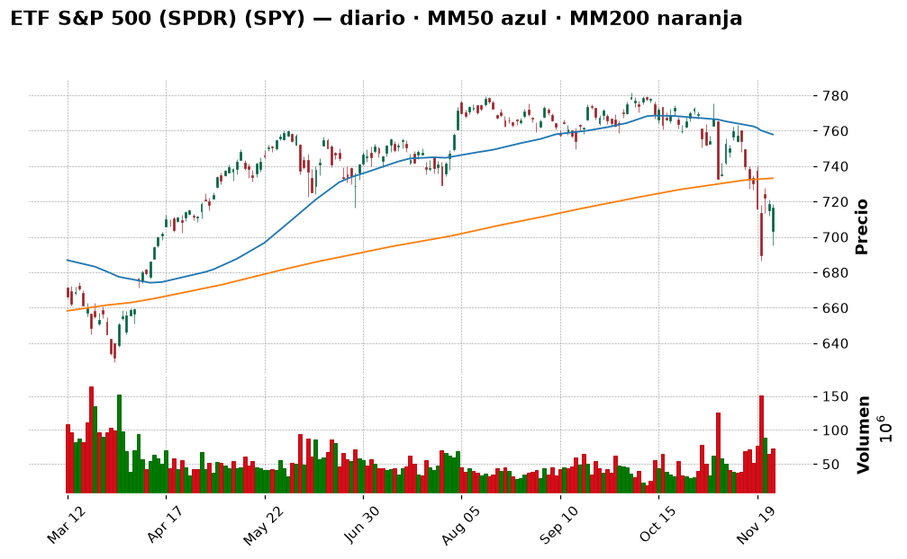
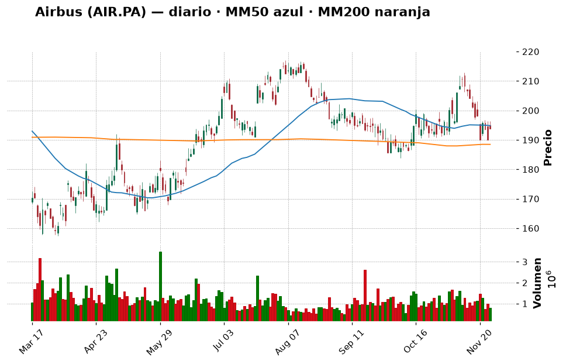
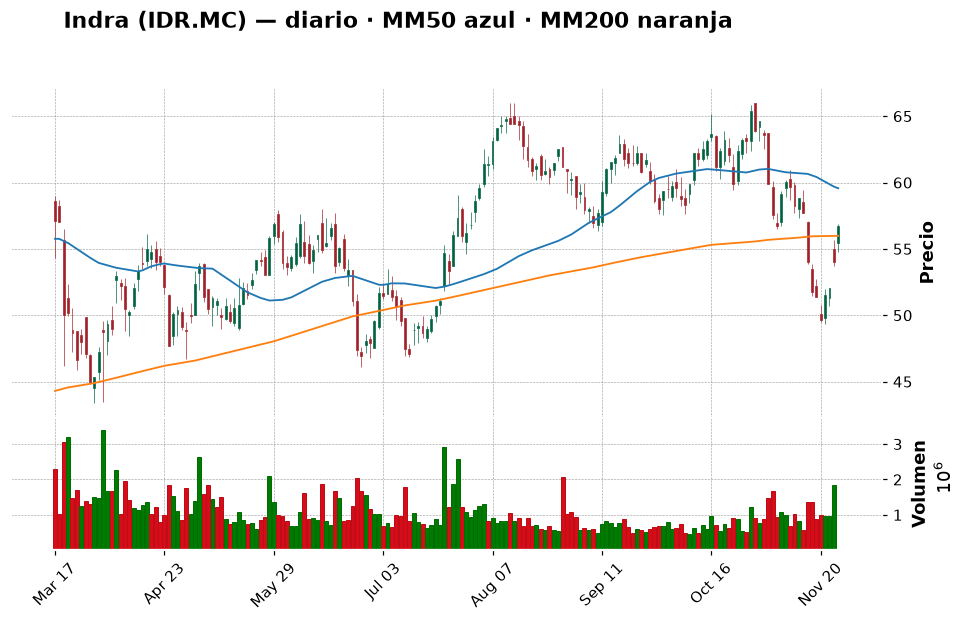
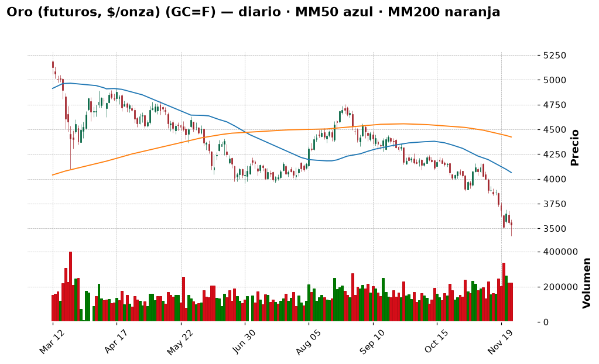
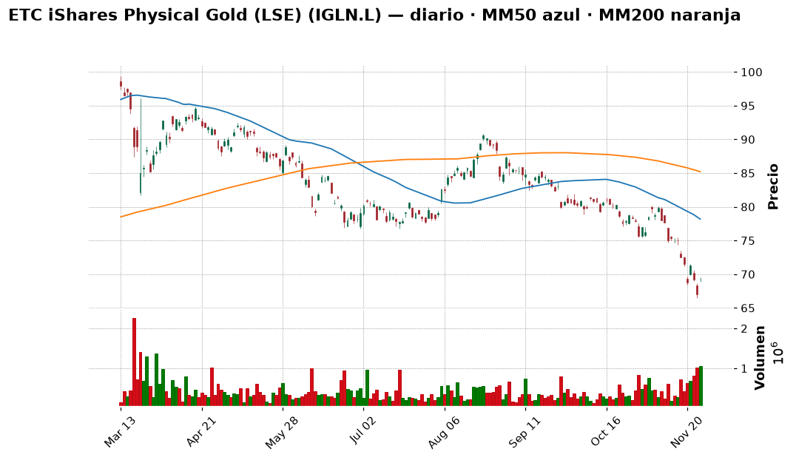
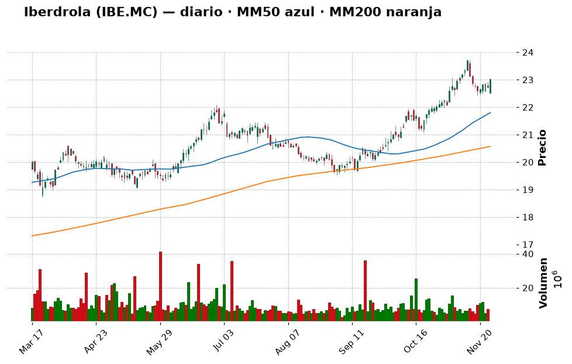
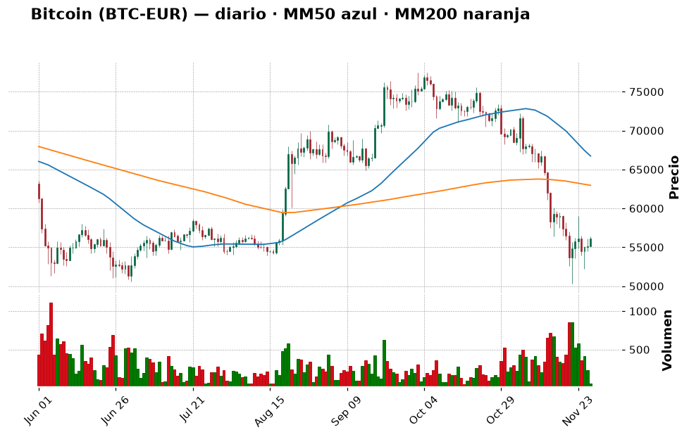
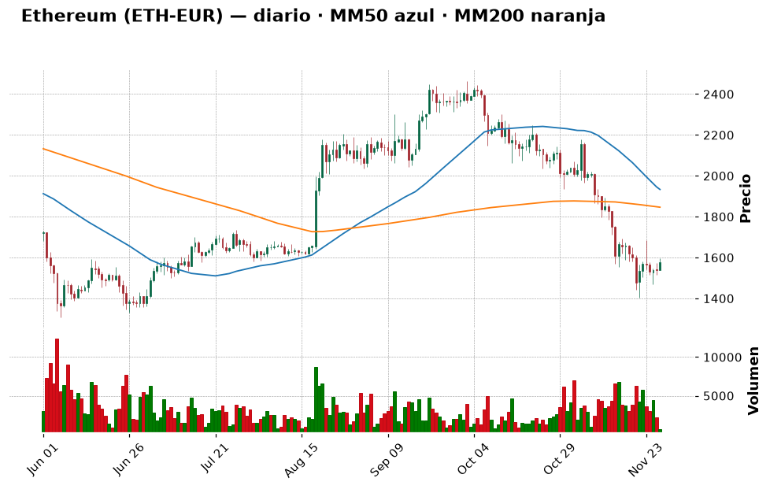
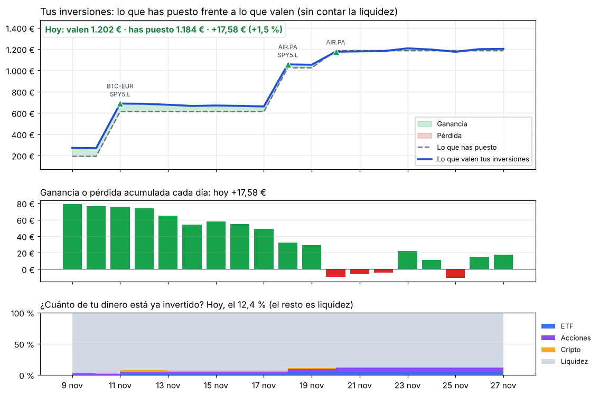

# 📈 Informe pre-apertura — viernes 27 de noviembre de 2026

> Generado automáticamente a las 07:55 (hora de Madrid) · Bolsa española abre a las 9:00 · **Wall Street: sesión corta por Black Friday (15:30–19:00 de Madrid)** · Cripto: 24/7
> **Termómetro del día:** 🟡 prudencia. El ambiente ha mejorado mucho en 24 horas. Ayer el Ibex subió un **+2,26 %** y recuperó su MM200, Asia sube con fuerza y los futuros del Nasdaq ganan casi un **+3 %**. Aun así, no bajo la guardia a 🟢. El rebote llega con poco volumen (Wall Street estuvo cerrado ayer), la Fed sigue casi segura de subir tipos en diciembre y el domingo hay elecciones generales en España y reunión de la OPEP+. Reuters lo resume con una pregunta: *¿es esto un "rebote del pavo muerto"?*
> **Lección de hoy:** Las divisas: cómo el euro/dólar cambia el valor de tu cartera

## 1. Lo que tienes que saber hoy
- **⏰ Hoy a las 14:00 se cierra el plazo de las Letras del Tesoro.** Es la única tarea que no puede esperar: **~3.000 €** (1.000 € a 6 meses y 2.000 € a 12 meses) para la subasta del martes 1-dic. La Letra a 12 meses pagó un **3,045 %** en la última subasta (Tesoro Público). Si ya la has pedido, no hagas nada más. Si no, hazlo esta mañana.
- **Europa rebotó con fuerza ayer.** El **Ibex 35 subió un +2,26 % hasta 19.057,9 puntos** y volvió a quedar **sobre su MM200** (18.827). El **Euro Stoxx 50 ganó un +2,04 % (6.014,74)**. Tiraron Solaria (+7,85 %), **Indra (+5,00 %)** y Santander (+4,11 %) (Estrategias de Inversión, Investing.com). 💡 *Tras un día de caídas fuertes, es normal un rebote de "caza de gangas". Lo importante es si dura varios días.*
- **Wall Street abre hoy con ganas, pero solo medio día.** Los futuros del **S&P 500 suben un +1,82 % (7.326,75)** y los del **Nasdaq 100 un +2,81 %** (Yahoo Finance, CME, datos de las 7:38 de Madrid). El motivo es un rebote de la tecnología y la IA tras un noviembre muy malo. Wall Street abre a las 15:30 y **cierra a las 19:00** (hora de Madrid).
- **Indra cumple la señal que pusimos.** Cerró en **56,70 €**, por encima de su MM200 (55,99 €), así que pasa de **Evitar a Esperar** (sección 6). No es una orden de compra: es el primer paso del plan.
- **Hoy se decide el "cierre semanal".** Hay dos reglas de nuestro plan que se juzgan con el cierre de hoy: la del **ETF S&P 500** (¿cierra sobre ~733 $?) y la línea roja de **Airbus** (¿cierra sobre 183,84 €?). Airbus está lejos de su línea roja (193,84 €). Al ETF le falta bastante (último cierre del SPY: 716,70 $). El lunes te diré qué toca.
- **Tu cartera vuelve a verde:** **9.688,97 €** de patrimonio y **+17,58 € (+1,48 %)** en tus inversiones. No has registrado movimientos nuevos en `cartera.csv` y no hay errores.

## 2. ✅ Recomendaciones del día (resumen)
| Activo | Acción | vs. ayer | Cuánto (orientativo) | Horizonte | Por qué, en una frase | Confianza |
|---|---|---|---|---|---|---|
| Letras del Tesoro (LETRAS) | 🟢 Comprar | = | **~3.000 €**: 1.000 € a 6 meses y 2.000 € a 12 meses (subasta del 1-dic); **petición hoy antes de las 14:00** | 6–12 meses | Tipo fijo del 2,82–3,05 % (última subasta) con el Estado como emisor | alta |
| ETF S&P 500 (SPY / SPY5.L) | 🔵 Mantener | = | 0 € hoy; la regla de la ½ del tramo 2 (~300 €) se decide con el **cierre de hoy** (¿sobre ~733 $?); si no se cumple, ~150 € el 15-dic | Años (5+) | Los futuros suben un +1,8 %, pero el SPY necesita un +2,3 % desde su último cierre | media |
| Airbus (AIR.PA) | 🔵 Mantener | = | 0 €: ya tienes el 3 % previsto | Años | Rebota a 193,84 € (+2,02 %), un +5,4 % sobre la línea roja de 183,84 € | media |
| Indra (IDR.MC) | ⏸️ Esperar | ↑ antes Evitar | Hasta un 2–3 % (~200–290 €) en 2 tramos; el primero (~100–150 €) solo si **se mantiene sobre 56 € toda la semana que viene** | Años | Cierra sobre su MM200 (56,70 € frente a 55,99 €): la señal que pedíamos | baja |
| Oro (IGLN.L) | ⏸️ Esperar | = | 0 €; primer tramo de ~150 € con un cierre sobre ~75 $ o tras 2–3 semanas sin perder 66,47 $ | Años | Rebota un +3,34 % (69,24 $), pero sigue un −18,7 % bajo su MM200 | media |
| Iberdrola (IBE.MC) | ⏸️ Esperar | = | Hasta un 5 % (~480 €) si retrocede a 21–22 € | Años | Alcista y cerca de máximos (23,03 €): buena empresa, precio exigente | media |
| Repsol (REP.MC) | 🔵 Mantener | = | No añadir; **Reducir 1 acción** si el Brent baja de 83 $ o la acción cierra bajo 26,28 € | Años | 27,52 € (+0,66 %); el Brent (~92,5 $) sigue lejos del disparador | baja |
| Inditex (ITX.MC) | 🔵 Mantener | = | No añadir | Años | Alcista (58,62 €), tu posición gana +117,6 %; hoy, Black Friday | media |
| Apple (AAPL) | 🔵 Mantener | = | No añadir | Años | Alcista (355,58 $) y cerca de máximos; tu posición gana +106,7 % | media |
| Solaria (SLR.MC) | 🔵 Mantener | = | No añadir | Años | Rebota un +7,85 % (14,08 €), pero sigue bajista; posición de 1 acción | baja |
| Telefónica (TEF.MC) | ⏸️ Esperar | = | Hasta ~250 € si supera 3,71 € | Años | 3,38 € (+0,71 %), justo en su MM50; Evitar si cierra bajo 3,27 € | baja |
| NVIDIA (NVDA) | ⛔ Evitar | = | 0 € | — | Sigue un −26 % bajo su MM200; Singapur aún no confirma el freno a sus envíos | media |
| Bitcoin (BTC) | 🔵 Mantener | = | 0 € a este precio; la orden opcional de ~50 € en ~50.600 € sigue hasta el lunes 30-nov | Años | 56.108 € (+1,7 %), camino de su primera semana en positivo en ocho | baja |
| Ether (ETH) | ⛔ Evitar | = | 0 € | — | 1.577 €: roza la línea de 1.580 €, pero necesita una semana entera por encima | media |
| Shiba Inu (SHIB) | ⛔ Evitar | = | No añadir | — | Memecoin bajista, −55 % en un año | alta |

*(El resto de la watchlist —Santander, BBVA, Oryzon, IAG, Aena, Microsoft, Amazon, Alphabet, Berkshire, los ETF del Nasdaq y del MSCI World, ASML, LVMH, SAP y Siemens— tiene su veredicto en la tabla "Resto de la watchlist" de la sección 6.)*

**🔁 Seguimiento de ayer** (informe del jueves 26-nov):
- **Letras:** "Comprar ~3.000 €, petición antes del viernes a las 14:00" → **el plazo vence hoy**. En `cartera.csv` no aparece ninguna fila nueva, lo cual es normal: el dinero no se carga hasta la emisión (4-dic). **Sin cambios**, salvo la urgencia.
- **Indra:** "Evitar; pasaría a Esperar con un cierre sobre ~56 €" → **ha ocurrido**: cerró en **56,70 € (+5,00 %)**, sobre su MM200 (55,99 €). **Cambio: Evitar → Esperar.** El motivo es el nivel técnico que fijamos de antemano, no la euforia del día.
- **ETF S&P 500:** "pausa hasta un cierre semanal sobre ~733 $" → Wall Street estuvo cerrado ayer, así que el SPY sigue en **716,70 $** (cierre del miércoles). La regla se juzga **hoy**. Los futuros suben un +1,8 % y el SPY necesitaría un +2,3 %: se acercará, pero lo más probable sigue siendo el plan alternativo (~150 € el 15-dic). **Sin cambios.**
- **Airbus:** "línea roja con cierre semanal bajo 183,84 €" → subió un **+2,02 % hasta 193,84 €** y se aleja de la línea roja. **Sin cambios.**
- **Oro:** "Esperar; el nuevo suelo a vigilar es 66,47 $" → el IGLN.L rebotó un **+3,34 % hasta 69,24 $** y recupera los 68 $. Es una buena señal, pero no cumple ninguna de las dos condiciones de entrada. **Sin cambios.**
- **Bitcoin:** la orden de ~50.600 € no se ha ejecutado (precio de esta mañana: 56.108 €). Ether (1.577 €) sigue por debajo de 1.580 €. **Sin cambios.**
- **Cartera:** no has registrado movimientos nuevos.

> Día de rebote, pero **no de compras impulsivas**. Lo único que hay que hacer hoy es **pedir las Letras antes de las 14:00**. Lo demás (ETF, Airbus, Indra) se decide con el cierre de hoy y te lo explicaré el lunes.

## 3. Agenda del día (y de los próximos días)
| Hora (Madrid) | Evento | Por qué importa |
|---|---|---|
| Primera hora | **IPC adelantado de Francia** de noviembre y **paro de Alemania** (8:55; previsión +5.000 parados) (Reuters, Investing.com) | Pistas sobre la inflación y la economía europeas |
| 9:00 | **IPC adelantado de España** de noviembre (INE) · apertura de la Bolsa española | Una inflación más baja de lo esperado aliviaría al Ibex; más alta, al revés |
| Hoy | Confianza del consumidor de la zona euro (dato final de noviembre) (Reuters) | Termómetro del ánimo de las familias europeas |
| Hoy | **Vencimiento de ~7.000 M$ en opciones de bitcoin** (CoinDesk) | Estos vencimientos suelen traer movimientos bruscos alrededor de la hora del vencimiento |
| **14:00** | **⏰ Fin del plazo de peticiones de Letras a 6 y 12 meses** (Banco de España) | **Tu tarea de hoy** |
| 15:30–19:00 | **Wall Street en sesión corta** (Black Friday). El mercado de bonos cierra a las 20:00 | Con poco volumen, los movimientos pueden exagerarse |
| Hoy, cierre | **Cierre semanal** del SPY (¿sobre ~733 $?), de **Airbus** (¿sobre 183,84 €?) y de **Indra** (¿sobre 56 €?) | Deciden los siguientes pasos del plan |
| Dom 29 | **Elecciones generales en España** · **Reunión de la OPEP+** para las cuotas de 2027; Irak rechaza la evaluación de capacidad, así que el acuerdo es incierto (Investing.com) | La banca y las eléctricas son las más sensibles al resultado; la OPEP+ puede mover el petróleo |
| Lun 30 | Último día de la orden opcional de bitcoin en ~50.600 € | Si no se ha ejecutado, la retiras |
| Mar 1-dic | **Subasta de Letras a 6 y 12 meses** · **tu aportación de 200 €** · HYPE entra en un ETF cripto de Franklin (Unchained) | Emisión de las Letras el 4-dic |
| Jue 3-dic | Jensen Huang (Nvidia) comparece en el Senado de EE. UU. | Prueba clave para Nvidia y para la tecnología |
| Vie 4-dic | **Empleo de EE. UU.** de noviembre · fin del plazo de Letras a 3 y 9 meses (subasta del 9-dic) | Último gran dato antes de la Fed |
| 8–9 dic | **Reunión de la Fed** | Los futuros dan un 96–99 % de probabilidad a una subida de 0,25 puntos |

## 4. Cómo llegan los mercados
### España y Europa
El **Ibex 35 subió un +2,26 % hasta 19.057,9 puntos** y recuperó los 19.000 "sin Wall Street", según Estrategias de Inversión. Con eso deshace casi todo el −2,00 % del miércoles. Vuelve a estar **un +1,2 % sobre su MM200** (18.827,5) y su RSI sube a 46 (zona neutra). Aun así, en una semana pierde un −0,67 % y en un mes apenas gana un +0,92 %. Viene de su peor semana del año (−5,7 % del 17 al 20 de noviembre, según Investing.com).

Lideraron **Solaria (+7,85 %)**, **Indra (+5,00 %, 56,70 €)** y **Santander (+4,11 %, 10,44 €)**, seguidos de CaixaBank (+2,92 %) y **BBVA (+2,73 %, 21,86 €)**. 💡 *Los bancos, que más cayeron el miércoles, son también los que más rebotan: son valores **cíclicos**, que amplifican los movimientos del mercado.* Repsol subió poco (+0,66 %, 27,52 €).

El **Euro Stoxx 50 ganó un +2,04 % (6.014,74)**, pero sigue un −1,9 % bajo su MM200. **ASML** rebotó un +3,23 % (1.168,20 €) y **LVMH** un +2,57 % (401,05 €).

Noticias de España y de empresas (titulares vía RSS):
- **Pablo Hernández de Cos será el próximo presidente del BCE.** Los líderes europeos lo eligieron ayer (El País, Cinco Días). Será el primer español en el cargo y sustituirá a Lagarde cuando termine su mandato (octubre de 2027). Los analistas lo ven como un **perfil "moderado"** (Cinco Días). 💡 *"Moderado" significa que no se le espera ni muy partidario de subir tipos ni de bajarlos. Para hoy no cambia nada.* El BCE publicó además las actas de su reunión del 28–29 de octubre.
- **Indra:** Expansión titula que su nueva estrategia "despeja un recorrido alcista superior al 30 %" según los analistas, y que **Seat se alía con Indra** para entrar en el sector de defensa. En Europa, **Thales** negocia la compra del 51,6 % de Lumibird (láseres). La defensa europea sigue en el foco, también por un **dron no identificado en el espacio aéreo de Letonia** que activó cazas de la OTAN (Investing.com).
- **Elecciones del domingo:** Expansión se pregunta si "habrá correctivo para el Ibex si Pedro Sánchez gana" y publica "los valores más firmes del Ibex en plenas turbulencias". Son análisis de campaña: lo comento en riesgos.
- **Otras:** JPMorgan rebaja la recomendación de Adidas y Puma (Investing.com). Ence busca 3.000 M€ para proyectos de combustible sostenible de aviación (Expansión). Los sindicatos temen el cierre de la aerolínea Plus Ultra (Expansión).

**Previsión de apertura:** ninguna búsqueda ha dado una previsión fiable para hoy (la web de Expansión bloquea la lectura automática). Los futuros europeos subían un +0,6 % de madrugada (Reuters, Morning Bid). *Mi interpretación:* lo más probable es una **apertura ligeramente positiva**, más moderada que la de Wall Street, porque Europa ya rebotó ayer. Ojo al IPC español de las 9:00.

### Estados Unidos
Ayer Wall Street estuvo **cerrado** por Acción de Gracias. Los últimos cierres son los del miércoles 25-nov: **S&P 500 7.182,78 (−0,25 %)** y **Nasdaq 23.585,80 (−0,62 %)**. Ese día el Nasdaq llegó a caer un −4,5 % antes de recuperarse (Investing.com vía Yahoo).

**Esta mañana**, los futuros suben con fuerza: **S&P 500 +1,82 % (7.326,75)**, **Nasdaq 100 +2,81 % (26.833,75)** y Dow Jones +1,06 % (Yahoo Finance, CME; datos diferidos de las 7:38). Lo explica la "caza de gangas" en las tecnológicas de IA tras un noviembre con caídas de entre el −3 % y el −7,3 % en los índices. En Asia, **Corea sube un +3,9 %** y el **Nikkei un +1,9 %**. China rebota de mínimos de un año tras prometer Pekín más apoyo a su bolsa (Reuters vía Investing.com).

Reuters titula su resumen de la mañana con una pregunta: **"¿Es esto un rebote del pavo muerto?"** 💡 *Es un juego de palabras con el "rebote del gato muerto": una subida corta dentro de una caída que luego continúa. Nadie lo sabe todavía, y por eso no cambiamos las reglas del plan por un día bueno.*

Noticias de grandes empresas:
- **Nvidia:** el Gobierno de Singapur **aún no confirma** que Nvidia haya frenado sus envíos de chips avanzados (Yahoo Finance). Analistas rebajan su "valor razonable" por los riesgos de gobierno corporativo y regulación.
- **Alphabet:** los seguros contra su impago (*credit default swaps*) marcan récord con una quema de caja de 9.100 M$ (Yahoo Finance). 💡 *Un **CDS** es como un seguro contra el impago de una empresa. Si su precio sube, el mercado ve más riesgo en su deuda.*
- **Amazon:** el regulador de telecomunicaciones de EE. UU. (FCC) rechaza su intento de frenar el plan de SpaceX de un millón de satélites para centros de datos (Yahoo Finance).
- **Apple:** entra en la carrera de los "agentes de IA" (Barchart). El ETF QQQ compró 187 M$ más de Apple el martes.
- **Black Friday:** hoy empieza la campaña. Pesa en Amazon, Inditex y el consumo en general.

### Macro (tipos de interés, inflación, divisas, materias primas)
- **Fed:** con la inflación subyacente al **3,3 %**, los futuros dan un **96,2 %** de probabilidad a una subida de 0,25 puntos el **9-dic** (Investing.com). Las apuestas por una subida de **medio punto** se desinflan (Reuters). El Banco de Inglaterra avisa de que la financiación de la IA, "compleja, circular y opaca", podría causar contagio financiero.
- **Bonos:** el bono de EE. UU. a 10 años repunta al **4,92 %** (Reuters, Morning Bid).
- **Divisas:** **euro/dólar en 1,0978** (+0,03 %; Yahoo Finance, 7:47). A principios de semana bajó de 1,09, su mínimo en 19 meses (Investing.com). El dólar va camino de su **tercer mes seguido de subidas**, cerca de máximos de 22 meses. BCA Research no ve suelo para el euro hasta 2027 y apunta a 1,05 (Investing.com). Lo explico en la **lección de hoy**, porque afecta a tu ETF y a tus USDC.
- **Petróleo:** el **Brent está en ~92,4–92,5 $** esta mañana (+0,8 % a +2,1 % según la fuente; Yahoo Finance, Investing.com). Está por debajo de los 94,61 $ del miércoles, así que ayer corrigió. El WTI ronda los 86 $. Siguen las tensiones por ataques hutíes en Arabia Saudí y en el estrecho de Ormuz, y el domingo se reúne la OPEP+.
- **Tipos de referencia** (de `rates_2026-11-27.json`): **BCE (facilidad de depósito) 2,50 %** · **Euríbor 12 m 3,239 %** (media de octubre) · **deuda AAA de la zona euro a 1 año 2,924 %** (25-nov; antes 2,945 %) · **Fed 4,00 %** (límite superior). El Euríbor sigue sobre el umbral del 3 %, así que el apartado de renta fija sigue activo.

**🥇 Oro:** el dato del futuro **GC=F** en nuestro JSON es del **miércoles 25-nov (3.535,8 $)**, porque ayer el mercado americano estuvo en festivo. Según Investing.com vía Yahoo, el jueves el futuro subió un **+1,7 % hasta 3.625,50 $** y esta mañana ronda los **3.650 $** (Reuters). El ETC **IGLN.L** sí cotizó ayer en Londres: **69,24 $ (+3,34 %)**, con casi el doble de volumen de lo normal. Lo empujan los compradores de gangas tras tocar mínimos de más de un año, y un dólar que se toma un respiro. Pero el oro va camino de su **tercer mes seguido con caídas de más del 6 %**: la Fed subiendo tipos lo penaliza porque no paga intereses.

## 5. Panorama técnico de la watchlist
> 💡 *Cómo leer esta tabla:* la **tendencia** resume si el precio lleva meses subiendo, bajando o de lado
> (comparando el precio con sus medias de 50 y 200 días). El **RSI** mide de 0 a 100 si las subidas o bajadas
> recientes han sido muy fuertes: por encima de 70 se dice "sobrecompra" (quizá ha subido demasiado rápido),
> por debajo de 30 "sobreventa". Son pistas, no predicciones.

Datos del **cierre del jueves 26-nov** para España, Europa, el MSCI World y el IGLN.L. **⚠️ Los valores de EE. UU. (S&P 500, Nasdaq, Apple, Microsoft, Nvidia, Amazon, SPY, QQQ, Alphabet y Berkshire) y el oro GC=F traen datos del miércoles 25-nov**: ayer era festivo en EE. UU. (Acción de Gracias), no es un error.

| Valor | Último cierre | Día | 1 mes | 1 año | Tendencia | RSI | vs MM200 |
|---|---|---|---|---|---|---|---|
| IBEX 35 (^IBEX) | 19.057,9 | +2,26 % | +0,92 % | +16,28 % | ➡️ lateral | 46,0 🟢 | +1,2 % |
| Euro Stoxx 50 (^STOXX50E) | 6.014,74 | +2,04 % | −2,48 % | +8,79 % | ➡️ lateral | 42,5 🟢 | −1,9 % |
| S&P 500 (^GSPC) *(25-nov)* | 7.182,78 | −0,25 % | −6,99 % | +7,12 % | ➡️ lateral | 39,7 🟡 | −2,3 % |
| Nasdaq Composite (^IXIC) *(25-nov)* | 23.585,80 | −0,62 % | −10,92 % | +3,12 % | ➡️ lateral | 38,6 🟡 | −6,3 % |
| Banco Santander (SAN.MC) | 10,44 | +4,11 % | −1,86 % | +12,32 % | ➡️ lateral | 41,9 🟢 | −7,5 % |
| BBVA (BBVA.MC) | 21,86 | +2,73 % | −2,63 % | +16,52 % | ➡️ lateral | 42,2 🟢 | +1,0 % |
| Inditex (ITX.MC) | 58,62 | +2,02 % | +2,70 % | +18,93 % | 📈 alcista | 53,4 🟢 | +7,1 % |
| Iberdrola (IBE.MC) | 23,03 | +1,36 % | +4,54 % | +28,34 % | 📈 alcista | 60,9 🟡 | +12,0 % |
| Telefónica (TEF.MC) | 3,38 | +0,71 % | +3,20 % | −7,80 % | ➡️ lateral | 48,5 🟢 | −7,1 % |
| Repsol (REP.MC) | 27,52 | +0,66 % | −3,57 % | +69,77 % | ➡️ lateral | 39,3 🟡 | +10,1 % |
| Solaria (SLR.MC) | 14,08 | +7,85 % | −8,63 % | −13,83 % | 📉 bajista | 42,8 🟢 | −27,4 % |
| Oryzon (ORY.MC) | 2,40 | +1,87 % | −3,77 % | −26,38 % | 📉 bajista | 46,5 🟢 | −14,9 % |
| IAG (IAG.MC) | 5,27 | +1,27 % | +9,35 % | +17,70 % | 📈 alcista | 52,4 🟢 | +7,9 % |
| Indra (IDR.MC) | 56,70 | +5,00 % | −10,23 % | +26,96 % | ➡️ lateral | 49,2 🟢 | +1,3 % |
| Aena (AENA.MC) | 28,36 | +1,65 % | +5,90 % | +20,94 % | 📈 alcista | 58,5 🟢 | +9,0 % |
| Apple (AAPL) *(25-nov)* | 355,58 | +0,43 % | +2,44 % | +28,87 % | 📈 alcista | 57,9 🟢 | +16,8 % |
| Microsoft (MSFT) *(25-nov)* | 489,93 | −1,25 % | −7,79 % | +3,36 % | ➡️ lateral | 38,7 🟡 | +10,1 % |
| NVIDIA (NVDA) *(25-nov)* | 149,30 | −3,91 % | −31,49 % | −18,21 % | ➡️ lateral | 37,5 🟡 | −26,4 % |
| Amazon (AMZN) *(25-nov)* | 244,43 | −3,12 % | −3,43 % | +8,02 % | ➡️ lateral | 42,0 🟢 | −0,5 % |
| ETF S&P 500 (SPY) *(25-nov)* | 716,70 | −0,29 % | −6,88 % | +7,17 % | ➡️ lateral | 39,8 🟡 | −2,3 % |
| ETF Nasdaq 100 (QQQ) *(25-nov)* | 633,93 | −0,65 % | −12,11 % | +4,75 % | ➡️ lateral | 38,6 🟡 | −7,3 % |
| Alphabet (GOOGL) *(25-nov)* | 273,10 | −2,13 % | −14,81 % | −14,28 % | 📉 bajista | 36,9 🟡 | −18,8 % |
| Berkshire Hathaway (BRK-B) *(25-nov)* | 579,32 | +0,37 % | +6,69 % | +14,08 % | 📈 alcista | 62,7 🟡 | +15,0 % |
| ETF MSCI World (IWDA.AS) | 125,82 | +2,84 % | −4,49 % | +12,94 % | ➡️ lateral | 45,2 🟢 | +2,4 % |
| Airbus (AIR.PA) | 193,84 | +2,02 % | +1,00 % | +0,65 % | ➡️ lateral | 46,2 🟢 | +2,9 % |
| ASML (ASML.AS) | 1.168,20 | +3,23 % | −21,58 % | +26,06 % | ➡️ lateral | 38,0 🟡 | −16,6 % |
| LVMH (MC.PA) | 401,05 | +2,57 % | +4,17 % | −37,60 % | ➡️ lateral | 53,6 🟢 | −12,0 % |
| SAP (SAP.DE) | 194,14 | +2,28 % | −8,08 % | −6,21 % | ➡️ lateral | 43,8 🟢 | +15,9 % |
| Siemens (SIE.DE) | 250,30 | +1,96 % | −7,31 % | +10,00 % | ➡️ lateral | 39,8 🟡 | −4,0 % |
| Oro (GC=F) *(25-nov)* | 3.535,80 | −0,73 % | −13,22 % | −13,64 % | 📉 bajista | 29,2 🔴 | −20,1 % |
| Oro (IGLN.L) | 69,24 | +3,34 % | −11,63 % | −14,17 % | 📉 bajista | 35,5 🟡 | −18,7 % |

*Clave del RSI en la tabla:* 🟢 entre 40 y 60 (zona neutra) · 🟡 entre 30 y 40 o entre 60 y 70 (acercándose a un extremo) · 🔴 30 o menos, o 70 o más (zona extrema).

**Interpretación:** en Europa el cambio de un día es evidente. Ayer 18 de los 31 valores tenían el RSI entre 30 y 40, y hoy, entre los que cotizaron, casi todos vuelven a la zona neutra. El **Ibex**, **BBVA**, **Indra** y el **ETF MSCI World** recuperan su MM200. Pero que sea un rebote **de un día** se nota en las columnas de 1 mes: casi todo sigue en negativo. Lo que mejor aguanta sigue siendo lo "aburrido": Iberdrola, Aena, Inditex, Apple y Berkshire, todos alcistas. **Aena** mantiene su cruce dorado reciente. El único extremo es el **oro GC=F (RSI 29,2)**, pero su dato es de antes del rebote del jueves.

## 6. Ideas de bolsa: qué haría un experto
### ETF S&P 500 (SPY5.L / SPY) — MANTENER (hoy se juzga la regla)

- **Qué es:** un fondo que replica a las 500 mayores empresas de EE. UU. Es tu **núcleo**: tienes 0,8695 participaciones del SPY5.L, la versión que cotiza en la Bolsa de Londres (en dólares). El gráfico usa el SPY americano, que se mueve igual.
- **Por qué es noticia hoy:** sus futuros suben un **+1,8 %** antes de una sesión de medio día. Además, **hoy es el cierre semanal** que decide nuestra regla del tramo. Tu SPY5.L, que sí cotizó ayer en Londres, se valora en **723,09 $**.
- **Lo que dice el gráfico:** el último cierre del SPY (716,70 $, del miércoles) está justo encima de su soporte de **716,58 $**. Está **bajo su MM200 (733,16 $)** y su MM50 (757,89 $). La tendencia es lateral y el RSI de 39,8. El MACD "mejora": las caídas pierden fuerza. El mínimo del pánico (20-nov) está en 686,75 $ y el máximo anual en 781,62 $ (−8,3 %).
- **Lo positivo:** si el rebote se confirma, el ETF volvería sobre su MM200, lo que suele indicar que lo peor de la corrección ha pasado. A largo plazo sigue siendo la base más sensata para un principiante.
- **El riesgo:** la Fed subiendo tipos con una inflación del 3,3 %, el peso de la tecnología en el índice y que el rebote de hoy sea un "rebote del pavo muerto" con poco volumen.
- **🧑‍💼 Recomendación: MANTENER.** No cambio nada antes del cierre. Si el SPY **cierra hoy sobre ~733 $**, el lunes compraría la ½ del tramo 2 (**~300 €**) con una orden limitada. Si no, **~150 € el 15-dic**, siempre que no marque nuevos mínimos (bajo 686,75 $). *¿Por qué no compro ya, con los futuros subiendo un +1,8 %?* Porque la regla se escribió para no decidir con el entusiasmo de una mañana (lección del 20-nov sobre el FOMO). Y un +1,8 % no basta para llegar a los 733 $.
  - **Cuánto y cómo:** 0 € hoy. En el informe del lunes 30 te diré qué opción toca.
  - **Horizonte:** años (5 o más).
  - **Qué me haría cambiar de opinión:** solo un cambio de tesis, como una recesión con caída generalizada de beneficios. Una bajada de precio no.
- **Qué mirar para entenderlo:** el **cierre del SPY a las 19:00** (hora de Madrid). Sobre 733 $, primera señal de que el rebote es real. Si vuelve a perder 716,58 $, el siguiente apoyo es 686,75 $.
- **Confianza:** media.

### Airbus (AIR.PA) — MANTENER

- **Qué es:** el mayor fabricante de aviones del mundo junto a Boeing, con negocio en defensa y espacio. Tienes 1,5065 acciones (3,01 % del patrimonio).
- **Por qué es noticia hoy:** sube un **+2,02 % (193,84 €)** con el rebote europeo. Por el lado negativo, Qantas estaría a punto de adjudicar **la mayor parte de un pedido de 20 aviones a Boeing** (Bloomberg vía Investing.com). Es un pedido pequeño, que muestra que la competencia existe. Lo importante llega a primeros de diciembre: las **entregas de noviembre**. Airbus necesita 249 aviones en noviembre y diciembre para cumplir su objetivo de ~870 en el año (Airdatanews, CAPA). En defensa, el sector sigue fuerte (Thales–Lumibird, drones en Letonia).
- **Lo que dice el gráfico:** el precio (193,84 €) está **sobre su MM200 (188,47 €, +2,9 %)** y justo bajo su MM50 (194,83 €). Su primer soporte está en 193,18 € y el siguiente en ~190,9 €. Su resistencia está en **200,40 €**. RSI 46,2 (neutro) y MACD "mejorando". Está un −12 % por debajo de su máximo anual (221,30 €).
- **Lo positivo:** cartera de pedidos para muchos años, recompra de acciones y una demanda de aviones nuevos, que gastan menos combustible, que sigue fuerte con el queroseno caro.
- **El riesgo:** que no llegue al objetivo de entregas y los aranceles de EE. UU., que no se aplicarían antes de febrero o marzo.
- **🧑‍💼 Recomendación: MANTENER.** Sin cambios. La línea roja (183,84 €) queda un +5,4 % por debajo y hoy no corre peligro.
  - **Cuánto y cómo:** 0 €. Ya tienes el peso previsto (~3 %).
  - **Horizonte:** años.
  - **Qué me haría cambiar de opinión:** un **cierre semanal bajo 183,84 €** o un **recorte del objetivo de entregas** → **Reducir a la mitad**. Un cierre semanal sobre 200,40 € reafirmaría la tendencia.
- **Qué mirar para entenderlo:** si hoy cierra sobre su MM50 (~194,8 €). Y, a principios de diciembre, la cifra de entregas de noviembre (se esperan 90–100).
- **Confianza:** media.

### Indra (IDR.MC) — ESPERAR (antes Evitar)

- **Qué es:** la empresa española de defensa, tecnología y control del tráfico aéreo y ferroviario. No la tienes.
- **Por qué es noticia hoy:** sube por segundo día (**+5,00 %, 56,70 €**; +10,3 % en una semana) tras presentar su plan a 2030: más de **12.000 M€ de ingresos** y **más de 3.100 M€ de caja libre** en cinco años (Reuters, 25-nov). Expansión titula que los analistas le ven **"un recorrido alcista superior al 30 %"** y que **Seat se alía con Indra** para entrar en defensa. 💡 *Un "recorrido alcista" es la distancia entre el precio actual y el precio objetivo de los analistas. Es una opinión, no una garantía.*
- **Lo que dice el gráfico:** el precio ha cerrado **sobre su MM200 (55,99 €, +1,3 %)**, la señal que pedíamos. Sigue bajo su MM50 (59,57 €), con un RSI de 49,2 (neutro) y el MACD "mejorando". Sus soportes cercanos están en **56,36–56,50 €** y el siguiente, lejos, en 46,85 €. Su resistencia está en 62,66 €. Ha caído un −10 % en un mes y un −14 % desde su máximo (66,15 €).
- **Lo positivo:** un plan creíble en un sector con viento a favor durante años (gasto en defensa europeo) y un precio que empieza a girar.
- **El riesgo:** dos días de euforia tras un plan pueden deshacerse igual de rápido. Es muy volátil (~48 % anual) y apenas pagará dividendo (15–25 % del beneficio): su atractivo depende de que cumpla.
- **🧑‍💼 Recomendación: ESPERAR (sube desde Evitar).** **Qué ha cambiado desde ayer:** el cierre sobre la MM200 que fijamos como condición. Pero un solo cierre no confirma (lección del 13-nov). Quiero ver que **se mantiene** por encima.
  - **Cuánto y cómo:** como máximo un **2–3 % del patrimonio (~200–290 €)** en **dos tramos**. **Tramo 1 (~100–150 €)** si cierra la semana que viene (viernes 4-dic) **por encima de 56 €** sin haber perdido los 53,5 €. **Tramo 2**, solo si después supera la MM50 (~59,6 €) o tras 3–4 semanas estable. Con una orden limitada, nunca "a mercado" en la apertura.
  - **Horizonte:** años.
  - **Qué me haría cambiar de opinión:** un **cierre bajo 53,5 €** (la antigua resistencia) → vuelta a **Evitar**.
- **Qué mirar para entenderlo:** el cierre de hoy y de la semana que viene. Si los soportes de 56,4–56,5 € aguantan, la resistencia superada se ha convertido en soporte (lección del 17-nov).
- **Confianza:** baja.

### Oro (IGLN.L) — ESPERAR

- **Qué es:** el oro es el activo refugio clásico. El **ETC IGLN.L** (iShares Physical Gold, Bolsa de Londres, en dólares) es oro físico guardado en cámaras y es el vehículo que puedes comprar. **GC=F** (futuros) es solo la referencia del precio.
- **Por qué es noticia hoy:** tras tocar el miércoles su mínimo de más de un año (por debajo de 3.500 $), el futuro rebotó un **+1,7 %** el jueves, **hasta 3.625,50 $**, por la "caza de gangas", y la plata subió un +4,8 % (Investing.com vía Yahoo). El IGLN.L subió en Londres un **+3,34 % (69,24 $)**, con casi el doble del volumen habitual. Pero va camino de su **tercer mes seguido de caídas de más del 6 %** (Investing.com).
- **Lo que dice el gráfico:** tendencia **bajista**. El IGLN.L está un **−18,7 % bajo su MM200** (85,20 $) y un −11,4 % bajo su MM50 (78,17 $), con un RSI de 35,5 y el MACD "mejorando". Su mínimo de 52 semanas es **66,47 $** (del miércoles). Hay resistencias lejanas en ~80 $. El gráfico del GC=F llega solo hasta el 25-nov por el festivo americano.
- **Lo positivo:** ha caído un −36 % desde su máximo de enero, diversifica la cartera y los bancos centrales siguen comprando (321 toneladas en el tercer trimestre, según el World Gold Council).
- **El riesgo:** el **coste de oportunidad**. Con las Letras pagando ~3 % y una Fed a punto de subir tipos, el oro (que paga 0 %) lo tiene difícil a corto plazo. Un rebote de un día dentro de una tendencia bajista no la cambia.
- **🧑‍💼 Recomendación: ESPERAR.** Sin cambios. El rebote es una buena primera señal, pero no cumple ninguna de nuestras condiciones.
  - **Cuánto y cómo:** 0 € hoy. **Primer tramo de ~150 €** en IGLN.L con un **cierre sobre ~75 $** (le falta un +8 %), o tras **2–3 semanas sin perder 66,47 $** (es decir, no antes del 9–16 de diciembre). Después, tramos de 150 € hasta un 3–5 % del patrimonio. Nunca futuros ni productos apalancados; PAXG no sustituye al ETC.
  - **Horizonte:** años.
  - **Qué me haría cambiar de opinión:** esas señales técnicas, o que la Fed deje de subir tipos. Perder 66,47 $ alargaría la espera.
- **Qué mirar para entenderlo:** si el IGLN.L se mantiene sobre ~68 $ en los próximos días. Si lo hace, el mínimo del miércoles empezará a parecer un suelo.
- **Confianza:** media.

### Iberdrola (IBE.MC) — ESPERAR (la opción tranquila)

- **Qué es:** la mayor eléctrica española y una de las mayores del mundo en renovables y redes. Es un valor **defensivo**: la gente sigue pagando la luz aunque la economía vaya mal. No la tienes.
- **Por qué es noticia hoy:** sigue siendo la que mejor aguanta del Ibex (+1,36 % ayer, +28 % en un año). Las eléctricas rechazan que la CNMC desvíe un superávit de las redes (Cinco Días, 26-nov), y las **elecciones del domingo** pueden mover a las empresas reguladas.
- **Lo que dice el gráfico:** tendencia **alcista** clara. El precio (23,03 €) está un **+12 % sobre su MM200** (20,57 €) y sobre su MM50 (21,80 €). Está muy cerca de su máximo de 52 semanas (**23,71 €**), con un RSI de 60,9 (alto, sin llegar a sobrecompra). Soportes en 22,43 € y **21,09 €**.
- **Lo positivo:** negocio estable, dividendo y la mejor tendencia de la lista española.
- **El riesgo:** el precio ya descuenta muchas buenas noticias. Las eléctricas suelen sufrir cuando suben los tipos de interés (tienen mucha deuda), y hay riesgo regulatorio y político.
- **🧑‍💼 Recomendación: ESPERAR.** Sin cambios. Es justo la clase de empresa que encaja en tu perfil, pero comprar a un paso de máximos tiene poco margen de seguridad. Prefiero esperar a un retroceso.
  - **Cuánto y cómo:** hasta un **5 % del patrimonio (~480 €)** en **dos tramos**, el primero si retrocede a **21–22 €** (zona de su MM50 y del soporte de 21,09 €).
  - **Horizonte:** años.
  - **Qué me haría cambiar de opinión:** si supera con claridad 23,71 € y consolida varias semanas, pasaría a un primer tramo pequeño (~150 €) sin esperar al retroceso. Un cambio regulatorio grave me haría pasar a Evitar.
- **Qué mirar para entenderlo:** cómo reacciona el lunes al resultado electoral y si respeta los 22,43 €.
- **Confianza:** media.

### Resto de la watchlist: veredicto rápido
| Valor | Acción | Por qué (1 frase) | Nivel a vigilar |
|---|---|---|---|
| Repsol (REP.MC) | 🔵 Mantener | La tienes (+122 %); sube un +0,66 % (27,52 €); Brent ~92,5 $, lejos de 83 $; la OPEP+ se reúne el domingo; sigue la noticia de los 2.000 M$ en Venezuela con Eni | Reducir 1 acción con Brent < 83 $ o cierre < 26,28 €; resistencia 28,42 € |
| Inditex (ITX.MC) | 🔵 Mantener | La tienes (+117,6 %); alcista (58,62 €) a −3,6 % de su máximo; hoy empieza el Black Friday | Soporte 56,2 €; máximo 60,80 € |
| Apple (AAPL) | 🔵 Mantener | La tienes (+106,7 %); alcista (355,58 $, 25-nov) a −1,5 % de su máximo; entra en la carrera de los agentes de IA (Barchart) | Soporte 338,7 $; máximo 360,83 $ |
| Solaria (SLR.MC) | 🔵 Mantener | La tienes (1 acción); rebota un +7,85 % (14,08 €), la mejor del Ibex, pero sigue −27 % bajo su MM200; vender no compensa la comisión | Resistencia 16,95 €; soporte 13,61 € |
| Oryzon (ORY.MC) | 🔵 Mantener | La tienes (4 acciones, −25,7 %); posición mínima, bajista | Mínimo 2,23 €; resistencia 2,60 € |
| Telefónica (TEF.MC) | ⏸️ Esperar | 3,38 € (+0,71 %), justo en su MM50 y −7 % bajo su MM200 | Comprar sobre 3,71 €; Evitar con cierre bajo 3,27 € |
| NVIDIA (NVDA) | ⛔ Evitar | 149,30 $ (25-nov), −26 % bajo su MM200; dudas de gobierno corporativo; Singapur no confirma el freno a sus envíos | Recuperar la MM200 (203 $) |
| Banco Santander (SAN.MC) | ⏸️ Esperar | Rebota un +4,11 % (10,44 €) y recupera el soporte de 10,08 €, pero sigue −7,5 % bajo su MM200; las elecciones del domingo le afectan | Comprar solo sobre ~11,5 € (MM50); soporte 10,08 € |
| BBVA (BBVA.MC) | ⏸️ Esperar | +2,73 % (21,86 €): recupera su MM200 (21,65 €) por muy poco | Superar 23,11 €; perder 21,20 € |
| IAG (IAG.MC) | ⏸️ Esperar | Alcista (5,27 €), pero el MACD "empeora" y el combustible de aviones está en máximos | Soporte 4,95 €; máximo 5,72 € |
| Aena (AENA.MC) | ⏸️ Esperar | Alcista, con cruce dorado reciente; 28,36 € (+1,65 %), cerca de su máximo (29,32 €) | Retroceso hacia la MM50 (26,77 €) |
| Microsoft (MSFT) | ⏸️ Esperar | 489,93 $ (25-nov), +10 % sobre su MM200; Pictet la incluye en su "tecnología de calidad" para 2027 (Expansión) | Soporte 486 $; resistencia 513,73 $ |
| Amazon (AMZN) | ⏸️ Esperar | 244,43 $ (25-nov), justo bajo su MM200; hoy empieza el Black Friday y la FCC le da un revés frente a SpaceX | Recuperar 249,7 $; soporte 244,3 $ |
| ETF Nasdaq 100 (QQQ) | ⏸️ Esperar | −7,3 % bajo su MM200; los futuros del Nasdaq suben casi un +3 % hoy | Recuperar 683,5 $ (MM200) |
| Alphabet (GOOGL) | ⛔ Evitar | Bajista y con cruce de la muerte; sus CDS marcan récord (Yahoo Finance) | Recuperar 304,97 $ |
| Berkshire Hathaway (BRK-B) | ⏸️ Esperar | Alcista (579,32 $), +15 % sobre su MM200; RSI 62,7, el más alto de la lista | Retroceso hacia la MM50 (540 $) |
| ETF MSCI World (IWDA.AS) | ⏸️ Esperar | +2,84 % (125,82 €): recupera su MM200 (122,86 €) y el nivel de 125,8 €; aplicamos la misma regla de cierre semanal que al SPY | Mantener 125,8 € esta semana; resistencia 128,28 € |
| ASML (ASML.AS) | ⏸️ Esperar | Rebota un +3,23 % (1.168,20 €), pero sigue −16,6 % bajo su MM200; un diputado neerlandés avisa de que la ley MATCH de EE. UU. sería "desastrosa" para ella (TIKR) | Recuperar 1.401 € (MM200) |
| LVMH (MC.PA) | ⛔ Evitar | +2,57 % (401,05 €), pero −12 % bajo su MM200 y −37,6 % en un año; los aranceles a la UE pesan sobre el lujo | Resistencia 431 €; soporte 376–381 € |
| SAP (SAP.DE) | ⏸️ Esperar | 194,14 € (+2,28 %); estudia recortar al menos 10.000 empleos en una reestructuración por la IA (Yahoo Finance) | Superar 198,2 € (MM50); soporte 178,9 € |
| Siemens (SIE.DE) | ⏸️ Esperar | +1,96 % (250,30 €), −4 % bajo su MM200, con el MACD "empeorando"; muy expuesta a aranceles y China | Recuperar 260,8 € (MM200) |

## 7. ₿ Criptomonedas
> 💡 *Las criptomonedas cotizan 24 horas, 7 días a la semana: los precios son de esta mañana (en euros).
> Son mucho más volátiles que las acciones: caídas del 50 % o más han ocurrido varias veces.*

**Sentimiento:** Fear & Greed **12/100, miedo extremo** (ayer 11, hace una semana 12, hace un mes 51) · Capitalización total **2,20 billones $** (**+1,80 % en 24 h**, **−54,4 %** bajo su máximo histórico de octubre de 2025) · Dominancia de Bitcoin **56,3 %**.
El precio rebota, pero el sentimiento no: lleva una semana entera en miedo extremo. En el lado positivo, **bitcoin va camino de su primera semana en positivo tras siete de caídas** (+2,2 %; Investing.com vía Yahoo). CoinDesk señala que aumenta el **bitcoin "dormido"** (monedas que no se mueven), algo que se vio en suelos de mercados bajistas anteriores. En el lado negativo, **Galaxy Research retira su previsión de que el mercado bajista había terminado** (Decrypt).

**Radar Coinbase** (404 monedas comprables · en 24 h suben 272 y bajan 84 · en 7 días suben 145 y bajan 211):
- **Mayores por capitalización (7 días):** BTC −0,2 % · ETH −0,8 % · BNB −1,0 % · XRP +0,5 % · SOL +0,4 % · HYPE −0,1 % · ZEC −12,0 % · DOGE +1,0 % · LINK +8,3 % · ADA +2,4 %.
- **Más suben (7 d, top 100):** VVV (+30,6 %, puesto 56), LINK (+8,3 %), ALGO (+7,9 %), LTC (+6,4 %) · **Más bajan:** ZEC (−12,0 %), WLFI (−8,9 %), AAVE (−6,9 %), INJ (−4,2 %).
La semana se va equilibrando: hace un día bajaban 302 monedas en 7 días y ahora 211. **Chainlink (LINK)** vuelve a destacar entre las grandes. Fidelity ha solicitado un ETF de LINK, como antes Grayscale y Bitwise (Unchained), y la moneda se acerca a su MM200 (−0,9 %). Pero la tendencia sigue lateral y una solicitud no es una aprobación: no la convierto en idea. Con el sentimiento en 12, **llegar tarde a la moneda que más sube** es justo el error que hay que evitar.

| Moneda | Ranking | Precio (€) | 24 h | 7 días | 1 mes | 1 año | Tendencia | RSI | vs MM200 |
|---|---|---|---|---|---|---|---|---|---|
| Bitcoin (BTC) | #1 | 56.107,54 | +1,71 % | +4,49 % | −22,99 % | −28,76 % | ➡️ lateral | 33,8 | −10,9 % |
| Ether (ETH) | #2 | 1.577,38 | +2,50 % | +6,71 % | −25,36 % | −39,33 % | ➡️ lateral | 35,1 | −14,6 % |
| XRP (XRP) | #6 | 0,8848 | +2,93 % | +6,63 % | −25,48 % | −53,36 % | 📉 bajista | 40,6 | −17,3 % |
| Solana (SOL) | #7 | 66,44 | +2,69 % | +5,86 % | −27,56 % | −45,30 % | ➡️ lateral | 38,5 | −13,7 % |
| Chainlink (LINK) | #17 | 8,74 | +3,09 % | +12,31 % | −17,64 % | −23,99 % | ➡️ lateral | 48,1 | −0,9 % |
| Shiba Inu (SHIB) | #40 | 0,00000336 | +1,51 % | +3,07 % | −24,83 % | −55,50 % | 📉 bajista | 35,9 | −21,7 % |

*(En la tabla, las variaciones salen de las velas de Coinbase en euros; en el radar, de Coinpaprika en dólares y con otro corte horario. Por eso no coinciden.)*

**Noticias que importan:**
- **🇪🇸 España da poder al SEPBLAC para congelar cuentas cripto sin orden judicial.** El organismo contra el blanqueo de capitales podrá hacerlo en casos sospechosos (CoinDesk, Decrypt, Cointelegraph). 💡 *Para ti, que operas desde España, recuerda que las cripto están cada vez más vigiladas. Opera solo en plataformas autorizadas en la UE y guarda el registro de todas tus operaciones (también para Hacienda).*
- **Binance recupera los retiros** cuatro semanas después del hackeo de 6.300 M$ (CoinDesk, Cointelegraph). La custodia cripto de Standard Chartered (Zodia) sufre una brecha de datos de sus clientes (CoinDesk, Decrypt). 💡 *Otro recordatorio de que en cripto el riesgo no es solo el precio: también el de la plataforma.*
- **Hoy vencen ~7.000 M$ en opciones de bitcoin** (CoinDesk; Expansión titula "el bitcoin se enfrenta hoy a un gran vencimiento de opciones"). Puede haber movimientos bruscos durante el día.
- **Fed y cripto:** Cointelegraph advierte de un posible "desplome" en diciembre si la Fed se muestra dura. CoinDesk titula que los ETF de bitcoin "sangran" dinero y que la Fed no va a ayudar.
- **Ether:** los desarrolladores fijan para mediados de diciembre la prueba de su actualización **Glamsterdam** en una red de test (CoinDesk, Cointelegraph). Es una mejora técnica que, por sí sola, no cambia la tendencia.

### Bitcoin (BTC) — MANTENER

- **Qué es:** la primera y mayor criptomoneda, con un máximo de 21 millones de unidades. Tienes 0,00263 BTC (147,61 €, −19,7 %).
- **Lo que dice el gráfico:** el precio (56.108 €) rebota y sale de la sobreventa (RSI 33,8, ayer 29). Sigue un **−10,9 % bajo su MM200** (62.959 €) y un −15,9 % bajo su MM50 (66.738 €). Está ya justo sobre su primera resistencia (56.625 €). El soporte está en ~53.968 € y el mínimo de 52 semanas en **50.362 €**. La MM50 sigue por encima de la MM200, pero se acercan: Decrypt habla ya de "cruce de la muerte" en el gráfico en dólares. El MACD "mejora".
- **🧑‍💼 Recomendación: MANTENER.** Sin cambios. Una semana verde tras siete rojas es una buena noticia, pero no es la señal que fijamos (un cierre sobre la MM200, ~63.000 €).
  - **Cuánto y cómo:** 0 € a este precio. La **orden limitada opcional de ~50 € en ~50.600 €** (BTC-EUR) puede seguir hasta el **lunes 30-nov**. Si se ejecuta, regístrala en `cartera.csv`. Si no, retírala el lunes. El tramo mensual normal (~50–100 €) sigue en pausa hasta un cierre sobre la MM200. Tu tope es el 25 %, pero para tu perfil recomiendo no pasar del **~5 %** (hoy tienes un 1,5 %): las criptomonedas han caído un 50–80 % varias veces.
  - **Qué me haría cambiar de opinión:** un cierre sobre la MM200 (~63.000 €) → se reactiva el plan normal. Un cierre diario bajo ~48.000 € → ni siquiera el mini-tramo.
- **El riesgo:** el vencimiento de opciones de hoy, la Fed del 9-dic y las salidas de los ETF. Tu posición es pequeña: aunque cayera otro −30 %, perderías unos 44 €.
- **Confianza:** baja.

### Ether (ETH) — EVITAR

- **Qué es:** la segunda criptomoneda, la "plataforma" sobre la que funcionan muchas aplicaciones (contratos inteligentes). No tienes.
- **Lo que dice el gráfico:** 1.577,38 € (**−14,6 % bajo su MM200**, 1.846,52 €), RSI 35,1 y −39 % en un año. Sube un +6,7 % en una semana y está **a 3 € de la línea de 1.580 €**. Soporte en 1.404 € y mínimo anual en 1.309 €; resistencia en 1.682 €.
- **🧑‍💼 Recomendación: EVITAR.** Sin cambios. La condición para pasar a Esperar es **una semana entera cerrando sobre 1.580 €**, no tocarla un día. Si la cumple, te lo diré.
  - **Cuánto y cómo:** 0 €.
  - **Qué me haría cambiar de opinión:** cerrar sobre 1.580 € durante una semana → Esperar. Cerrar sobre la MM200 (~1.850 €) → primer tramo de ~50 €.
- **El riesgo:** en las caídas baja el doble que bitcoin (CoinDesk) y sus ETF siguen perdiendo dinero.
- **Confianza:** media.

### Shiba Inu (SHIB) — EVITAR
- **Qué es:** una memecoin (moneda nacida como broma, sin uso real). Tienes 1.000.000 SHIB = 3,36 € (pagaste 6 €).
- **🧑‍💼 Recomendación: EVITAR (no añadir).** Bajista, con cruce de la muerte, −55,5 % en un año y −21,7 % bajo su MM200. Un artículo de Motley Fool se pregunta si puede llegar a 1 $ en 2027: para eso valdría unos 590 billones, más que toda la economía mundial (lección del 12-nov sobre capitalización). Venderla no compensa la comisión.
- **Confianza:** alta.

## 8. 💼 Tu cartera
**Valor total:** 9.688,97 € · **Invertido:** 1.201,61 € (coste 1.184,03 €) · **Ganancia/pérdida no realizada:** +17,58 € (+1,48 %) · **Realizada:** 0 €
**Reparto:** acciones 4,93 % · ETF 5,91 % · cripto 1,56 % · liquidez 87,6 % · **Cripto vs tope:** 1,56 % de 25 % ✅ dentro (margen 3.028,36 €)
**Liquidez disponible:** 8.487,36 € (87,6 %: 6.114,07 € en euros en otro bróker + 2.605,43 USDC ≈ 2.373,29 € en Coinbase) · **Próxima aportación:** 200 € el 2026-12-01 (en 4 días)

**Cómo leer el gráfico:** desde que empezó el plan (9-nov, 19 días), tus inversiones ganan **+17,58 € (+1,48 %)**: **+2,78 € en el último día** y **+27,22 € en siete días**. El mejor momento fue el primer día (+78,96 €, 9-nov). El peor fue el miércoles 25-nov (**−10,45 €**), del que ya te has recuperado. En el periodo has puesto **991,16 €** en nuevas compras y el **12,4 %** de tu dinero está invertido. La subida de los últimos días viene del rebote del ETF (de 556 € a 573 €), de las acciones (Airbus, Inditex y Solaria; de 470 € a 478 €) y algo de bitcoin.

| Activo | Cantidad | Precio medio | Precio actual | Valor (€) | G/P | Peso | Acción recomendada |
|---|---|---|---|---|---|---|---|
| Liquidez en euros (otro bróker) | 6.114,07 € | — | — | 6.114,07 | — | 63,1 % | **~3.000 € a Letras: petición HOY antes de las 14:00**; el resto, para los tramos planificados |
| USDC (Coinbase) | 2.605,43 | 1 $ | 1 $ | 2.373,29 | 0 % (en $) | 24,5 % | Reserva para cripto (orden opcional de ~50 € en ~50.600 €) |
| ETF SPDR S&P 500 UCITS (SPY5.L) | 0,8695 | 748,72 $ | 723,09 $ | 572,69 | −3,42 % | 5,9 % | 🔵 Mantener — regla del tramo: cierre de hoy |
| Airbus (AIR.PA) | 1,5065 | 197,92 € | 193,84 € | 292,03 | −2,06 % | 3,0 % | 🔵 Mantener — línea roja 183,84 € (semanal) |
| Bitcoin (BTC) | 0,00262976 | 69.886,57 € | 56.131,13 € | 147,61 | −19,68 % | 1,5 % | 🔵 Mantener — orden opcional en ~50.600 € |
| Inditex (ITX.MC) | 1 | 26,94 € | 58,62 € | 58,62 | +117,6 % | 0,6 % | 🔵 Mantener |
| Repsol (REP.MC) | 2 | 12,37 € | 27,52 € | 55,04 | +122,5 % | 0,6 % | 🔵 Mantener — Reducir 1 si Brent < 83 $ o cierre < 26,28 € |
| Apple (AAPL) | 0,15 | 171,99 $ | 355,58 $ | 48,58 | +106,7 % | 0,5 % | 🔵 Mantener |
| Solaria (SLR.MC) | 1 | 14,99 € | 14,08 € | 14,08 | −6,1 % | 0,15 % | 🔵 Mantener — no añadir |
| Oryzon (ORY.MC) | 4 | 3,23 € | 2,40 € | 9,60 | −25,7 % | 0,1 % | 🔵 Mantener — posición mínima |
| Shiba Inu (SHIB) | 1.000.000 | 0,000006 € | 0,00000336 € | 3,36 | −44,0 % | 0,03 % | ⛔ Evitar — no añadir |

**Lo que ha cambiado desde ayer:** no has registrado movimientos nuevos y `cartera.csv` no tiene errores. El patrimonio sube a **9.688,97 €** (el informe de ayer daba 9.663,91 €). La mejora viene del ETF (cotizó ayer en Londres a 723,09 $), de Airbus (+2 %), Inditex, Solaria y bitcoin. Los **USDC** valen hoy **2.373,29 €** frente a 2.375,89 € ayer, **sin que el USDC se haya movido**: solo ha subido un poco el euro frente al dólar. Es el tema de la lección de hoy. Sigue pendiente ajustar la **comisión real** de los dos tramos de Airbus (anotaste 0,91 € estimados) y del ETF del 18-nov.

**¿Está bien diversificada?** Tu patrimonio está muy protegido (87,6 % de liquidez), pero tiene un riesgo poco visible: **el 24,5 % está en dólares (USDC)**, y el ETF y Apple también cotizan en dólares. En total, algo más del 30 % de tu patrimonio depende del euro/dólar. No es un problema si lo sabes y es temporal (la reserva de USDC es para cripto), pero conviene tenerlo en cuenta (lección de hoy). La tarea de la semana sigue siendo dar trabajo a la liquidez en euros: **las Letras, hoy**.

**Plan orientativo (6 meses):**
| Destino | Objetivo | Estado | Siguiente paso |
|---|---|---|---|
| Núcleo: ETF S&P 500 (o MSCI World) | ~35 % (~3.400 €) | 5,9 % (~573 €) | ~300 € el lunes 30-nov **si el SPY cierra hoy sobre ~733 $**; si no, ~150 € el 15-dic si no marca nuevos mínimos |
| Grandes empresas (Airbus, Iberdrola, Indra…) | ~10–15 % | Airbus 3,0 % ✅ | **Indra: tramo 1 (~100–150 €) si se mantiene sobre 56 € hasta el 4-dic**; Iberdrola a 21–22 €; Telefónica sobre 3,71 €; Santander sobre ~11,5 € |
| Oro (IGLN.L) | ~3–5 % | 0 % | Primer tramo de ~150 € con el IGLN.L sobre ~75 $ o tras 2–3 semanas sin perder 66,47 $ |
| Cripto (sobre todo BTC) | ~5 % (~500 €) | 1,5 % (~148 €) | Mini-tramo opcional de ~50 € en ~50.600 € hasta el 30-nov; tramo mensual en pausa hasta la MM200 |
| Renta fija a tipo fijo (Letras) | ~30 % | 0 % | **~3.000 € en Letras: petición hoy antes de las 14:00** |
| Liquidez para los próximos tramos | resto | 87,6 % | Se irá invirtiendo con las reglas de arriba y las aportaciones |

**Aportación de 200 € del 1-dic** (en 4 días): el reparto definitivo irá en el informe del lunes 30, cuando sepamos cómo ha cerrado hoy el SPY. Si la regla se cumple, la aportación iría al ETF junto con la ½ del tramo 2. Si no, se queda como liquidez para el tramo del 15-dic y el posible tramo de Indra. Cuando la recibas, regístrala en `cartera.csv` como fila `liquidez` (`compra` de `EUR`).

### 🏦 Dónde aparcar la liquidez a tipo fijo
> 💡 *Con los tipos altos, el dinero que espera a invertirse puede ganar un interés casi sin riesgo. Referencias de hoy:
> Euríbor 12 m 3,239 % · deuda AAA a 1 año 2,924 % · BCE 2,50 %.*

| Producto | Tipo | Rentabilidad | Plazo | Garantía / riesgo | Mínimo | Fuente (fecha) |
|---|---|---|---|---|---|---|
| Letras del Tesoro a 12 meses | Deuda pública (tipo fijo) | 3,045 % (tipo medio; marginal 3,068 %) | 12 meses (subasta 1-dic, emisión 4-dic) | Estado español | 1.000 € | [Tesoro Público](https://www.tesoro.es/deuda-publica/subastas/resultado-ultimas-subastas/letras-del-tesoro) (subasta del 3-nov-2026) |
| Letras del Tesoro a 6 meses | Deuda pública (tipo fijo) | 2,822 % (tipo medio; marginal 2,845 %) | 6 meses (subasta 1-dic) | Estado español | 1.000 € | [Tesoro Público](https://www.tesoro.es/deuda-publica/subastas/resultado-ultimas-subastas/letras-del-tesoro) (3-nov-2026) |
| Letras del Tesoro a 3 y 9 meses | Deuda pública (tipo fijo) | 2,652 % / 2,936 % (tipo medio) | 3 / 9 meses (subasta 9-dic; peticiones hasta el 4-dic) | Estado español | 1.000 € | [Tesoro Público](https://www.tesoro.es/deuda-publica/subastas/resultado-ultimas-subastas/letras-del-tesoro) (10-nov-2026) · [Raisin](https://www.raisin.com/es-es/noticias/rentabilidad-letras-3-9-meses-noviembre-2026/) |
| Depósito WiZink 12 meses | Depósito a plazo fijo | 3,00 % TAE | 12 meses | FGD español hasta 100.000 € | 5.000 € | [HelpMyCash](https://www.helpmycash.com/mejores-depositos/) (noviembre de 2026) |
| Depósito MiraltaBank 12 meses | Depósito a plazo fijo | 3,10 % TAE | 12 meses | FGD español hasta 100.000 € | 15.000 € | [HelpMyCash](https://www.helpmycash.com/mejores-depositos/) (noviembre de 2026) |
| Depósito Banca Sistema 1 año (vía Raisin) | Depósito a plazo fijo | 3,30 % TAE | 12 meses | Fondo de garantía de Italia hasta 100.000 € | 5.000 € | [Raisin](https://www.raisin.com/es-es/noticias/mejores-depositos-a-plazo-fijo-noviembre-2026/) (noviembre de 2026) |
| Fondo monetario (p. ej. AXA Trésor Court Terme) | Fondo monetario | 2,26 % en el último año (variable, no garantizado); gastos 0,06 % | Sin plazo (liquidez en 1–2 días) | Sin FGD; riesgo muy bajo, puede fluctuar | Según comercializador | [Rankia](https://www.rankia.com/blog/fondos-inversion/5789028-mejores-fondos-monetarios) (datos al 11-nov-2026) |

*No incluyo fondos de renta fija a vencimiento: los que he encontrado registrados en la CNMV no tienen una rentabilidad objetivo publicada este mes (los datos disponibles son de meses anteriores y con objetivos del 1,45–2,25 %, por debajo de las Letras). Tampoco incluyo depósitos con vinculación o mínimos de 25.000 €, ni cuentas remuneradas con ofertas temporales o topes de saldo.*

**🧑‍💼 Recomendación: COMPRAR Letras del Tesoro por ~3.000 €** (sin cambios): **~1.000 € a 6 meses y ~2.000 € a 12 meses** en la subasta del **martes 1-dic** (emisión el 4-dic).
- **⏰ Hoy es el último día:** la petición se cierra **hoy, viernes 27-nov, a las 14:00** en el Banco de España. Si se pasa el plazo, el plan B es pedir **Letras a 3 y 9 meses** (peticiones hasta el 4-dic, subasta del 9-dic) o esperar a la subasta a 12 meses de enero.
- **Por qué Letras y no un depósito:** la Letra a 12 meses (3,045 %) rinde más que la deuda AAA europea a 1 año (**2,924 %**, que además baja) y que el mejor depósito español sin mínimos altos (WiZink, 3,00 % TAE desde 5.000 €). El emisor es el Estado y puedes empezar con 1.000 €. El depósito de Banca Sistema (3,30 %) es una alternativa razonable, pero depende del fondo de garantía italiano y de una plataforma intermediaria.
- **Cómo:** petición **no competitiva** (al tipo medio que salga) en el Banco de España. 💡 *Recuerda la lección del 23-nov: pagas menos de 1.000 € por cada Letra (~970 € a 12 meses) y al vencimiento cobras 1.000 €.* También puedes pedirlas a través de una entidad financiera, pero algunas cobran comisión: compruébalo antes.
- **Qué queda libre:** de los 6.114 € en euros, **~3.114 € siguen disponibles** para el tramo del ETF (~150–450 €), el posible tramo de Indra (~100–150 €), el primer tramo de oro (~150 €) e Iberdrola si llega a 21–22 € (hasta ~480 €). Los 2.605 USDC quedan como reserva para cripto. Tu colchón de emergencia está aparte, así que no hace falta reservar nada más.
- **Fiscalidad:** la diferencia entre lo que pagas y lo que cobras tributa en el IRPF como **rendimiento del capital mobiliario** (19 % hasta 6.000 €). En los fondos monetarios, "rentabilidad pasada" no significa "rentabilidad garantizada".

## 9. Análisis de riesgo
| Riesgo | Nivel | Explicación |
|---|---|---|
| Fed e inflación | 🔴 | Subyacente al 3,3 %: subida casi segura el 9-dic (96–99 %); el bono a 10 años sube al 4,92 % |
| Rebote sin confirmar ("pavo muerto") | 🟡 | El rebote llega con poco volumen y tras un mes muy malo; puede deshacerse la semana que viene |
| Sesión corta en Wall Street | 🟡 | Con medio día y poco volumen, los movimientos pueden exagerarse en ambos sentidos |
| Elecciones del 29-N | 🟡 | La banca (Santander, BBVA) y las eléctricas (Iberdrola) son las más sensibles al resultado |
| Petróleo y OPEP+ | 🟡 | Brent ~92,5 $; la reunión del domingo es incierta (Irak); afecta a Repsol e IAG |
| Tecnología e IA | 🔴 | Nvidia (gobierno corporativo, chips a Asia), los CDS de Alphabet y el aviso del Banco de Inglaterra sobre la financiación de la IA |
| Euro/dólar | 🟡 | Más del 30 % de tu patrimonio está en dólares (USDC, ETF, Apple); si el euro sube, valen menos en euros |
| Cripto | 🔴 | Miedo extremo (12), vencimiento de opciones hoy y posible "cruce de la muerte" en bitcoin |
| Plazo de las Letras | 🟡 | **Hoy a las 14:00**; si se pasa, el plan B son las Letras a 3 y 9 meses |
| Tu exposición total | 🟢 | Solo el ~12 % del patrimonio está en activos con riesgo |

**Qué podría salir mal hoy:** que el rebote se agote. Por ejemplo, un IPC español o francés más alto de lo esperado, o que Wall Street abra fuerte y venda por la tarde con poco volumen. En ese caso, el SPY no se acercaría a 733 $ (el plan ya contaba con eso), Indra podría devolver parte de su +10 % semanal y volver bajo 56 € (seguiríamos en Esperar, sin haber comprado nada) y bitcoin podría moverse con brusquedad por el vencimiento de opciones. **Qué haríamos:** nada distinto. Ninguna de las reglas obliga a comprar hoy, y lo único con fecha (las Letras) no depende de la bolsa. **Lo que no haría:** comprar Indra o el Nasdaq "porque hoy sube todo".

## 10. 🎓 Aprende con el informe de hoy: Las divisas: cómo el euro/dólar cambia el valor de tu cartera
- **Qué es (en una frase):** una **divisa** es la moneda de un país o zona (euro, dólar, libra…), y el **tipo de cambio** dice cuántas unidades de una necesitas para comprar otra. Cuando ves **EUR/USD = 1,0978**, significa que **1 euro se cambia por 1,0978 dólares**. 💡 *Es como el precio del dólar visto desde el euro. Si el número sube, el euro "se fortalece" (con un euro compras más dólares) y el dólar se debilita.*
- **Ejemplo con números:** imagina que tienes **1.000 $** en un ETF americano y que el ETF **no se mueve** en todo el año.
  - Si el euro/dólar está en **1,10**, tus 1.000 $ valen **909 €** (1.000 ÷ 1,10).
  - Si el euro sube a **1,20**, valen **833 €**: has perdido unos **76 € (−8 %)** sin que el ETF haya bajado ni un céntimo.
  - Si el euro cae a **1,00**, valen **1.000 €**: has ganado **91 € (+10 %)** solo por la divisa.
  En la vida real pasan las dos cosas a la vez: el precio del activo se mueve y la divisa también, y tu resultado en euros es la combinación de ambos.
- **Dónde lo has visto hoy:**
  - **Tus USDC (sección 8):** el USDC siempre vale 1 $, pero tus 2.605,43 USDC han pasado de **2.375,89 €** (ayer, con el euro a 1,0966) a **2.373,29 €** (hoy, a 1,0978). Has "perdido" 2,60 € sin que nada se moviera, salvo el tipo de cambio.
  - **Tu ETF SPY5.L (sección 6):** cotiza en dólares (723,09 $). Tu ganancia o pérdida en euros depende de su precio **y** del euro/dólar.
  - **Macro (sección 4):** el dólar va camino de su tercer mes de subidas y el euro tocó esta semana su mínimo en 19 meses (bajo 1,09). Hay análisis (BCA Research) que lo ven en 1,05.
- **Por qué te importa como inversor:** porque **más del 30 % de tu patrimonio está en dólares** (USDC, ETF del S&P 500, Apple). Mientras el dólar sube, ese riesgo te ha favorecido: tus activos en dólares valen más euros. Pero puede girarse. Además, el tipo de cambio mueve a las empresas. Una empresa europea que vende mucho en EE. UU., como **Airbus**, gana más euros cuando el dólar está fuerte. Y el **oro**, que se cotiza en dólares, suele bajar cuando el dólar sube. La divisa es una "capa" de riesgo que hay que conocer, no necesariamente evitar: a largo plazo, invertir en otras monedas también diversifica.
- **Error típico de principiante:** el más común es **mirar solo el precio en dólares** y decir "mi ETF sube un 5 %" sin darse cuenta de que, en euros, puede estar plano porque el euro también ha subido un 5 %. El segundo error es intentar "acertar" con la divisa: cambiar todo a dólares porque "el dólar va a seguir subiendo" es especular, igual que comprar una acción por un titular. Y el tercero es olvidar las **comisiones de cambio**: algunas plataformas cobran un 0,5–1 % cada vez que conviertes euros en dólares, lo que se come parte de la rentabilidad. Antes de cada compra en dólares, compruébalo.
- **Pregunta para pensar:** si el próximo año tu ETF del S&P 500 sube un **+5 % en dólares**, pero el euro también sube un **+5 %** frente al dólar (por ejemplo, de 1,10 a 1,155), ¿cuánto habrías ganado **en euros**?

## 11. Consejo del día para inversores principiantes
**Un día bueno no cambia el plan.** Hoy todo invita a comprar: el Ibex rebota un +2,3 %, el Nasdaq sube casi un +3 % en los futuros e Indra suma un +10 % en la semana. Precisamente por eso escribimos las reglas **antes** (cierre semanal sobre 733 $ para el ETF, sobre 56 € para Indra, sobre 75 $ para el oro): para que la decisión no dependa de cómo te sientes al ver las cotizaciones en verde. Si la regla se cumple, compras con tranquilidad. Si no se cumple, no te has perdido nada: el mercado abre todos los días. La única decisión de hoy con fecha límite es la más aburrida y la más segura: **las Letras, antes de las 14:00**.

## 12. Glosario
- **Divisa:** la moneda de un país o zona (euro, dólar, libra…).
- **Tipo de cambio (EUR/USD):** cuántos dólares se obtienen por un euro; si sube, el euro se fortalece.
- **Riesgo de divisa:** la posibilidad de ganar o perder dinero solo porque cambia el tipo de cambio entre tu moneda y la del activo.
- **Rebote del gato (o del "pavo") muerto:** subida corta y brusca dentro de una caída que luego continúa.
- **Cierre semanal:** el precio de cierre del último día de la semana (normalmente el viernes); filtra el "ruido" de un solo día.
- **Valor cíclico / defensivo:** el cíclico (bancos, aerolíneas) se mueve mucho con la economía; el defensivo (eléctricas, alimentación) se mueve menos.
- **Recorrido alcista:** diferencia entre el precio actual y el precio objetivo que estiman los analistas.
- **CDS (credit default swap):** "seguro" contra el impago de la deuda de una empresa o país; si se encarece, el mercado ve más riesgo.
- **Vencimiento de opciones:** fecha en la que expiran contratos de opciones; puede causar movimientos bruscos en el precio.
- **SEPBLAC:** el servicio español de prevención del blanqueo de capitales.
- **Petición no competitiva:** en una subasta de Letras, aceptas el tipo medio que resulte sin fijar tú un precio.
- **FGD (Fondo de Garantía de Depósitos):** garantiza hasta 100.000 € por titular y entidad si un banco quiebra.

## 13. Fuentes
- Yahoo Finance — futuros del [S&P 500](https://finance.yahoo.com/quote/ES=F/) y del [Nasdaq 100](https://finance.yahoo.com/quote/NQ=F/) (7:38), [Euro Stoxx 50](https://finance.yahoo.com/quote/%5ESTOXX50E/), [euro/dólar](https://finance.yahoo.com/quote/EURUSD=X/) (7:47), [Brent](https://finance.yahoo.com/quote/BZ=F/) · [Investing.com: U.S. stock futures rise sharply; Nasdaq up 1.7%](https://finance.yahoo.com/markets/stocks/articles/u-stock-futures-rise-holiday-003122658.html) · [Gold rebounds 1.8% after more than one-year low](https://finance.yahoo.com/markets/commodities/articles/gold-steadies-near-15-month-015752388.html) · [Bitcoin recovers to $61.5k; set for first positive week in 8](https://finance.yahoo.com/markets/crypto/articles/bitcoin-recovers-61-5k-set-062257549.html) · [Singapore yet to confirm Nvidia chip halt](https://finance.yahoo.com/technology/articles/singapore-yet-confirm-nvidia-halted-041419330.html) · [Alphabet: credit swaps hit record](https://finance.yahoo.com/markets/stocks/articles/alphabet-stocks-slip-2-13-182601811.html) · [SAP weighs cutting 10,000 positions](https://finance.yahoo.com/technology/ai/articles/sap-weighs-cutting-least-10-161548594.html) · [Amazon, la FCC y SpaceX](https://finance.yahoo.com/technology/ai/articles/amazon-tried-kill-musk-plan-2330007)
- Reuters vía Investing.com — [Morning Bid: Is this a dead turkey bounce?](https://www.investing.com/news/economy-news/morning-bid-is-this-a-dead-turkey-bounce-5052930) · [Dollar lingers near 22-month peak](https://www.investing.com/news/economy-news/dollar-lingers-near-22month-peak-as-ai-worries-simmer-5052803) · [Chinese stocks rebound from 1-yr lows](https://www.investing.com/news/stock-market-news/chinese-stocks-rebound-from-1yr-lows-after-beijing-pledges-more-support-5052940) · [Qantas set to award Boeing bulk of 20-jet order](https://www.investing.com/news/stock-market-news/qantas-set-to-award-boeing-bulk-of-20jet-order-bloomberg-reports-5052952) · [Thales en negociaciones por Lumibird](https://es.investing.com/news/stock-market-news/thales-negocia-en-exclusiva-la-compra-del-516-de-lumibird-3945004) · [JPMorgan rebaja Adidas](https://es.investing.com/news/analyst-ratings/jpmorgan-rebaja-la-calificacion-de-adidas-por-preocupaciones-de-crecimiento-93CH-3945014)
- Ibex y España — [Investing.com: la bolsa hoy (Ibex, euro/dólar, petróleo, agenda)](https://es.investing.com/news/stock-market-news/la-bolsa-hoy-ibex-35-euro-dolar-petroleo-geopolitica-y-wall-street-3944960) · [Estrategias de Inversión: el Ibex recupera los 19.000 puntos](https://www.estrategiasdeinversion.com/actualidad/noticias/bolsa-espana/el-ibex-35-recupera-los-19000-puntos-con-todos-n-974131) · Expansión (titulares vía RSS; la web bloquea la lectura automática): [Indra, recorrido alcista >30 %](https://www.expansion.com/inversion/2026/11/27/nueva-estrategia-indra-despeja-recorrido-alcista-superior-30.html), [Seat se alía con Indra](https://www.expansion.com/empresas/2026/11/27/seat-alia-indra-lanzar-desembarco-sector-defensa.html), [¿Correctivo para el Ibex si gana Sánchez?](https://www.expansion.com/mercados/2026/11/27/habra-correctivo-ibex-pedro-sanchez-gana-elecciones.html), [Los valores más firmes del Ibex](https://www.expansion.com/mercados/2026/11/27/valores-firmes-ibex-plenas-turbulencias.html), [La Fed se prepara para subir tipos](https://www.expansion.com/mercados/2026/11/27/fed-prepara-subir-tipos-interes.html), [Pictet y la tecnología de calidad](https://www.expansion.com/mercados/2026/11/27/microsoft-alphabet-meta-amazon-son-tecnologia-calidad-2027-pictet.html), [El bitcoin y el vencimiento de opciones](https://www.expansion.com/mercados/criptomonedas/2026/11/27/bitcoin-enfrenta-hoy-gran-vencimiento-opciones.html), [Ence y el combustible de aviación](https://www.expansion.com/empresas/2026/11/27/ence-lanza-3-000-millones-proyectos-combustible-sostenible-aviacion.html)
- El País y Cinco Días (titulares vía RSS) — [Los diez minutos que encumbraron a Hernández de Cos](https://elpais.com/economia/2026-11-27/los-diez-minutos-que-desenredaron-el-nudo-para-encumbrar-a-hernandez-de-cos-como-presidente-del-bce.html) · [Los analistas ven a De Cos como un perfil moderado](https://cincodias.elpais.com/mercados-financieros/2026-11-27/los-analistas-ven-a-cos-como-un-perfil-moderado-que-dejara-una-huella-personal) · [Los bancos, el canario en la mina de la deuda de los centros de datos](https://cincodias.elpais.com/opinion/2026-11-27/los-bancos-son-el-canario-en-la-mina-de-la-deuda-de-los-centros-de-datos.html) · BCE: [actas de la reunión del 28–29 de octubre](https://www.ecb.europa.eu//press/accounts/2026/html/ecb.mg261126~ccf28c8071.en.html)
- Airbus — [Airdatanews: entregas de octubre y objetivo anual](https://www.airdatanews.com/airbus-delivers-74-aircraft-in-october-needs-249-more-to-meet-2026-target/) · [CAPA: pedidos y entregas de octubre](https://centreforaviation.com/news/airbus-reports-202-commercial-aircraft-orders-and-74-deliveries-for-oct-2026-1378941)
- ASML — [TIKR: la ley MATCH y ASML](https://www.tikr.com/blog/asml-sinks-7-in-a-week-dutch-lawmaker-warns-the-match-act-is-disastrous-f)
- Cripto — [CoinDesk Markets](https://www.coindesk.com/markets) · [CoinDesk: España y la congelación de cuentas cripto](https://www.coindesk.com/business/2026/11/26/spain-gives-anti-laundering-unit-power-to-freeze-crypto-accounts-without-a-judge) · [CoinDesk: 7.000 M$ en opciones vencen el viernes](https://www.coindesk.com/markets/2026/11/26/usd7-billion-of-bitcoin-options-expire-friday-and-the-biggest-bets-lo) · [CoinDesk: el bitcoin dormido aumenta](https://www.coindesk.com/markets/2026/11/26/bitcoin-s-dormant-supply-rises-a-behavior-seen-during-previous-bear-market-bottoming-phases) · [CoinDesk: Binance restablece los retiros](https://www.coindesk.com/markets/2026/11/27/binance-says-its-withdrawal-suspension-is-over-four-weeks-after-a-usd6-3-billi) · [CoinDesk: Glamsterdam](https://www.coindesk.com/tech/2026/11/27/ethereum-s-much-awaited-glamsterdam-upgrade-cleared-for-december-test-here-s-what-t) · [CoinDesk: brecha de datos en Zodia](https://www.coindesk.com/tech/2026/11/26/standard-chartered-s-zodia-custody-suffers-data-breach-exposing-client-information) · [CoinDesk: los ETF de bitcoin sangran dinero](https://www.coindesk.com/daybook-us/2026/11/26/bitcoin-etfs-are-bleeding-cash-and-the-fed-is-unlikely-to-help) · [Decrypt: Galaxy retira su previsión](https://decrypt.co/384030/galaxy-research-withdraws-call-that-bitcoins-bear-market-is-over) · [Decrypt: bitcoin sobre 60.000 $ y el cruce de la muerte](https://decrypt.co/384079/bitcoin-holds-above-60k-as-death-cross-clouds-thanksgiving-recovery) · [Cointelegraph: la Fed y el riesgo de "desplome" en diciembre](https://cointelegraph.com/markets/crypto-hawkish-fed-risks-december-meltdown) · [Unchained: Fidelity solicita un ETF de Chainlink](https://unchainedcrypto.com/fidelity-files-for-a-spot-chainlink-etf-following-grayscale-and-bitwise/) · [Unchained: HYPE en el ETF de Franklin](https://unchainedcrypto.com/index-reshuffle-puts-hyperliquids-hype-in-franklins-ezpz-crypto-etf-on-dec-1/)
- Renta fija — [Tesoro Público: últimas subastas de Letras](https://www.tesoro.es/deuda-publica/subastas/resultado-ultimas-subastas/letras-del-tesoro) · [Raisin: Letras a 3 y 9 meses](https://www.raisin.com/es-es/noticias/rentabilidad-letras-3-9-meses-noviembre-2026/) · [Banco de España: calendario de Letras 2026](https://www.bde.es/f/webbe/INF/MenuVertical/MercadoDeDeudaPublica/ProximasSubastas/Ficheros/Calendario_Letras_Web_2026.pdf) · [HelpMyCash: mejores depósitos](https://www.helpmycash.com/mejores-depositos/) · [Raisin: depósitos de noviembre](https://www.raisin.com/es-es/noticias/mejores-depositos-a-plazo-fijo-noviembre-2026/) · [Rankia: fondos monetarios](https://www.rankia.com/blog/fondos-inversion/5789028-mejores-fondos-monetarios) · [Finect: fondos con objetivo de rentabilidad en la CNMV](https://www.finect.com/usuario/eduardogarcia/articulos/kutxabank-y-cajamar-registran-fondos-de-renta-fija-con-objetivo-de-rentabilidad-en-la-cnmv) · [Raisin: cuentas remuneradas de noviembre](https://www.raisin.com/es-es/noticias/mejores-cuentas-remuneradas-noviembre-2026/)
- Tipos de referencia: API de datos del BCE y FRED (St. Louis Fed)
- Precios e indicadores de bolsa: Yahoo Finance (velas diarias, último cierre disponible: jueves 26-nov en Europa; miércoles 25-nov en EE. UU. por el festivo)
- Cripto: Coinbase (universo de monedas y velas diarias) · Coinpaprika (datos de mercado) · [Fear & Greed](https://alternative.me/crypto/fear-and-greed-index/) (alternative.me)
- **Fuentes que fallaron hoy:**
  - Expansión (portada de mercados y cotización del Ibex): la web bloquea la descarga automática en los dos intentos. Uso sus titulares vía RSS y completo el cierre con Estrategias de Inversión e Investing.com. El Boletín devolvió un error 403 (acceso denegado).
  - Notas de prensa del BCE y de la Fed: las portadas no muestran la lista de notas recientes (se cargan con un script). Las completo con el feed RSS del BCE (actas del 28–29 de octubre); de la Fed no hay novedades de política monetaria.
  - Búsquedas sin resultados de hoy: calendario económico, previsión de apertura del Ibex, premarket de Wall Street, resultados empresariales (en español y "earnings before the bell"), noticias cripto en español, noticias de Airbus de noviembre y precio del oro en español. Los datos se cubren con las páginas y los artículos citados.
  - Oro GC=F: el JSON trae el dato del 25-nov por el festivo de EE. UU.; lo completo con Investing.com y Reuters.
  - Fondos de renta fija a vencimiento: no hay registros en la CNMV con rentabilidad objetivo publicada este mes.

---
**Respuesta a la pregunta del día:** **prácticamente nada: alrededor de 0 €.** Supón que inviertes 1.000 $ con el euro a 1,10: te cuestan **909 €**. Un año después, tu ETF vale **1.050 $** (+5 %), pero el euro está en **1,155**. Al pasarlo a euros, 1.050 ÷ 1,155 = **909 €**, lo mismo que pusiste. La subida del ETF en dólares se la ha "comido" la subida del euro. Por eso, cuando inviertas en activos en otra moneda, mira siempre tu resultado **en euros**, que es la moneda en la que gastas. Y recuerda que también puede pasar al revés: si el dólar se fortalece, ganas por los dos lados.

*Este informe lo genera automáticamente una IA a partir de noticias y datos de precios públicos y de los
movimientos que has registrado. Las recomendaciones son la opinión razonada de un modelo, no
asesoramiento financiero personalizado ni regulado: no conoce toda tu situación (ingresos, deudas,
objetivos, fiscalidad). El análisis técnico es orientativo y no predice el futuro. Invertir conlleva riesgo
de pérdida, y en criptomonedas ese riesgo es muy alto. Decide tú, contrasta la información y, si lo
necesitas, consulta con un profesional.*
