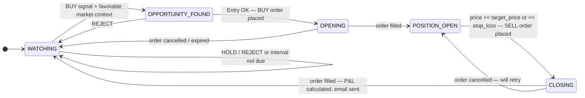
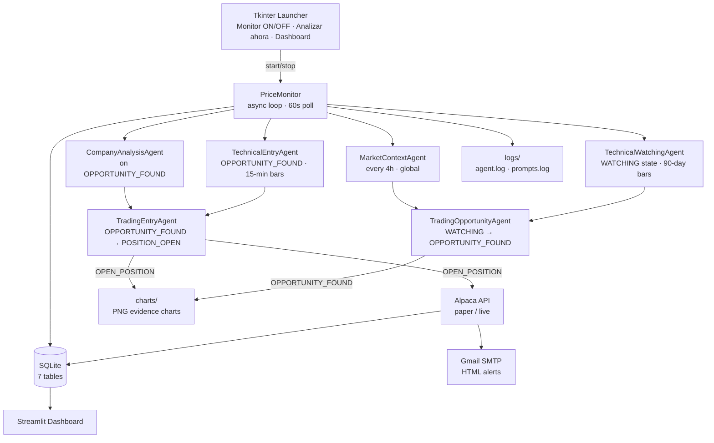
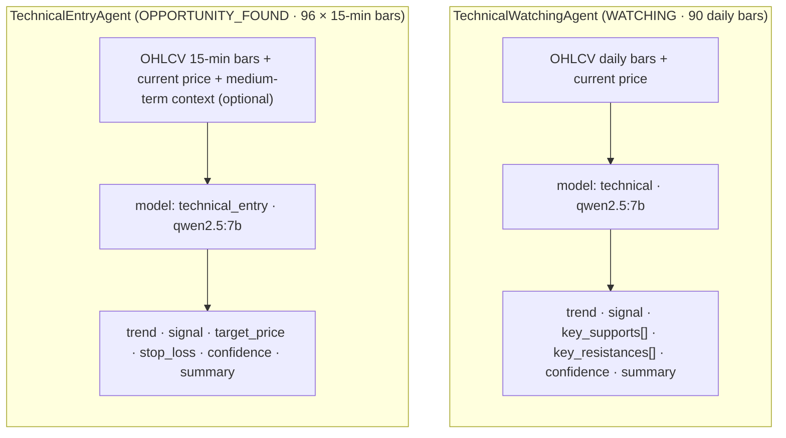
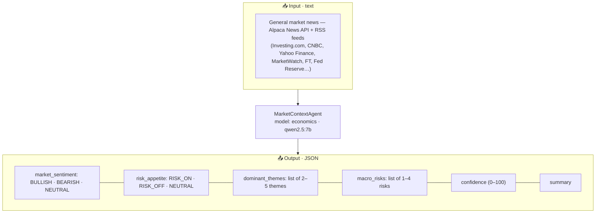
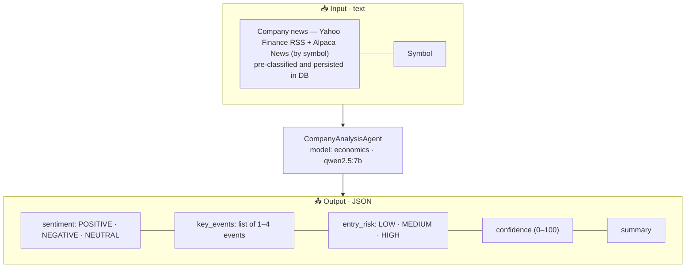
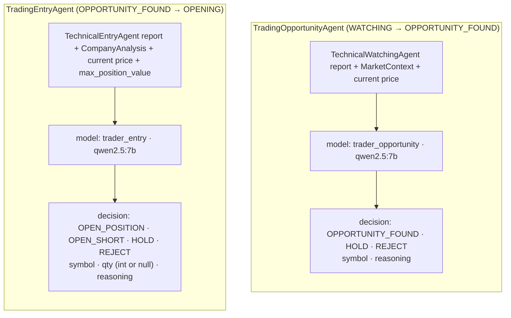

# Architecture

## Multi-agent state machine

Each symbol has an independent state machine managed by `PriceMonitor`. Additionally, a global market context report is refreshed every `analysis_interval_hours` and shared across all symbols.

### Analysis triggers

| State | Trigger | Agents involved |
|---|---|---|
| `WATCHING` | Every `analysis_interval_hours` (default 4h) or force event | **TechnicalWatchingAgent** (90-day bars) + market context from DB → **TradingOpportunityAgent** |
| `OPPORTUNITY_FOUND` | Every poll cycle (default 60s) | **TechnicalEntryAgent** (5-day 15-min bars) + CompanyAnalysisAgent → **TradingEntryAgent** |
| `OPENING` | Every poll cycle | `AlpacaClient.get_order()` to check buy order fill |
| `POSITION_OPEN` | Every poll cycle | 1. Check bracket order legs via `AlpacaClient.get_order()` (auto-exit by Alpaca); 2. Fallback: price check (cancel bracket legs, place market close) |
| `CLOSING` | Every poll cycle | `AlpacaClient.get_order()` to check sell order fill → P&L calculation |
| Global | Every `analysis_interval_hours` | MarketContextAgent (general market news → DB) |

---

## System diagram

---

## Agent diagrams

### TechnicalWatchingAgent / TechnicalEntryAgent

Two separate agent instances with different system prompts and model temperatures. Both analyze OHLCV bars, but with different focuses:

- **TechnicalWatchingAgent** (`model_role: technical`, temp 0.1) — macro trend, support/resistance zones, medium-term setup. Used in `WATCHING` state with 90 daily bars.
- **TechnicalEntryAgent** (`model_role: technical_entry`, temp 0.1) — precise entry timing, mandatory target/stop for BUY. Used in `OPPORTUNITY_FOUND` with 96 × 15-min bars.

---

### MarketContextAgent

Produces a holistic macro view of the global market once every `analysis_interval_hours`. The report is persisted in the `market_context` table and read by all symbols during their `WATCHING` analysis — no redundant API calls.

---

### CompanyAnalysisAgent

Fetches company-specific news when a symbol reaches `OPPORTUNITY_FOUND` and assesses the risk of opening a position right now. Result is passed directly to `TradingEntryAgent` as context.

---

### TradingOpportunityAgent / TradingEntryAgent

Two separate orchestrator agents, each with a distinct system prompt and temperature:

- **TradingOpportunityAgent** (`model_role: trader_opportunity`, temp 0.3) — "Is this worth watching more closely?" Biased toward `HOLD` when signals conflict. Runs in `WATCHING` state.
- **TradingEntryAgent** (`model_role: trader_entry`, temp 0.1) — "Should we enter NOW?" Strict: all conditions (BUY signal, RISK_ON/NEUTRAL market, LOW/MEDIUM entry risk, confidence ≥ 60) must be met. Runs in `OPPORTUNITY_FOUND` state.

> **Position sizing**: `TradingEntryAgent` recommends a `qty` (integer ≥ 1). The monitor applies a hard cap: `max_qty = max(1, int(max_position_value / price))`. Final qty = `min(agent_qty, max_qty)`. If the agent returns `null`, the monitor falls back to `max_qty`.

**Decision rules (TradingOpportunityAgent):**
- `OPPORTUNITY_FOUND` — trend is BULLISH, signal is BUY, confidence ≥ 60, market RISK_ON or NEUTRAL.
- `HOLD` — signals promising but not confirmed; confidence moderate (40-60); preferred over REJECT.
- `REJECT` — trend BEARISH, confidence < 40, or market strongly RISK_OFF.

**Decision rules (TradingEntryAgent):**
- `OPEN_POSITION` — technical signal is BUY, market is RISK_ON or NEUTRAL, company entry_risk is LOW or MEDIUM, confidence ≥ 70.
- `OPEN_SHORT` — only available when `allow_short_selling=true` and the watchlist symbol has `shortable=1`. Signal is BEARISH, confidence ≥ 70, entry_risk is LOW or MEDIUM. Uses a SELL order to open; a BUY order to close. P&L = `(entry_price - exit_price) × qty`.
- `HOLD` — signals conflict, confidence is low, or market is RISK_OFF but not severely.
- `REJECT` — signals clearly unfavorable, entry_risk is HIGH, or market is strongly BEARISH.

---

## Evidence charts

At each state transition that involves a positive decision, the monitor generates a candlestick PNG via `src/chart_generator.py` (using `mplfinance`):

| Event | Chart timeframe | Stored in |
|---|---|---|
| `WATCHING → OPPORTUNITY_FOUND` | Daily (90-bar window) | `symbol_states.chart_path` + `charts/` dir |
| `OPPORTUNITY_FOUND → POSITION_OPEN` | 15-min (96-bar window) | `symbol_states.chart_path` + `charts/` dir |

The chart path is logged as `file:///absolute/path.png` and displayed in the **Estados** dashboard page.

---

## Module contracts

| Module | Input | Output |
|---|---|---|
| **NewsClassifierAgent** | `Article` (title, description) | `{scope, ticker, exchange, impact, reasoning}` (first pass) |
| **NewsClassifierAgent (full)** | `Article` (title, description, full_content) | `{scope, ticker, exchange, impact, reasoning, article_summary}` (second pass) |
| **NewsIngestionService** | `NewsAggregator` + classifier agents + `StorageLayer` | `(fetched, classified)` / `list[dict]` |
| **NewsAggregator** | Alpaca API key/secret | `list[Article]` (market news or symbol-specific) |
| **TechnicalWatchingAgent** | 90 daily OHLCV bars JSON | `{trend, signal, key_supports: [float], key_resistances: [float], confidence, summary}` |
| **TechnicalEntryAgent** | 96 × 15-min OHLCV bars JSON + optional medium-term context | `{trend, signal, target_price, stop_loss, confidence, summary}` |
| **MarketContextAgent** | Classified market news JSON from DB | `{market_sentiment, risk_appetite, dominant_themes, macro_risks, confidence, summary}` |
| **CompanyAnalysisAgent** | Classified company news JSON from DB | `{sentiment, key_events, entry_risk, confidence, summary}` |
| **TradingOpportunityAgent** | Technical + market reports | `{decision: OPPORTUNITY_FOUND\|HOLD\|REJECT, symbol, reasoning}` |
| **TradingEntryAgent** | Technical + company reports | `{decision: OPEN_POSITION\|OPEN_SHORT\|HOLD\|REJECT, symbol, qty: <int or null>, reasoning}` |
| **AlpacaClient.get_asset()** | Symbol string | `{symbol, name, exchange, marginable, shortable}` or `None` |
| **AlpacaClient.get_clock()** | — | `{is_open, next_open, next_close, timestamp}` |
| **AlpacaClient.place_order()** | symbol, qty, side, [take_profit_price, stop_loss_price] | Market or bracket order; returns `{order_id, take_profit_order_id?, stop_loss_order_id?}` |
| **AlpacaClient.cancel_order()** | order_id | Cancels a specific order; returns True/False |
| **AlpacaClient.get_order()** | order_id | Order status + `legs: [{id, status, type, side}]` for bracket orders |
| **AlpacaClient** | Credentials + params | Prices, orders, assets, clock (async REST) |
| **StorageLayer** | Various | SQLite persistence (7 tables) |
| **TradeAlerter** | Trade details | HTML email via Gmail SMTP |
| **ChartGenerator** | Symbol, OHLCV bars, timeframe | Absolute path to PNG file |

## Key design constraints

- Each agent is independently replaceable (swap model, planner, or provider in YAML).
- `SimplePlanner` embeds the system prompt in the user message.
- All crypto symbols are filtered out (`asset_class=us_equity`, `exchange != CRYPTO`).
- SQLite deduplication for articles: primary key `url`; also `content_hash` (sha256 of title + date) for cross-source dedup. `symbol` as primary key for `symbol_states`.
- **News pipeline**: `NewsAggregator` (Alpaca News API + RSS feeds + Yahoo Finance by symbol) → **two-pass** `NewsClassifierAgent`: (1) quick classification with title+description; (2) if scope ≠ `irrelevant`, fetch full article text and reclassify with `article_summary` → persisted in `articles` table with retention (HIGH=7d, MEDIUM=3d, LOW=1d). Agents read pre-classified articles from DB. **Article content limit**: `fetch_article_content()` fetches up to 10 000 characters of full article text; truncated articles emit a `WARNING` log: `Article truncated: <url> (<original> → 10000 chars)`.
- **Article scopes**: `company` (ticker-specific), `market` (general macro), `exchange` (NYSE/NASDAQ-level), `irrelevant` (filtered out by agents).
- **Bracket orders**: When opening a position with both `target_price` and `stop_loss`, the monitor places a bracket order (`order_class=bracket`) with attached take-profit (limit) and stop-loss (stop) legs. `bracket_order_id` is persisted in `symbol_states`. In `POSITION_OPEN`, the monitor first checks whether Alpaca auto-executed a leg; if not, it falls back to its own price-comparison logic (cancelling bracket legs before placing a manual close order).
- **Manual news ingestion**: the "Analyze news" button in Tkinter runs `NewsIngestionService.run_market_ingestion()` independently of the monitor loop.
- `AgentLogger` writes to `logs/agent.log` and `logs/prompts.log` (rotating, configurable via `LOG_LEVEL`).
- **Position sizing**: `TradingEntryAgent` recommends a qty; the monitor caps it to `max(1, int(MAX_POSITION_VALUE / price))`. Fallback to the cap if the agent returns `null`.
- Stop signal is checked at the beginning of each symbol iteration (not only at the `while` loop boundary), so the monitor halts within one symbol's analysis time.
- **Market hours standby**: `_check_all()` calls `get_clock()` at the start of every cycle. If the market is closed, the monitor still runs `_maybe_update_market_context()` and processes all WATCHING symbols (long-term daily analysis — data available regardless of session). States that require an open market (`OPPORTUNITY_FOUND`, `POSITION_OPEN`, `OPENING`, `CLOSING`) are skipped via `_process_symbol(market_is_open=False)`. After completing WATCHING analysis the monitor sleeps until `next_open` (interruptible). If `get_clock()` fails, the cycle continues with `market_is_open=True`.
- **Force analysis**: when `force_event` is set (via the "Analyze now" button in Tkinter), `_force_analysis=True` causes `_check_all()` to skip the market-hours check entirely. All WATCHING symbols are analysed regardless of market status. The flag is reset by `run()` at cycle end. The event is signaled with `loop.call_soon_threadsafe(force_event.set)` to ensure thread-safety across the Tkinter/asyncio boundary. Both `_wait_or_stop()` and `_interruptible_sleep()` accept a `force_event` parameter and wake early when it is set, so "Analyze now" interrupts both the poll-interval sleep and the market-closed standby sleep immediately.
- **Trade fees**: the `fees` column in `trades` is populated from the `commission` field returned by `GET /v2/orders/{id}`. Alpaca returns `"0"` for paper trading and the actual regulatory fee for live trading. No local fee calculation is performed.
- **Watchlist enrichment**: when `WATCHLIST_SYMBOLS` is set, each symbol is enriched via `get_asset()` (name, exchange, marginable, shortable). Falls back to minimal entry on API failure.
- **Short selling**: disabled by default. Enable with `ALLOW_SHORT_SELLING=true` (env var) or `allow_short_selling: true` in `trading_agent.yaml`. Only applies to symbols with `shortable=1` in the watchlist. The `TradingEntryAgent` prompt includes the `OPEN_SHORT` option only when both conditions are met. Position side (`long`/`short`) is stored in `symbol_states.position_side` and used for reversed target/stop logic and P&L calculation.
- Prompt separation by state: `WATCHING` uses macro-focused prompts; `OPPORTUNITY_FOUND` uses timing-focused prompts with stricter conditions.
