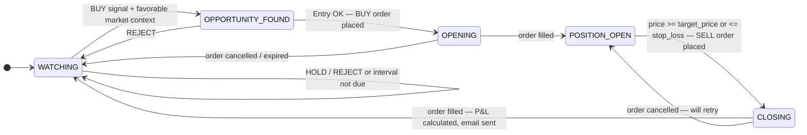
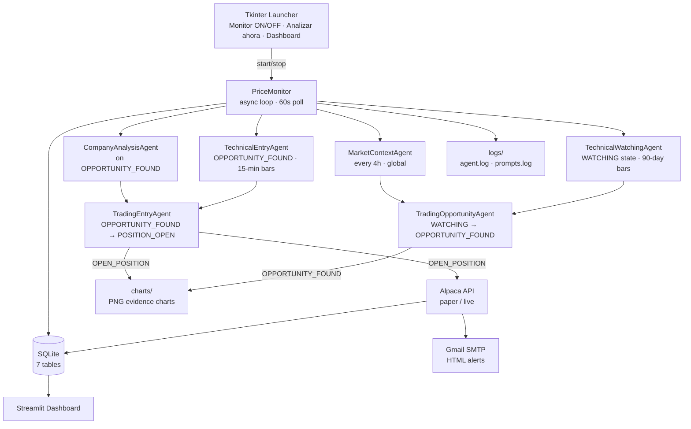
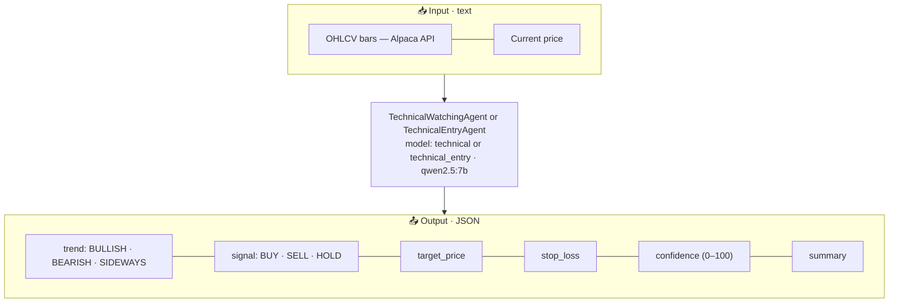
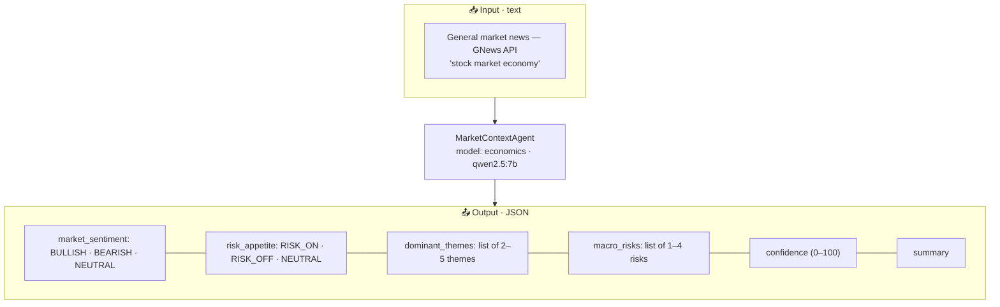
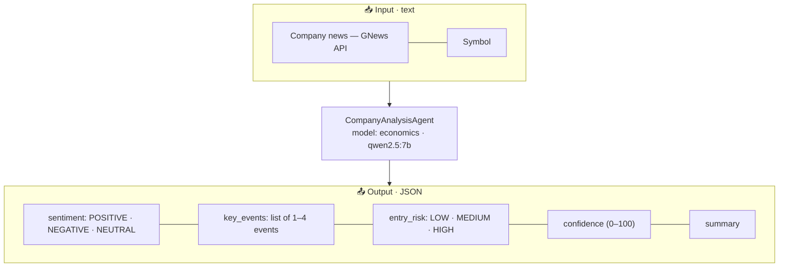
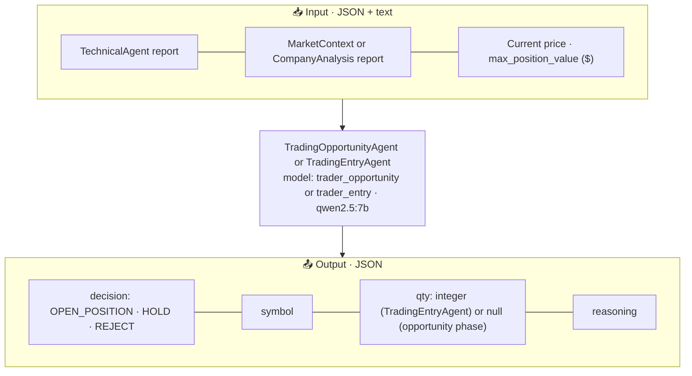

# Architecture

## Multi-agent state machine

Each symbol has an independent state machine managed by `PriceMonitor`. Additionally, a global market context report is refreshed every `analysis_interval_hours` and shared across all symbols.

### Analysis triggers

| State | Trigger | Agents involved |
|---|---|---|
| `WATCHING` | Every `analysis_interval_hours` (default 4h) or force event | **TechnicalWatchingAgent** (90-day bars) + market context from DB → **TradingOpportunityAgent** |
| `OPPORTUNITY_FOUND` | Every poll cycle (default 60s) | **TechnicalEntryAgent** (5-day 15-min bars) + CompanyAnalysisAgent → **TradingEntryAgent** |
| `OPENING` | Every poll cycle | `AlpacaClient.get_order()` to check buy order fill |
| `POSITION_OPEN` | Every poll cycle | Price check only (no LLM call) |
| `CLOSING` | Every poll cycle | `AlpacaClient.get_order()` to check sell order fill → P&L calculation |
| Global | Every `analysis_interval_hours` | MarketContextAgent (general market news → DB) |

---

## System diagram

---

## Agent diagrams

### TechnicalWatchingAgent / TechnicalEntryAgent

Two separate agent instances with different system prompts and model temperatures. Both analyze OHLCV bars, but with different focuses:

- **TechnicalWatchingAgent** (`model_role: technical`, temp 0.1) — macro trend, support/resistance zones, medium-term setup. Used in `WATCHING` state with 90 daily bars.
- **TechnicalEntryAgent** (`model_role: technical_entry`, temp 0.1) — precise entry timing, mandatory target/stop for BUY. Used in `OPPORTUNITY_FOUND` with 96 × 15-min bars.

---

### MarketContextAgent

Produces a holistic macro view of the global market once every `analysis_interval_hours`. The report is persisted in the `market_context` table and read by all symbols during their `WATCHING` analysis — no redundant API calls.

---

### CompanyAnalysisAgent

Fetches company-specific news when a symbol reaches `OPPORTUNITY_FOUND` and assesses the risk of opening a position right now. Result is passed directly to `TradingEntryAgent` as context.

---

### TradingOpportunityAgent / TradingEntryAgent

Two separate orchestrator agents, each with a distinct system prompt and temperature:

- **TradingOpportunityAgent** (`model_role: trader_opportunity`, temp 0.3) — "Is this worth watching more closely?" Biased toward `HOLD` when signals conflict. Runs in `WATCHING` state.
- **TradingEntryAgent** (`model_role: trader_entry`, temp 0.1) — "Should we enter NOW?" Strict: all conditions (BUY signal, RISK_ON/NEUTRAL market, LOW/MEDIUM entry risk, confidence ≥ 60) must be met. Runs in `OPPORTUNITY_FOUND` state.

> **Position sizing**: `TradingEntryAgent` recommends a `qty` (integer ≥ 1). The monitor applies a hard cap: `max_qty = max(1, int(max_position_value / price))`. Final qty = `min(agent_qty, max_qty)`. If the agent returns `null`, the monitor falls back to `max_qty`.

**Decision rules (TradingEntryAgent):**
- `OPEN_POSITION` — technical signal is BUY, market is RISK_ON or NEUTRAL, company entry_risk is LOW or MEDIUM, confidence ≥ 60.
- `HOLD` — signals conflict, confidence is low, or market is RISK_OFF but not severely.
- `REJECT` — signals clearly unfavorable, entry_risk is HIGH, or market is strongly BEARISH.

---

## Evidence charts

At each state transition that involves a positive decision, the monitor generates a candlestick PNG via `src/chart_generator.py` (using `mplfinance`):

| Event | Chart timeframe | Stored in |
|---|---|---|
| `WATCHING → OPPORTUNITY_FOUND` | Daily (90-bar window) | `symbol_states.chart_path` + `charts/` dir |
| `OPPORTUNITY_FOUND → POSITION_OPEN` | 15-min (96-bar window) | `symbol_states.chart_path` + `charts/` dir |

The chart path is logged as `file:///absolute/path.png` and displayed in the **Estados** dashboard page.

---

## Module contracts

| Module | Input | Output |
|---|---|---|
| **TechnicalWatchingAgent** | 90 daily OHLCV bars JSON | `{trend, signal, target_price, stop_loss, confidence, summary}` |
| **TechnicalEntryAgent** | 96 × 15-min OHLCV bars JSON | `{trend, signal, target_price, stop_loss, confidence, summary}` |
| **MarketContextAgent** | General news JSON | `{market_sentiment, risk_appetite, dominant_themes, macro_risks, confidence, summary}` |
| **CompanyAnalysisAgent** | Company news JSON | `{sentiment, key_events, entry_risk, confidence, summary}` |
| **TradingOpportunityAgent** | Technical + market reports | `{decision: OPEN_POSITION\|HOLD\|REJECT, symbol, qty: null, reasoning}` |
| **TradingEntryAgent** | Technical + company reports | `{decision: OPEN_POSITION\|HOLD\|REJECT, symbol, qty: <int or null>, reasoning}` |
| **AlpacaClient.get_asset()** | Symbol string | `{symbol, name, exchange, marginable, shortable}` or `None` |
| **AlpacaClient.get_clock()** | — | `{is_open, next_open, next_close, timestamp}` |
| **AlpacaClient** | Credentials + params | Prices, orders, assets, clock (async REST) |
| **StorageLayer** | Various | SQLite persistence (7 tables) |
| **TradeAlerter** | Trade details | HTML email via Gmail SMTP |
| **ChartGenerator** | Symbol, OHLCV bars, timeframe | Absolute path to PNG file |

## Key design constraints

- Each agent is independently replaceable (swap model, planner, or provider in YAML).
- `SimplePlanner` embeds the system prompt in the user message.
- All crypto symbols are filtered out (`asset_class=us_equity`, `exchange != CRYPTO`).
- SQLite deduplication uses `url` as unique key for articles; `symbol` as primary key for `symbol_states`.
- `AgentLogger` writes to `logs/agent.log` and `logs/prompts.log` (rotating, configurable via `LOG_LEVEL`).
- **Position sizing**: `TradingEntryAgent` recommends a qty; the monitor caps it to `max(1, int(MAX_POSITION_VALUE / price))`. Fallback to the cap if the agent returns `null`.
- Stop signal is checked at the beginning of each symbol iteration (not only at the `while` loop boundary), so the monitor halts within one symbol's analysis time.
- **Market hours standby**: `_check_all()` calls `get_clock()` at the start of every cycle. If the market is closed, it sleeps until `next_open` (interruptible). If `get_clock()` fails, the cycle continues normally.
- **Watchlist enrichment**: when `WATCHLIST_SYMBOLS` is set, each symbol is enriched via `get_asset()` (name, exchange, marginable, shortable). Falls back to minimal entry on API failure.
- Prompt separation by state: `WATCHING` uses macro-focused prompts; `OPPORTUNITY_FOUND` uses timing-focused prompts with stricter conditions.
