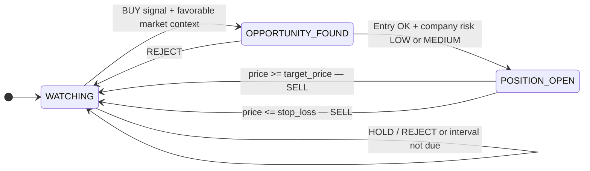
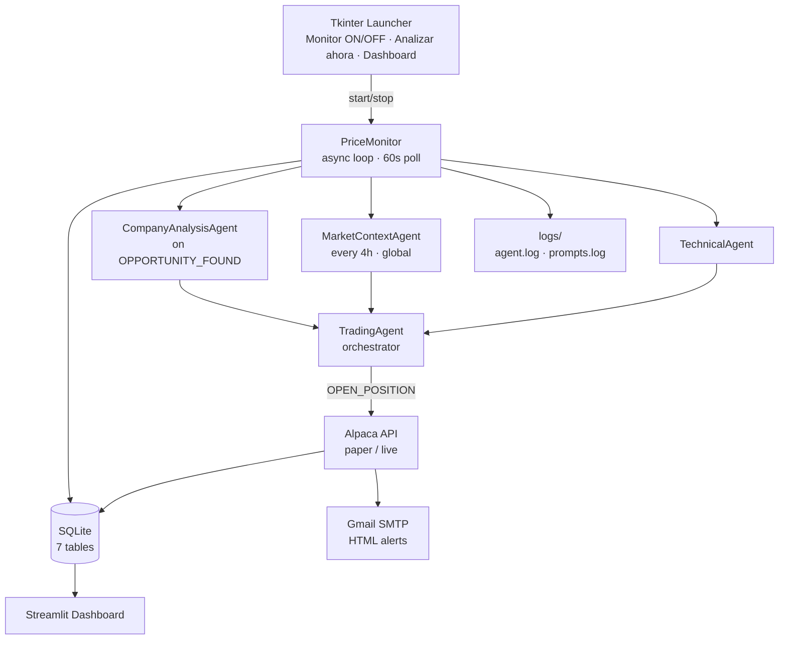
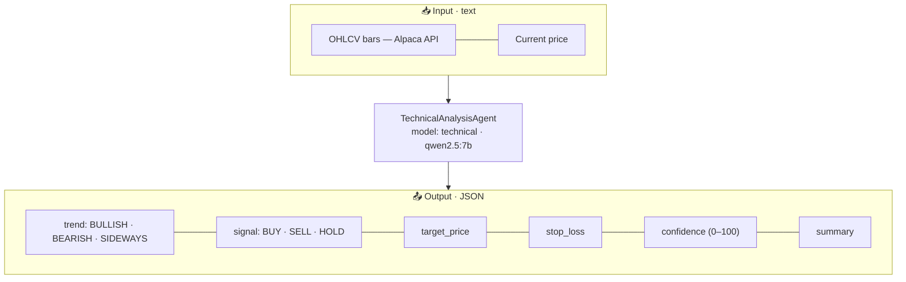
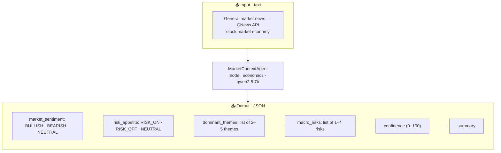
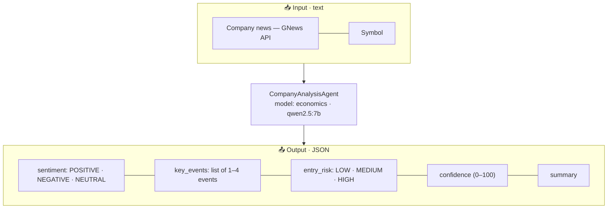
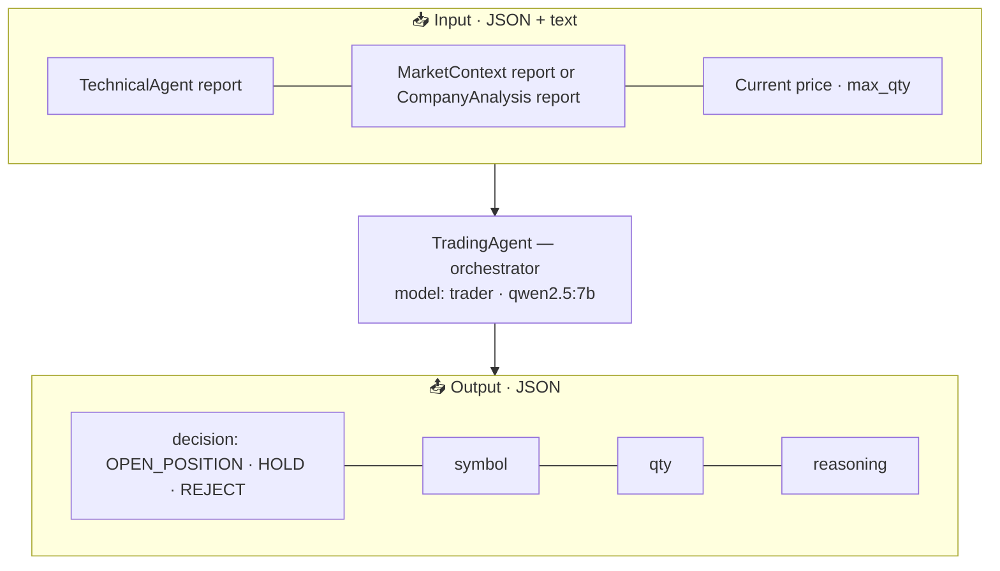

# Architecture

## Multi-agent state machine

Each symbol has an independent state machine managed by `PriceMonitor`. Additionally, a global market context report is refreshed every `analysis_interval_hours` and shared across all symbols.

### Analysis triggers

| State | Trigger | Agents involved |
|---|---|---|
| `WATCHING` | Every `analysis_interval_hours` (default 4h) or force event | TechnicalAgent (90-day bars) + market context from DB → TradingAgent |
| `OPPORTUNITY_FOUND` | Every poll cycle (default 60s) | TechnicalAgent (5-day 15-min bars) + CompanyAnalysisAgent → TradingAgent |
| `POSITION_OPEN` | Every poll cycle | Price check only (no LLM call) |
| Global | Every `analysis_interval_hours` | MarketContextAgent (general market news → DB) |

---

## System diagram

---

## Agent diagrams

### TechnicalAnalysisAgent

Analyzes OHLCV price bars to identify trends and entry/exit levels. Called in two modes: medium-term (90 daily bars) for `WATCHING` analysis, and short-term (96 × 15-min bars) for `OPPORTUNITY_FOUND` entry timing.

---

### MarketContextAgent

Produces a holistic macro view of the global market once every `analysis_interval_hours`. The report is persisted in the `market_context` table and read by all symbols during their `WATCHING` analysis — no redundant API calls.

---

### CompanyAnalysisAgent

Fetches company-specific news when a symbol reaches `OPPORTUNITY_FOUND` and assesses the risk of opening a position right now. Result is passed directly to `TradingAgent` as context.

---

### TradingAgent (orchestrator)

Makes the final trading decision based on sub-agent reports. Called twice per symbol cycle: once to detect opportunities (`WATCHING → OPPORTUNITY_FOUND`) and once to decide entry (`OPPORTUNITY_FOUND → POSITION_OPEN`).

**Decision rules:**
- `OPEN_POSITION` — technical signal is BUY, market is RISK_ON or NEUTRAL, company entry_risk is LOW or MEDIUM, confidence ≥ 60.
- `HOLD` — signals conflict, confidence is low, or market is RISK_OFF but not severely.
- `REJECT` — signals clearly unfavorable, entry_risk is HIGH, or market is strongly BEARISH.

---

## Module contracts

| Module | Input | Output |
|---|---|---|
| **TechnicalAgent** | OHLCV bars JSON | `{trend, signal, target_price, stop_loss, confidence, summary}` |
| **MarketContextAgent** | General news JSON | `{market_sentiment, risk_appetite, dominant_themes, macro_risks, confidence, summary}` |
| **CompanyAnalysisAgent** | Company news JSON | `{sentiment, key_events, entry_risk, confidence, summary}` |
| **TradingAgent** | Sub-agent reports | `{decision: OPEN_POSITION\|HOLD\|REJECT, symbol, qty, reasoning}` |
| **AlpacaClient** | Credentials + params | Prices, orders, assets (async REST) |
| **StorageLayer** | Various | SQLite persistence (7 tables) |
| **TradeAlerter** | Trade details | HTML email via Gmail SMTP |

## Key design constraints

- Each agent is independently replaceable (swap model, planner, or provider in YAML).
- `SimplePlanner` embeds the system prompt in the user message.
- All crypto symbols are filtered out (`asset_class=us_equity`, `exchange != CRYPTO`).
- SQLite deduplication uses `url` as unique key for articles; `symbol` as primary key for `symbol_states`.
- `AgentLogger` writes to `logs/agent.log` and `logs/prompts.log` (rotating, configurable via `LOG_LEVEL`).
